# LabTube 學生使用手冊

> 適用課程:圖型識別(pr-2026-fall)　|　本手冊的畫面為示範資料,姓名與學號皆為虛構。

## 目錄

1. 這個系統在做什麼?
2. 第一次使用:註冊、登入、加入課程
3. 認識畫面與選單
4. 課程樹:看懂每份作業的狀態
5. 繳交作業:把程式放在你的 GitHub Repo
6. 在 LabTube 登記 Repo 與作業目錄
7. 上傳「程式執行結果」(不要上傳程式碼)
8. 線上口試(用手機作答)
9. 查看成績與申請複核
10. 常見問題
11. 一頁速查表

---

## 1. 這個系統在做什麼?

每份作業有**三件事**,缺一不可:

| 步驟 | 你要做什麼 | 在哪裡做 |
|---|---|---|
| ① 繳交作業 | 把程式、報告放進你自己的 GitHub Repo,截止前打上標籤 `hwNN-submit` | GitHub |
| ② 分享執行結果 | 上傳**程式的執行結果**(圖片、GIF、短片)讓老師與同學看到成果 | LabTube |
| ③ 線上口試 | 截止後,老師開一場約 8 分鐘的線上口試:針對**你自己的程式**回答 3 題簡答 | LabTube(手機) |

**最終分數 = 作業評分(Rubric)× ( 0.5 + 0.5 × 口試得分率 )**(比重以老師在課程設定的為準)。
其中**作業評分(Rubric)**是老師依作業說明裡的評分標準,對你交出的報告、程式與實驗結果所給的分數(與口試無關);**口試得分率**是 3 題得分總和 ÷ 6。
也就是說:程式寫得再好,如果口試答不出自己寫的程式,分數會打折;反過來,口試答得好才能拿到完整分數。

> 為什麼要口試?為了確認程式是你自己理解、自己完成的,而不是直接複製貼上的結果。只要你真的懂自己寫的程式,3 題簡答不難。

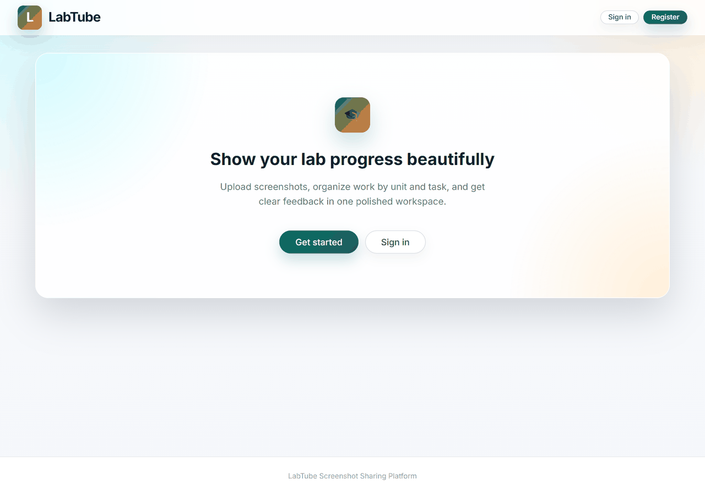

---

## 2. 第一次使用:註冊、登入、加入課程

### 2.1 註冊帳號

1. 開啟 LabTube 網址,按右上角 **Register**。
2. 填寫**學號、姓名、Email、密碼**(密碼要輸入兩次)。
3. 學號請**填寫正確**:老師的修課名單用學號比對,學號打錯就無法參加口試與成績登錄。

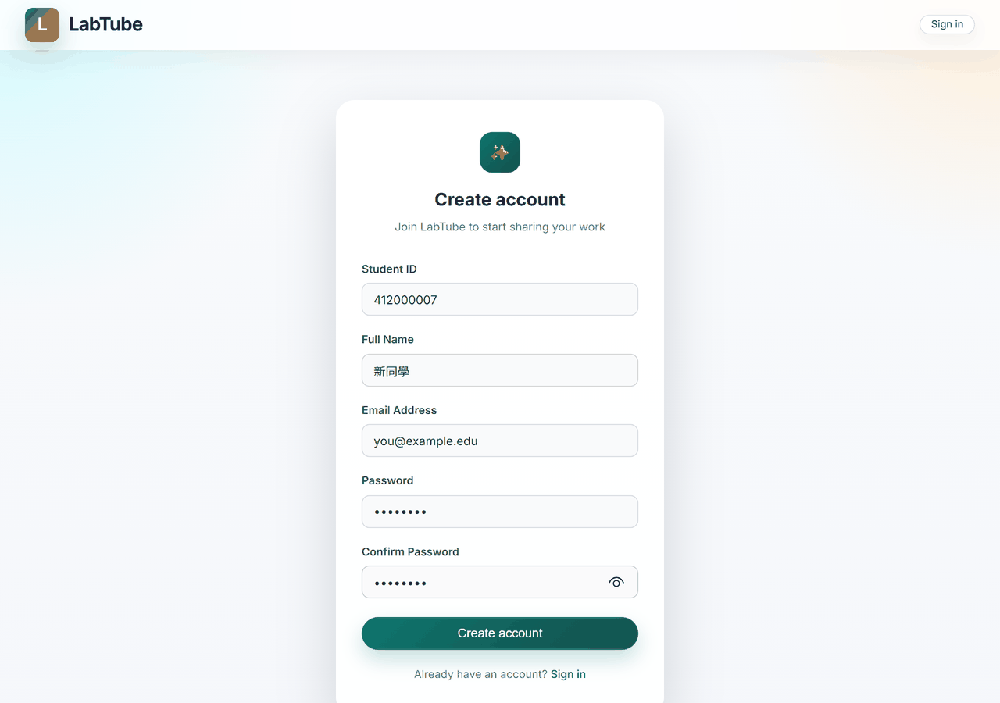

### 2.2 登入

在登入頁輸入學號與密碼。**連續輸入錯誤 10 次,帳號會暫時鎖住 15 分鐘**,請留意。

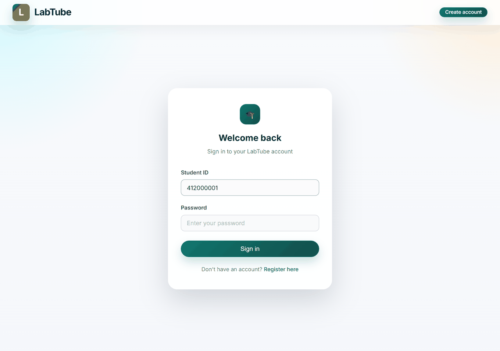

### 2.3 加入課程

第一次登入時,首頁會顯示「You're not enrolled in any courses yet.」與一個下拉選單:選擇本課程,按 **Join Course** 即可。(只有修課名單上的同學才能參加口試與取得成績。)

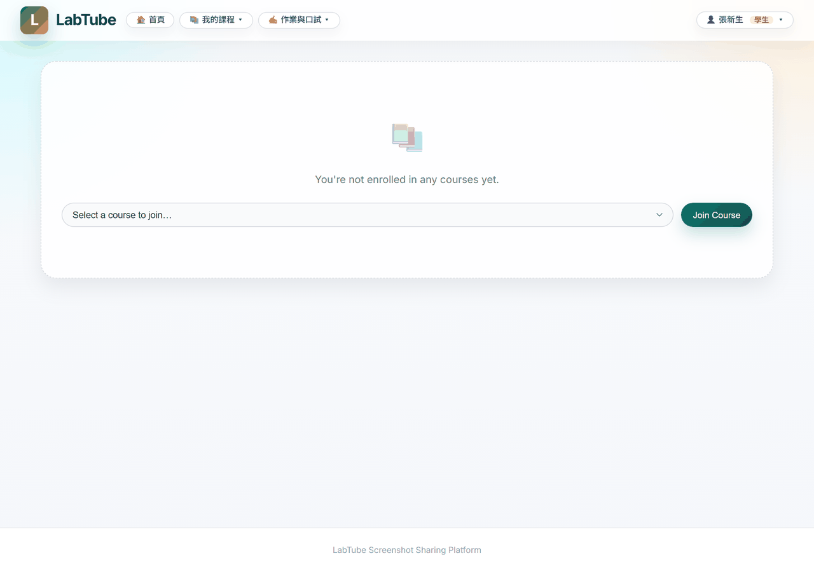

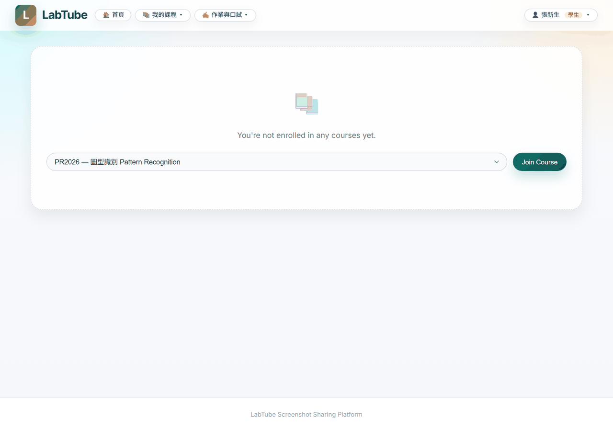

---

## 3. 認識畫面與選單

登入後,上方只有三個選單,依你的身分顯示:

| 選單 | 內容 |
|---|---|
| 🏠 首頁 | 你的課程列表 |
| 📚 我的課程 ▾ | 列出你加入的課程,點進去就是**課程樹** |
| ✍️ 作業與口試 ▾ | 🔗 我的作業 Repo、📝 線上口試、📊 我的成績(老師開放後才出現)、🖼 我繳交的執行結果 |
| 👤 你的名字 ▾ | 登出 |

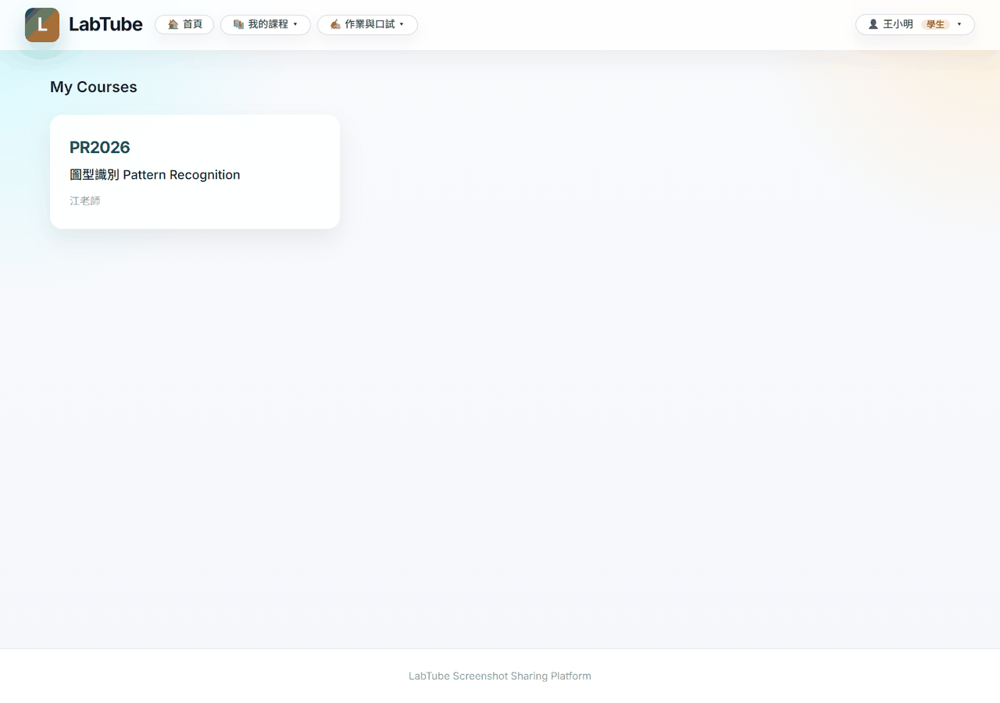

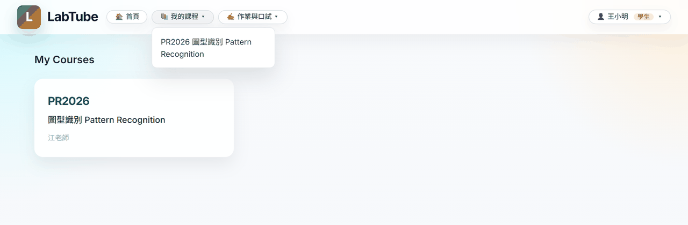

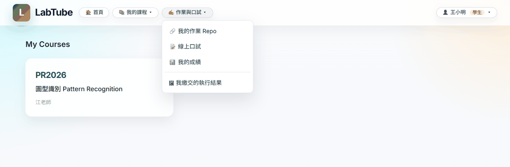

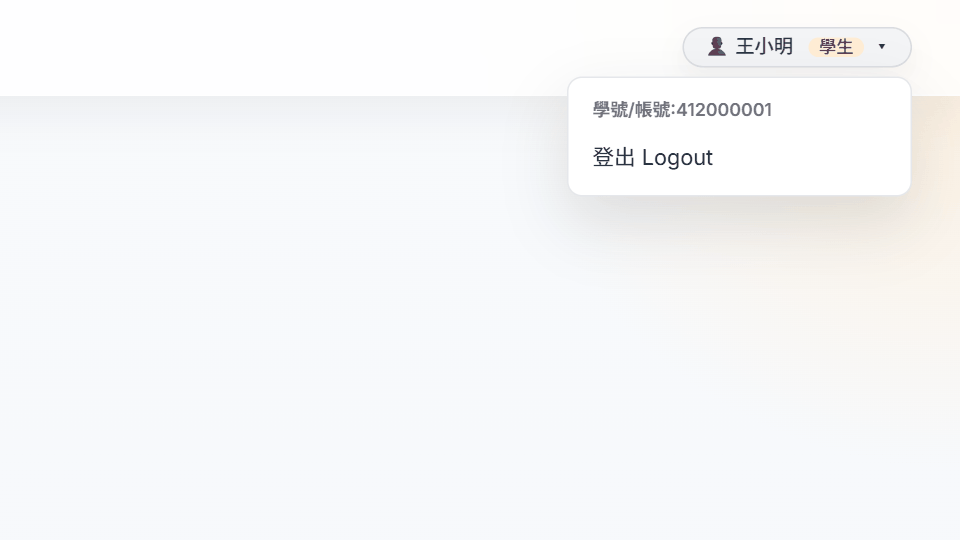

**小技巧:** 把滑鼠移到按鈕或選單項目上,會出現**說明提示**,告訴你這個按鈕做什麼。

---

## 4. 課程樹:看懂每份作業的狀態

點「我的課程」裡的課程,進入**課程樹**。階層很簡單:**課程 → 單元 → 作業**。

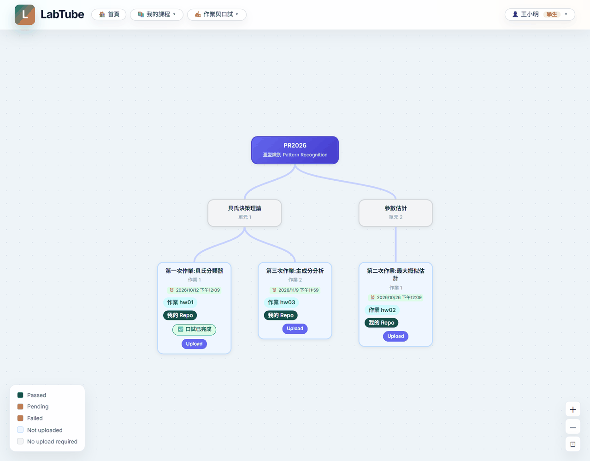

每份作業的卡片上有:

- **截止時間**(綠色時鐘標籤,台北時間)。
- **作業 hwNN**:作業代號。
- **我的 Repo**:點了會前往「登記 Repo 與目錄」頁。
- **口試狀態徽章**(最重要,請留意):

| 徽章 | 意思 | 你要做什麼 |
|---|---|---|
| 🔴 口試進行中 · 加入(會閃動) | 老師已開場,可以加入 | 點下去,輸入投影幕上的加入碼 |
| 🟡 已加入 · 開始作答 | 你已加入場次,但還沒開始作答 | 點下去,在時限內按「開始作答」 |
| 🟠 作答中 · 繼續 | 你正在作答 | 點下去回到作答頁 |
| ✅ 口試已完成 | 你已提交(或時間到被自動結束) | 無須再做 |
| ⚠ 口試未參加(請洽老師) | 場次已結束但你沒有參加 | 聯絡老師安排補測 |

- **Upload**:上傳這份作業的**程式執行結果**(見第 7 節)。

> 口試狀態也會顯示在手機上,所以你**不必**一直盯著投影幕:開口試時,打開課程樹就能看到紅色閃動的「口試進行中」。

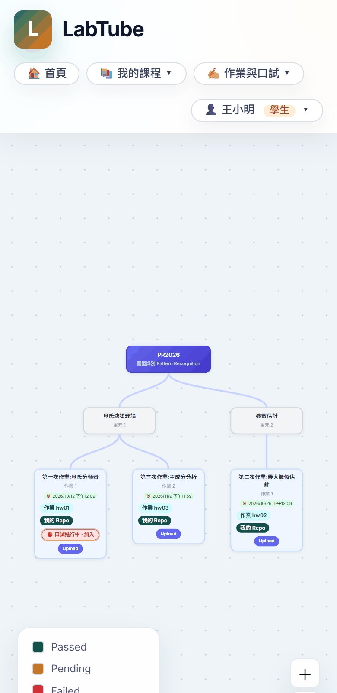

---

## 5. 繳交作業:把程式放在你的 GitHub Repo

### 5.1 一個學期只要建一個 Repo

- Repo 名稱固定為:**`pr-2026-hw-你的學號`**(例:`pr-2026-hw-412000001`)。
- 必須設為 **Private(私人)**。
- 在 GitHub 的 **Settings → Collaborators** 把老師的帳號 **`ndhuccc`** 加為協作者(只需做一次;老師要先接受邀請才讀得到)。
- 建議直接用課程提供的**範本 Repo**(<https://github.com/ndhuccc/pr-2026-hw-template>)建立,它已經幫你準備好資料夾結構與檢查工具。

### 5.2 每份作業一個資料夾

Repo 裡每次作業一個資料夾,名稱固定為**小寫兩位數**:`hw01`、`hw02`…(不能寫成 `HW1` 或 `hw_01`)。每個資料夾要**自給自足**:附上 `requirements.txt` 與執行說明。實際要交哪些檔案,以作業說明 `hwNN/README.md` 為準。

### 5.3 打標籤 = 繳交

完成作業後,在**截止前**於你要繳交的那個 commit 打上標籤並推送:

```bash
git tag hw01-submit
git push origin hw01-submit
```

- 老師只評分**這個標籤指向的版本**;標籤之後的修改不影響成績。
- 截止前想更新繳交版本,可以移動標籤:

```bash
git tag -f hw01-submit
git push -f origin hw01-submit
```

- **繳交時間以 GitHub 記錄的「標籤推送時間」為準**,不是 commit 上你電腦自己填的時間。系統會記錄標籤第一次被看到時的版本,標籤事後被移動會被標示。
- 平時請**分次 commit**,commit 訊息寫清楚做了什麼。一次把所有內容一起 commit(或截止前幾分鐘才 commit 大量檔案)會被系統標示為需要留意的情形。

---

## 6. 在 LabTube 登記 Repo 與作業目錄

> 重點:**Repo 在整個課程只登記一次;每份作業只登記它在 Repo 裡的「目錄」**。

從選單 **✍️ 作業與口試 → 🔗 我的作業 Repo** 進入。

### 6.1 ① 登記課程 Repo(一次)

在「Repo(擁有者/名稱)」欄位輸入 `你的GitHub帳號/pr-2026-hw-學號`,按 **登記**。

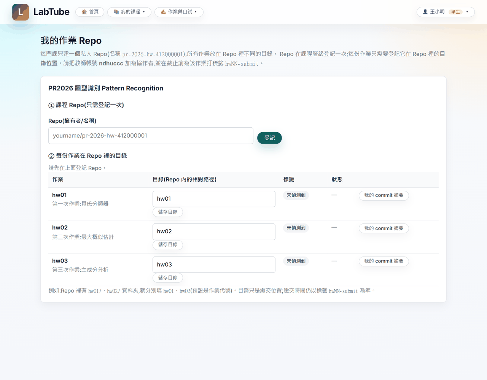

登記後會顯示目前登記的 Repo 與狀態(「尚未查核」→ 老師查核後變成「教師可讀取」;若顯示「教師無法讀取」,請確認已邀請 `ndhuccc` 並讓老師接受邀請)。

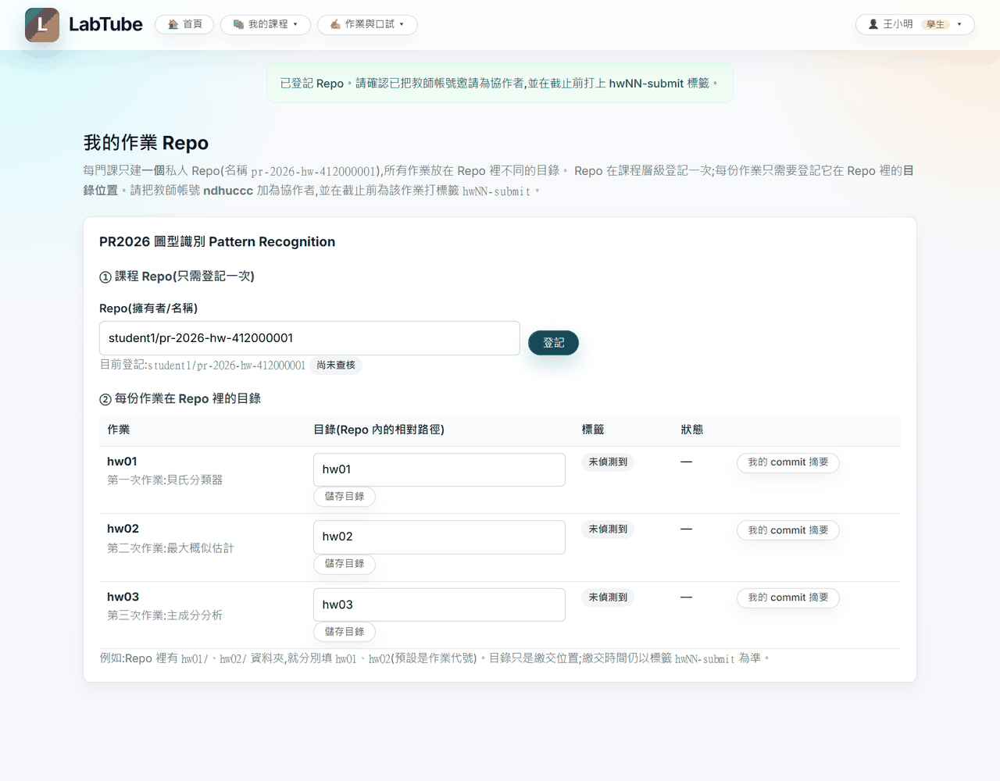

### 6.2 ② 登記每份作業的目錄

下方表格每份作業一列,「目錄」預設就是作業代號(例如 `hw01`)。如果你的資料夾名稱就是 `hw01`,**什麼都不用改**,直接按 **儲存目錄**;若放在更深的位置(例如 `homework/hw01`),就填相對路徑(最多 4 層,不可含 `..`)。

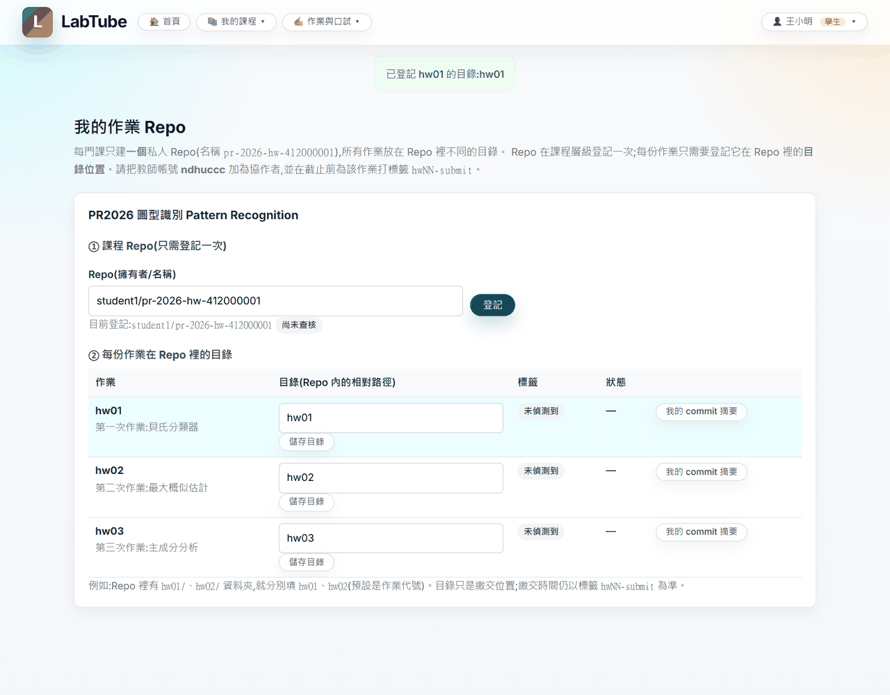

此頁也會顯示:是否偵測到標籤 `hwNN-submit`、準時或逾時,以及 **「我的 commit 摘要」** 按鈕,可以看到系統看到的你的 commit 紀錄(只有中繼資料,例如日期與訊息,不含程式內容)。

---

## 7. 上傳「程式執行結果」(不要上傳程式碼)

### 7.1 規則(請務必遵守)

- ✅ **可以上傳**:程式的**執行結果**——圖片(PNG、JPG、GIF、BMP、WEBP)、GIF 動畫、MP4 短片,每個檔案最大 16 MB。
- ❌ **不可上傳程式碼**:`.py`、`.txt`、`.ipynb`、`.zip`、`.pdf` 等一律拒絕。程式碼請放在你的 Repo。
- ❌ **不要用截圖拍下大量程式碼**,這同樣是在分享程式碼。
- 系統會檢查檔案內容:把程式碼檔改名成 `.png` 也會被拒絕。

> 為什麼?老師能直接讀你的 Repo,不需要你再傳程式;而同學之間看得到彼此上傳的內容,公開程式碼容易造成抄襲。這裡只用來展示「成果長什麼樣子」。

### 7.2 上傳步驟

1. 在課程樹點作業卡片上的 **Upload**(或點作業進入頁面再按上方的「⬆ 上傳執行結果」)。
2. 把圖片或影片拖進虛線框,或點一下選擇檔案(可一次選多個)。
3. 畫面會顯示「1 file(s): 檔名」,確認後按 **Upload Screenshots**(按鈕名稱沿用舊版,實際上傳的是執行結果)。

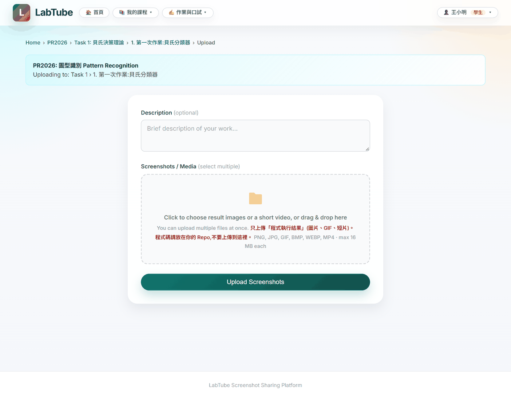

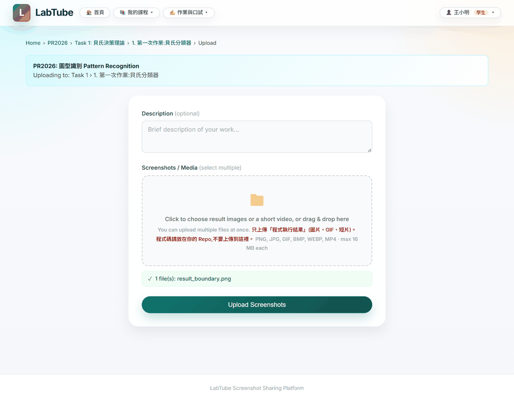

上傳成功後會回到作業頁,看到自己的成果卡片(狀態一開始是 PENDING,老師審閱後會標示 Pass/Fail,並可能留下評語,點 **View Comments** 查看)。

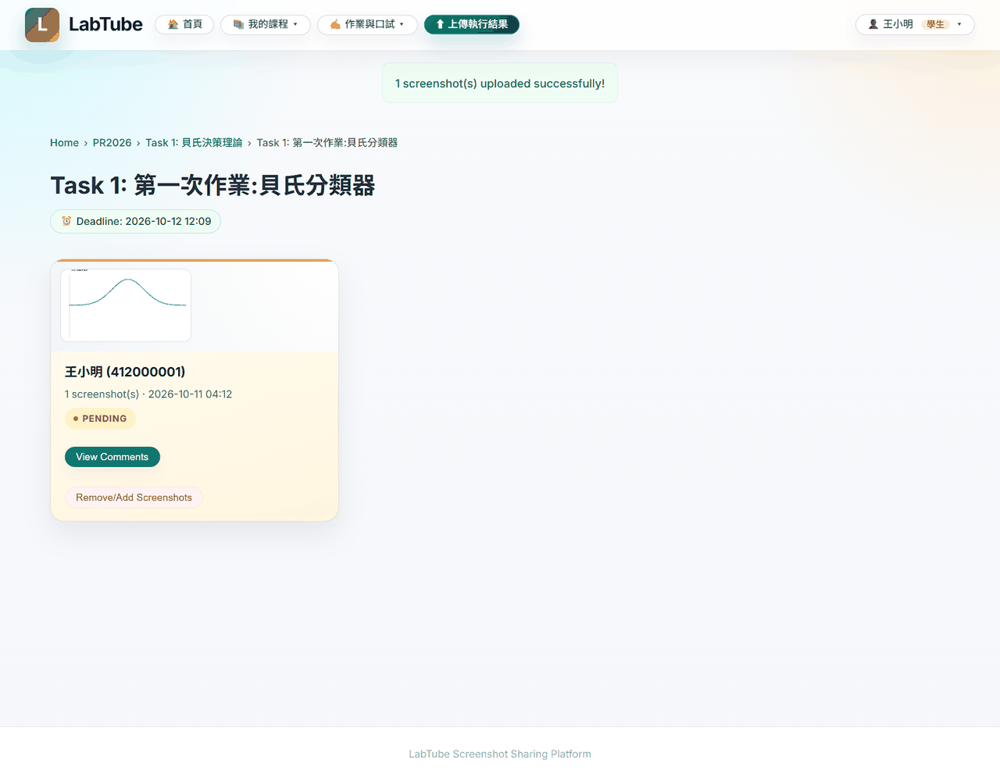

### 7.3 同學的成果

同一份作業頁面會列出所有同學上傳的成果,可以互相參考作法的呈現方式(但看不到程式碼)。

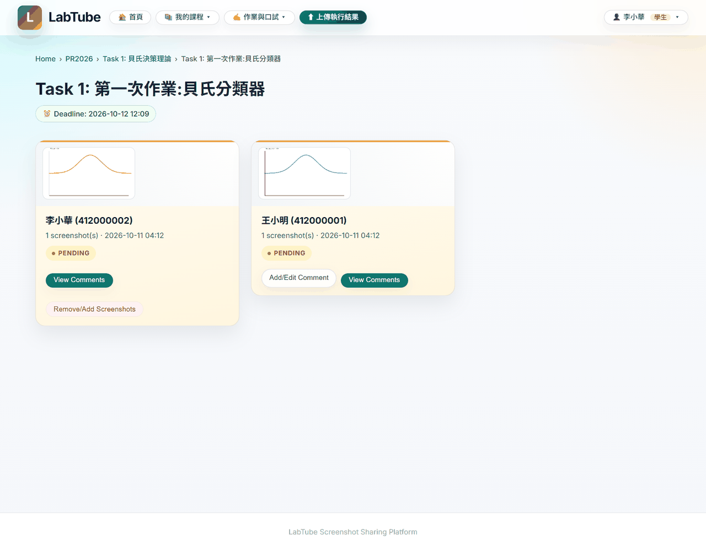

### 7.4 管理自己上傳的檔案

選單 **✍️ 作業與口試 → 🖼 我繳交的執行結果** 會列出你所有上傳的檔案,可以挑選刪除。

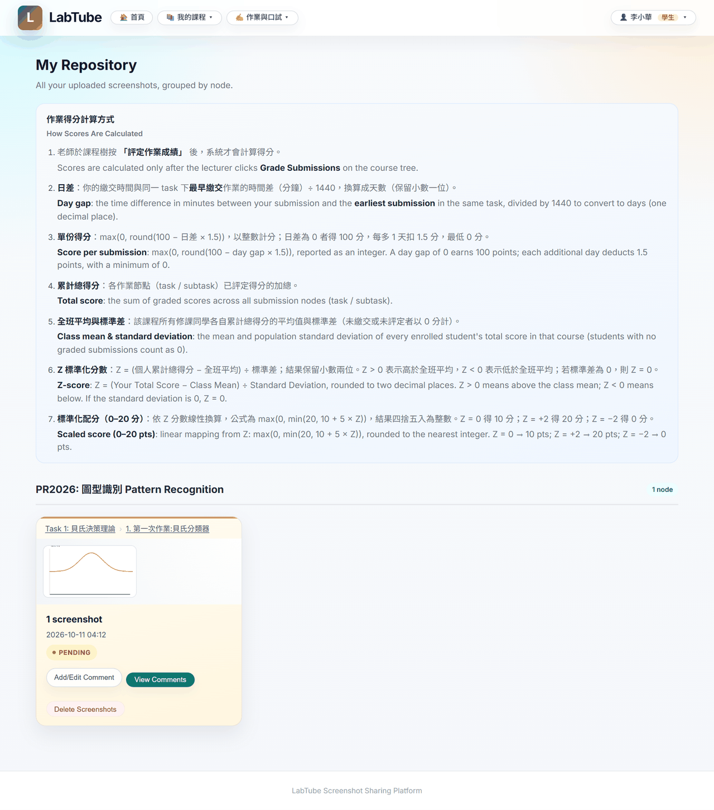

---

## 8. 線上口試(用手機作答)

### 8.1 先了解規則

| 項目 | 規定 |
|---|---|
| 題目 | **3 題簡答**,每題針對**你自己程式**的一小段(最多幾行) |
| 答案長度 | 每題**最多 50 字**(超過會被截斷),不需要複雜計算 |
| 時間 | 約 **8 分鐘**(有特殊需求的同學老師會另外延長) |
| 加入 | 老師開場後,在投影幕上看到 **6 碼加入碼**(**每 60 秒更換一次**),在課程樹或「線上口試」頁輸入 |
| 開始 | 加入後,必須在老師開場後的 **120 秒內**按「開始作答」,否則無法開始(遲到請找老師) |
| 作答 | 答案**自動儲存**;時間到或按「提交」就結束,**只能作答一次** |
| 裝置 | 一場口試**綁定第一台裝置**;系統會記錄 IP、分頁切換與貼上次數 |
| 用途 | 題目與你的程式有關,所以只要你理解自己的程式就能回答 |

### 8.2 考前準備(前一天)

- [ ] 手機已能**登入 LabTube**,並確認你看得到課程樹。
- [ ] 瀏覽器更新到最新版;手機電量充足,**螢幕恆亮**(避免自動鎖屏)。
- [ ] 想好用哪一台裝置作答,**整場不要換**。
- [ ] 重新讀過自己的程式,特別是**核心函式、參數的意義、為什麼這樣寫**。
- [ ] 準備好網路(Wi-Fi 較穩;行動網路也可以)。

### 8.3 考試當天

**1. 開場前 10 分鐘**:先登入,停在課程樹或「線上口試」頁。

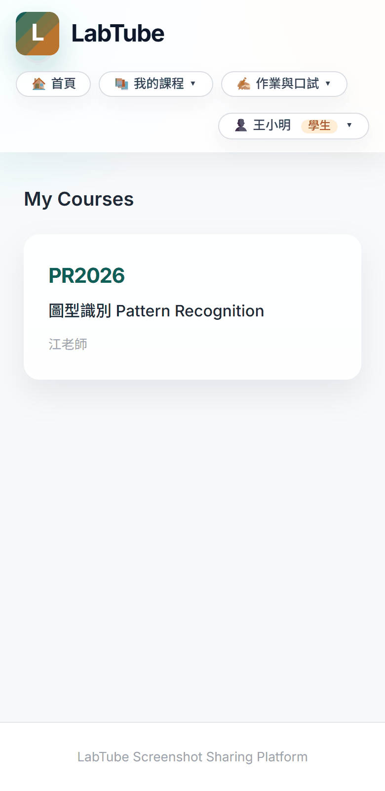

**2. 老師開場後**:課程樹上作業卡片會出現 🔴「口試進行中 · 加入」。點「作業與口試 → 線上口試」或直接點徽章。

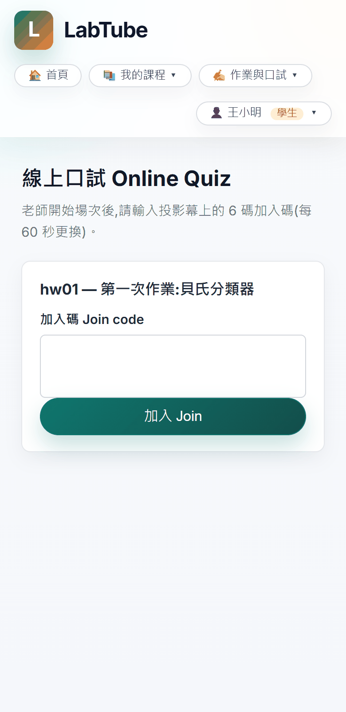

**3. 輸入投影幕上的 6 碼加入碼**(英文字母與數字,不分大小寫),按 **加入 Join**。碼每 60 秒換一次,輸入時如果剛好換碼,系統在換碼後 10 秒內仍接受上一組。

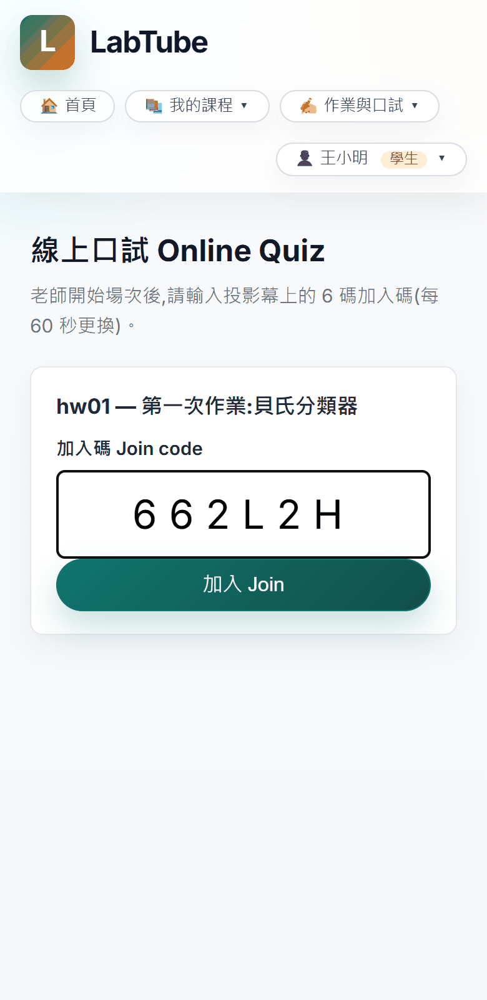

**4. 按「開始作答 Start」**(**120 秒內**)。這時才會顯示題目並開始倒數。

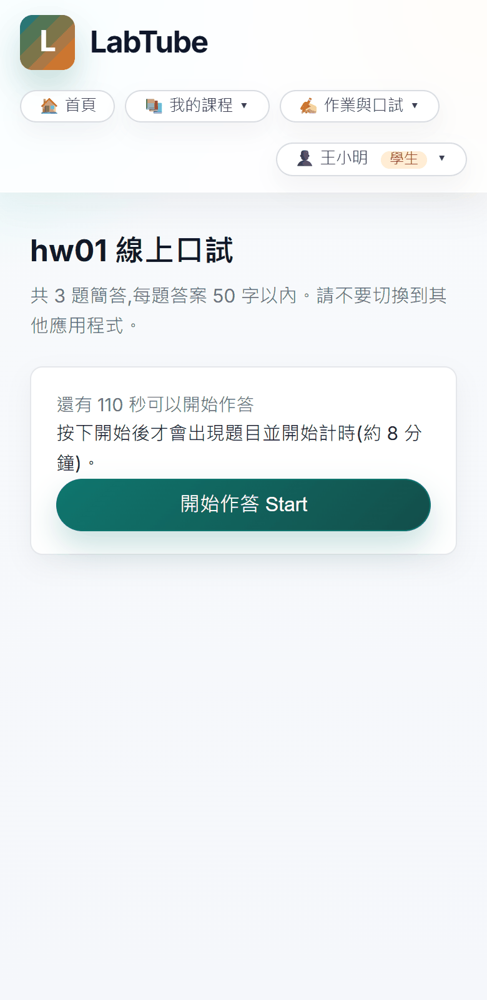

**5. 作答**:每題上方是你程式的一小段,下方輸入答案(最多 50 字,輸入框下方有字數)。畫面上方有**剩餘時間**。

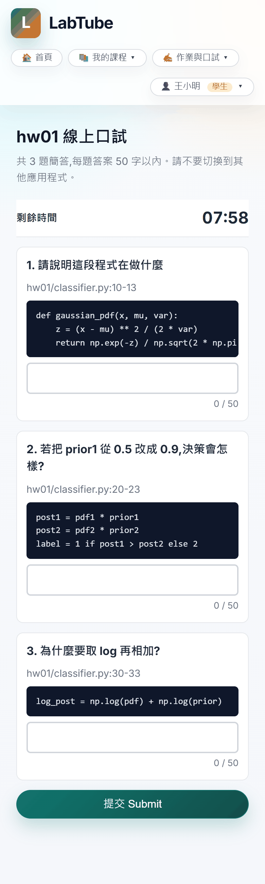

**6. 填完所有題目**:答案會自動儲存。確認無誤後按 **提交 Submit**。

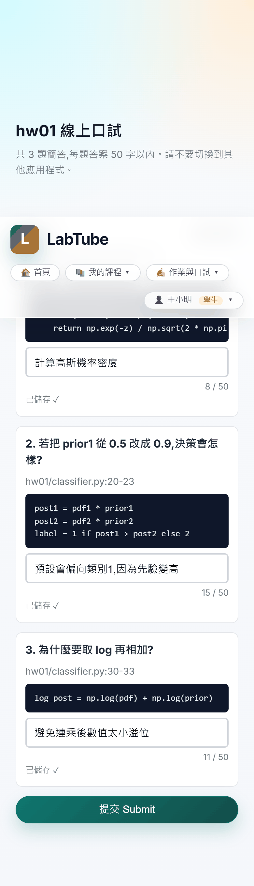

**7. 看到「已提交」**即完成。之後無法再修改。

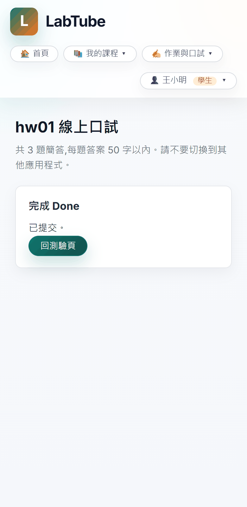

### 8.4 考試中的注意事項

- **不要切換到其他 App 或分頁**:系統會記錄切換次數(只作為老師複核時的參考,不會自動扣分)。
- **不要貼上答案**:系統會記錄貼上次數;答案請自己打字。
- **不要與旁人討論**。
- 每題的答案請簡短扼要,**50 字內說清楚重點**即可,不用寫成作文。
- 時間到時,**已輸入的答案會保留**,系統會自動結束作答。

### 8.5 發生狀況怎麼辦?

| 狀況 | 怎麼辦 |
|---|---|
| 加入碼輸入後說錯誤 | 看投影幕**最新**的碼再輸入一次(每 60 秒更換) |
| 超過 120 秒才想開始 | 立刻舉手,告訴老師你的學號與理由,老師可以個別允許你開始 |
| 手機當機/沒電/斷線 | **舉手找老師**。老師可在 2 分鐘內允許你換裝置,新裝置登入後按「老師已允許,在這台裝置繼續」;已儲存的答案與剩餘時間都保留 |
| 網路斷了一下 | 恢復後重新整理頁面,回到作答頁繼續(答案是自動儲存的) |
| 想延長時間(身心障礙等) | 事先向老師登記,老師會在修課名單設定延長比例 |
| 沒參加成口試 | 看到課程樹上「⚠ 口試未參加」→ 聯絡老師,視情況安排補測 |

---

## 9. 查看成績與申請複核

- 成績**只有在老師定案並開放顯示後**,才會出現在選單 **📊 我的成績**。沒開放前你看不到(選單也不會出現)。
- 老師開放前,選單裡**沒有**「我的成績」這一項(直接輸入網址會看到 Not Found,這是正常的,不是故障)。

開放後可以看到:

- **Rubric**:老師評的作業分數;
- **測驗得分率**:你的 3 題口試得分率(0–1);
- **最終分數**:依公式計算的結果;
- **測驗狀態**:已測 / 缺考 / 免測。

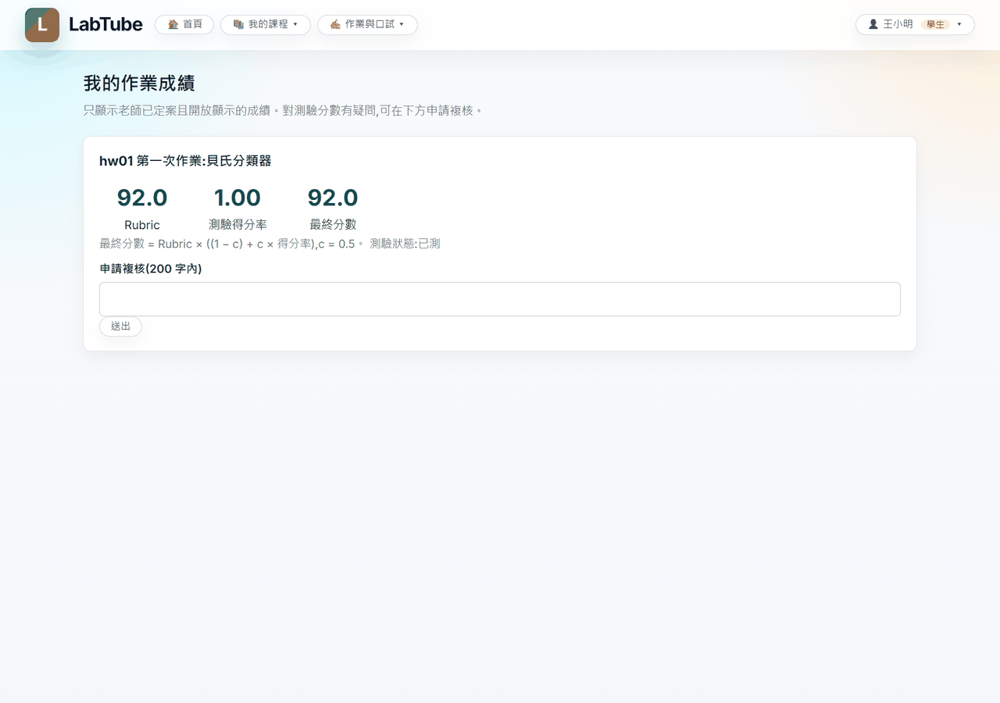

**對口試分數有疑問**:在下方「申請複核」欄寫下理由(200 字內)按 **送出**,老師會重新檢視你的作答。申請複核**不會自動改分**,由老師判斷。

---

## 10. 常見問題

**Q1. 我可以在 LabTube 上傳 Python 檔或 Notebook 嗎?**
不行。LabTube 只收程式「執行結果」(圖片、GIF、MP4);程式請放在你的 GitHub Repo。

**Q2. Repo 一定要 Private 嗎?老師一定要加成協作者嗎?**
是。公開的 Repo 任何人都能抄;老師沒加進協作者就看不到你的作業。

**Q3. 標籤打錯了怎麼辦?**
截止前可以用 `git tag -f hwNN-submit` 後強制推送來移動;截止後移動標籤會被系統標示,請勿這樣做。

**Q4. 截止後我才發現漏交某個檔案?**
標籤之後的修改不算成績。需要補交請依課程規定(逾期)與老師聯絡。

**Q5. 口試是不是「我的程式有 AI 協助」就會被扣分?**
AI 是否允許依課程規定(見課綱);口試要檢查的是「你**理解**自己交出的程式嗎」。請自己讀懂、能說明每個重要步驟。

**Q6. 同學之間共用一個校園網路,IP 一樣會被當成作弊嗎?**
不會。IP 只作為老師複核時的**旗標參考**,不會單獨據此扣分。

**Q7. 答案寫超過 50 字?**
超過的部分會被截斷;請用一兩句話說清楚重點。

**Q8. 我忘記密碼?**
請聯絡老師或助教協助處理。

**Q9. 課程樹上看不到我的作業/口試徽章?**
確認你是用**自己的學號**登入、且已加入這門課程(首頁選課程後按 Join Course);口試徽章只在老師開啟場次後才出現。

---

## 11. 一頁速查表

**每份作業(截止前)**
- [ ] 程式與說明放進 Repo 的 `hwNN/`
- [ ] `git tag hwNN-submit` → `git push origin hwNN-submit`
- [ ] LabTube:登記 Repo(一次)、登記目錄 `hwNN`
- [ ] LabTube:上傳程式**執行結果**(圖片/GIF/MP4),不要上傳程式碼

**口試日**
- [ ] 手機登入、電量足、螢幕恆亮
- [ ] 看到紅色「口試進行中」→ 輸入加入碼 → **120 秒內**按「開始作答」
- [ ] 3 題各 ≤ 50 字 → 提交

**重要提醒**
- 繳交時間 = **標籤推送時間**
- 標籤名稱 = `hwNN-submit`(小寫、兩位數)
- Repo 名稱 = `pr-2026-hw-學號`,Private,協作者 `ndhuccc`
