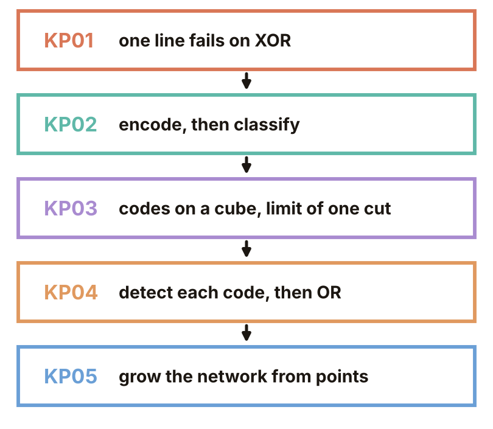
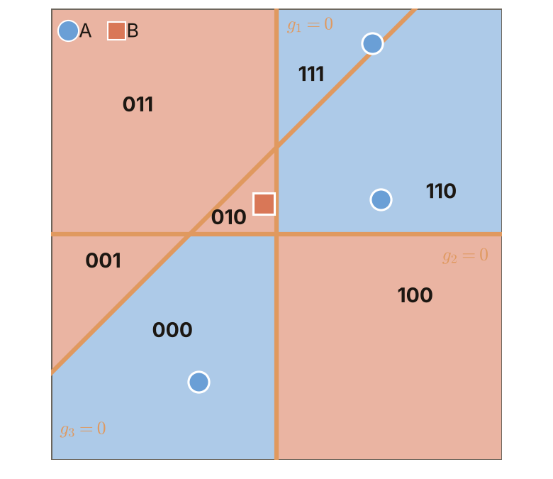
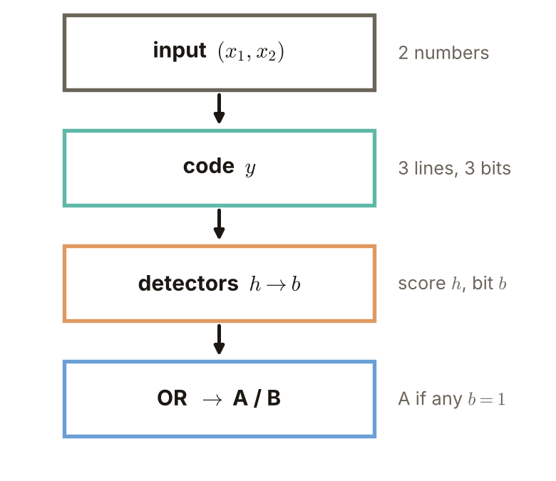

# Chapter 4 Roadmap: After One Line Is Not Enough

> Level: undergraduate, year 3
>
> Pattern Recognition | Chapter 4 overview (KP01–KP05)

[Slides: read and download](../../slides/lec05-kp00-overview-en.jbd.json) | [中文版](../lec05-kp00-overview.md)

## Learning objectives

- Connect KP01 to KP05 with one question and state the question, the answer and the question left behind for each knowledge point.
- Say in plain words what every term of this chapter (bit, code, unrealized code, detector and so on) means.
- Explain the conclusion and the limits of this chapter and know what comes next.

## Chapter 4 Roadmap

**One-sentence summary**: When the labels are interleaved (as in XOR), one line cannot separate them; adding lines and then a layer can. KP05 shows how a network is grown when we only have points; the question left over is how to learn the weights.

### Prerequisites and symbols

**Three things you need first**:

- **Linear classifier** (Chapter 3): separate two classes with a straight line (a plane in high dimensions). Points on one side go to one class and points on the other side to the other.
- **Score**: the number obtained by putting a point into the line's formula. For example $g(x)=x_1+x_2-1.5$; a positive score gives A and otherwise B.
- **Coordinates and tables**: a point is written with two coordinates $(x_1,x_2)$; we use small tables to list the class of every point.

**Symbols used in this chapter**:

| Symbol | Meaning | Note |
|---|---|---|
| $x_1,x_2$ | the two coordinates of the input | most examples in this chapter have two coordinates |
| $g(x)$ | score function | a positive score gives A and otherwise B |
| A, B | the two classes | the A and B of XOR are the main example of this chapter |
| $y_1,y_2,\dots$ | hidden bits | the 0 or 1 output by each hidden unit (from KP02 on) |

### 1. This chapter asks only one thing

**Question**: when one line cannot separate the labels, how does a network separate them?

**The starting point is XOR** (exclusive or): B when the two inputs are equal, A when they differ:

| $x_1$ | $x_2$ | Class |
|---|---|---|
| 0 | 0 | B |
| 0 | 1 | A |
| 1 | 0 | A |
| 1 | 1 | B |

The two A points lie on one diagonal and the two B points on the other. No straight line can put the two A points on one side and the two B points on the other.

Figure `lec05-kp01-xor-check`: look at the positions of the four points, A on one diagonal and B on the other; then at the grey line, which always puts some B on the same side as an A. [Function: 1, 3]

### 2. The roadmap: each knowledge point takes over the question left by the previous one

This chapter has five knowledge points, one after the other. Each starts from the question left by the previous one.

Figure `lec05-kp00-map`: from top to bottom are KP01 to KP05, with the question left at each step beside the arrows. Follow the arrows first, then go back to the name of each box. [Function: 1]

### 3. The question, answer and what is left for the five knowledge points

**Five words in plain language first** (later KPs unfold them one by one):

- **Bit**: a number that is only 0 or 1; a line decides "is the point on the positive side?" and the answer is written as one bit.
- **Hidden layer**: the row of computing units between the input and the final output; each unit asks one small question.
- **Code**: all the bits of a point written one after another, for example $(1,0)$, like attaching a "position label" to the point.
- **Unrealized code**: a code that can be written but that no input point gets.
- **Detector**: a unit that answers "yes" only when the code of the input equals one target code.

| Knowledge point | Question | Answer | Left behind |
|---|---|---|---|
| KP01 One line is not enough | Does any line separate XOR? | The scores of the two A points must add up positive and those of the two B points must add up to at most 0, yet it is the same expression: a contradiction. | What has to change is a combination of boundaries, for example two lines enclosing a strip. |
| KP02 Encode first, then classify | How do we build the two decisions as a network? | Two lines give a bit each, the four points get only three codes, and one line of the output layer separates A from B. | With more lines, is the output layer still enough? |
| KP03 Codes and limits | With more lines, does one cut separate every labelling? | Some labellings yes, some no (on the bottom face A and B alternate along the diagonals). | A labelling that cannot be cut needs another layer. |
| KP04 Detect code by code | How do we add a layer above the codes? | Detector score $=0.5-{}$ the number of mismatching bits, and the output layer merges them with "or". | This only proves it is enough; how is the network to be grown from the points? |
| KP05 Growing from points | With only labelled points, how is the network grown? | A primary node splits once, auxiliary nodes handle mixed groups, and added bits purify. | All right is only for this batch of points; fix the architecture first, then learn the weights. |

The five figures below each correspond to one knowledge point and are the core figure of each KP.

Figure: look at the two parallel lines of KP01 enclosing a strip with A inside; then at KP02 turning it into a two-layer network; KP03 shows the limit of one cut; KP04 adds a layer above the codes; KP05 shows how to grow when there is no ready network. [Function: 1, 3]

### 4. Review: the whole network and four reminders

Figure `lec05-kp04-stages`: look at the input first, then at the four stages hidden code, detectors and output, each using only the result of the previous stage. [Function: 1]

**Common misconception**: a constructed network that is enough means the weights have been learned or that it is the smallest network. A construction only proves that it is enough.

**Four reminders**:

1. On a fixed code, one cut has a limit.
2. Contradictory labels cannot all be right.
3. All right is only for this batch of points.
4. A construction proves sufficiency, not that the weights were learned or that the network is smallest.

**Next chapter**: fix the network architecture first and then learn the weights with a cost function (backpropagation, from KP06).

## Terms and source

| 中文 | English | Appears in |
|---|---|---|
| 位元 | Bit | KP02 |
| 階梯規則 | Step rule | KP02 |
| 隱藏層、隱藏編碼 | Hidden layer, hidden code | KP02 |
| 編碼、實際碼、虛擬碼 | Code, realized code, unrealized code | KP03 |
| 線性可分 | Linearly separable | KP03 |
| 目標碼、偵測器、或合併、三層網路 | Target code, detector, OR merge, three-layer network | KP04 |
| 主要節點、輔助節點、混雜群、純化 | Primary node, auxiliary node, mixed group, purification | KP05 |

Source: the decks and lectures of KP01–KP05 of this chapter (compiled 2026-10-25). This page only reviews and gives plain-language definitions and adds no new content.
