# KP02 Two-Layer Perceptron: Encode Positions First, Then Classify

> Level: undergraduate, year 3
>
> Pattern Recognition | Chapter 4, §4.3

[Slides: read and download](../../slides/lec05-kp02-two-layer-perceptron-en.jbd.json) | [中文版](../lec05-kp02-two-layer-perceptron.md)

## Learning objectives

- Explain what the hidden layer and the output layer each do, and turn scores into bits with the step rule.
- Compute the hidden code and the output score of each XOR point and check the predictions.
- Translate the whole two-layer network back to the original plane as a strip between two lines, and explain which merges make the output layer fail.

## KP02 Two-Layer Perceptron: Encode Positions First, Then Classify

**One-sentence summary**: One line cannot answer "A or B?", so first ask two yes-or-no questions with two lines, replace each point by a two-bit code, and then classify with one line of the output layer in the plane of codes. Translated back to the original plane, the whole network is the strip between two parallel lines.

### Prerequisites and symbols

**Three things you need first**:

- **Score and positive side**: put a point into the line's formula to get its score; if the score is positive, the point is on the "positive side" of the line.
- **XOR and the strip** (KP01): the two A points lie on one diagonal and the two B points on the other; two parallel lines enclose a strip that holds exactly the two A points.
- **Step**: a function that outputs 1 when its input is positive and 0 otherwise.

**The two lines fixed for this lecture** (the two hidden units):

$$
g_1(\mathbf x)=x_1+x_2-0.5,\qquad g_2(\mathbf x)=x_1+x_2-1.5 .
$$

**Symbol table**:

| Symbol | Meaning | Note |
|---|---|---|
| $x_1,x_2$ | input coordinates | each 0 or 1 |
| $g_1,g_2$ | scores of the two hidden units | the two lines above; the points with $g_j=0$ form the $j$-th boundary line |
| $y_1,y_2$ | hidden bits | $y_j$ is $g_j$ passed through the step, 0 or 1 |
| $g_{\text{out}}$ | score of the output unit | section 5 |
| A, B | the two classes of XOR | A: the two inputs differ; B: they are equal |

**Wording**: a **unit** computes a "score" $g_j(\mathbf x)$; the **boundary line** is the set of points with score 0; the **positive side** is the side where the score is positive.

### 1. One line fails, so ask two small questions first

**Plain explanation**: The previous KP ended with two parallel lines enclosing a strip that holds exactly the A points of XOR. This section turns that into a network.

- **Hidden layer**: the row of computing units that asks the small questions; the boundary of each unit is a line in the plane.
- **Output layer**: the unit that makes the final classification from the codes.
- **Two-layer network**: hidden layer plus output layer; the inputs only supply coordinates and are not a layer.

Figure `lec05-kp02-net-wiring`: inputs $x_1,x_2$ feed two hidden units $g_1$ (teal) and $g_2$ (violet), each giving one bit, which feed one output unit. Each unit computes a score and its boundary is a line in the plane. Look at the inputs on the left, then at the two hidden units in the middle, and finally at the output unit on the right. [Function: 1]

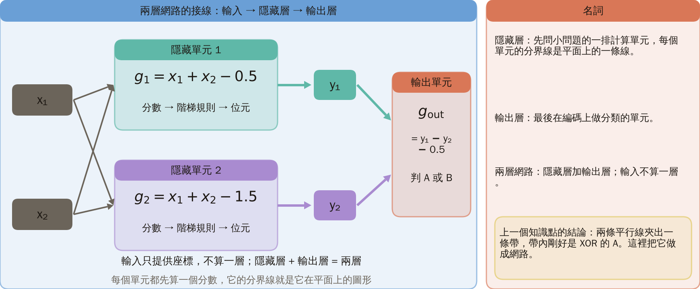

The next question: how does each hidden unit turn a score into a bit?

### 2. Each line asks: is the point on the positive side? Record one bit

**Formal definition**: for each line $g_j$, a point on the positive side (score $g_j>0$) gets 1 and otherwise 0 (exactly 0 also gives 0). This rule is the **step rule**, and the 0 or 1 it produces is a **bit**:

$$
y_j=\begin{cases}1,&g_j(\mathbf x)>0,\\0,&g_j(\mathbf x)\le 0.\end{cases}
$$

Every point gets two bits $y_1,y_2$; the next section walks one point through and then names this pair of bits. The next question: walk a concrete point through.

Figure `lec05-kp02-input-sides`: the same picture with the positive side of each line shaded and marked by an arrow; where the colours overlap, both lines are on the positive side. Look at the arrow beside each line (the positive side), then at the region where the colours overlap. [Function: 1, 3]

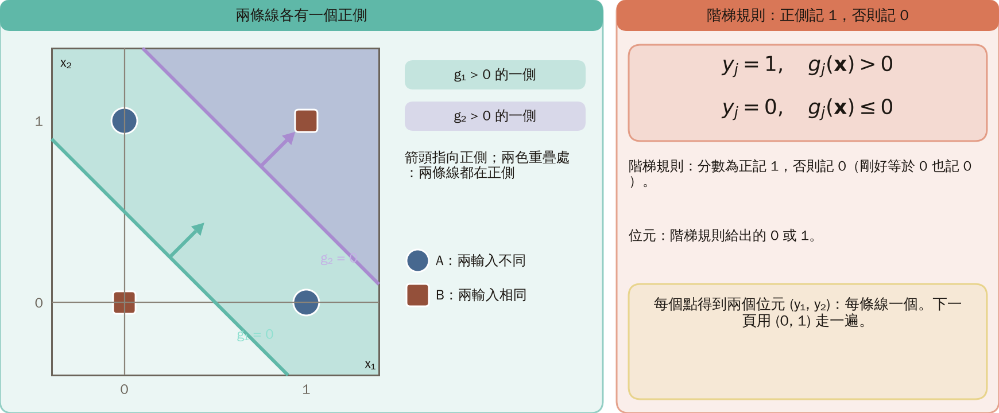

### 3. Walk the point $(0,1)$ through

**Example**:

- Into the first line: $g_1=0+1-0.5=0.5>0$, so $y_1=1$.
- Into the second line: $g_2=0+1-1.5=-0.5\le 0$, so $y_2=0$.
- The two bits written together, $\mathbf y=[y_1,y_2]=(1,0)$, form the **hidden code**, like two position labels attached to the point. The flow reads top to bottom: input, two scores, step rule, hidden code. The next question: what code does each of the four input points get?

Figure `lec05-kp02-bits-example`: the star is the point $(0,1)$, labelled with its two scores and two bits. Look at the two scores of the star, then at the two bits they become through the step. [Function: 1, 2]

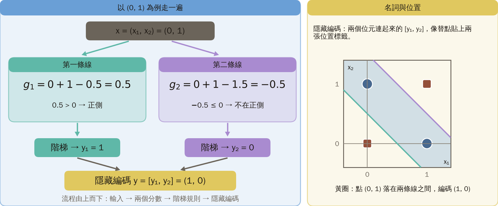

### 4. The four codes: $(0,0)$, $(1,0)$, $(1,0)$, $(1,1)$

| Input | $g_1$ | $g_2$ | Code | XOR truth |
|---|---:|---:|---|---|
| $(0,0)$ | $-0.5$ | $-1.5$ | $(0,0)$ | B |
| $(0,1)$ | $0.5$ | $-0.5$ | $(1,0)$ | A |
| $(1,0)$ | $0.5$ | $-0.5$ | $(1,0)$ | A |
| $(1,1)$ | $1.5$ | $0.5$ | $(1,1)$ | B |

The two lines cut the plane into three bands with codes $(0,0)$, $(1,0)$, $(1,1)$; both A points sit in the middle band. The next question: how does the output layer classify these three codes?

Figure `lec05-kp02-bands`: three bands, each labelled with its code; both A points lie in the $(1,0)$ band. Look at the three bands, read the code of each, and find which one holds the two A points. [Function: 1, 3]

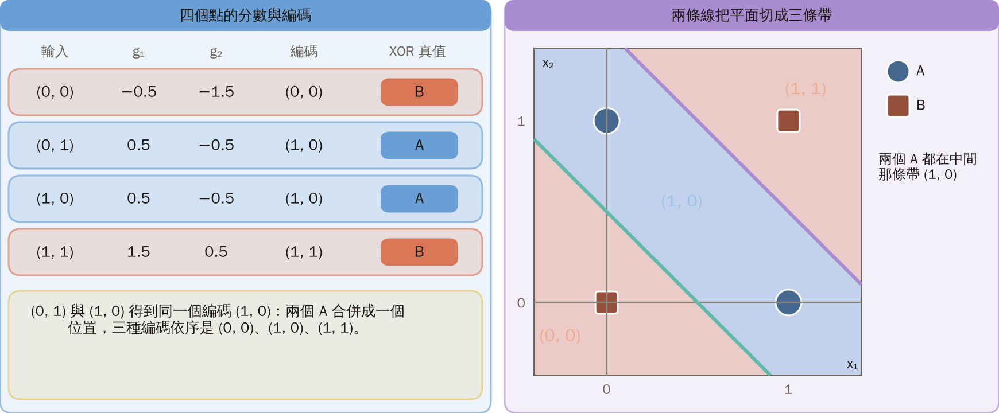

### 5. In the plane of codes, one line separates A from B

**Hidden space**: replace every point by its code $(y_1,y_2)$ and draw it in a new plane. $(0,0)$ is B, $(1,0)$ is A (two merged inputs) and $(1,1)$ is B. The output score is

$$
g_{\text{out}}=y_1-y_2-0.5 .
$$

**Where the output line comes from**: set $g_{\text{out}}=0$ and rearrange to $y_2=y_1-0.5$, a line in the hidden space. $g_{\text{out}}>0$ is equivalent to $y_2<y_1-0.5$, that is, the point lies **below** this line, and the decision is A. Merging the two A points does not matter, because they are the same class.

Figure `lec05-kp02-hidden-plane`: the location $(0,1)$ is hollow because no input lands there; the output line separates $(1,0)$ from the other two locations. Look at the three locations, then at the two sides of the output line. [Function: 1, 3]

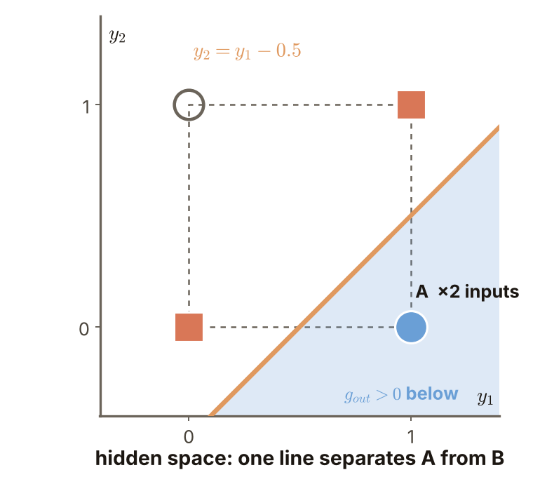

### 6. Output layer check: predictions $(0,1,1,0)$ are exactly XOR

$(0,0)$: $0-0-0.5=-0.5$, predict B. $(1,0)$: $1-0-0.5=0.5$, predict A (both A inputs). $(1,1)$: $1-1-0.5=-0.5$, predict B. The predictions for the four inputs are $(0,1,1,0)$: 4 of 4 correct. This checks these four points; it is not an accuracy on new data.

Figure `lec05-kp02-hidden-scores`: the output scores at the three locations; only $(1,0)$ is positive. Look at the scores at the three locations, then check the decision that goes with each sign. [Function: 2]

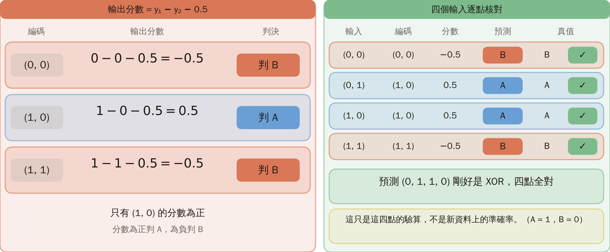

### 7. Back in the original plane: the whole network is the strip between two lines

$y_1=1$ and $y_2=0$ means $x_1+x_2>0.5$ and $x_1+x_2\le 1.5$. This is the strip of the previous KP: the hidden layer makes the two decisions and the output layer asks for both.

Figure `lec05-kp02-strip-net`: both A points inside the strip, both B points outside. Look at the strip between the two lines, then compare the points inside and outside it. [Function: 1, 3]

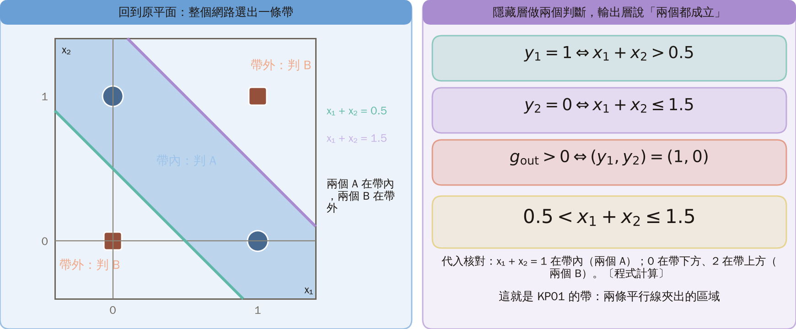

### 8. Merging the same class is fine; merging different classes is not

Here the two A points merge and the output layer still separates them.

**Common misconception**: treating the hidden bits as class probabilities, or assuming any merge is harmless. But if points of different classes receive the same code, no output line can separate them and later decisions cannot recover. Note that $y_1,y_2$ are only "on the positive side?" bits, not class probabilities. This construction only proves that XOR can be represented; for other tasks, first check that the hidden codes can be separated by the output layer.

Figure `lec05-kp02-merge-bad`: schematic with an A and a B both at $(1,1)$, the conflict marked by a red ring. Look at the two points at the same location, then at the conflict marked by the red ring. [Function: 1]

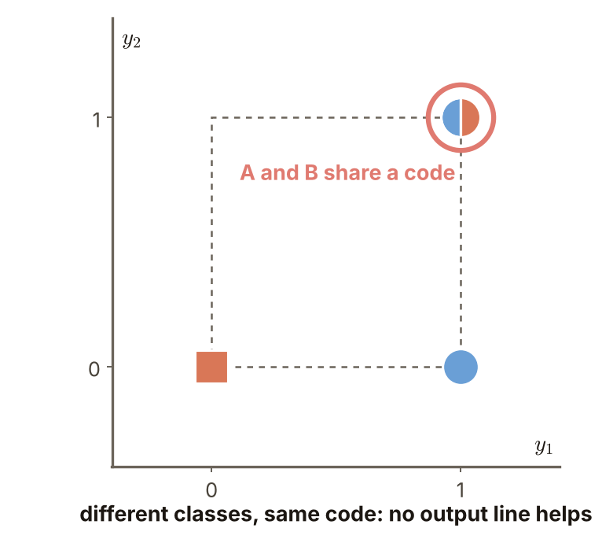

The next KP asks: with more hidden lines, can any labelling be separated?

### Extension: practice and worked solution

**Practice**: keep the hidden codes and change the output score to $g_{\text{out}}=y_1-y_2+0.5$.

1. What are the predictions for the four inputs? Hint: recompute only the output scores.
2. Which different inputs are merged, and why does the merge cause no conflict? Hint: look at their labels.

Figure `lec05-kp02-bias-line`: the three locations and the new output line $y_2=y_1+0.5$. Look at the new output line, then at which side each of the three locations is on. [Function: 1, 3]

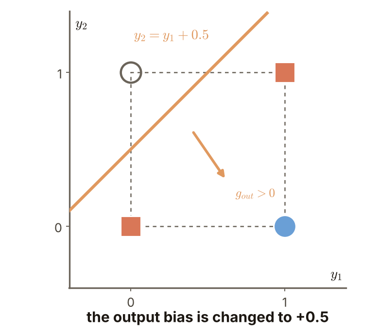

**Worked solution of question 1**: (1) The formula is $g_{\text{out}}=y_1-y_2+0.5$. (2) Substitute the three locations: $(0,0)$: $0.5$; $(1,0)$: $1.5$; $(1,1)$: $0.5$. (3) All three scores are positive, so all four inputs are predicted A. (4) Check: XOR is B, A, A, B, so the two B inputs are predicted A: 2 errors. The bias shifted the line so it no longer separates B from A.

**Worked solution of question 2**: (1) The merged inputs are $(0,1)$ and $(1,0)$; both have the hidden code $(1,0)$. (2) Both have the XOR truth A, and merging points of the same class causes no conflict: the output layer only has to call this code A. (3) Check: with this output line the two B points $(0,0)$ and $(1,1)$ are also called A; the cause of the errors is the bias that shifts the line, not the merge.

Figure `lec05-kp02-bias-plus`: the two B locations marked by red rings as errors. Look at the three locations all on the positive side, then at the errors marked by red rings. [Function: 1, 2]

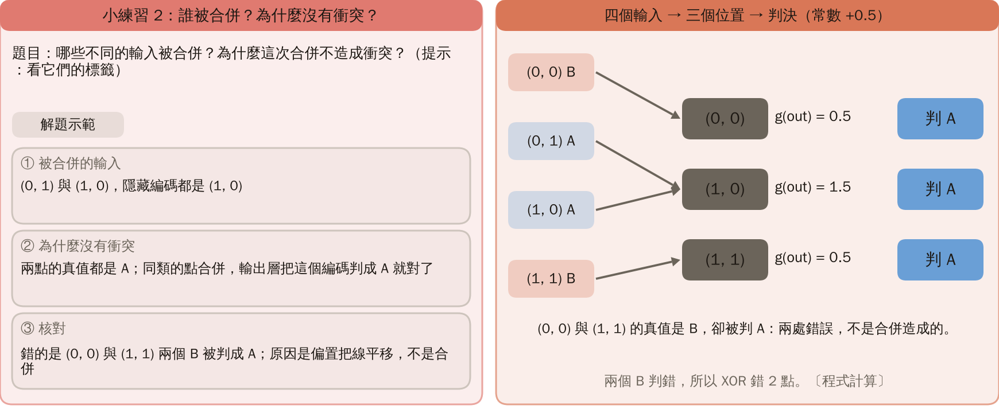

**The steps cannot be removed** [added]: without the steps, $y_1=x_1+x_2-0.5$ and $y_2=x_1+x_2-1.5$; substituting into $g_{\text{out}}=y_1-y_2-0.5$ gives $(x_1+x_2-0.5)-(x_1+x_2-1.5)-0.5=0.5$, independent of $x$, so every point is predicted A and XOR has 2 errors. A combination of linear expressions is linear again, so the nonlinearity has to come from the steps.

Figure `lec05-kp02-no-step`: the whole plane predicts A, the two B points marked by red rings. Look at the whole plane in one colour, then at the errors marked by red rings. [Function: 1, 2]

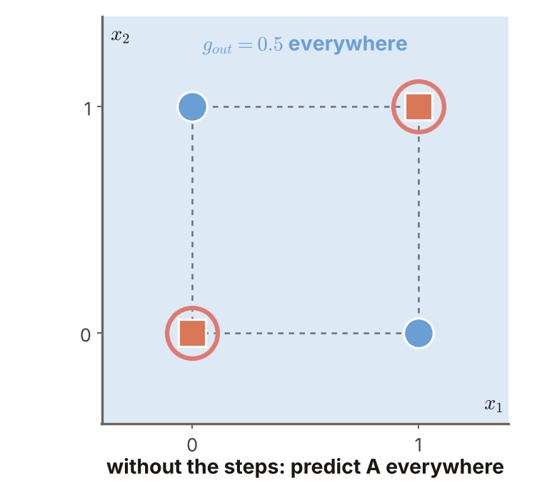

## Terms and sources

| English | 中文 |
|---|---|
| Hidden layer, output layer | 隱藏層、輸出層 |
| Bit | 位元 |
| Step rule | 階梯規則 |
| Hidden code | 隱藏編碼 |
| Hidden space | 隱藏空間 |

Source: Chapter 4 KP02, §4.3 (read 2026-10-24). The two-layer XOR construction follows the source; explanations and figures were rewritten; the bias practice and the no-step derivation are [added].
