# KP03 Codes of several lines and the limit of two layers

> Level: undergraduate (year 3)
>
> Pattern Recognition | Chapter 4, Section 4.3.1

[Slides (view and download)](../../slides/lec05-kp03-polyhedral-codes-en.jbd.json) | [中文版](../lec05-kp03-polyhedral-codes.md)

## Learning objectives

- Turn the sign decisions of three lines into a 3-bit code for every point, and find the same code in the input plane and on the cube.
- Explain why an unrealized code has no input, and check separability of the output layer on realized codes only.
- Use the shared midpoint of two diagonals to explain why a fixed set of lines cannot separate an XOR-type labelling.

## KP03 Codes of several lines and the limit of two layers

**One-sentence summary**: Each point gets three bits from three lines, and the bits form its code. The last layer (the output layer) is one cut through the cube of codes, so any labelling that alternates like XOR on a face cannot be separated by it.

### 1. Two lines rescued XOR; with more lines, is the final layer still enough?

**Plain explanation**: In KP02 two lines turned XOR into three locations, and the final layer (the output layer, one more line or plane) separated them. This section sets out the tools first.

- **Score**: the number obtained by substituting a point into the formula $g_i(\mathbf x)=\mathbf w_i^T\mathbf x+b_i$ of line $i$.
- **Step rule**: a score greater than 0 gives 1; anything else gives 0 (a score of exactly 0 also gives 0).
- **Bit**: a point on the **positive side** of a line (the side where the score is greater than 0, called a half-space in mathematics) gets 1, otherwise 0.

Figure `lec05-kp03-two-spaces`: The input plane is on the left and the cube of 3-bit codes on the right. Every point ends up at one corner of the cube; the three stars show this mapping.

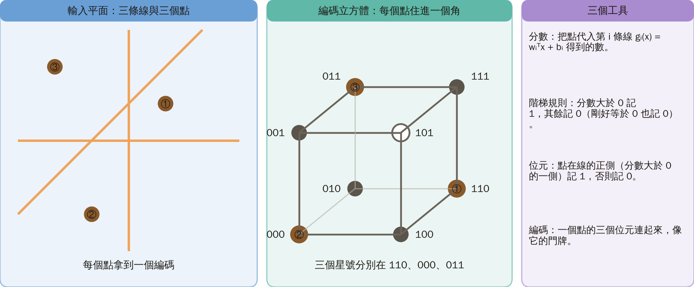

### 2. Three lines cut seven cells, each with its own code

**Formal definition and example [Added]**: With input dimension $d$ and $p$ lines in the hidden layer (the general form is in the extension). Here we use three lines whose coefficients are a teaching choice, not the equations of the original figure:

$$
g_1=x_1,\qquad g_2=x_2,\qquad g_3=-x_1+x_2-1.
$$

- **Code**: the three bits of a point written in a row, like a house number.
- **Cell**: all points that receive the same code form one piece of the plane.

**Example**: At $(1,1)$ the scores are $g_1=1$, $g_2=1$ and $g_3=-1+1-1=-1$, so the bits are $1,1,0$ ($-1\le0$ gives 0) and the code is **110**.

Figure `lec05-kp03-regions`: Read the three orange boundaries and the arrows toward the positive sides, then the code of each cell. Seven codes occur and 101 does not. Points on a line follow the step rule and receive 0.

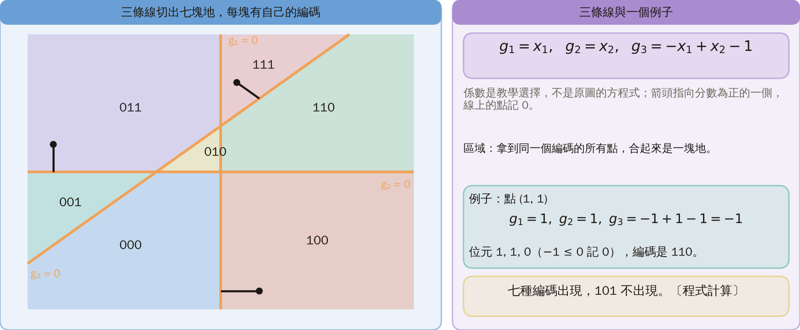

### 3. Why no point receives code 101

Three bits allow 8 codes but the plane shows only 7 cells. Code 101 would need all of the following at once:

1. Bit 1 is 1: $x_1>0$.
2. Bit 2 is 0: $x_2\le0$.
3. Bit 3 is 1: $x_2>x_1+1$.

Conditions 1 and 2 give $x_2\le0<x_1+1$, so condition 3 cannot hold.

Figure `lec05-kp03-no101`: The first three panels show the region of one condition each; the fourth stacks the three and they have no common part.

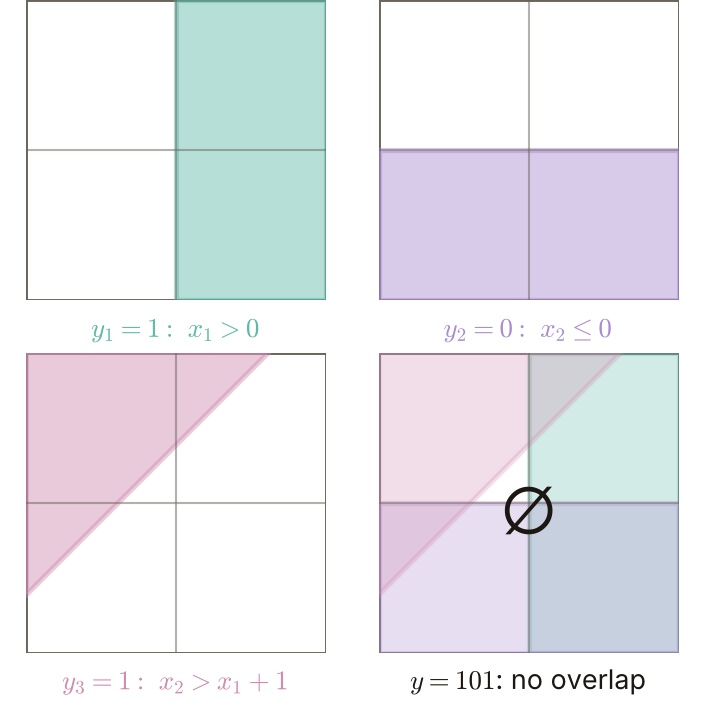

- **Realized code**: a code received by at least one input point (7 of them).
- **Unrealized code**: a code that can be written down but that no input point receives (101).

This is **not** "data not yet collected": however much data you gather, 101 never appears.

### 4. Codes are corners of a cube; the last layer is one cut

The 8 codes of three bits are exactly the coordinates $(y_1,y_2,y_3)$ of the 8 corners of a cube. With more bits we get a higher-dimensional cube (a hypercube). The cube contains continuous points, but the step rule outputs only corners and never fills the inside.

Figure `lec05-kp03-cube`: The colors match the cells of section 2; 101 is a hollow circle that no input reaches. [Added figure]

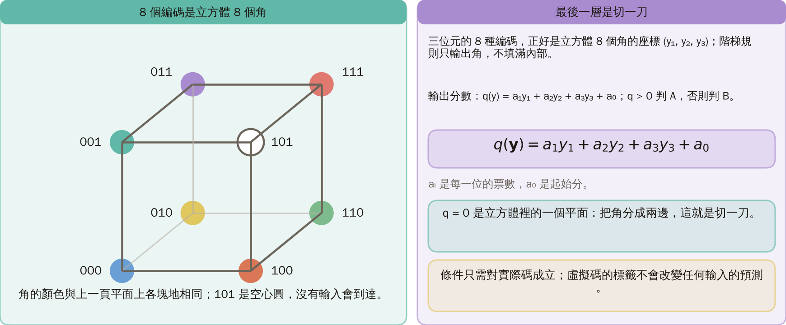

**Output score**:

$$
q(\mathbf y)=a_1y_1+a_2y_2+a_3y_3+a_0,
$$

and $q>0$ means class A, otherwise class B. The $a_i$ are coefficients and $a_0$ is a constant. The set $q=0$ is a **plane** in the cube; it splits the corners into two sides, and that is one cut. The conditions need to hold only for realized codes; labelling an unrealized code changes no prediction on any input.

### 5. Score every corner: the cut separates the first labelling

Take the source's output score $q=-y_1-y_2+y_3+0.5$ and substitute corner by corner:

| Corner | Substitution | $q$ | Class |
|---|---|---:|---|
| 000 | $-0-0+0+0.5$ | 0.5 | A |
| 001 | $-0-0+1+0.5$ | 1.5 | A |
| 011 | $-0-1+1+0.5$ | 0.5 | A |
| 010 | $-0-1+0+0.5$ | −0.5 | B |
| 100 | $-1-0+0+0.5$ | −0.5 | B |
| 110 | $-1-1+0+0.5$ | −1.5 | B |
| 111 | $-1-1+1+0.5$ | −0.5 | B |

The score at 101 is $-1-0+1+0.5=0.5$, but no input receives it, so it does not affect the classification. When all of A lies on one side of a plane and all of B on the other, the labelling is **linearly separable**.

Figure `lec05-kp03-cube-cut`: A (circles) lies above the plane and B (squares) below; each corner shows its code and score.

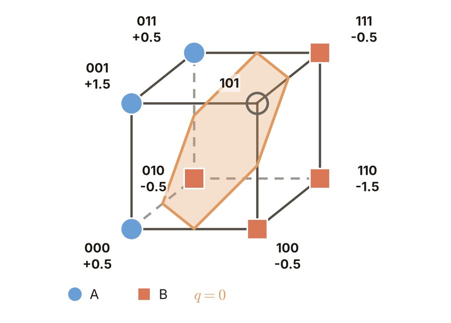

### 6. Back in the plane: region A is three cells joined, with a notch

Class A is the **union** of the cells 000, 001 and 011 (several cells merged into one region). A region is **convex** if the segment between any two of its points stays inside it. Take $P(-0.15,-1)$ and $Q(-0.15,2)$: both lie in region A, but segment $PQ$ passes through the B point $R(-0.15,0.62)$, so region A is **not convex** [Added].

Figure `lec05-kp03-union-gap`: On the left, blue is region A and orange region B, and the dashed line joins two A points; on the right is the cube under the same cut.

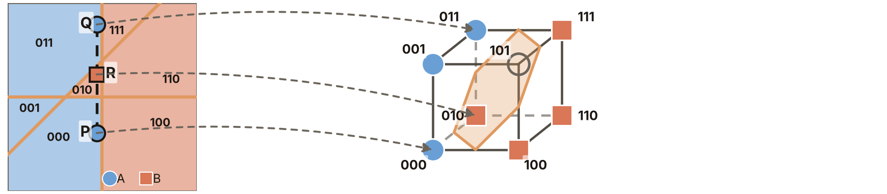

**Common misconception**: "One code cell is convex, so a two-layer network can classify only convex regions." The first half holds, the second does not: the last layer may accept several codes, so its region is a union of cells that can have a notch or even be disconnected.

### 7. A second labelling: the bottom face alternates A and B, and XOR returns

Now let A = {000, 110, 111} and B the rest. The four corners of the bottom face ($y_3=0$) have A at 000 and 110 and B at 010 and 100, alternating along the diagonals. In the input plane these four corners correspond to the four cells cut by the two coordinate axes, just as in the XOR of KP01. The labelling is **nonseparable**, and it is a **counterexample** to the claim that any union of cells can be separated.

Figure `lec05-kp03-plane-to-face` and `lec05-kp03-obstruction`: The left figure colors the plane with the second labelling; the cube on the right has its bottom face colored the same way; the small figure flattens the bottom face, A at 000 and 110, B at 010 and 100.

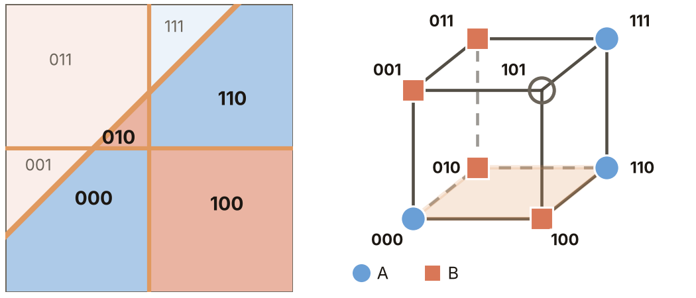

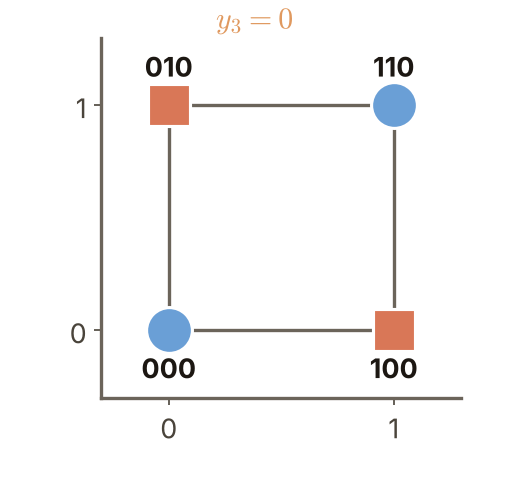

### 8. Proof by the shared midpoint

1. Add the two A corners: $q(000)+q(110)=a_0+(a_1+a_2+a_0)=a_1+a_2+2a_0>0$.
2. Add the two B corners: $q(010)+q(100)=(a_2+a_0)+(a_1+a_0)=a_1+a_2+2a_0\le0$.
3. One expression cannot be both $>0$ and $\le0$, so no choice of $a_0,a_1,a_2$ separates them. (On the bottom face $y_3=0$, so $a_3$ never appears.)

Geometrically, the diagonal of A (000 to 110) and the diagonal of B (010 to 100) meet at the midpoint $M=(\tfrac12,\tfrac12,0)$. Since $q$ is linear, $q(M)=\frac{a_1+a_2+2a_0}{2}$ is both the average of the two A scores (positive) and the average of the two B scores (nonpositive).

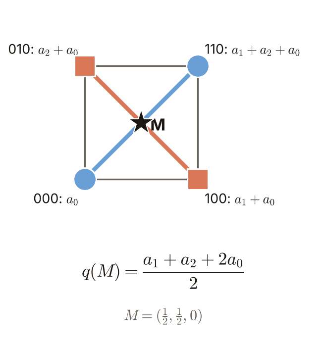

### 9. Not hopeless: one cut is not enough, one more layer helps

A two-layer network is a row of lines (the hidden layer) plus one output plane (the output layer). What is blocked is **this fixed set of lines plus this one cut**, not every two-layer network: with other lines the codes differ and so does the counterexample. The repair, in intuition: any single corner can be cut off by a plane, so cut each target corner separately and merge the results; that is what one more layer does.

Figure `lec05-kp03-slice-corner`: Three planes cut off the corners 110, 111 and 000. [Added figure]

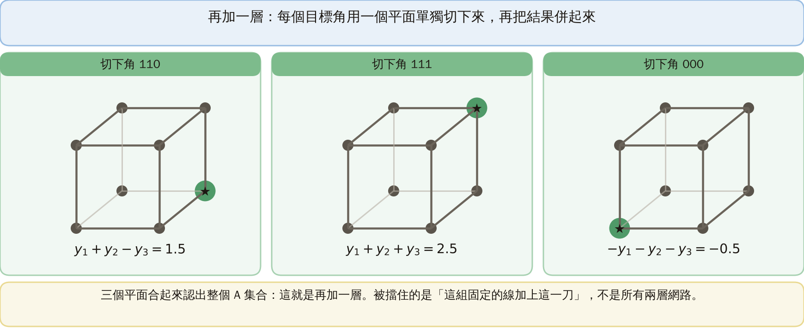

### Extension: the general form

With $d$ input coordinates and $p$ lines:

$$
\mathbf y=[f(g_1(\mathbf x)),\ldots,f(g_p(\mathbf x))]^T\in\{0,1\}^p,\qquad f(t)=\begin{cases}1,&t>0,\\0,&t\le0.\end{cases}
$$

$\{0,1\}^p$ has $2^p$ corners: the corners of a $p$-dimensional cube, a **hypercube**.

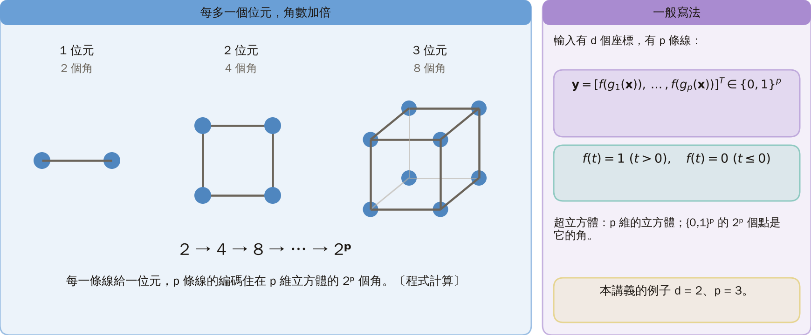

### Practice

**Practice**:

1. If we label the unrealized code 101 as A or as B, do the predictions on inputs change? Hint: ask whether any input receives 101.
2. With the second labelling, can changing only $a_3$ remove the contradiction on the bottom face? Hint: all four bottom-face points have $y_3=0$.

**Worked solution (question 2)**: ① Symbolic form: both sums equal $a_1+a_2+2a_0$. ② Substitute $y_3=0$: $a_3\cdot0=0$, so $a_3$ vanishes. ③ Result: both sums are independent of $a_3$ and the contradiction remains. ④ Check: for $a_3=100$ both sums are unchanged.

## Terminology and source

| Term | Meaning |
|---|---|
| Bit | 1 on the positive side of a line, otherwise 0 (positive side = half-space) |
| Step rule | a positive score gives 1, anything else 0 |
| Code, cell | the bits of a point written in a row; all points sharing one code |
| Realized / unrealized code | received by some input / received by none |
| Vertex | a corner of the cube (of the hypercube) |
| Output score, linearly separable | $q$ of the last layer; one plane separates A from B |
| Convex, union | segments stay inside; several cells merged |
| Nonseparable, counterexample | no plane separates A from B; an example showing a claim fails |

Source: Chapter 4, KP03, Section 4.3.1, accessed 2026-10-24. The output score and both label sets follow the source; the explicit input boundaries, the cube, notch and corner-cut figures, and the midpoint proof are [Added] checks of its claims.
