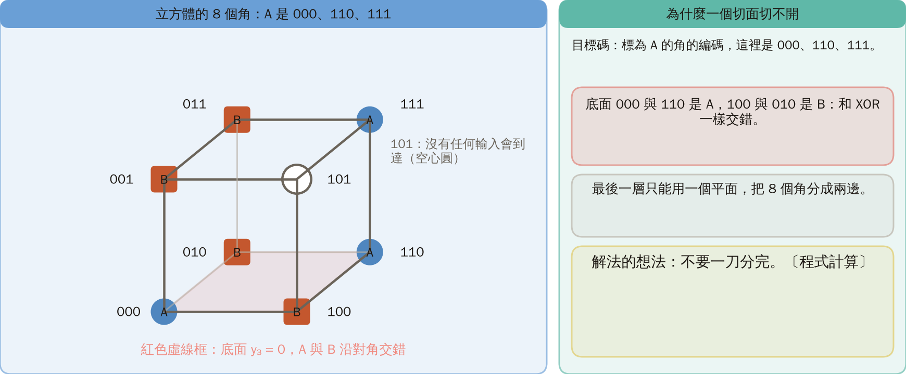
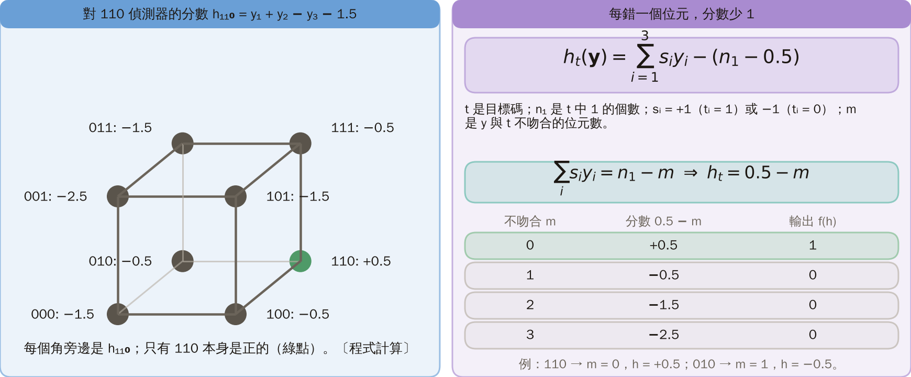
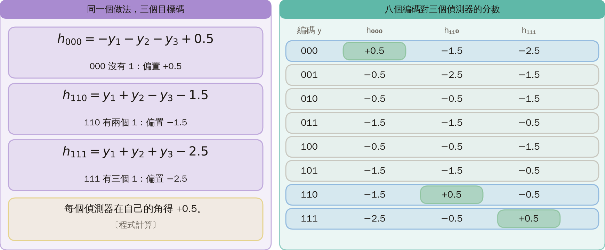
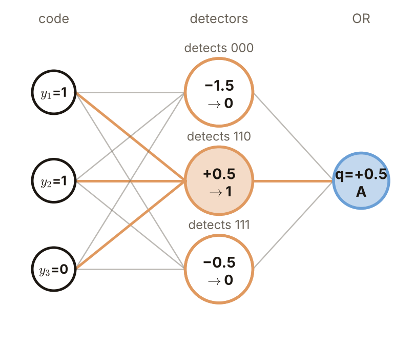
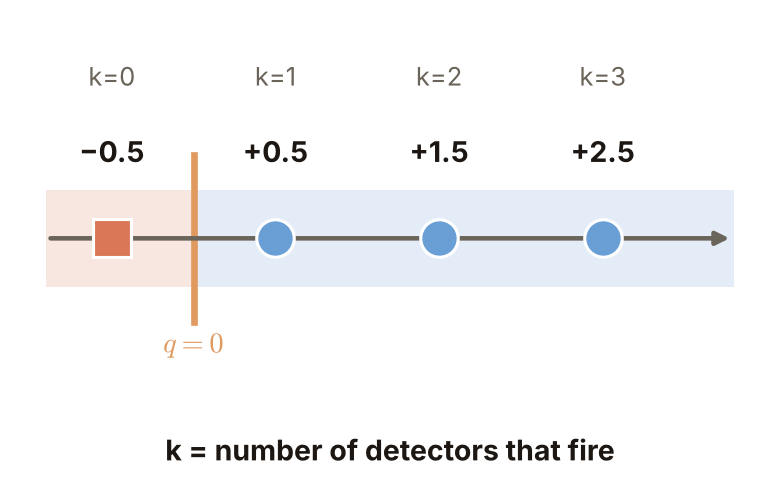
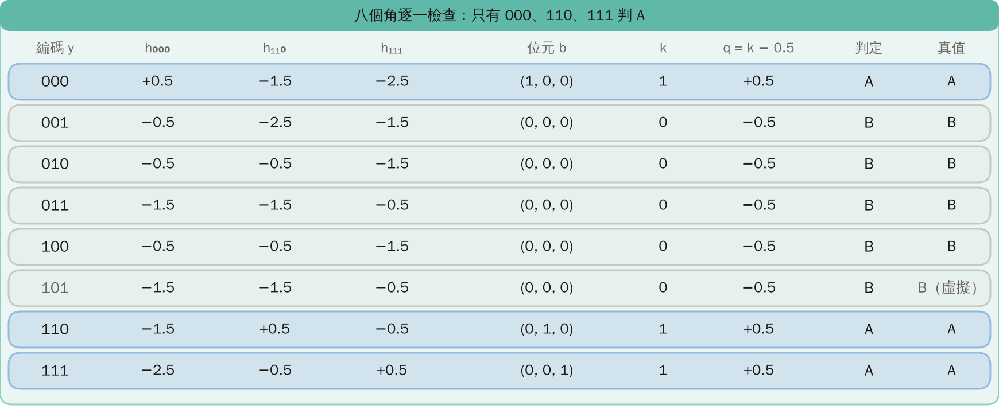
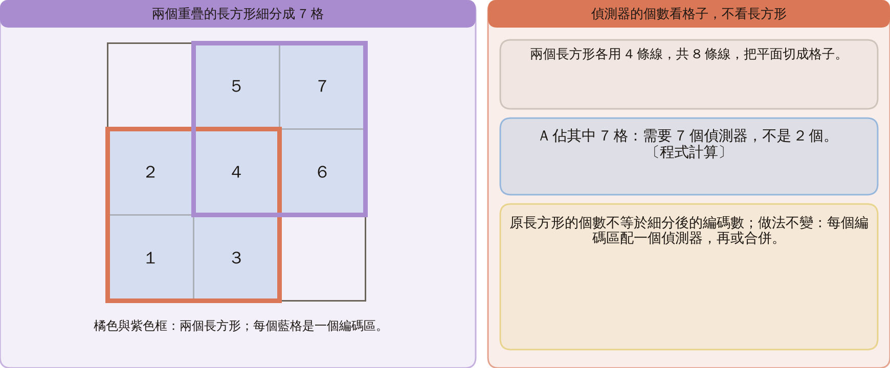
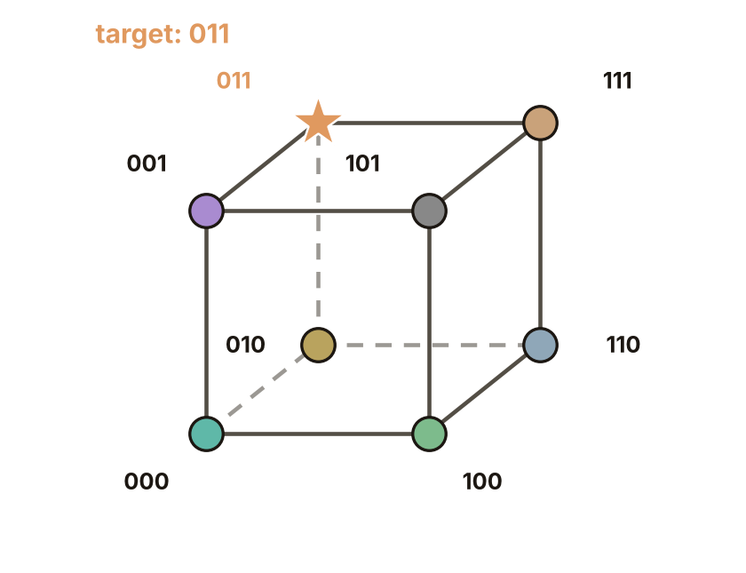
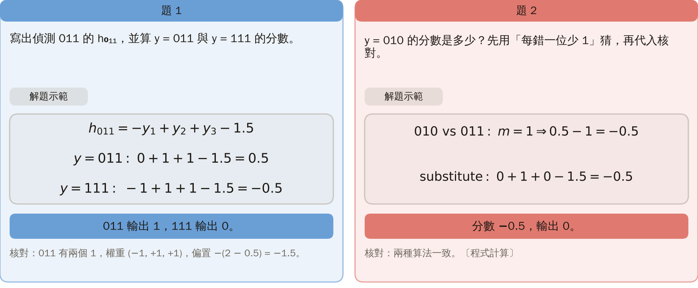

# KP04 Three-Layer Perceptron: Detect Each Code, Then Merge

> Level: undergraduate, year 3
>
> Pattern Recognition | Chapter 4, §4.3.2

[Slides: read and download](../../slides/lec05-kp04-three-layer-perceptron-en.jbd.json) | [中文版](../lec05-kp04-three-layer-perceptron.md)

## Learning objectives

- Write a detector for any three-bit target code and explain why its score is $0.5-$ (number of wrong bits).
- Join several detectors with an OR merge in the output layer and check the prediction at every code.
- Explain that the three-layer construction only proves that this is enough, not that the weights are learned or the network is minimal.

## KP04 Three-Layer Perceptron: Detect Each Code, Then Merge

**One-sentence summary**: A two-layer network has a single cut on fixed codes and cannot separate corners whose labels alternate; give each target code its own detector and merge them with an OR, and any set of corners can be split into A and B.

### Prerequisites and symbols

**Three things you need first** (KP02, KP03):

- **Codes and the corners of a cube**: three lines give three bits, which together form a code and match one of the 8 corners of a cube.
- **The output layer is one cut**: on the codes the output layer can only separate the corners into two sides with one plane.
- **The step rule**: $f(t)=1$ if $t>0$, otherwise $f(t)=0$.

**Symbol table** (fixed for this lecture):

| Symbol | Meaning | Note |
|---|---|---|
| $\mathbf y=(y_1,y_2,y_3)$ | the code output by the first hidden layer | a corner of the cube |
| $t$ | target code | a corner labelled A, here 000, 110, 111 |
| $n_1$ | number of ones in $t$ | section 3 |
| $s_i$ | the $i$-th weight of a detector | $+1$ if $t_i=1$, $-1$ if $t_i=0$ |
| $m$ | number of bits in which $\mathbf y$ differs from $t$ | $0\le m\le3$ |
| $h_t(\mathbf y)$ | score of detector $t$ | $h_t=0.5-m$ |
| $b_t$ | output bit of detector $t$ | $b_t=f(h_t)$ |
| $k$ | number of fired detectors (output 1) | section 6 |
| $q$ | score of the output layer | $q=k-0.5$ |

### 1. The A corners are scattered, so one cut fails

**Plain explanation**: At the end of the previous KP, with A at 000, 110 and 111, the A and B corners on the bottom face alternate as in XOR and the last layer cannot cut them apart. The idea is not to split everything in one cut.

- **Target code**: the code of a corner labelled A, here 000, 110 and 111.

Figure `lec05-kp04-cube-target`: look at the blue circles (A) and orange squares (B) first, then at the red dashed bottom face, where A and B alternate along the diagonals; the hollow 101 is never reached by any input. [Function: 1, 3]

The next question: instead of one cut, in how many steps?

### 2. Three steps: code, one detector per target code, A if any detector fires

- **Three-layer network**: two hidden layers plus an output layer. The first hidden layer makes the code with three lines, the second holds the detectors and the output layer merges them.
- **Detector**: a step unit that outputs 1 exactly when the input code equals one target code, and 0 otherwise.
- **OR merge**: if any detector outputs 1 the answer is A; if all are 0 the answer is B.

The two-layer network of the previous KP had only the first layer and the output layer, without the detector layer in between.

Figure `lec05-kp04-stages`: look at the input first, then at the three stages code, detectors and OR merge, each using only the result of the previous stage. [Function: 1]

### 3. Detect 110: every wrong bit costs 1 point

**Formal definition**: for a target code $t\in\{0,1\}^3$ with $n_1$ ones, the detector is

$$
h_t(\mathbf y)=\sum_{i=1}^{3} s_i\,y_i-\left(n_1-0.5\right),\qquad s_i=\begin{cases}+1,&t_i=1,\\-1,&t_i=0.\end{cases}
$$

The detector outputs the bit $b_t=f(h_t)$: $b_t=1$ if $h_t>0$ and $b_t=0$ otherwise.

**Why it works**: $\sum_i s_iy_i=n_1-m$, where $m$ is the number of bits in which $\mathbf y$ differs from $t$, so $h_t=0.5-m$.

- A perfect match: $m=0$, giving $+0.5$.
- One wrong bit: $m=1$, giving $-0.5$.
- Two wrong bits: $m=2$, giving $-1.5$, never above 0.

**Example**: 110 has two ones, $h_{110}=y_1+y_2-y_3-1.5$; $y=110$ gives $0.5$ and $y=010$ gives $-0.5$.

Figure `lec05-kp04-cube-one`: look at the score beside each corner for the 110 detector, then find the only positive one, the star (110 itself). [Function: 1, 2]

The next question: how about the other target codes?

### 4. The same recipe gives three detectors for 000, 110 and 111

$$
h_{000}=-y_1-y_2-y_3+0.5,\quad h_{110}=y_1+y_2-y_3-1.5,\quad h_{111}=y_1+y_2+y_3-2.5.
$$

000 has no ones so its bias is $-(0-0.5)=+0.5$; 111 has three ones so its bias is $-2.5$. Each detector scores $+0.5$ at its own corner.

Figure `lec05-kp04-three-det`: look at the target code each of the three cubes marks with a star, then compare: each detector's positive score is only at its own corner. [Function: 1, 3]

### 5. Code 110 arrives: only the 110 detector fires

Substituting $y=(1,1,0)$:

- The three scores: $h_{000}=-1.5$, $h_{110}=0.5$, $h_{111}=-0.5$.
- Turned into bits $b_t=f(h_t)$: $(b_{000},b_{110},b_{111})=(0,1,0)$.
- The output layer adds the bits and subtracts $0.5$: $0+1+0-0.5=0.5>0$, so A.

Figure `lec05-kp04-net-110`: look at the orange lines (the path that fires), then read the score and bit in each node. [Function: 1, 2]

The next question: how does the output layer treat all firing cases uniformly?

### 6. One rule merges them: fired count $k$ minus 0.5, above 0 means A

The output score is $q=b_{000}+b_{110}+b_{111}-0.5=k-0.5$, where $b_t$ is the 0/1 output of a detector and $k$ is the number of detectors with output 1.

- $k=0$ gives $-0.5$ and B.
- $k\ge1$ gives $0.5,\ 1.5,\ 2.5$ and A.
- This is an OR merge.
- Every code fires at most one detector, so only $k=0$ or $1$ occurs.

Figure `lec05-kp04-or-line`: look at the zero on the number line between $k=0$ and $k=1$, then at B on the left and A on the right. [Function: 1, 2]

### 7. All eight corners: only 000, 110 and 111 give A

Do not check only the successful inputs. For $010$ the three detector scores are $-0.5,\ -0.5,\ -1.5$, all bits are 0, the output is $-0.5$ and the answer is B. The unrealized code 101 also gives all zeros, so B; no input ever gets it, so it does not affect classification.

Figure `lec05-kp04-firing`: look at each row as one code, then at the bits of the three detectors; only 000, 110 and 111 make their own detector fire and give A. [Function: 1, 2]

### 8. Back in the input plane: the network gets the three cells 000, 110 and 111 right

The A region is the union of the cells 000, 110 and 111 (110 and 111 are neighbours) with the B cell 010 between them; one cut could not do this and the three-layer network does.

Figure `lec05-kp04-plane-final`: look at the blue A region and the orange B region first, then at the A circles and the B square: all correct. [Function: 1, 3]

**Common misconception**: believing that because a three-layer construction exists, the network has learned the weights or is the smallest possible. The construction only proves that this is enough; how the weights come from labelled points is the question of the next KP.

### Extension: overlapping rectangles, practice and worked solution

**Overlapping rectangles** [added]: two overlapping rectangles use 4 lines each, so 8 lines cut the plane into cells; A covers 7 of them and needs 7 detectors with this recipe, not 2. The number of original rectangles is not the number of codes after subdivision; the recipe is unchanged.

Figure `lec05-kp04-refine`: look at the orange and purple rectangles, then count the cells numbered 1 to 7: each cell is a code region. [Function: 1, 3]

**Practice**:

1. Write the detector $h_{011}$ for $011$ and compute its score at $y=011$ and $y=111$. Hint: weight $+1$ where the target bit is 1, $-1$ where it is 0, bias $-(\text{number of ones}-0.5)$.
2. What is the score at $y=010$? Hint: guess first with "every wrong bit costs 1", then substitute to check.

Figure `lec05-kp04-cube-011`: look at the star (target code 011), then think how many bits each corner differs from it. [Function: 1]

**Worked solution of questions 1 and 2**: (1) Formula: 011 has two ones, the weights are $(-1,+1,+1)$ and the bias is $-(2-0.5)=-1.5$, so $h_{011}=-y_1+y_2+y_3-1.5$. (2) Substitute: $y=011$: $0+1+1-1.5=0.5$; $y=111$: $-1+1+1-1.5=-0.5$. (3) Decision: 011 outputs 1 and 111 outputs 0. (4) Question 2: 010 is one bit from 011, so the score is $0.5-1=-0.5$; substituting $0+1+0-1.5=-0.5$ agrees.

Figure `lec05-kp04-cube-011-scores`: look at the score beside each corner for the 011 detector, then check that only 011 is positive. [Function: 1, 2]

## Terms and sources

| English | 中文 |
|---|---|
| Target code | 目標碼 |
| Three-layer network | 三層網路 |
| Detector | 偵測器 |
| OR merge | 或合併 |

Source: Chapter 4 KP04, §4.3.2 (read 2026-10-24). That a three-layer network can represent alternating corners follows the source; the general detector formula, the corner-by-corner check and the subdivision example are [added] and verified by program.
