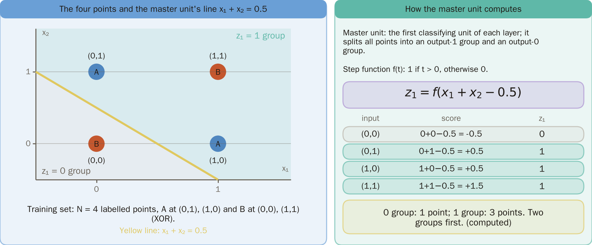
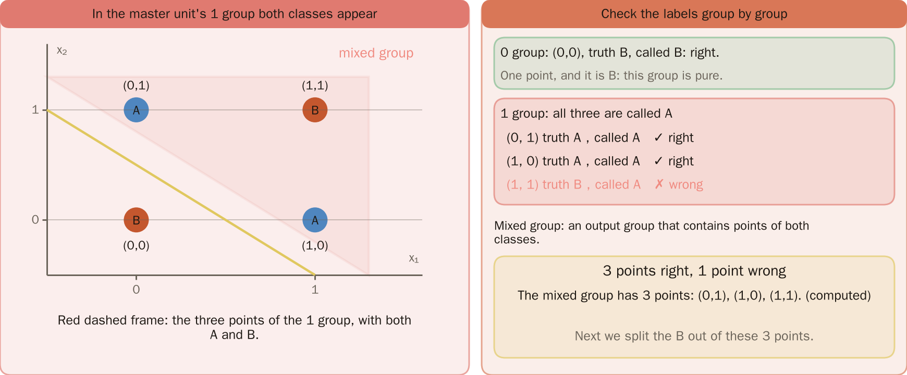
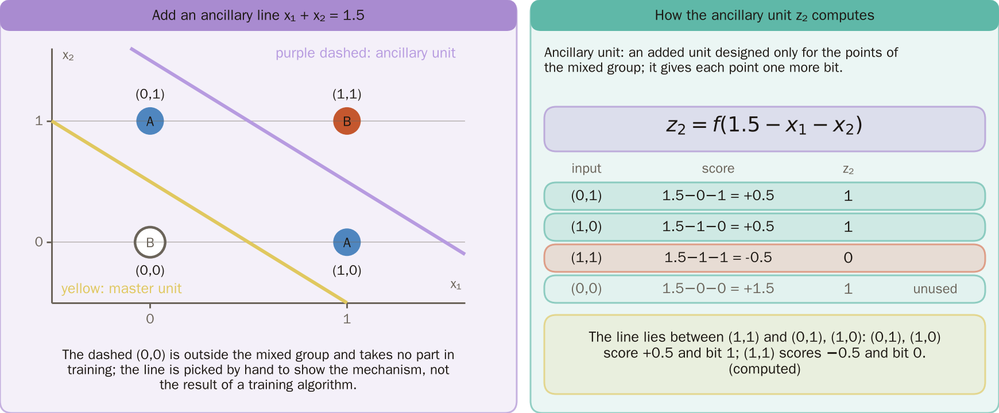
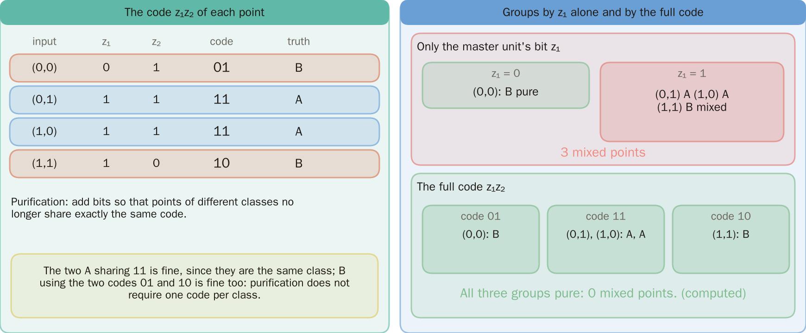
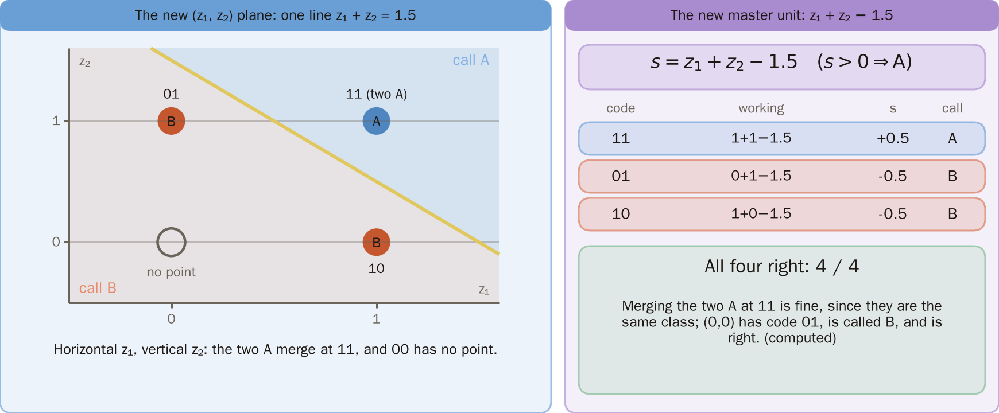
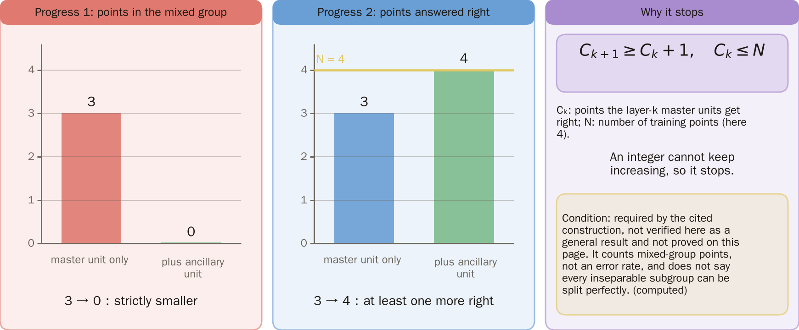
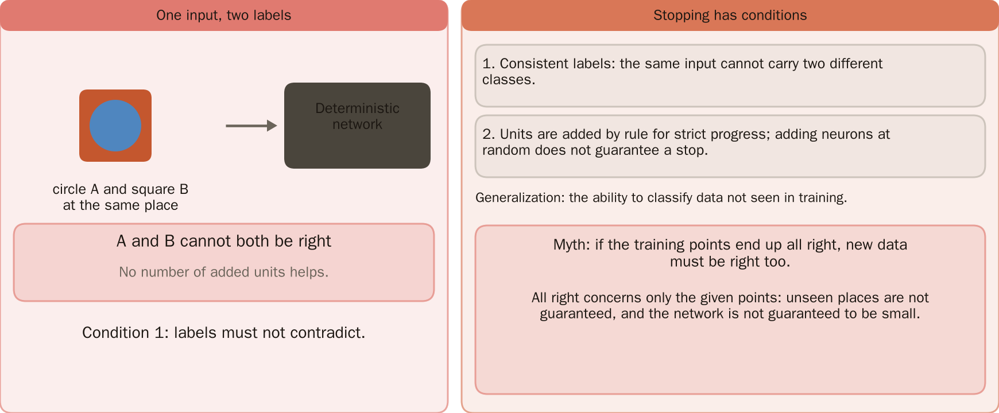
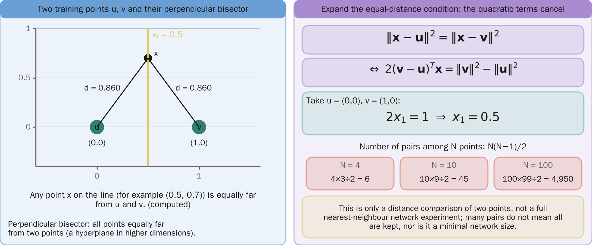
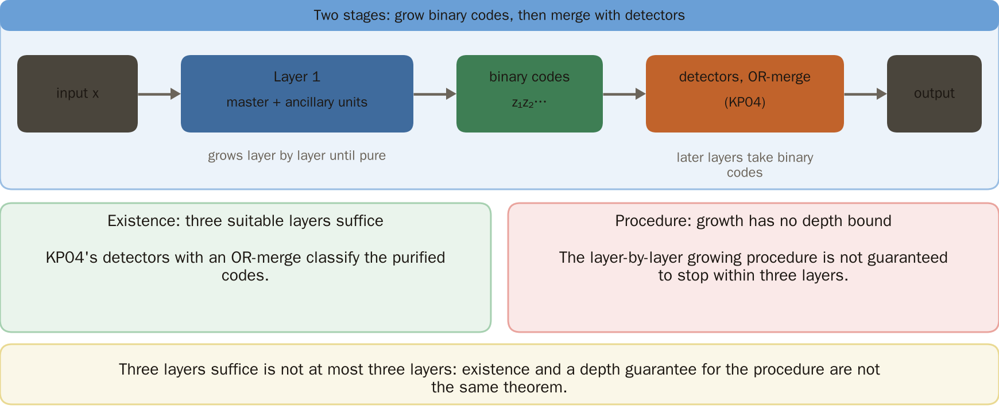
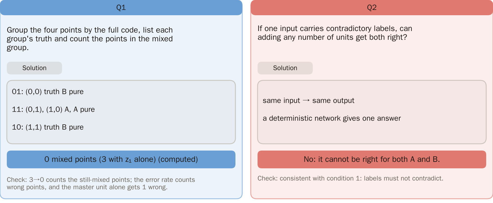

# KP05 Constructive Methods: Growing a Network from Training Points

> Level: undergraduate, year 3
>
> Pattern Recognition | Chapter 4, §4.5

[Slides: read and download](../../slides/lec05-kp05-constructive-methods-en.jbd.json) | [中文版](../lec05-kp05-constructive-methods.md)

## Learning objectives

- Distinguish master units, ancillary units and purification, and hand-compute one purification on the four XOR points.
- Explain why the process stops using strict progress on a finite sample, and state its conditions.
- Explain why zero training error guarantees neither generalization nor a small network.

## KP05 Constructive Methods: Growing a Network from Training Points

**One-sentence summary**: In practice we only have labelled points. A constructive method first splits them with a master unit and then handles the groups that are still mixed with ancillary units until different classes no longer share a code; this is a training-set goal, not a guarantee on unseen data.

### Prerequisites and symbols

**Three things you need first** (KP02–KP04):

- **Step unit**: turns a score into a bit 0 or 1 through a step; the bits together form a code.
- **Codes and purity**: if two points of different classes have exactly the same code, the output layer cannot separate them.
- **The four XOR points**: $(0,0)$ and $(1,1)$ are B, $(0,1)$ and $(1,0)$ are A.

**Symbol table** (fixed for this lecture):

| Symbol | Meaning | Note |
|---|---|---|
| $X=\{(\mathbf x_n,c_n)\}$ | training set | $N$ points, $c_n\in\{0,1\}$ the class (here $N=4$) |
| $f(t)$ | step function | 1 if $t>0$, otherwise 0 |
| $z_1$ | bit of the master unit | section 1 |
| $z_2$ | bit of the ancillary unit | section 3 |
| $C_k$ | number of points the master unit of layer $k$ gets right | section 6 |

### 1. In practice we only have labelled points: first split them with a master unit

**Plain explanation**: The construction of KP04 knew the equations of the target regions, while in practice we only have points and labels. This section takes the four XOR points and starts building from points.

- **Master unit**: the first unit of a layer, in charge of classifying; it splits all points into a group with output 1 and a group with output 0.

**Formal definition**: let $X=\{(\mathbf x_n,c_n)\}_{n=1}^N$ be a finite labelled set with $c_n\in\{0,1\}$. Here $z_1=f(x_1+x_2-0.5)$, where $f(t)=1$ if $t>0$ and 0 otherwise.

Figure `lec05-kp05-master`: First see the four points and the yellow master-unit line x₁ + x₂ = 0.5 on the left; then see z₁ computed point by point on the right: (0,0) is in the 0 group and the other three are in the 1 group. [Function: 1, 3]

### 2. The master gets only 3 of 4 right: its 1 group holds two A and one B

**Mixed group**: an output group that contains points of both classes. $(0,0)$ alone is in the 0 group (B, correct). The 1 group is $(0,1)$, $(1,0)$ and $(1,1)$, all called A: the two A are right and the B at $(1,1)$ is wrong. The master gets 3 points right.

Figure `lec05-kp05-mixed`: First see the three points of the mixed group in the red dashed frame; then see the group-by-group check on the right: the 0 group is right, the two A of the 1 group are right and the B at (1,1) is wrong, so 3 points are right. [Function: 1]

### 3. For the demonstration we pick one ancillary line by hand to split off the upper-right B

**Ancillary unit**: a new unit designed only for the points of a mixed group; it gives every point one more bit. Real methods find its weights with a training algorithm; here we pick them by hand.

**Example** [added]: take $z_2=f(1.5-x_1-x_2)$, whose line $x_1+x_2=1.5$ lies exactly between $(1,1)$ and $(0,1),(1,0)$: $(0,1)$ and $(1,0)$ score $0.5$ and get bit 1; $(1,1)$ scores $-0.5$ and gets bit 0. $(0,0)$ is not in the mixed group and takes no part in training; its $z_2=f(1.5)=1$ is just a value computed along the way. This is a mechanism demonstration, not a recorded run of a training algorithm.

Figure `lec05-kp05-anc`: First see the yellow solid line (master unit), then see the purple dashed line x₁ + x₂ = 1.5 (ancillary unit) between (1,1) and the other two points; the table on the right lists z₂ as 1, 1, 0. [Function: 1, 3]

### 4. With the extra bit the codes are 01, 11, 11, 10

**Purification**: adding bits so that points of different classes no longer share exactly the same code.

| Input | Code $z_1z_2$ | Label |
|---|---|---|
| $(0,0)$ | 01 | B |
| $(0,1)$ | 11 | A |
| $(1,0)$ | 11 | A |
| $(1,1)$ | 10 | B |

Purification does not require one code per class: B occupying the two codes 01 and 10 is fine.

Figure `lec05-kp05-codes`: First see the two-bit codes 01, 11, 11, 10 of the points on the left; then see on the right: with z₁ alone 3 points are mixed, with the full code the three groups are pure and 0 points are mixed. [Function: 1]

### 5. On the new codes, one new master unit classifies all four points

The new master unit is $z_1+z_2-1.5$, above 0 means A: 11 gives $1+1-1.5=0.5$, A; 01 gives $-0.5$ and 10 gives $-0.5$, B. All four points are right; merging the two A points at 11 is harmless because they are the same class.

Figure `lec05-kp05-code-plane`: First see the new (z₁, z₂) plane, then see the two A merged at 11 and no point at 00, and finally find the line z₁ + z₂ = 1.5 that separates A from B; the table on the right lists the scores +0.5, −0.5, −0.5. [Function: 1, 3]

### 6. Why it stops: the mixed group shrinks, correct points increase, and the number of points is finite

- **Progress one**: within a layer, the mixed group that still needs refining strictly shrinks. Here it goes from 3 points to 0.
- **Progress two**: under a suitable inter-layer construction the new master keeps the points the old one got right and gets at least one more. With $C_k$ the number of points the master of layer $k$ gets right:

$$
C_{k+1}\ge C_k+1,\qquad C_k\le N.
$$

This condition is required by the cited construction, is not a general result verified by this example, and is not proved here; here $C$ rises from 3 to 4. An integer cannot increase forever, so the process stops. Note that 3→0 counts points in the mixed group, not an error rate. This is the stopping reason when the conditions hold, not a claim that every nonseparable subgroup can be perfectly separated.

Figure `lec05-kp05-progress`: First see the red bar (mixed-group points) fall from 3 to 0, then the blue bar (correct points) rise from 3 to 4 with the dashed line at N = 4; the right gives the condition and the reason for stopping. The values are computed for this example, not an experimental curve from the source. [Function: 2]

### 7. Stopping has conditions: labels must not contradict, and all correct only means these points

When two identical inputs carry different labels, a deterministic network has one output for one input and cannot get both right. Nodes must be added by rule to get strict progress; adding neurons arbitrarily does not guarantee termination.

**Common misconception**: since all training points end up right, new data will be right as well. All correct concerns only the points given; it guarantees neither correct answers at unseen locations nor a small network.

Figure `lec05-kp05-conflict`: First see the circle and the square at the same place, then see that going into one deterministic network gives only one output; the right gives the two conditions for stopping and the common myth. [Function: 1]

The next KP asks: can we fix the architecture first and then learn the weights with a cost function?

### Extension: nearest neighbour, three layers, practice and worked solution

**Another route (nearest neighbour)**: compare distances with the perpendicular bisector of two training points. [Added] Let $\mathbf u,\mathbf v$ be two training points. The equal-distance condition expands, and the common quadratic term cancels:

$$
\|\mathbf x-\mathbf u\|^2=\|\mathbf x-\mathbf v\|^2\iff 2(\mathbf v-\mathbf u)^T\mathbf x=\|\mathbf v\|^2-\|\mathbf u\|^2.
$$

With $\mathbf u=(0,0)$ and $\mathbf v=(1,0)$ this gives $2x_1=1$, that is $x_1=0.5$. This is only one pairwise comparison, not a full nearest-neighbour network experiment. $N$ points have at most $N(N-1)/2$ pairs, so comparisons can grow quadratically; this does not mean all must be kept and it is not a minimal network size.

Figure `lec05-kp05-nearest`: First see the two training points u, v, then see the perpendicular bisector x₁ = 0.5 between them: every point on the line is equally far from both (for example (0.5, 0.7) is 0.860 from each); the right expands the equal-distance condition and counts pairs 6, 45, 4950. [Function: 1, 3]

**Three layers suffice, which is not a bound on the growth**: inputs after the first layer are binary codes, and KP04's detectors plus OR can classify the purified codes, so a suitable three-layer representation is enough; but a layer-by-layer growth procedure is not guaranteed to stop within three layers. Existence and a depth guarantee for a procedure are not the same theorem.

Figure `lec05-kp05-layers`: First see the block diagram above: later layers take binary codes, and detectors with an OR-merge are enough; below, the left is existence and the right is that the growing procedure has no depth bound. [Function: 1]

**Practice**:

1. Group the four points by their full code, list the labels of each group and count the points in mixed groups. Hint: first write down which points have each of the codes 01, 11 and 10.
2. If one input appears with contradictory labels, can adding more nodes classify both correctly? Hint: deterministic outputs.

**Worked solution (question 1)**:

- By master bit: $\{(0,0)\}$ is B, pure; $\{(0,1),(1,0),(1,1)\}$ is A, A, B, mixed, 3 points.
- By full code: 01: B; 11: A, A; 10: B, all pure, 0 mixed points.
- 3→0 counts points still mixed; an error rate counts wrong answers, and the master alone is wrong on 1 point.

**Worked solution (question 2)**: the same input gives the same output, so a deterministic network gives one answer and cannot be right for both A and B.

Figure `lec05-kp05-groups`: The left is Q1: grouped by the full code, 01, 11, 10 are all pure with 0 mixed points; the right is Q2: contradictory labels cannot both be right, each with its check. [Function: 1, 2]

## Terms and sources

| English | 中文 |
|---|---|
| Constructive method | 構造式方法 |
| Master unit | 主要節點 |
| Ancillary unit | 輔助節點 |
| Mixed group | 混雜群 |
| Purification | 純化 |
| Perpendicular-bisector hyperplane | 垂直平分超平面 |
| Generalization | 泛化 |

Source: Chapter 4 KP05, §4.5 (read 2026-10-24). The tiling, pocket, LMS, binary intermediate representation and nearest-neighbour comparison follow the source; the complete original algorithm was not available, so no full replication is claimed. The XOR purification numbers, the distance formula and the data-consistency condition are [added].
