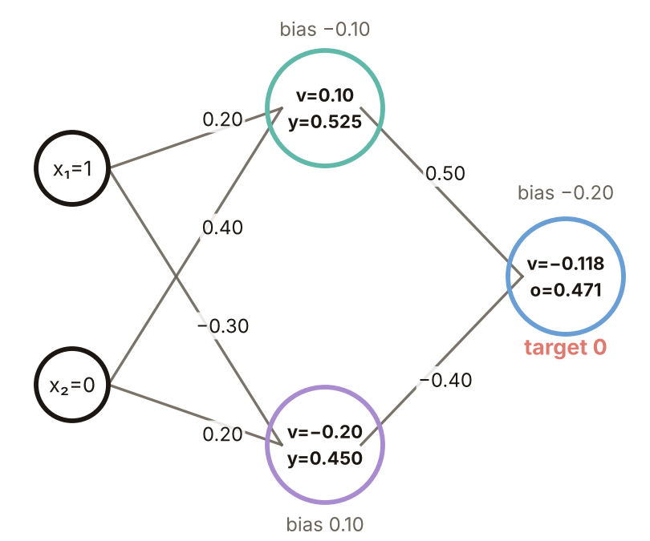

# KP06 From the Step to the Gradient of Backpropagation

> Level: undergraduate, year 3
>
> Pattern Recognition | Chapter 4, §4.6

[Slides: read and download](../../slides/lec05-kp06-backprop-gradient-en.jbd.json) | [中文版](../lec05-kp06-backprop-gradient.md)

## Learning objectives

- Explain why the step function is replaced by a sigmoid and the trade-off of the slope parameter $a$.
- Use the chain rule to write the slope of a weight as "$\delta$ times the input" and compute every $\delta$ of a 2-2-1 network step by step.
- Update all nine weights by one step and check the gradients with numerical differences.

## KP06 From the Step to the Gradient of Backpropagation

**One-sentence summary**: The step function is not differentiable, so it is replaced by a sigmoid that has a slope; with the chain rule the gradient of each weight is $\delta$ (error times slope) times the weight's input, and $\delta$ is computed from the output layer backward along the weights, which is backpropagation.

### 1. The step function has no slope to read

**Plain explanation**: In KP05 the weights were given by rules. To let the network learn its weights we read the slope of the cost in each weight and move the weight in the direction that lowers the cost.

- **Cost function**: one number that adds up how far predictions are from targets; smaller is better. Here $E=\tfrac12(\text{target}-\text{output})^2$.
- **Gradient descent**: read the slope of the cost in every weight and move the weight a little in the direction that lowers the cost.

Apart from the jump the step function has slope 0, and at the jump it has no slope. Without a slope, gradient descent has nothing to work with.

Figure `lec05-kp06-step-slope`: top, the step function with slope 0 everywhere and no slope at the jump; bottom, the sigmoid with a tangent of slope 0.25 in the middle.

### 2. Rounding the step into a sigmoid gives a slope everywhere, but nearer to a step the slope is narrower

**Formal definition**:

$$
f(x)=\frac{1}{1+e^{-ax}},\qquad f'(x)=a\,f(x)\,\bigl(1-f(x)\bigr).
$$

A larger $a$ is closer to a step. The **sigmoid** squeezes any number into 0 to 1.

**Common misconception**: that closer to a step is better. A larger $a$ makes the slope a taller, narrower spike with almost zero slope on both sides, which makes gradient training harder. Also, once we leave the step the output is no longer just 0 or 1, the earlier picture of cube corners no longer holds and the cost function carries the classification.

Figure `lec05-kp06-sigmoid-a`: top, three sigmoids ($a=0.7,2,8$) with the dashed step; bottom, their slopes.

### 3. Walk a small 2-2-1 network through

**Forward pass**: compute layer by layer from the input. Each unit first forms the weighted sum $v$ and then applies the sigmoid to get $y=f(v)$, and the intermediate values are stored.

**Example**: input $x=(1,0)$, target $1$. Weights (bias, $x_1$, $x_2$): hidden unit 1 $(-0.10,\,0.20,\,0.40)$, unit 2 $(0.10,\,-0.30,\,0.20)$, output unit $(-0.20,\,0.50,\,-0.40)$.

- Hidden layer: $v_1=-0.10+0.20\cdot1+0.40\cdot0=0.10$, $y_1=0.525$; $v_2=0.10-0.30\cdot1+0.20\cdot0=-0.20$, $y_2=0.450$.
- Output layer: $v_o=-0.20+0.50\cdot0.525-0.40\cdot0.450=-0.118$, output $o=0.471$. The error is $e=1-0.471=0.529$ and $E=\tfrac12e^2=0.140$.

Figure `lec05-kp06-net-forward`: weights beside the lines, biases above the figure.

### 4. How much to change one weight: split the cost's slope into three slopes multiplied together

**Chain rule**: $E$ depends on the weight $w$ only through $o$ and $v$, so

$$
\frac{\partial E}{\partial w}=\frac{\partial E}{\partial o}\cdot\frac{\partial o}{\partial v}\cdot\frac{\partial v}{\partial w}.
$$

For the weight from hidden unit 1 to the output: $\partial E/\partial o=-e=-0.529$, $\partial o/\partial v=f'(v_o)=o(1-o)=0.249$ and $\partial v/\partial w=y_1=0.525$ (the input this weight multiplies). The product is $-0.069$, and the minus sign means that increasing $w$ lowers $E$.

Figure `lec05-kp06-chain`: the three slopes along $w\to v\to o\to E$ and their product.

### 5. The error signal $\delta$: the output layer's gradient is $\delta$ times the input

The **error signal** is $\delta\equiv-\partial E/\partial v$, "error times slope". For the output unit $\delta_o=e\,f'(v_o)=0.529\times0.249=0.1319$. The descent direction of each weight is $-\partial E/\partial w=\delta\cdot(\text{the input this weight multiplies})$; for example the slope $-0.069$ of section 4 with its sign flipped is $0.1319\times0.525$.

The **learning rate** $\eta$ is the step size of each update, here $\eta=0.3$. The update is $\Delta w=\eta\,\delta\cdot\text{input}$. The inputs of the three output weights are $1$ (bias), $y_1=0.525$ and $y_2=0.450$, so the updates are $+0.0396$, $+0.0208$ and $+0.0178$.

**Sign convention** [added]: the source writes $\delta$ both as $\partial E/\partial v$ and as "error times slope", which differ by a sign; this lecture fixes $\delta=-\partial E/\partial v$, so the update adds $\eta\delta\cdot$input.

Figure `lec05-kp06-out-bars`: the updates of the three output weights, all positive.

### 6. Hidden units do not see the target: pass the output $\delta$ back along the weights

**Backpropagation**: after the forward pass, go backward from the output layer. A hidden unit affects $E$ only through the weights to the next layer, so a unit's $\delta$ is the sum of the next layer's $\delta$ times the connecting weights, times the unit's own slope:

$$
\delta_j=f'(v_j)\sum_k\delta_k\,w_{kj}.
$$

Example: $\delta_1=0.249\times0.1319\times0.50=0.0164$; $\delta_2=0.248\times0.1319\times(-0.40)=-0.0131$ ($w_{o2}<0$, so $\delta_2<0$).

Figure `lec05-kp06-net-backward`: the red lines are the path of the error going backward.

### 7. After one step on all nine weights the cost drops from 0.140 to 0.132

The hidden-layer inputs are $(1,1,0)$: unit 1's bias and $x_1$ weight each get $+0.0049$; unit 2's each get $-0.0039$; the $x_2$ weights stay (input 0). Recomputing the forward pass (program): output $o=0.4857$ (was $0.4706$), $E=0.1322$ (was $0.1401$). One step is small and many repeats are needed to approach the target.

Figure `lec05-kp06-before-after`: left, the output; right, the cost.

### 8. Check with numerical slopes

Shift one weight by a tiny $\varepsilon=10^{-6}$ up and down and see how much $E$ changes: $[E(w+\varepsilon)-E(w-\varepsilon)]/(2\varepsilon)$. For all nine weights $-\delta\times\text{input}$ equals the difference slope within $10^{-6}$ (program). This is the most common debugging method when writing backpropagation code. The next knowledge point writes the whole procedure as an algorithm.

Figure `lec05-kp06-numcheck`: bars are $\delta\times$input, dots are the difference slopes.

### Extension: saturation, practice and worked solution

**Saturation**: at $x=3$, $f'(3)=a\,f(1-f)$ is $0.068$ for $a=0.7$, $0.0049$ for $a=2$ and $3\times10^{-10}$ for $a=8$. With a large $a$ the sigmoid saturates not far from the centre, $\delta$ is multiplied by a slope near 0 and the weights hardly move; so $a$ is chosen moderate.

Figure `lec05-kp06-saturation`: logarithmic bar chart of the slope.

**Practice**: keep the example and change only the target from 1 to 0; the forward pass is unchanged.

1. What are the error $e$ and the output-layer $\delta_o$? Hint: $e=$ target $-$ output and $f'(v_o)=0.249$ stays.
2. In which direction does each of the three output weights move and by how much ($\eta=0.3$)?

Figure `lec05-kp06-practice-net`: the same network with target 0.

**Worked solution of questions 1 and 2**: (1) $e=0-0.471=-0.471$ and $\delta_o=-0.471\times0.249=-0.1173$. (2) $\Delta w=0.3\times(-0.1173)\times\text{input}$: bias $-0.0352$, $w_{o1}$ $-0.0185$, $w_{o2}$ $-0.0158$; all three move down. (3) Check: the output 0.471 must drop toward 0, so the output weights should decrease, with signs exactly opposite to the target-1 case.

Figure `lec05-kp06-practice-sol`: the updates of the three output weights, all negative.

## Terms and sources

| English | 中文 |
|---|---|
| Cost function | 代價函數 |
| Gradient descent | 梯度下降 |
| Sigmoid (logistic function) | sigmoid |
| Forward pass | 前向傳遞 |
| Chain rule | 連鎖律 |
| Error signal ($\delta$) | 誤差訊號 |
| Backpropagation | 反向傳播 |
| Learning rate | 學習率 |

Source: Chapter 4 KP06, §4.6 (read 2026-10-25). The sigmoid family, the chain rule and the backward recursion of $\delta$ follow the source; the 2-2-1 weights, input and target are the initial settings of the source's interactive example, and every worked number, update and numerical check was recomputed for this lecture ([added], (program)); the sign convention of $\delta$ is fixed by this lecture.
