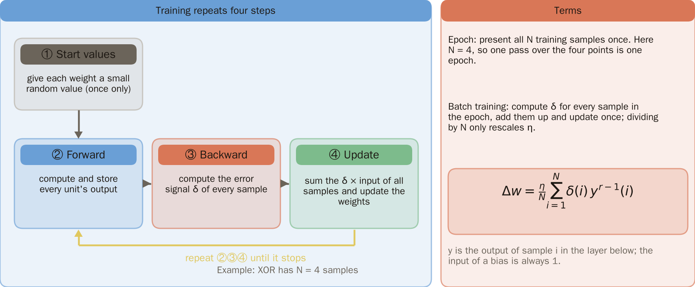
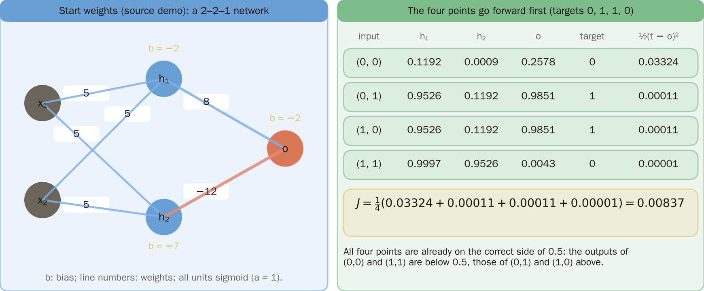
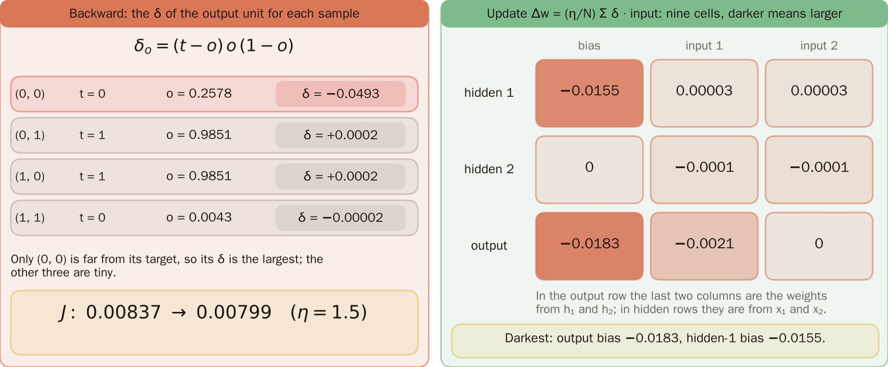
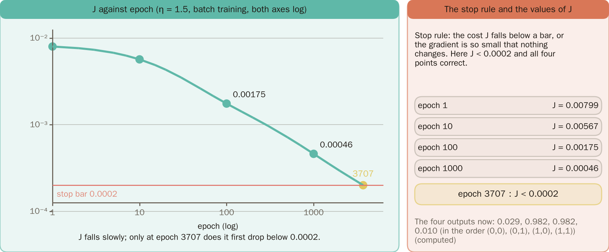
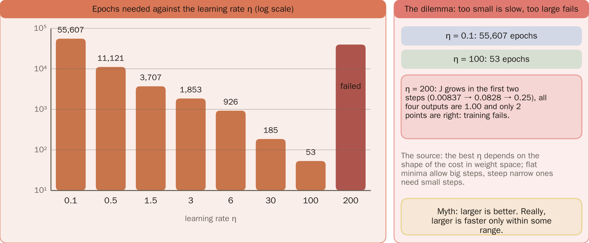
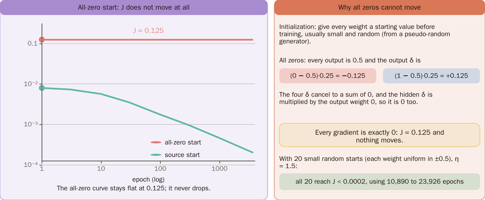
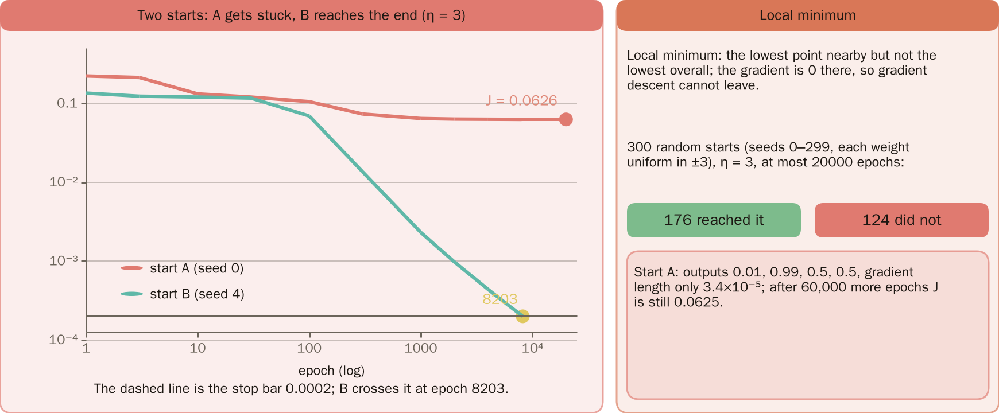
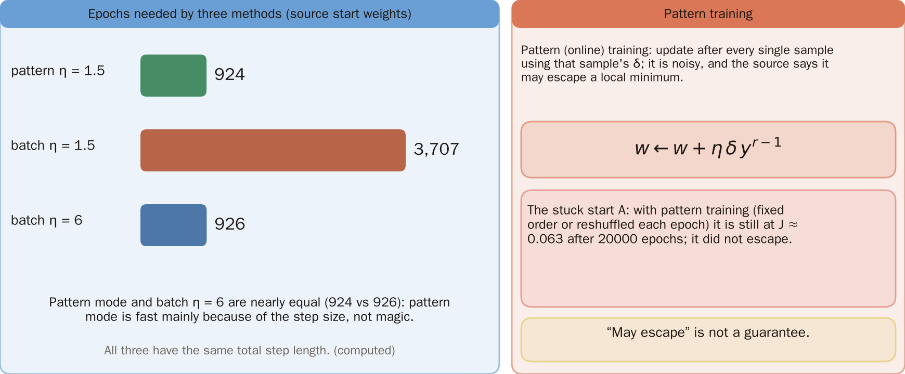
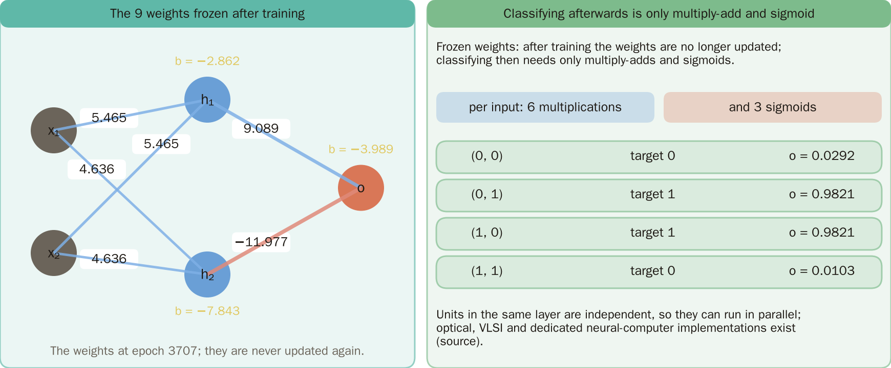
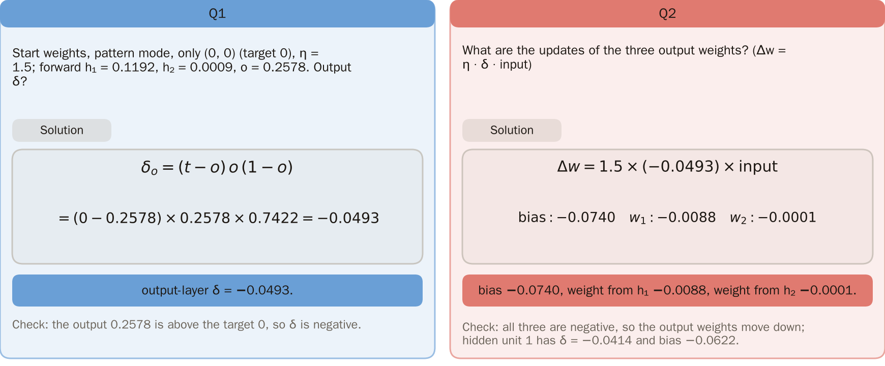

# KP07 The Backpropagation Algorithm

> Level: undergraduate, year 3
>
> Pattern Recognition | Chapter 4, §4.7

[Slides: read and download](../../slides/lec05-kp07-backprop-algorithm-en.jbd.json) | [中文版](../lec05-kp07-backprop-algorithm.md)

## Learning objectives

- Write the four steps of backpropagation training and explain epoch, batch training and the stop rule.
- Walk through the first epoch of the XOR 2-2-1 network and read the curve of the cost $J$ against epochs.
- Explain how the learning rate, the initial values, local minima and pattern training each affect training.

## KP07 The Backpropagation Algorithm

**One-sentence summary**: KP06 took one step on one sample; real training gives the weights start values once and then repeats forward, backward and update in every epoch until the cost is small enough. The learning rate, the start values and whether training falls into a local minimum decide how fast it is and whether it succeeds.

### Prerequisites and symbols

**Three things you need first** (KP06):

- **Forward pass**: compute from the input forwards the weighted sum and output of every unit.
- **Error signal $\delta$**: $\delta=-\partial E/\partial v$; the downhill direction of a weight is $+\eta\,\delta\times$input.
- **Chain rule and backpropagation**: the $\delta$ of a hidden unit is computed back from the $\delta$ of the next layer along the weights.

**Experiment setup of this lecture** (implemented in a program, with the sigmoid $a=1$ of KP06):

- Data: the four XOR points, inputs $(0,0),(0,1),(1,0),(1,1)$ and targets $0,1,1,0$.
- Network: 2–2–1 with 9 weights (3 for each of the 2 hidden units and 3 for the output unit).
- Cost $J$: the mean of $\tfrac12(\text{target}-o)^2$ over the four samples.
- Stop rule: $J<0.0002$ and all four points on the right side of 0.5.
- Initial weights: unless stated otherwise those of the source's interactive example (section 2).

**Symbol table**:

| Symbol | Meaning | Note |
|---|---|---|
| $N$ | number of training samples | here $N=4$ |
| epoch | one presentation of all $N$ samples | |
| $\eta$ | learning rate | the size of one step |
| $\delta(i)$ | error signal of sample $i$ | the convention of KP06 |
| $y^{r-1}(i)$ | output of sample $i$ at layer $r-1$ | the input of a bias is fixed at 1 |
| $J$ | cost | the mean squared error over four samples |

### 1. Training repeats four steps

**Plain explanation**: Real training has many samples, for example the four XOR points. The question is when the weights are updated.

- **Epoch**: presenting all $N$ training samples once. Here $N=4$.
- **Batch training**: in one epoch every sample first gets its $\delta$ and the sum updates the weights once, $\Delta w=\eta\sum_i\delta(i)\,y^{r-1}(i)/N$. Dividing by $N$ only rescales $\eta$.

**Formal definition**: batch update $\Delta w=\dfrac{\eta}{N}\sum_{i=1}^{N}\delta(i)\,y^{r-1}(i)$, where $y^{r-1}(i)$ is the previous-layer output for sample $i$ (the input of a bias is fixed at 1).

**Example**: for XOR with $N=4$, one epoch looks at the four points and updates once.

**Steps**:

1. Give every weight a small random start value (once).
2. Forward and store values.
3. Backward for the $\delta$ of every sample.
4. Update.

Repeat steps 2 to 4 until stopping.

Figure `lec05-kp07-loop`: First see the four step boxes: 1 start values once, then 2 forward, 3 backward and 4 update repeated until it stops; then the definitions of epoch and batch training with the batch update formula on the right. [Function: 1]

### 2. Epoch 1: the four points go forward first

Take the initial weights of the source's interactive example (bias, $x_1$, $x_2$): hidden unit 1 $(-2,5,5)$, unit 2 $(-7,5,5)$, output $(-2,8,-12)$. The outputs: $(0,0)$ gives $0.2578$ and $(1,1)$ gives $0.0043$ (target 0); $(0,1)$ and $(1,0)$ give $0.9851$ (target 1). The cost $J$ is the mean of $\tfrac12(\text{target}-o)^2$ over the four samples, $J=0.0084$ (program). All four are already on the right side of 0.5.

Figure `lec05-kp07-epoch1-forward`: First see the 2–2–1 network with its nine start weights on the left; then the table on the right: the four outputs 0.2578, 0.9851, 0.9851, 0.0043 average to J = 0.00837, all on the correct side of 0.5. [Function: 2]

### 3. Epoch 1: backward and update

The output $\delta_o$ of each sample: $-0.0493$ for $(0,0)$, about $+0.0002$ each for $(0,1)$ and $(1,0)$, about $-0.00002$ for $(1,1)$. Sum the four "$\delta\times$ input" terms, divide by 4 and multiply by $\eta=1.5$ to update the nine weights once: output bias $-0.0183$, hidden unit 1 bias $-0.0155$, the rest smaller. After one epoch $J$ goes from $0.00837$ to $0.00799$ (program), a small step.

Figure `lec05-kp07-epoch1-update`: First see the output-layer δ of the four samples on the left: only (0, 0) is −0.0493 and the rest are tiny; then the shading of the nine cells on the right, darkest at the output bias −0.0183 and the hidden-1 bias −0.0155; J falls from 0.00837 to 0.00799. [Function: 2]

### 4. J falls slowly to the bar

**Stop rule**: the cost $J$ falls below a threshold, or the gradient becomes almost zero. Here $J<0.0002$ and all four points correct. Repeating epochs ($\eta=1.5$, the source's initial weights, batch training):

| epoch | 1 | 10 | 100 | 1000 | 3707 |
|---|---:|---:|---:|---:|---:|
| $J$ | 0.00799 | 0.00567 | 0.00175 | 0.00046 | below 0.0002 |

It falls below the threshold only at epoch 3707, when the four outputs are $0.029$, $0.982$, $0.982$, $0.010$ (program).

Figure `lec05-kp07-curve`: First see the log-log curve of J falling slowly (0.00175 at epoch 100, 0.00046 at epoch 1000); then the dashed bar 0.0002 crossed at epoch 3707. [Function: 2]

### 5. The learning-rate dilemma

With the source's initial weights (batch training) the epochs needed against $\eta$ (program):

| $\eta$ | 0.1 | 0.5 | 1.5 | 3 | 6 | 30 | 100 | 200 |
|---|---:|---:|---:|---:|---:|---:|---:|---|
| epochs | 55607 | 11121 | 3707 | 1853 | 926 | 185 | 53 | fails |

At $\eta=200$ $J$ grows in the first two steps, all four outputs end at $1.00$ with $J=0.25$ and only 2 points are correct: training fails.

The source says the best $\eta$ depends on the shape of the cost in weight space: flat minima allow big steps and steep narrow ones need small steps.

**Common misconception**: a larger learning rate is always better. Too large a step overshoots or even diverges; here a larger $\eta$ is faster only within a range.

Figure `lec05-kp07-eta-bars`: First see the log-scale bars shrink as η grows: 55,607, 11,121, 3,707, 1,853, 926, 185, 53; then note that η = 200 has no valid bar: J grows in the first two steps and training fails. [Function: 3]

### 6. The start cannot be all zeros

**Initialization**: before training every weight gets a start value, usually small random values (from a pseudo-random generator). With all weights 0, every output is 0.5, the output-layer $\delta$ of the four samples cancel, the hidden $\delta$ is multiplied by the output weights (0), so every gradient is exactly 0 and $J=0.125$ never moves (program). With another 20 random starts (random seeds 0 to 19, every weight uniform in $\pm0.5$) and $\eta=1.5$, all reach $J<0.0002$, in 10890 to 23926 epochs.

Figure `lec05-kp07-zero-init`: First see the all-zero start's J curve flat at 0.125 and the source start's curve falling; the right side explains that the output δ of ±0.125 cancel so every gradient is 0. [Function: 3]

### 7. Local minimum

**Local minimum**: lowest nearby but not lowest overall, with zero gradient, so gradient descent cannot leave it.

**Experiment setup**: 300 random starts (seeds 0 to 299, every weight uniform in $\pm3$), $\eta=3$, at most 20000 epochs. Result: 176 succeed and 124 do not. 

- Start A (seed 0) stalls at $J=0.0626$ with outputs $0.01$, $0.99$, $0.5$, $0.5$ and a gradient norm of only $3\times10^{-5}$; 60000 more epochs do not move it.
- Start B (seed 4) converges in 8203 epochs (program).

Figure `lec05-kp07-stuck`: First see start A's curve stop at J = 0.0626, then start B's curve reach the bar at epoch 8203; on the right: 176 of 300 starts reach it and 124 do not. [Function: 3]

### 8. Per-sample updates

**Pattern (online) training**: after every sample update with that sample's $\delta$, $w\leftarrow w+\eta\,\delta\,y^{r-1}$; it is noisier and the source says it may jump out of a local minimum. 

With the source's weights, the epochs of the three setups:

| Setup | Epochs |
|---|---:|
| pattern $\eta=1.5$ | 924 |
| batch $\eta=1.5$ | 3707 |
| batch $\eta=6$ (same total step) | 926 |

Pattern mode and batch with $\eta=6$ are almost the same, so the speed gain of pattern mode is mostly step size. On stuck start A pattern mode (fixed order or shuffled each epoch) is still at $J\approx0.063$ after 20000 epochs; it did not escape here. "May" is no guarantee (program).

Figure `lec05-kp07-batch-pattern`: First see the three bars: pattern η = 1.5 takes 924, batch η = 1.5 takes 3,707 and batch η = 6 takes 926; then on the right start A is still at J ≈ 0.063 after 20000 epochs of pattern training. [Function: 3]

### Extension: frozen weights, practice and worked solution

**Frozen weights**: after training the weights are no longer updated and classifying needs only multiply-adds and the sigmoid. Here the nine weights are hidden 1 $(-2.862,5.465,5.465)$, hidden 2 $(-7.843,4.636,4.636)$, output $(-3.989,9.089,-11.977)$; each input costs 6 multiply-adds and 3 sigmoids, and the four outputs are $0.0292$, $0.9821$, $0.9821$, $0.0103$. Units of one layer are independent and can run in parallel, with optical, VLSI and dedicated neurocomputer implementations (source).

Figure `lec05-kp07-frozen`: First see the nine frozen weights on the left; then the four outputs on the right: two near 0 (0.0292, 0.0103) and two near 1 (0.9821). Each input needs 6 multiplications and 3 sigmoids. [Function: 1]

**Practice**: with the initial weights, pattern mode on the sample $(0,0)$ only (target 0), $\eta=1.5$. The forward pass gives $h_1=0.1192$, $h_2=0.0009$, $o=0.2578$.

1. What is the output-layer $\delta_o$? Hint: $\delta_o=(\text{target}-o)f'(v_o)$ and $f'(v_o)=o(1-o)$.
2. What are the updates of the three output weights?

**Worked solution (question 1)**: $\delta_o=(0-0.2578)\times0.2578\times(1-0.2578)=-0.0493$.

**Worked solution (question 2)**: $\Delta w=1.5\times(-0.0493)\times\text{input}$.

- bias: $-0.0740$.
- $w_{o1}$: $-0.0088$.
- $w_{o2}$: $-0.0001$.

**Check**: the target is 0 and the output 0.2578 is too high, so the output weights go down; hidden unit 1 has $\delta=-0.0414$ and its bias changes by $-0.0622$.

Figure `lec05-kp07-practice-sol`: The left is Q1: δ = −0.0493; the right is Q2: bias −0.0740, weight from h₁ −0.0088 and from h₂ −0.0001, each with its check. [Function: 1, 2]

## Terms and sources

| English | 中文 |
|---|---|
| Epoch | epoch |
| Batch training | 批次訓練 |
| Stop rule | 停止條件 |
| Initialization | 初始化 |
| Local minimum | 區域極小值 |
| Pattern (online) training | 逐筆訓練 |
| Frozen weights | 凍結權重 |

Source: Chapter 4 KP07, §4.7 (read 2026-10-25). The four steps, the batch and pattern modes, the discussion of learning rate and initial values, local minima and frozen weights follow the source; the XOR 2-2-1 network and initial weights are from the source's interactive example, and every epoch count, output and update was recomputed for this lecture ([added], (program)). The all-zero start, the 300 random starts in $\pm3$ and the stuck-in-pattern-mode experiment are this lecture's own program experiments ([added]). Notation follows KP06: $\delta=-\partial E/\partial v$ and the update is $+\eta\,\delta\cdot$input.
