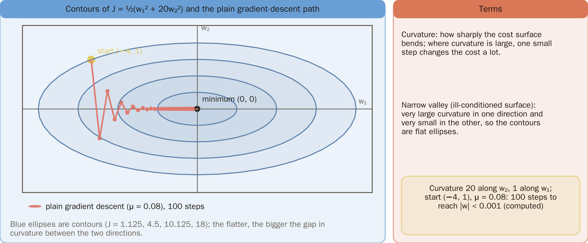
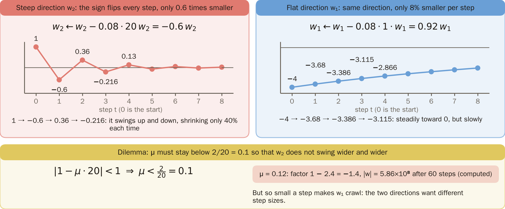
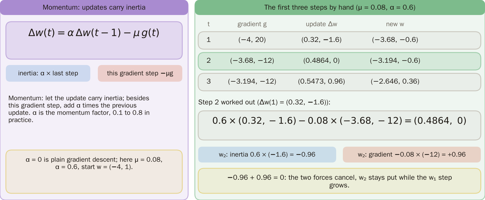
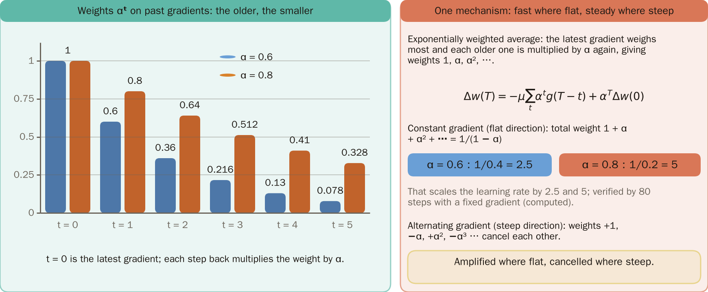
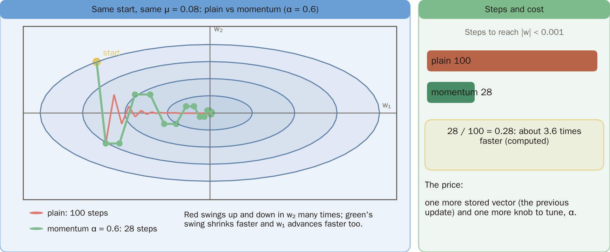
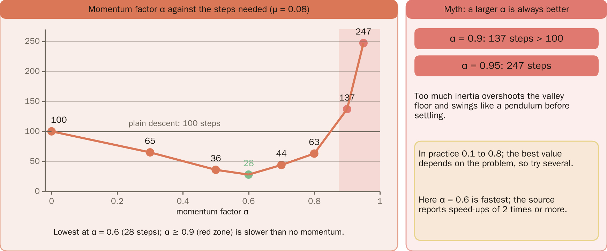
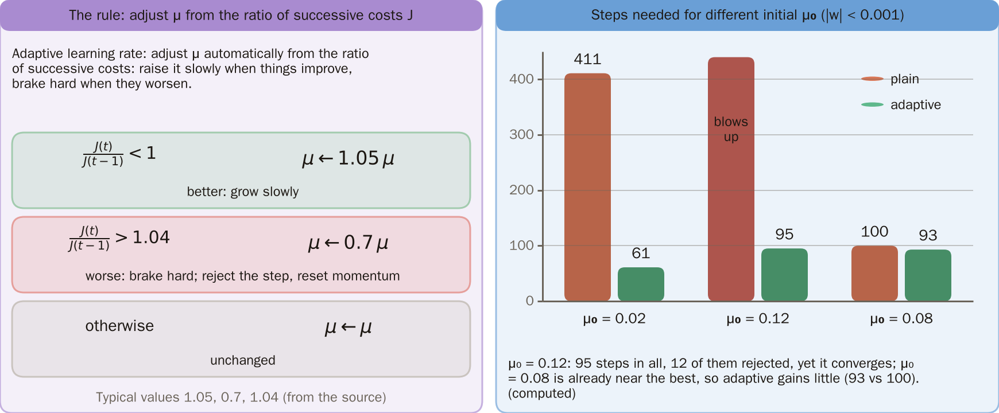
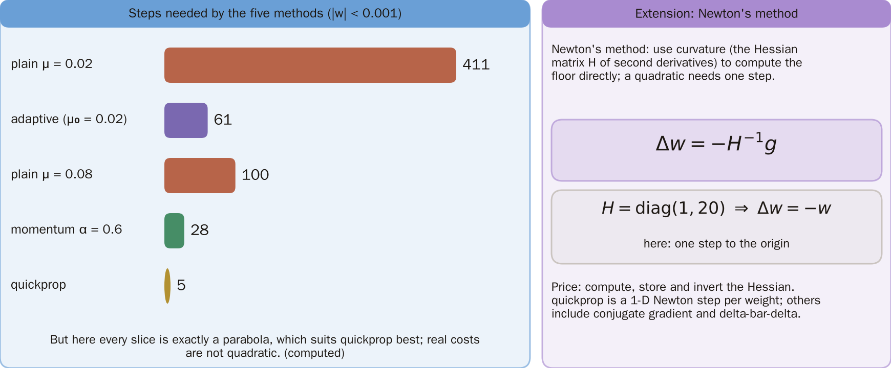
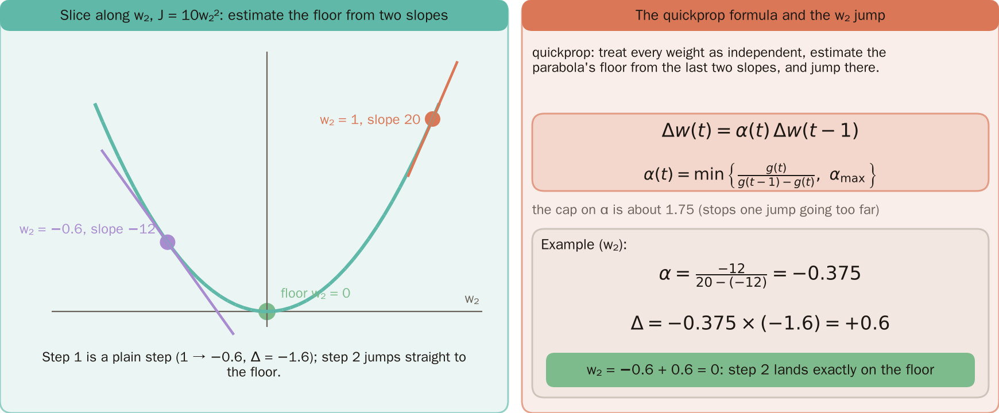
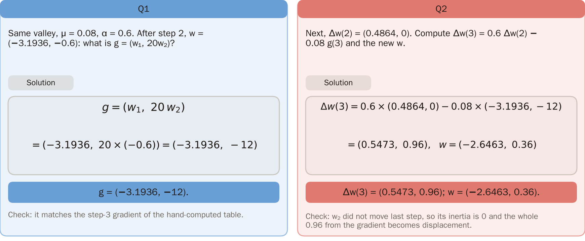

# KP08 Speeding Up Backpropagation

!!! note "Self-study"
    This unit (KP08) is self-study: it is not taught in class, so please read it on your own.

> Level: undergraduate, year 3
>
> Pattern Recognition | Chapter 4, §4.7

[Slides: read and download](../../slides/lec05-kp08-backprop-speedups-en.jbd.json) | [中文版](../lec05-kp08-backprop-speedups.md)

## Learning objectives

- Explain why a narrow valley makes gradient descent slow and swinging.
- Write the momentum update, work a few steps by hand, and explain why it speeds up the flat direction and cancels the steep one.
- State the rules of the adaptive learning rate and of quickprop and know the price and limits of each.

## KP08 Speeding Up Backpropagation

**One-sentence summary**: Gradient descent is slow and swings in a narrow valley; momentum adds $\alpha$ times the previous step to this step, so the flat direction is enlarged and the steep one is cancelled; an adaptive learning rate lets $\mu$ adjust itself and quickprop estimates the valley floor from two slopes. Every speed-up costs extra complexity.

### Prerequisites and symbols

**Three things you need first**:

- **Gradient descent** (KP06, KP07): each step goes against the gradient, with a size equal to the learning rate $\mu$ times the gradient.
- **Contour lines**: lines joining points of equal cost; the denser the contours, the faster the cost changes.
- **Squares and quadratic functions**: the graph of a quadratic function is a parabola (one dimension) or a bowl (several).

**Symbol table** (fixed for this lecture; note that this lecture writes the learning rate as $\mu$ where KP06 and KP07 write $\eta$, with the same meaning):

| Symbol | Meaning | Note |
|---|---|---|
| $w=(w_1,w_2)$ | weights | only two here |
| $J(w)$ | cost | here $J=\tfrac12(w_1^2+20w_2^2)$ |
| $g(t)$ | gradient at step $t$ | $g=(w_1,\,20w_2)$ |
| $\mu$ | learning rate | the step size of this lecture |
| $\Delta w(t)$ | update at step $t$ | |
| $\alpha$ | momentum factor | section 3; $\alpha=0$ is plain gradient descent |
| $H$ | Hessian matrix | the matrix of second partial derivatives, describing the curvature in every direction (extension) |

### 1. The narrow valley

**Plain explanation**: KP07 training took thousands of epochs, partly because gradient descent itself is slow.

- **Curvature**: how sharply the cost surface bends. Where the curvature is large, a small step changes the cost a lot.
- **Narrow valley (ill-conditioned surface)**: very large curvature in one direction and very small in another, so the contours are flat ellipses; the source calls it ill-conditioned, meaning the eigenvalues of the Hessian differ a lot.

**Example**: for this lecture we designed $J=\tfrac12(w_1^2+20w_2^2)$ to show the mechanism: curvature 20 along $w_2$ and 1 along $w_1$, start $(-4,1)$, $\mu=0.08$. Plain gradient descent needs 100 steps to reach $|w|<0.001$ and swings along $w_2$ (program).

Figure `lec05-kp08-valley`: First see the blue elliptical contours: very flat, meaning curvature 20 along w₂ and 1 along w₁; then see the red path from the start (−4, 1) swinging up and down along w₂ and needing 100 steps to reach |w| < 0.001 (computed). [Function: 1]

### 2. Why it swings

Steep direction: the gradient of $w_2$ is $20w_2$, so $w_2\leftarrow w_2-0.08\cdot20\,w_2=-0.6\,w_2$: it flips sign every step and shrinks only to 0.6 times. Flat direction: $w_1\leftarrow w_1-0.08\cdot1\cdot w_1=0.92\,w_1$, the same direction and only 8% smaller per step.

**The dilemma**: $\mu$ must stay below $2/20=0.1$ or $w_2$ swings ever wider; with $\mu=0.12$ the norm $|w|$ exceeds $10^8$ after 60 steps. But such a small step makes $w_1$ slow.

Figure `lec05-kp08-zigzag`: First see the left chart: w₂ flips sign every step and shrinks only to 0.6 times (1, −0.6, 0.36, −0.216); then the right chart: w₁ keeps its direction and shrinks only 8% per step (−4, −3.68, −3.386); below is the limit μ < 0.1, and μ = 0.12 gives |w| = 5.86×10⁸ after 60 steps. [Function: 1]

### 3. The momentum term

**Momentum**: gives the update inertia: besides the new gradient step, this step adds $\alpha$ times the previous step.

**Formal definition**:

$$
\Delta w(t)=\alpha\,\Delta w(t-1)-\mu\,g(t),
$$

$g$ is the gradient and $\alpha$ the momentum factor, 0.1 to 0.8 in practice; $\alpha=0$ is plain gradient descent.

**By hand** ($\mu=0.08$, $\alpha=0.6$): step 1 is $(0.32,-1.6)$ and $w=(-3.68,-0.6)$; step 2 is $0.6\times(0.32,-1.6)-0.08\times(-3.68,-12)=(0.4864,0)$, so the two pulls on $w_2$ (inertia $-0.96$, gradient $+0.96$) cancel exactly. Step 3 is $(0.5473,0.96)$ and $w=(-2.646,0.36)$.

| Step $t$ | Gradient $g$ | Update $\Delta w$ | $w$ after |
|---|---|---|---|
| 1 | $(-4,\,20)$ | $(0.32,\,-1.6)$ | $(-3.68,\,-0.6)$ |
| 2 | $(-3.68,\,-12)$ | $(0.4864,\,0)$ | $(-3.194,\,-0.6)$ |
| 3 | $(-3.19,\,-12)$ | $(0.5473,\,0.96)$ | $(-2.646,\,0.36)$ |

Start $w=(-4,1)$，$\Delta w(t)=0.6\,\Delta w(t-1)-0.08\,g(t)$。

Figure `lec05-kp08-momentum`: First see the momentum formula Δw(t) = αΔw(t−1) − μg(t) on the left, with the inertia term and the gradient step; then the three-step hand calculation on the right, where at step 2 the w₂ inertia −0.96 and gradient +0.96 cancel, giving Δw = (0.4864, 0). [Function: 2]

### 4. Why it works: an exponentially weighted average of past gradients

**Exponentially weighted average**: the newest gradient weighs most and every older one is multiplied by $\alpha$ once more, weights $1,\alpha,\alpha^2,\dots$.

Unrolled over $T$ steps: $\Delta w(T)=-\mu\sum_{t}\alpha^{t}g(T-t)+\alpha^{T}\Delta w(0)$ and the last term is near 0 after a few steps. With an unchanging gradient (the flat direction) the total weight is $1+\alpha+\alpha^2+\cdots=1/(1-\alpha)$, which enlarges the learning rate by $1/(1-\alpha)$: 2.5 times for $\alpha=0.6$ and 5 times for $\alpha=0.8$ (checked with a fixed gradient over 80 steps). When the gradient alternates in sign (the steep direction) the weighted average cancels it. One mechanism, fast where it can be and steady where it must be.

Figure `lec05-kp08-expo`: First see the bars on the left: the weights αᵗ for α = 0.6 and 0.8 fall with t; then the right: with a fixed gradient the total weight is 1/(1 − α), 2.5 for α = 0.6 and 5 for α = 0.8, while alternating gradients cancel. [Function: 2]

### 5. Two paths

Same start and same $\mu=0.08$: plain needs 100 steps and momentum with $\alpha=0.6$ needs 28 (program). The red path swings along $w_2$ many times while the green one shrinks the swing faster and also moves faster along $w_1$. The price is one more stored array for the previous update and one more knob $\alpha$.

Figure `lec05-kp08-two-paths`: First see the left chart: the red (plain) path swings many times along w₂ while the green (momentum, α = 0.6) swing shrinks faster; then the bars on the right: 100 steps against 28, about 3.6 times faster. [Function: 2]

### 6. The best $\alpha$

**Common misconception**: a larger $\alpha$ is always better. Steps needed with $\mu=0.08$:

| $\alpha$ | 0 | 0.3 | 0.5 | 0.6 | 0.7 | 0.8 | 0.9 | 0.95 |
|---|---:|---:|---:|---:|---:|---:|---:|---:|
| steps | 100 | 65 | 36 | 28 | 44 | 63 | 137 | 247 |

$\alpha\ge0.9$ is slower than no momentum: too much inertia overshoots the valley floor and rocks like a pendulum before it stops. In practice 0.1 to 0.8 is common, the best value depends on the problem and must be tried, and the source reports speed-ups of 2 times or more.

Figure `lec05-kp08-alpha-curve`: First see that the curve is lowest at α = 0.6 (28 steps); then the red zone: α ≥ 0.9 needs 137 and 247 steps, more than the 100 steps at α = 0 (dashed line). [Function: 2]

### 7. Adaptive learning rate

**Adaptive learning rate**: adjust $\mu$ automatically from the ratio of the cost before and after a step:

$$
\mu(t)=\begin{cases}1.05\,\mu(t-1), & J(t)/J(t-1)<1\\ 0.7\,\mu(t-1), & J(t)/J(t-1)>1.04\\ \mu(t-1), & \text{otherwise}\end{cases}
$$

Typical values $r_i=1.05$, $r_d=0.7$, $c=1.04$ (source). The rule is asymmetric: slow growth when better, hard braking when worse; when the cost rises this lecture rejects the step and zeroes the momentum (one of the source's suggestions).

**Results** (program):

| Start $\mu_0$ | Plain gradient descent | Adaptive |
|---:|---|---|
| 0.02 | 411 steps | 61 steps |
| 0.12 | blows up | converges in 95 steps in all (12 of them rejected) |
| 0.08 | 100 steps | 93 steps |

From $\mu_0=0.08$, already near the best, adaptive is hardly better than plain.

Figure `lec05-kp08-adaptive`: First see the three rules on the left: ratio < 1 multiplies μ by 1.05, > 1.04 by 0.7, otherwise unchanged; then the bars on the right: μ₀ = 0.02 takes 411 steps against 61, μ₀ = 0.12 blows up for plain descent but takes 95 steps adaptively, and μ₀ = 0.08 takes 100 against 93. [Function: 3]

### 8. quickprop and a comparison of five methods

**quickprop**: treat every weight as independent; the last two slopes estimate the bottom of a parabola and the weight jumps there:

$$
\Delta w(t)=\alpha(t)\,\Delta w(t-1),\qquad \alpha(t)=\min\Bigl\{\frac{g(t)}{g(t-1)-g(t)},\ \alpha_{\max}\Bigr\},\ \alpha_{\max}\approx1.75.
$$

**Example** ($w_2$): step 1 is an ordinary step $1\to-0.6$ with slope $20\to-12$; $\alpha=-12/(20+12)=-0.375$ and $\Delta=-0.375\times(-1.6)=+0.6$, so step 2 lands exactly on 0.

**Steps needed by the five methods** (program):

| Method | Steps |
|---|---:|
| plain $\mu=0.02$ | 411 |
| adaptive | 61 |
| plain $\mu=0.08$ | 100 |
| momentum | 28 |
| quickprop | 5 |

But every slice of this example is exactly a parabola, ideal for quickprop; real costs are not quadratic. Every speed-up costs extra complexity.

Figure `lec05-kp08-compare`: First see the lengths of the five bars on the left (steps): 411, 61, 100, 28, 5, quickprop is shortest but assumes every slice is a parabola; then Newton's method on the right: Δw = −H⁻¹g, one step to the origin here. [Function: 3]

### Extension: Newton's method, practice and worked solution

**Newton's method**: use the curvature (the Hessian matrix $H$) to compute the valley floor directly, $\Delta w=-H^{-1}g$, and a quadratic is solved in one step. Here $H=\mathrm{diag}(1,20)$ and $\Delta w=-w$, one step to the origin; the price is computing, storing and inverting the Hessian. quickprop can be seen as a one-dimensional Newton method per weight. The source also lists conjugate gradient, the Newton family, Kalman filtering and Levenberg–Marquardt, mostly needing Hessian elements; delta-delta and delta-bar-delta give every weight its own learning rate, grown when its gradient keeps its sign and shrunk when it flips.

Figure `lec05-kp08-secant`: First see the parabola J = 10w₂² along w₂ with slopes 20 and −12 at two points; then the right: α = −12/(20 + 12) = −0.375 and Δ = +0.6, so step 2 lands exactly on w₂ = 0. [Function: 3]

**Practice**: the same valley, $\mu=0.08$ and $\alpha=0.6$. After step 2 $w=(-3.1936,-0.6)$ and the update of step 2 is $(0.4864,0)$.

1. What is the gradient $g=(w_1,20w_2)$ here?
2. What are the update $\Delta w(3)=0.6\,\Delta w(2)-0.08\,g(3)$ and the new $w$ after step 3?

**Worked solution (question 1)**: $g=(-3.1936,\,20\times(-0.6))=(-3.1936,-12)$.

**Worked solution (question 2)**:

- $\Delta w(3)=0.6\times(0.4864,0)-0.08\times(-3.1936,-12)=(0.29184+0.25549,\,0.96)=(0.54733,0.96)$.
- $w=(-3.1936+0.5473,\,-0.6+0.96)=(-2.6463,0.36)$.

**Check**: $w_2$ did not move in step 2, so its inertia is 0 in this step and the whole 0.96 of the gradient part becomes displacement.

Figure `lec05-kp08-practice`: The left is Q1: g = (−3.1936, −12); the right is Q2: Δw(3) = (0.5473, 0.96) and w = (−2.6463, 0.36), each with its check. [Function: 2]

## Terms and sources

| English | 中文 |
|---|---|
| Curvature | 曲率 |
| Narrow valley (ill-conditioned surface) | 狹長谷底（病態代價面） |
| Momentum | 動量 |
| Exponentially weighted average | 指數加權平均 |
| Adaptive learning rate | 自適應學習率 |
| quickprop | quickprop |
| Newton's method | 牛頓法 |

Source: Chapter 4 KP08, §4.7 (read 2026-10-25). The momentum rule, the $1/(1-\alpha)$ derivation, the adaptive learning-rate rule and typical values, the quickprop formula and the Newton family follow the source; the example $J=\tfrac12(w_1^2+20w_2^2)$, its start and every step count and path were designed and recomputed for this lecture ([added], (program)).
