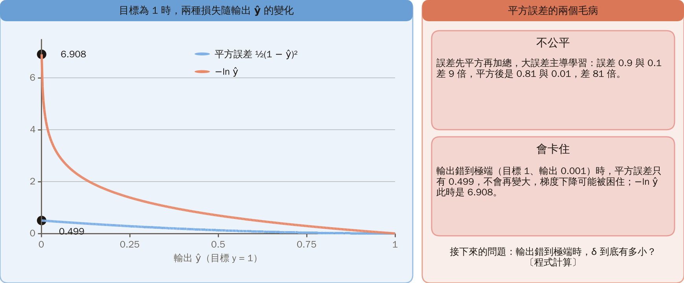
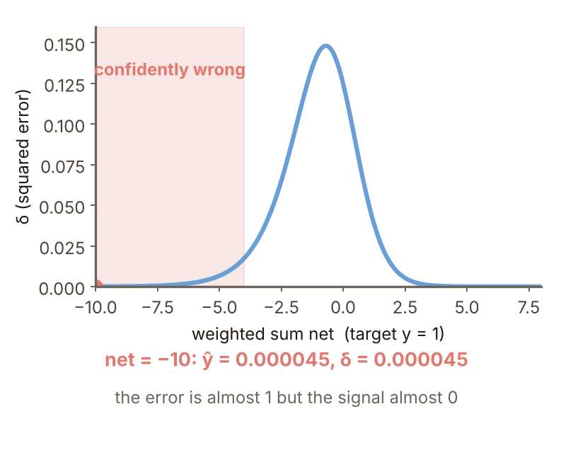
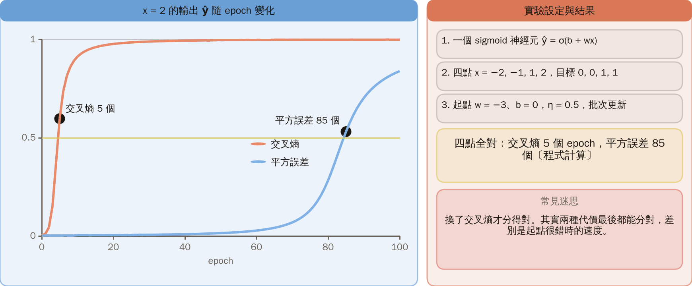
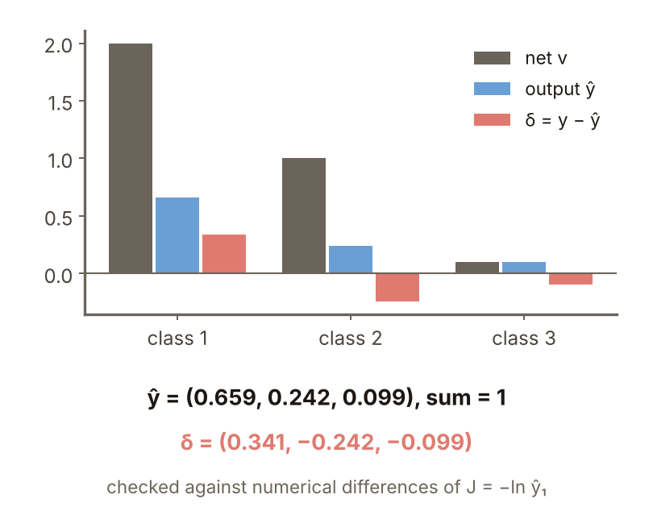
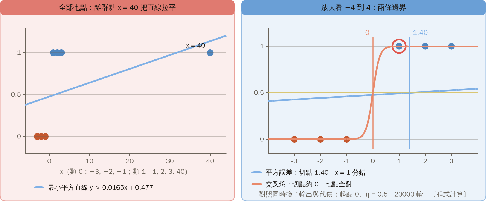
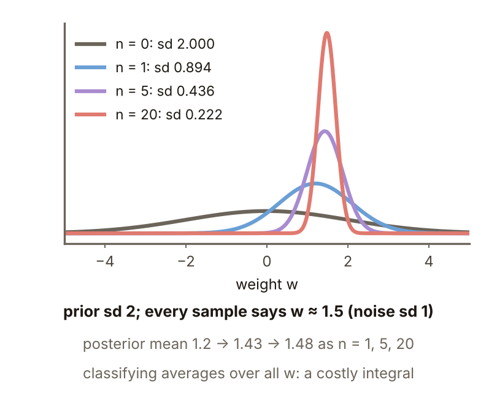
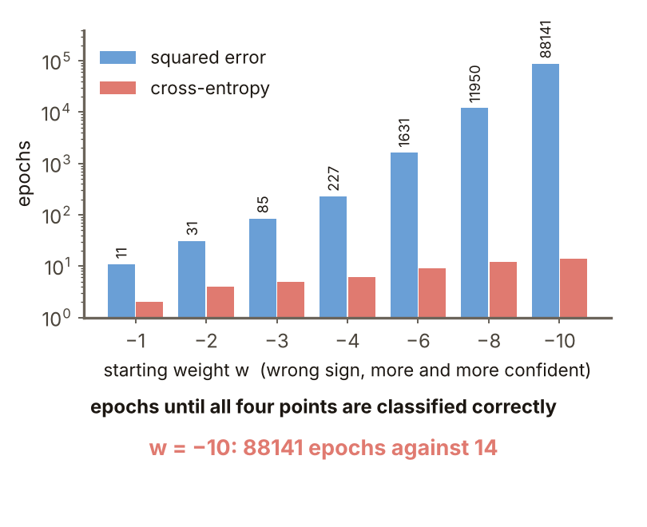

# KP09 Choosing the Cost Function

> Level: undergraduate, year 3
>
> Pattern Recognition | Chapter 4, §4.8

[Slides: read and download](../../slides/lec05-kp09-cost-functions-en.jbd.json) | [中文版](../lec05-kp09-cost-functions.md)

## Learning objectives

- Explain the two flaws of squared error and why a confidently wrong output cannot learn.
- Derive that with cross-entropy and a sigmoid or softmax the $\delta$ becomes $y-\hat y$, and explain that cross-entropy is the negative log-likelihood.
- Explain the idea and the price of discriminative learning and of Bayesian training.

## KP09 Choosing the Cost Function

**One-sentence summary**: Squared error is not the only choice. For classification the cross-entropy is often the better loss: the sigmoid slope does not squeeze it away and the worse the error the harder it fixes; with softmax the backpropagation $\delta$ is simply $y-\hat y$.

### Prerequisites and symbols

**Three things you need first**:

- **Sigmoid and the $\delta$ of backpropagation** (KP06): $\delta=-\partial J/\partial net$ and the update is $\eta\,\delta\times$input.
- **Probability**: the probability of an event lies between 0 and 1; probabilities of independent events multiply; $\ln$ turns a product into a sum.
- **Bayes' theorem** (Chapter 2): posterior $\propto$ likelihood $\times$ prior.

**Symbol table** (fixed for this lecture):

| Symbol | Meaning | Note |
|---|---|---|
| $net$ | weighted sum of the output unit | the $v$ of KP06 |
| $\sigma(v)$ | sigmoid | $1/(1+e^{-v})$ |
| $y$ | target | 0 or 1 for two classes; a vector with a single 1 for several |
| $\hat y$ | output | the network's estimate of the probability that the target is 1 |
| $J$ | cost | squared error in section 1, cross-entropy from section 3 |
| $\delta$ | error signal | $\delta=-\partial J/\partial net$ |
| $\eta$ | learning rate | |
| $v_k$, $\hat y_k$ | weighted sum and output of class $k$ in softmax | section 6 |

### 1. Two flaws of squared error

**Plain explanation**: The speed-ups of KP08 all rewrite the update rule, but where the update goes depends on the cost function itself.

- **Unfair**: errors are squared before summing, so big errors dominate. Errors $0.9$ and $0.1$ differ 9 times, but squared they are $0.81$ and $0.01$, 81 times.
- **It can stall**: when the output $\hat y$ is wrong at an extreme (target 1, output $0.001$) the squared error is only $0.499$ and never grows, so gradient descent can get stuck (source citing Witt 00). Contrast: another loss, $-\ln\hat y$, is $6.908$ at $\hat y=0.001$.

Figure `lec05-kp09-loss`: both losses against the output for target 1. Look at the squared-error curve for target 1 rising only to 0.5 as the output approaches 0, then at the $-\ln\hat y$ curve shooting up. [Function: 1, 2]

### 2. The plateau: δ goes to 0 when the output is wrong at an extreme

**Plateau**: a flat region where the cost is large but the gradient is almost 0, so gradient descent hardly moves on it.

For a single sigmoid output with squared error, $\delta=(y-\hat y)\,\hat y(1-\hat y)$. The closer $\hat y$ is to 0 or 1 the smaller the slope $\hat y(1-\hat y)$, squeezing even a big error into a small signal. With target $y=1$ and $net=-10$, $\hat y=0.000045$, the error is almost 1 and $\delta=0.000045$.

Figure `lec05-kp09-mse-delta`: the squared-error $\delta$ against the weighted sum $net$. Look at $\delta$ almost 0 for very negative or very positive $net$, then at the narrow middle stretch where it is large enough. [Function: 2]

### 3. Cross-entropy: cancel the slope

**Cross-entropy**: read the output $\hat y$ as the probability that the target is 1. **Formal definition**:

$$
J=-\bigl(y\ln\hat y+(1-y)\ln(1-\hat y)\bigr),
$$

which for $y=1$ is $-\ln\hat y$.

**Derivation, step by step**:

1. $\partial J/\partial\hat y=-(y-\hat y)/[\hat y(1-\hat y)]$.
2. The sigmoid slope is $\partial\hat y/\partial net=\hat y(1-\hat y)$.
3. By the chain rule they multiply and $\hat y(1-\hat y)$ cancels exactly, giving $\delta=-\partial J/\partial net=y-\hat y$.

The sign follows KP06 ($\delta=-\partial J/\partial net$); the source writes $\hat y-y$, which differs by a sign.

**Numbers**: at $net=-10$ the squared-error $\delta=0.00005$ and the cross-entropy $\delta=1.0000$.

With target $y=1$:

| $net$ | $\hat y$ | $\delta$ of squared error | $\delta$ of cross-entropy |
|---:|---:|---:|---:|
| $-10$ | 0.00005 | 0.00005 | 1.0000 |
| $-5$ | 0.0067 | 0.00660 | 0.9933 |
| $-2$ | 0.1192 | 0.09248 | 0.8808 |
| $0$ | 0.5000 | 0.12500 | 0.5000 |
| $2$ | 0.8808 | 0.01252 | 0.1192 |
| $5$ | 0.9933 | 0.00004 | 0.0067 |

The cross-entropy $\delta$ is not squeezed; squared error gives almost no signal at $net=-10$.

### 4. Training compared

**Experiment setup** (designed here, implemented in a program):

- Model: one sigmoid neuron $\hat y=\sigma(b+wx)$.
- Data: four points $x=-2,-1,1,2$ with targets $0,0,1,1$.
- Start: $w=-3$, $b=0$, so all four are wrong.
- Training: $\eta=0.5$, batch updates (each epoch uses the mean $\delta$ of the four points).
- "All right": the number of points with $\hat y>0.5$ agreeing with the target is 4.

**Result**: cross-entropy gets all four right in 5 epochs and squared error needs 85 (program).

**Common misconception**: only cross-entropy can classify correctly. Both costs end up correct; the difference is the speed from a very wrong start.

Figure `lec05-kp09-train`: the output of the point $x=2$ against epochs. Look at the output of the point $x=2$ rising with epochs, cross-entropy passing 0.5 quickly, then at squared error lingering near the start. [Function: 2]

### 5. Likelihood: cross-entropy is the negative log-likelihood

**Likelihood**: the probability of seeing this data if the model is right; larger is better and independent samples multiply. **Example**: outputs $0.9,0.8,0.3,0.1$ with targets $1,1,0,0$.

- The probability of each target: $0.9,\ 0.8,\ 1-0.3=0.7,\ 1-0.1=0.9$.
- Product: $0.9\times0.8\times0.7\times0.9=0.4536$, $-\ln0.4536=0.7905$.
- The four cross-entropies add up to $0.105+0.223+0.357+0.105=0.790$, the same.

Minimizing cross-entropy is maximizing likelihood.

### 6. softmax

**softmax** for several classes:

$$
\hat y_k=\frac{e^{v_k}}{\sum_{k'}e^{v_{k'}}},
$$

every output lies between 0 and 1 and they sum to exactly 1.

**Example**: $v=(2,1,0.1)$.

- $e^{2}=7.389$, $e^{1}=2.718$, $e^{0.1}=1.105$, with sum $11.212$.
- $\hat y=(0.659,\ 0.242,\ 0.099)$.
- With target $y=(1,0,0)$: $J=-\ln0.659=0.417$.
- The $\delta_k=y_k-\hat y_k=(0.341,-0.242,-0.099)$ needed by backpropagation equals numerical differences (program check).

Figure `lec05-kp09-softmax`: bars of $v$, $\hat y$ and $\delta$. Look at the three bars of $v$, then at $\hat y$ after softmax (summing to 1), and finally at $\delta$ (positive for the target class, negative for the rest). [Function: 1, 2]

### 7. Discriminative learning

**Discriminative learning**: since the goal is a low classification error, focus on the largest posterior and push the decision surface to lower the error directly. **Contrast example** (designed here, implemented in a program): $x=-3,-2,-1$ are class 0; $x=1,2,3$ and the outlier $x=40$ are class 1.

- Squared error: the least-squares line $y\approx ax+b$ ($a=0.0165$, $b=0.477$), cut where the line equals 0.5, at $1.40$; $x=1$ is misclassified.
- Cross-entropy: one sigmoid output, gradient descent (start 0, $\eta=0.5$, 20000 rounds), cut at about $0$; all seven are right.

The contrast changes both the output and the cost; the error rate itself is not differentiable, so a smooth version is used, with a risk of local minima (source, which also mentions deterministic annealing).

Figure `lec05-kp09-lsfit`: seven points and the two boundaries. Look at the outlier $x=40$ flattening the least-squares line, then at the two cuts: squared error at 1.40 and cross-entropy at 0. [Function: 1, 3]

### 8. Bayesian training

**Bayesian training**: set a prior $p(w)$ on the weights; with the data, Bayes' rule gives the posterior $p(w\mid Y)=p(Y\mid w)\,p(w)/p(Y)$; classifying averages over all $w$, $P(\omega_k\mid x;Y)=\int\phi_k(x;w)\,p(w\mid Y)\,dw$. **Example** (designed here, from the Gaussian formulas):

- Prior: $w\sim N(0,2^2)$.
- Every sample says $w\approx1.5$ with noise standard deviation 1; $n$ samples.
- Posterior precision (inverse variance) $=\tfrac14+n$ and posterior mean $=1.5n/(\tfrac14+n)$.

| $n$ | 0 | 1 | 5 | 20 |
|---:|---:|---:|---:|---:|
| posterior sd | 2 | 0.894 | 0.436 | 0.222 |
| posterior mean | 0 | 1.2 | 1.43 | 1.48 |

 Price: a high-dimensional integral is expensive; the source reminds us that replacing least squares often gives no real gain in practice.

Figure `lec05-kp09-posterior`: the posterior for different $n$. Look at the wide bell for $n=0$ (the prior), then at the bell narrowing and its centre moving towards 1.5 as $n$ grows. [Function: 1, 2]

### Extension: worse starts, practice and worked solution

**Worse starts**: with the data of section 4 and $\eta=0.5$ ($b=0$), epochs needed:

| Start $w$ | $-1$ | $-2$ | $-3$ | $-4$ | $-6$ | $-8$ | $-10$ |
|---|---:|---:|---:|---:|---:|---:|---:|
| squared error | 11 | 31 | 85 | 227 | 1631 | 11950 | 88141 |
| cross-entropy | 2 | 4 | 5 | 6 | 9 | 12 | 14 |

The squared-error $\delta$ shrinks exponentially as the start gets worse and the epochs grow roughly exponentially; the cross-entropy $\delta$ stays near 1.

Figure `lec05-kp09-init`: epochs needed from seven starts (log axis). Look at the squared-error points climbing on a log axis, then at the cross-entropy points staying almost flat. [Function: 2]

**Practice**: a single sigmoid output, target 1, $net=-4$.

1. What is $\hat y=\sigma(-4)$?
2. What are the squared-error $\delta=(1-\hat y)\,\hat y(1-\hat y)$ and the cross-entropy $\delta=1-\hat y$, and how many times larger is the cross-entropy one?

**Worked solution (question 1)**: $\hat y=1/(1+e^{4})=0.0180$.

**Worked solution (question 2)**:

- Squared error $\delta=0.9820\times0.0180\times0.9820=0.01735$.
- Cross-entropy $\delta=0.9820$.
- Ratio $0.9820/0.01735=56.6$.

**Check**: the ratio is exactly $1/[\hat y(1-\hat y)]$ and grows as the output gets more extreme; at $net=-10$ it is about 22000.

## Terms and sources

| English | 中文 |
|---|---|
| Plateau | 高原 |
| Cross-entropy | 交叉熵 |
| Likelihood | 概似 |
| softmax | softmax |
| Discriminative learning | 判別式學習 |
| Bayesian training | 貝氏訓練 |

Source: Chapter 4 KP09, §4.8 (read 2026-10-25). The two flaws of squared error, the cross-entropy and softmax formulas, the simplified $\delta$, and the descriptions of discriminative learning and Bayesian training follow the source; the single-neuron training comparison, the outlier contrast, the Gaussian posterior example and every number were designed and recomputed for this lecture ([added], (program)). The sign of $\delta$ is fixed as $-\partial J/\partial net$.
