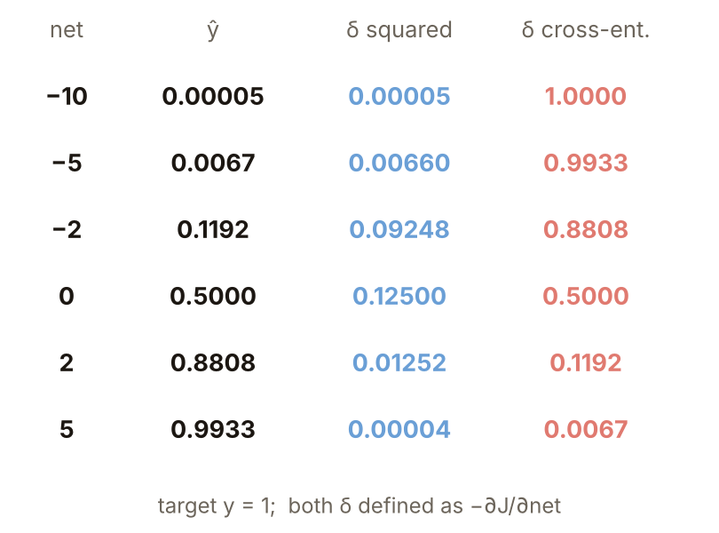
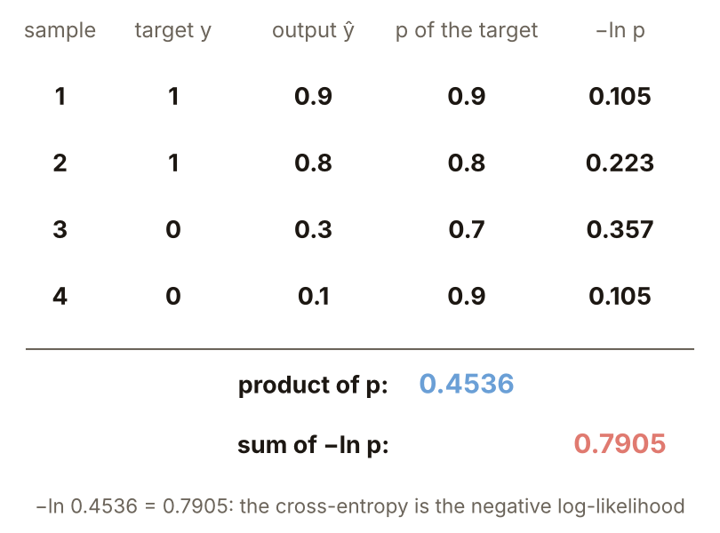
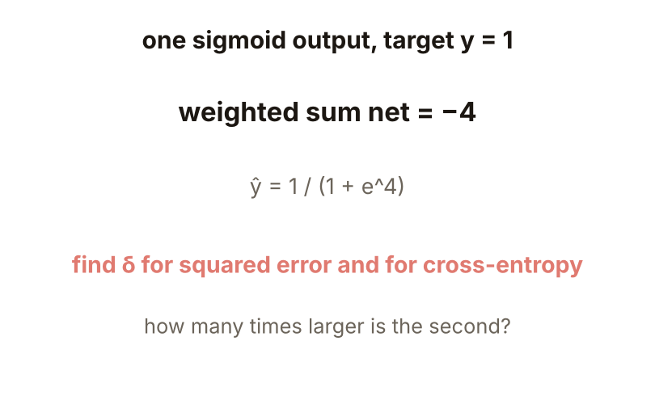
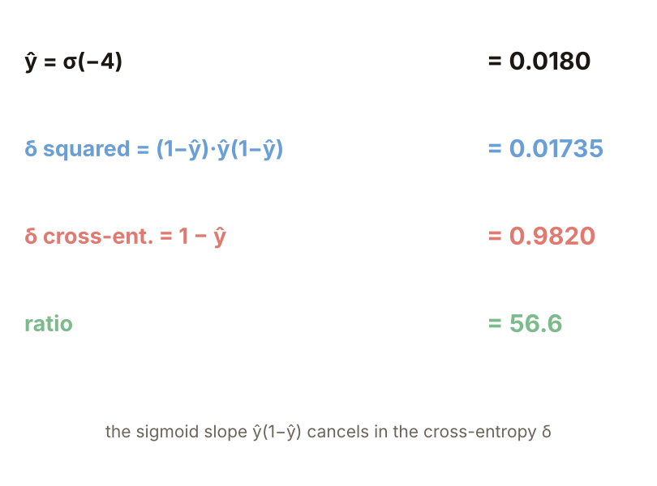

# KP09 Choosing the Cost Function

> Level: undergraduate, year 3
>
> Pattern Recognition | Chapter 4, §4.8

[Slides: read and download](../../slides/lec05-kp09-cost-functions-en.jbd.json) | [中文版](../lec05-kp09-cost-functions.md)

## Learning objectives

- Explain the two flaws of squared error and why a confidently wrong output cannot learn.
- Derive that with cross-entropy and a sigmoid or softmax the $\delta$ becomes $y-\hat y$, and explain that cross-entropy is the negative log-likelihood.
- Explain the idea and the price of discriminative learning and of Bayesian training.

## KP09 Choosing the Cost Function

**One-sentence summary**: Squared error is not the only choice. For classification the cross-entropy is often the better loss: the sigmoid slope does not squeeze it away and the worse the error the harder it fixes; with softmax the backpropagation $\delta$ is simply $y-\hat y$.

### 1. Two flaws of squared error

**Plain explanation**: The speed-ups of KP08 all rewrite the update rule, but where the update goes depends on the cost function itself.

- **Unfair**: errors are squared before summing, so big errors dominate. Errors $0.9$ and $0.1$ differ 9 times, but squared they are $0.81$ and $0.01$, 81 times.
- **It can stall**: when the output $\hat y$ is wrong at an extreme (target 1, output $0.001$) the squared error is only $0.499$ and never grows, so gradient descent can get stuck (source citing Witt 00). Contrast: another loss, $-\ln\hat y$, is $6.908$ at $\hat y=0.001$.

Figure `lec05-kp09-loss`: both losses against the output for target 1.

### 2. The plateau: δ goes to 0 when the output is wrong at an extreme

**Plateau**: a flat region where the cost is large but the gradient is almost 0, so gradient descent hardly moves on it.

For a single sigmoid output with squared error, $\delta=(y-\hat y)\,\hat y(1-\hat y)$. The closer $\hat y$ is to 0 or 1 the smaller the slope $\hat y(1-\hat y)$, squeezing even a big error into a small signal. With target $y=1$ and $net=-10$, $\hat y=0.000045$, the error is almost 1 and $\delta=0.000045$.

Figure `lec05-kp09-mse-delta`: the squared-error $\delta$ against the weighted sum $net$.

### 3. Cross-entropy: cancel the slope

**Cross-entropy**: read the output $\hat y$ as the probability that the target is 1. **Formal definition**:

$$
J=-\bigl(y\ln\hat y+(1-y)\ln(1-\hat y)\bigr),
$$

which for $y=1$ is $-\ln\hat y$. Derivation: $\partial J/\partial\hat y=-(y-\hat y)/[\hat y(1-\hat y)]$ and the sigmoid slope $\hat y(1-\hat y)$ cancels it exactly, giving $\delta=y-\hat y$. The sign follows KP06 ($\delta=-\partial J/\partial net$); the source writes $\hat y-y$, which differs by a sign. At $net=-10$ the squared-error $\delta=0.00005$ and the cross-entropy $\delta=1.0000$.

Figure `lec05-kp09-delta-table`: $\hat y$ and the two $\delta$ at different $net$.

### 4. Training compared

**Example** (designed here): one sigmoid neuron $\hat y=\sigma(b+wx)$, four points $x=-2,-1,1,2$ with targets $0,0,1,1$; start $w=-3,b=0$ so all four are wrong; $\eta=0.5$, batch updates. Cross-entropy gets all four right in 5 epochs and squared error needs 85 (program). **Common misconception**: only cross-entropy can classify correctly. Both costs end up correct; the difference is the speed from a very wrong start.

Figure `lec05-kp09-train`: the output of the point $x=2$ against epochs.

### 5. Likelihood: cross-entropy is the negative log-likelihood

**Likelihood**: the probability of seeing this data if the model is right; larger is better and independent samples multiply. Outputs $0.9,0.8,0.3,0.1$ with targets $1,1,0,0$: the probability of each target is $0.9,0.8,0.7,0.9$, the product is $0.4536$ and $-\ln0.4536=0.7905$; the four cross-entropies $0.105+0.223+0.357+0.105=0.790$ add up to the same. Minimizing cross-entropy is maximizing likelihood.

Figure `lec05-kp09-likelihood`: probabilities and $-\ln$ of four samples.

### 6. softmax

**softmax** for several classes:

$$
\hat y_k=\frac{e^{v_k}}{\sum_{k'}e^{v_{k'}}},
$$

every output lies between 0 and 1 and they sum to exactly 1. $v=(2,1,0.1)$ gives $\hat y=(0.659,0.242,0.099)$; with target $y=(1,0,0)$, $J=-\ln0.659=0.417$. The $\delta_k=y_k-\hat y_k=(0.341,-0.242,-0.099)$ needed by backpropagation equals numerical differences (program check).

Figure `lec05-kp09-softmax`: bars of $v$, $\hat y$ and $\delta$.

### 7. Discriminative learning

**Discriminative learning**: since the goal is a low classification error, focus on the largest posterior and push the decision surface to lower the error directly. **Contrast example** (designed here): $x=-3,-2,-1$ are class 0; $x=1,2,3$ and the outlier $x=40$ are class 1. The squared-error line cuts at $1.40$ and misclassifies $x=1$; sigmoid with cross-entropy cuts at $0$ and gets all seven right. The contrast changes both the output and the cost; the error rate itself is not differentiable, so a smooth version is used, with a risk of local minima (source, which also mentions deterministic annealing).

Figure `lec05-kp09-lsfit`: seven points and the two boundaries.

### 8. Bayesian training

**Bayesian training**: set a prior $p(w)$ on the weights; with the data, Bayes' rule gives the posterior $p(w\mid Y)=p(Y\mid w)\,p(w)/p(Y)$; classifying averages over all $w$, $P(\omega_k\mid x;Y)=\int\phi_k(x;w)\,p(w\mid Y)\,dw$. **Example** (designed here): prior sd 2, every sample says $w\approx1.5$ (noise sd 1); for $n=0,1,5,20$ the posterior sd is $2,0.894,0.436,0.222$ and the mean $0,1.2,1.43,1.48$. Price: a high-dimensional integral is expensive; the source reminds us that replacing least squares often gives no real gain in practice.

Figure `lec05-kp09-posterior`: the posterior for different $n$.

### Extension: worse starts, practice and worked solution

**Worse starts**: with the data of section 4 and $\eta=0.5$, starts $w=-1,-2,-3,-4,-6,-8,-10$ need 11, 31, 85, 227, 1631, 11950 and 88141 epochs with squared error and only 2, 4, 5, 6, 9, 12 and 14 with cross-entropy. The squared-error $\delta$ shrinks exponentially as the start gets worse and the epochs grow roughly exponentially; the cross-entropy $\delta$ stays near 1.

Figure `lec05-kp09-init`: epochs needed from seven starts (log axis).

**Practice**: a single sigmoid output, target 1, $net=-4$.

1. What is $\hat y=\sigma(-4)$?
2. What are the squared-error $\delta=(1-\hat y)\,\hat y(1-\hat y)$ and the cross-entropy $\delta=1-\hat y$, and how many times larger is the cross-entropy one?

Figure `lec05-kp09-practice`: the setup of the practice.

**Worked solution of questions 1 and 2**: (1) $\hat y=1/(1+e^{4})=0.0180$. (2) Squared error $\delta=0.9820\times0.0180\times0.9820=0.01735$; cross-entropy $\delta=0.9820$; ratio $0.9820/0.01735=56.6$. (3) Check: the ratio is exactly $1/[\hat y(1-\hat y)]$ and grows as the output gets more extreme; at $net=-10$ it is about 22000.

Figure `lec05-kp09-practice-sol`: the two $\delta$ and the ratio.

## Terms and sources

| English | 中文 |
|---|---|
| Plateau | 高原 |
| Cross-entropy | 交叉熵 |
| Likelihood | 概似 |
| softmax | softmax |
| Discriminative learning | 判別式學習 |
| Bayesian training | 貝氏訓練 |

Source: Chapter 4 KP09, §4.8 (read 2026-10-25). The two flaws of squared error, the cross-entropy and softmax formulas, the simplified $\delta$, and the descriptions of discriminative learning and Bayesian training follow the source; the single-neuron training comparison, the outlier contrast, the Gaussian posterior example and every number were designed and recomputed for this lecture ([added], (program)). The sign of $\delta$ is fixed as $-\partial J/\partial net$.
