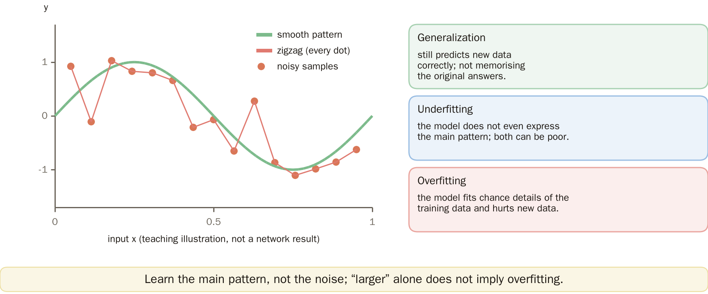
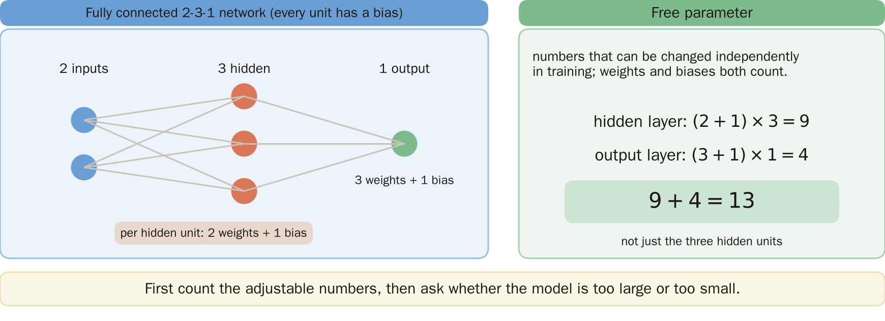
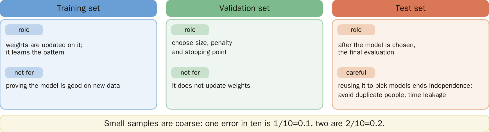
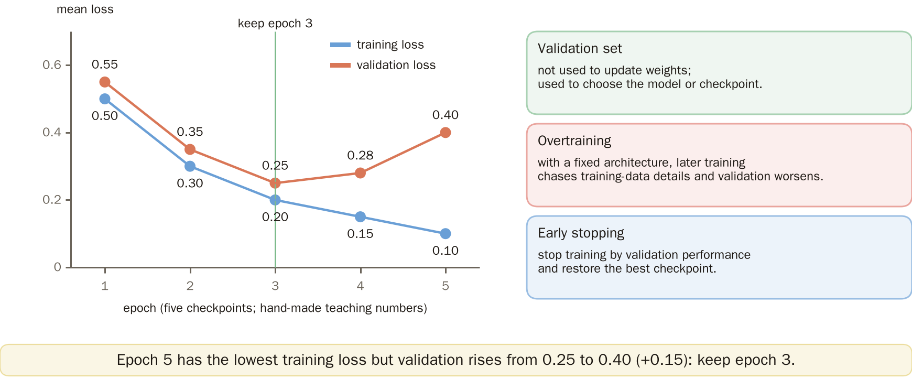
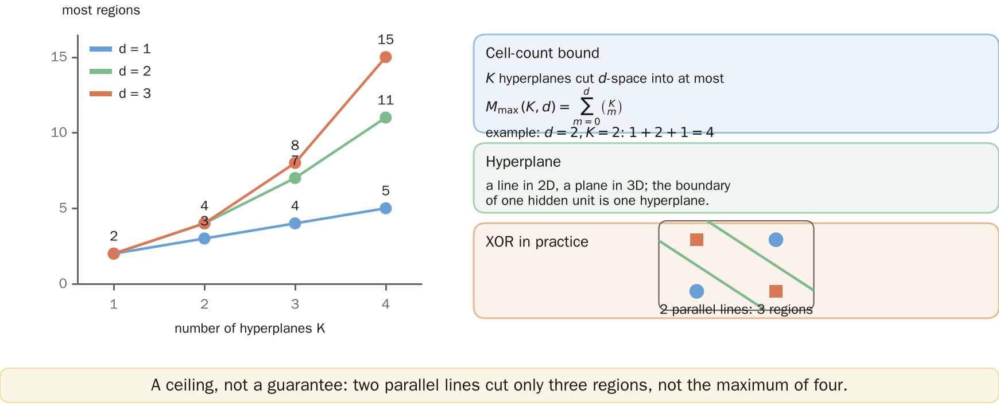
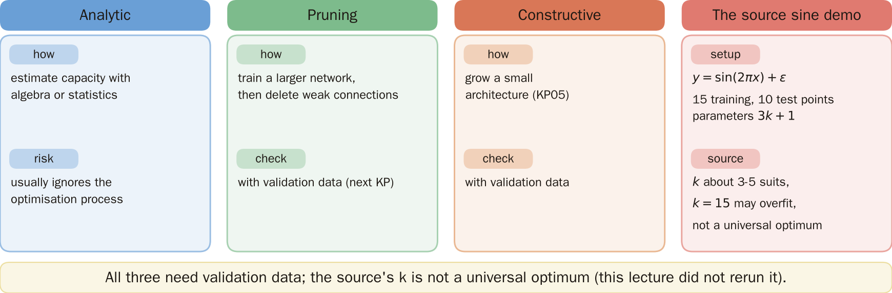
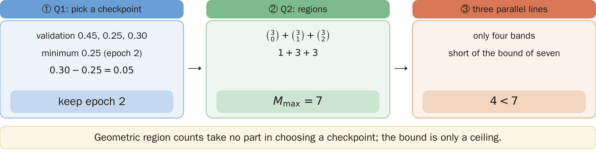

# KP10 Network Size, Generalization and Early Stopping

!!! note "Self-study"
    This unit (KP10) is self-study: it is not taught in class, so please read it on your own.

> Level: undergraduate, year 3
>
> Pattern Recognition | Chapter 4

[Slides: read and download](../../slides/lec05-kp10-network-size-en.jbd.json) | [中文版](../lec05-kp10-network-size.md)

## Learning objectives

- Count the parameters of a given architecture and tell units from parameters.
- Choose a training checkpoint from validation numbers and tell the three roles of data apart.
- Explain that the geometric capacity bound is only an upper limit, not a guarantee of model quality.

## KP10 Network Size, Generalization and Early Stopping

**One-sentence summary**: How large a network should be and how long it should be trained cannot be decided by the training score alone; data that did not take part in training must decide together with it.

### Prerequisites and symbols

**Three things you need first**:

- **Loss and cost** (KP06, KP09): the loss is the penalty for how far a prediction is from its target; the cost is the mean of the losses.
- **Forward pass and parameters** (KP06): every unit has weights and a bias, and training adjusts them.
- **Hyperplane** (KP03): a line in 2-D and a plane in 3-D; the boundary of one hidden unit is a hyperplane.

**Symbol table** (fixed for this lecture):

| Symbol | Meaning | Note |
|---|---|---|
| $d$ | dimension of the input | $d=2$ for 2-D data |
| $K$, $k$ | number of hidden units | $K$ (number of hyperplanes) in section 5, $k$ in section 7 |
| $M_{\max}(K,d)$ | the most regions $K$ hyperplanes can cut in $d$ dimensions | section 5 |
| $L$ | mean squared error | $L=\frac1N\sum_n(\hat y_n-t_n)^2$ |
| $N$ | number of samples in this data set | |
| $t_n,\hat y_n$ | target and prediction of sample $n$ | |

### 1. Why control the size: first tell "memorized" from "learned"

**Plain explanation**: A high training score does not mean new data will be predicted well. Controlling the size of the network is about avoiding merely memorizing the training data.

- **Generalization**: still predicting correctly on new data that did not take part in training; it is not memorizing the original answers.

The figure is a supplementary illustration for continuous prediction, and classification faces the same trade-off: find the main trend first, then look at the small fluctuations of the samples; not every fluctuation should be treated as a rule.



Figure `lec05-kp10-trend`: [Added] Look at the dots (noisy samples) scattered above and below a smooth curve, then at the broken line passing through every dot: it memorized the noise instead of learning the trend. The broken line is only a teaching illustration, not a network training result. [Function: 1, 2]

The next question: how many adjustable numbers does a network actually have?

### 2. Counting free parameters, underfitting and overfitting

- **Free parameter**: a number that can be changed independently during training; weights and biases both count.

**Counting example**: two inputs, three hidden units and one output, fully connected, every computing unit with a bias.

- Hidden layer: each hidden unit has 2 weights plus 1 bias, $(2+1)\times3=9$.
- Output layer: the output unit has 3 weights plus 1 bias, $(3+1)\times1=4$.
- In all $9+4=13$, not just three for the three hidden units.

Figure `lec05-kp10-params`: look at the three layers of the network, then at the count on the right: hidden layer (2+1)×3=9, output layer (3+1)×1=4, total 13. [Function: 2]



Two opposite failures:

- **Underfitting**: the model cannot even express the main trend, and both training and new-data performance may be poor.
- **Overfitting**: the model fits chance details of this training set and thereby hurts predictions on new data.

"Larger" is not a sufficient condition for overfitting; the amount of data, the size of the weights, the way of limiting them and the training procedure all matter.

The next question: with the architecture fixed, how long should we train?

### 3. Choosing a training checkpoint with held-out data

Even with a fixed size the model can fit the training data too closely, so the training time has to be controlled separately.

- **Validation set**: data not used to update weights but used to choose a model or a training checkpoint.
- **Overtraining**: with the architecture fixed, later training starts to chase details of the training set and the validation performance gets worse.
- **Early stopping**: stop training according to the validation performance and restore the best checkpoint; an implementation may tolerate a few epochs without improvement.

**Illustrative numbers** (hand-made teaching numbers, not experimental results): at each checkpoint compute the training loss and the validation loss.

| Epoch | 1 | 2 | 3 | 4 | 5 |
|---|---:|---:|---:|---:|---:|
| training loss | 0.50 | 0.30 | 0.20 | 0.15 | 0.10 |
| validation loss | 0.55 | 0.35 | 0.25 | 0.28 | 0.40 |

Figure `lec05-kp10-roles`: compare the three columns: what each set is used for and what it must not be used for. [Function: 2]



- The smallest validation loss is $0.25$ at epoch 3, so the weights of epoch 3 are kept.
- At epoch 5 the training loss is lowest, but the validation loss rises from $0.25$ to $0.40$, an increase of $0.40-0.25=0.15$.

Figure `lec05-kp10-early`: look at the blue line (training loss) falling all the way, then at the orange line (validation loss) lowest at epoch 3 and rising afterwards; the dashed line marks epoch 3 to be saved. The two curves need not cross, and the gap need not start from zero. [Function: 2]



The next question: the validation data have been used to choose; what data should report the final score?

### 4. Three kinds of data, each with its own job

- **Training set**: used to update the weights and learn the regularities in the data.
- **Validation set**: used to choose the size, the penalty strength and the stopping point, without directly updating weights.
- **Test set**: used for the final evaluation after the model has been chosen. If it is looked at repeatedly to pick models it is no longer an independent check; leakage of repeated individuals or of time information must also be avoided.

**Numbers from small samples are coarse**: one error in ten gives an error rate $1/10=0.1$; two errors give $2/10=0.2$. One case more changes the estimate by ten percentage points.

Repeated splits or cross-validation can help the choice, but each time the training and the evaluation must still be separated; independent data cannot be created out of nothing. So there is no "best number of neurons" apart from the amount of data and the task.

**Common misconception**: fewer parameters or longer training does not by itself guarantee better accuracy on new data.

The next question: can we skip training and compute an upper limit of capacity from the architecture alone?

### 5. The geometric capacity bound and the actual construction for XOR

Data selection answers "is the prediction good?", and the geometric count only answers "how many pieces can the architecture cut at most?". They are different questions.

**Formal definition (bound on the number of regions)**: $K$ hyperplanes cut $d$-dimensional space into at most

$$
M_{\max}(K,d)=\sum_{m=0}^{d}\binom{K}{m}
$$

regions, where $\binom Km$ is the number of ways to choose $m$ out of $K$ and is 0 when $m>K$. General position (no coincident or parallel hyperplanes or many meeting at one point, which reduce the regions) reaches this maximum; degenerate arrangements may give fewer.

**Value table**:

| $d$ \ $K$ | 1 | 2 | 3 | 4 |
|---|---:|---:|---:|---:|
| 1 | 2 | 3 | 4 | 5 |
| 2 | 2 | 4 | 7 | 11 |
| 3 | 2 | 4 | 8 | 15 |

Example: $d=2,K=2$: $M_{\max}=1+2+1=4$; the three binomial numbers correspond to choosing 0, 1 and 2 lines.

Figure `lec05-kp10-regions`: look at the number of hyperplanes $K$ on the horizontal axis, then compare the curves for different input dimensions $d$: the higher the dimension and the more lines, the faster the maximum number of regions grows. [Function: 2] The small panel at the bottom right shows the real XOR construction: two parallel lines cut only three regions.



**The actual construction for XOR**: the lines $x_1+x_2=0.5$ and $x_1+x_2=1.5$ of KP01 are parallel and actually cut only three bands, the two A points living in the middle one. "The bound of four holds three" is only a capacity check; whether two units are enough must be shown by this explicit construction.

The next question: the bound does not tell us how to find a suitable size. What strategies exist in practice?

### 6. Three strategies for choosing the size

- **Analytic methods**: estimate capacity with algebra or statistics, but usually ignore the actual optimization process.
- **Pruning**: train a larger network first and then delete the less important connections by a rule (the next KP).
- **Constructive methods**: start from a small architecture and add units step by step (KP05).

All three need to be checked with validation data.

Figure `lec05-kp10-strategies`: compare the three strategies column by column; the fourth column is the source demo, not a universal optimum. [Function: 2]



### 7. Reading the scope of the source's interactive demonstration

The source has a sine demonstration; we only describe its setup and do not treat one experiment as a universal best setting.

- Target: $y=\sin(2\pi x)+\epsilon$, where $\epsilon$ is noise added to the observation.
- Data: 15 training points and 10 independent test points.
- Model: $\hat y=\sum_{j=1}^{k}v_j\tanh(a_jx+b_j)+c$, with $k$ hidden units; $a_j,b_j,v_j,c$ are all adjustable and the number of parameters is $3k+1$.

The source describes $k$ of about 3 to 5 as suitable and $k=15$ as possibly overfitting. This is not a universal best value for any data, and this lecture did not rerun the training.

### Extension: practice, the recurrence and a program

**Practice**:

1. The training losses are $0.40,0.20,0.10$ and the validation losses $0.45,0.25,0.30$. Which epoch is chosen? Hint: find the validation minimum first.
2. What is the largest number of regions of three lines in general position in 2-D? Hint: compute $\binom30+\binom31+\binom32$; is it still this number if the three lines are parallel?

**Worked solution (question 1)**: among the validation values $0.45,0.25,0.30$ the smallest is $0.25$, so epoch 2 is kept; the lower training value of the last epoch does not change the choice. The validation at epoch 3 is higher than at epoch 2 by $0.30-0.25=0.05$.

**Worked solution (question 2)**: $M_{\max}=1+3+3=7$. Three parallel lines give only four bands, not reaching the bound of seven. The number of regions took no part in choosing the checkpoint.

Figure `lec05-kp10-solution`: follow the three boxes left to right: pick epoch 2, count 1+3+3=7, then three parallel lines give only four bands. [Function: 3]



**Why the number of regions has this form**: when the $K$-th hyperplane is added in general position it cuts some existing regions in two. The newly cut parts correspond to the regions one dimension lower that the other $K-1$ hyperplanes form inside the new plane, so

$$
R(K,d)=R(K-1,d)+R(K-1,d-1),\qquad R(0,d)=1,\ R(K,0)=1 .
$$

With the Pascal relation of the binomial numbers this gives $R(K,d)=\sum_{m=0}^d\binom Km$. The derivation only counts the partition of space and does not include whether the output layer can separate arbitrary region labels.

**Mean squared error**: the source's sine demonstration is continuous prediction and uses $L=\frac1N\sum_{n=1}^N(\hat y_n-t_n)^2$. Example: two errors of 1 and $-1$ give $L=(1^2+(-1)^2)/2=1$. For classification a threshold and an error rate must be specified separately, and the two must not be treated as the same quantity; the five checkpoint numbers above are a teaching supplement, not the execution result of this demonstration.

**A checkpoint choice you can run yourself**:

```python
validation = [0.55, 0.35, 0.25, 0.28, 0.40]
best_epoch = min(range(len(validation)), key=validation.__getitem__) + 1
assert best_epoch == 3
```

This only selects among the supplied checkpoints and does not train a neural network. Real training must also save and restore the weights of that epoch, fix the data split and record the evaluation measure.

## Terms and source

| 中文 | English |
|---|---|
| 泛化 | Generalization |
| 自由參數 | Free parameter |
| 欠擬合 | Underfitting |
| 過擬合 | Overfitting |
| 驗證集 | Validation set |
| 過度訓練 | Overtraining |
| 早停 | Early stopping |
| 訓練集、測試集 | Training set, test set |
| 區域數上界 | Cell-count bound |
| 超平面 | Hyperplane |

Source: [Chapter 4, KP10](https://ndhuccc.github.io/CCC-LNS/PR_115/Ch04-nonlinear-classifiers/index.html#kp10) (read 2026-10-25); reference code [Mirc 89]. The source puts validation and test side by side, treats the divergence of the curves as the stopping point and infers sufficiency directly from the region bound; this lecture separately clarifies the roles of the data, the validation minimum and the explicit construction. A general training loss does not decrease monotonically epoch by epoch. The five checkpoint numbers and the practice of this lecture are [added] and were checked with Python; the curves of the source experiment were not rerun.
