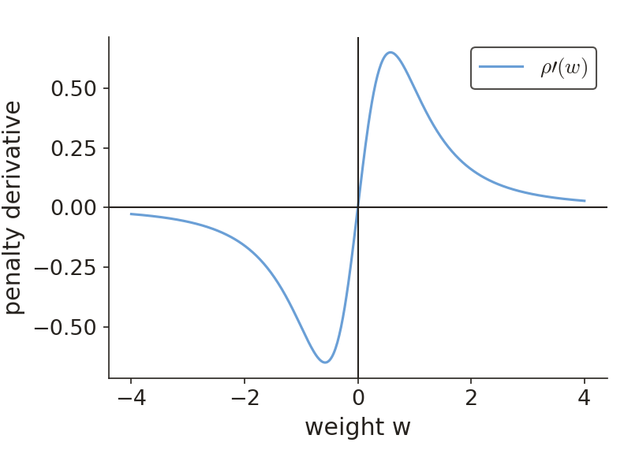
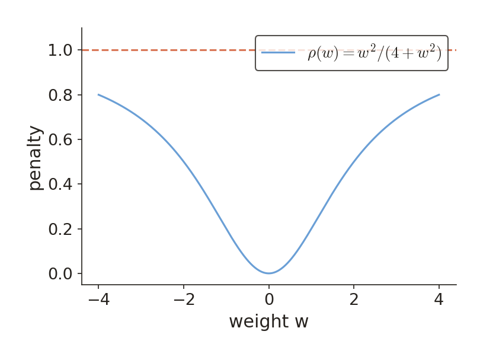
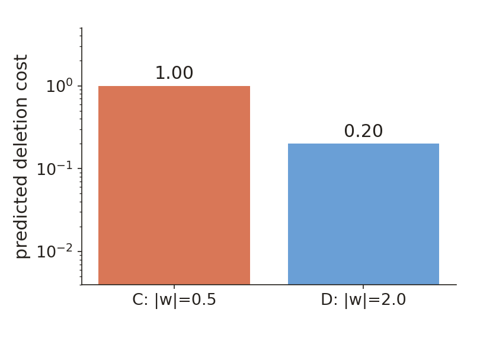

# KP11 Pruning, regularization and reported simulations

!!! note "Self-study"
    This unit (KP11) is self-study: it is not taught in class, so please read it on your own.

> Level: third-year undergraduate | Self-study | English edition

Read this independently with weighted scores, basic differentiation and matrices as prerequisites. New terms are introduced when needed.

[Open the matching slides](../../slides/lec05-kp11-pruning-regularization-en.jbd.json) | [中文版](../lec05-kp11-pruning-regularization.md)

## Learning objectives

- Derive saliency and state its assumptions.
- Compute penalties, deletion costs and compensation.
- Distinguish reported simulations from teaching calculations.

## KP11 Pruning, regularization and reported simulations

**One-sentence summary**：Estimate deletion cost and control the model through penalties and validation; count is not the only criterion.

**Plain explanation**：A fitted network may be redundant, but weight magnitude alone is not importance. Specify the deletion operation before examining how loss responds.

**Formal definition**：The sections define terms, symbols and assumptions while keeping symbols consistent for the same quantity.

**Example**：All new worked examples are [Added] and checked in Python. Source experiment reports are identified separately.

**Common misconception**：A small weight need not be unimportant, and a smooth penalty is not deletion.

**Practice**：The final section provides questions, hints and worked checks for use after your own attempt.

### A deletion amount is not its cost

A fitted network may be redundant, but weight magnitude alone is not importance. Specify the deletion operation before examining how loss responds.

**Pruning**: Pruning removes connections or units to reduce adjustable structure; performance must be checked afterward.

Start with one connection: setting its weight to zero removes its contribution to the score.

The goal is acceptable loss and held-out performance with a simpler model, not deletion for its own sake.

w_i is weight i and $\delta w_i$ its change. Since $w_i+\delta w_i=0$, deletion uses $\delta w_i=-w_i$.

J is the training objective; $\Delta J$ is its value after deletion minus before deletion. It is not the weight magnitude.

If $w_i=0.2$, deletion adds $-0.2$. A small parameter change need not have a small effect.

Figure `lec05-kp11-curvature`：[Added] Compare the labelled alternatives, then check them against the numerical discussion. Schematic model drawings are not exact experimental traces.

**Curvature**: Local curvature describes how quickly the loss slope changes; here it is measured by a second derivative.

**Hessian**: The Hessian matrix H collects second partial derivatives; $H_{ii}$ measures curvature in weight direction i.

Weight A is smaller but lies in a more curved loss profile; its deletion can cost more than deleting larger weight B.

### Derive saliency from a Taylor expansion

Local slopes and curvature predict nearby changes. Every simplification has conditions; the example deliberately reverses the magnitude-based ranking.

$\Delta J\approx\sum_i g_i\delta w_i+\frac12\sum_{i,j}H_{ij}\delta w_i\delta w_j$, where $g_i=\partial J/\partial w_i$ is the local slope.

Near a minimum, take $g_i\approx0$. A diagonal approximation drops cross-weight terms, leaving $\Delta J\approx\frac12\sum_iH_{ii}(\delta w_i)^2$.

**Saliency**: Substituting $\delta w_i=-w_i$ gives estimated deletion cost $s_i=\frac12H_{ii}w_i^2$, called saliency. It is an approximation, not measured loss.

A: $w_A=0.2,H_{AA}=100$. Then $s_A=\frac12\times100\times0.2^2=2$.

B: $w_B=1,H_{BB}=0.02$. Then $s_B=\frac12\times0.02\times1^2=0.01$.

Compare: $2/0.01=200$. This local estimate prefers deleting B, despite its larger magnitude.

Figure `lec05-kp11-saliency`：[Added] Compare the labelled alternatives, then check them against the numerical discussion. Schematic model drawings are not exact experimental traces.

Away from a minimum, the first-order term may matter; a large deletion can also invalidate the local expansion.

Multiple deletions can interact. Negative Hessian curvature should not be treated as a safe importance score.

Prune in small steps, measure loss again, retrain the remaining weights and keep the best validation model.

### Turn estimates into a checked pruning procedure

Saliency is not a measurement after deletion. The procedure therefore needs reassessment and retraining rather than treating one ranking as permanent.

Fit to a suitable state → estimate saliency → remove a few low-saliency connections → retrain and validate.

Stop using validation, an allowed loss increase or a resource budget. A smaller pruned network is not always more accurate.

Full-Hessian methods can account for compensating changes in other weights, at higher storage and computation cost.

### Put a model preference into the objective

Pruning changes structure; regularization first changes the objective. Compare two candidates, examine the saturating penalty, then distinguish shrinkage from deletion.

**Regularization**: Regularization adds a model preference or constraint beyond data fit, changing which solutions are favored.

$J_{\mathrm{total}}=J_{\mathrm{data}}+\alpha P(\mathbf w)$. The first term measures data error; P penalizes weights and $\alpha\ge0$ sets its strength.

Summed and averaged data losses have different scales, so the same numerical alpha has different effects.

Model A has data loss $0.10$ and penalty $4$; B has data loss $0.20$ and penalty $1$. Fix $\alpha=0.1$.

$J_A=0.10+0.1\times4=0.50$; $J_B=0.20+0.1\times1=0.30$. This objective favors B.

With $\alpha=0$, A wins. Select alpha with validation data; lower penalized training objective need not imply lower test error.

**Saturating penalty**: $\rho(w)=w^2/(\tau^2+w^2)$ with scale $\tau>0$ approaches 1 for large magnitude weights.

Set $P=\sum_i\rho(w_i)$. With $\tau=1$: $\rho(0.2)=0.04/1.04\approx0.0385$, $\rho(1)=0.5$, $\rho(3)=0.9$.

Compare magnitudes: $|w|\ll\tau$ describes the near-zero range, not a signed comparison between w and tau.

Figure `lec05-kp11-rho`：[Added] Compare the labelled alternatives, then check them against the numerical discussion. Schematic model drawings are not exact experimental traces.

$\rho'(w)=2\tau^2w/(\tau^2+w^2)^2$. Its derivative is zero at $w=0$; finite updates need not reach exact zero.

**Weight elimination**: Weight elimination encourages shrinkage and periodically zeroes or removes weights below a chosen threshold.

Use $|w_i|<\varepsilon$ for deletion. Epsilon is a deletion threshold; tau is the penalty scale. Their roles differ.

Figure `lec05-kp11-gradient`：[Added] Compare the labelled alternatives, then check them against the numerical discussion. Schematic model drawings are not exact experimental traces.

### Consider unit outputs and weight norms

A connection is not a unit, and a unit is not a whole signal path. These distinctions help explain why parameter count is not the only complexity measure.

The source also discusses penalties on neuron outputs, encouraging some units to respond less rather than scoring only individual connections.

A small unit output may be amplified by a large downstream weight. Inspect the path and performance after removal.

Connection deletion, unit deletion and numerical shrinkage are distinct operations and should be recorded separately.

The source cites a two-layer sigmoid-network result whose complexity term includes $A^3\sqrt{\log d/N}$ under training-error and weight-norm conditions.

A bounds each unit's sum of absolute weights; d is input dimension and N sample count. This is the source's scaling summary, not a complete probability bound.

With d and N fixed, doubling A multiplies this term by $2^3=8$. The term is not itself a classification error probability.

### Cascade correlation adds units for residual structure

Growth starts from a small architecture. Incoming weights first find residual-related responses; outgoing weights then reduce error after freezing. These are different objectives.

**Residual**: The residual is target minus prediction, $e_n=t_n-\hat y_n$, with n indexing examples.

**Cascade correlation**: Cascade correlation adds a hidden unit responsive to current residuals, then refits output weights.

The new unit receives original inputs and earlier hidden outputs. Train its incoming weights, then freeze them.

A single-output teaching score is $S=|\sum_n(v_n-\bar v)(e_n-\bar e)|$, where bars denote sample means.

For $e=(-1,1)$, candidate $v=(-1,1)$ gives $S=|-1\times(-1)+1\times1|=2$. Constant $v=(1,1)$ centers to zero and gives $S=0$.

After selecting the candidate and freezing incoming weights, refit outgoing weights for squared error. S is unnormalized, not a Pearson coefficient.

### Separate source simulation reports from new calculations

The following retains the source settings and reported numbers. Resampled scatter checks the distribution; count bars show reported counts. Neither claims reproduction of the experiments.

A means: $(0.4,0.9),(2.0,1.8),(2.3,2.3),(2.6,1.8)$. B means: $(1.5,1.0),(1.9,1.0),(1.5,3.0),(3.3,2.6)$.

Each cluster contributes 50 cases: $8\times50=400$. Covariance is $0.08I$; I is the 2-D identity and standard deviation is $\sqrt{0.08}$, not 0.08.

The plot resamples the stated distributions with a fixed seed. It checks the data design, not the original samples or network training.

Figure `lec05-kp11-data`：[Added] Compare the labelled alternatives, then check them against the numerical discussion. Schematic model drawings are not exact experimental traces.

The network is 2–3–2–1 with logistic slope 1 and targets 1/0. Counting biases gives $9+8+3=20$ parameters.

Reported momentum uses $\mu=0.05,\alpha=0.85$; adaptive momentum uses $\mu=0.01,\alpha=0.85,r_i=1.05,c=1.05,r_d=0.7$.

Here mu is learning rate, alpha momentum, and r_i and r_d learning-rate multipliers, and c the cost-ratio threshold. This alpha differs from regularization strength. Adaptive momentum was faster in the reported batch case.

The source reports two hidden layers of 20 units, an initial 480-weight model, saliency checks every 100 epochs and 25 retained weights.

The retained fraction is $25/480\approx0.0521$, about 5.21%. Deleting $480-25=455$ weights removes about 94.79%.

The source reports improved performance and shows a wavy boundary becoming approximately straight. The case does not guarantee improved generalization after every pruning procedure.

Figure `lec05-kp11-counts`：[Added] Compare the labelled alternatives, then check them against the numerical discussion. Schematic model drawings are not exact experimental traces.

Added illustration: use score $r=x_2-0.6x_1-1$ and continuous response $p=1/(1+e^{-r})$, thresholded at 0.5. This is not the source's trained model.

Evaluate p on a 2-D grid and draw the $p=0.5$ contour. It is the thresholded class that switches between 0 and 1.

Record grid resolution, threshold and coordinate range. A smoother figure alone is not an accuracy comparison.

Figure `lec05-kp11-boundary`：[Added] Compare the labelled alternatives, then check them against the numerical discussion. Schematic model drawings are not exact experimental traces.

### Full-curvature compensation and practice

For more depth compare fixed remaining weights with compensating changes. The final problems return to hand-computable saliency and penalties.

In an added quadratic example, $H=\begin{bmatrix}4&1\\1&2\end{bmatrix}$ and deleting $w_1=0.5$ gives $\delta w_1=-0.5$.

Fixing $\delta w_2=0$ costs $\frac12\times4\times0.5^2=0.5$. Allowing compensation gives $\Delta J=0.5-0.5\delta w_2+(\delta w_2)^2$.

Differentiating gives $-0.5+2\delta w_2=0$, so $\delta w_2=0.25$. Cost $0.5-0.125+0.0625=0.4375$ is below 0.5.

Question 1: C has weight 0.5 and curvature 8; D has weight 2 and curvature 0.1. Which has lower saliency $s=Hw^2/2$?

Question 2: set $\tau=2,w=2$ and calculate $\rho(w)$. Does that value mean the weight has been deleted?

Figure `lec05-kp11-rho-practice`：[Added] Compare the labelled alternatives, then check them against the numerical discussion. Schematic model drawings are not exact experimental traces.

Question 1: $s_C=\frac12\times8\times0.5^2=1$; $s_D=\frac12\times0.1\times2^2=0.2$. The estimate favors deleting D.

Question 2: $\rho(2)=2^2/(2^2+2^2)=4/8=0.5$. The weight remains 2 until an explicit zeroing or removal operation.

Check the lesson: a larger weight can have lower saliency. Next ask whether connections can share fewer parameters from the start.

Figure `lec05-kp11-saliency-practice`：[Added] Compare the labelled alternatives, then check them against the numerical discussion. Schematic model drawings are not exact experimental traces.

#### State the Taylor assumptions explicitly

Let the current parameter vector be $\mathbf w$ and its perturbation $\delta\mathbf w$. For a twice differentiable objective, locally

$$
J(\mathbf w+\delta\mathbf w)-J(\mathbf w)\approx\nabla J(\mathbf w)^T\delta\mathbf w+\frac12\delta\mathbf w^TH\delta\mathbf w.
$$

Only near stationarity may the first term be neglected. The diagonal assumption simplifies computation; it does not make real network weights independent. Changing only one weight with all others fixed removes cross terms because other perturbations are zero.

Allowing compensation requires the off-diagonal information again. The final $2\times2$ example illustrates this distinction.

#### Differentiate the saturating penalty

With $u=w^2$ and $v=\tau^2+w^2$, the quotient rule yields

$$
\rho'(w)=\frac{2w(\tau^2+w^2)-w^2(2w)}{(\tau^2+w^2)^2}=\frac{2\tau^2w}{(\tau^2+w^2)^2}.
$$

The penalty gradient pulls positive and negative weights toward zero. It is also small for very large magnitudes because the curve saturates. This is not a convex L1 penalty and does not guarantee exact zeros in finite updates.

#### A counting ambiguity in the source

The source reports two 20-unit hidden layers and 480 weights without fully specifying the input/output/bias convention. Do not reverse-engineer a unique architecture and present it as a source fact. Keep the 400-case 2–3–2–1 simulation separate from the 480-to-25 pruning illustration.

#### A finite-difference curvature check

Changing only weight i by step h while holding others fixed gives the central-difference estimate

$$
H_{ii}\approx\frac{J(\mathbf w+h\mathbf e_i)-2J(\mathbf w)+J(\mathbf w-h\mathbf e_i)}{h^2}.
$$

$\mathbf e_i$ has one in coordinate i and zeros elsewhere. Step h is not a deletion threshold. With $J(w)=(w-0.5)^2$, w=0.5 and h=0.1, the costs are 0.01, zero, 0.01. Thus $(0.01-2\times0+0.01)/0.01=2$, matching the analytic curvature. Large steps have approximation error; tiny steps can suffer cancellation. The difference formula is not an exact black box in general.

## Glossary and symbol reminders

| English | 中文 |
|---|---|
| Pruning | 剪枝 |
| Curvature | 曲率 |
| Hessian | 海森矩陣 |
| Saliency | 顯著度 |
| Regularization | 正則化 |
| Saturating penalty | 飽和懲罰 |
| Weight elimination | 權重消除 |
| Residual | 殘差 |
| Cascade correlation | 級聯相關法 |

Read symbols by their local definitions. Distinguish weights, scores, predictions and loss; identically named hyperparameters in different experiments may have different roles.

## Sources and supplementary scope

- [Chapter 4, KP11](https://ndhuccc.github.io/CCC-LNS/PR_115/Ch04-nonlinear-classifiers/index.html#kp11), accessed 2026-10-25.
- The 480-to-25 counts, 100-epoch interval and momentum settings are source reports, not reproduced experiments or new exact traces. The Bartlett result is available only as a scaling summary, not a complete theorem or unconditional certificate.
- Source reference codes: [Lecu 90], [Hass 93], [Wein 90], [Bart 98], [Fahl 90].
- Original Figures 4.14–4.16 were inspected. New teaching diagrams do not claim to be the original figures or exact experimental curves.
- Historical reference codes follow the source. Full papers, theorem conditions and experimental records were not all available; those limits are retained.
