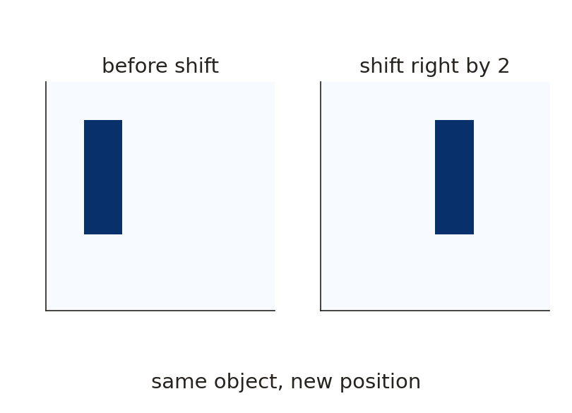
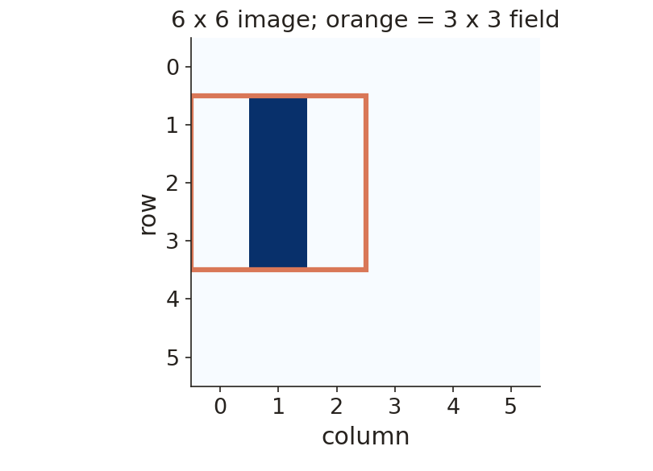
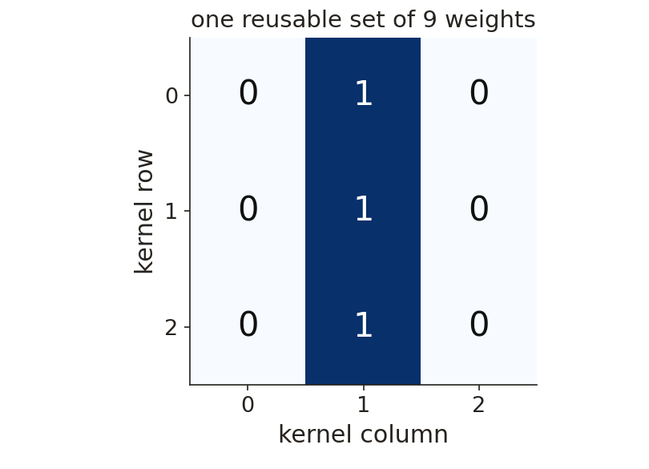
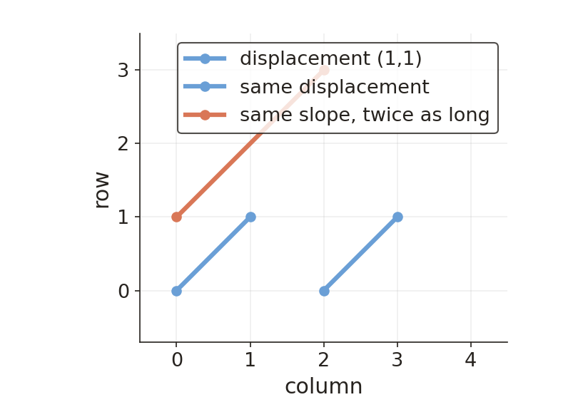
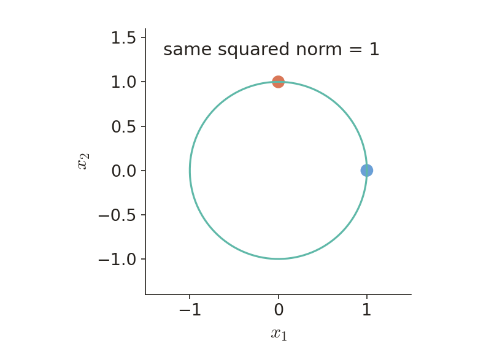
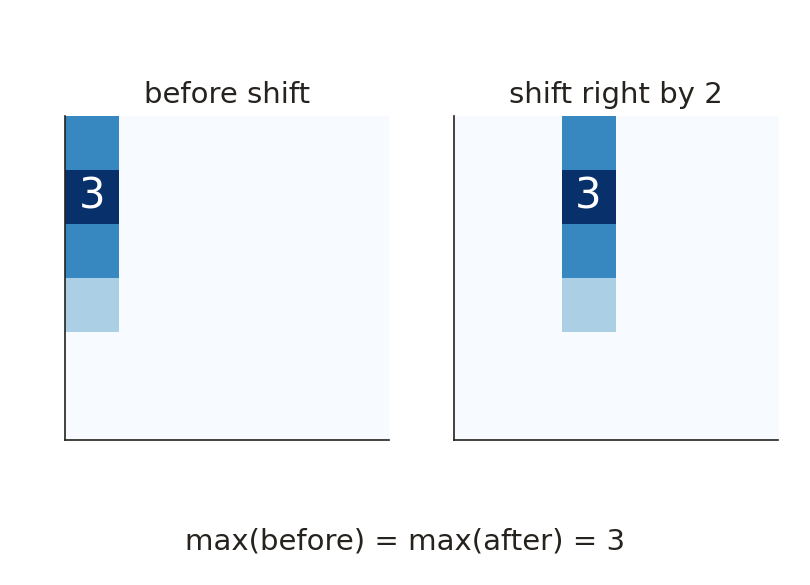

# KP12 Weight Sharing and Transformation Invariance

!!! note "Self-study"
    This unit (KP12) is self-study: it is not taught in class, so please read it on your own.

> Level: undergraduate, year 3
>
> Pattern Recognition | Chapter 4

[Slides: read and download](../../slides/lec05-kp12-weight-sharing-en.jbd.json) | [中文版](../lec05-kp12-weight-sharing.md)

## Learning objectives

- Compute a shared kernel, a feature map and a parameter count by hand.
- Tell "equivariance" from "invariance" with one example.
- State the conditions and limits of sharing for translation and rotation.

## KP12 Weight Sharing and Transformation Invariance

**One-sentence summary**: Reusing one set of weights at every position usually gives a response that moves with the input (equivariance); only a suitable read-out can then give a result that does not depend on position (invariance).

### Prerequisites and symbols

**Three things you need first**:

- **Weighted score** (KP06): the score is $r=b+\sum w_ix_i$, where $b$ is the bias.
- **Chain rule** (KP06): when one parameter affects the cost along many paths, add up the contributions of the paths.
- **Matrices and arrays**: "row $i$, column $j$" points to one cell.

**Symbol table** (fixed for this lecture):

| Symbol | Meaning | Note |
|---|---|---|
| $x$, $Tx$ | the image, and the shifted image | 6×6; $T$ is the given transformation |
| $K$, $b$ | the shared 3×3 weight matrix, the bias | $b=0$ in this example |
| $r_{ij}$ | score of the window whose top-left corner is at $(i,j)$ | row $i$, column $j$ |
| $F(x)$ | feature map | all $r_{ij}$ arranged in an array; 4×4 here |
| $z$ | result of max pooling | $z=\max_{i,j}F(x)_{ij}$ |
| $k$, $x_p$, $\delta_p$ | shared weight, input at position $p$, partial derivative of the cost with respect to the score at $p$ | section 3 |
| $\eta$ | learning rate | 0.1 in section 3 |

### 1. Building a local sharing rule from a moving stroke

**Plain-words explanation**: We want an object to keep its class after it moves, but that does not mean every number in the network must stay the same. The method has two steps: first restrict each unit to look at a small area, then let all positions use the same weights.

- **Transformation invariance**: for a given transformation $T$, the classification satisfies $c(Tx)=c(x)$. State which transformation you mean.
- **Receptive field**: the input range a unit receives directly; here a 3×3 window of the image.
- **Weight sharing**: several corresponding connections are restricted to use one adjustable value; an update changes only that common value.
- **Kernel**: the weight matrix reused by the sliding window; called $K$ in this section.

**Setting of this section**:

- The image $x$ is 6×6 with one vertical three-cell stroke (value 1) and 0 elsewhere. The stroke is in column 1, rows 1 to 3 (rows and columns count from 0).
- Shifting $x$ right by two columns gives $Tx$, with the stroke in column 3, not cut off.
- The window moves one cell at a time with no padding, so there are $4\times4=16$ legal top-left positions.

Figure `lec05-kp12-shift`: [Supplement] First look at the left and right 6×6 images: the same three-cell stroke moves from column 1 to column 3; then check that the stroke is complete in both. What we want is "the class stays", not "every middle number stays". [Function: 1]

Figure `lec05-kp12-patch`: [Supplement] First look at one 3×3 box on the 6×6 image, which is the receptive field of a single position; then count how many top-left positions the box can take: $6-3+1=4$ in each direction, 16 in all. [Function: 1]

One position sees nine numbers; different positions see different data but can use the same decision rule.

Figure `lec05-kp12-kernel`: [Supplement] First look at the 3×3 weight matrix: the middle column is 1, the rest 0, and the bias is $b=0$; then compute one window: when the middle column is $1,1,1$ the score is $1\times1+1\times1+1\times1=3$. This kernel only detects "a vertical line in the middle column". [Function: 2]

The next question: what do we get by sliding this kernel over the whole image, and how does it change after a shift?

### 2. An equivariant feature map first, an invariant read-out afterwards

Keeping every position gives a response that moves with the input. Only a suitable pooling step can then remove the position difference; this is the most important turn of idea in this unit.

- **Feature map**: the window scores arranged by position, written $F(x)$; 4×4 here.

With the $x$, $K$ and $b=0$ above, compute cell by cell:

$$
F(x)=\begin{bmatrix}2&0&0&0\\3&0&0&0\\2&0&0&0\\1&0&0&0\end{bmatrix},\qquad
F(Tx)=\begin{bmatrix}0&0&2&0\\0&0&3&0\\0&0&2&0\\0&0&1&0\end{bmatrix}.
$$

**How to read the two matrices**:

1. The middle column of a window is column $j+1$ of the image; with the stroke in column 1, only windows with $j=0$ touch it.
2. The overlap of the window rows $i$ to $i+2$ with the stroke rows 1 to 3 is $2,3,2,1$ for $i=0,1,2,3$; that is the first column $2,3,2,1$.
3. After the shift the stroke is in column 3 and only windows with $j=2$ touch it; the pattern of scores is the same, the position moves from column 0 to column 2.

Figure `lec05-kp12-maps`: [Supplement] First look at the two 4×4 feature maps: the bright cells are in column 0 on the left and column 2 on the right; then compare the two maxima, both 3. The response "moves with the stroke" but its size does not change. [Function: 2]

- **Translation equivariance**: when the input is shifted, the output is shifted in the corresponding way, written $F(Tx)=TF(x)$. Usually $F(Tx)\ne F(x)$ here, because the high-score position changed.
- **Max pooling**: take only the maximum of the whole feature map, $z=\max_{i,j}F(x)_{ij}$. Here $z=3$ before and after the shift.

**Limits**:

- Integer shifts, the stride, padding and boundary conditions must be compatible; when the object is cut off, the same response is not guaranteed.
- Pooling throws position away; tasks that need exact localization may not suit it.
- This only checks a shift that keeps the whole feature in this example; if the later classifier depends only on $z$, the two images give it the same evidence.

The next question: how many parameters does sharing save, and how is a shared weight updated in training?

### 3. How parameters are counted and updated together

Sharing saves "independently adjustable numbers", not the computation at each position: all sixteen positions are still computed.

| Setting | Parameters | Count |
|---|---:|---|
| Not shared | 160 | 16 positions, each with 9 weights and 1 bias: $16\times(9+1)$ |
| Shared | 10 | all positions share 9 weights and 1 bias: $9+1$ |

This reduction needs "the sharing assumption fits the task"; fewer parameters does not mean every problem becomes more accurate, nor that the number of operations drops to one tenth.

**How a shared weight is updated, step by step**:

1. Let a shared weight be $k$; the input score at position $p$ is $r_p$ and the input multiplied by $k$ is $x_p$, so for a locally linear score $\partial r_p/\partial k=x_p$.
2. Let $\delta_p=\partial J/\partial r_p$. The chain rule adds up all paths: $\dfrac{\partial J}{\partial k}=\sum_p\delta_px_p$.
3. Numerical example: two positions give $0.2\times3$ and $-0.1\times1$, so the total gradient is $0.6-0.1=0.5$.
4. With learning rate $\eta=0.1$ and the old $k=1$, the update is $k=1-0.1\times0.5=0.95$; all positions then use 0.95.

If some paths also have an activation, its derivative is already inside $\delta_p$ and must not be left out or counted twice.

The next question: besides sharing, what other routes lead to invariance to shifts?

### 4. Comparing three routes to invariance

Local sharing is only one architectural prior. A real system can combine the three below, but first judge whether the transformation preserves the class.

| Route | What it does | Risk |
|---|---|---|
| Choose invariant features | first turn the data into a representation insensitive to the given transformation | may throw away information needed for recognition |
| Architectural constraint | shared weights plus suitable pooling, stating which computations must be the same | holds only for compatible transformations |
| Data augmentation | create more training examples with reasonable transformations | finite examples usually do not guarantee invariance under all transformations |

### 5. Geometric sharing in higher-order input products

Multiplying two pixels brings "the geometric relation of a pair of positions" into the model. Telling apart that a shift preserves the displacement and a rotation preserves the length avoids using the wrong sharing condition.

- **Higher-order network**: the score before activation contains input products, for example $v=b+\sum_i a_ix_i+\sum_{j,k}c_{jk}x_jx_k$, followed by an activation $f(v)$.
- Symbols: $x_i$ is a pixel value, $a_i$ a single-pixel weight, $c_{jk}$ a pixel-pair weight and $b$ the bias.
- For example, if both cells are 1 the product is 1; if either cell is 0 the product is 0. So a pixel pair can describe the joint effect between positions.

**Under a shift, what stays the same?** Adding the same displacement $t$ to both end points leaves the difference vector unchanged: $(p_k+t)-(p_j+t)=p_k-p_j$. So the pairs that can share a coefficient are those with the same displacement vector.

Figure `lec05-kp12-pair`: [Supplement] First look at the two blue lines: both have displacement $(1,1)$ and can share through the same displacement group; then look at the orange line: its displacement is $(2,2)$, and although its slope equals the blue ones it is not the same displacement, so it cannot share. [Function: 2]

So "the same slope is enough" is too rough; for the whole model to be invariant, the single-pixel terms, the boundary handling and the read-out must also meet the same symmetry requirement.

**Under a rotation, what stays the same?**

- A rotation preserves segment length, so pixel pairs of the same length can share a second-order coefficient; this puts a geometric prior into the model.
- On a finite pixel grid, a rotation by an arbitrary angle often needs interpolation or cropping; exact invariance is possible only when the transformation, the terms and the pooling are compatible.
- Higher-order networks can reduce free parameters, but the source also notes that such methods have not become mainstream; geometric intuition is not an unconditional performance guarantee.

### 6. A squared-term special case and the limits of the historical architecture

A special sum of squares needs only one extra coefficient, but "one term has the symmetry" does not mean "the whole model has it".

- Model: $v=b+\sum_i a_ix_i+c\sum_i x_i^2$. $c$ is one coefficient shared by all squared terms, one extra parameter rather than one per cell.
- The sum of squares is $\|x\|^2$: $(1,0)$ and $(0,1)$ both give $1^2+0^2=1$, so the sum of squares itself is invariant under orthogonal rotations.
- But the linear term may differ: if $a=(1,0)$, the scores of the two points are $b+1+c$ and $b+c$, which are not equal.

Figure `lec05-kp12-radius`: [Supplement] First see that the points $(1,0)$ and $(0,1)$ lie on the same circle and have squared norm 1; then recall the scores above: the linear term makes the overall scores of the two points differ. The figure only shows that "the squared term itself" is rotation invariant. [Function: 2]

**Historical architecture**: the source describes three hidden layers, the first two made of feature maps; each unit receives only a local window of the previous layer, and the corresponding connections in one map share weights.

- This is the same sharing principle as the three-cell stroke here, but not the same architecture.
- Without enough original detail, its full parameter count or accuracy cannot be computed; the source's generalization benefit is a quoted claim, not a guarantee of this lecture's examples.

Next step: first ask "which transformation should keep the label", then decide the features, the sharing rule and the read-out; do not only ask "is sharing always better".

### 7. Small exercises and a parameter-count check

Change the image size and compute again, then describe the output with the "equivariance" and "invariance" formulas, checking that you keep the number of positions apart from the number of parameters.

**Small exercises**:

1. An 8×8 input, a 3×3 window, stride 1, no padding, with the bias also shared. How large is the feature map? How many parameters with and without sharing?
2. After sharing, the high-score position moves with the input. Is this equivariance or invariance? Hint: compare $F(Tx)=TF(x)$ with $F(Tx)=F(x)$.

**Exercise 1, worked solution**:

1. $8-3+1=6$ positions in each direction, $6\times6=36$ in all, so the feature map is 6×6.
2. Not shared: $36\times(9+1)=360$. Shared: $9+1=10$.
3. A larger image only increases how often the parameters are used, not this set of shared parameters.

**Exercise 2, worked solution**: A high-score position that moves with the input is equivariance; only with suitable pooling and under the conditions can an invariant feature follow.

Figure `lec05-kp12-maps-practice`: [Supplement] The exercise puts the same three-cell stroke in an 8×8 image and shifts it right by two columns; the figure shows 6×6 feature maps. First see that the bright cells on the left and right differ by two columns, then compare the two maxima, both 3. [Function: 2]

### Extension: exact window computation, boundaries and gradient

**Exact form of the shared window**: let the image be $x$, the kernel $K$ and the bias $b$. Here we use cross-correlation, which does not flip the kernel:

$$
r_{ij}=b+\sum_{a=0}^{2}\sum_{c=0}^{2}K_{ac}x_{i+a,j+c}.
$$

$i,j$ is the top-left position of the window; $a,c$ are the row and column offsets inside the kernel (we use $c$ to avoid confusion with the bias $b$). With a pointwise activation $\phi$, the feature map can be $F(x)_{ij}=\phi(r_{ij})$; the main example of this lecture uses the score $r$ directly, with no extra activation.

**Boundaries on a finite grid**: the equivariance formula needs the corresponding positions to be legal.

- When the object moves out of the picture, the boundary fill differs, or the shift is not compatible with the stride, the equality may hold only in the interior.
- Rotating an image may also need interpolation; grouping weights of the same length alone cannot remove sampling error.

**Where the shared gradient comes from**: one parameter $k$ enters many scores $r_p$. The chain rule adds all paths:

$$
\frac{\partial J}{\partial k}=\sum_p\frac{\partial J}{\partial r_p}\frac{\partial r_p}{\partial k}.
$$

Under a locally linear score, the second factor is the input $x_p$ at that position (see section 3).

## Terms and source

| 中文 | English |
|---|---|
| 轉換不變性 | Transformation invariance |
| 感受野 | Receptive field |
| 權重共享 | Weight sharing |
| 卷積核 | Kernel |
| 特徵圖 | Feature map |
| 平移等變性 | Translation equivariance |
| 最大值彙整 | Global max pooling |
| 高階網路 | Higher-order network |

Source: [Chapter 4 KP12](https://ndhuccc.github.io/CCC-LNS/PR_115/Ch04-nonlinear-classifiers/index.html#kp12) (read 2026-10-25); reference codes [Fuku 82], [Rume 86], [Fuku 92], [Lecu 89], [Ride 97]. The source calls sharing translation invariance directly; this lecture separates local equivariance from invariance after pooling; the source's "same slope" constraint cannot describe a pure shift, so displacement vectors are used instead. The examples, feature maps and exercises here are [Supplement] and were checked with Python; the source's original figures (Figures 4.14 to 4.16) were viewed, and this lecture uses its own diagrams without passing off source images or exact curves as new results. Where a quoted full theorem or experimental detail cannot be checked, its limits are kept.
