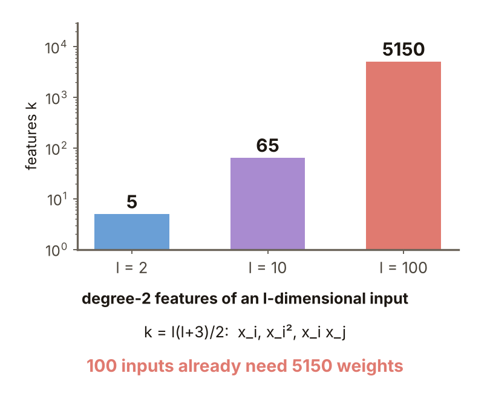
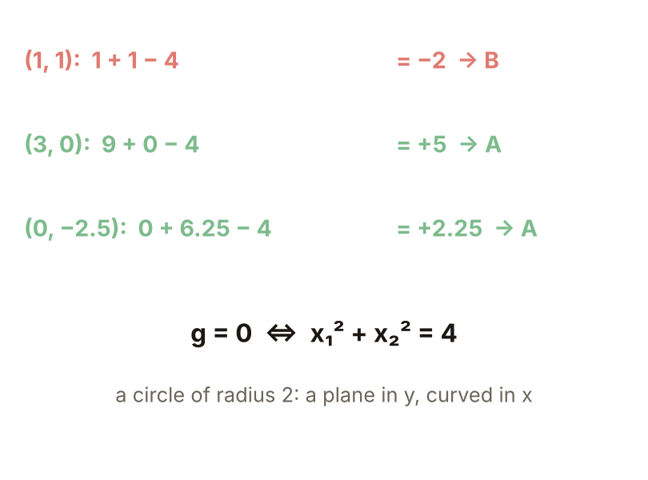

# KP13 Generalized Linear Classifiers

> Level: undergraduate, year 3
>
> Pattern Recognition | Chapter 4, §4.12

[Slides: read and download](../../slides/lec05-kp13-generalized-linear-en.jbd.json) | [中文版](../lec05-kp13-generalized-linear.md)

## Learning objectives

- Explain why we lift first and then use a linear classifier, and how a nonlinear boundary in the original space becomes a plane in the new space.
- Compute the weights of a generalized linear classifier by least squares (the normal equation) and handle several classes.
- Explain how a generalized linear classifier differs from projection pursuit and from a multilayer perceptron, and the price of lifting.

## KP13 Generalized Linear Classifiers

**One-sentence summary**: First send $x$ to a $k$-dimensional space with a set of fixed nonlinear functions $f_i$, then design an ordinary linear classifier there; all the nonlinearity is carried by the $f_i$ and the discriminant function stays linear in the weights.

### 1. Sandwiched classes

**Plain explanation**: What if no straight line separates the data in the original space?

**Example** (one dimension, designed here): class A at $x=-3,-2,2,3$ and class B at $x=-1,0,1$. Any single threshold, in either direction, gets at most 5 of the 7 right (exhaustive program search). The reason is that A lies on both sides of B, so $x$ alone cannot show it.

Figure `lec05-kp13-sandwich`: the two classes on a line and the best single threshold.

### 2. A new coordinate

**Feature mapping**: use a set of functions $f_i$ to replace $x$ by new coordinates $y=(f_1(x),\dots,f_k(x))$. Here $y=(x,x^2)$: A has $y_2=4,9$ and B has $y_2=0,1$, and one horizontal line $y_2=2.5$ separates the two classes, a linear classifier in the new coordinates.

Figure `lec05-kp13-lift`: the points lifted to $(x,x^2)$ and separated by one horizontal line.

### 3. Curved when seen back on x

**Formal definition**: the **generalized linear classifier**

$$
g(x)=w_0+\sum_{i=1}^{k}w_if_i(x),
$$

lifts with fixed nonlinear $f_i$ and then designs an ordinary linear classifier; "linear" means linear in the weights $w_i$. Here $g(x)=-2.5+0\cdot x+1\cdot x^2$, $g>0$ means A and $g<0$ means B; $g=0$ at $x=\pm\sqrt{2.5}=\pm1.58$, A outside and B inside. A line (in general a hyperplane) in the new space is two points in the original space. Seen the other way round, if a nonlinear hypersurface $g(x)=0$ separates the classes in the original space, writing $g$ as a linear combination of the $f_i$ is the classical interpolation and function-approximation problem (source).

Figure `lec05-kp13-curve`: $g(x)=-2.5+x^2$ and the seven points.

### 4. XOR once more

Add the coordinate $y_3=x_1x_2$ and take $g=x_1+x_2-2y_3-0.5$: $(0,0)\to-0.5$, $(0,1)\to+0.5$, $(1,0)\to+0.5$, $(1,1)\to-0.5$, so one plane separates the four points. KP02 combined two lines; here one fixed mapping and one plane do the job.

Figure `lec05-kp13-xor`: new coordinates and $g$ of the four XOR points.

### 5. Computing the weights

**Normal equation**: the solution $w=(\Phi^T\Phi)^{-1}\Phi^Tt$ that minimizes the squared error between $\Phi w$ and the targets ($+1$ for A, $-1$ for B); each row of $\Phi$ is $(1,f_1,\dots,f_k)$ of one sample. For the seven points of section 1 the rows of $\Phi$ are $(1,x,x^2)$ and the solution is $w=(-0.810,\,0,\,0.238)$; the sign of each of the seven $g$ equals its target, so all seven points are right (program).

Figure `lec05-kp13-fit`: the $g$ values of the seven points.

### 6. Concentric rings

A program generates two classes of 100 points each, the inner ring of radius about 1.0 and the outer about 2.2. Straight-line features $[1,x_1,x_2]$ are right only 51% of the time, no better than guessing; quadratic features $[1,x_1,x_2,x_1^2,x_2^2,x_1x_2]$ are 99.5% right, and $g=0$ is a circle of radius 1.71 in the original space, between the two rings (program). **Common misconception**: after lifting the boundary becomes a straight line. It is a plane in the new space and a circle back in the original space.

Figure `lec05-kp13-rings`: the concentric rings and the decision circle.

### 7. Several classes

For $M$ classes design $M$ weight vectors $w_r$ and pick the class with the largest $w_r^Ty+w_{r0}$. **Example** (designed here): nine points in one dimension with classes 1, 2, 3 on the left, middle and right; one-hot targets, features $(1,x,x^2)$ and a least-squares solution for three weight vectors: all nine right; with only $(1,x)$ just 7 are right and the middle class is right only at $x=0$ (a three-way tie of $1/3$ there, resolved to the middle class).

Figure `lec05-kp13-multi`: the three $g$ curves and nine points.

### 8. Contrast: projection pursuit

**Projection pursuit**: $g(x)=\sum_i f_i(w_i^Tx)$; $f_i$ sees the projection of $x$ on a direction $w_i$, and direction and function are optimized together. Double $w$: a generalized linear $g$ doubles exactly, while for projection pursuit ($f$ a sigmoid, input 1, $w=1$) $f(2)=0.881$, not $2f(1)=1.462$, so it is not linear in $w$ and needs a two-stage alternating optimization (source). If $f_i$ is fixed to a sigmoid it is a one-hidden-layer neural network, which multilayer perceptrons have replaced in practice. **To remember**: generalized linear = fixed mapping + learnable linear layer; multilayer perceptron = learnable mapping + learnable linear layer.

Figure `lec05-kp13-pp`: block diagrams of the two structures and the doubling test.

### Extension: how many coordinates, practice and worked solution

**How many coordinates**: quadratic features of an $l$-dimensional input are $l$ terms $x_i$, $l$ terms $x_i^2$ and $l(l-1)/2$ terms $x_ix_j$, $k=l(l+3)/2$ in all: 5 for $l=2$, 65 for $l=10$ and 5150 for $l=100$. Does lifting really help? The source answers with Cover's theorem (KP14); polynomial and RBF mappings follow in KP15 and KP16.

Figure `lec05-kp13-count`: the number of quadratic features (log axis).

**Practice**: features $y=(x_1^2,x_2^2)$ and $g=y_1+y_2-4$ ($g>0$ is A).

1. Which class are $(1,1)$, $(3,0)$ and $(0,-2.5)$?
2. What shape is $g=0$ on the $x$ plane?

Figure `lec05-kp13-practice`: the setup of the practice.

**Worked solution of questions 1 and 2**: (1) $(1,1)$: $1+1-4=-2$, B; $(3,0)$: $9+0-4=5$, A; $(0,-2.5)$: $0+6.25-4=2.25$, A. (2) $g=0$ means $x_1^2+x_2^2=4$, a circle of radius 2: a straight line in the $y$ space and curved in the $x$ space.

Figure `lec05-kp13-practice-sol`: $g$ of the three points and the decision circle.

## Terms and sources

| English | 中文 |
|---|---|
| Feature mapping | 特徵映射 |
| Generalized linear classifier | 廣義線性分類器 |
| Normal equation | 正規方程 |
| Projection pursuit | 投影追蹤 |

Source: Chapter 4 KP13, §4.12 (read 2026-10-25). The definition of the generalized linear classifier, the function-approximation view, the several-class method, the projection-pursuit contrast and the "to remember" line follow the source; the one-dimensional sandwich example, the XOR coordinates, the concentric-rings data (the source has an interactive demo, this lecture generates its own data by a program), the three-class one-dimensional data and every number were designed and recomputed for this lecture ([added], (program)).
