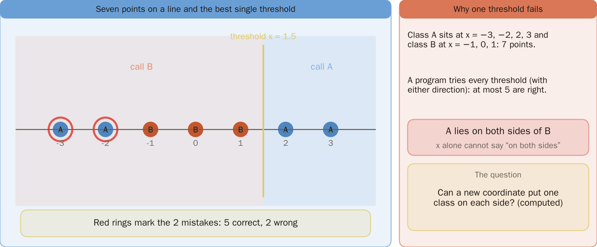
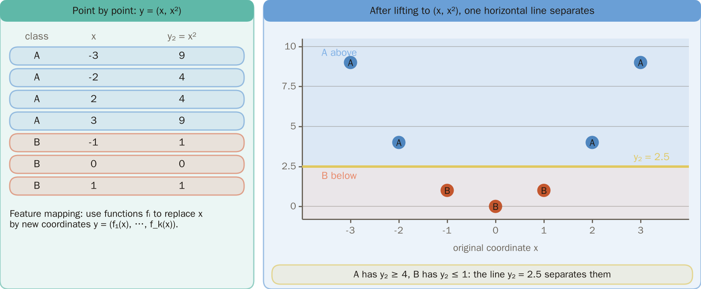
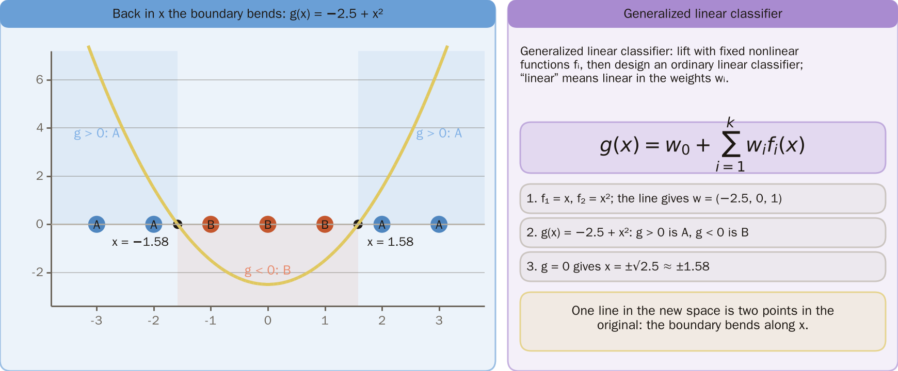
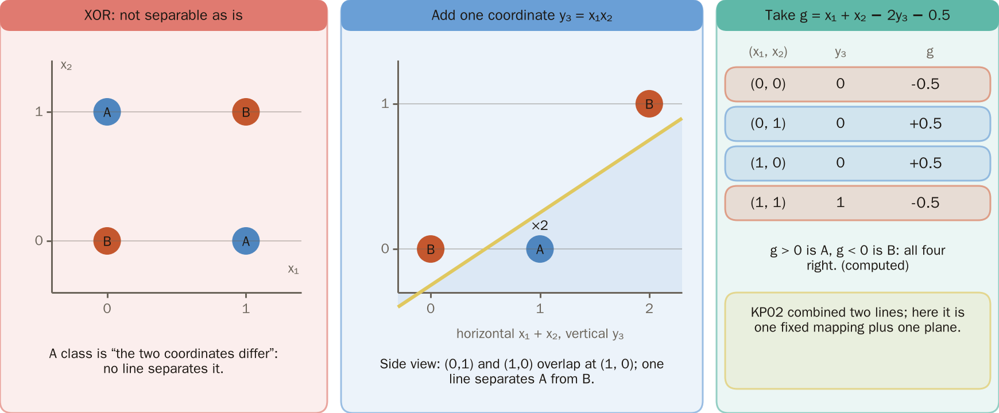
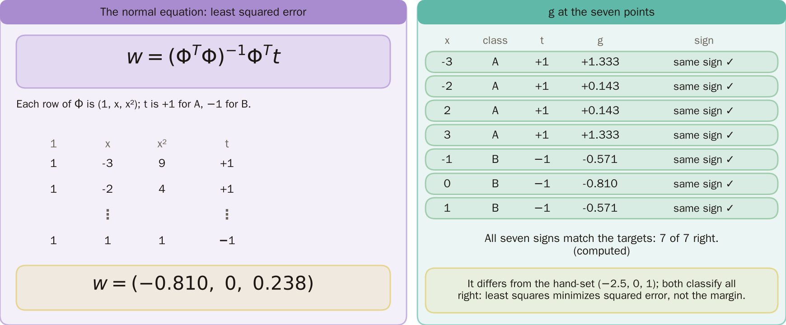
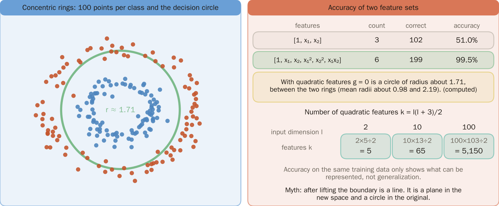
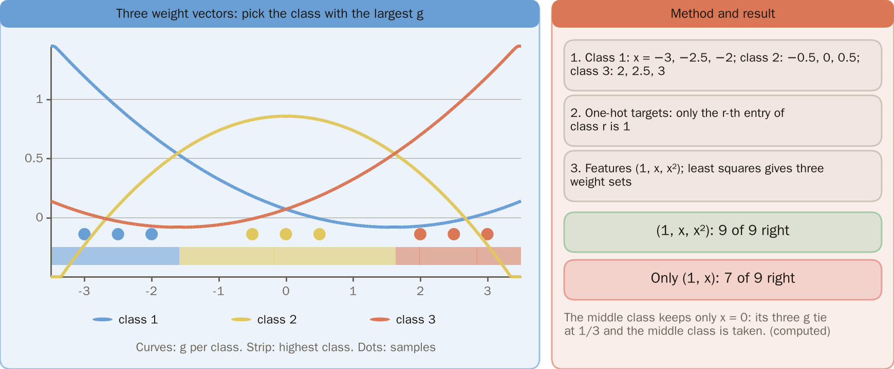
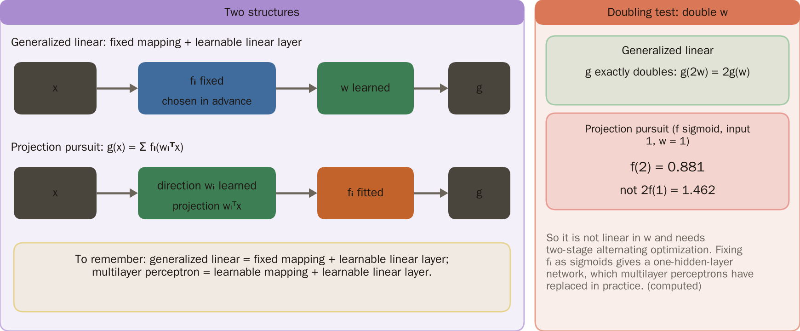
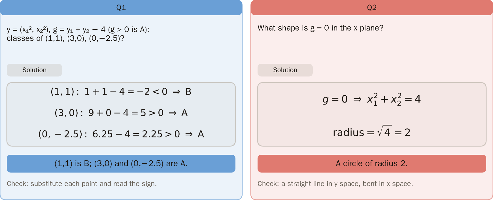

# KP13 Generalized Linear Classifiers

> Level: undergraduate, year 3
>
> Pattern Recognition | Chapter 4 §4.12

[Slides: read and download](../../slides/lec05-kp13-generalized-linear-en.jbd.json) | [中文版](../lec05-kp13-generalized-linear.md)

## Learning objectives

- Explain why we first raise the dimension and then use a linear classifier, turning a nonlinear boundary of the original space into a plane of the new space.
- Compute the weights of a generalized linear classifier by least squares (the normal equation), and handle several classes.
- Explain how a generalized linear classifier differs from projection pursuit and the multilayer perceptron, and what raising the dimension costs.

## KP13 Generalized Linear Classifiers

**One-sentence summary**: First send $x$ with a fixed set of nonlinear functions $f_i$ into a $k$-dimensional space, then design an ordinary linear classifier there; all the nonlinearity is carried by the $f_i$, and the discriminant is still linear in the weights.

### Prerequisites and symbols

**Three things you need first**:

- **Linear discriminant** (KP01–KP03): $g(x)=w^Tx+w_0$; $g>0$ decides one class and $g<0$ the other; the boundary $g=0$ is a line or a plane.
- **Squared error** (KP06): the square of the difference between prediction and target; the smaller the total, the better.
- **Matrix product and transpose**: $\Phi w$ takes the inner product of each row of the matrix $\Phi$ with $w$.

**Symbol table** (fixed for this lecture):

| Symbol | Meaning | Note |
|---|---|---|
| $x$, $l$ | a point of the original space, its dimension | $l=1$ in sections 1–3, $l=2$ in section 6 |
| $f_i(x)$, $k$ | the $i$-th fixed nonlinear function, the number of functions | the new space has dimension $k$ |
| $y$ | a point of the new space | $y=(f_1(x),\dots,f_k(x))$ |
| $w_0,w_i$ | bias and weights | the only things that are learned |
| $g(x)$ | discriminant | in this lecture $g>0$ decides A, $g<0$ decides B |
| $\Phi$ | design matrix | each row is $(1,f_1,\dots,f_k)$ of one sample |
| $t$ | target vector | $+1$ for A, $-1$ for B |
| $M$, $w_r$ | number of classes, weight vector of class $r$ | section 7 |

### 1. Classes that sandwich one another

**Plain-words explanation**: What if the data cannot be separated by one line in the original space? Look at the simplest one-dimensional case first.

**Example** (one dimension, designed for this lecture):

- Class A at $x=-3,-2,2,3$, class B at $x=-1,0,1$, seven points in all.
- Any single threshold (with its direction) gets at most 5 of the 7 right (a program tries every threshold).
- Reason: A lies on both sides of B, and the size of $x$ alone cannot show "on both sides".

Figure `lec05-kp13-sandwich`: First see the seven points on the number line: A on both sides and B in the middle; then see the best single threshold x = 1.5 as the yellow dashed line, with the two mistakes ringed in red: only 5 are right. [Function: 1]

The next question: can we change the coordinate so that the two classes sit "one on each side"?

### 2. Changing the coordinates

- **Feature mapping**: use a set of functions $f_i$ to replace $x$ by new coordinates $y=(f_1(x),\dots,f_k(x))$.

Take $y=(x,x^2)$ and compute point by point:

| Class | $x$ | $y_2=x^2$ |
|---|---|---|
| A | $-3,-2,2,3$ | $9,4,4,9$ |
| B | $-1,0,1$ | $1,0,1$ |

A's $y_2$ are all at least 4 and B's at most 1; the horizontal line $y_2=2.5$ separates the two classes, which is a linear classifier in the new coordinates.

Figure `lec05-kp13-lift`: First see the table of (x, x²) point by point on the left; then see the seven points lifted to (x, x²) on the right: A above, B below, and one horizontal line y₂ = 2.5 separates the two groups. [Function: 1, 2]

The next question: what is this horizontal line when we look back at the original $x$ axis?

### 3. Back in x it is curved

- **Generalized linear classifier**:

$$
g(x)=w_0+\sum_{i=1}^{k}w_if_i(x).
$$

First raise the dimension with fixed nonlinear $f_i$, then design an ordinary linear classifier; "linear" means linear in the weights $w_i$.

**This example, step by step**:

1. Take $f_1=x$, $f_2=x^2$; the horizontal line $y_2=2.5$ corresponds to $w_0=-2.5$, $w_1=0$, $w_2=1$.
2. So $g(x)=-2.5+0\cdot x+1\cdot x^2$; $g>0$ decides A and $g<0$ decides B.
3. $g=0$ gives $x=\pm\sqrt{2.5}\approx\pm1.58$. Outside ($|x|>1.58$) is A, inside is B.
4. One line of the new space (in general a hyperplane) is two points in the original space; that is, the boundary is "curved" on the $x$ axis.

It can also be read the other way: if the original space is split by a nonlinear hypersurface $g(x)=0$, writing $g$ as a linear combination of the $f_i$ is the classical problem of approximating a function by interpolation (source).

Figure `lec05-kp13-curve`: First see the parabola g(x) = −2.5 + x² and the seven points; then see its two crossings with the x axis at ±1.58: outside, g > 0 is A, and in the middle g < 0 is B; the right side gives the definition of a generalized linear classifier and the three-step derivation. [Function: 2]

### 4. XOR once more

The four XOR points $(0,0),(0,1),(1,0),(1,1)$; the class "the two coordinates differ" forms one class.

1. Add one coordinate $y_3=x_1x_2$ (the product of the two coordinates).
2. Take $g=x_1+x_2-2y_3-0.5$ and substitute point by point:

| $(x_1,x_2)$ | $y_3$ | $g$ |
|---|---|---|
| $(0,0)$ | 0 | $-0.5$ |
| $(0,1)$ | 0 | $+0.5$ |
| $(1,0)$ | 0 | $+0.5$ |
| $(1,1)$ | 1 | $-0.5$ |

One plane separates the four points. KP02 combined two lines; here it is one fixed mapping plus one plane.

Figure `lec05-kp13-xor`: First see the left: the four XOR points cannot be separated in the original coordinates; then see the middle: after adding y₃ = x₁x₂, a side view (x₁ + x₂ against y₃) shows one line separating A from B; the table on the right computes g = x₁ + x₂ − 2y₃ − 0.5 point by point: −0.5, +0.5, +0.5, −0.5. [Function: 2]

The next question: the mapping is fixed, so how are the three weights $w_0,w_1,w_2$ computed rather than guessed by eye?

### 5. How the weights are computed

- **Normal equation**: the solution that minimizes the squared error between $\Phi w$ and the target $t$ is

$$
w=(\Phi^T\Phi)^{-1}\Phi^Tt.
$$

Each row of $\Phi$ is $(1,f_1,\dots,f_k)$ of one sample; in $t$, A is $+1$ and B is $-1$.

**The seven points of section 1**: the rows of $\Phi$ are $(1,x,x^2)$, and the solution is $w=(-0.810,\,0,\,0.238)$.

- The sign of each of the seven $g$ equals its target, so all seven are right (computed by a program).
- Note that it differs from the hand-set $(-2.5,0,1)$ of section 3; both separate the points, because least squares seeks "the smallest squared error", not "the boundary farthest from the points".

Figure `lec05-kp13-fit`: First see the normal equation on the left with the shape of Φ and t and the solved w = (−0.810, 0, 0.238); then see the g values of the seven points on the right compared sign by sign: all match the targets. [Function: 2]

### 6. Concentric rings

The one-dimensional example can be done by hand; for the two-dimensional concentric rings we use a program experiment.

**Experiment setting** (designed for this lecture, reproducible):

- Data: 100 points per class. The angle is uniform in $[0,2\pi)$; the radius is normal $N(1.0,0.15^2)$ for class A and $N(2.2,0.2^2)$ for class B. Random numbers come from NumPy `default_rng(0)` (seed 0).
- Targets: A is $+1$, B is $-1$; both feature sets get their weights by least squares, and the prediction is the sign of $g$.
- Evaluation: accuracy on the same training data; there is no separate test set, so this only shows "whether it can be represented", not generalization.

| Features | Number of features | Right out of 200 | Accuracy |
|---|---:|---:|---:|
| Straight line $[1,x_1,x_2]$ | 3 | 102 | 51% |
| Quadratic $[1,x_1,x_2,x_1^2,x_2^2,x_1x_2]$ | 6 | 199 | 99.5% |

Straight-line features are no better than guessing. For the quadratic features $g=0$ is a circle of radius about 1.71 in the original space, between the two rings (mean radii about 0.98 and 2.19) (computed by a program).

**Common misconception**: after raising the dimension the boundary becomes a straight line. It is a plane of the new space; back in the original space it is a circle.

Figure `lec05-kp13-rings`: First see the two rings of points on the left with the green decision circle; then read the table on the right: linear features 102 right (51%), quadratic features 199 right (99.5%), a circle of radius about 1.71, and the numbers of quadratic features 5, 65, 5150. [Function: 1, 3]

### 7. Several classes

For $M$ classes, design $M$ weight vectors $w_r$ and choose the class with the largest $w_r^Ty+w_{r0}$.

**Example** (designed for this lecture):

- Nine one-dimensional points: $x=-3,-2.5,-2$ are class 1, $x=-0.5,0,0.5$ class 2, $x=2,2.5,3$ class 3.
- The targets are one-hot (the target vector of class $r$ has a 1 only in position $r$), the features are $(1,x,x^2)$, and least squares solves three sets of weights: all nine are right.
- With only $(1,x)$: just 7 are right; for the middle class only $x=0$ is right (there the three $g$ tie at $1/3$ and the middle class is taken).

Figure `lec05-kp13-multi`: First see the three g curves, where the highest curve in each stretch is the chosen class (the strip at the bottom); then see whether the nine points fall in the stretch of their own class; the right side gives the method and result: all nine right, and only 7 with just (1, x). [Function: 2]

### 8. Contrast: projection pursuit

- **Projection pursuit**: $g(x)=\sum_i f_i(w_i^Tx)$. The argument of $f_i$ is the projection of $x$ on the direction $w_i$; the directions and the functions must be optimized together.

**Doubling test**: double $w$ and see how the output changes:

- For the generalized linear classifier, $g$ exactly doubles.
- For projection pursuit ($f$ a sigmoid, input 1, $w=1$): $f(2)=0.881$, not $2f(1)=1.462$.

So it is not linear in $w$ and needs a two-stage alternating optimization (source). If $f_i$ is fixed in advance as a sigmoid, it is a one-hidden-layer neural network, which in practice has been replaced by the multilayer perceptron.

**How to remember**: generalized linear = fixed mapping + learnable linear layer; multilayer perceptron = learnable mapping + learnable linear layer.

Figure `lec05-kp13-pp`: First see the two rows of block diagrams: in the top row the mapping fᵢ is fixed and only w is learned; in the bottom row the direction wᵢ is learned and then the function fᵢ is fitted; then read the doubling test on the right: the generalized linear classifier exactly doubles and projection pursuit does not (f(2) = 0.881 against 2f(1) = 1.462). [Function: 2]

Figure `lec05-kp13-practice`: The left is Q1: (1,1) is B and (3,0), (0,−2.5) are A; the right is Q2: g = 0 is a circle of radius 2, each with its check. [Function: 3]

### Extension: number of coordinates, exercises and worked solutions

**Number of coordinates**: the quadratic features of an $l$-dimensional input are $l$ terms $x_i$, $l$ terms $x_i^2$ and $l(l-1)/2$ terms $x_ix_j$, so

$$
k=l+l+\frac{l(l-1)}{2}=\frac{l(l+3)}{2}.
$$

| Input dimension $l$ | 2 | 10 | 100 |
|---|---:|---:|---:|
| Number of quadratic features $k$ | 5 | 65 | 5150 |

Does raising the dimension really help? The source answers with Cover's theorem (KP14); the two kinds of mappings, polynomial and RBF, are in KP15 and KP16.

**Small exercises**: features $y=(x_1^2,x_2^2)$, $g=y_1+y_2-4$ ($g>0$ is A).

1. Which class do $(1,1)$, $(3,0)$ and $(0,-2.5)$ belong to?
2. What shape is $g=0$ in the $x$ plane?

**Exercise 1, worked solution**:

- $(1,1)$: $1+1-4=-2$, B.
- $(3,0)$: $9+0-4=5$, A.
- $(0,-2.5)$: $0+6.25-4=2.25$, A.

**Exercise 2, worked solution**: $g=0$ means $x_1^2+x_2^2=4$, a circle of radius 2: a straight line in $y$ space, curved in $x$ space.

## Terms and source

| 中文 | English |
|---|---|
| 特徵映射 | Feature mapping |
| 廣義線性分類器 | Generalized linear classifier |
| 正規方程 | Normal equation |
| 投影追蹤 | Projection pursuit |

Source: Chapter 4 KP13, §4.12 (read 2026-10-25). The definition of the generalized linear classifier, the function-approximation view, the multi-class method, the contrast with projection pursuit and "how to remember" follow the source; the one-dimensional sandwich example, the new coordinates of XOR, the concentric-ring data (the source has an interactive demo; this lecture generates its own data by program, seed 0), the three-class one-dimensional data and all numbers were designed and recomputed for this lecture ([Supplement], computed by a program).
