# KP14 Cover's Theorem

!!! note "Self-study"
    This unit (KP14) is self-study: it is not taught in class, so please read it on your own.

> Level: undergraduate, year 3
>
> Pattern Recognition | Chapter 4 §4.13

[Slides: read and download](../../slides/lec05-kp14-cover-theorem-en.jbd.json) | [中文版](../lec05-kp14-cover-theorem.md)

## Learning objectives

- Use Cover's formula to compute the number of linear dichotomies and the probability of separability of $N$ points in general position in $l$ dimensions.
- Explain the critical point $N=2(l+1)$ and the "phase transition", and predict the separability after raising the dimension.
- Explain that raising the dimension only improves separability and does not guarantee generalization.

## KP14 Cover's Theorem

**One-sentence summary**: The higher the dimension, the more likely a set of points with random labels is still linearly separable, with a clear critical point $N=2(l+1)$; this is a quantitative licence for raising the dimension, but it only guarantees that the training data can be separated, not that it generalizes.

### Prerequisites and symbols

**Three things you need first**:

- **Linear separability** (KP03): a line (in general a hyperplane) exists that separates the two classes.
- **Raising the dimension** (KP13): replace $x$ by more coordinates with fixed functions, then use a linear classifier.
- **Binomial coefficient** $\binom{n}{i}$: the number of ways to choose $i$ out of $n$ things, e.g. $\binom{4}{2}=6$.

**Symbol table** (fixed for this lecture):

| Symbol | Meaning | Note |
|---|---|---|
| $N$ | number of points | |
| $l$ | dimension of the space | one hyperplane has $l+1$ adjustable parameters ($l$ weights plus the bias) |
| $O(N,l)$ | number of linear dichotomies | the formula of section 2 |
| $P_N^l$ | probability of separability | $P_N^l=O(N,l)/2^N$ |
| $r$ | ratio of points to degrees of freedom | $N=r(l+1)$, section 4 |

### 1. How many ways can a line split the points

**Plain-words explanation**: Does raising the dimension really help? Count first: how many ways can one line split some points into two classes?

- **Dichotomy**: one way of labeling $N$ points with two classes; one that a line (hyperplane) can realize is called a linear dichotomy.

**Check one by one** (a program checks every labeling):

- Three points (in general position): $2^3=8$ labelings, all separable by one line.
- Four points (the corners of a square): $2^4=16$ labelings, of which 14 are separable.
- The 2 non-separable ones have the diagonal points in the same class: XOR and its opposite XNOR. Call the corners top-left A, bottom-left B, top-right C, bottom-right D; the two labelings are "A and D in one class, B and C in the other", and the one with the class names swapped.

Figure `lec05-kp14-dichotomy`: First look at the 16 small panels, each one a labeling; then count the green frames (separable) and the red frames (not separable): 14 green, 2 red. [Function: 1]

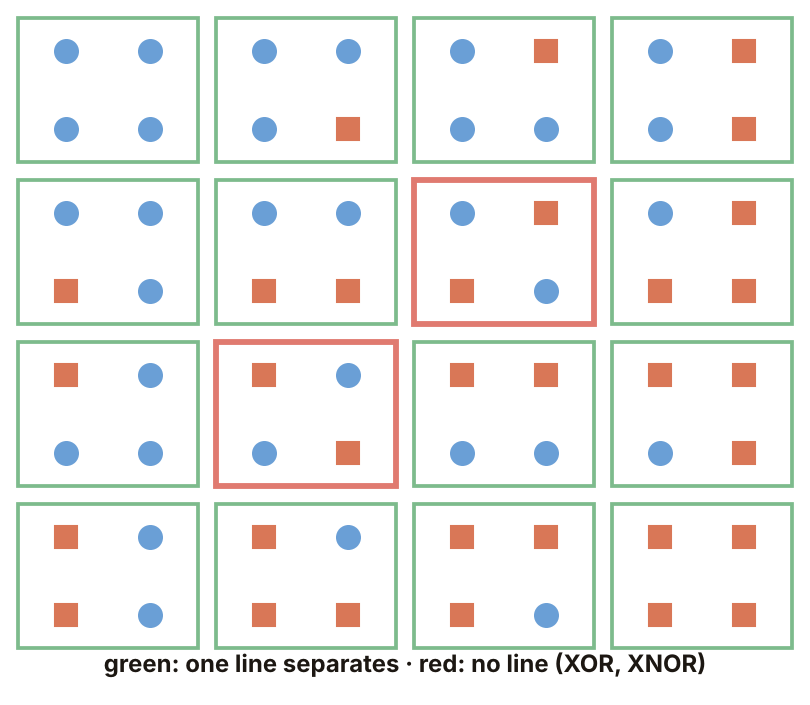

The next question: is there a formula that gives the number of separable labelings of $N$ points in $l$ dimensions at once?

### 2. The counting formula

- **General position**: points in $l$-dimensional space such that no $l+1$ of them lie on the same $(l-1)$-dimensional hyperplane (in two dimensions: no three on a line).

**Cover's formula** (source):

$$
O(N,l)=2\sum_{i=0}^{l}\binom{N-1}{i}.
$$

**Examples, step by step**:

1. $N=4,\ l=2$: $\binom{3}{0},\binom{3}{1},\binom{3}{2}=1,3,3$, so $O=2(1+3+3)=14$.
2. $N=3,\ l=2$: $\binom{2}{i}=1,2,1$, $O=2(1+2+1)=8=2^3$.
3. In general, for $N\le l+1$, $O=2^N$: every labeling is separable.

For $l=2$, $N=1,\dots,8$:

| $N$ | 1 | 2 | 3 | 4 | 5 | 6 | 7 | 8 |
|---|---:|---:|---:|---:|---:|---:|---:|---:|
| $O(N,2)$ | 2 | 4 | 8 | 14 | 22 | 32 | 44 | 58 |
| $2^N$ | 2 | 4 | 8 | 16 | 32 | 64 | 128 | 256 |

Figure `lec05-kp14-count`: First look at the two rows of numbers, $O(N,2)$ above and $2^N$ below; then see that from $N=4$ on the rows part: 14 against 16, and the gap keeps widening. [Function: 2]

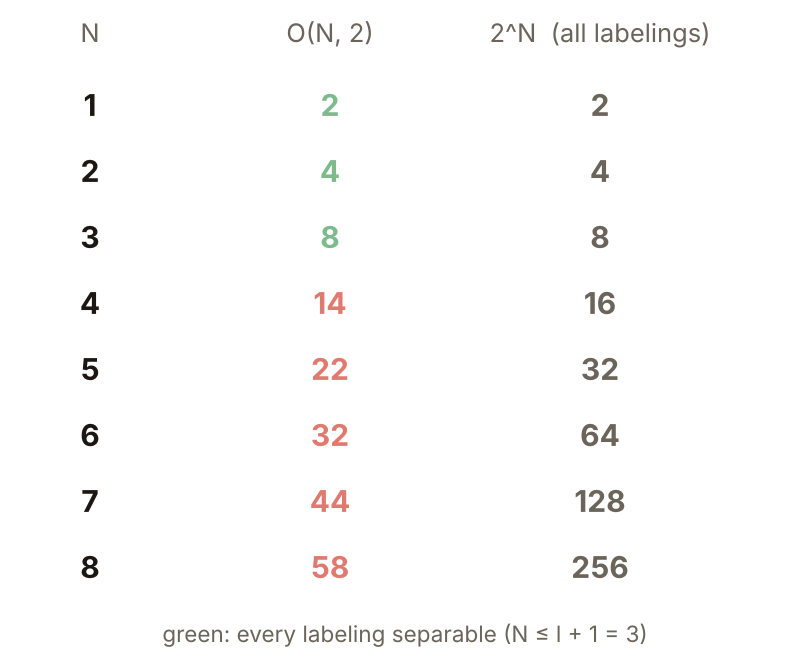

### 3. The probability of separability

With random labels all $2^N$ labelings are equally likely, so the probability of separability is

$$
P_N^l=O(N,l)/2^N,\qquad P=1\text{ when }N\le l+1.
$$

Two dimensions ($l=2$), $N=1,\dots,10$:

| $N$ | 1–3 | 4 | 5 | 6 | 7 | 8 | 9 | 10 |
|---|---:|---:|---:|---:|---:|---:|---:|---:|
| $P$ | 1 | 0.875 | 0.6875 | 0.5 | 0.344 | 0.227 | 0.145 | 0.090 |

As soon as $N$ exceeds $l+1=3$ the probability starts to fall; at $N=6$ it is exactly one half.

Figure `lec05-kp14-prob`: First see that the probability is 1 for $N=1$ to 3; then that the curve falls all the way afterwards and crosses 0.5 at $N=6$. [Function: 2]

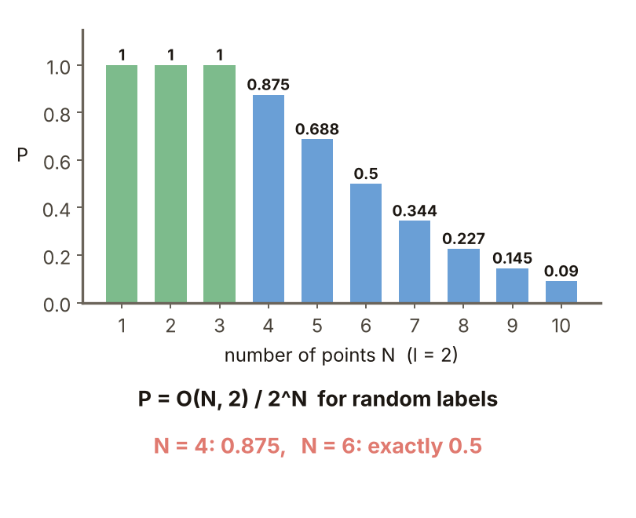

The next question: what does this falling curve look like in higher dimensions?

### 4. The phase transition

- **Phase transition**: the turn where the probability drops from 1 to 0. The larger the dimension, the sharper the turn, like water freezing into ice.

Let $N=r(l+1)$, where $r$ is "the number of points divided by the degrees of freedom".

**At $r=2$ the probability is exactly 1/2**: for $N=2(l+1)$, $O(2l+2,l)=2^{2l+1}$, so $P=2^{2l+1}/2^{2l+2}=1/2$. Checked one by one for $l=1,\dots,7$.

| $l$ | $P$ at $r=1.5$ | $P$ at $r=2.5$ |
|---|---:|---:|
| 1 | 0.75 | 0.31 |
| 19 | 0.97 | 0.08 |
| 99 | 1.00 | 0.0007 |

The larger $l$ is, the closer $r=1.5$ is to 1 and $r=2.5$ to 0: the curve looks more like a step, and the step is always at $r=2$.

Figure `lec05-kp14-curves`: First see that each curve is $P$ against $r$ for one $l$; then that all curves pass through the point $(2,1/2)$, and the larger $l$ is, the steeper the curve. [Function: 2]

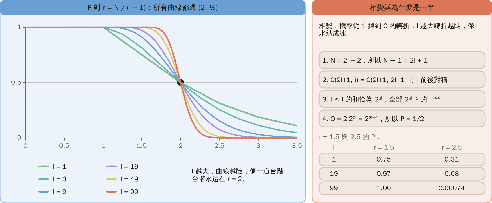

### 5. A random experiment

The formula is theory; now the measurement.

**Experiment setting** (designed for this lecture, reproducible):

- Each time draw $N$ standard normal points in two dimensions and give each a random $\pm1$ label (equal chances).
- Use linear programming to decide "does a line exist that separates the two classes completely" (feasible means separable).
- 1500 trials per $N$; random numbers from NumPy `default_rng(1)` (seed 1), doing $N=4$ and $N=6$ first, then the experiments of sections 6 and 8, using the same generator in sequence.

| $N$ | Measured fraction separable | Formula $P$ | Gap |
|---|---:|---:|---:|
| 4 | 0.865 | 0.875 | 0.010 |
| 6 | 0.503 | 0.500 | 0.003 |

The standard error of 1500 trials is about $\sqrt{0.25/1500}\approx0.013$ (near probability 0.5; about 0.009 for $N=4$), so both gaps are about one standard error or less (computed by a program).

Figure `lec05-kp14-mc`: First look at the two groups of bars, $N=4$ and $N=6$, each with a "formula" bar and a "measured" bar; then compare the heights of the two bars: nearly the same. [Function: 3]

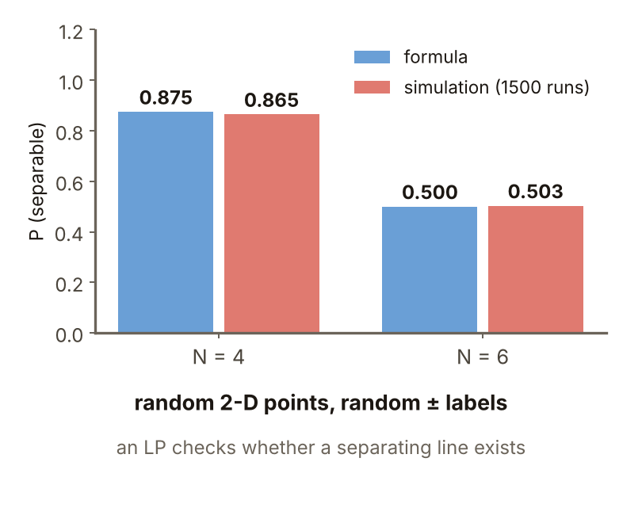

### 6. The effect of raising the dimension

**Experiment setting**: the same random points and labels ($N=6$, 1500 trials, continuing the generator above).

- Originally $[x_1,x_2]$, so $l=2$.
- Adding $x_1^2,x_2^2,x_1x_2$ gives $l=5$.
- Formula prediction: $N=6\le l+1=6$, so $P=1$.

| Features | $l$ | Formula $P$ | Measured (1500 trials) |
|---|---:|---:|---:|
| $[x_1,x_2]$ | 2 | 0.5 | 0.494 |
| with quadratic terms | 5 | 1 | 1.000 |

The 0.494 and the 0.503 of section 5 are two different samples under the same condition; the gap is within sampling error, and both agree with the formula's 0.5.

Figure `lec05-kp14-lift`: First see that the bar before lifting is about one half, then that the bar after lifting reaches the top (1.0); the only difference between them is the three quadratic coordinates added. [Function: 2]

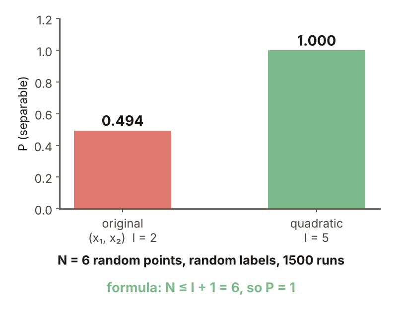

### 7. How many dimensions are enough

For $N>l+1$ some labelings cannot be separated; when the amount of data exceeds twice the degrees of freedom, $N>2(l+1)$, the probability of separability falls below one half.

Fix $N=100$ and change the dimension $l$:

| $l$ | 40 | 48 | 49 | 56 | 60 | 68 |
|---|---:|---:|---:|---:|---:|---:|
| $P$ | 0.035 | 0.42 | 0.5 | 0.92 | 0.987 | 0.9999 |

To separate all random labels by raising the dimension, the dimension must reach more than about half the amount of data.

Figure `lec05-kp14-need`: First see that the horizontal axis is the dimension $l$ and the vertical axis the probability of separability; then that the curve crosses 0.5 near $l=49$ and quickly climbs to nearly 1. [Function: 2]

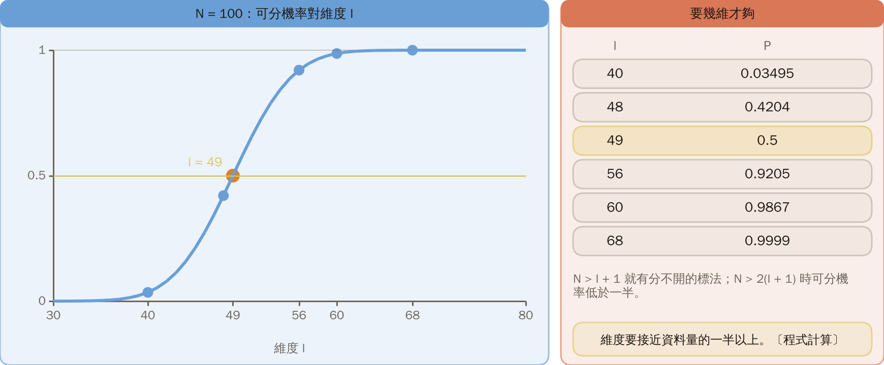

### 8. Separable is not the same as generalizing

**Common misconception**: after raising the dimension the training data can be separated, so new data will also be classified right.

**Experiment setting** (designed for this lecture, reproducible):

- 5 standard normal points in two dimensions, each with a random $\pm1$ label; use quadratic features (5 dimensions) and linear programming to find a separating hyperplane. 300 trials in all (continuing the generator above, seed 1).
- Each time draw 200 new points, also with random labels, and predict them with the hyperplane just found.

**Result**: a hyperplane is found in all 300 trials ($N=5\le l+1=6$, consistent with the formula) and the training data are all right; on the new points the average is only 50.4%, which is guessing.

Raising the dimension only guarantees that the training data can be separated; only data with a pattern lets you learn something, and generalization has to be looked at separately (Chapter 5).

Figure `lec05-kp14-gen`: First look at the "training" bar: all right; then the "new data" bar: about 50%. The same classifier, two very different numbers. [Function: 3]

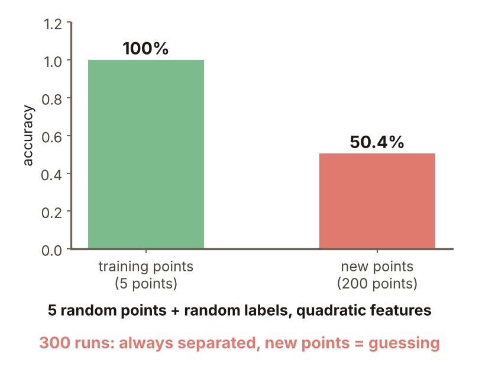

### Extension: why one half, exercises and worked solutions

**Why one half**, step by step:

1. For $N=2l+2$, $N-1=2l+1$.
2. $\binom{2l+1}{i}=\binom{2l+1}{2l+1-i}$: the first half and the second half of the binomial coefficients are symmetric.
3. The sum over $i\le l$ is exactly half of the whole $2^{2l+1}$, that is $2^{2l}$.
4. So $O(2l+2,l)=2\cdot2^{2l}=2^{2l+1}$ and $P=1/2$.

For $l=1,\dots,5$ we get $O=8,32,128,512,2048$.

Figure `lec05-kp14-proof`: First look at the row of $O$ values for each of $l=1$ to 5, then at the explanation of the symmetry: the two halves are equal. [Function: 2]

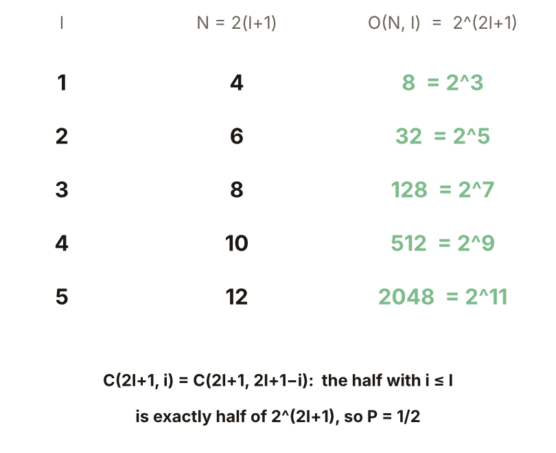

**Small exercises**: $N=5$ points in general position.

1. For $l=2$, what are $O(5,2)$ and $P$? Hint: $\binom{4}{i}=1,4,6,4,1$.
2. Raise to $l=3$; what is $P$?

Figure `lec05-kp14-practice`: First look at the setting of the exercise: $N=5$, with $l=2$ and $l=3$; compute it yourself before comparing with the solution. [Function: 1]

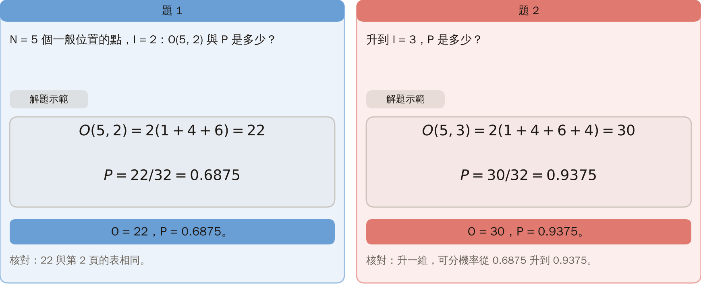

**Exercises 1 and 2, worked solutions**:

1. $O(5,2)=2(1+4+6)=22$, $P=22/32=0.6875$.
2. $O(5,3)=2(1+4+6+4)=30$, $P=30/32=0.9375$.
3. Check: 22 agrees with the table of section 2; one more dimension raises the probability of separability from 0.6875 to 0.9375.

Figure `lec05-kp14-practice-sol`: First look at $O$ and $P$ for each of the two dimensions: 22 with 0.6875 and 30 with 0.9375; then compare the two: one more dimension adds 0.25 to the probability. [Function: 2]

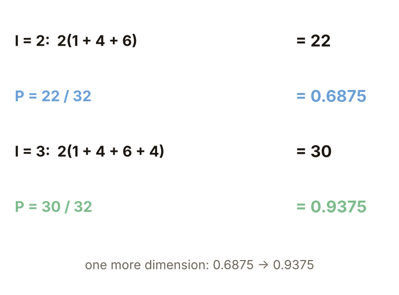

## Terms and source

| 中文 | English |
|---|---|
| 二分 | Dichotomy |
| 一般位置 | General position |
| 相變 | Phase transition |

Source: Chapter 4 KP14, §4.13 (read 2026-10-25). Cover's formula, the probability of separability, the critical point $N=2(l+1)$ and the phase transition, 14 out of 16 for $N=4,l=2$, and "raising the dimension improves separability, not generalization" follow the source; all numbers, the random experiments (linear programming), the fractions before and after raising the dimension, the $N=100$ table and the random-label generalization experiment were designed and recomputed for this lecture ([Supplement], computed by a program).
