# KP15 Polynomial Classifiers

> Level: undergraduate, year 3
>
> Pattern Recognition | Chapter 4, §4.14

[Slides: read and download](../../slides/lec05-kp15-polynomial-en.jbd.json) | [中文版](../lec05-kp15-polynomial.md)

## Learning objectives

- Write a second-order polynomial discriminant as a linear classifier on new coordinates and solve XOR with one interaction term.
- Count the terms with $k=(l+r)!/(r!\,l!)$ and explain the combinatorial explosion.
- Explain the power and the price of high-order polynomials (memory, overfitting, numerical instability) and why a kernel inner product avoids the explosion.

## KP15 Polynomial Classifiers

**One-sentence summary**: A polynomial of order at most $r$ as the discriminant can be as accurate as you like in theory but the number of terms explodes in practice; the power comes from the interaction terms and so does the disaster.

### 1. Order-2 expansion

**Plain explanation**: KP14 said lifting raises the probability of separable labels. The most direct way to build the new coordinates writes out every product.

- **Polynomial classifier**: a polynomial of order at most $r$ as the discriminant function, i.e. every product with total power at most $r$ becomes a new coordinate before learning a linear classifier.
- **Interaction term**: a product of two or more different inputs such as $x_1x_2$; a lone $x_1^2$ is a square term.

**Formal definition** (two inputs, order 2):

$$
g(x)=w_0+w_1x_1+w_2x_2+w_{12}x_1x_2+w_{11}x_1^2+w_{22}x_2^2,
$$

with new coordinates $y=[x_1,x_2,x_1x_2,x_1^2,x_2^2]$ and the bias making 6 terms; $g=w^Ty+w_0$ is linear in the 6 weights.

Figure `lec05-kp15-terms`: the six boxes of the order-2 expansion.

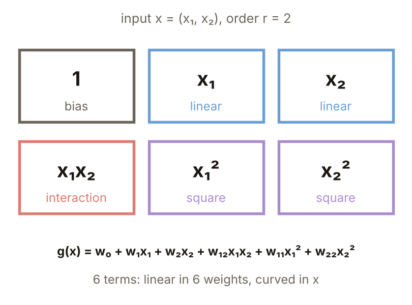

### 2. XOR lacks only one interaction term

Take only $y=(x_1,x_2,x_1x_2)$: $(0,0)\to(0,0,0)$, $(0,1)\to(0,1,0)$, $(1,0)\to(1,0,0)$, $(1,1)\to(1,1,1)$. The plane $y_1+y_2-2y_3-\tfrac14=0$ gives back $g=-\tfrac14+x_1+x_2-2x_1x_2$ and the four values $-0.25,+0.75,+0.75,-0.25$ all have the right sign. One interaction term $x_1x_2$ solves XOR (the constant may be $-\tfrac14$ or the $-0.5$ of KP13).

Figure `lec05-kp15-xor`: new coordinates, $g$ and class of the four points.

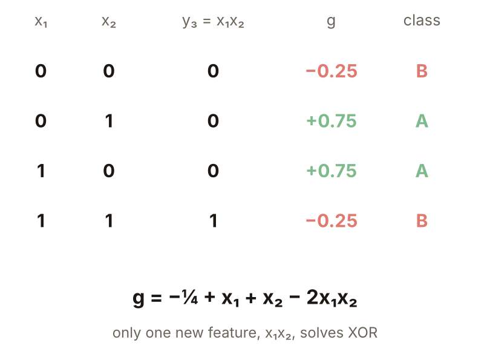

### 3. Hyperbolas

$g=0$ means $x_1+x_2-2x_1x_2=\tfrac14$, a pair of hyperbola branches. A ($g>0$) is the band holding $(0,1)$ and $(1,0)$; B is the two corners holding $(0,0)$ and $(1,1)$. **Example**: at $(0.5,0.5)$, $g=-0.25+1-0.5=+0.25$, on the A side. The same rule is a plane in three dimensions and curved in two.

Figure `lec05-kp15-hyper`: the decision boundary and the two classes.

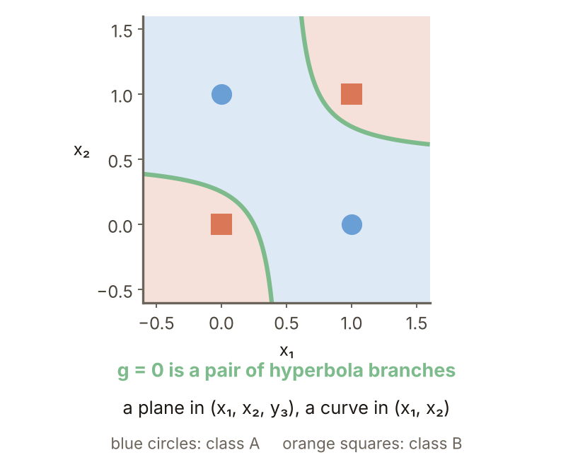

### 4. How many terms

For $l$ inputs and order at most $r$ the new coordinates (with the constant) number

$$
k=\frac{(l+r)!}{r!\,l!}.
$$

Check: $l=2,r=2$: $4!/(2!\,2!)=6$; $l=3,r=2$: $5!/(2!\,3!)=10$. For $l=2$, $r=1..5$ gives 3, 6, 10, 15 and 21 terms.

Figure `lec05-kp15-kcount`: the term count for $l=2$ and $r=1..5$.

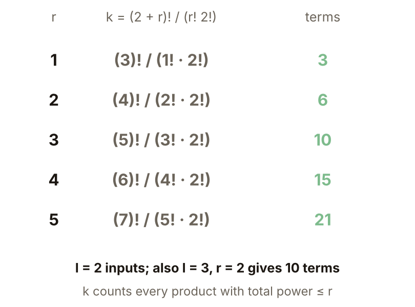

### 5. Combinatorial explosion

$l=10,r=10$ gives $k=184{,}756$ terms. Others: for $l=10$, 66 at order 2 and 286 at order 3; for $l=100$, 5151 and 176,851. It stays small only with few inputs: $l=2$ gives just 66 terms at $r=10$. This previews the curse of dimensionality of Chapter 5 (source).

Figure `lec05-kp15-explode`: the term count against the order (log axis).

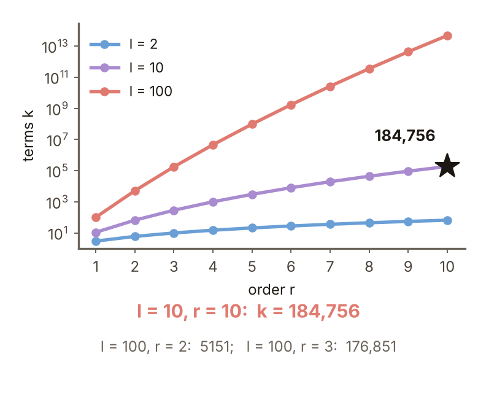

### 6. Memory

With $l=10,r=10$, $k=184{,}756$, 8 bytes per number and 1000 samples, the design matrix $\Phi$ ($1000\times k$) takes about 1.48 GB; the $\Phi^T\Phi$ ($k\times k$) of the normal equation from KP13 takes about 273 GB, far more than a typical computer's memory (program).

Figure `lec05-kp15-memory`: memory needs (log axis).

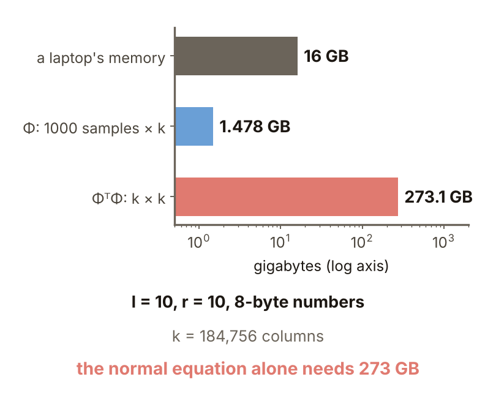

### 7. The power

**Example** (designed here): two moons of 30 points each with noise (sd 0.2), 60 training points; 1000 fresh points; least-squares polynomial classifiers of order $r=1..10$. Order 1 gets 84.9% on new points and order 3 (10 terms) gets 93.2%: a low-order polynomial already bends around the moons, about 8 points better than a line.

Figure `lec05-kp15-moons`: training and new-point accuracy for orders 1 to 10.

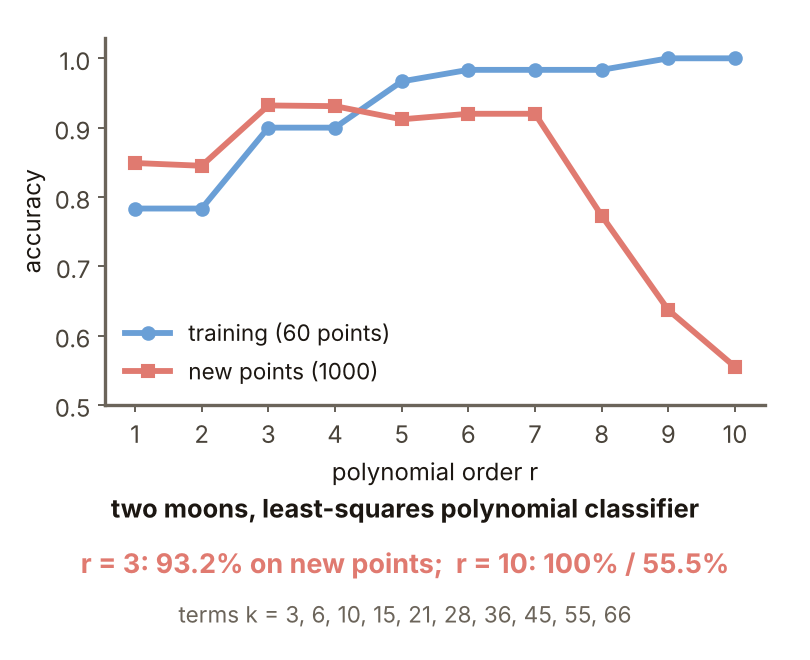

### 8. Going too far

**Condition number**: how much a matrix magnifies small errors; the larger, the less stable the solution. On new points $r=8$ gives 77.3%, $r=9$ gives 63.7% and $r=10$ gives 55.5%, while training points are 100% at $r=9,10$. **Common misconception**: a higher order is always more accurate. $r=9$ has 55 terms and $r=10$ has 66, close to or above the 60 training points, so the model can memorize every point, noise included: overfitting. It is numerically worse too: for the same 60 points the condition number of $\Phi$ rises from 3.25 at $r=1$ to 4.4 million at $r=8$.

Figure `lec05-kp15-cond`: the condition number of the design matrix against the order (semi-log).

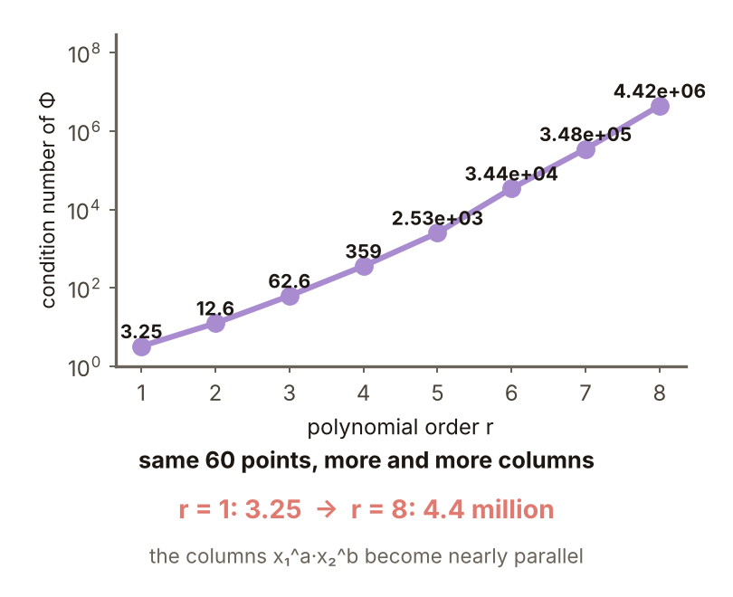

### Extension: no new coordinates, practice and worked solution

**Kernel preview**: $l=2$, order 2, $x=(1,2)$, $z=(3,-1)$: $(1+x\cdot z)^2=(1+3-2)^2=4$. The other side maps $x$ to $\varphi(x)=(1,\sqrt2x_1,\sqrt2x_2,x_1^2,x_2^2,\sqrt2x_1x_2)$ and term by term $1+6-4+9+4-12=4$, the same. The left side takes one inner product and one power; for $l=10,r=10$ the right side is a 184,756-term inner product. Kernel methods (KP19) exist to avoid this explosion.

Figure `lec05-kp15-kernel`: the same number computed two ways.

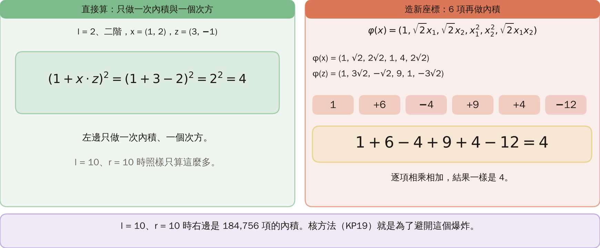

**Practice**:

1. For $l=4$ inputs and order at most $r=3$, how many terms $k$?
2. With $g=-\tfrac14+x_1+x_2-2x_1x_2$, which class is the point $(1.5,1.5)$ ($g>0$ is A)?

Figure `lec05-kp15-practice`: the setup of the practice.

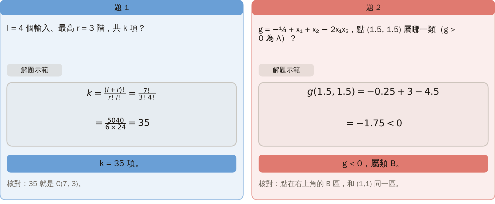

**Worked solution of questions 1 and 2**: (1) $k=7!/(3!\,4!)=5040/(6\cdot24)=35$. (2) $g(1.5,1.5)=-0.25+3-4.5=-1.75<0$, class B. (3) Check: 35 is exactly $\binom{7}{3}$ and the point lies in the upper-right B region, the same region as $(1,1)$.

Figure `lec05-kp15-practice-sol`: the term count and $g$.

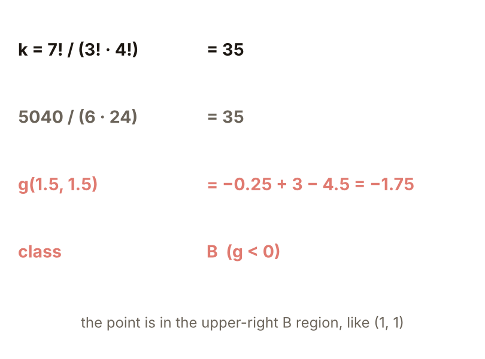

## Terms and sources

| English | 中文 |
|---|---|
| Polynomial classifier | 多項式分類器 |
| Interaction term | 交互項 |
| Condition number | 條件數 |

Source: Chapter 4 KP15, §4.14 (read 2026-10-25). The second-order general form, the term formula $k=(l+r)!/(r!\,l!)$ and 184,756, the XOR rule $g=-\tfrac14+x_1+x_2-2x_1x_2$ with its hyperbolas, the "to remember" line and the pointer to kernel methods follow the source; the order experiment on two moons, the condition numbers, the memory estimate and the kernel check were designed and recomputed for this lecture ([added], (program)).
