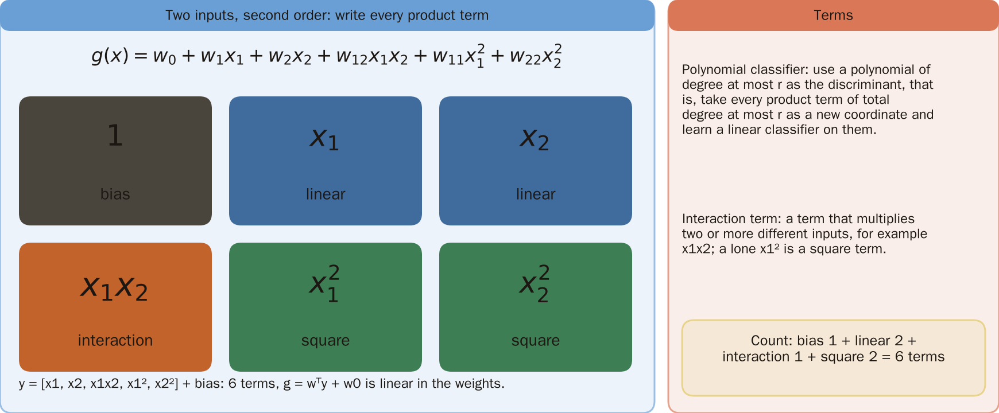
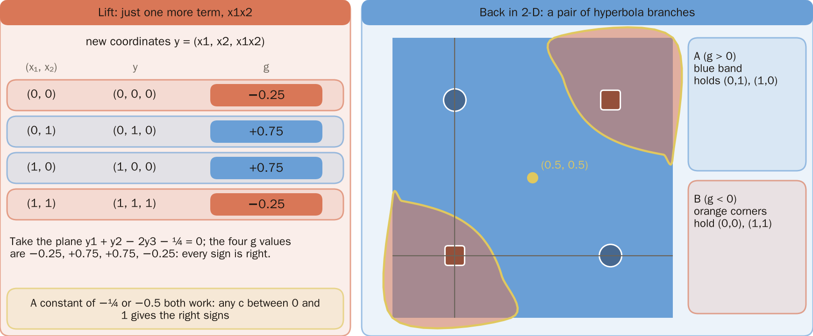
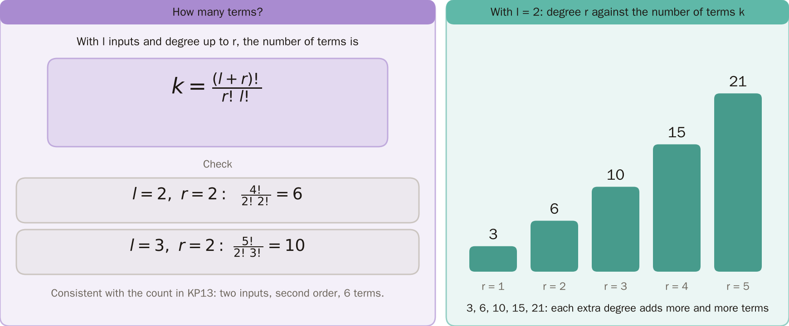
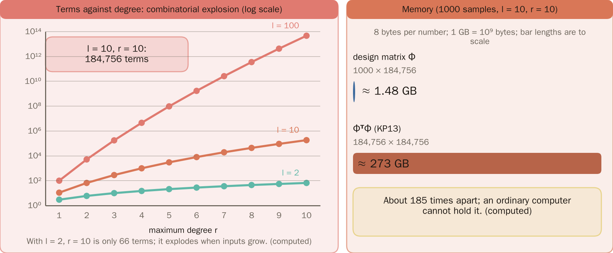
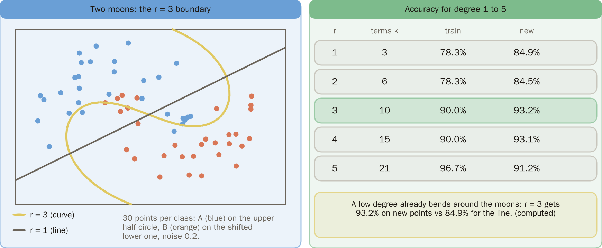
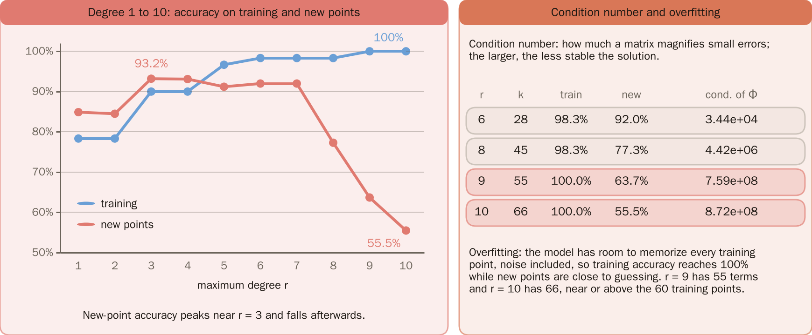
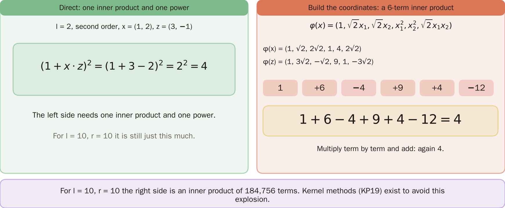
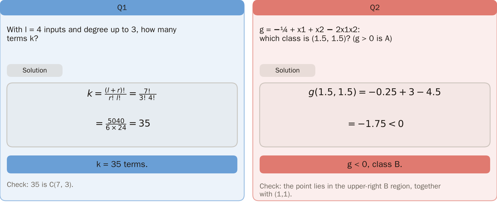

# KP15 Polynomial Classifiers

> Level: undergraduate, year 3
>
> Pattern Recognition | Chapter 4, §4.14

[Slides: read and download](../../slides/lec05-kp15-polynomial-en.jbd.json) | [中文版](../lec05-kp15-polynomial.md)

## Learning objectives

- Write a second-order polynomial discriminant as a linear classifier on new coordinates and solve XOR with one interaction term.
- Count the terms with $k=(l+r)!/(r!\,l!)$ and explain the combinatorial explosion.
- Explain the power and the cost of high-order polynomials (memory, overfitting, numerical instability), and why a kernel inner product avoids the explosion.

## KP15 Polynomial Classifiers

**One-sentence summary**: Use a polynomial of order at most $r$ as the discriminant; in theory it can be as accurate as you like, in practice the number of terms explodes; the power comes from the interaction terms, and so does the disaster.

### Prerequisites and symbols

**Three things you need first**:

- **Generalized linear classifier** (KP13): first raise the dimension with fixed functions, then learn a linear classifier; it is linear in the weights.
- **Factorial and binomial coefficient**: $n!=1\times2\times\cdots\times n$; $\binom{n}{i}=n!/(i!\,(n-i)!)$.
- **XOR and separability after raising the dimension** (KP02, KP14): the four XOR points are not separable in two dimensions, but are after raising the dimension.

**Symbol table** (fixed for this lecture):

| Symbol | Meaning | Note |
|---|---|---|
| $l$ | number of inputs (dimension) | $x=(x_1,\dots,x_l)$ |
| $r$ | highest order of the polynomial | the total degree is at most $r$ |
| $k$ | number of new coordinates (with the constant term) | $k=(l+r)!/(r!\,l!)$ |
| $g(x)$ | discriminant | $g>0$ decides A, $g<0$ decides B |
| $w_0,w_i,w_{ij}$ | bias, first-order weights, second-order weights | the only things that are learned |
| $\Phi$ | design matrix | each row holds all the new coordinates of one sample; size "number of samples × $k$" |

### 1. The second-order expansion

**Plain-words explanation**: KP14 says raising the dimension raises the chance of separability. The most direct way to build new coordinates is to write out all the product terms.

- **Polynomial classifier**: use a polynomial of order at most $r$ as the discriminant, that is, take the product terms whose total degree is at most $r$ as new coordinates and learn a linear classifier on them.
- **Interaction term**: a term that multiplies two or more different inputs, such as $x_1x_2$; a lone $x_1^2$ is called a square term.

**Two inputs, second order**:

$$
g(x)=w_0+w_1x_1+w_2x_2+w_{12}x_1x_2+w_{11}x_1^2+w_{22}x_2^2.
$$

The new coordinates are $y=[x_1,x_2,x_1x_2,x_1^2,x_2^2]$, 6 terms with the bias; $g=w^Ty+w_0$ is linear in the 6 weights.

Figure `lec05-kp15-terms`: First see the formula on top: g(x) for two inputs at second order has 6 terms; then see the six blocks below, with the interaction term x1x2 in orange; the right side defines the polynomial classifier and the interaction term. [Function: 1]

The next question: which of these six terms matters most for XOR?

### 2. XOR lacks only one interaction term

Take only $y=(x_1,x_2,x_1x_2)$; the new coordinates of the four points:

| $(x_1,x_2)$ | $y=(x_1,x_2,x_1x_2)$ |
|---|---|
| $(0,0)$ | $(0,0,0)$ |
| $(0,1)$ | $(0,1,0)$ |
| $(1,0)$ | $(1,0,0)$ |
| $(1,1)$ | $(1,1,1)$ |

**Step by step**:

1. Take the plane $y_1+y_2-2y_3-\tfrac14=0$.
2. Substitute back to $x$: $g=-\tfrac14+x_1+x_2-2x_1x_2$.
3. The $g$ of the four points: $-0.25,\ +0.75,\ +0.75,\ -0.25$, all with the right sign.

One extra interaction term $x_1x_2$ solves XOR; the constant may be $-\tfrac14$ or the $-0.5$ of KP13: the four values of $x_1+x_2-2x_1x_2$ are $0,1,1,0$, so any constant $-c$ with $c$ between 0 and 1 gives all the right signs.

### 3. The hyperbola

$g=0$ is $x_1+x_2-2x_1x_2=\tfrac14$, a pair of hyperbola branches.

- A ($g>0$) is the band containing $(0,1)$ and $(1,0)$.
- B is the two corners containing $(0,0)$ and $(1,1)$.

**Example**: for $(0.5,0.5)$, $g=-0.25+1-0.5=+0.25$, on the A side. The same rule is a plane in three dimensions and curved in two.

Figure `lec05-kp15-hyper`: First see the table on the left: after adding x1x2 the four XOR points give g equal to -0.25, +0.75, +0.75, -0.25; then see the right: the hyperbola cuts the plane into two corners and a band, with (0,1) and (1,0) in the band and (0,0) and (1,1) in the corners. [Function: 2]

### 4. How many terms in all

For $l$ inputs and highest order $r$, the new coordinates (with the constant term) number

$$
k=\frac{(l+r)!}{r!\,l!}.
$$

**Check**:

- $l=2,r=2$: $4!/(2!\,2!)=6$.
- $l=3,r=2$: $5!/(2!\,3!)=10$.

For $l=2$, $r=1,\dots,5$:

| $r$ | 1 | 2 | 3 | 4 | 5 |
|---|---:|---:|---:|---:|---:|
| terms $k$ | 3 | 6 | 10 | 15 | 21 |

Figure `lec05-kp15-kcount`: First see the formula k = (l + r)! / (r! l!) on the left with its two checks; then see the bars on the right: for l = 2 and r = 1 to 5 the counts are 3, 6, 10, 15, 21. [Function: 2]

### 5. The combinatorial explosion

$l=10,r=10$ gives $k=184{,}756$ terms.

| Inputs $l$ | Second order | Third order |
|---|---:|---:|
| 10 | 66 | 286 |
| 100 | 5151 | 176,851 |

It is slow only when the inputs are few: for $l=2$, even $r=10$ is only 66 terms. This foreshadows the "curse of dimensionality" of Chapter 5 (source).

Figure `lec05-kp15-explode`: First see the left chart: the horizontal axis is the degree and the vertical axis the number of terms (log scale), with three lines for l = 2, 10 and 100; the more inputs, the higher and faster the line climbs, and l = 10, r = 10 gives 184,756 terms. Then see the memory on the right: Φ about 1.48 GB and ΦᵀΦ about 273 GB. [Function: 2]

### 6. Memory

**Estimate** (1 GB means $10^9$ bytes): $l=10,r=10$, $k=184{,}756$, 8 bytes per number, 1000 samples.

| Matrix | Size | Memory |
|---|---|---:|
| design matrix $\Phi$ | $1000\times k$ | about 1.48 GB |
| $\Phi^T\Phi$ (used by the normal equation of KP13) | $k\times k$ | about 273 GB |

An ordinary computer's memory cannot hold it (computed by a program).

The next question: the number of terms explodes, but how powerful is a high-order polynomial?

### 7. Power

**Experiment setting** (designed for this lecture, reproducible):

- Data: two half-moons. Class A takes the upper half circle $(\cos t,\sin t)$, class B the shifted lower half circle $(1-\cos t,\ 0.5-\sin t)$, with $t$ uniform in $[0,\pi]$; each gets Gaussian noise with standard deviation 0.2.
- Training set: 30 points per class, 60 in all, random seed 0 (NumPy `default_rng(0)`); new points: 500 per class, 1000 in all, seed 1.
- Model: least squares (NumPy `lstsq`) for polynomial classifiers of order $r=1,\dots,10$, targets $\pm1$, prediction by the sign of $g$.

**Results**:

| $r$ | terms $k$ | training accuracy | new-point accuracy |
|---|---:|---:|---:|
| 1 | 3 | 78.3% | 84.9% |
| 2 | 6 | 78.3% | 84.5% |
| 3 | 10 | 90.0% | 93.2% |
| 4 | 15 | 90.0% | 93.1% |
| 5 | 21 | 96.7% | 91.2% |

A low-order polynomial already bends a half-moon boundary: $r=3$ is about 8 percentage points better than a straight line.

Figure `lec05-kp15-boundary`: First see the left chart: the solid curve is the r = 3 boundary, the dashed line is r = 1, and the blue and orange dots are the two training classes; then see the table on the right: r = 3 reaches 93.2% on new points and the line 84.9%. [Function: 3]

### 8. Too high an order

- **Condition number**: the factor by which a matrix magnifies tiny errors; the larger it is, the less stable the solution.

The same experiment, going to higher orders:

| $r$ | terms $k$ | training accuracy | new-point accuracy | condition number of $\Phi$ |
|---|---:|---:|---:|---:|
| 6 | 28 | 98.3% | 92.0% | $3.4\times10^4$ |
| 8 | 45 | 98.3% | 77.3% | $4.4\times10^6$ |
| 9 | 55 | 100% | 63.7% | $7.6\times10^8$ |
| 10 | 66 | 100% | 55.5% | $8.7\times10^8$ |

(The condition number at $r=1$ is 3.25, so from $r=1$ to $r=8$ it grows about 1.3 million times.)

**Common misconception**: the higher the order, the more accurate.

- $r=9$ has 55 terms and $r=10$ has 66, close to or above the 60 training points; the model has room to memorize every point (noise included), which is called **overfitting**.
- Training accuracy reaches 100% while the new points drop to 55.5%, close to guessing.
- The numerics also get worse: the larger the condition number, the more the same tiny error is magnified.

Figure `lec05-kp15-overfit`: First see the left chart: the horizontal axis is the degree from 1 to 10, the blue line is training and the red line is new points; new points peak near r = 3 (93.2%) and then fall to 55.5% while training climbs to 100%. Then see the right: the condition number rises from 3.44×10⁴ at r = 6 to 8.72×10⁸ at r = 10, and the definition of overfitting. [Function: 3]

Figure `lec05-kp15-kernel`: First see the left: directly (1 + x·z)² = 4; then see the right: build the 6 new coordinates and add the term-by-term products, 1 + 6 - 4 + 9 + 4 - 12 = 4, the same result. [Function: 2]

Figure `lec05-kp15-practice`: The left is Q1: k = C(7, 3) = 35 terms; the right is Q2: g(1.5, 1.5) = -1.75 < 0, class B, each with its check. [Function: 3]

### Extension: not building new coordinates, exercises and worked solutions

**Preview of the kernel inner product**: $l=2$, second order, $x=(1,2)$, $z=(3,-1)$.

1. Left side (compute directly): $(1+x\cdot z)^2=(1+3-2)^2=2^2=4$.
2. Right side (build new coordinates): map $x$ to $\varphi(x)=(1,\sqrt2x_1,\sqrt2x_2,x_1^2,x_2^2,\sqrt2x_1x_2)$ and take the inner product; multiplying and adding term by term gives $1+6-4+9+4-12=4$, the same.
3. The left side takes one inner product and one power; for $l=10,r=10$ the right side is an inner product of 184,756 terms.

Kernel methods (KP19) exist to avoid this explosion.

**Small exercises**:

1. $l=4$ inputs, highest order $r=3$: how many terms $k$?
2. $g=-\tfrac14+x_1+x_2-2x_1x_2$; which class does the point $(1.5,1.5)$ belong to ($g>0$ is A)?

**Exercises 1 and 2, worked solutions**:

1. $k=7!/(3!\,4!)=5040/(6\times24)=35$.
2. $g(1.5,1.5)=-0.25+3-4.5=-1.75<0$, so class B.
3. Check: 35 is $\binom{7}{3}$; the point is in the B region at the upper right, the same region as $(1,1)$.

## Terms and source

| 中文 | English |
|---|---|
| 多項式分類器 | Polynomial classifier |
| 交互項 | Interaction term |
| 條件數 | Condition number |

Source: Chapter 4 KP15, §4.14 (read 2026-10-25). The general second-order form, the term-count formula $k=(l+r)!/(r!\,l!)$ and 184,756, the XOR $g=-\tfrac14+x_1+x_2-2x_1x_2$ and the hyperbola, "how to remember" and the preview of kernel methods follow the source; the half-moon order experiment (seeds 0 and 1), the condition numbers, the memory estimate and the kernel inner-product check were designed and recomputed for this lecture ([Supplement], computed by a program).
