# KP17 The Universal Approximation Theorem

!!! note "Self-study"
    This unit (KP17) is self-study: it is not taught in class, so please read it on your own.

> Level: undergraduate, year 3
>
> Pattern Recognition | Chapter 4, §4.16

[Slides: read and download](../../slides/lec05-kp17-universal-approx-en.jbd.json) | [中文版](../lec05-kp17-universal-approx.md)

## Learning objectives

- Explain that polynomials, one-hidden-layer sigmoid networks and RBF networks are all universal approximators and differ in how fast the error falls and how hard the optimization is.
- State Weierstrass's theorem and the Runge phenomenon, and read the different outcomes on a smooth one-dimensional target and on a high-dimensional ridge.
- Explain fixed against data-adaptive bases and why more layers may be more efficient.

## KP17 The Universal Approximation Theorem

**One-sentence summary**: Polynomials, sigmoid networks and RBF networks are all universal approximators; universal approximation is the ticket to enter, not an advantage, and the real difference is the rate at which the error falls (polynomial $O(r^{-2/l})$ against network $O(1/k)$) and how hard the optimization is.

### 1. The ticket

**Plain explanation**: Which kind of new coordinates can finally approximate any function, and which does it fastest?

**Universal approximation theorem**: with enough nodes (or a high enough order) any continuous function on a compact set can be approximated to any small error. A compact set is bounded and contains its boundary, for example the interval $[0,1]$. It holds for polynomials (Weierstrass's theorem), one-hidden-layer sigmoid networks and RBF networks; the difference is how fast the error falls and how hard the optimization is.

Figure `lec05-kp17-summary`: the three universal approximators and their speeds.

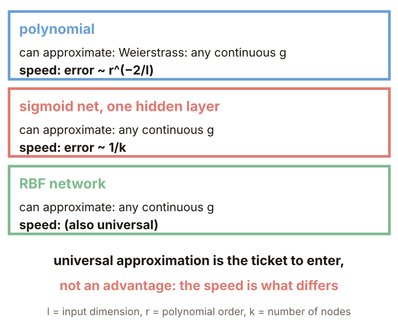

### 2. The polynomial guarantee

**Formal definition** (Weierstrass's theorem): for a continuous $g$ on a compact set $S$ and any $\epsilon>0$ there is an order-$r$ polynomial $\phi$ with

$$
|g(x)-\phi(x)|<\epsilon,\qquad\forall x\in S.
$$

**Example** (designed here): $g=\sin2\pi x+0.3x^2$ on $[0,1]$, least squares on 401 points; largest error for $r=1,3,5,7,9,11$: $0.998,0.198,0.0152,0.000607,0.000015,2.5\times10^{-7}$. The largest error is the worst point of the whole interval, not an average; orders $2m-1$ and $2m$ give the same error because the even part is just $t^2$ plus a constant ($t=2x-1$), fitted at $r=2$, after which only odd orders help.

Figure `lec05-kp17-polyerr`: the largest polynomial error against the degree.

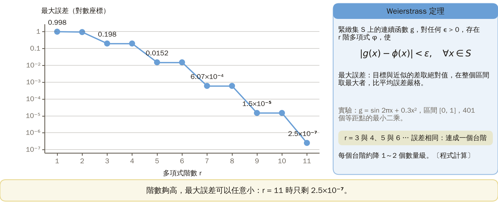

### 3. The Runge phenomenon

**Runge phenomenon**: interpolating (forcing the polynomial through every sample point) a high-order polynomial through equal-spaced points oscillates wildly near the ends and the error grows. **Common misconception**: a higher order always fits better. Example: $g=1/(1+25x^2)$ on $[-1,1]$; equal-spaced interpolation at $r=4,8,12,16,20$ has largest error $0.44,1.05,3.66,14.4,59.8$; least squares on 400 points gives $0.33,0.15,0.068,0.031,0.014$, slow but steady. The source also warns that high-order polynomials suffer from numerical error through many products and from too many free parameters; a compromise is piecewise approximation.

Figure `lec05-kp17-runge`: the Runge function with two degree-12 polynomials.

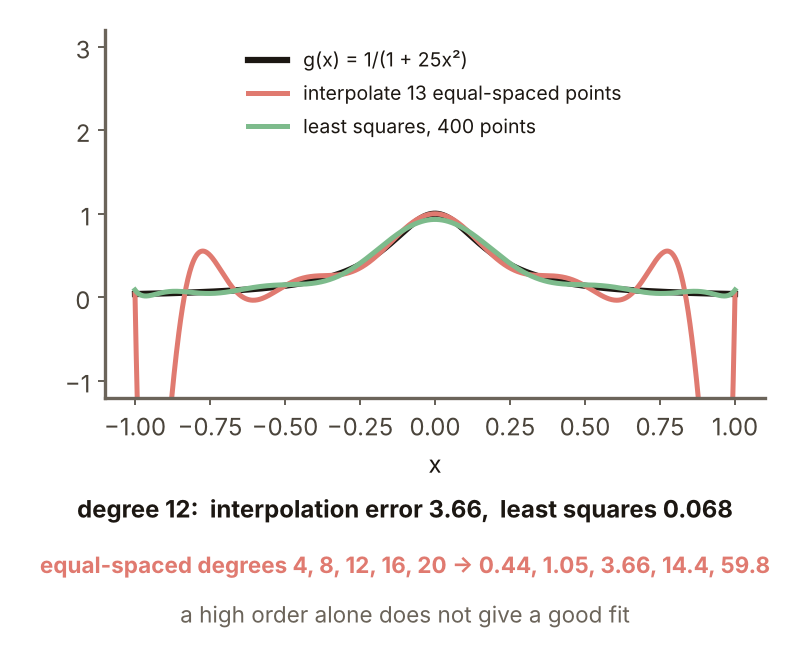

### 4. The sigmoid network

**Squashing function**: a monotonically increasing function that squeezes any input into a bounded range, for example the sigmoid. Theorem (source, citing Cybenko, Funahashi, Hornik and others): with a squashing activation a one-hidden-layer network

$$
\phi(x)=\sum_{j=1}^{k}w_j^{o}f\bigl(w_j^{hT}x\bigr)+w_o^{o}
$$

with large enough $k$ approximates any continuous function on a compact set to any error. For the same target, $k=1,2,3,4,6,8$ and the best of 8 random starts, the largest error is $0.819,0.0142,0.0056,0.0058,0.0045,0.0011$.

Figure `lec05-kp17-mlpfit`: the target wave and the fits by $k=1,2,4$.

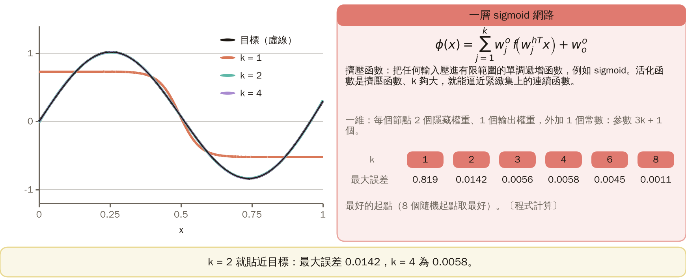

### 5. A fair test in one dimension

With 7 parameters the polynomial $r=6$ gives $0.0152$ and the sigmoid network $k=2$ ($3k+1=7$) gives $0.0142$, about the same. With 13 parameters the polynomial $r=12$ gives $2.5\times10^{-7}$ and the network $k=4$ gives $0.0058$. The advantage of the network is not on a smooth one-dimensional target; the rate difference of the theorem shows only in high dimensions.

Figure `lec05-kp17-equal`: the largest error at equal parameters.

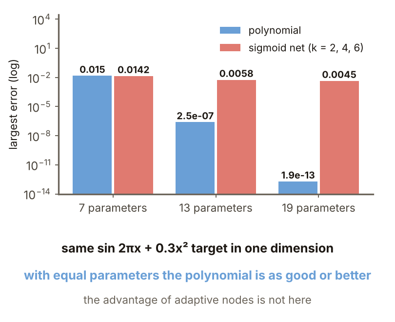

### 6. High dimension

**Example** (designed here): $l=5$ standard-normal inputs, target $\tanh(2w^Tx)$ (a "ridge function", depending only on one direction $w$), 3000 training and 2000 new points, root-mean-square error. Polynomials $r=1,2,3,5$ (6, 21, 56, 252 terms) have error $0.326,0.326,0.222,0.257$ on new points; networks $k=1,2,4$ (8, 15, 29 parameters) are all below $0.0001$. Note: the target has exactly the shape of the network, a design that favours it, and normal inputs are not a compact set.

Figure `lec05-kp17-ridge`: new-point error of polynomials and networks on a 5-dimensional ridge.

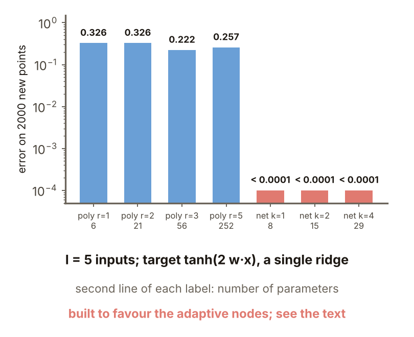

### 7. The rates

**Rates** (Barron 93, source): $O(r^{-2/l})$ for polynomials and $O(1/k)$ for a one-hidden-layer sigmoid network, with the input dimension $l$ absent from the formula. Halving the error multiplies the polynomial's $r$ by $2^{l/2}$: $2,5.7,32,1024$ times for $l=2,5,10,20$; the network's $k$ only doubles. These are worst-case asymptotic rates, not measurements; a smooth target like section 2 can go much faster, and $r$ against $k$ is not parameter-by-parameter.

Figure `lec05-kp17-halving`: the growth needed to halve the error.

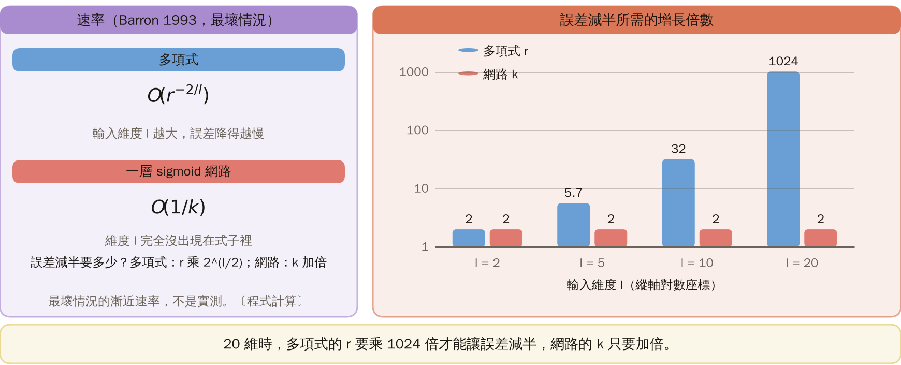

### 8. Why, and the price

**Fixed basis**: basis functions such as $x_1^2x_2$ that are the same whatever the data look like; polynomials use them. **Data-adaptive basis**: basis functions $f(w^Tx)$ whose $w$ is optimized from the data; the hidden nodes of a network are such. The source says every expansion on a fixed basis is doomed to an error that falls more slowly as the dimension grows. The price is that the optimization turns from linear into nonlinear: for the same data, $k=2$ with 8 random starts, 5 reach a largest error below 0.1 and 3 get stuck near 0.82 (program).

Figure `lec05-kp17-restarts`: the largest error of 8 random starts.

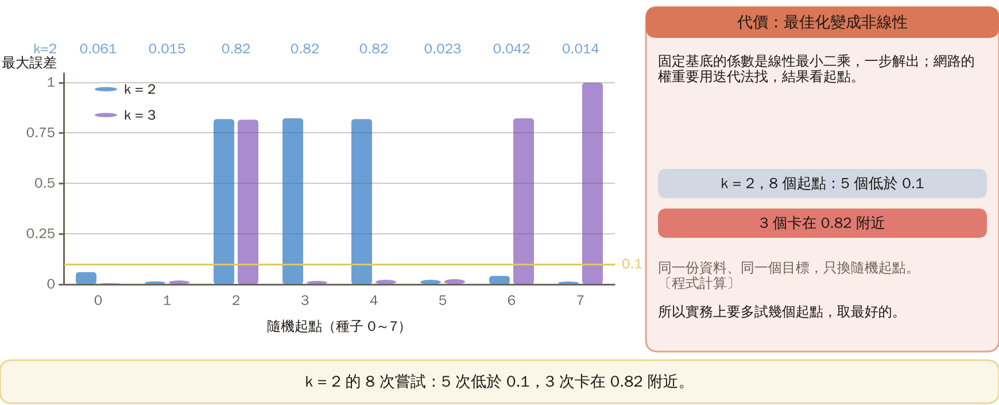

### Extension: depth, practice and worked solution

**Depth**: the hat function $h(x)=2\min(x,1-x)$ takes 2 ReLU nodes (the piecewise-linear activation $\max(0,x)$; same principle as the sigmoid); stacking $n$ layers gives $2^n$ straight pieces, counted by a program for $n=1..4$: 2, 4, 8, 16. A deep network needs $2n$ nodes; a one-hidden-layer ReLU network has at most $k+1$ pieces and needs $2^n-1$. For $n=3,6,10$: 6, 12, 20 deep against 7, 63, 1023 in one layer. The source says more than one hidden layer may reach the same accuracy with fewer neurons.

Figure `lec05-kp17-hat`: stacked hat functions and the node-count table.

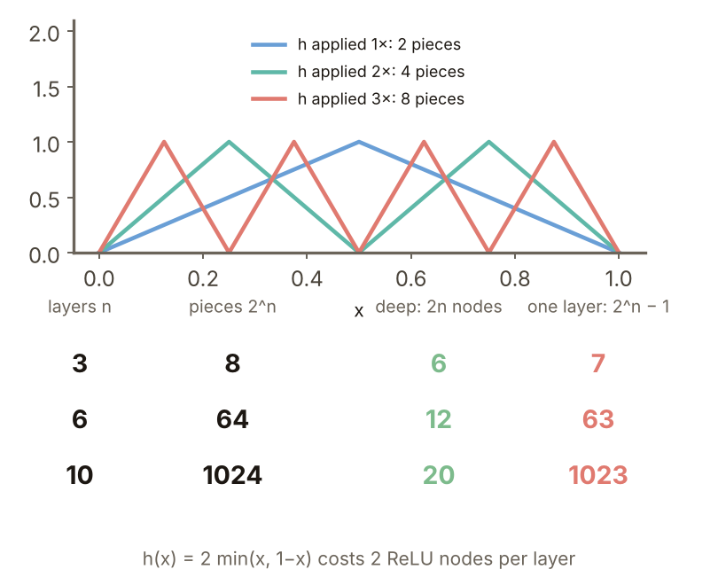

**Practice**:

1. $l=8$ and the polynomial error $\sim r^{-2/l}$. By what factor must $r$ grow to halve the error?
2. How many pieces does the five-fold hat function have, and how many ReLU nodes do a deep network and a one-hidden-layer network need?

Figure `lec05-kp17-practice`: the setup of the practice.

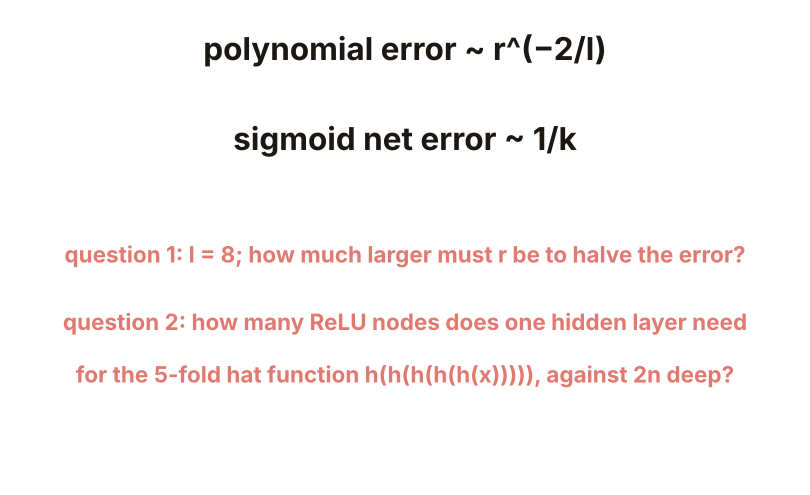

**Worked solution of questions 1 and 2**: (1) Halving $r^{-2/8}$ needs $r$ times $2^{8/2}=2^4=16$. (2) 5 layers have $2^5=32$ pieces; the deep network needs $2\times5=10$ nodes and one hidden layer needs $2^5-1=31$. (3) Check: 32 pieces need 31 breakpoints and a single layer of $k$ nodes has at most $k$ breakpoints, so $k\ge31$; question 1 is an asymptotic formula, not an exact measurement.

Figure `lec05-kp17-practice-sol`: the calculations of both questions.

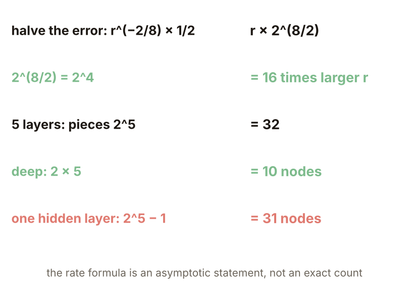

## Terms and sources

| English | 中文 |
|---|---|
| Universal approximation theorem | 通用近似定理 |
| Runge phenomenon | 龍格現象 |
| Squashing function | 擠壓函數 |
| Fixed basis | 固定基底 |
| Data-adaptive basis | 資料自適應基底 |

Source: Chapter 4 KP17, §4.16 (read 2026-10-25). Weierstrass's theorem, the universal approximation of sigmoid networks, the rates $O(r^{-2/l})$ against $O(1/k)$, the fixed against adaptive basis explanation, the efficiency of more layers and the "ticket" remark follow the source; every experiment (largest errors of polynomials and sigmoid networks, the Runge phenomenon, the high-dimensional ridge, the random starts and the piece counts of the hat function) was designed and recomputed for this lecture ([added], (program)).
