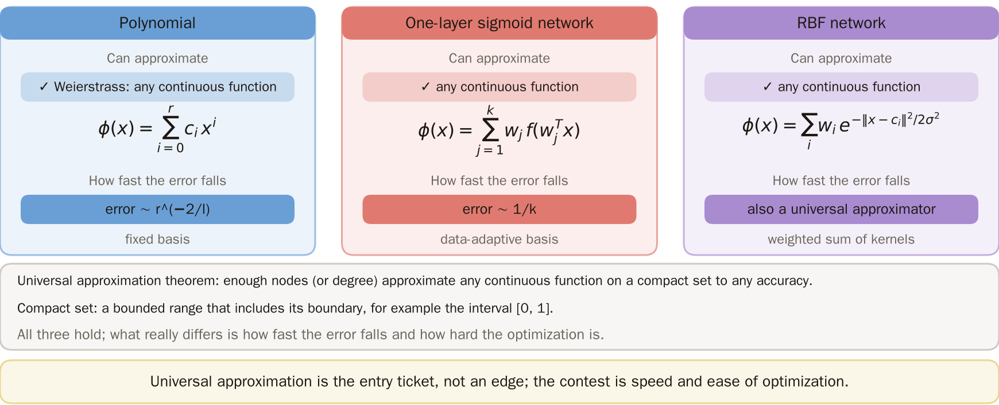
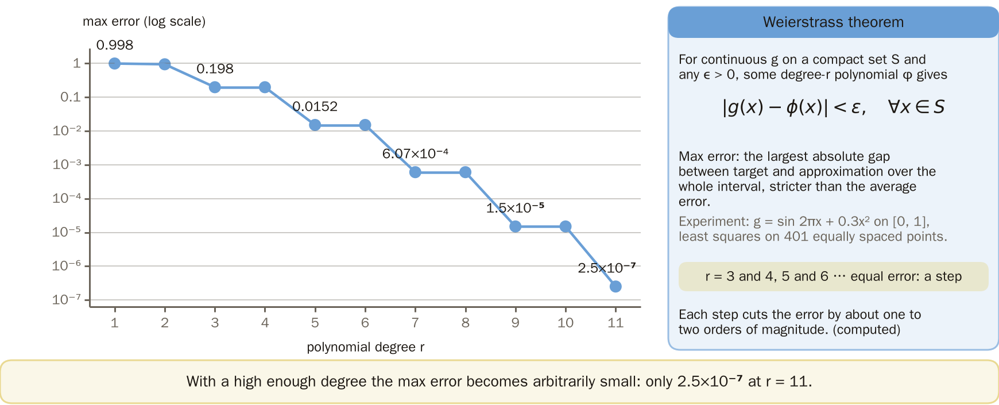
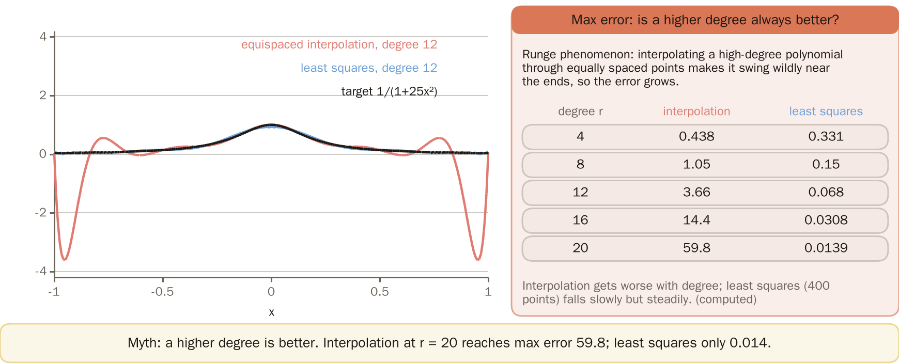
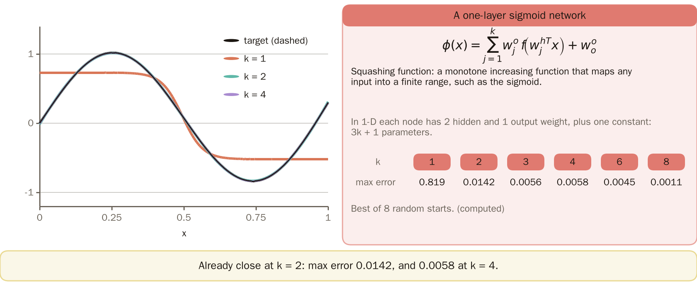
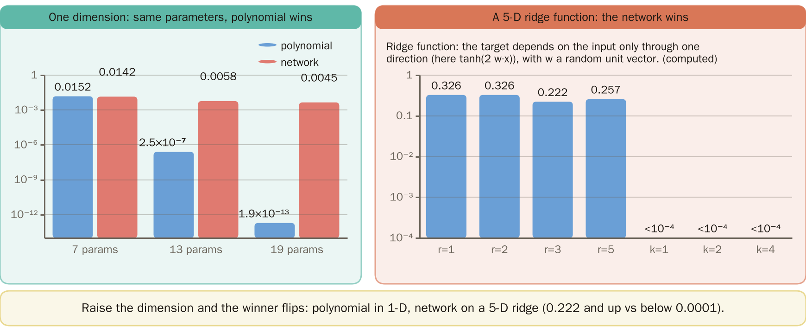
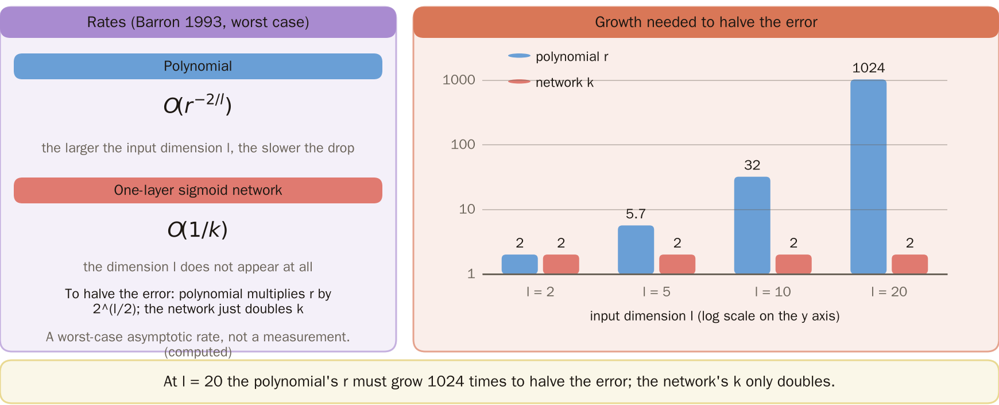
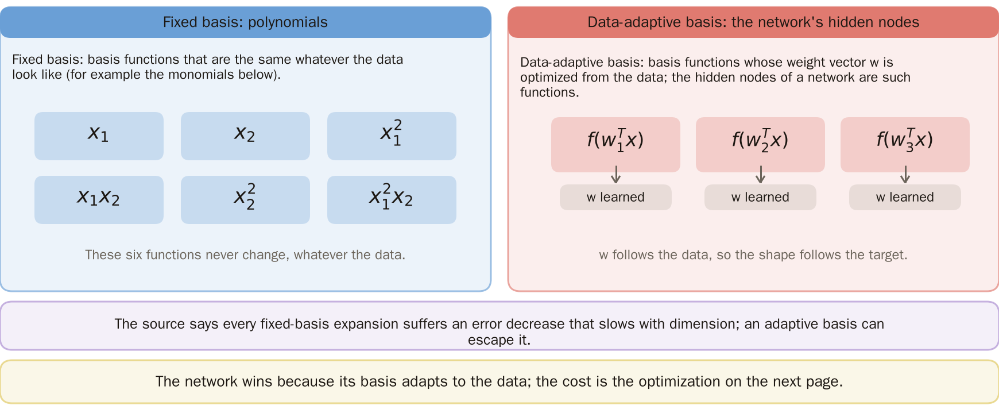
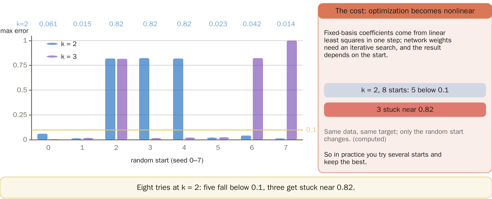
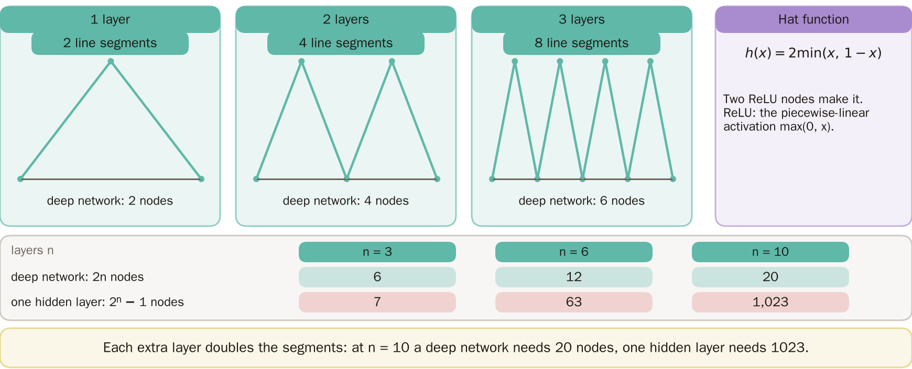

# KP17 The Universal Approximation Theorem

!!! note "Self-study"
    This unit (KP17) is self-study: it is not taught in class, so please read it on your own.

> Level: undergraduate, year 3
>
> Pattern Recognition | Chapter 4 §4.16

[Slides: read and download](../../slides/lec05-kp17-universal-approx-en.jbd.json) | [中文版](../lec05-kp17-universal-approx.md)

## Learning objectives

- Explain that polynomials, one-layer sigmoid networks and RBF networks are all universal approximators, differing in how fast the error falls and how hard the optimization is.
- State the Weierstrass theorem and the Runge phenomenon, and read the different outcomes for a smooth one-dimensional target and a high-dimensional ridge function.
- Explain the difference between fixed and data-adaptive bases, and why several layers may be more efficient.

## KP17 The Universal Approximation Theorem

**One-sentence summary**: Polynomials, sigmoid networks and RBF networks are all universal approximators; universal approximation is the ticket to enter, not a competitive advantage; the real differences are the rate at which the error falls (polynomial $O(r^{-2/l})$ against network $O(1/k)$) and how hard the optimization is.

### Prerequisites and symbols

**Three things you need first**:

- **Polynomial classifiers and RBF networks** (KP15, KP16): two ways of turning the input into new coordinates and then using a linear layer.
- **Sigmoid and one-layer networks** (KP06): a weighted sum of hidden nodes $f(w^Tx)$.
- **Largest error**: the absolute difference between target and approximation, taken as the maximum over the whole interval; stricter than the mean error.

**Symbol table** (fixed for this lecture):

| Symbol | Meaning | Note |
|---|---|---|
| $g(x)$ | the target function to be approximated | a continuous function |
| $\phi(x)$ | the approximating function | polynomial or network |
| $\epsilon$ | the allowed error | any small positive number |
| $r$ | polynomial order | $r+1$ parameters (one dimension) |
| $k$ | number of hidden nodes of the network | $3k+1$ parameters in one dimension |
| $l$ | input dimension | sections 6 and 7 |
| $n$ | number of layers of the hat function | extension |

### 1. The ticket to enter

**Plain-words explanation**: Which kind of new coordinates can in the end approximate any function? And which approximates fastest?

- **Universal approximation theorem**: with enough nodes (or a high enough order), any continuous function on a compact set can be approximated to any small error.
- **Compact set**: a bounded range that includes its boundary, such as the interval $[0,1]$.

It holds for polynomials (the Weierstrass theorem), one-layer sigmoid networks and RBF networks; the differences are how fast the error falls and how hard the optimization is.

| Approximator | What it can approximate | Speed (error) |
|---|---|---|
| polynomial | Weierstrass: any continuous function | $\sim r^{-2/l}$ |
| one-layer sigmoid network | any continuous function | $\sim 1/k$ |
| RBF network | any continuous function | also a universal approximator |

Universal approximation is the ticket to enter, not an advantage; the difference is the speed.

Figure `lec05-kp17-entry`: First see the three cards: polynomial, one-layer sigmoid network and RBF network, each stating what it can approximate and how fast the error falls; then read the definitions below: the universal approximation theorem and the compact set. All three hold, so universal approximation is the entry ticket, not an edge. [Function: 2]

### 2. The guarantee for polynomials

**Weierstrass theorem**: for a continuous function $g$ on a compact set $S$ and any $\epsilon>0$, there is a polynomial $\phi$ of order $r$ with

$$
|g(x)-\phi(x)|<\epsilon,\qquad\forall x\in S.
$$

**Experiment setting** (designed for this lecture, reproducible): target $g=\sin2\pi x+0.3x^2$ on $[0,1]$, 401 equally spaced points, a least-squares fit of an order-$r$ polynomial (solved in a Chebyshev basis to avoid numerical instability).

| $r$ | 1 | 3 | 5 | 7 | 9 | 11 |
|---|---:|---:|---:|---:|---:|---:|
| largest error | 0.998 | 0.198 | 0.0152 | 0.000607 | 0.000015 | $2.5\times10^{-7}$ |

- The largest error is the worst point of the whole interval, not the mean.
- From $r=3$ on, orders $2m-1$ and $2m$ ($m\ge2$) have the same error ($r=1$ gives 0.998 and $r=2$ gives 0.948): with $t=2x-1$, the even part of the target is only $t^2$ plus a constant, which $r=2$ already fits, and after that everything depends on the odd orders.

Figure `lec05-kp17-polyerr`: First see that the horizontal axis is the degree and the vertical axis is the max error (log scale); then see the curve fall steadily, with degrees 3 and 4, 5 and 6, ... forming one step each, about one to two orders of magnitude per step; on the right are the Weierstrass theorem and the definition of the max error. [Function: 3]

### 3. The Runge phenomenon

- **Runge phenomenon**: interpolating (forcing the polynomial through every sample point) with a high-order polynomial at equally spaced points makes it swing wildly near the ends, and the error grows.

**Common misconception**: the higher the order the better the fit.

**Experiment setting**: $g=1/(1+25x^2)$ on $[-1,1]$; two methods compared.

| order $r$ | 4 | 8 | 12 | 16 | 20 |
|---|---:|---:|---:|---:|---:|
| largest error of equally spaced interpolation ($r+1$ equal points, through every point) | 0.44 | 1.05 | 3.66 | 14.4 | 59.8 |
| largest error of least squares on 400 equally spaced points | 0.33 | 0.15 | 0.068 | 0.031 | 0.014 |

Interpolation gets worse with the order; least squares falls slowly but steadily. The source also notes that high-order polynomials suffer from rounding errors in the repeated products and from too many free parameters; the compromise is piecewise approximation.

Figure `lec05-kp17-runge`: First look at the Runge function (dashed) and the two degree-12 polynomials; then see the red curve through equally spaced points swing wildly at both ends while the blue least-squares curve hugs the target; the table on the right lists the max error for degrees 4 to 20. [Function: 2]

### 4. Sigmoid networks

- **Squashing function**: a monotonically increasing function that presses any input into a finite range, such as the sigmoid.

Theorem (the source cites Cybenko, Funahashi, Hornik and others): when the activation is a squashing function, a one-hidden-layer network with $k$ large enough,

$$
\phi(x)=\sum_{j=1}^{k}w_j^{o}f\bigl(w_j^{hT}x\bigr)+w_o^{o},
$$

can approximate a continuous function on a compact set to any error.

**Experiment setting** (designed for this lecture, reproducible): the target is the same as in section 2; the network has $3k+1$ parameters (two hidden weights and one output weight per node, plus a constant); initial values: hidden slope $N(0,8^2)$, bias $N(0,4^2)$, output weight $N(0,1)$; mean squared error minimized with L-BFGS-B (at most 3000 iterations); for each $k$ it is trained once with each seed 0 to 7 (8 random starts) and the one with the best largest error is kept.

| $k$ | 1 | 2 | 3 | 4 | 6 | 8 |
|---|---:|---:|---:|---:|---:|---:|
| largest error (best start) | 0.819 | 0.0142 | 0.0056 | 0.0058 | 0.0045 | 0.0011 |

Figure `lec05-kp17-mlpfit`: First look at the target wave (dashed); then the three fits k = 1, 2, 4: k = 1 is rough, k = 2 is already close and k = 4 almost coincides; on the right are the formula, the definition of the squashing function and the max error for k = 1 to 8. [Function: 2]

### 5. A fair comparison in one dimension

Compare "the same number of parameters": an order-$r$ polynomial has $r+1$ parameters; a network with $k$ nodes has $3k+1$.

| Parameters | Polynomial | Network |
|---|---|---|
| 7 | $r=6$: 0.0152 | $k=2$: 0.0142 |
| 13 | $r=12$: $2.5\times10^{-7}$ | $k=4$: 0.0058 |
| 19 | $r=18$: $1.9\times10^{-13}$ | $k=6$: 0.0045 |

With 7 parameters they are about equal; with more parameters the polynomial is much smaller. The network's advantage is not on a smooth one-dimensional target; the rate difference of the theorem only shows in high dimensions.

Figure `lec05-kp17-equal`: First see the left chart: one dimension with the same number of parameters (7, 13, 19), two bars per group, polynomial and network, on a log scale; then the right chart: new-point error on a 5-D ridge function, where the four blue bars (polynomial) are all above 0.2 and the three network bars fall below 0.0001. Raise the dimension and the winner flips. [Function: 3]

The next question: how does this comparison change as the dimension rises?

### 6. High dimensions

**Experiment setting** (designed for this lecture, reproducible):

- Input dimension $l=5$, each component of $x$ standard normal; the target is $\tanh(2w^Tx)$ with $w$ a random unit vector (`default_rng(0)`); a function that depends on a single direction is called a "ridge function".
- 3000 training points and 2000 new points (drawn in sequence from the same generator). The error is the root mean square on the new points.
- Polynomial: least squares; network: $k$ tanh hidden nodes, initial values $N(0,0.5^2)$, L-BFGS-B (at most 500 iterations), 5 tries per $k$ with seeds 0 to 4, best kept.

| Model | order / nodes | parameters | new-point error |
|---|---|---:|---:|
| polynomial | $r=1$ | 6 | 0.326 |
| polynomial | $r=2$ | 21 | 0.326 |
| polynomial | $r=3$ | 56 | 0.222 |
| polynomial | $r=5$ | 252 | 0.257 |
| network | $k=1$ | 8 | $<0.0001$ |
| network | $k=2$ | 15 | $<0.0001$ |
| network | $k=4$ | 29 | $<0.0001$ |

**Note**: this target has exactly the shape of the network, a design that favours the network, and normal inputs are not a compact set; the example only shows how unfriendly a "ridge function" is to polynomials in high dimensions.

### 7. Rates

**Rates** (Barron 93, source):

- Polynomial: $O(r^{-2/l})$.
- One-layer sigmoid network: $O(1/k)$; the input dimension $l$ does not appear in the formula at all.

**What halving the error costs**: the polynomial's $r$ must be multiplied by $2^{l/2}$; the network's $k$ only ever has to double.

| $l$ | 2 | 5 | 10 | 20 |
|---|---:|---:|---:|---:|
| factor for the polynomial's $r$, $2^{l/2}$ | 2 | 5.7 | 32 | 1024 |

This is a worst-case asymptotic rate, not a measurement; smooth targets (such as section 2) can be much faster, and $r$ and $k$ are not a parameter-by-parameter comparison.

Figure `lec05-kp17-halving`: First read the two rate formulas on the left: polynomial O(r^(-2/l)) and network O(1/k); then in the right chart the horizontal axis is the dimension l and the vertical axis is the growth needed to halve the error (log scale): the blue bars (polynomial) climb to 1024 while the red bars (network) stay at 2. [Function: 2]

### 8. Why, and at what cost

- **Fixed basis**: basis functions such as $x_1^2x_2$ that are the same whatever the data look like; polynomials are one.
- **Data-adaptive basis**: basis functions whose $w$ in $f(w^Tx)$ is optimized from the data; the hidden nodes of a network are one.

The source says every expansion on a fixed basis is doomed to an error that falls more slowly as the dimension grows.

Figure `lec05-kp17-basis`: First see the left card: a fixed basis, six monomials that never change with the data; then the right card: a data-adaptive basis, three hidden nodes whose weights w are learned from the data. [Function: 2]

**The cost**: the optimization turns from linear to nonlinear. On the same data, with $k=2$ and 8 random starts (seeds 0 to 7): 5 have a largest error below 0.1 and 3 get stuck near 0.82 (computed by a program).

Figure `lec05-kp17-restarts`: First see that the horizontal axis is the eight random starts, two bars per start: k = 2 (blue) and k = 3 (violet), with the k = 2 errors listed above the chart; then count the blue bars: five fall below the dashed line 0.1 and three get stuck near 0.82. [Function: 3]

### Extension: several layers are more efficient, exercises and worked solutions

**Several layers are more efficient**: the hat function $h(x)=2\min(x,1-x)$ can be built from 2 ReLU nodes (a piecewise-linear activation $\max(0,x)$), by the same principle as the sigmoid; stacking $n$ layers gives $2^n$ line segments, and a program counted $n=1,\dots,4$: 2, 4, 8, 16.

- The deep network needs $2n$ nodes;
- a ReLU network with a single hidden layer has at most $k+1$ segments, so it needs $2^n-1$ nodes.

| layers $n$ | 3 | 6 | 10 |
|---|---:|---:|---:|
| nodes of the deep network $2n$ | 6 | 12 | 20 |
| nodes of the single hidden layer $2^n-1$ | 7 | 63 | 1023 |

The source says that using more than one hidden layer may reach the same accuracy with fewer neurons.

Figure `lec05-kp17-hat`: First look at the broken lines after stacking the hat function once, twice and three times: each extra layer doubles the segments (2, 4, 8); then the table below: a deep network needs 2n nodes against 2ⁿ−1 for one hidden layer (20 against 1023 at n = 10). [Function: 2]

**Small exercises**:

1. $l=8$, the polynomial error $\sim r^{-2/l}$. To halve the error, by what factor must $r$ be multiplied?
2. How many segments does a 5-layer hat function have? How many ReLU nodes does a deep network need, and how many a single hidden layer?

**Exercise 1, worked solution**: halving $r^{-2/8}$ needs $r$ multiplied by $2^{8/2}=2^4=16$.

**Exercise 2, worked solution**: 5 layers give $2^5=32$ segments; the deep network needs $2\times5=10$ nodes; the single hidden layer needs $2^5-1=31$.

**Check**: 32 segments need 31 break points, and a single layer with $k$ nodes has at most $k$ break points, so $k\ge31$; exercise 1 is an asymptotic formula, not an exact measurement.

## Terms and source

| 中文 | English |
|---|---|
| 通用近似定理 | Universal approximation theorem |
| 龍格現象 | Runge phenomenon |
| 擠壓函數 | Squashing function |
| 固定基底 | Fixed basis |
| 資料自適應基底 | Data-adaptive basis |

Source: Chapter 4 KP17, §4.16 (read 2026-10-25). The Weierstrass theorem, the universal approximation of sigmoid networks, the rates $O(r^{-2/l})$ against $O(1/k)$, the explanation by fixed versus adaptive bases, "several layers are more efficient" and the "ticket to enter" wording follow the source; all experiments (largest error of polynomials and sigmoid networks, the Runge phenomenon, the high-dimensional ridge function, random starts, the number of pieces of the hat function) were designed and recomputed for this lecture ([Supplement], computed by a program).
