# KP19 The Nonlinear SVM and the Mercer Kernel Trick

> Level: undergraduate, year 3
>
> Pattern Recognition | Chapter 4, §4.18

[Slides: read and download](../../slides/lec05-kp19-kernel-svm-en.jbd.json) | [中文版](../lec05-kp19-kernel-svm.md)

## Learning objectives

- Explain that the classification rule of the SVM uses only inner products, and state the inner-product identity of the quadratic map.
- Say what Mercer's theorem states and what it does not tell us, and write the dual problem and the classification rule of the kernelized SVM.
- Use experimental numbers to explain the choice of kernel and the effect of the hyperparameters $\gamma$ and $C$, and choose hyperparameters on validation data (not test data).

## KP19 The Nonlinear SVM and the Mercer Kernel Trick

**One-sentence summary**: The SVM computes with inner products only, so replace the inner product by a kernel function; then we can design a linear classifier in a high-dimensional space that is never actually visited, and the work of computing one kernel value does not depend on the dimension of that space.

### Prerequisites and symbols

**Four things you need first**:

- **Inner product**: multiply the corresponding entries of two vectors and add, $x^Tz=x_1z_1+x_2z_2$. Its size reflects how "alike" the two vectors are.
- **The basic SVM idea** (KP15): find a boundary that makes the empty band between the two classes (the margin) as wide as possible; only the few points nearest the boundary (the support vectors) decide the line.
- **Soft margin and $C$** (KP15): a few points may be misclassified, but each costs something; $C$ is the weight of that cost, and a larger $C$ tolerates fewer errors.
- **Matrices and eigenvalues**: an eigenvalue can be thought of as the "stretching factor" of a matrix along some directions. Below we only need: if no factor is negative, the matrix is called **positive semi-definite**.

**Symbol table** (fixed for this lecture; note that $y_i$ only means the class, and the mapped vector is always written $\phi(x)$):

| Symbol | Meaning | Note |
|---|---|---|
| $x,z$ | points in the original space | $l$-dimensional vectors; the experiments here have $l=2$ |
| $y_i$ | class of the $i$-th training point | $y_i\in\{-1,+1\}$ |
| $\phi(x)$ | the mapped vector | the function that carries $x$ into a high ($k$-) dimensional space |
| $K(x,z)$ | kernel function | $K(x,z)=\phi(x)^T\phi(z)$, the mapped inner product given directly |
| $\lambda_i$ | weight of the $i$-th point | solved by training; points with $\lambda_i>0$ are support vectors |
| $N,N_s$ | number of training points, of support vectors | |
| $w_0$ | bias | the constant in the classification rule |
| $C$ | violation cost | the penalty weight of the soft margin and also the upper limit of every $\lambda_i$ |
| $\gamma$ | width parameter of the Gaussian kernel | the larger it is, the closer two points must be to count as "alike" |

### 1. Only inner products

**Plain explanation**: Is there a way to keep only a few points and still classify nonlinearly? First look at how a trained SVM classifies.

- **Support vector**: a training point whose weight $\lambda_i>0$ after training; the rule depends on them only, and there are usually far fewer than all training points.

The rule is

$$
g(x)=\sum_{i=1}^{N_s}\lambda_iy_i\,x_i^Tx+w_0 .
$$

$g(x)>0$ gives one class and otherwise the other. Note that the data appear in the formula only through the inner product $x_i^Tx$.

To design in a $k$-dimensional mapped space, replace $x_i$ by $\phi(x_i)$ and the inner product by $\phi(x_i)^T\phi(x)$. The naive worry: $k$ is far larger than $l$, so will the cost not explode? The next section answers with an example.

Figure `lec05-kp19-inner`: look at the flow of the rule first, then at where the data enter: only the "inner product" step touches the data. [Function: 1]

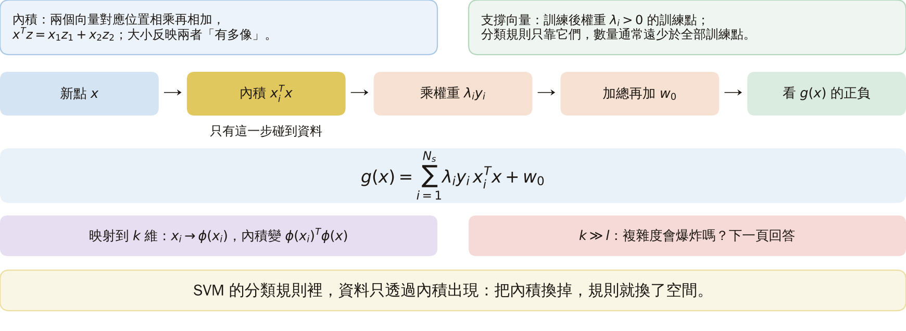

### 2. A quadratic map: a high-dimensional inner product without building the high-dimensional vectors

**Kernel function** $K(x,z)$: a function that gives the mapped inner product $\phi(x)^T\phi(z)$ directly, without computing the map first.

**Example**: map a 2-D $x$ to 3-D, $\phi(x)=[x_1^2,\ \sqrt2x_1x_2,\ x_2^2]^T$. Then

$$
\phi(x)^T\phi(z)=(x^Tz)^2 .
$$

**Check**: take $x=(1,2)$, $z=(2,1)$.

- Map first: $\phi(x)=(1,\ 2.828,\ 4)$, $\phi(z)=(4,\ 2.828,\ 1)$.
- Inner product: $1\times4+2.828\times2.828+4\times1=4+8+4=16$.
- With the kernel: $x^Tz=1\cdot2+2\cdot1=4$, and $4^2=16$. The same.

The inner product in the high-dimensional space comes out of the original-space inner product squared, without building any 3-D vector.

Figure `lec05-kp19-identity`: look at the 3-D vectors and the inner product 16 on the left, then at the original-space inner product and its square on the right: they agree. [Function: 1, 2]

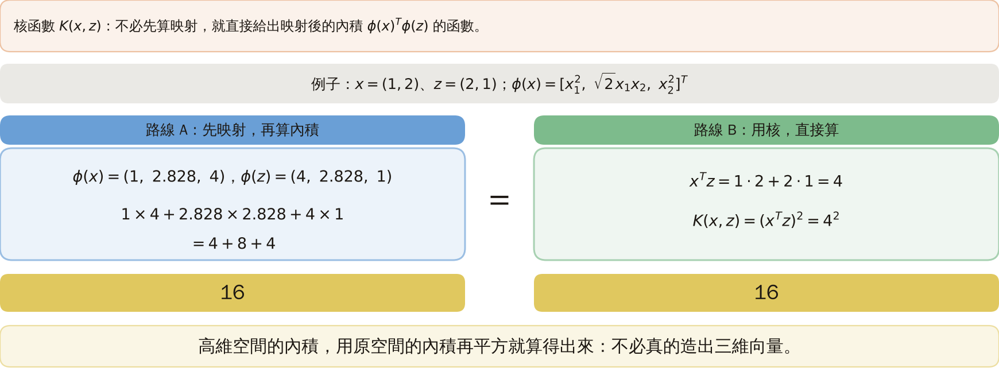

### 3. Lifting concentric rings

**Experiment setup** (designed here, generated by a program): two concentric rings. Each point gets a uniformly random angle and a radius drawn from a normal distribution: the inner ring (label $-1$) has mean 1 and the outer ring (label $+1$) mean 2, both with standard deviation $0.25$. The training set has 60 points per class (random seed 1) and the new data 500 points per class (seed 2).

**Effect of the map**: let $y_1=x_1^2$ and $y_3=x_2^2$; then $y_1+y_3=x_1^2+x_2^2=\|x\|^2$. The map turns the "radius" into a coordinate.

$\|x\|^2$ is about 1 on the inner ring and about 4 on the outer. We pick the middle value $2.5$ by hand and draw the line $y_1+y_3=2.5$; this line was not trained.

**Result**: on the first 100 points per class of the new data, 200 points in all, the line is right on 195, that is 97.5%; the errors are where the rings overlap at the edges.

A plane in 3-D is a circle when brought back to the original space. The figure does not draw the middle coordinate $\sqrt2x_1x_2$.

Figure `lec05-kp19-lift`: look at the rings on the left, which no line can separate; then at the right after the map, where one line $y_1+y_3=2.5$ cuts the two classes apart. [Function: 1, 3]

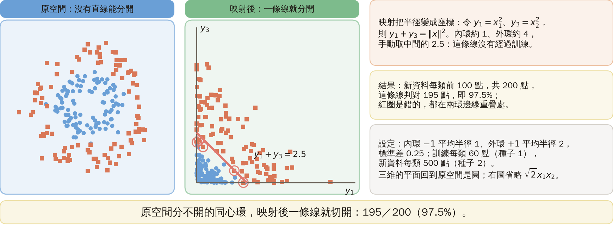

### 4. Mercer's theorem: which functions can serve as a kernel?

**Question**: can we write any $K(x,z)$ and treat it as the inner product of some map? No.

**Mercer condition**: $K$ is symmetric ($K(x,z)=K(z,x)$), continuous, and for every square-integrable function $g$,

$$
\iint K(x,z)\,g(x)\,g(z)\,dx\,dz\ \ge 0 .
$$

Square-integrable means that $\int g(x)^2dx$ is finite. This integral condition is the continuous way of writing "positive semi-definite".

**Formal definition (Mercer's theorem)**: for a $K$ satisfying the condition there is a vector space $H$ (called an RKHS; its details are not needed in this course) and a map $\phi$ such that $K(x,z)=\langle\phi(x),\phi(z)\rangle$. Conversely, a kernel of inner-product form satisfies the condition.

**What the theorem does not tell us**: it does not say what $\phi$ looks like or how many dimensions $H$ has; the $H$ of the Gaussian kernel is infinite-dimensional.

**A check on finitely many points** (added): for any finite points $x_1,\dots,x_n$ the **Gram matrix** $G_{ij}=K(x_i,x_j)$ must be positive semi-definite, that is, all eigenvalues $\ge0$.

- Small example: the quadratic kernel $K=(x^Tz+1)^2$ and the two points $e_1=(1,0)$, $e_2=(0,1)$: $G=\begin{pmatrix}4&1\\1&4\end{pmatrix}$, with eigenvalues $3$ and $5$, both positive.
- 30 random points (random seed 0): the Gaussian kernel has smallest eigenvalue $8.8\times10^{-8}$; the quadratic kernel $-8\times10^{-15}$ (rounding error, taken as 0).

**Limit of this check**: finding one negative eigenvalue proves the kernel illegal; not finding one only says this set of points is fine and does not prove it for all data.

Figure `lec05-kp19-mercer`: look at what the theorem says and does not say, then at the smallest Gram eigenvalues of two kernels, neither clearly negative. [Function: 1, 2]

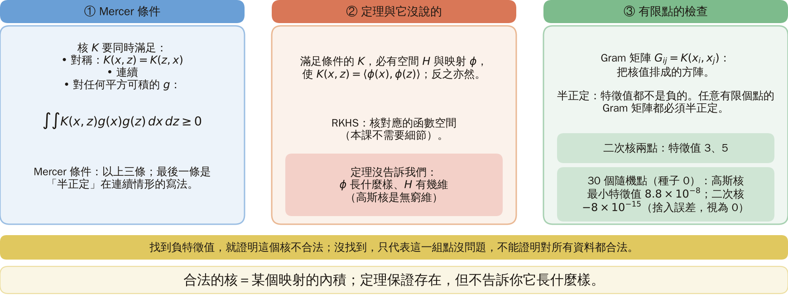

### 5. The kernelized SVM: replace the inner product by a kernel

**Common kernels**:

- Polynomial kernel: $(x^Tz+1)^q$, $q$ the degree.
- Gaussian (RBF) kernel: $\exp(-\gamma\|x-z\|^2)$. It is close to 1 for near points and close to 0 for far ones; the larger $\gamma$ is, the smaller the range of "near".
- Hyperbolic tangent kernel: $\tanh(\beta x^Tz+\gamma)$, not always legal, see the extension.

**Dual problem** (the training problem of the SVM in inner-product form):

$$
\max_\lambda\ \sum_i\lambda_i-\tfrac12\sum_{i,j}\lambda_i\lambda_jy_iy_jK(x_i,x_j),\qquad 0\le\lambda_i\le C,\quad \sum_i\lambda_iy_i=0 .
$$

**How to read it**:

- We choose $N$ weights $\lambda_1,\dots,\lambda_N$ to make the quantity above as large as possible.
- The first term $\sum\lambda_i$ favours large weights; the second subtracts the double counting of pairs that are similar (large $K$) and of the same class ($y_iy_j=+1$) both having large weights.
- $0\le\lambda_i\le C$: no point may have an influence above $C$. In the original objective $C$ is the weight of the violation penalty; here it becomes the upper limit of $\lambda_i$.
- $\sum\lambda_iy_i=0$: the total weights of the two classes balance each other.

After training the classification rule is

$$
g(x)=\sum_{i=1}^{N_s}\lambda_iy_iK(x_i,x)+w_0 ,
$$

and $g>0$ is assigned to $\omega_1$. Because the kernel is nonlinear, this is a nonlinear classifier in the original space.

**Check** (added): putting the solved $\lambda$ into this formula, it differs from the library's decision values by at most $10^{-14}$.

Figure `lec05-kp19-kernels`: look at the three common kernels, then at the dual problem and the classification rule: the two formulas connect only where the kernel $K$ appears. [Function: 1]

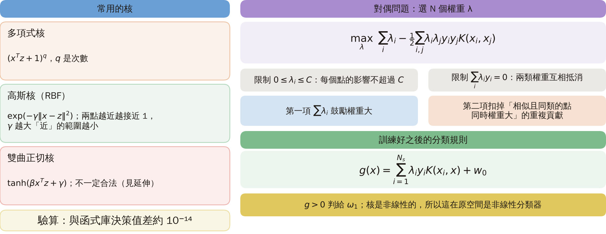

### 6. The rings experiment: only the kernel changes

**Experiment setup** (designed here, generated by a program): reuse the rings of section 3 (standard deviation $0.25$, 60 training points per class, seed 1; new data 500 points per class, 1000 in all, seed 2). scikit-learn's SVC is used with the kernel values computed beforehand and passed in, $C=10$; Gaussian kernel $\gamma=0.5$, quadratic kernel $(x^Tz+1)^2$. Only this one draw is used, with no repeats.

| Kernel | Training correct | New points correct | New-point accuracy | Support vectors |
|---|---:|---:|---:|---:|
| Linear $x^Tz$ | 66/120 | 562/1000 | 56.2% | 118 |
| Quadratic | 117/120 | 976/1000 | 97.6% | 10 |
| Gaussian | 119/120 | 968/1000 | 96.8% | 19 |

**How to read the table**: neither the data nor the algorithm changed, only the kernel, and the new-point accuracy rises from a near-guess 56.2% to about 97%. The Gaussian kernel has only 19 support vectors; a PNN (KP18) would keep all 120 training points (sparsification is in KP21).

Figure `lec05-kp19-regions`: look at the decision regions of the three kernels, a straight line for the linear one and circles for the other two; then at the support vectors circled: for the linear kernel almost all points are support vectors. [Function: 1, 3]

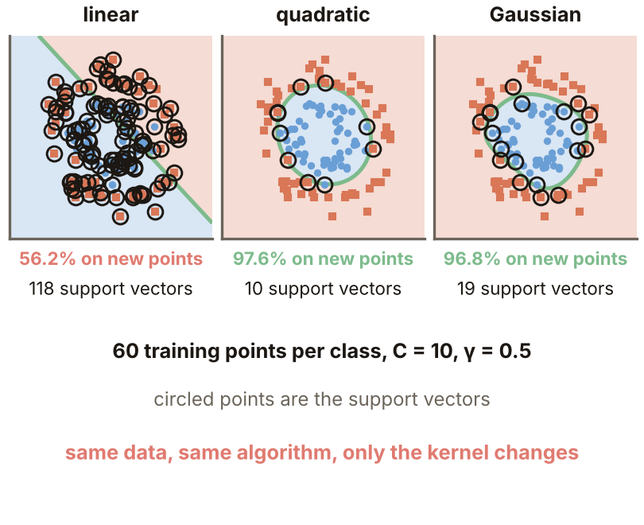

### 7. Hyperparameters: choose them on validation data

**Hyperparameter**: a parameter that must be decided before training and is not solved from the data, here the Gaussian $\gamma$ and the violation cost $C$.

**Experiment setup** (designed here, generated by a program): make the rings overlap more, standard deviation $0.45$. Training has 60 points per class (seed 3); the **validation data** has 500 per class (seed 5) and is used only to pick the hyperparameters; the **test data** has 500 per class (seed 4) and is used once at the end to report. First fix $C=10$ and sweep $\gamma$.

| $\gamma$ | Training correct (/120) | Validation correct (/1000) | Test correct (/1000) | Support vectors |
|---:|---:|---:|---:|---:|
| 0.01 | 90 | 778 | 772 | 117 |
| 0.1 | 106 | 863 | 870 | 51 |
| **0.5** | 106 | **866** | 861 | 47 |
| 2 | 110 | 835 | 840 | 54 |
| 10 | 118 | 798 | 794 | 99 |
| 50 | 119 | 753 | 747 | 118 |

Then fix $\gamma=0.5$ and sweep $C$:

| $C$ | Training correct (/120) | Validation correct (/1000) | Test correct (/1000) |
|---:|---:|---:|---:|
| 0.01 | 98 | 838 | 843 |
| 0.1 | 98 | 840 | 848 |
| 1 | 104 | 864 | 864 |
| **10** | 106 | **866** | 861 |
| 1000 | 111 | 807 | 828 |

**How to read the two tables**:

- Training correct rises as $\gamma$ or $C$ grows (119/120 at $\gamma=50$), but validation and test are best in the middle and fall at both ends: fitting too tightly makes new data worse.
- Choose hyperparameters by the **validation** column: $\gamma=0.5$, $C=10$ is highest (866/1000). Taking it to the test data gives 861/1000, that is 86.1%.
- Peeking at the test column and choosing $\gamma=0.1$ would give 87.0%, a picked number that is optimistic.

**Common misconception**: the higher the training accuracy the better. In fact when $\gamma$ is too large the training fit is tighter and the new points get worse.

Figure `lec05-kp19-hyper`: look at the training accuracy rising steadily with $\gamma$, then at the new-point accuracy rising and then falling; the wider the two lines part, the more the fit hugs the training data. [Function: 1, 2]

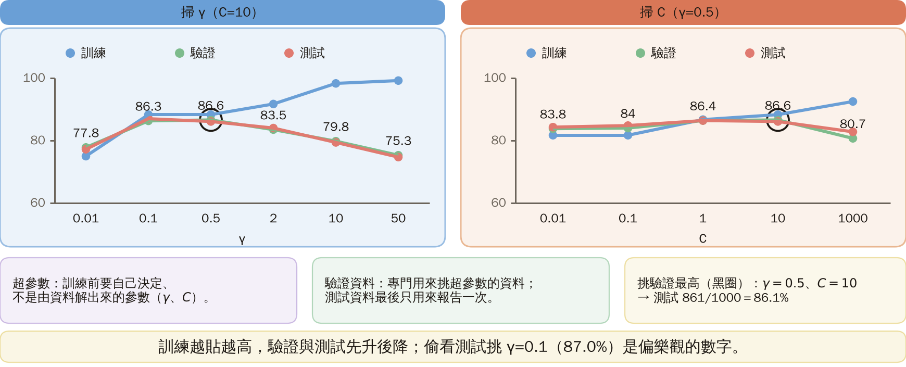

### 8. Independent of the dimension, but not free of cost

**Dimension of the kernel space**: a polynomial kernel of dimension $l$ and degree $q$ has $\binom{l+q}{q}$ explicit features:

| $(l,q)$ | Explicit features |
|---|---:|
| $(2,2)$ | 6 |
| $(10,3)$ | 286 |
| $(100,5)$ | 96,560,646 |
| $(784,5)$ | 2,515,874,132,157 (about $2.5\times10^{12}$) |

**One kernel value**: an inner product and then a power, about $l$ multiplications whatever the dimension of the kernel space. The Gaussian kernel's space is infinite-dimensional, and one value still costs one distance.

**Limits** (to be honest):

- What is avoided is "building the high-dimensional features", not all computation. Training and classifying need kernel values; with $N$ training points there are $N\times N$ kernel values to handle (the Gram matrix), which becomes the bottleneck when samples are many.
- Nobody knows how to pick the best kernel; the quality of a kernel must be judged on validation data.

**To remember**: any algorithm that uses only inner products can replace the inner product by a kernel and design a linear classifier in a high-dimensional space; the price is not knowing which space one is in, and paying for the Gram matrix.

Figure `lec05-kp19-cost`: look at the explicit feature counts of the polynomial kernel exploding with $l$ and $q$, then at the multiplications of one kernel value, proportional to $l$ only. [Function: 2]

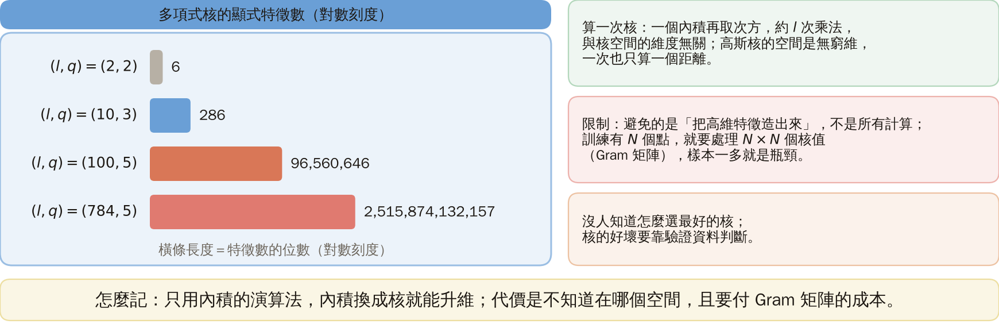

### Extension: an illegal kernel, practice and worked solution

**The hyperbolic tangent kernel is not always legal** (designed here): $K=\tanh(2x^Tz+1)$ ($\beta=2$, $\gamma=1$). Take the three points $(-1,0)$, $(1.6,0.9)$, $(0.1,-0.8)$; the eigenvalues of their Gram matrix are $-0.132$, $0.875$, $2.232$, one negative, which violates the Mercer condition.

**Statistics**: take 10 random points each time (random seed 5) and repeat 200 times: the hyperbolic tangent kernel has a negative eigenvalue in all 200, the Gaussian kernel in 0.

For these parameters the hyperbolic tangent is not a legal kernel and the dual problem is not guaranteed to be convex (a theoretical consequence, not measured in this experiment); check before using it, or use the Gaussian kernel.

Figure `lec05-kp19-tanh`: look at the Gram matrix of the three points, then at the negative number among the eigenvalues. [Function: 2]

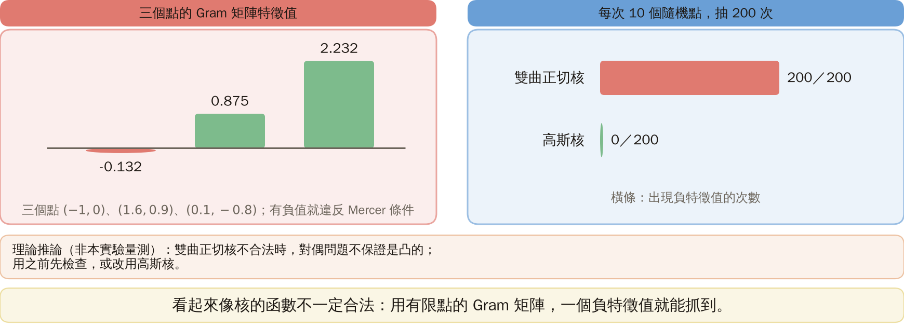

**Practice**: $K(x,z)=(x^Tz+1)^2$, $x=(1,2)$, $z=(3,1)$; map $\phi(x)=[1,\sqrt2x_1,\sqrt2x_2,x_1^2,\sqrt2x_1x_2,x_2^2]$.

1. Compute $K(x,z)$ directly with the kernel.
2. First compute the 6 features $\phi(x)$ and $\phi(z)$, then the inner product, and check whether it equals question 1.

Figure `lec05-kp19-practice`: the setup of the practice. Look at the kernel formula and the two points first, then at the map on the right. [Function: 1]

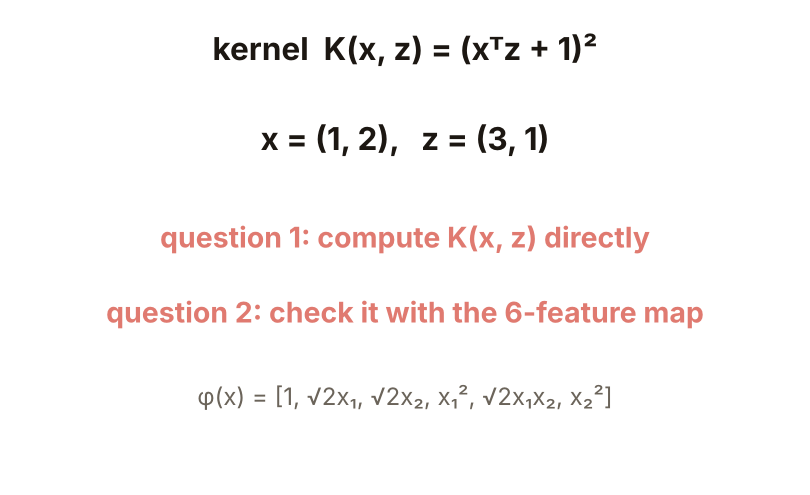

**Worked solution of questions 1 and 2**: (1) $x^Tz=1\cdot3+2\cdot1=5$, $K=(5+1)^2=36$, only 2 multiplications. (2) $\phi(x)=(1,1.414,2.828,1,2.828,4)$, $\phi(z)=(1,4.243,1.414,9,4.243,1)$; inner product $1+6+4+9+12+4=36$, the same as question 1. (3) Check: the same 36; the kernel computes in 2 dimensions while the map first builds 6 features; the higher the dimension, the larger the gap.

Figure `lec05-kp19-practice-sol`: look at the kernel computation on the left, then at the map computation on the right; both give 36. [Function: 1, 2]

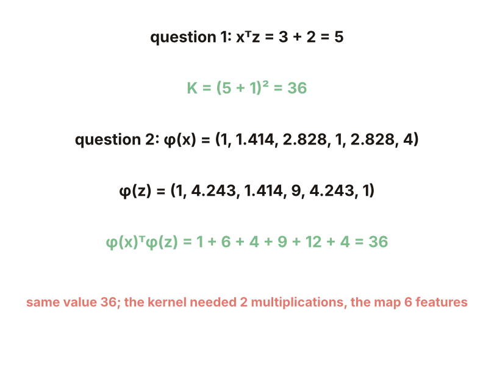

## Terms and source

| 中文 | English |
|---|---|
| 支撐向量 | Support vector |
| 核函數 | Kernel function |
| 內積 | Inner product |
| Mercer 條件 | Mercer condition |
| Gram 矩陣 | Gram matrix |
| 半正定 | Positive semi-definite |
| 特徵值 | Eigenvalue |
| 超參數 | Hyperparameter |
| 驗證資料 | Validation data |
| RKHS（再生核希爾伯特空間） | Reproducing kernel Hilbert space |
| 高斯核（RBF） | Gaussian (RBF) kernel |

Source: Chapter 4, KP19, §4.18 (read 2026-10-25). The SVM using only inner products, the quadratic-map identity, Mercer's theorem and what it does not say, the kernelized dual and classification rule, the independence of the complexity from the kernel-space dimension and the "to remember" line follow the source; the rings experiments, the sweeps of $\gamma$ and $C$ (including the use of validation data), the feature-count table, the negative eigenvalues of the hyperbolic tangent kernel and the practice were designed and recomputed for this lecture ([added], (program-computed); scikit-learn's SVC, with the data generator, seeds and sizes given in each section). "The Gram matrix of finitely many points must be positive semi-definite" is the finite-point version of the Mercer condition and is a supplementary remark.
