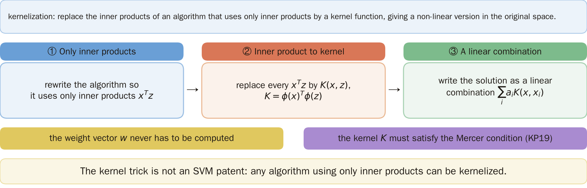
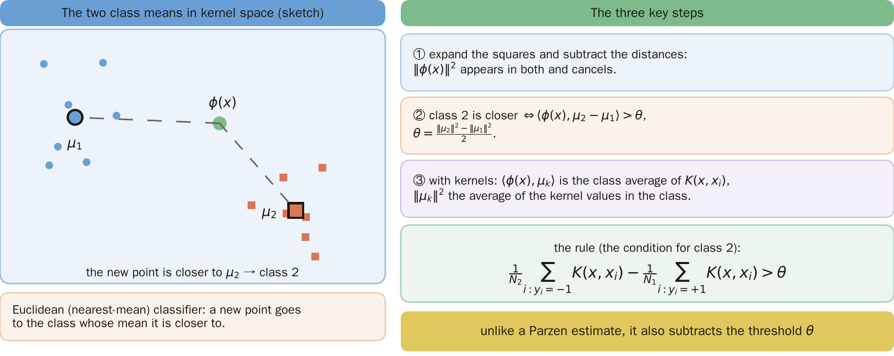
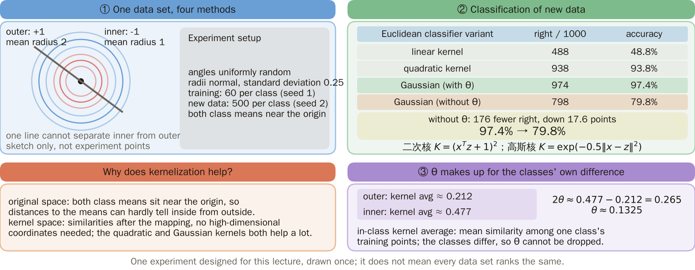
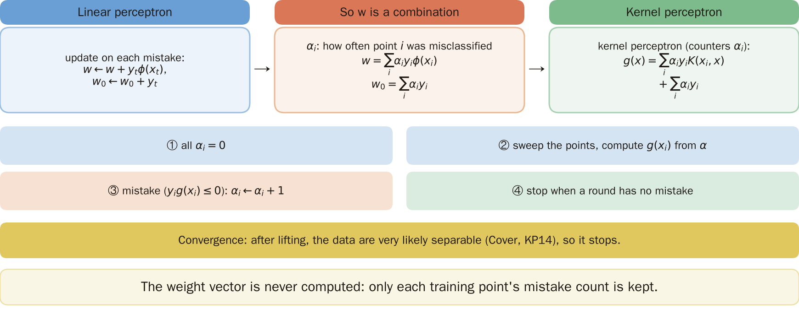
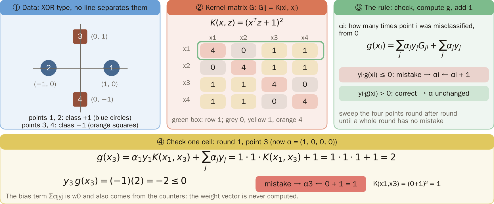
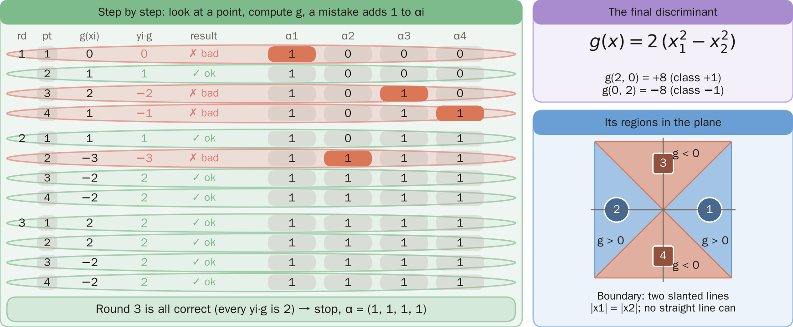
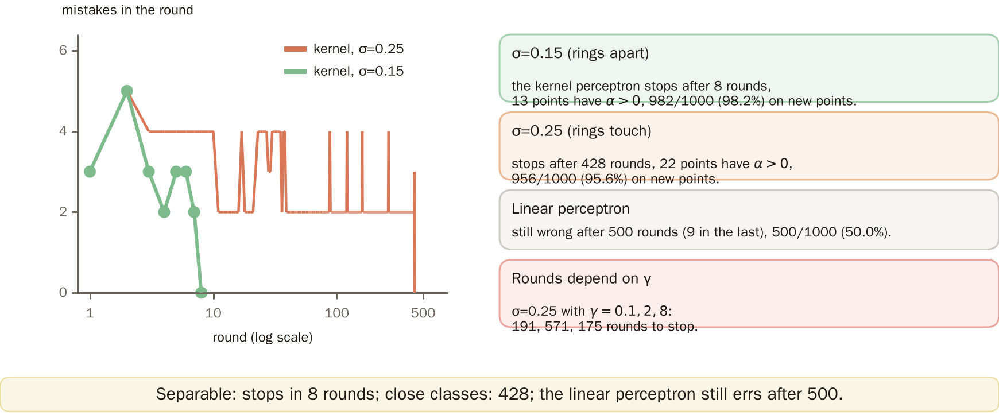
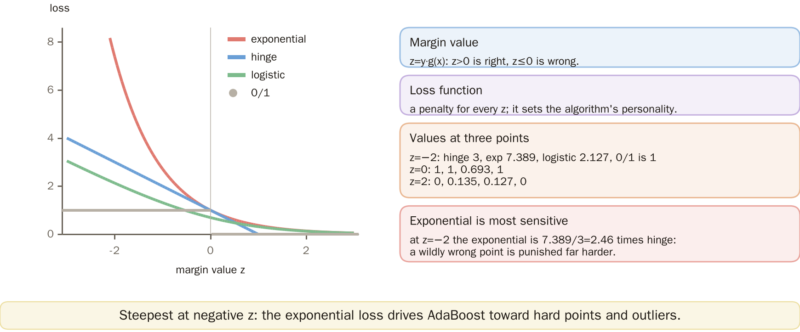
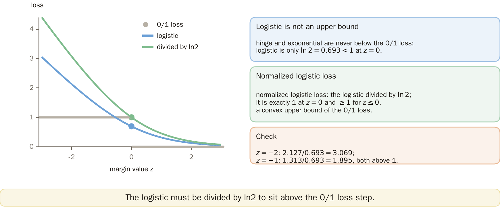
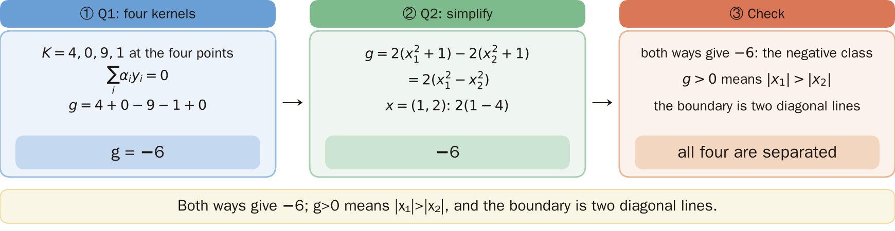

# KP20 Beyond the SVM: The General Kernel Trick and the Kernel Perceptron

> Level: undergraduate, year 3
>
> Pattern Recognition | Chapter 4, §4.19

[Slides: read and download](../../slides/lec05-kp20-beyond-svm-en.jbd.json) | [中文版](../lec05-kp20-beyond-svm.md)

## Learning objectives

- Write the three-step recipe of the kernel trick, use it to kernelize the Euclidean classifier and explain its relation to the Parzen estimate.
- Write the update and the discriminant of the kernel perceptron and work every step of a small example by hand.
- Compare the hinge, exponential, logistic and 0/1 losses and explain why the logistic loss must be normalized.

## KP20 Beyond the SVM: The General Kernel Trick and the Kernel Perceptron

**One-sentence summary**: The kernel trick is not only for the SVM; any linear algorithm that uses only inner products can be kernelized into a nonlinear version. The weight vector never has to be computed.

### Prerequisites and symbols

**A few things you need first** (one plain sentence each):

- **Inner product and kernel** (KP19): the kernel $K(x,z)=\phi(x)^T\phi(z)$ gives the inner product "after mapping to a high dimension" directly, without computing $\phi$.
- **Perceptron**: look at a point; if it is classified wrongly, push the weights a little towards that point; sweep over all points again and again until there is no error.
- **Parzen estimate** (KP18): put a small hill on every training point and add them up as the density estimate at a location; the class whose hills add up higher gets the point.
- **Cover's theorem** (KP14): map the data to a space of high enough dimension and a plane will very likely separate them.
- **Mercer condition** (KP19): the condition a kernel must meet to be truly the inner product of some map.

**Symbol table** (fixed for this lecture):

| Symbol | Meaning | Note |
|---|---|---|
| $x,z$ | points in the original space | the experiments here are 2-D |
| $y_i$ | class of the $i$-th training point | $y_i\in\{-1,+1\}$ |
| $\phi(x)$ | the mapped vector | never computed |
| $K(x,z)$ | kernel function | $=\phi(x)^T\phi(z)$ |
| $\mu_k$ | mean vector of class $k$ in the kernel space | $\mu_k=\frac1{N_k}\sum_{i\in\text{class }k}\phi(x_i)$ |
| $N_k$ | number of training points of class $k$ | |
| $\theta$ | threshold | see section 2 |
| $\alpha_i$ | number of times point $i$ was misclassified | the counter of the kernel perceptron |
| $g(x)$ | discriminant | $g(x)>0$ gives $+1$ |
| $z$ | margin value | $z=y\,g(x)$, section 7 |

### 1. The three-step recipe

**Plain explanation**: Can other algorithms that use only inner products also be lifted the way KP19 did? Yes, and the recipe has three steps.

- **Kernelization**: replacing the inner products of an algorithm by a kernel function, giving a nonlinear version in the original space.

**The three-step recipe**:

1. Rewrite the algorithm with inner products only.
2. Replace each inner product by a kernel $K$.
3. Write the solution as a linear combination of the training points.

The weight vector never has to be computed. As in KP19, $K$ must satisfy the Mercer condition.

Figure `lec05-kp20-recipe`: First the definition of kernelization at the top, then the three steps in order: only inner products, inner products to kernels, a linear combination; finally the two reminders: the weight vector is never computed and the kernel must satisfy the Mercer condition. [Function: 1]

The next question: can the simplest classifier (compare the distances to the two class means) be kernelized?

### 2. The Euclidean classifier: compare the distances to the two class means

**Plain explanation**: The Euclidean (nearest-mean) classifier averages the training points of each class and gives a new point to the class whose mean is nearer. Kernelizing means doing the same in the mapped space.

**Derivation, step by step**:

1. In the kernel space the mean of class $k$ is $\mu_k=\frac1{N_k}\sum_{i\in\text{class }k}\phi(x_i)$. To classify, compare $\|\phi(x)-\mu_1\|^2$ and $\|\phi(x)-\mu_2\|^2$; the smaller one wins.
2. Expand the square: $\|\phi(x)-\mu_k\|^2=\|\phi(x)\|^2-2\langle\phi(x),\mu_k\rangle+\|\mu_k\|^2$.
3. Subtract the two distances; $\|\phi(x)\|^2$ appears in both and cancels:

$$
\|\phi(x)-\mu_2\|^2-\|\phi(x)-\mu_1\|^2=2\langle\phi(x),\mu_1-\mu_2\rangle+\|\mu_2\|^2-\|\mu_1\|^2 .
$$

4. Class 2 is nearer when this is below 0, which rearranges to $\langle\phi(x),\mu_2-\mu_1\rangle>\theta$ with $\theta=(\|\mu_2\|^2-\|\mu_1\|^2)/2$. If it holds, decide class 2 ($y=-1$).
5. Switch to kernels: $\langle\phi(x),\mu_k\rangle=\frac1{N_k}\sum_{i\in\text{class }k}K(x,x_i)$ and $\|\mu_k\|^2=\frac1{N_k^2}\sum_{i,j\in\text{class }k}K(x_i,x_j)$, the mean of the kernel values inside class $k$.

**Formal definition**: the decision rule is

$$
\frac{1}{N_2}\sum_{i:y_i=-1}K(x,x_i)-\frac{1}{N_1}\sum_{i:y_i=+1}K(x,x_i)>\theta ,
$$

and $2\theta$ = the mean kernel value inside class 2 $-$ the mean kernel value inside class 1.

**Relation to Parzen**: the two sums on the left look like a Parzen density estimate (KP18), and with a Gaussian kernel they are one. The difference is $\theta$: Parzen compares the two sums directly, while the kernelized Euclidean classifier also subtracts the threshold $\theta$.

Figure `lec05-kp20-kmean`: First the two classes, their means $\mu_1$, $\mu_2$ and the new point $\phi(x)$ (closer to $\mu_2$) on the left; then the three derivation steps on the right and the rule at the bottom. [Function: 1]

The next question: does the kernelized Euclidean classifier really work? Can $\theta$ be dropped? Try concentric rings.

### 3. Comparison on concentric rings

**Experiment setup** (designed here, generated by a program): two concentric rings. Each point gets a uniformly random angle and a radius drawn from a normal distribution: the inner ring (label $-1$) has mean 1 and the outer ring (label $+1$) mean 2, standard deviation $0.25$. Training has 60 points per class (random seed 1) and the new data 500 points per class, 1000 in all (seed 2). Gaussian kernel $\gamma=0.5$, quadratic kernel $(x^Tz+1)^2$. Only this one draw is used, with no repeats.

| Method | New points correct (/1000) | New-point accuracy |
|---|---:|---:|
| Euclidean classifier, linear kernel | 488 | 48.8% |
| Quadratic kernel | 938 | 93.8% |
| Gaussian kernel | 974 | 97.4% |
| Gaussian kernel without $\theta$ (only the two sums, a Parzen comparison with equal priors) | 798 | 79.8% |

**Why $\theta$ cannot be dropped**: the mean kernel values inside the classes for this Gaussian kernel are about 0.212 for class 1 (outer ring) and about 0.477 for class 2 (inner ring), so $2\theta\approx0.265$. The two classes have different inner kernel means and $\theta$ makes up the difference. Without it only 79.8% is left.

**Common misconception**: the two sums look like a Parzen estimate, so comparing the two sums directly is a Parzen classifier and needs no threshold. In fact without $\theta$ it is much worse: "≈ Parzen" must not ignore it.

Figure `lec05-kp20-ringcmp`: First the concentric-ring data and the four methods at the top left, then the result table at the top right: the Gaussian kernel reaches 97.4% and drops to 79.8% without $\theta$; finally the two panels below: why kernel space helps, and how $\theta$ makes up the difference of the in-class kernel averages (0.212 against 0.477). [Function: 2]

The next question: the Euclidean classifier is simple. Can a more learning-like algorithm such as the perceptron also be kernelized?

### 4. The kernel perceptron: counters instead of weights

**The linear perceptron, recalled**: whenever a point is misclassified ($y_tg(x_t)\le0$), update $w\leftarrow w+y_t\phi(x_t)$ and $w_0\leftarrow w_0+y_t$; start from zero.

**Why $w$ need not be computed**: an update only "adds a training point", so the final $w$ is a linear combination of training points. Let $\alpha_i$ be the number of times point $i$ was misclassified:

$$
w=\sum_i\alpha_iy_i\phi(x_i),\qquad w_0=\sum_i\alpha_iy_i .
$$

The discriminant $g(x)=\langle w,\phi(x)\rangle+w_0$ then contains only kernels:

$$
g(x)=\sum_i\alpha_iy_iK(x_i,x)+\sum_i\alpha_iy_i .
$$

**The algorithm of the kernel perceptron**:

1. Start with all $\alpha_i=0$.
2. Sweep over the training points round after round. At each point $x_i$ compute $g(x_i)$ with the current $\alpha$.
3. If $y_ig(x_i)\le0$ (wrong), set $\alpha_i\leftarrow\alpha_i+1$.
4. Stop when a whole round has no error.

**Convergence**: the linear perceptron converges only when the data are linearly separable. After the kernel maps to a high dimension, by Cover's theorem (KP14) the data are very likely linearly separable.

Figure `lec05-kp20-kperc`: First the three boxes in the top row: the linear perceptron's update, $w$ as a combination of training points, and the kernel perceptron's discriminant; then the four-step algorithm and the convergence note below. [Function: 2]

The next question: with a small example, compute the discriminant value of every point.

### 5. A hand trace

**Example** (designed here): four points: $x_1=(1,0)$ and $x_2=(-1,0)$ are $+1$; $x_3=(0,1)$ and $x_4=(0,-1)$ are $-1$. Kernel $K=(x^Tz+1)^2$. This is XOR-type data that no line can separate.

First the kernel matrix $G_{ij}=K(x_i,x_j)$. For example $K(x_1,x_1)=(1+1)^2=4$, $K(x_1,x_3)=(0+1)^2=1$, $K(x_1,x_2)=(-1+1)^2=0$:

$$
G=\begin{pmatrix}4&0&1&1\\0&4&1&1\\1&1&4&0\\1&1&0&4\end{pmatrix}.
$$

**Trace round by round**: $g(x_i)=\sum_j\alpha_jy_jG_{ji}+\sum_j\alpha_jy_j$.

| Round | Point | $g(x_i)$ | $y_ig(x_i)$ | Result | $\alpha$ after |
|---|---|---:|---:|---|---|
| 1 | 1 | 0 | 0 | wrong | $(1,0,0,0)$ |
| 1 | 2 | 1 | 1 | right | $(1,0,0,0)$ |
| 1 | 3 | 2 | $-2$ | wrong | $(1,0,1,0)$ |
| 1 | 4 | 1 | $-1$ | wrong | $(1,0,1,1)$ |
| 2 | 1 | 1 | 1 | right | $(1,0,1,1)$ |
| 2 | 2 | $-3$ | $-3$ | wrong | $(1,1,1,1)$ |
| 2 | 3 | $-2$ | 2 | right | $(1,1,1,1)$ |
| 2 | 4 | $-2$ | 2 | right | $(1,1,1,1)$ |
| 3 | 1–4 | $2,2,-2,-2$ | all 2 | all right | $(1,1,1,1)$, stop |

**One cell checked by hand**: in round 1 at point 3 ($x_3=(0,1)$) with $\alpha=(1,0,0,0)$: $g(x_3)=\alpha_1y_1K(x_1,x_3)+\sum\alpha_jy_j=1\cdot1\cdot1+1=2$, and $y_3=-1$, so $y_3g=-2\le0$, wrong.

**The final discriminant**: adding the four kernels, $g(x)=2(x_1^2-x_2^2)$. $(2,0)$ gives $+8$ and $(0,2)$ gives $-8$.

Figure `lec05-kp20-trace`: First see the left chart: four XOR-type points (blue circles +1, orange squares −1); then the kernel matrix G in the middle with row 1 boxed in green; on the right is the rule, and below it the check of round 1, point 3: g = 2, y·g = −2, a mistake, so α₃ becomes 1. [Function: 2]

Figure `lec05-kp20-trace2`: First see the step-by-step table on the left: red rows are mistakes and the orange cell is the α that was increased in that step; round 3 is all correct, so α = (1, 1, 1, 1) and the algorithm stops; then the right side: the final g(x) = 2(x₁² − x₂²) and its regions in the plane, with the boundary two slanted lines |x₁| = |x₂| that no straight line can match. [Function: 2]

The next question: on more realistic data, how many rounds does the kernel perceptron need and how accurate is it?

### 6. The rings experiment

**Experiment setup** (designed here, generated by a program): concentric rings (generated as in section 3) with standard deviation $0.15$ (the rings are apart) and $0.25$ (the edges touch); training 60 points per class (seed 1), new data 500 per class (seed 2); Gaussian kernel $\gamma=0.5$. A perceptron round sweeps the 120 training points in order, and the linear perceptron runs at most 500 rounds. Only this one draw is used, with no repeats.

| Method | Standard deviation | Rounds | Points with $\alpha>0$ | New points correct (/1000) |
|---|---:|---:|---:|---:|
| Linear perceptron | 0.15 | still errors after 500 rounds | — | 500 (50.0%) |
| Kernel perceptron | 0.15 | stops after 8 rounds | 13 | 982 (98.2%) |
| Linear perceptron | 0.25 | still errors after 500 rounds | — | 500 (50.0%) |
| Kernel perceptron | 0.25 | stops after 428 rounds | 22 | 956 (95.6%) |

**How to read it**: when the data are separable it is guaranteed to stop in finitely many steps, but when the two classes are close the number of rounds grows a lot (8 rounds become 428). With the same standard deviation $0.25$ and the same training data, $\gamma=0.1,2,8$ need 191, 571 and 175 rounds to stop, so the number of rounds is also sensitive to $\gamma$.

Figure `lec05-kp20-epochs`: look at the number of rounds on a logarithmic axis, then at how the errors per round fall; the curve for standard deviation 0.25 drags on for a long time. [Function: 2]

The next question: where do the perceptron and the SVM differ? Look at the loss each one minimizes.

### 7. Loss functions

**Margin value** $z=y\,g(x)$: $z>0$ is classified right and $z\le0$ wrong; the more negative, the worse the error.

A **loss function** gives every $z$ a penalty, and the character of the algorithm is set by it. Four of them:

| Loss | Formula | Used in |
|---|---|---|
| hinge | $\max(0,\ 1-z)$ | the soft margin of the SVM |
| exponential | $e^{-z}$ | AdaBoost (KP25) |
| logistic | $\ln(1+e^{-z})$ | the negative log-likelihood of the logistic probability model |
| 0/1 | 1 when $z\le0$, else 0 | counts errors directly, but not differentiable |

Figure `lec05-kp20-losses`: look at the heights of the four curves on the $z>0$ side (right) first, then at which one rises fastest on the $z<0$ side (wrong). [Function: 1, 2]

The next question: do the four losses punish a point that is badly wrong equally hard?

### 8. The character of the losses

**Value table**:

| $z$ | hinge | exponential | logistic | 0/1 |
|---:|---:|---:|---:|---:|
| $-2$ | 3 | 7.389 | 2.127 | 1 |
| $0$ | 1 | 1 | 0.693 | 1 |
| $2$ | 0 | 0.135 | 0.127 | 0 |

**How to read it**: the exponential is steepest on the negative side. At $z=-2$ its penalty is $7.389/3=2.46$ times that of the hinge.

**Meaning**: a point that is badly wrong (noise or an outlier) is punished especially hard by the exponential loss; this is what drives AdaBoost to concentrate on hard points and also where it is sensitive to such points (the source says it is a weakness on tasks with a high Bayes error; KP25 returns to this).

**To remember**: the general recipe of the kernel trick: (1) inner products only, (2) replace the inner product by $K$, (3) express the solution as a linear combination of the training points; the weight vector never has to be computed.

### Extension: the logistic upper bound, practice and worked solution

**The logistic loss must be normalized**: the hinge and exponential losses are never below the 0/1 loss; but the logistic $\ln(1+e^{-z})$ is only $\ln2=0.693<1$ at $z=0$, so it is not an upper bound.

After dividing by $\ln2$ it is exactly 1 at $z=0$ and $\ge1$ for all $z\le0$, which makes it a convex upper bound of the 0/1 loss (the source calls it the normalized logistic).

**Check**: $z=-2$: $2.127/0.693=3.069$; $z=-1$: $1.313/0.693=1.895$, both above 1.

Figure `lec05-kp20-logup`: look at the step of the 0/1 loss, then at the logistic dipping below the step at $z=0$, and finally at the curve divided by $\ln2$ lying above the step. [Function: 1, 2]

**Practice**: the points $(1,0)+$, $(-1,0)+$, $(0,1)-$, $(0,-1)-$, $K=(x^Tz+1)^2$ and $\alpha=(1,1,1,1)$.

1. Use the four kernels to compute $g(x)$ at $x=(1,2)$. Which class is it?
2. Simplify $g$ into a formula in $x_1,x_2$ and check question 1.

**Worked solution of questions 1 and 2**: (1) $K(x,(1,0))=4$, $K(x,(-1,0))=0$, $K(x,(0,1))=9$, $K(x,(0,-1))=1$; $\sum\alpha_iy_i=0$; $g=4+0-9-1+0=-6$, the negative class. (2) Adding the four squares, $g=2(x_1^2+1)-2(x_2^2+1)=2(x_1^2-x_2^2)$; at $x=(1,2)$: $2(1-4)=-6$, the same as question 1. (3) Check: $g>0$ means $|x_1|>|x_2|$, given to the positive class; the boundary is two oblique lines, and the four points that no line could split are separated by the kernel perceptron.

Figure `lec05-kp20-solution`: First step 1, the four kernel values of exercise 1 and $g=-6$, then step 2, the simplification to $2(x_1^2-x_2^2)$, and finally the check that both ways give $-6$. [Function: 2]

## Terms and source

| 中文 | English |
|---|---|
| 核化 | Kernelization |
| 核感知器 | Kernel perceptron |
| 感知器 | Perceptron |
| 歐氏分類器（最近平均） | Euclidean (nearest-mean) classifier |
| Parzen 估計 | Parzen estimate |
| Cover 定理 | Cover's theorem |
| Mercer 條件 | Mercer condition |
| 間隔值 | Margin value |
| 損失函數 | Loss function |
| hinge 損失 | Hinge loss |
| 正規化的 logistic 損失 | Normalized logistic loss |

Source: Chapter 4, KP20, §4.19 (read 2026-10-25). The three-step kernelization recipe, the kernelized Euclidean classifier and its relation to Parzen, the update and discriminant of the kernel perceptron, the four losses and their uses and the "to remember" line follow the source; the rings comparison (data generator, seeds and sizes in sections 3 and 6), the 4-point hand computation with its round-by-round table, the rounds and accuracies of the perceptron, the loss table, the logistic normalization and the practice were designed and recomputed for this lecture ([added], (program-computed)); the step-by-step derivation of the Euclidean classifier is a supplementary explanation.
