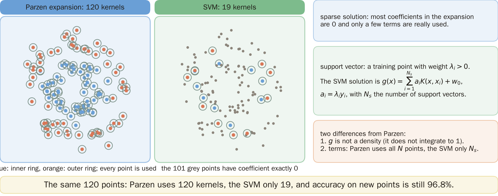
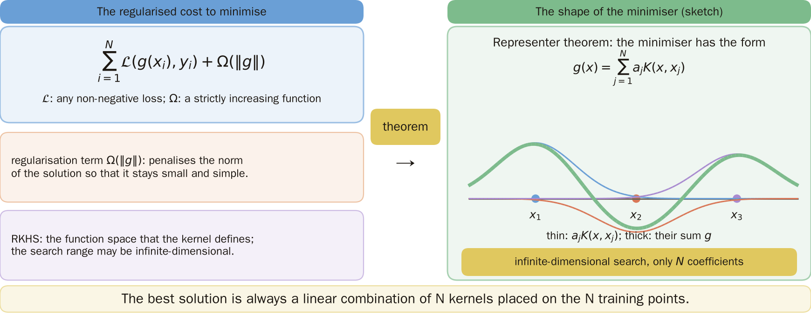
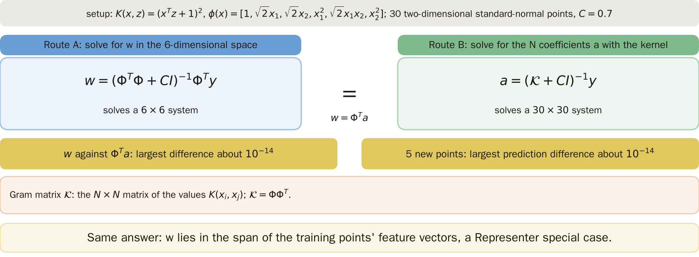
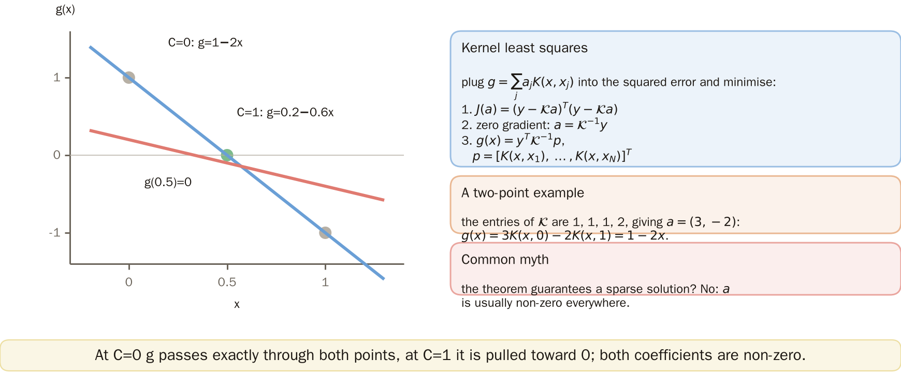
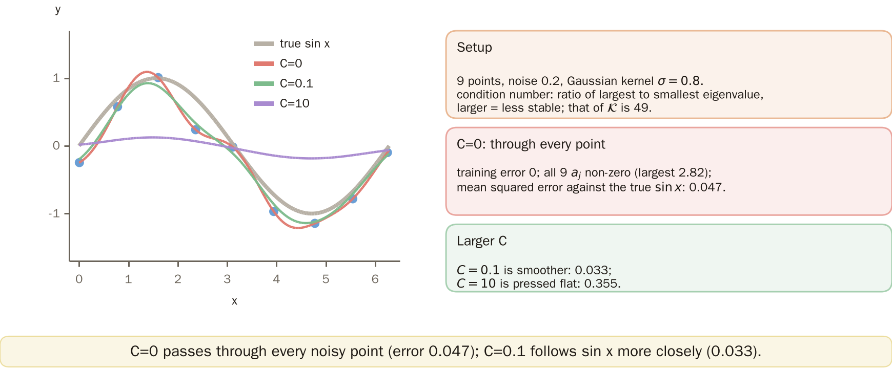
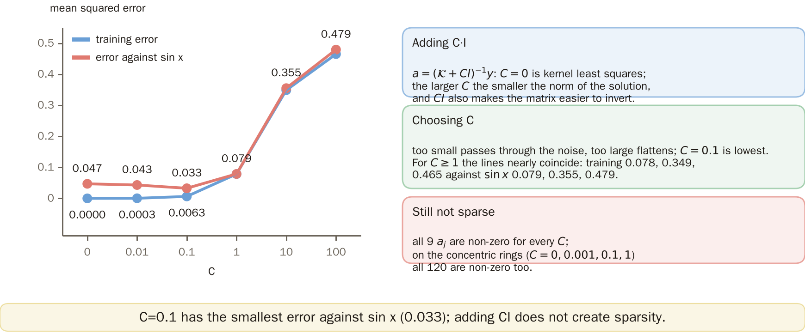
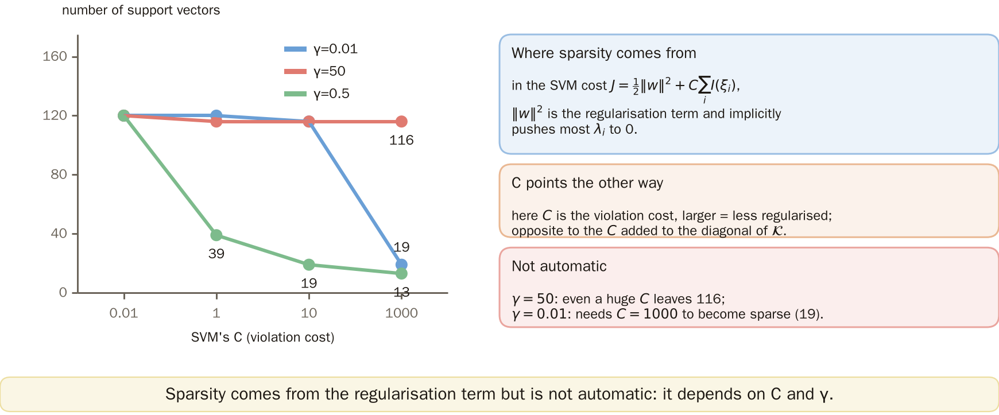
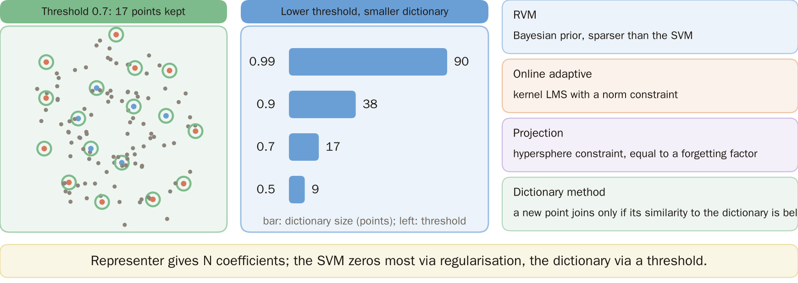
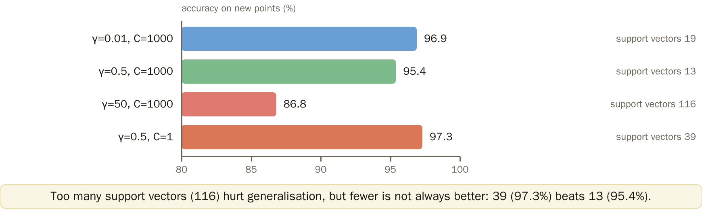
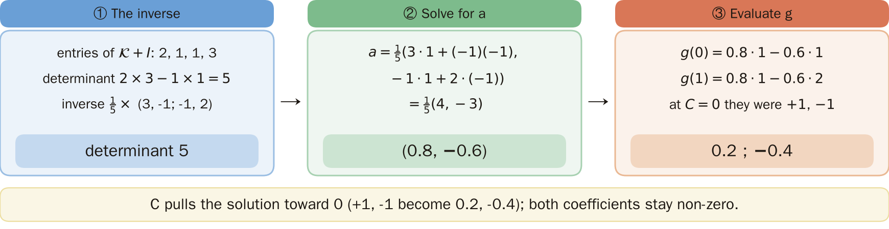

# KP21 The Representer Theorem, Kernel Expansions and Sparse Models

!!! note "Self-study"
    This unit (KP21) is self-study: it is not taught in class, so please read it on your own.

> Level: undergraduate, year 3
>
> Pattern Recognition | Chapter 4 §4.19.1

[Slides: read and download](../../slides/lec05-kp21-representer-en.jbd.json) | [中文版](../lec05-kp21-representer.md)

## Learning objectives

- Explain how an SVM solution differs from a Parzen expansion and what a sparse solution is.
- State the Representer theorem and verify it with numbers; solve kernel least squares and the version with $CI$ added.
- Explain that sparsity comes from the regularization term and is not automatic; list the four routes to sparsification.

## KP21 The Representer Theorem, Kernel Expansions and Sparse Models

**One-sentence summary**: Even when the solution is searched for in an infinite-dimensional space, the best solution is just a linear combination of $N$ kernels placed at the $N$ training points; the regularization term decides how many of these $N$ coefficients are zero.

### Prerequisites and symbols

**Three things you need first**:

- **Kernel function and Gram matrix** (KP19): $K(x,z)$ gives the inner product after the mapping; the $K(x_i,x_j)$ of $N$ points form an $N\times N$ matrix.
- **SVM and support vectors** (KP19): after training only a few points have weight $\lambda_i>0$.
- **Matrix inverse and least squares** (KP13): the solution of $Ax=b$ is $x=A^{-1}b$.

**Symbol table** (fixed for this lecture):

| Symbol | Meaning | Note |
|---|---|---|
| $x_i,y_i$ | the $i$-th training point and target | $N$ training points |
| $K(x,z)$ | kernel function | $K=\phi(x)^T\phi(z)$ |
| $\mathcal K$ | Gram matrix | $\mathcal K_{ij}=K(x_i,x_j)$, $N\times N$ |
| $a_j$ | coefficients of the kernel expansion | $g(x)=\sum_ja_jK(x,x_j)$; in an SVM $a_i=\lambda_iy_i$ |
| $N_s$ | number of support vectors | |
| $C$ | two uses in this lecture | section 6: the regularization weight added to the diagonal of $\mathcal K$; section 7: the violation cost of an SVM (the larger, the less regularized, the opposite of the former) |
| $\gamma$ | Gaussian kernel width parameter | $K=\exp(-\gamma\|x-z\|^2)$ (section 7); section 5 uses $\sigma$ instead: $\exp(-\|x-z\|^2/2\sigma^2)$ |
| $\Omega(\|g\|)$ | regularization term | penalizes the norm of the solution |

### 1. Sparse solutions

**Plain-words explanation**: An SVM solution is also a sum of kernels; how many kernels does it use?

- **Sparse solution**: in the expansion most coefficients are 0, and only a few terms are really used.

The SVM solution $g(x)=\sum_{i=1}^{N_s}a_iK(x,x_i)+w_0$, $a_i=\lambda_iy_i$, resembles a Parzen expansion when a Gaussian kernel is used. Two differences:

1. $g$ is not a density (it does not integrate to 1).
2. The number of terms: Parzen uses all $N$ points, the SVM only the support vectors $N_s$.

**Example** (the concentric-ring data of KP19: standard deviation 0.25, 60 training points per class (seed 1), 500 new points per class (seed 2), $C=10$, $\gamma=0.5$): only 19 of the 120 training points are support vectors, and the new-point accuracy is 96.8%.

Figure `lec05-kp21-sparse`: First look at the left panel: Parzen uses all 120 points as kernels (each point has a circle); then at the right panel: the SVM keeps only the 19 circled points, and the grey dots have coefficient exactly zero. [Function: 1, 3]

The next question: why does the best solution only ever need kernels at the training points?

### 2. The representer theorem

- **Representer theorem**: let $\mathcal L$ be any non-negative loss and $\Omega$ strictly increasing; then the regularized cost

$$
\sum_{i=1}^{N}\mathcal L(g(x_i),y_i)+\Omega(\|g\|)
$$

has, in the RKHS (the function space of the kernel), a minimizer of the form $g(x)=\sum_{j=1}^{N}a_jK(x,x_j)$.

- **Regularization term** $\Omega(\|g\|)$: penalizes the norm of the solution, keeping it small and simple.

The search space may be infinite-dimensional, yet the best solution has only $N$ coefficients.

Figure `lec05-kp21-rep`: First the cost to minimise on the left with its two terms (regularisation term, RKHS), then the sketch on the right: one kernel on each of three training points (thin lines), added with weights into the minimiser (thick line). [Function: 2]

### 3. A numerical check

- **Gram matrix** $\mathcal K$: the $N\times N$ matrix of the $K(x_i,x_j)$.

**Experiment setting** (designed for this lecture, reproducible):

- The quadratic kernel corresponds to 6-dimensional features $\phi(x)=[1,\sqrt2x_1,\sqrt2x_2,x_1^2,\sqrt2x_1x_2,x_2^2]$.
- 30 two-dimensional standard normal random points with standard normal targets (`default_rng(3)`), $C=0.7$.
- Two ways to solve: in 6 dimensions $w=(\Phi^T\Phi+CI)^{-1}\Phi^Ty$; with the kernel $a=(\mathcal K+CI)^{-1}y$.

**Result**: $w$ and $\Phi^Ta$ differ by about $10^{-14}$ at most; the predictions at 5 new points also differ by about $10^{-14}$ at most (both rounding error; the trailing digits depend on the numerical library).

$w=\sum_ja_j\phi(x_j)$ lies in the space spanned by the feature vectors of the training points; this is one special case of the theorem.

Figure `lec05-kp21-repcheck`: First the setup at the top, then the two routes: route A solves for $w$ in 6 dimensions, route B solves for $a$ with the kernel; finally the two yellow boxes: the largest differences are both about $10^{-14}$ (rounding error). [Function: 2]

### 4. Kernel least squares

Substitute $g(x)=\sum_ja_jK(x,x_j)$:

1. The cost is $J(a)=(y-\mathcal Ka)^T(y-\mathcal Ka)$.
2. Setting the gradient to zero gives $a=\mathcal K^{-1}y$ ($\mathcal K$ must be invertible).
3. So $g(x)=y^T\mathcal K^{-1}p$ with $p=[K(x,x_1),\dots,K(x,x_N)]^T$.

**Example** (designed for this lecture): points $x=0,1$, targets $+1,-1$, kernel $K=xz+1$.

- $\mathcal K=\begin{bmatrix}1&1\\1&2\end{bmatrix}$, and the solution is $a=(3,-2)$.
- $g(x)=3\,K(x,0)-2\,K(x,1)=3-2(x+1)=1-2x$, so $g(0.5)=0$.

**Common misconception**: the Representer theorem guarantees a sparse solution. In fact this solution is not sparse; all $a_j$ are usually nonzero.

Figure `lec05-kp21-hand`: First look at the two black dots (targets $+1$ and $-1$) and the blue line $C=0$: the line passes exactly through both points, $g=1-2x$; then at the red line $C=1$: pulled toward zero, $g=0.2-0.6x$. [Function: 2]

### 5. Noisy data

**Experiment setting** (designed for this lecture, reproducible):

- Data: $y=\sin x+$ noise (standard deviation 0.2), 9 points; $x$ is 9 equally spaced points of $[0,2\pi]$ plus $N(0,0.05^2)$ jitter (`default_rng(0)`).
- Gaussian kernel $\exp(-\|x-z\|^2/2\sigma^2)$ with $\sigma=0.8$; the condition number of the Gram matrix $\mathcal K$ is 49.
- Evaluation: the mean squared error against the true $\sin x$ on 200 equally spaced points of $[0,2\pi]$.

**Result ($C=0$, kernel least squares)**:

- All 9 $a_j$ are nonzero (largest absolute value 2.82).
- The training error is 0 and the curve passes through every point; the mean squared error against the true $\sin x$ is 0.047.
- With these parameters the curve does not oscillate wildly; passing through noisy points is the direction of overfitting, but the amount is small.

Figure `lec05-kp21-sin`: First look at the nine black dots and the dashed line (the true $\sin x$); then at the red line $C=0$ through every point, the green line $C=0.1$ smoother and close to the dashed line, and the purple line $C=10$ flattened. [Function: 2]

### 6. Adding C·I

$a=(\mathcal K+CI)^{-1}y$. $C=0$ is kernel least squares; the larger $C$, the more the norm of the solution is pressed down; $CI$ also makes the matrix easier to invert.

**Result** (the data of section 5; training mean squared error, and error against $\sin x$):

| $C$ | 0 | 0.01 | 0.1 | 1 | 10 | 100 |
|---|---:|---:|---:|---:|---:|---:|
| training error | 0 | 0.0003 | 0.0063 | 0.078 | 0.349 | 0.465 |
| error against $\sin x$ | 0.047 | 0.043 | **0.033** | 0.079 | 0.355 | 0.479 |
| nonzero $a_j$ | 9 | 9 | 9 | 9 | 9 | 9 |

- Too small a $C$ passes through the noise, too large flattens the curve; $C=0.1$ has the smallest error against $\sin x$.
- At every $C$ all 9 $a_j$ are still nonzero: adding $CI$ does not create sparsity.
- On the concentric-ring classification as well (kernel least squares, $C=0,0.001,0.1,1$), all 120 coefficients are nonzero.

Figure `lec05-kp21-csweep`: First see that the horizontal axis is $C$ (log scale) with two lines: blue the training error, red the error against $\sin x$; then that the red line is lowest at $C=0.1$ (0.033) and both lines rise sharply for $C\ge10$. [Function: 3]

### 7. Where sparsity comes from

In the SVM cost $J=\tfrac12\|w\|^2+C\sum I(\xi_i)$, $\|w\|^2$ is the regularization term and implicitly forces most $\lambda_i$ to 0.

**Experiment setting**: the 120 training points of the concentric rings (as in section 1), a Gaussian kernel, varying $C$ and $\gamma$; here $C$ is the violation cost of the SVM, the larger the less regularized, the opposite of the $C$ of ridge regression in section 6.

Number of support vectors (new-point accuracy):

| $\gamma\backslash C$ | 0.01 | 1 | 10 | 1000 |
|---:|---:|---:|---:|---:|
| 0.01 | 120 (71.5%) | 120 (71.5%) | 116 (80.3%) | 19 (96.9%) |
| 0.5 | 120 (94.3%) | 39 (97.3%) | 19 (96.8%) | 13 (95.4%) |
| 50 | 120 (85.9%) | 116 (86.0%) | 116 (86.8%) | 116 (86.8%) |

Sparsity is not automatic: at $\gamma=50$ there are 116 however large $C$ is; at $\gamma=0.01$ $C$ must reach 1000 before it is sparse.

Figure `lec05-kp21-svcount`: First see that the horizontal axis is $C$ (log scale) and the vertical axis the number of support vectors, with one line per $\gamma$; then that the green line ($\gamma=0.5$) falls all the way to 13 as $C$ grows, while the red line ($\gamma=50$) stays at 116. [Function: 3]

### 8. Routes to sparsification

Four routes (source):

| Route | What it does |
|---|---|
| RVM | Bayesian prior, sparser; memory grows with the square of the number of bases, computation with the cube |
| online adaptive | kernel LMS, norm constraint |
| projection | hypersphere constraint, equivalent to a forgetting factor, linear complexity |
| dictionary | add a new point only if its similarity to the dictionary is below a threshold, quadratic complexity |

**Dictionary experiment** (designed for this lecture, reproducible): the 120 concentric-ring points, $\gamma=0.5$; the points arrive one at a time in an order shuffled by `default_rng(0)`; a new point is not added if its kernel value with the nearest dictionary member is above the threshold.

| threshold | 0.99 | 0.9 | 0.7 | 0.5 |
|---|---:|---:|---:|---:|
| dictionary size | 90 | 38 | 17 | 9 |

**How to remember**: the Representer theorem turns an infinite-dimensional search into $N$ coefficients; the SVM makes most of them zero through the regularization term, the dictionary method through a threshold.

Figure `lec05-kp21-dict`: First look at the grey dots on the left (all 120 points) and the green circles (the 17 kept at threshold 0.7); then at the numbers on the right: the lower the threshold, the smaller the dictionary. [Function: 1, 3]

### Extension: fewer is not always better, exercises and worked solutions

**Comparison** (designed for this lecture, $C=1000$; the data and settings of section 7):

| $\gamma$ | 0.01 | 0.5 | 50 |
|---|---:|---:|---:|
| support vectors | 19 | 13 | 116 |
| new-point accuracy | 96.9% | 95.4% | 86.8% |

The source warns that with too many support vectors generalization degrades. But fewer is not guaranteed to be better (a single experiment, differences may contain noise): $\gamma=0.5$, $C=1$ has 39 points and 97.3%, better than the 95.4% of 13 points; the count is a clue, not a goal.

**Small exercises**: training points $x=0,1$, targets $+1,-1$, kernel $K=xz+1$; $g(x)=a_1K(x,0)+a_2K(x,1)$.

1. For $C=1$, solve $a=(\mathcal K+I)^{-1}y$ and find $g(0)$ and $g(1)$.
2. Compared with $g(0)=1$, $g(1)=-1$ at $C=0$, what has $C$ done to the solution?

**Exercise 1, worked solution**:

1. $\mathcal K+I=\begin{bmatrix}2&1\\1&3\end{bmatrix}$, determinant $2\times3-1\times1=5$, inverse $\tfrac15\begin{bmatrix}3&-1\\-1&2\end{bmatrix}$.
2. $a=\tfrac15(3\cdot1+(-1)(-1),\ -1\cdot1+2\cdot(-1))=\tfrac15(4,-3)=(0.8,-0.6)$.
3. $g(0)=0.8\cdot1-0.6\cdot1=0.2$; $g(1)=0.8\cdot1-0.6\cdot2=-0.4$.

**Exercise 2, worked solution**: at $C=0$ they are $+1$ and $-1$ (passing exactly through), at $C=1$ they shrink to $0.2$ and $-0.4$: $C$ presses the solution toward 0; both coefficients are still nonzero.

Figure `lec05-kp21-extra`: First the accuracy on new points of the four bars, then the number of support vectors on the right: $\gamma=50$ has 116 and is the worst (86.8%), but the 39 of $\gamma=0.5$, $C=1$ (97.3%) beat the 13 (95.4%). [Function: 3]

Figure `lec05-kp21-solution`: First step 1, the inverse (determinant 5), then step 2, $a=(0.8,-0.6)$, and finally step 3, $g(0)=0.2$ and $g(1)=-0.4$, compared with $+1$, $-1$ at $C=0$. [Function: 2]

## Terms and source

| 中文 | English |
|---|---|
| 稀疏解 | Sparse solution |
| Representer 定理 | Representer theorem |
| 正則化項 | Regularization term |
| Gram 矩陣 | Gram matrix |

Source: Chapter 4 KP21, §4.19.1 (read 2026-10-25). The difference between an SVM solution and a Parzen expansion, the Representer theorem, the closed-form solution of kernel least squares, sparsity coming from the regularization term, the four routes to sparsification and "how to remember" follow the source; the 6-dimensional check, the hand calculation, the noisy 9 points, the support-vector table, the dictionary experiment and the exercises were designed and recomputed for this lecture ([Supplement], computed by a program).
