# KP22 Robust Statistical Regression and Ridge Regression

!!! note "Self-study"
    This unit (KP22) is self-study: it is not taught in class, so please read it on your own.

> Level: undergraduate, year 3
>
> Pattern Recognition | Chapter 4, §4.19.2

[Slides: read and download](../../slides/lec05-kp22-robust-ridge-en.jbd.json) | [中文版](../lec05-kp22-robust-ridge.md)

## Learning objectives

- Explain why least squares fears outliers and write the Huber and ε-insensitive losses.
- Explain how ε-insensitive regression produces sparsity and the trade-off in ε.
- Write the closed form and the two forms of ridge regression and compare what each of the four methods resists.

## KP22 Robust Statistical Regression and Ridge Regression

**One-sentence summary**: Least squares is terrified of outliers; with a loss that is lenient on large errors, one bad point no longer bends the line. Huber makes large errors linear, the ε-insensitive loss ignores small errors (and gains sparsity) and ridge regression takes ε=0 to gain a closed form.

### 1. The outlier

**Plain explanation**: What does least squares do when one point is badly wrong?

- **Outlier**: a point far from the trend of the others (an extreme value or a wrong label); the effect is larger at the edge of the $x$ range.

**Example** (designed here): 20 points $y=2x+1+$ noise (sd 0.3) with $x\in[0,4]$, plus one outlier at $x=5$ with $y$ raised by 10. The least-squares slope goes $2.009\to2.686$ and the intercept $1.000\to-0.007$ (truth 2 and 1); three noise draws give 2.69, 2.95 and 2.98. Squaring makes a large error's contribution grow quadratically, so it dominates the solution.

Figure `lec05-kp22-outlier`: 20 points, the outlier (star) and two least-squares lines.

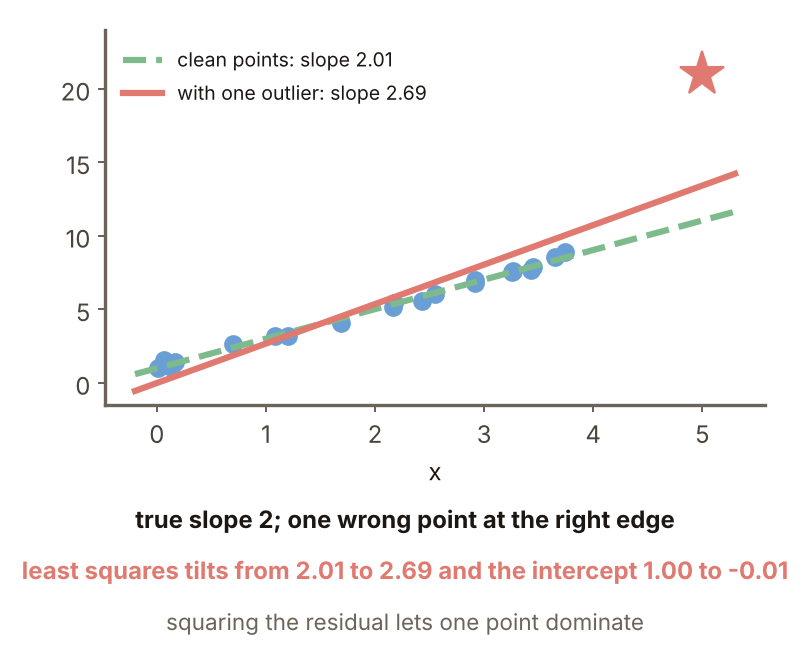

### 2. Robust losses

A **robust loss** is lenient on large errors so that a few bad points no longer dominate. The **ε-insensitive loss** is $\max(0,|e|-\epsilon)$; errors within $\epsilon$ cost nothing. The **Huber loss**:

$$
\mathcal L=\begin{cases}\tfrac12e^2 & |e|\le c\\ c|e|-\tfrac{c^2}{2} & |e|>c\end{cases}
$$

The outlier's influence drops from quadratic to linear. Values: $e=3$: squared 4.5, Huber ($c=1$) 2.5, ε-insensitive ($\epsilon=0.5$) 2.5; $e=10$: 50, 9.5, 9.5.

Figure `lec05-kp22-losses`: three losses against the residual.

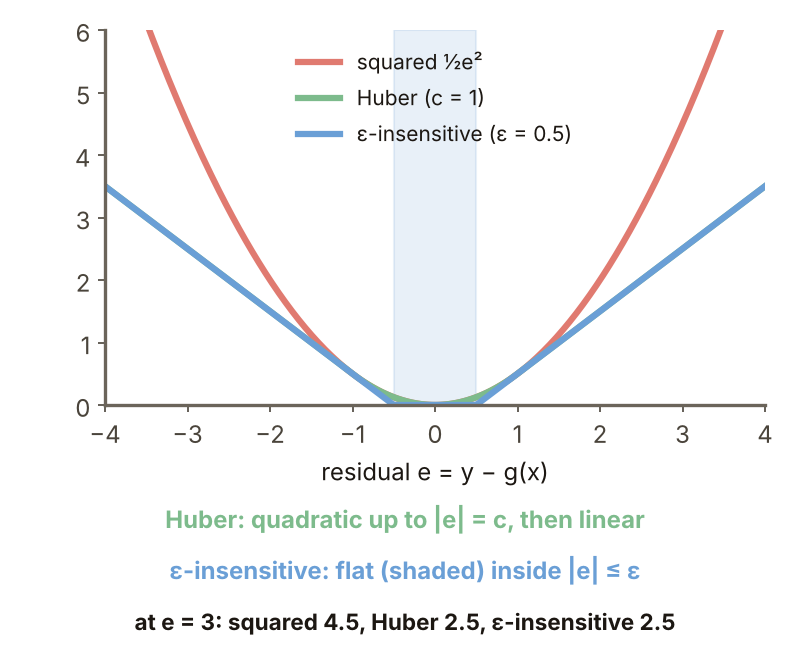

### 3. Huber fit

IRLS (iteratively reweighted least squares): weight 1 when $|e|\le c$ and $c/|e|$ otherwise, repeated until convergence. **Example** (designed here, the same 21 points): Huber ($c=1$) slope 2.099, intercept 0.867; least squares 2.686, $-0.007$; least squares on clean data 2.009, 1.000. Three noise draws: Huber 2.10, 2.14, 2.13; least squares 2.69, 2.95, 2.98. Huber is still slightly off (truth 2) but far less.

Figure `lec05-kp22-hfit`: the two lines on the same 21 points.

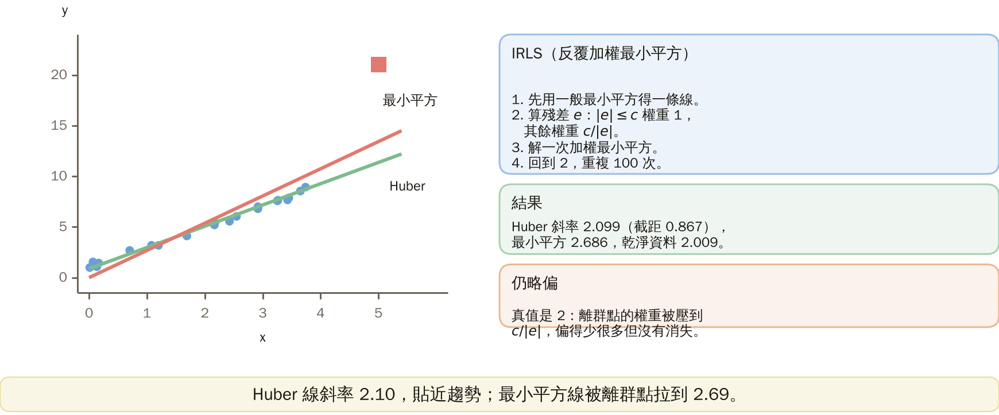

### 4. ε-insensitive regression

**Formal definition** (SVR): minimize $\tfrac12\|w\|^2+C\sum(\xi_i+\xi_i^{\star})$ with $|y_i-\langle w,\phi(x_i)\rangle-w_0|\le\epsilon+$ slack; $g(x)=\sum_i(\lambda_i^{\star}-\lambda_i)K(x,x_i)+w_0$. Read from KKT: error $<\epsilon$ → $\lambda_i=\lambda_i^{\star}=0$; support vectors = points with error $\ge\epsilon$; error $>\epsilon$ → $\lambda=C$. $\epsilon$ is the sparsity knob.

Figure `lec05-kp22-svr`: the objective, the regressor and the KKT readings.

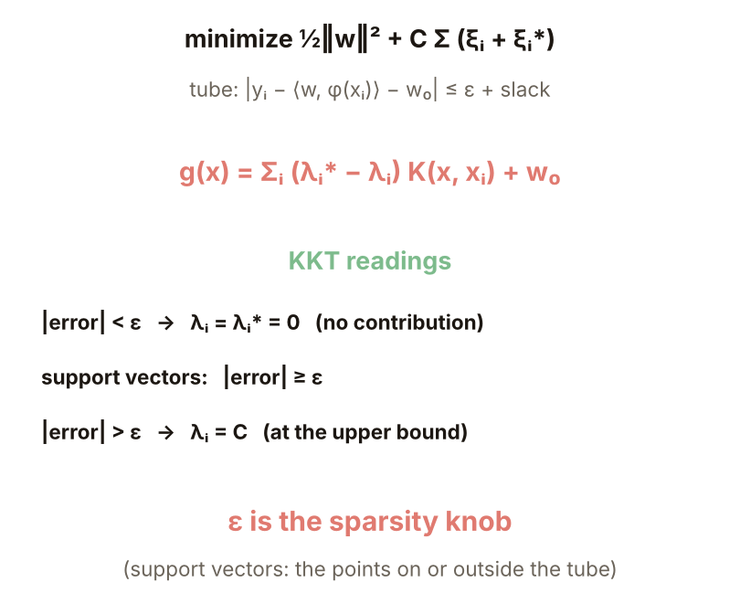

### 5. Turning ε

**Example** (designed here): $y=\sin x+$ noise (sd 0.15), 60 points, Gaussian kernel $\gamma=0.5$, $C=10$. Support vectors: $\epsilon=0.01$: 58; 0.1: 29; 0.2: 9; 0.3: 6; 0.5: 5; 1.0: 2. Mean squared error against the true sin: 0.0008, 0.0020, 0.0038, 0.0175, 0.0551, 0.3455. A larger $\epsilon$ gives a sparser but coarser fit.

Figure `lec05-kp22-eps`: support vectors against $\epsilon$.

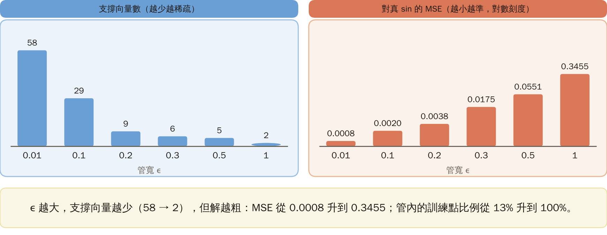

### 6. Ridge regression

**Ridge regression**: least squares with a penalty on the norm, done in the RKHS. Set $\epsilon=0$, $w_0=0$ and use equalities: minimize $\mathcal C\|w\|^2+\sum\xi_i^2$ with $\mathcal C=\tfrac1{2C}$. The closed form is $g(x)=y^T(\mathcal K+\mathcal CI)^{-1}p$; it differs from the kernel least squares of KP21 only by $\mathcal CI$. The price: with $\epsilon=0$ no point is a free zero-error point, so sparsity is lost (the loss became squared and the constraints equalities); there is no free lunch.

Figure `lec05-kp22-ridge`: the objective, the closed form and the two linear-kernel forms.

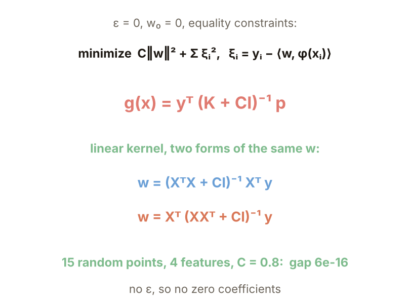

### 7. Collinearity

The two linear-kernel forms: $w=(X^TX+\mathcal CI)^{-1}X^Ty=X^T(XX^T+\mathcal CI)^{-1}y$; with 15 points, 4 features and $\mathcal C=0.8$ the largest gap is $6\times10^{-16}$. **Example** (designed here): two nearly identical columns (differing by $10^{-4}$): $\mathcal C=0$: $w=(-170.0,171.0)$, condition number $5\times10^8$; $\mathcal C=0.1$: $(0.49,0.49)$, condition number 776. Adding a small positive number on the diagonal is a standard numerical stabilizer; the price is coefficients pulled toward 0.

Figure `lec05-kp22-collinear`: coefficients and condition numbers for different $\mathcal C$.

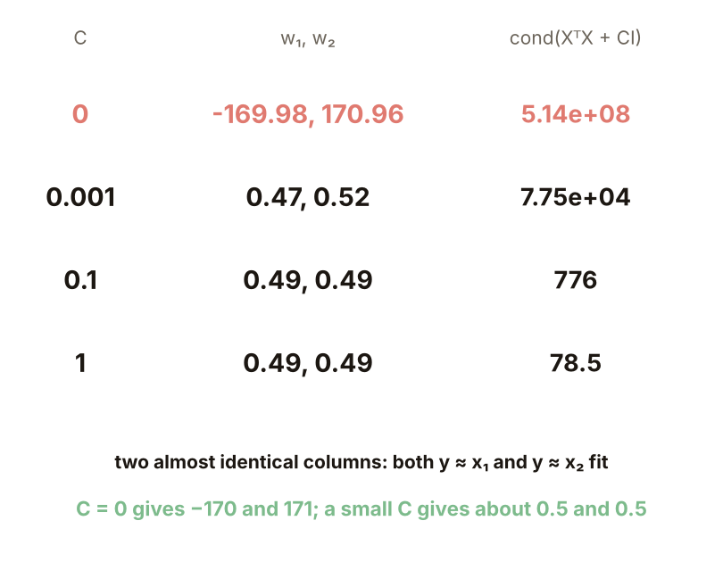

### 8. Four methods compared

On the same 21 points with the outlier, slopes (truth 2): least squares 2.686; Huber ($c=1$) 2.099; ε-insensitive ($\epsilon=0.5$, $C=10$) 2.122; ridge ($\mathcal C=0.1$) 2.679. Nonzero coefficients: ε-insensitive has only 4 support vectors; the other three use all 21. **To remember**: Huber = large errors linear; ε-insensitive = small errors ignored (sparse); ridge = $\epsilon=0$ for a closed form (not sparse). **Common misconception**: ridge regression resists outliers; in fact it resists collinearity and overfitting, not outliers.

Figure `lec05-kp22-compare`: slopes and nonzero coefficients of the four methods.

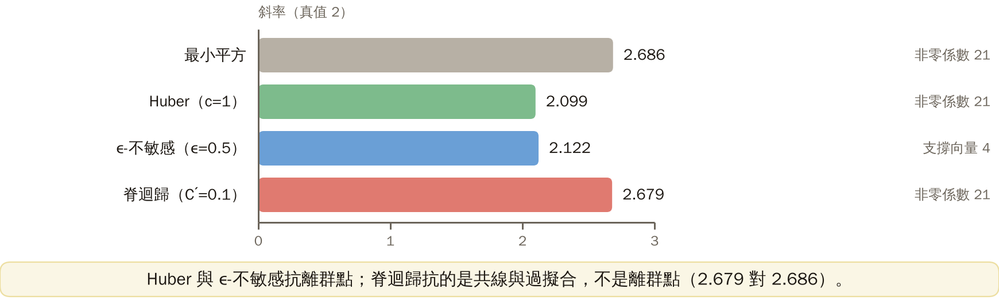

### Extension: the threshold c, practice and worked solution

**The Huber threshold $c$** (the same 21 points): $c=0.2$: 2.045; 0.5: 2.054; 1: 2.099; 2: 2.188; 5: 2.455; 20: 2.686. A large $c$ puts every error in the quadratic zone, which is least squares; a small $c$ nearly ignores the outlier. Choose $c$ to match the noise level (sd 0.3 here).

Figure `lec05-kp22-csweep`: the Huber slope against $c$.

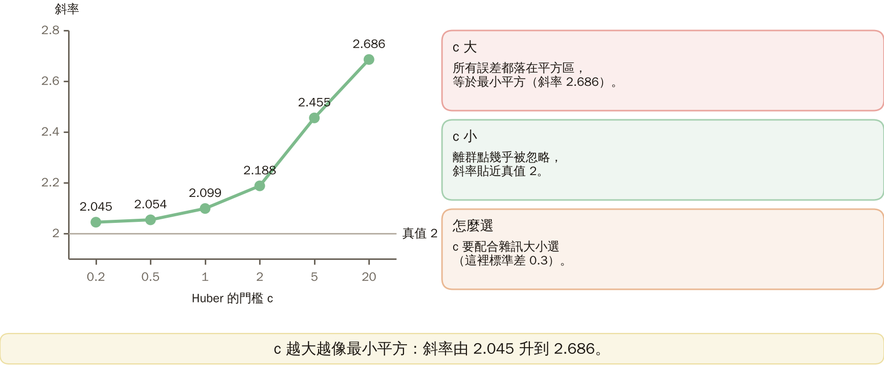

**Practice**: residual $e=y-g(x)$; Huber with $c=1$ and ε-insensitive with $\epsilon=0.5$.

1. What is the Huber loss at $e=0.5$ and at $e=3$?
2. What is the ε-insensitive loss at $e=0.3$ and at $e=2$?

Figure `lec05-kp22-practice`: the setup of the practice.

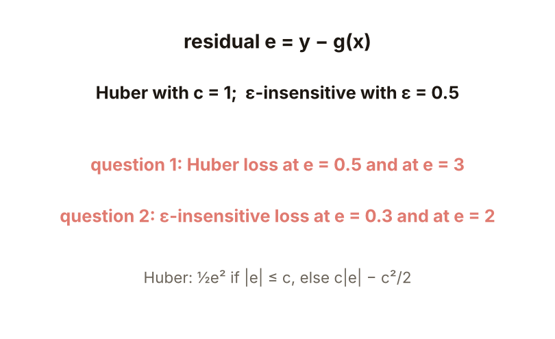

**Worked solution of questions 1 and 2**: (1) $e=0.5\le1$: $\tfrac12\cdot0.25=0.125$; $e=3>1$: $1\cdot3-\tfrac12=2.5$; the squared $\tfrac12e^2$ would give 0.125 and 4.5. (2) $e=0.3$: $\max(0,0.3-0.5)=0$; $e=2$: $\max(0,2-0.5)=1.5$. (3) Check: a small error costs the same under Huber and squared but 0 under ε-insensitive; a large error grows linearly under both robust losses.

Figure `lec05-kp22-practice-sol`: the computation.

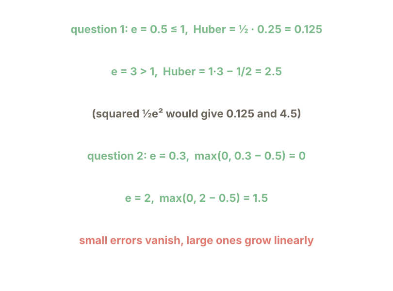

## Terms and source

| 中文 | English |
|---|---|
| 離群點 | Outlier |
| 穩健損失 | Robust loss |
| ε-不敏感損失 | ε-insensitive loss |
| 脊迴歸 | Ridge regression |

Source: Chapter 4, KP22, §4.19.2 (read 2026-10-25). Least squares fearing outliers, the three robust losses, the KKT reading and sparsity of ε-insensitive regression, the closed form and two forms of ridge regression and the 'to remember' line follow the source; the outlier and Huber experiments, the ε sweep, the collinear example, the four-method comparison, the $c$ sweep and the practice were designed and recomputed for this lecture ([added], (program-computed)).
