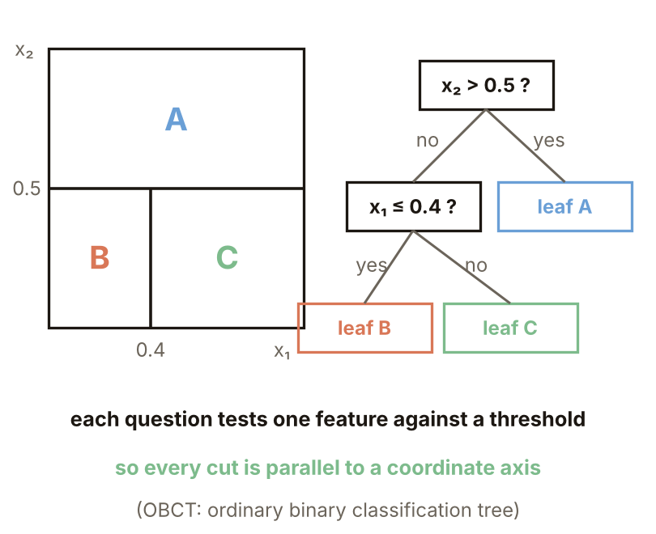
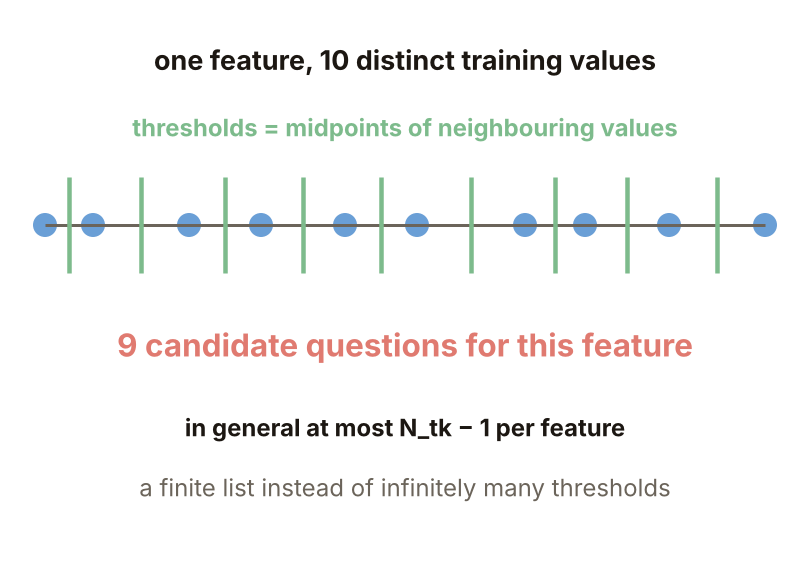
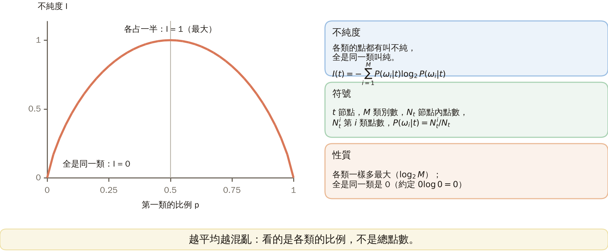
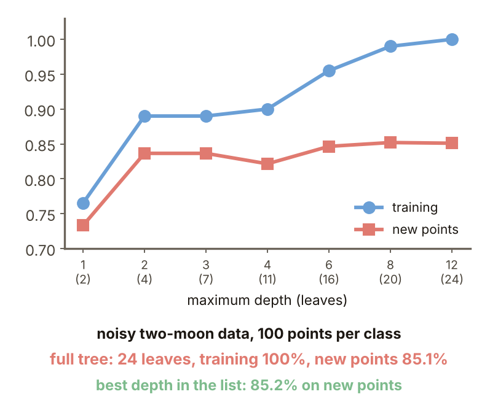
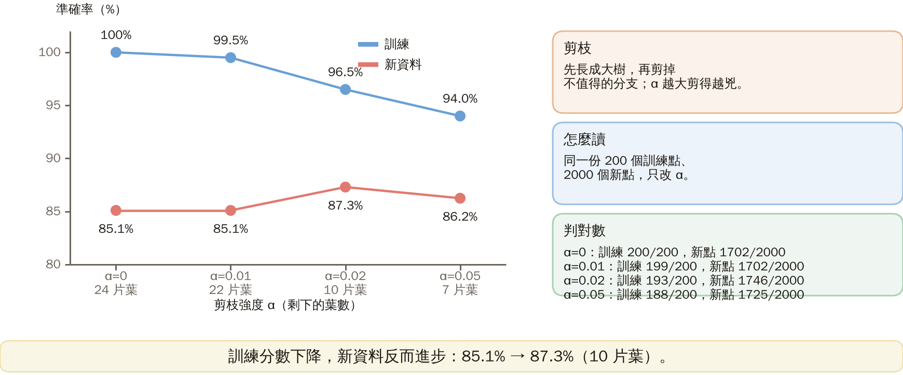
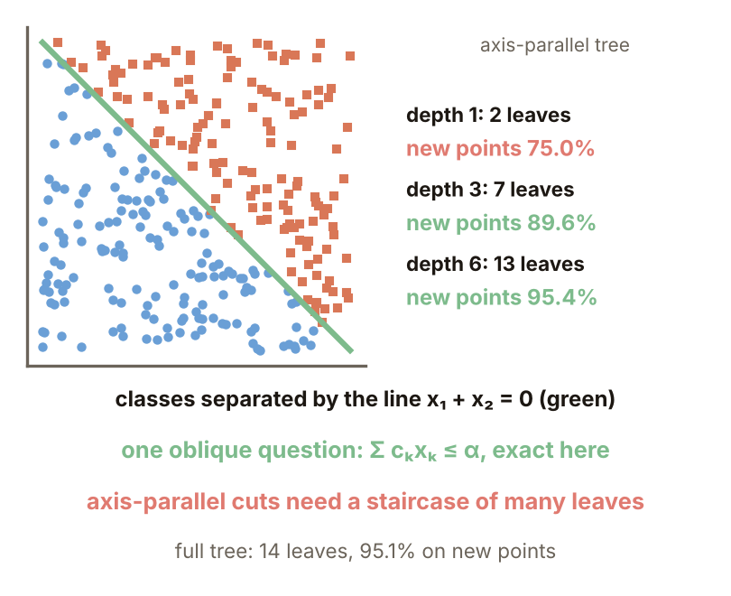

# KP23 Decision Trees: OBCT, Splitting Criteria and Pruning

> Level: undergraduate, year 3
>
> Pattern Recognition | Chapter 4, §4.20

[Slides: read and download](../../slides/lec05-kp23-decision-tree-en.jbd.json) | [中文版](../lec05-kp23-decision-tree.md)

## Learning objectives

- Describe the structure of an OBCT and the four things to decide in training, and compute the impurity and the impurity decrease.
- Explain why the child nodes are weighted, what happens when a tree is too large and how pruning works.
- Explain the high variance of a decision tree and how bagging and random forests reduce it.

## KP23 Decision Trees: OBCT, Splitting Criteria and Pruning

**One-sentence summary**: Instead of drawing one complicated boundary, ask a sequence of simple yes-or-no questions; each question cuts the feature space once. The size of the tree is what matters, a single tree has a large variance, and bagging can average it out.

### Prerequisites and symbols

**A few things you need first**:

- **Probability and proportion**: a node holds $N_t$ training points, of which $N_t^i$ are of class $i$; the proportion of class $i$ is $N_t^i/N_t$.
- **The logarithm $\log_2$**: $\log_2 8=3$ means "how many times 2 must be multiplied to reach 8". For a proportion below 1, $\log_2$ is negative.
- **Majority vote**: a group of classifiers each cast one vote and the class with the most votes wins.
- **Overfitting** (KP10): the model learns even the details of the training set; the training score is high and new data get worse.

**Symbol table** (fixed for this lecture):

| Symbol | Meaning | Note |
|---|---|---|
| $t$ | a node of the tree | $t_Y,t_N$ are the two children answering "yes" and "no" |
| $N_t$ | number of training points in node $t$ | $N_{tY},N_{tN}$ are the sizes of the two children |
| $N_t^i$ | number of points of class $i$ in node $t$ | |
| $M$ | number of classes | |
| $P(\omega_i|t)$ | proportion of class $i$ in the node | estimated by $N_t^i/N_t$ |
| $I(t)$ | impurity of node $t$ | section 3 |
| $\Delta I$ | impurity decrease | section 4 |
| $x_k$ | the $k$-th feature | |
| $\alpha$ | threshold (sections 1, 2), pruning strength (section 7) | two different uses; read it from the section |
| $B$ | number of trees in bagging | section 8 |

### 1. A sequence of yes-or-no questions

**Plain explanation**: Can we classify without drawing a boundary, just by asking a sequence of simple yes-or-no questions?

- **Decision tree**: a sequence of yes-or-no decisions along a path of nodes, ruling out classes step by step until a leaf node is reached (a node with no further question, which decides the final class).

The most popular is the OBCT (ordinary binary classification tree): each node asks about one feature only, "$x_k\le\alpha$?", and yes and no lead to one child each. The space is therefore cut into hyper-rectangles parallel to the coordinate axes (rectangles in 2-D).

**Advantages**:

- Especially useful when there are many classes.
- Often not all features need to be tested.
- Simple structure, easy to interpret.
- Both numerical and categorical features can be handled.

Figure `lec05-kp23-partition`: look at the three regions on the left, whose edges are all parallel to the axes; then at the tree on the right, where every internal node corresponds to one cut on the left. [Function: 1, 3]

The next question: to build a tree, what must be decided first?

### 2. Four things and the candidate questions

**Training must decide four things**:

1. The candidate question set: which questions a node may ask.
2. The splitting criterion: which question is best.
3. The stop-splitting rule: when to stop.
4. The rule assigning a class to a leaf: how a leaf decides its class (usually the majority).

**Where the candidate questions come from**: feature $x_k$ has $N_{tk}$ distinct values in the node; sort them and take the midpoint of each pair of neighbours as a threshold. That gives at most $N_{tk}-1$ questions (the textbook writes $N_{tk}$); over all features the total is finite.

**Example** (designed here): a feature has 10 distinct values 1.0, 1.4, 2.2, 2.8, 3.5, 4.1, 5.0, 5.5, 6.2, 7.0; after sorting, the midpoints of neighbouring values give 9 thresholds, for example $(1.0+1.4)/2=1.2$ and $(1.4+2.2)/2=1.8$.

Figure `lec05-kp23-cands`: look at the 10 values, then at the 9 midpoints between neighbouring values. [Function: 1]

The next question: with so many candidate questions, what standard picks the best one? First we need to measure "how mixed a node is".

### 3. Impurity

**Plain explanation**: if a node contains points of all classes it is called "impure"; if all are of one class it is "pure". Impurity is a number for how mixed the node is.

**Impurity** (formal definition, entropy):

$$
I(t)=-\sum_{i=1}^{M}P(\omega_i|t)\log_2P(\omega_i|t).
$$

**Properties**:

- It is largest when the classes are equal in number ($\log_2M$ for $M$ classes).
- It is 0 when all points are of one class (with the convention $0\log0=0$).
- The probabilities are estimated by $N_t^i/N_t$.

**Worked numbers, step by step**:

- $(4,4,2)$ (three classes with 4, 4, 2 points): proportions $(0.4,0.4,0.2)$; $I=-2\times0.4\log_20.4-0.2\log_20.2=2\times0.529+0.464=1.522$ (the textbook writes 1.521).
- $(1,1,1)$: $I=-3\times\tfrac13\log_2\tfrac13=\log_23=1.585$.
- $(5,0,0)$: $I=-1\cdot\log_21=0$.

Figure `lec05-kp23-entropy`: look at the entropy curve for two classes, highest (1) when they are equal and 0 when all are one class; then at where the three worked numbers fall. [Function: 1, 2]

The next question: with impurity defined, how do we tell which of two questions cuts better?

### 4. The impurity decrease

**How to compare**: after a question the node splits into a Yes child and a No child. See how much the impurity has dropped compared with before the split:

$$
\Delta I=I(t)-\frac{N_{tY}}{N_t}I(t_Y)-\frac{N_{tN}}{N_t}I(t_N).
$$

Choose the question with the largest $\Delta I$.

**Example 4.2** (the textbook example): $t=(4,4,2)$, Yes child $(3,1,0)$, No child $(1,3,2)$.

- $I(t)=1.522$.
- $I(t_Y)=I(3,1)=-\tfrac34\log_2\tfrac34-\tfrac14\log_2\tfrac14=0.811$.
- $I(t_N)=I(1,3,2)=1.459$.
- Child sizes: $N_{tY}=4$, $N_{tN}=6$, weights $0.4$ and $0.6$.
- $\Delta I=1.522-0.4\times0.811-0.6\times1.459=0.322$.

**Where it differs from the textbook**: the textbook writes $I(t_Y)=0.815$, $I(t_N)=1.472$ and $\Delta I=0.315$, which does not match its own counts (even with its printed numbers the result is only 0.312); this lecture recomputed this one split only.

The next question: why must the children in $\Delta I$ be multiplied by their size proportions and not simply averaged?

### 5. Why weight

**Example** (designed here): the parent has 5 of $\omega_1$ and 5 of $\omega_2$, $I=1$.

- Split A: Yes $(1,0)$, No $(4,5)$.
- Split B: Yes $(4,1)$, No $(1,4)$.

**Weighted** (the right way):

- A: $\Delta I=1-\tfrac1{10}\cdot0-\tfrac9{10}\cdot0.991=0.108$.
- B: $\Delta I=1-\tfrac12\cdot0.722-\tfrac12\cdot0.722=0.278$.
- B is chosen.

**Unweighted** (the two children simply averaged):

- A: $1-(0+0.991)/2=0.504$.
- B: $0.278$.
- A would be chosen; one pure point is mistaken for a big improvement.

**Common misconception**: a split is good as soon as a child becomes pure. Making only a very small subset pure has no real value.

The next question: if we keep splitting, how large should the tree grow?

### 6. How big the tree should be

**Experiment setup** (designed here, generated by a program): two noisy half-moons. Each point first gets an angle $t$ (uniform from $0$ to $\pi$); class one lies at $(\cos t,\sin t)$, class two at $(1-\cos t,\ 0.5-\sin t)$, and normal noise with standard deviation $0.35$ is added. Training has 100 points per class, 200 in all (random seed 1); the new data have 1000 per class, 2000 in all (seed 2). The tree is scikit-learn's DecisionTreeClassifier with the entropy criterion and a limited maximum depth. Only this one draw is used.

| Maximum depth | Leaves | Training correct (/200) | New points correct (/2000) | New-point accuracy |
|---:|---:|---:|---:|---:|
| 1 | 2 | 153 | 1466 | 73.3% |
| 2 | 4 | 178 | 1673 | 83.7% |
| 4 | 11 | 180 | 1643 | 82.2% |
| 8 | 20 | 198 | 1704 | 85.2% |
| 12 (no limit) | 24 | 200 | 1702 | 85.1% |

**How to read it**: with more leaves the training correct count rises all the way to 200/200 (100%), while new points stay at about 85%. A tree that is too big is learning the details of the training set.

Figure `lec05-kp23-depth`: look at the training accuracy rising to 100% with depth, then at the new-point accuracy, which stalls around depth 8. [Function: 1, 2]

The next question: since too big is harmful, how do we trim a tree that grew too large?

### 7. Pruning

**Pruning**: grow a large tree first, then cut away the branches that are not worth it. This experiment uses cost-complexity pruning: each cut aims to minimize "the total impurity $+\ \alpha\times$ the number of leaves", and the larger $\alpha$ is, the harder the pruning.

The textbook says that stopping rules such as "stop when the impurity decrease is small enough" often stop too early or too late, hence grow first and prune afterwards.

**Experiment** (the same training and new data as section 6, entropy criterion, only the pruning strength $\alpha$ changes):

| Pruning strength $\alpha$ | Leaves | Training correct (/200) | New points correct (/2000) | New-point accuracy |
|---:|---:|---:|---:|---:|
| 0 | 24 | 200 | 1702 | 85.1% |
| 0.01 | 22 | 199 | 1702 | 85.1% |
| 0.02 | 10 | 193 | 1746 | 87.3% |
| 0.05 | 7 | 188 | 1725 | 86.3% |

**How to read it**: pruned to 10 leaves, the new-point accuracy rises from 85.1% to 87.3%, an improvement of about 2 percentage points; pruning too hard (7 leaves) lowers it a little again. This is the result of one data set and one experiment.

**Which criterion does not matter much**: entropy and Gini, each with 20 different training sets (random seeds 10 to 29, depth 4): new-point accuracy $86.1\pm2.3\%$ and $86.1\pm3.1\%$ (mean ± standard deviation), the same (in line with the source).

Figure `lec05-kp23-prune`: look at the number of leaves falling as $\alpha$ grows, then at the new-point accuracy rising and falling, with its peak at 10 leaves. [Function: 1, 2]

The next question: for the same problem, does the tree look the same with another training set?

### 8. High variance and bagging

**Variance** (designed here): grow an unlimited-depth tree on each of 8 training sets of the same size (seeds 40 to 47, 200 points each). The first cut (the root) always splits the second feature, but with different thresholds: 0.42, 0.11, 0.12, 0.09, 0.22, 0.26, 0.22, 0.29; the number of leaves is 22 to 33. A small difference in the data grows a different tree, which is called high variance.

**Bagging**: draw $B$ sets **with replacement** from the training set (each as large as the original, so some points repeat and some are not drawn), build one tree on each and finally take a majority vote. A **random forest** adds one trick to bagging: at every split only features picked at random are considered (in this experiment only 1 feature at a time).

**Experiment** (20 different training sets, seeds 100 to 119; the new data are the same 2000 points as in section 6; $B=25$ trees):

| Method | New-point accuracy (mean ± standard deviation) |
|---|---:|
| a single tree (no depth limit) | $84.4\pm1.4\%$ |
| bagging (25 trees) | $87.7\pm1.1\%$ |
| random forest (25 trees) | $87.8\pm1.1\%$ |

**Why averaging helps**: a tree is hierarchical, so an error high up passes to all the leaves below; different trees err differently, and in the vote the errors cancel and the variance falls.

**To remember**: decision tree = hierarchical, sequential hard decisions; neural network = parallel soft decisions; the MLP is better in error rate and the decision tree in training time (source).

### Extension: oblique questions, practice and worked solution

**An oblique question** (designed here): 300 training points are spread uniformly over $[-1,1]^2$ (random seed 5) and the class is decided by $x_1+x_2>0$; the new data are 3000 points. One oblique question $x_1+x_2\le0$ is perfectly right, but an axis-parallel tree needs many cuts to approximate the slanted line:

| Maximum depth | Leaves | Training accuracy | New points correct (/3000) | New-point accuracy |
|---|---:|---:|---:|---:|
| 1 | 2 | 75.3% | 2251 | 75.0% |
| 3 | 7 | 93.7% | 2687 | 89.6% |
| 6 | 13 | 99.7% | 2863 | 95.4% |
| no limit (full) | 14 | 100% | 2852 | 95.1% |

13 to 14 leaves are needed to reach about 95%. Oblique questions $\sum c_kx_k\le\alpha$ cut well but training is more complicated (source).

Figure `lec05-kp23-oblique`: look at the slanted line cutting the two classes in one stroke, then at the axis-parallel tree approximating it with steps, the more leaves the closer. [Function: 1, 3]

**Practice**: node $t$ has 4 of $\omega_1$ and 4 of $\omega_2$; split A: Yes $(3,1)$, No $(1,3)$; split B: Yes $(2,2)$, No $(2,2)$; given $I(3,1)=0.811$.

1. What is $\Delta I$ of split A?
2. What is $\Delta I$ of split B? Which split is better?

**Worked solution of questions 1 and 2**: (1) $I(t)=1$; both children of A have $I=0.811$; $\Delta I=1-\tfrac48\cdot0.811-\tfrac48\cdot0.811=0.189$. (2) Both children of B are $(2,2)$ with $I=1$; $\Delta I=1-0.5-0.5=0$. (3) Check: A is better; B lowers the impurity not at all; a split into $(4,0)$ and $(0,4)$ would give $\Delta I=1$.

## Terms and source

| 中文 | English |
|---|---|
| 決策樹 | Decision tree |
| OBCT（普通二元分類樹） | Ordinary binary classification tree |
| 葉節點 | Leaf node |
| 不純度（熵） | Impurity (entropy) |
| 不純度下降量 | Impurity decrease |
| 剪枝 | Pruning |
| 代價加複雜度剪枝 | Cost-complexity pruning |
| 高變異 | High variance |
| Bagging（自助聚合） | Bagging |
| 隨機森林 | Random forest |
| 過擬合 | Overfitting |

Source: Chapter 4, KP23, §4.20 (read 2026-10-25). The OBCT, the four design elements, the candidate questions, the entropy impurity and the impurity decrease, stopping and class assignment, pruning, high variance, bagging and random forests, oblique questions and the comparison with neural networks follow the source; the candidate-question example, the weighting contrast, the depth and pruning experiments, the variance and bagging experiments, the oblique experiment and the practice were designed and recomputed for this lecture ([added], (program-computed); scikit-learn, with data generators, seeds and sizes given in each section). The numbers of textbook Example 4.2 differ when recomputed from its own counts, as marked in the text.
