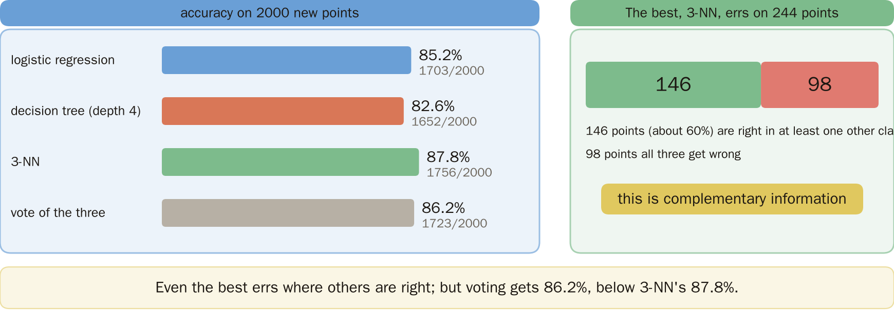
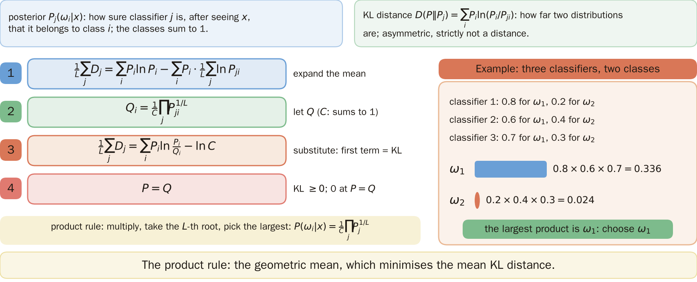
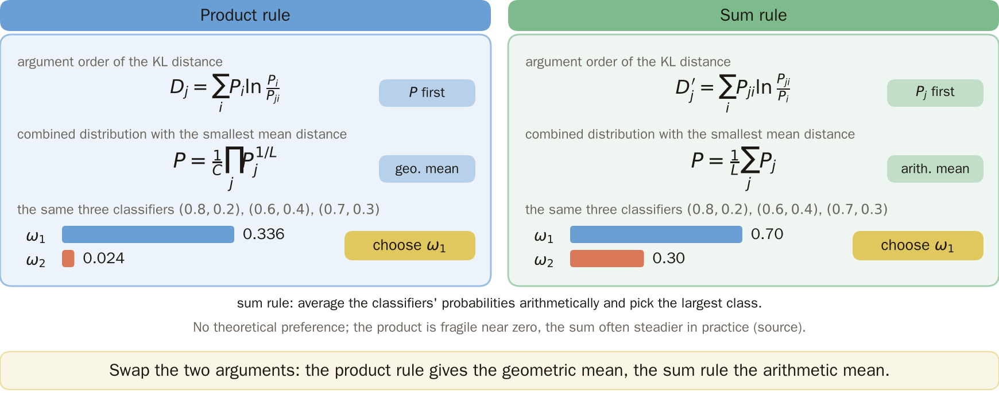
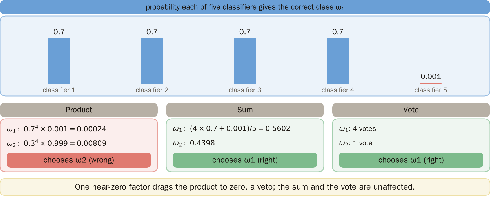
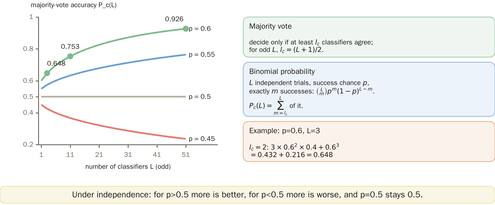
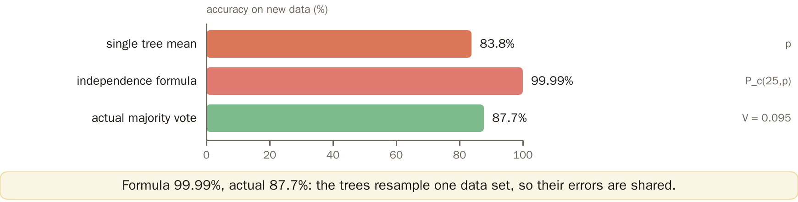
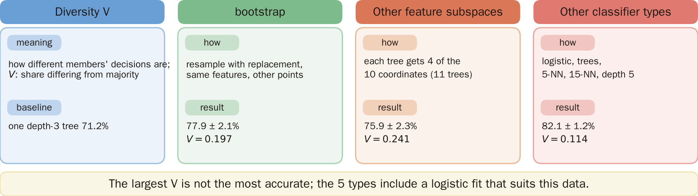
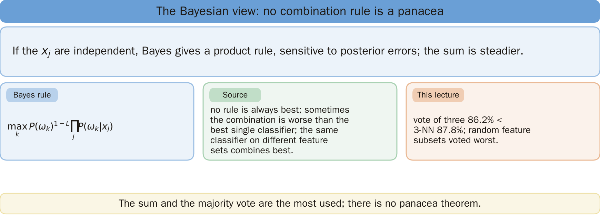
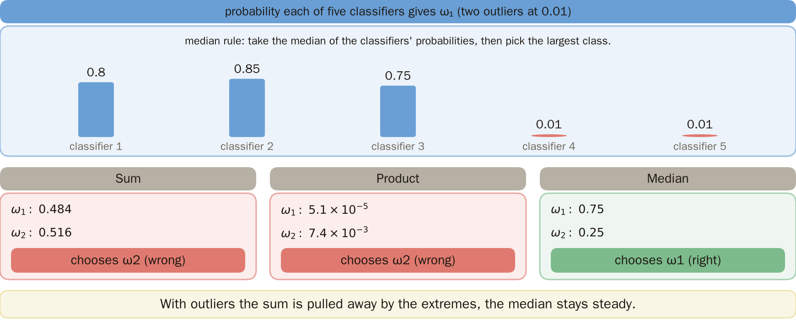
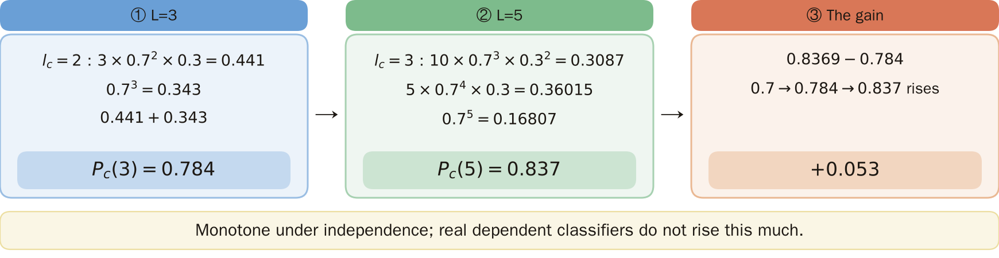

# KP24 Combining Classifiers: Product, Sum, Majority Vote and the Bayesian View

> Level: undergraduate, year 3
>
> Pattern Recognition | Chapter 4, §4.21

[Slides: read and download](../../slides/lec05-kp24-combining-en.jbd.json) | [中文版](../lec05-kp24-combining.md)

## Learning objectives

- Explain the value of combining classifiers (complementary information) and write the product rule and the sum rule with their KL derivations.
- Explain the majority-vote formula and why the independence assumption is an illusion, and name the three routes to diversity.
- Explain the veto of the product rule and the Bayesian view, and know that no rule is always best.

## KP24 Combining Classifiers: Product, Sum, Majority Vote and the Bayesian View

**One-sentence summary**: Even the best classifier errs on samples that others get right; complementary information is the whole value of combining classifiers. But combining does not guarantee improvement and there is no panacea.

### Prerequisites and symbols

**A few things you need first**:

- **Posterior probability**: after seeing $x$, the classifier's confidence that it belongs to class $i$, written $P(\omega_i|x)$; the classes add up to 1.
- **Logarithms and the KL distance between probabilities**: how far apart two probability distributions are (defined in section 2).
- **Binomial probability**: in $L$ independent trials, each with success probability $p$, the probability of exactly $m$ successes is $\binom Lm p^m(1-p)^{L-m}$; $\binom Lm$ is the number of ways to pick $m$ out of $L$.
- **Bias and variance** (KP23): a single tree grows differently with another data set, which is called high variance; averaging lowers it.

**Symbol table** (fixed for this lecture):

| Symbol | Meaning | Note |
|---|---|---|
| $L$ | number of classifiers | |
| $j$ | the $j$-th classifier | $j=1,\dots,L$ |
| $P_j(\omega_i|x)$ | posterior of class $i$ given by classifier $j$ | |
| $P(\omega_i|x)$ | the combined posterior | to be found |
| $M$ | number of classes | |
| $C$ | normalizing constant | makes the probabilities add up to 1 |
| $D_j$ | KL distance between classifier $j$ and the combined result | section 2 |
| $p$ | probability that each classifier is right | section 5, assumed equal |
| $l_c$ | the least number of votes a majority needs | $l_c=(L+1)/2$ for odd $L$ |
| $P_c(L)$ | accuracy of the majority of $L$ independent classifiers | section 5 |
| $V$ | diversity | the share of member decisions that differ from the majority |

### 1. Complementary information

**Plain explanation**: What do we gain by putting classifiers together?

**Experiment setup** (designed here, generated by a program): the half-moon data of KP23 (two half-moons plus normal noise with standard deviation $0.35$); training has 100 points per class (random seed 1) and the new data 1000 per class, 2000 in all (seed 2). Three classifiers (scikit-learn): logistic regression, a decision tree of maximum depth 4 and 3-NN (the vote of the 3 nearest neighbours). Only this one draw is used.

| Classifier | New points correct (/2000) | New-point accuracy |
|---|---:|---:|
| logistic regression | 1703 | 85.2% |
| decision tree (depth 4) | 1652 | 82.6% |
| 3-NN | 1756 | 87.8% |
| majority vote of the three | 1723 | 86.2% |

**How to read it**: the best, 3-NN, errs on 12.2% (244 points); in 60% of these errors (146 points) at least one other classifier is right, and that is the complementary information. But the vote of the three scores only 86.2%, still below the 87.8% of 3-NN; complementary information has value only if it can be dug out.

Figure `lec05-kp24-comp`: First the four bars on the left (accuracy on new points), then the 244 points the best, 3-NN, gets wrong on the right: 146 are right in at least one other classifier, 98 are wrong in all three. Complementary information is worth something only if it can be extracted. [Function: 1, 2]

The next question: several classifiers each give a set of probabilities; how do we merge them into one?

### 2. The product rule

**KL distance**: $D(P\,\|\,P_j)=\sum_iP(\omega_i)\ln\dfrac{P(\omega_i)}{P_j(\omega_i)}$, how far apart two probability distributions are; it is asymmetric and strictly not a distance.

**Idea**: find a combined distribution $P$ with the smallest average distance to the $L$ classifiers:

$$
\min_P\ \frac1L\sum_{j=1}^LD_j,\qquad D_j=\sum_iP_i\ln\frac{P_i}{P_{ji}} .
$$

**Derivation, step by step**:

1. Expand the average: $\frac1L\sum_jD_j=\sum_iP_i\ln P_i-\sum_iP_i\cdot\frac1L\sum_j\ln P_{ji}$.
2. Let $Q_i=\frac1C\prod_jP_{ji}^{1/L}$, with $C$ the constant that makes $Q$ add up to 1; then $\frac1L\sum_j\ln P_{ji}=\ln Q_i+\ln C$.
3. Substitute back: $\frac1L\sum_jD_j=\sum_iP_i\ln\dfrac{P_i}{Q_i}-\ln C$.
4. The first term is the KL distance between $P$ and $Q$, always $\ge0$ and 0 only when $P=Q$; the second term does not depend on $P$. So the minimum is at $P=Q$.

**The product rule** (formal definition):

$$
P(\omega_i|x)=\frac1C\prod_{j=1}^{L}P_j(\omega_i|x)^{1/L},
$$

and the class with the largest product is chosen.

**Example**: two classes and three classifiers $(0.8,0.2)$, $(0.6,0.4)$, $(0.7,0.3)$: the product for $\omega_1$ is $0.8\times0.6\times0.7=0.336$ and for $\omega_2$ it is $0.2\times0.4\times0.3=0.024$, so $\omega_1$.

Figure `lec05-kp24-prod`: First the two definition cards (posterior probability, KL distance), then the four derivation steps from top to bottom, finally the example on the right: product 0.336 against 0.024, so choose ω1. [Function: 2]

The next question: what do we get if the two arguments of the KL distance are swapped?

### 3. The sum rule

**Sum rule**: swap the two arguments of $D_j$ (put $P_j$ first): $D_j'=\sum_iP_{ji}\ln\frac{P_{ji}}{P_i}$.

**Derivation**: after averaging, only one term depends on $P$: $-\sum_i\bar P_i\ln P_i$, where $\bar P_i=\frac1L\sum_jP_{ji}$ is the arithmetic mean of the $L$ classifiers. This term is smallest at $P=\bar P$ (a standard property of probability distributions). So the best solution is

$$
P(\omega_i|x)=\frac1L\sum_{j=1}^LP_j(\omega_i|x),
$$

the arithmetic mean.

**The same three classifiers**: the mean for $\omega_1$ is $(0.8+0.6+0.7)/3=0.70$ and for $\omega_2$ it is $0.30$, again $\omega_1$.

**Comparing the two rules**: both have a rigorous information-theoretic origin and there is no theoretical ground to prefer one. The product derivation is clean but fragile when an output is near zero; in practice the sum is often more stable (source [Mill 99]).

Figure `lec05-kp24-sum`: Compare side by side: the argument order of the KL distance differs, giving the geometric and the arithmetic mean; the same three classifiers choose ω1 in both. [Function: 2]

The next question: when do the two rules differ? What if one extreme classifier appears?

### 4. One veto

**Example** (designed here): five classifiers give the correct class $\omega_1$ the values 0.7, 0.7, 0.7, 0.7, 0.001 (the rest to $\omega_2$).

| Rule | $\omega_1$ | $\omega_2$ | Choice |
|---|---:|---:|---|
| product | $0.7^4\times0.001=0.00024$ | $0.3^4\times0.999=0.00809$ | $\omega_2$ (wrong) |
| sum | $(4\times0.7+0.001)/5=0.5602$ | $0.4398$ | $\omega_1$ (right) |
| vote | 4 votes | 1 vote | $\omega_1$ (right) |

**How to read it**: the product is pulled to zero by one factor near zero, which amounts to a veto.

Figure `lec05-kp24-veto`: First the outputs of the five classifiers, the fifth almost 0; then the results of the three rules: only the product chooses wrongly. [Function: 1, 2]

The next question: voting is the simplest. How much can voting among several classifiers raise the accuracy?

### 5. Majority vote

**Majority vote**: decide only when at least $l_c$ classifiers agree ($l_c=\tfrac{L+1}2$ for odd $L$); otherwise reject.

**Formula**: assume the decisions of the classifiers are **independent** with the same accuracy $p$; then the probability that the majority is right is "at least $l_c$ are right":

$$
P_c(L)=\sum_{m=l_c}^{L}\binom Lm p^m(1-p)^{L-m}.
$$

**Example, step by step**: $p=0.6$, $L=3$: $l_c=2$, $P_c(3)=\binom32\cdot0.6^2\cdot0.4+0.6^3=0.432+0.216=0.648$.

**Results**:

| $p$ | $L=1$ | $L=3$ | $L=11$ | $L=51$ |
|---:|---:|---:|---:|---:|
| 0.6 | 0.6 | 0.648 | 0.753 | 0.926 |
| 0.55 | 0.55 | 0.575 | 0.633 | 0.764 |
| 0.5 | 0.5 | 0.5 | 0.5 | 0.5 |
| 0.45 | 0.45 | 0.425 | 0.367 | 0.236 |

**How to read it**: for $p>0.5$ a larger $L$ is better; for $p<0.5$ a larger $L$ is worse; $p=0.5$ stays at 0.5.

Figure `lec05-kp24-vote`: First the p=0.6 curve rising with L, then the p=0.45 curve falling, with the horizontal line p=0.5 between them; the right side gives the majority vote, the binomial probability and the example p=0.6, L=3. [Function: 2]

The next question: the formula is pretty, but does its premise, "independent", hold for real classifiers?

### 6. The illusion of independence

**Experiment setup** (designed here, generated by a program): the half-moon data of KP23, 20 training sets (seeds 100 to 119, 100 points per class), 25 bagged trees for each (entropy criterion, no depth limit); the new data are the same 2000 points as in section 1.

| Quantity | Value |
|---|---:|
| mean accuracy of a single tree $p$ | 83.8% |
| independent formula $P_c(25,p)$ | 99.99% |
| actual majority-vote accuracy | 87.7% |
| share of members differing from the majority $V$ | 0.095 |

**How to read it**: the independent formula predicts 99.99% and the actual value is only 87.7%. These trees were trained on resamples of the same data, so their errors are highly shared.

**Common misconception**: as long as every classifier is better than a coin, voting approaches 100%. It depends on independence, which does not hold in practice, and the larger $L$ is, the less realistic it is (source).

Figure `lec05-kp24-indep`: Three bars from top to bottom: the single-tree mean 83.8%, the independence formula's prediction 99.99% and the actual majority vote 87.7% (V=0.095). Prediction and actual differ a lot. [Function: 2]

The next question: since independence cannot be counted on, how do we make the members differ from each other?

### 7. Making diversity

**Diversity**: how much the member decisions differ from each other; one measure is $V$, the share of member decisions that differ from the majority.

**Three routes** (source):

1. The same feature space, different data points (bootstrap, most effective for unstable trees).
2. Different classifier types.
3. Different feature subspaces.

**Experiment setup** (designed here, generated by a program): 10-D data. The class $y\in\{0,1\}$ of each point is random; each coordinate of $x$ is standard normal, and coordinates 1, 3, 5, 7, 9 additionally get $+0.9y$ (the other 5 are noise). Training has 150 points (seeds 200 to 214, 15 runs); the new data are a fixed 2000 points (seed 999).

- Bootstrap trees: 11 trees of depth 3, each trained on 150 points drawn with replacement.
- Random feature subsets: 11 trees of depth 3, each on 4 coordinates picked at random out of 10.
- 5 classifier types: logistic, a tree of depth 3, 5-NN, 15-NN and a tree of depth 5.

| Method | Vote accuracy (mean ± standard deviation) | $V$ |
|---|---:|---:|
| a single tree (depth 3) | 71.2% | — |
| 11 bootstrap trees | $77.9\pm2.1\%$ | 0.197 |
| 11 random-subset trees | $75.9\pm2.3\%$ | 0.241 |
| 5 classifier types | $82.1\pm1.2\%$ | 0.114 |

**How to read it**: the one with the largest $V$ is not the most accurate. The 5 types include logistic, which happens to suit this data, so one cannot conclude that different classifier types are always better.

Figure `lec05-kp24-div`: Compare column by column: the definition of diversity V and the single tree, then the accuracy and V of the three routes, bootstrap, other feature subspaces and other classifier types. The largest V is not the most accurate. [Function: 2]

### 8. The Bayesian view and what to remember

**The Bayesian view**: assume the $x_j$ seen by the classifiers are independent; the Bayes rule gives

$$
\max_kP(\omega_k)^{1-L}\prod_jP(\omega_k|x_j).
$$

This is again the product rule, but very sensitive to errors in the posterior estimates; the sum is more error-tolerant and in practice often beats the product (source [Kitt 98]).

**The source's handwritten-digit experiment**: no rule is always best; in some cases the combination is worse than the best single classifier; combining the same classifier on different feature sets works best. In this lecture the random feature subsets of section 7 came out worst, and in section 1 also the vote of 86.2% is below the 87.8% of 3-NN.

**To remember**: the sum and the majority vote are the most used; there is no panacea theorem.

Figure `lec05-kp24-bayes`: From top to bottom: the Bayesian view gives the product rule; the three cards are the Bayes rule, the source's handwritten-digit experiment and what this lecture saw. There is no panacea. [Function: 2]

### Extension: the median, practice and worked solution

**The median** (designed here): five classifiers give $\omega_1$ the values 0.80, 0.85, 0.75, 0.01, 0.01 (the rest to $\omega_2$).

| Rule | $\omega_1$ | $\omega_2$ | Choice |
|---|---:|---:|---|
| sum | 0.484 | 0.516 | $\omega_2$ (wrong) |
| product | $5.1\times10^{-5}$ | $7.4\times10^{-3}$ | $\omega_2$ (wrong) |
| median | 0.75 | 0.25 | $\omega_1$ (right) |

When outlying outputs appear, the sum is pulled away by the extreme values and the median is more robust; the source also mentions max, min and median, the reason being the chain of inequalities: product ≤ min ≤ mean ≤ max.

Figure `lec05-kp24-median`: First the five outputs above (two outliers of 0.01), then the three rules: the sum and the product choose wrongly, the median chooses right. [Function: 2]

**Practice**: each classifier is right with probability $p=0.7$, decisions are independent, and the vote is a majority of an odd number $L$.

1. What is the accuracy $P_c(3)$ for $L=3$?
2. What is the accuracy $P_c(5)$ for $L=5$? How much more than $L=3$?

**Worked solution of questions 1 and 2**: (1) $l_c=2$: $3\cdot0.7^2\cdot0.3+0.7^3=0.441+0.343=0.784$. (2) $l_c=3$: $10\cdot0.7^3\cdot0.3^2+5\cdot0.7^4\cdot0.3+0.7^5=0.3087+0.36015+0.16807=0.837$, which is 0.053 more than $L=3$. (3) Check: $0.7\to0.784\to0.837$ rises monotonically (under independence); real dependent classifiers do not rise that much.

Figure `lec05-kp24-practice-sol`: Follow the three boxes from left to right: L=3 gives 0.784, L=5 gives 0.837, 0.053 more. [Function: 2]

## Terms and source

| 中文 | English |
|---|---|
| 後驗機率 | Posterior probability |
| KL 距離 | KL distance |
| 乘積規則 | Product rule |
| 加總規則 | Sum rule |
| 多數投票 | Majority vote |
| 多樣性 | Diversity |
| bootstrap（有放回重抽樣） | Bootstrap |
| 中位數規則 | Median rule |
| 二項機率 | Binomial probability |

Source: Chapter 4, KP24, §4.21 (read 2026-10-25). Complementary information, the KL derivations of the product and sum rules, majority vote and the independence assumption, the three routes to diversity, the $V$ measure, the Bayesian view, the experimental conclusions of [Jain 00] and "no panacea" follow the source; the comparison of three classifiers, the veto example, the independence-illusion experiment, the diversity experiment, the median example and the practice were designed and recomputed for this lecture ([added], (program-computed); scikit-learn, with data generators, seeds and sizes given in each section); the step-by-step expansion of the KL derivation is a supplementary explanation.
