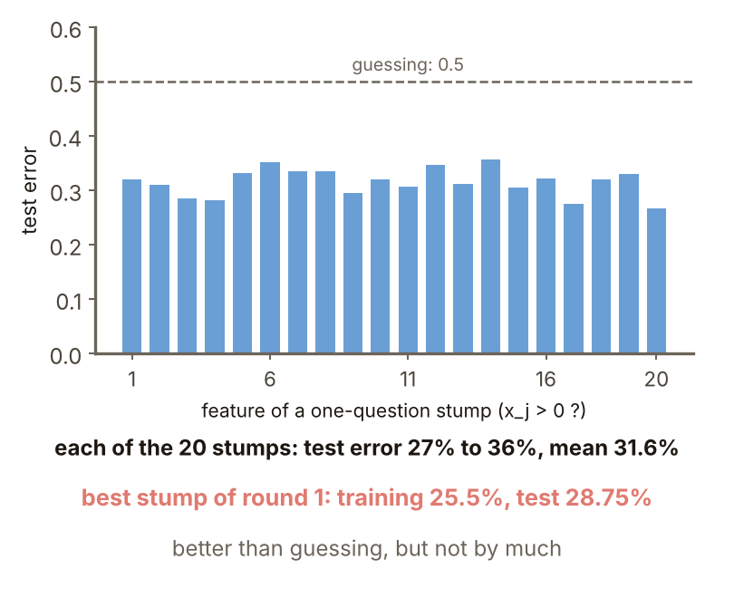
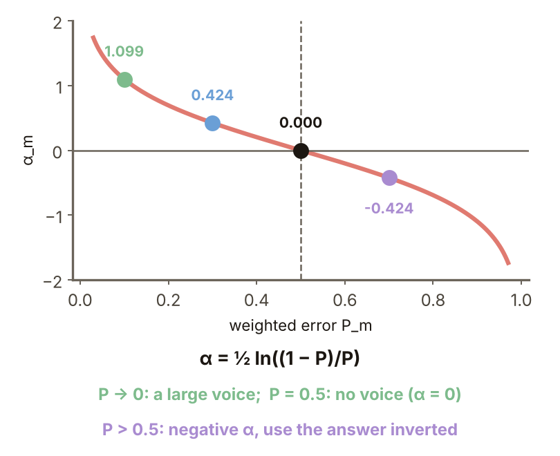
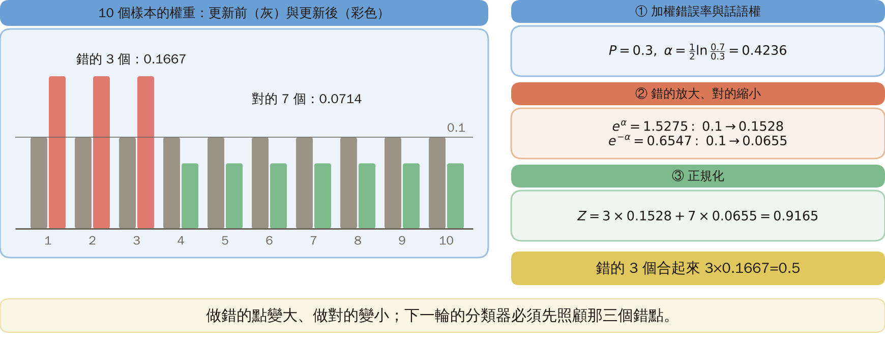
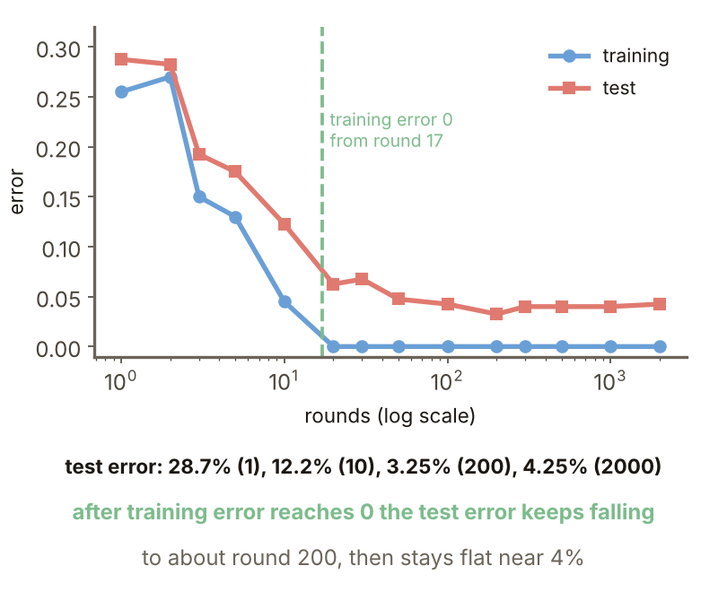
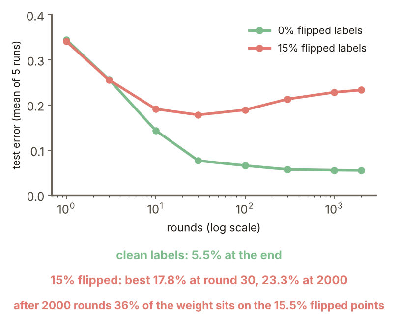

# KP25 Boosting and AdaBoost: Turning "Weak" into "Strong"

> Level: undergraduate, year 3
>
> Pattern Recognition | Chapter 4 §4.22

[Slides: read and download](../../slides/lec05-kp25-adaboost-en.jbd.json) | [中文版](../lec05-kp25-adaboost.md)

## Learning objectives

- Derive the weights of AdaBoost and $\alpha_m=\tfrac12\ln\tfrac{1-P_m}{P_m}$, and compute one round of weight update by hand.
- Explain the margin explanation of why AdaBoost is relatively immune to overfitting, and the limits of that explanation.
- Explain why AdaBoost degrades on hard tasks with noisy labels.

## KP25 Boosting and AdaBoost: Turning "Weak" into "Strong"

**One-sentence summary**: A classifier only slightly better than guessing, retrained again and again on "the samples it got wrong last time" and combined by a weighted vote, can have its training error pushed arbitrarily low; but it is not a cure-all.

### Prerequisites and symbols

**Three things you need first**:

- **Exponential loss** (KP20): $e^{-z}$ with $z=y\,F(x)$; a small penalty when right ($z>0$), a heavy one when wrong ($z<0$).
- **Weighted error rate**: every sample has a weight, and the error rate is the total weight of the misclassified samples (the weights sum to 1).
- **Decision stump** (the smallest version of the tree of KP23): asks one question about one feature.

**Symbol table** (fixed for this lecture):

| Symbol | Meaning | Note |
|---|---|---|
| $y_i$ | label of the $i$-th sample | $y_i\in\{\pm1\}$ |
| $\phi_m(x)$ | output of the $m$-th weak classifier | $\phi_m\in\{\pm1\}$ |
| $w_i$ | weight of the $i$-th sample | recomputed every round, normalized to sum 1 |
| $P_m$ | weighted error rate of round $m$ | $P_m=\sum_iw_i[y_i\phi_m(x_i)<0]$ |
| $\alpha_m$ | the say of the $m$-th classifier | $\alpha_m=\tfrac12\ln\frac{1-P_m}{P_m}$ |
| $F_m(x)$ | weighted sum of the first $m$ | $F_m=F_{m-1}+\alpha_m\phi_m$ |
| $Z_m$ | normalizing constant | makes the updated weights sum to 1 |
| $N$ | number of training points | |

### 1. Weak to strong

**Plain-words explanation**: Can a weak classifier be boosted into a strong one?

- **Weak classifier**: a classifier whose error rate is only slightly better than guessing (0.5).
- **Decision stump**: a tree that asks one question about one feature, for example "is $x_j>0$?".

**Experiment setting** (designed for this lecture, reproducible):

- Data: two Gaussian classes in 20 dimensions. Each component is standard normal plus the class mean $\mp a$ ($a=2/\sqrt{20}$, half the points in each class). 200 training points (seed 1) and 400 test points (seed 2).
- Weak classifiers: the 20 stumps "is $x_j>0$?", $j=1,\dots,20$.

**Result**: the 20 stumps have test errors from 27% to 36%, mean 31.6%.

**Mechanism**: every round changes the distribution of sample weights, giving more weight to the hardest (misclassified) points, and the final answer is a weighted vote.

Figure `lec05-kp25-weak`: First look at the 20 bars, each the test error of one stump; then compare with the dashed line at 0.5 (guessing): every bar is below it, but all between 27% and 36%, only a little better than guessing. [Function: 1, 3]

### 2. Where the weights come from

**Stage-wise optimization**: each time optimize only the newly added classifier and freeze the earlier ones: $F_m=F_{m-1}+\alpha_m\phi_m$.

Unfold the exponential loss (KP20) $\sum_i\exp(-y_iF(x_i))$ stage by stage:

1. $\exp(-y_iF_m(x_i))=\exp(-y_iF_{m-1}(x_i))\cdot\exp(-y_i\alpha\phi(x_i))$.
2. Let $w_i=\exp(-y_iF_{m-1}(x_i))$; then

$$
J=\sum_iw_i\exp\big(-y_i\alpha\phi(x_i)\big).
$$

3. $w_i$ contains neither $\alpha$ nor $\phi$: it is the sample weight.
4. So $\phi_m$ must minimize the weighted error rate $P_m$ (weights normalized to sum 1).

### 3. The say α

**Derivation**: split $J$ into "right" and "wrong".

1. The weights of the right ones sum to $1-P_m$, each multiplied by $e^{-\alpha}$; those of the wrong ones sum to $P_m$, each multiplied by $e^{\alpha}$.
2. $J(\alpha)=e^{-\alpha}(1-P_m)+e^{\alpha}P_m$.
3. Setting the derivative to zero: $-e^{-\alpha}(1-P_m)+e^{\alpha}P_m=0$, so

$$
\alpha_m=\tfrac12\ln\frac{1-P_m}{P_m}.
$$

**Numbers**:

| $P$ | 0.1 | 0.3 | 0.5 | 0.7 |
|---|---:|---:|---:|---:|
| $\alpha$ | 1.099 | 0.424 | 0 | $-0.424$ |

Very accurate → a big say; guessing → 0; worse than guessing ($P>0.5$) → negative, use the answer inverted.

Figure `lec05-kp25-alpha`: First see that the horizontal axis is the weighted error $P$ and the vertical axis $\alpha$; then that the curve passes through $(0.5,0)$, rises on the left (small $P$) and drops to negative on the right ($P>0.5$); four points are marked: 1.099, 0.424, 0, $-0.424$. [Function: 2]

### 4. The weight update

$w_i\leftarrow w_i\exp(-y_i\alpha_m\phi_m(x_i))/Z_m$; a wrong answer ($y\phi<0$) grows, a right one shrinks.

**By hand** (designed for this lecture): 10 points of weight 0.1 each, $\phi$ wrong on 3.

1. $P=0.3$, $\alpha=\tfrac12\ln(0.7/0.3)=0.4236$.
2. The wrong ones are multiplied by $e^{\alpha}=1.5275$: $0.1\to0.1528$; the right ones by $e^{-\alpha}=0.6547$: $0.1\to0.0655$.
3. $Z=3\times0.1528+7\times0.0655=0.9165$.
4. After normalizing: each wrong one $0.1528/0.9165=0.1667$, each right one $0.0655/0.9165=0.0714$.
5. The three wrong ones together hold $3\times0.1667=0.5$: the next round's $\phi$ must look after them first.

Figure `lec05-kp25-update`: First look at the two bars per sample: dark grey before the update (all 0.1), coloured after; then at the first 3 (red, now 0.1667) and the other 7 (green, now 0.0714). [Function: 2]

### 5. The algorithm and the setting

**AdaBoost**:

1. Start with $w_i=1/N$.
2. Repeat: find the $\phi_m$ that minimizes $P_m$; compute $\alpha_m=\tfrac12\ln\frac{1-P_m}{P_m}$; update the weights $w_i\leftarrow w_i\exp(-y_i\alpha_m\phi_m(x_i))/Z_m$.
3. Until a stopping rule is met; finally $f(x)=\operatorname{sign}\sum_k\alpha_k\phi_k(x)$.

**Setting** (this lecture redoes the source's Example 4.3, reproducible):

- Data: the same 20-dimensional two-class Gaussians as section 1, 200 training points (seed 1) and 400 test points (seed 2).
- Weak classifier: every round picks the stump with the smallest weighted error among the 20 features and all thresholds; 2000 rounds.

**Result**: round 1 has training error 25.5% and test error 28.75%, better than any single fixed stump (mean 31.6%).

### 6. The error curves

| rounds | 1 | 10 | 50 | 200 | 500 | 2000 |
|---|---:|---:|---:|---:|---:|---:|
| training error | 25.5% | 4.5% | 0% | 0% | 0% | 0% |
| test error | 28.75% | 12.25% | 4.75% | 3.25% | 4.0% | 4.25% |

- The training error is 0 from round 17 on.
- After the training error reaches zero the test error keeps falling, and after about 200 rounds it stays flat near 4%; within sampling error it does not rise (400 test points, 1% is only 4 points).

Figure `lec05-kp25-curve`: First see that the horizontal axis is the number of rounds (log scale) with two lines: blue the training error, red the test error; then look at the green dashed line (round 17): the blue line reaches 0 there, and the red line keeps falling slowly afterwards to about 4%. [Function: 3]

### 7. The margin explanation

- **Normalized margin**: $\operatorname{margin}=yF(x)/\sum_k\alpha_k\in[-1,1]$; only a positive one is right, and the larger, the more confident.

Bound (Schapire et al.): generalization error $\lesssim\operatorname{prob}\{\operatorname{margin}<\gamma\}+O(\sqrt{V_c/(N\gamma^2)})$, independent of the number of rounds $K$, which is the source of the immunity.

**Experiment** (designed for this lecture, the data and model of section 5):

| rounds | 1 | 10 | 50 | 100 | 200 | 2000 |
|---|---:|---:|---:|---:|---:|---:|
| smallest margin | $-1.000$ | $-0.205$ | $+0.148$ | $+0.179$ | $+0.203$ | $+0.220$ |
| fraction with margin $<0.1$ | 25.5% | 8.5% | 0% | 0% | 0% | 0% |
| test error | 28.75% | 12.25% | 4.75% | 4.25% | 3.25% | 4.25% |

With more rounds the smallest margin is raised again and again: this is the qualitative explanation of why the test error does not rise after the training error reaches zero.

**Criticism**: the bound is very loose (unless $N$ reaches tens of thousands), so it is only a qualitative explanation; stage-wise optimization is itself an implicit regularization.

### 8. Not a cure-all

**Experiment setting** (designed for this lecture, reproducible): the same kind of data, with the training labels flipped at random for 15% (the test labels are clean); 0% and 15% flips are each run 5 times, each time re-sampled (training seeds 10 to 14, test seeds 50 to 54) and averaged (so the numbers differ from the single experiments above); each round uses the best stump, 2000 rounds.

| rounds | 10 | 30 | 100 | 500 | 2000 |
|---|---:|---:|---:|---:|---:|
| clean labels, test error | 14.4% | — | 6.6% | 5.7% | 5.5% |
| 15% flipped, test error | 19.1% | 17.8% | 18.9% | 21.7% | 23.3% |

With 15% flipped the test error is lowest around round 30 (17.8%; a scan of every round gives about 16.5% at round 36), and afterwards rises to 23.3%.

**Possible reason**: the exponential loss punishes bad samples with a large negative margin too heavily; after 2000 rounds the 15.5% of flipped samples hold 36% of the weight (in one of the runs).

**Common misconception**: AdaBoost never overfits. On hard tasks with a high Bayes error and noisy labels it can degrade sharply (source).

**How to remember**: weak classifier + weight the wrong points + weighted vote; the weights grow out of the exponential loss, and $\alpha$ is set by the weighted error.

Figure `lec05-kp25-noise`: First look at the two lines: green for clean labels, red for 15% flipped, with the number of rounds on the horizontal axis (log scale); then at the red line: it falls to a minimum around round 30 and then rises, while the green line falls all the way to about 5.5%. [Function: 3]

### Extension: a negative α, exercises and worked solutions

**A negative $\alpha$**: $P=0.7$: $\alpha=\tfrac12\ln(0.3/0.7)=-0.4236$.

- $-0.4236\,\phi=+0.4236\,(-\phi)$, and the weighted error of $-\phi$ is 0.3.
- The points $\phi$ gets wrong are multiplied by $e^{-0.4236}=0.6547$ (smaller) and those it gets right by $1.5275$ (larger), exactly the same as for the inverted classifier.

**Small exercises**: 5 samples of weight 0.2 each, $\phi$ gets 1 wrong, weighted error $P=0.2$.

1. What is $\alpha$?
2. After updating and normalizing, what is the weight of each sample?

**Exercise 1, worked solution**: $\alpha=\tfrac12\ln\tfrac{0.8}{0.2}=\tfrac12\ln4=0.6931$; $e^{\alpha}=2$, $e^{-\alpha}=0.5$.

**Exercise 2, worked solution**:

1. The wrong one $0.2\times2=0.4$; each of the 4 right ones $0.2\times0.5=0.1$.
2. $Z=0.4+4\times0.1=0.8$.
3. Normalizing: the wrong one $0.4/0.8=0.5$, each right one $0.1/0.8=0.125$.

**Check**: the sum is $0.5+4\times0.125=1$. The wrong point holds exactly half, the same rule as the 3 points holding 0.5 in section 4: after the update, the weights of the points the old $\phi$ got wrong always sum to 0.5, so the old $\phi$ has weighted error 0.5 and a new $\phi$ is needed. If the family of stumps can be inverted, the search directly picks $-\phi$ ($P=0.3$), which is why a negative $\alpha$ is rare.

## Terms and source

| 中文 | English |
|---|---|
| 弱分類器 | Weak classifier |
| 決策樁 | Stump |
| 逐級最佳化 | Stage-wise optimization |
| 正規化邊距 | Normalized margin |

Source: Chapter 4 KP25, §4.22 (read 2026-10-25). The boosting question of weak learning, the exponential loss and stage-wise optimization, the origin of the weights, the formula for $\alpha$, the weight update, the algorithm, the margin explanation and the criticism that the bound is loose, "not a cure-all" and "how to remember" follow the source; the error of the stumps, the 10-point hand calculation, the error curve and margin table redoing Example 4.3, the 15% label-flip experiment, the negative $\alpha$ and the exercises were designed and recomputed for this lecture ([Supplement], computed by a program).
