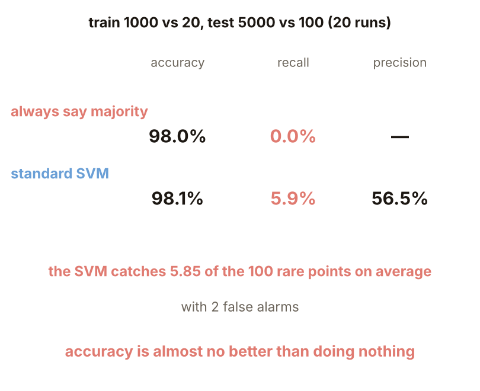
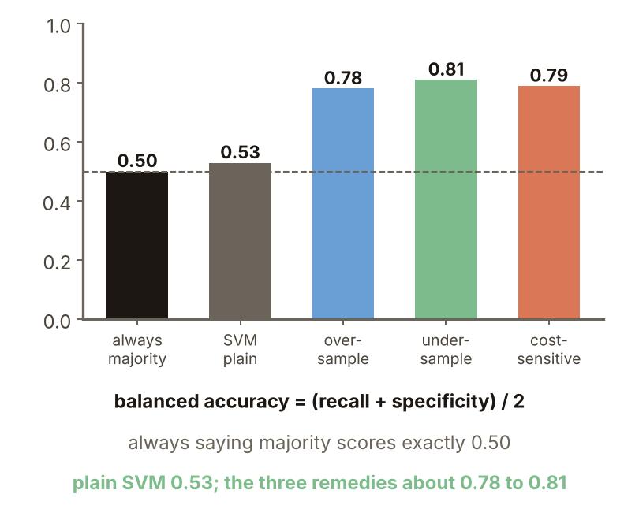

# KP26 The Class Imbalance Problem

> Level: undergraduate, year 3
>
> Pattern Recognition | Chapter 4, §4.23

[Slides: read and download](../../slides/lec05-kp26-imbalance-en.jbd.json) | [中文版](../lec05-kp26-imbalance.md)

## Learning objectives

- Explain why class imbalance harms classifiers and why accuracy can deceive.
- Name the data-level and the cost-sensitive cures and compare their trade-offs.
- Compute recall, precision and balanced accuracy.

## KP26 The Class Imbalance Problem

**One-sentence summary**: When one class has ten thousand samples and another only ten, a classifier that "seeks simplicity" naturally ignores the rare class, which is often the very class we care about.

### 1. The accuracy trap

**Plain explanation**: Is even a high accuracy reliable when one class has only 20 samples?

- **Class imbalance**: one class has very many samples and another very few; common in text classification, rare diseases, oil-spill detection.
- **Recall**: the share of rare points caught; **precision**: the share of points called rare that really are.

**Example** (designed here): two 2-D Gaussians with means 2 apart, training 1000 against 20, test 5000 against 100, 20 runs. Always the majority: accuracy 98.0%, recall 0; standard SVM: 98.1%, recall 5.9%, precision 56.5% (5.85 caught and 2 false alarms on average).

Figure `lec05-kp26-trap`: accuracy, recall and precision of always-majority and a standard SVM.

### 2. The simplicity preference

**Reasoning** (source): for generalization we keep asking for simple classifiers (regularization, pruning); a simple hypothesis does not bother with rare cases, and ignoring 20 points barely changes the total cost. SVM (designed here): a larger $C$ means less regularization; recall: $C=0.01$, $0.1$: 0%; 1: 5.9%; 10: 13.2%; 100: 16.6%; accuracy about 98% throughout. Decision tree: at least $k$ points per leaf (larger is simpler): $k=1$: recall 25.0%; 5: 20.1%; 20: 7.8%; 50: 0%.

Figure `lec05-kp26-simple`: recall against the SVM's $C$ and the tree's leaf size.

### 3. Difficulty and data size

**Source** (Japkowicz): a large imbalance need not hurt; read it with task difficulty and the number of training points: an easy task or much data may be fine; a hard (overlapping) task or too few points can make even a small imbalance fatal. Easy task (designed here, means 4 apart, rare-class recall): 100:100: 97.4%; 1000:100: 91.6%; 1000:10: 65.3%; 10000:100: 78.2%; 10000:10: 43.3%. Hard task (means 1.5 apart): 100:100: 79.8%; 1000:100: 14.9%; 1000:10, 10000:100, 10000:10: 0%. With only 10 rare points even the easy task does poorly. **Common misconception**: a lopsided ratio always means failure; the ratio is not the only factor.

Figure `lec05-kp26-grid`: rare-class recall of an easy and a hard task at five ratios.

### 4. Changing the data

**Method**: oversampling copies the 20 rare points up to 1000; undersampling keeps only 20 random majority points; the same SVM. Results (recall / precision / false alarms): plain 5.9% / 56.5% / 2; oversampling 68.2% / 10.6% / 606; undersampling 77.0% / 9.9% / 757. The rare class is found, but precision drops to about 10% and accuracy to 85% to 88%.

Figure `lec05-kp26-data`: recall, precision and false alarms of three data-level treatments.

### 5. Focused resampling

Focused undersampling deletes points far from the boundary and focused oversampling targets the neighbourhood of the boundary (source). Here: train a first SVM and keep only the majority points nearest its boundary. Results (designed here, recall / accuracy): 20 kept: 82.7% / 58.0%; 60: 11.4% / 97.2%; 100: 8.3% / 97.6%; 200: 6.0% / 98.1%. The right target distribution is an open problem (source): 20 and 60 kept differ hugely (only these two were tested); keeping 20 gives 2126 false alarms against 757 for random undersampling.

Figure `lec05-kp26-focus`: the number of majority points kept against recall and accuracy.

### 6. Changing the cost

**Method** (source): the SVM uses different values of $C$ for the two classes, larger for the rare one (geometrically shrinking the convex hulls at different rates); AdaBoost gives the rare class heavier weights during the iterations (the weights of KP25 were designed for hard samples anyway). SVM (designed here): the rare-class $C$ set to 50 times the majority one: recall 70.2%, precision 10.6%, 619 false alarms, accuracy 87.3%. AdaBoost (100 stumps, rare-class weight ×1, ×10, ×50): recall 19.0%, 48.1%, 60.1%; precision 60.7%, 24.5%, 14.7%.

Figure `lec05-kp26-cost`: results of the cost-sensitive SVM and AdaBoost.

### 7. Comparing the cures

SVM (recall / precision / accuracy): plain 5.9% / 56.5% / 98.1%; oversampling 68.2% / 10.6% / 87.5%; undersampling 77.0% / 9.9% / 84.7%; cost-sensitive 70.2% / 10.6% / 87.3%. Decision tree (at least 5 points per leaf): plain 21.0% / 42.3% / 97.9%; oversampling 33.8% / 25.8% / 96.7%; undersampling 77.8% / 9.2% / 81.7%; cost-sensitive 43.2% / 16.4% / 94.4%. None clearly wins; the difference is a trade-off between how much of the rare class to catch and how many false alarms to tolerate (one data setting; the two classifiers differ in detail; precision is the mean of the 20 per-run values).

Figure `lec05-kp26-table`: the comparison table for four treatments of an SVM and a tree.

### 8. To remember

**To remember** (source): the harm does not come from the numbers being different but from the interaction of the simplicity preference with the rare class. Two cures: change the data (resampling) or change the cost (weighting). Evaluate by recall and precision, not accuracy alone; always saying the majority also scores 98.0%. Class imbalance matters a great deal in practice; a designer must be aware of it and alert to the cures (source).

Figure `lec05-kp26-recap`: the key points of class imbalance.

### Extension: balanced accuracy, practice and worked solution

**Formal definition**: balanced accuracy $=(\text{recall}+\text{specificity})/2$ with specificity $=\text{TN}/(\text{TN}+\text{FP})$ (TP, FN, FP, TN: true positives, false negatives, false alarms, true negatives). Balanced accuracy weights the two class recalls equally, a choice, and ignores precision. Results (SVM, same setting as before): always the majority 0.50; plain 0.53; oversampling 0.78; undersampling 0.81; cost-sensitive 0.79. Always the majority scores exactly 0.50 and the plain SVM is only a little better, while accuracy, 98.0% against 98.1%, hides the difference.

Figure `lec05-kp26-bal`: the balanced accuracy of five methods.

**Practice**: 1000 negatives and 10 positives (the rare class). A says negative for everyone; B catches 6 of the 10 positives and raises 40 false alarms.

1. What are the accuracy and recall of A and B?
2. What are the balanced accuracies of A and B?

Figure `lec05-kp26-practice`: the setup of the practice.

**Worked solution of questions 1 and 2**: (1) A: TP 0, FN 10, FP 0, TN 1000; accuracy $1000/1010=0.990$, recall 0. B: TP 6, FN 4, FP 40, TN 960; accuracy $966/1010=0.956$, recall 0.6. (2) A: $(0+1)/2=0.5$; B: specificity $960/1000=0.96$, $(0.6+0.96)/2=0.78$. (3) Check: A has the higher accuracy yet catches no rare point; B has a precision of only $6/46=0.13$, which is the trade-off.

Figure `lec05-kp26-practice-sol`: the computation.

## Terms and source

| 中文 | English |
|---|---|
| 類別不平衡 | Class imbalance |
| 召回率 | Recall |

Source: Chapter 4, KP26, §4.23 (read 2026-10-25). That class imbalance harms classifiers, that the harm comes from the interaction of the simplicity preference with the rare class, that it must be read with task difficulty and data size, the data-level and cost-sensitive cures, focused resampling, the open problem of the target distribution and the 'to remember' line follow the source; the accuracy trap, the sweeps of $C$ and leaf size, the difficulty and data-size table, the comparison of the cures, the balanced accuracy and the practice were designed and recomputed for this lecture ([added], (program-computed)).
