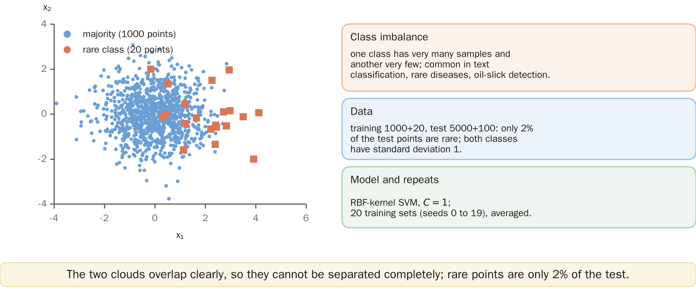
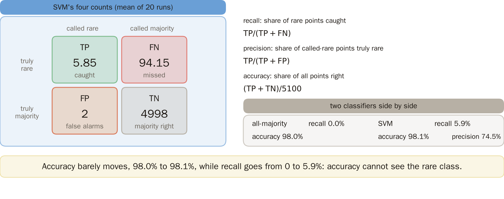
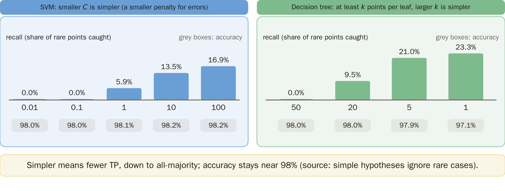
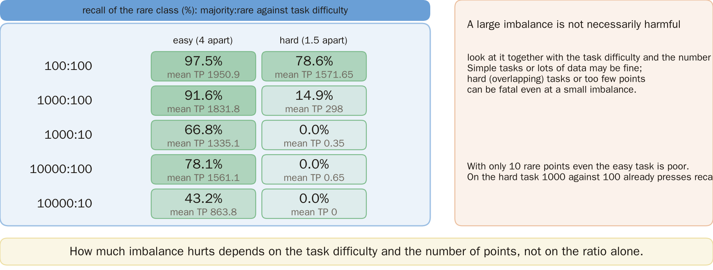
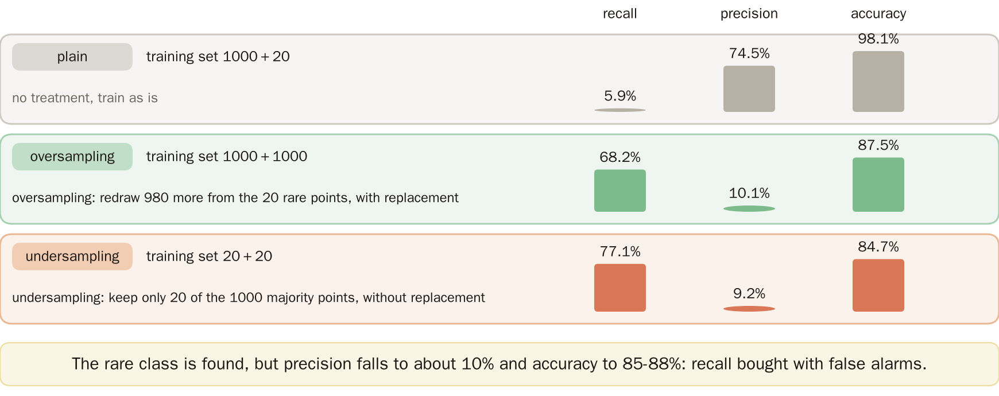
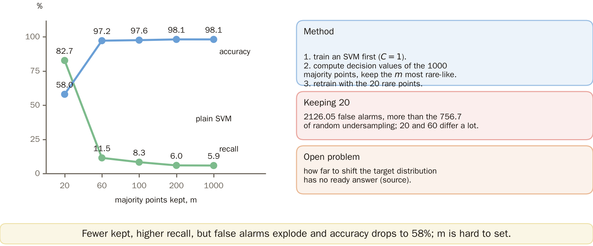
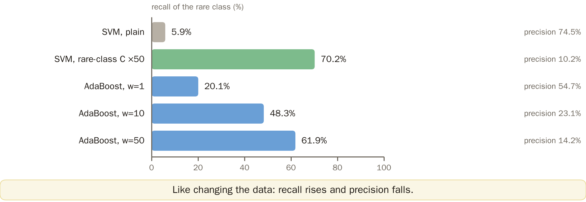
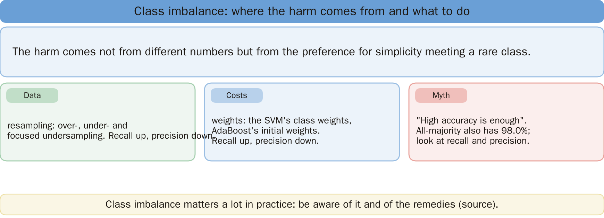
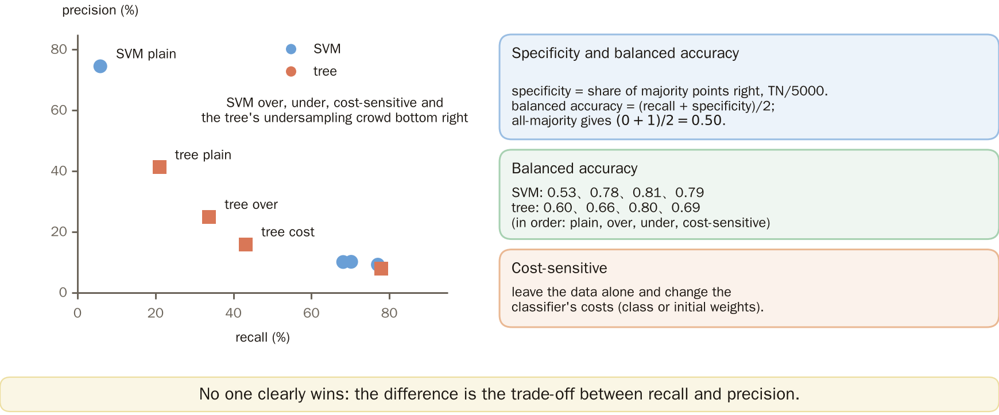
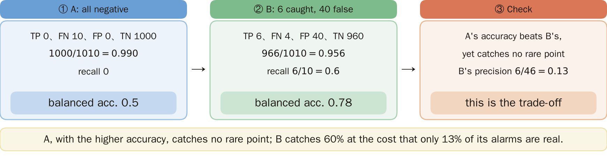

# KP26 The Class Imbalance Problem

> Level: undergraduate, year 3
>
> Pattern Recognition | Chapter 4 §4.23

[Slides: read and download](../../slides/lec05-kp26-imbalance-en.jbd.json) | [中文版](../lec05-kp26-imbalance.md)

## Learning objectives

- Explain why class imbalance harms a classifier and why accuracy can deceive.
- Name the two families of remedies, data-level and cost-sensitive, and compare their trade-offs.
- Compute recall, precision, accuracy and balanced accuracy from the number of rare points caught (TP) and the number of false alarms (FP), and be able to check the numbers in a table.

## KP26 The Class Imbalance Problem

**One-sentence summary**: When one class has ten thousand samples and the other only ten, a classifier that "seeks simplicity" will naturally ignore the rare class, and the rare class is often exactly the one we care about.

### Prerequisites and symbols

**Four things you need first**:

- **SVM and $C$** (KP15, KP19): $C$ is the penalty for a misclassification; the larger, the less it tolerates errors (the less regularized).
- **Decision tree** (KP23): the minimum number of points in a leaf; the larger, the simpler the tree.
- **AdaBoost** (KP25): samples carry weights, and a misclassified point's weight grows in the next round.
- **Regularization and simplicity** (KP11): for generalization we demand a simple model throughout.

**Table of symbols and terms** (fixed for this lecture):

| Symbol | Meaning | Note |
|---|---|---|
| TP | number of rare points caught | rare points judged rare |
| FN | number of rare points missed | rare points judged majority; with 100 rare test points, $\text{FN}=100-\text{TP}$ |
| FP | number of false alarms | majority points judged rare |
| TN | number of majority points judged right | with 5000 majority test points, $\text{TN}=5000-\text{FP}$ |
| recall | fraction of rare points caught | $\text{TP}/(\text{TP}+\text{FN})$ |
| precision | fraction of points judged rare that really are rare | $\text{TP}/(\text{TP}+\text{FP})$ |
| accuracy | fraction of all points judged right | $(\text{TP}+\text{TN})/\text{total}$ |
| specificity | fraction of majority points judged right | $\text{TN}/(\text{TN}+\text{FP})$ |
| balanced accuracy | the mean of recall and specificity | extension |
| majority:rare | ratio of the two class sizes in the training set | for example 1000:20 |

### 1. How the experiment is done

**Plain-words explanation**: The AdaBoost of KP25 degrades when the labels are noisy. When one class has only 20 samples, is even "high accuracy" reliable? First see how all the numbers of this lecture were obtained.

- **Class imbalance**: one class has very many samples and the other very few; common in text classification, rare diseases and oil-slick detection.

**Data** (designed for this lecture, generated by a program):

- The majority class is drawn from $N((0,0),I)$ and the rare class from $N((2,0),I)$, the two coordinates independent with standard deviation 1.
- Training: 1000+20 points; the test set is one fixed set of 5000+100 points (random seed 998).

**Model and repetition**:

- Model: an SVM with an RBF kernel (kernel $e^{-0.5\|x-z\|^2}$, $C=1$).
- Repetition: the training set is drawn once for each random seed 0 to 19, 20 times in all, and the results are averaged.

Figure `lec05-kp26-setup`: First the scatter plot of one training set: 1000 blue majority points and 20 orange rare points; the two clouds overlap clearly, so they cannot be separated completely; the cards on the right give the definition of class imbalance, the data and the model. [Function: 1, 3]

**Experiment details** (reproducible):

- Implementation: Python scikit-learn (SVC, DecisionTreeClassifier, AdaBoostClassifier, version 1.9.1 defaults except as listed below).
- Test sets: sections 2, 3, 5, 6, 7 and the extension use the fixed 5000+100 set (seed 998), with training sets from seeds 0 to 19; the over- and undersampling draws reuse the training seed. The test set of section 4 is a fixed 2000+2000 (seed 997), with training sets again from seeds 0 to 19 (20 runs), and the two class centres differ only along the $x_1$ axis, by 4 (easy) or 1.5 (hard).
- Decision tree: CART (Gini impurity, random seed 0). AdaBoost: depth-1 stumps as weak classifiers, 100 rounds, learning rate 1.
- The SVM class weights are $n/(2n_c)$: rare class $1020/(2\times20)=25.5$, majority class $1020/(2\times1000)=0.51$, a ratio of 50.
- The average counts are means of 20 integer counts, so they have decimals (for example 5.85 = 117/20).

### 2. From counts to metrics

The previous section buries 20 rare points among 1000 majority points; among the 5100 test points the rare ones are only 2%. How do we judge a classifier?

**Formulas of the metrics** (100 rare test points, 5000 majority test points):

- recall $=\text{TP}/100$.
- precision $=\text{TP}/(\text{TP}+\text{FP})$.
- accuracy $=(\text{TP}+\text{TN})/5100$ with $\text{TN}=5000-\text{FP}$.

**Example 1: always say majority**. TP 0, FP 0, so recall $0/100=0$ and accuracy $5000/5100=98.0\%$.

**Example 2: the SVM (average counts over 20 runs)**. TP 5.85, FP 2:

1. Recall $5.85/100=5.9\%$.
2. Precision $5.85/(5.85+2)=74.5\%$.
3. Accuracy $(5.85+4998)/5100=98.1\%$ ($\text{TN}=5000-2=4998$).

Precision is always computed by dividing the average counts.

Accuracy hardly moves from 98.0% to 98.1% while recall goes from 0 to 5.9%: accuracy cannot see the rare class.

Figure `lec05-kp26-metrics`: First the SVM's four counts on the left (TP 5.85, FN 94.15, FP 2, TN 4998), then the formulas of the three metrics on the right, finally all-majority against the SVM: accuracy 98.0% against 98.1%, recall 0 against 5.9%. [Function: 2]

### 3. The preference for simplicity

The SVM catches only 5.85 rare points on average; the other 94 are taken for majority. Why does a classifier ignore the rare class?

**Reasoning** (source): for generalization we demand a simple classifier all along (regularization, pruning); a simple hypothesis does not spend effort on rare cases, and ignoring 20 points barely changes the overall cost.

**SVM** (the larger $C$, the less regularized):

| $C$ | 0.01 | 0.1 | 1 | 10 | 100 |
|---|---:|---:|---:|---:|---:|
| TP | 0 | 0 | 5.85 | 13.45 | 16.85 |
| FP | 0 | 0 | 2 | 7.35 | 10.9 |
| recall | 0% | 0% | 5.9% | 13.5% | 16.9% |
| accuracy | 98.0% | 98.0% | 98.1% | 98.2% | 98.2% |

**Decision tree** (CART, at least $k$ points per leaf; the larger $k$, the simpler):

| $k$ | 1 | 5 | 20 | 50 |
|---|---:|---:|---:|---:|
| TP | 23.25 | 21 | 9.45 | 0 |
| FP | 73.1 | 29.85 | 12.55 | 0 |
| recall | 23.3% | 21.0% | 9.5% | 0% |
| accuracy | 97.1% | 97.9% | 98.0% | 98.0% |

The simpler it is (small $C$, large $k$), the fewer the TP, down to always saying majority; and the accuracy stays at about 98% throughout.

Figure `lec05-kp26-simple`: Two bar charts: the simpler (smaller C, larger leaves) the lower the recall, down to 0, while the accuracy in the grey boxes below stays near 98%. [Function: 2]

### 4. Difficulty and amount of data

The simpler the classifier the less it cares about 20 points. Is class imbalance always bad?

**Source** (Japkowicz): a large imbalance is not necessarily harmful; it must be seen together with task difficulty and the number of training points. For an easy task or a lot of data it may be fine; for a hard task (overlapping classes) or too few points even a small imbalance can be fatal.

**Experiment setting** (designed for this lecture):

- The same RBF SVM ($C=1$, $\gamma=0.5$); the training set is changed to majority:rare $=100{:}100$, $1000{:}100$, $1000{:}10$, $10000{:}100$, $10000{:}10$.
- The test set is fixed at 2000+2000, and recall $=\text{TP}/2000$.
- In the easy task the two centres differ by 4, in the hard task by 1.5.

**Result**: recall of the rare class (the mean TP is in brackets, out of 2000 rare test points):

| majority:rare | easy task | hard task |
|---|---:|---:|
| 100:100 | 97.5% (1950.9) | 78.6% (1571.65) |
| 1000:100 | 91.6% (1831.8) | 14.9% (298) |
| 1000:10 | 66.8% (1335.1) | 0.0% (0.35) |
| 10000:100 | 78.1% (1561.1) | 0.0% (0.65) |
| 10000:10 | 43.2% (863.8) | 0.0% (0) |

With only 10 rare points even the easy task does badly. In the hard task 1000 against 100 already presses recall to 14.9%.

Figure `lec05-kp26-grid`: Look at the 10-cell heat map: on the easy task recall falls slowly, on the hard task it already drops to 14.9% at 1000:100 and then to about 0; the darker the cell the higher the recall. [Function: 2, 3]

### 5. Changing the data

Imbalance is not always bad, but in the hard task 1000 against 100 presses recall to 14.9%. The first remedy is to change the data: copy the rare class or throw away majority points; what happens?

**What is done**:

- **Oversampling**: draw 980 more from the 20 rare points with replacement, so the training set becomes 1000+1000.
- **Undersampling**: keep only 20 of the 1000 majority points, drawn at random without replacement, so the training set becomes 20+20.
- The same SVM ($C=1$), the data and test set of section 1.

**Result** (mean of 20 runs):

| Treatment | training set | TP | FP | recall | precision | accuracy |
|---|---|---:|---:|---:|---:|---:|
| plain | 1000+20 | 5.85 | 2 | 5.9% | 74.5% | 98.1% |
| oversampling | 1000+1000 | 68.15 | 605.55 | 68.2% | 10.1% | 87.5% |
| undersampling | 20+20 | 77.05 | 756.7 | 77.1% | 9.2% | 84.7% |

Example: oversampling recall $68.15/100=68.2\%$, precision $68.15/(68.15+605.55)=10.1\%$.

**The price**: the rare class is found, but precision falls to about 10% and accuracy to 85% to 88%.

Figure `lec05-kp26-data`: Three rows: plain, oversampling, undersampling; the three bars of each row are recall, precision and accuracy. The rare class is found again, but precision falls to about 10%. [Function: 2]

### 6. Focused resampling

Over- and undersampling are random and give many false alarms. Would it be better to throw away only the majority points far from the boundary, which carry no information anyway?

**What is done** (focused undersampling, source). The concrete steps in this lecture:

1. First train an SVM ($C=1$) on the 20+1000 points.
2. Compute the decision values of the 1000 majority points and keep the $m$ with the largest values (the most rare-like).
3. Retrain with the 20 rare points plus these $m$; $m=20,60,100,200$.

**Result**:

| majority points kept $m$ | 20 | 60 | 100 | 200 | 1000 (plain SVM) |
|---|---:|---:|---:|---:|---:|
| TP | 82.7 | 11.45 | 8.3 | 5.95 | 5.85 |
| FP | 2126.05 | 55.5 | 32.55 | 2 | 2 |
| recall | 82.7% | 11.5% | 8.3% | 6.0% | 5.9% |
| accuracy | 58.0% | 97.2% | 97.6% | 98.1% | 98.1% |

**Meaning**: how far to move the target distribution is an open question (source). Keeping 20 and keeping 60 differ a lot; with 20 kept there are 2126 false alarms, more than the 757 of random undersampling.

Figure `lec05-kp26-focus`: The horizontal axis is the number m of majority points kept, the green line is recall and the blue one accuracy: with m=20 recall is 82.7% but accuracy only 58.0%; the larger m the closer to the plain SVM. The right side gives the method and the open problem. [Function: 2]

### 7. Changing the cost

How many to keep in focused undersampling is hard to fix. What does a cost-sensitive remedy, which leaves the data alone and changes the classifier, give?

**What is done** (source):

- SVM: the $C$ of the minority class is set to 50 times that of the majority class (weights 25.5 against 0.51).
- AdaBoost: 100 stumps, the initial weight of the minority class multiplied by $w=1,10,50$ and then normalized (the weights of KP25 were designed for hard samples anyway).

**Result** (mean of 20 runs):

| Classifier and setting | TP | FP | recall | precision |
|---|---:|---:|---:|---:|
| SVM, plain | 5.85 | 2 | 5.9% | 74.5% |
| SVM, minority $C$ 50 times | 70.2 | 619.3 | 70.2% | 10.2% |
| AdaBoost, $w=1$ | 20.1 | 16.65 | 20.1% | 54.7% |
| AdaBoost, $w=10$ | 48.3 | 160.65 | 48.3% | 23.1% |
| AdaBoost, $w=50$ | 61.9 | 373.75 | 61.9% | 14.2% |

Example: SVM precision $70.2/(70.2+619.3)=10.2\%$.

**Summary**: changing the cost, like changing the data, raises TP and FP together and lowers precision.

Figure `lec05-kp26-cost`: The five bars are the recall of the rare class and the small text on the right is precision: the higher the recall the lower the precision; the same for the SVM with a 50-times C for the rare class and for the AdaBoost weights. [Function: 2]

### 8. How to remember

**How to remember** (source): the harm of imbalance does not come from "the numbers are different" but from the interaction of "preference for simplicity × a rare class". There are two remedies: change the data (resampling) or change the cost (weighting).

**Common misconception**: thinking high accuracy is enough. Evaluate by how many were caught and how many false alarms (recall and precision), not accuracy alone; always saying majority also gets 98.0%.

**Reminder** (source): class imbalance is very important in practice; a designer must be aware of it and alert to the various remedies.

Figure `lec05-kp26-recap`: From top to bottom: the harm comes from the interaction of the preference for simplicity with the rare class; the three cards are the two remedies (data, costs) and the common myth. [Function: 2]

### Extension: comparing remedies, balanced accuracy and exercises

What to remember is the trade-off. Put the four treatments in one table, with a metric that can see the rare class; does one clearly win?

- **Balanced accuracy** $=(\text{recall}+\text{specificity})/2$, with specificity $=\text{TN}/5000$ (the fraction of majority points judged right). Always saying majority gives $(0+1)/2=0.50$.
- Example: the plain SVM $(0.0585+4998/5000)/2=0.53$.

**SVM** (TP / FP / recall / precision / accuracy / balanced accuracy):

| Treatment | TP | FP | recall | precision | accuracy | balanced accuracy |
|---|---:|---:|---:|---:|---:|---:|
| plain | 5.85 | 2 | 6% | 75% | 98% | 0.53 |
| oversampling | 68.15 | 605.55 | 68% | 10% | 88% | 0.78 |
| undersampling | 77.05 | 756.7 | 77% | 9% | 85% | 0.81 |
| cost-sensitive | 70.2 | 619.3 | 70% | 10% | 87% | 0.79 |

**Decision tree** (at least 5 points per leaf):

| Treatment | TP | FP | recall | precision | accuracy | balanced accuracy |
|---|---:|---:|---:|---:|---:|---:|
| plain | 21 | 29.85 | 21% | 41% | 98% | 0.60 |
| oversampling | 33.75 | 101.45 | 34% | 25% | 97% | 0.66 |
| undersampling | 77.85 | 912.6 | 78% | 8% | 82% | 0.80 |
| cost-sensitive | 43.15 | 227.7 | 43% | 16% | 94% | 0.69 |

Nobody clearly wins; the difference is a trade-off.

Figure `lec05-kp26-table`: Recall on the horizontal axis and precision on the vertical: four treatments each for the SVM (circles) and the decision tree (squares), the higher the recall the lower the precision; the right side gives the definition of balanced accuracy and its eight values. [Function: 2]

**Small exercises**: 1000 negative examples and 10 positive examples (the rare class). A: always say negative; B: catches 6 of the 10 positives and falsely alarms on 40 negatives.

1. What are the accuracy and recall of A and B?
2. What are the balanced accuracies of A and B?

**Exercise 1, worked solution**:

- A: TP 0, FN 10, FP 0, TN 1000; accuracy $1000/1010=0.990$, recall 0.
- B: TP 6, FN 4, FP 40, TN 960; accuracy $966/1010=0.956$, recall $6/10=0.6$.

**Exercise 2, worked solution**:

- A: $(0+1)/2=0.5$.
- B: specificity $960/1000=0.96$, $(0.6+0.96)/2=0.78$.

Figure `lec05-kp26-practice-sol`: Follow the three boxes from left to right: A judges everything negative (accuracy 0.990, recall 0, balanced accuracy 0.5), B catches 6 (accuracy 0.956, balanced accuracy 0.78), then check the trade-off. [Function: 2]

**Check**: A's accuracy is higher than B's, yet it caught not one rare point; B's precision is only $6/46=0.13$, which is the trade-off.

## Terms and source

| 中文 | English |
|---|---|
| 類別不平衡 | Class imbalance |
| 召回率 | Recall |
| 精確率 | Precision |
| 特異度 | Specificity |
| 平衡準確率 | Balanced accuracy |
| 過採樣 | Oversampling |
| 欠採樣 | Undersampling |
| 代價敏感 | Cost-sensitive |

Source: Chapter 4 KP26, §4.23 (read 2026-10-25). Class imbalance harming a classifier, the harm coming from the interaction of the preference for simplicity and the rare class, the need to read it together with task difficulty and data size, the two families of data-level and cost-sensitive remedies, focused resampling, the target distribution being an open problem, and "how to remember" follow the source; the experiment setting, the count formulas of the metrics, the sweeps of $C$ and leaf size, the difficulty-and-data-size table, the comparison of the remedies, balanced accuracy and the exercises were designed for this lecture and recomputed by a program ([Supplement], computed by a program); the data generator, parameters, seeds and repetitions are in section 1 and the count formulas in section 2.
