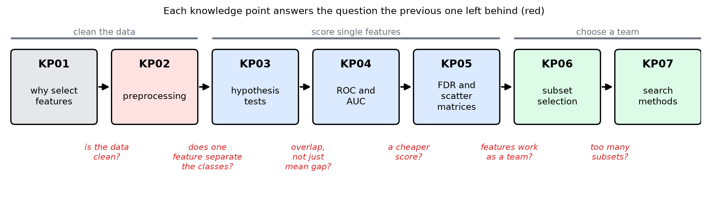
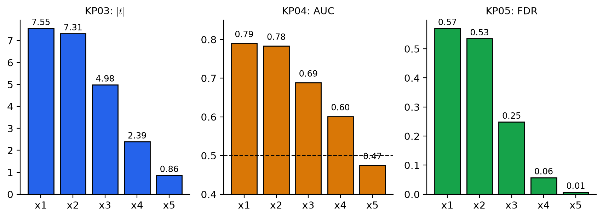

# Feature Selection Roadmap: Many Dimensions, So What Is Worth Keeping?

> Level: undergraduate
>
> Pattern Recognition | Feature selection unit overview (KP01–KP07)

[Slides](../../slides/lec07-kp00-overview-en.jbd.json) | [中文版](../lec07-kp00-overview.md)

## Learning objectives

- Connect KP01 to KP07 with one question, and state the question, the answer and the question left behind for each knowledge point.
- Say in plain words what the key terms of this unit mean: outlier, hypothesis test, AUC, FDR, subset and search.
- State the conclusion and the limits of this unit, and know what comes next.

## Feature selection roadmap

**One-sentence summary**: When there are many features and few samples, first clean the data, then score the features, and finally pick a *set* rather than the "top few scores". Single scores cannot see how features work together, so score the whole set at once, and when there are too many sets, search cleverly.

### Prerequisites and notation

*Three things you need to know first*:

- *Features and classes*: each sample has many measurements (features), and we want to predict which class it belongs to (Chapters 2 and 3).
- *Mean and standard deviation*: the centre and the spread of a batch of numbers.
- *Training set and test set*: the training set is used to learn; the test set imitates new data the model has never seen.

*Symbols used in this unit*:

| Symbol | Meaning | Note |
|---|---|---|
| $m$ | Total number of candidate features | Example: $m=5$ |
| $l$ | Number of features to keep | $l\le m$ |
| $\omega_1,\ \omega_2$ | The two classes | Most examples in this unit have only two classes |
| $\bar x,\ \sigma$ | Mean, standard deviation | Used from KP02 on |

### 1. This unit asks only one thing

**Question**: You have dozens or even hundreds of features. How do you pick the ones that are really useful and drop the redundant and useless ones?

Why pick at all? The textbook gives three reasons: computation cost; two features that are each useful alone may add little together because they are highly correlated; and when samples are limited, more features mean more parameters to estimate, so the classifier generalizes worse (KP01).

**A small example that runs through the unit.** `[Added]` Two classes with 100 samples each and 5 features (a teaching setup):

- $x_1$ carries class signal; $x_2$ is almost a copy of $x_1$; $x_3$ also carries signal.
- $x_4$ is signal plus a large block of noise; $x_5$ contains only that same block of noise and has no signal on its own.

This example comes back in KP03 to KP06. Make a guess: of the 5 features, which three are worth keeping?

### 2. Roadmap: each knowledge point takes over the question left by the previous one

The unit has seven knowledge points, one after another. Each starts from the question the previous one left behind.

Figure `lec07-kp00-overview-f1-map`: first follow the arrows from left to right, KP01 to KP07; then read the red text under each arrow: that is the question the previous knowledge point left and the next one must answer. The grey line at the top groups the seven knowledge points into three parts: clean the data, score single features, pick a set. (Function: 1)

### 3. The question, answer and leftover of each knowledge point

**Six terms in plain words first** (later knowledge points unpack them one by one):

- **Outlier**: a point far away from most of the data. A single one can distort the mean and the standard deviation.
- **Hypothesis test**: asks "is the difference in class means real, or just sampling luck?" and decides with the $t$ statistic.
- **ROC curve and AUC**: draw the two kinds of error at every threshold as one curve; the larger the area under it (AUC), the better the two classes separate.
- **FDR**: the squared difference of the class means divided by the sum of the class variances, a cheap "how separable" score.
- **Subset selection**: the thing being scored is a whole set of features, not a single feature.
- **Search**: when there are too many subsets, walk step by step: add one, remove one, or add and then go back and check.

| KP | Topic | Question | Answer | Question left behind |
|---|---|---|---|---|
| KP01 | Why select features | Are more features always better? | With limited samples, more features mean more parameters and worse generalization; redundant features (centimetres and inches) add no information | Before evaluating features, is the data clean? |
| KP02 | Preprocessing | Which data problems pull the mean and standard deviation off? | Outliers (one value can inflate the standard deviation 36 times), different units, missing values (mean imputation lowers the variance by 22.2%); parameters may only be computed from the training set | Once the data is clean, does a single feature discriminate? |
| KP03 | Hypothesis tests | Is the difference of class means real, or luck? | Divide the gap by the sampling fluctuation to get $t$; keep the feature if it exceeds the critical value | Even with a mean difference, the classes can still blur together; how much do they overlap? |
| KP04 | ROC and AUC | How much do the two classes overlap? | Sweep the threshold to draw the ROC; AUC condenses it to one score; a one-sided threshold cannot see equal means with different spreads | Is there a cheap score that needs no threshold sweep? |
| KP05 | FDR and scatter matrices | Can we score directly from means and variances? | FDR in one dimension; $S_w,S_b$ give $J_1,J_2,J_3$ in many dimensions; $q^2=N\cdot\text{FDR}$ | Scoring one by one, can we see how features combine? |
| KP06 | Subset selection | Are the top $l$ individual scores the best $l$ features? | Not necessarily: redundancy and complementarity; score the whole set (filter or wrapper), choose the number of features by validation, and put the selection inside validation | Subsets are too many ($\binom{100}{10}\approx1.7\times10^{13}$); how do we find one? |
| KP07 | Feature search | We cannot enumerate; how do we walk cleverly? | Forward, backward and floating; all are greedy, floating search can take a step back; optimal search needs monotonicity | (End of the unit) |

**The running example at each stop** (100 samples per class, fixed seed):

| Feature | $\|t\|$ (KP03) | AUC (KP04) | FDR (KP05) |
|---|---|---|---|
| $x_1$ | $7.55$ | $0.790$ | $0.570$ |
| $x_2$ | $7.31$ | $0.783$ | $0.535$ |
| $x_3$ | $4.98$ | $0.688$ | $0.248$ |
| $x_4$ | $2.39$ | $0.601$ | $0.057$ |
| $x_5$ | $0.86$ | $0.475$ | $0.007$ |

The three scores give the same ranking: $x_1>x_2>x_3>x_4>x_5$. The AUC of $x_5$ is $0.475$, slightly below random guessing ($0.5$), so at a glance it looks like a useless feature.

Figure `lec07-kp00-overview-f2-scores`: look at the three bar charts: in each one $x_1$ is tallest and $x_5$ is shortest, decreasing in order; the dashed line on the AUC chart is the random-guess level $0.5$, and $x_5$ falls below it. (Function: 1, 2)

### 4. Review: the conclusion of the unit, and two reminders

**Conclusion of the unit (revealed in KP06)**: looking only at individual scores, the top three are $\{x_1,x_2,x_3\}$, with accuracy $0.75$ on 4000 new samples. But $x_1$ and $x_2$ are redundant, and $x_5$, judged useless, cancels the noise of $x_4$: the set $\{x_1,x_4,x_5\}$ chosen by validation has accuracy $0.89$, almost as good as $0.90$ with all 5 features. KP07 explains how to find such a set when there are many features.

**Two reminders**:

- *Individual scores are a cheap first gate, not the answer.* They cannot see how features combine: redundant ones are selected together, and complementary ones are dropped together.
- *Selecting features is itself a kind of learning.* Selecting features on all the data and then cross-validating makes the accuracy look too high (it can reach $0.88$ on pure-noise data); the selection must be placed inside each fold (KP06). The data leakage described in KP02 reappears here in another form.

**What this unit does not do**: it only *selects* existing features and does not *create* new ones. Combining or transforming the original features into new ones (for example principal components) is the topic of the next unit (feature generation). The more theoretical criteria (divergence, Bhattacharyya distance, VC dimension, AIC and BIC) are not taught here and are left for self-study.

## Terms and sources

| English | 中文 |
|---|---|
| Feature selection | 特徵選擇 |
| Preprocessing | 前置處理 |
| Outlier | 離群點 |
| Hypothesis testing | 假設檢定 |
| ROC curve, AUC | ROC 曲線、AUC |
| Fisher's discriminant ratio (FDR) | 費雪判別比 |
| Scatter matrix | 散布矩陣 |
| Subset selection | 子集選擇 |
| Search | 搜尋 |
| Generalization | 泛化 |

Sources: Theodoridis & Koutroumbas, *Pattern Recognition*, Chapter 5 §5.1 (introduction and chapter structure), and the chapter map of Chapter 5 on the CCC-LNS web page; the explanations, figures and order are rewritten. The conclusion of each knowledge point is taken from the KP01–KP07 lectures of this unit; the running 5-feature example is `[Added]`, with numbers computed by `scripts/lec07-kp00-overview/compute_data.py` (`reports/lec07-kp00-overview/數值驗算.json`), and the accuracies of KP06 come from the verification of `lec07-kp06-subset-selection`.
