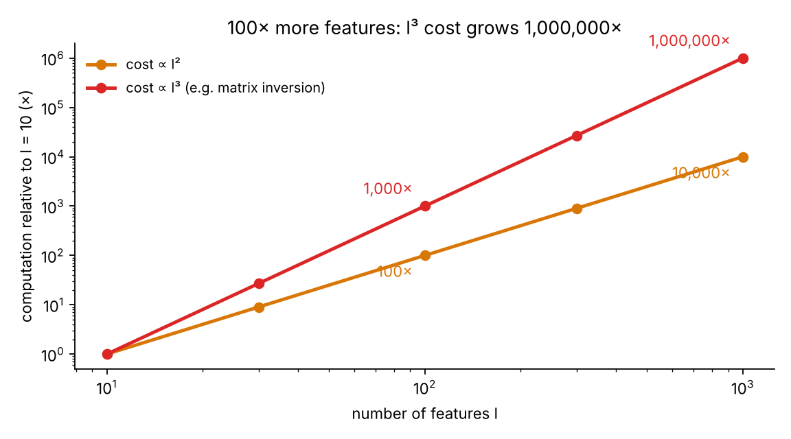
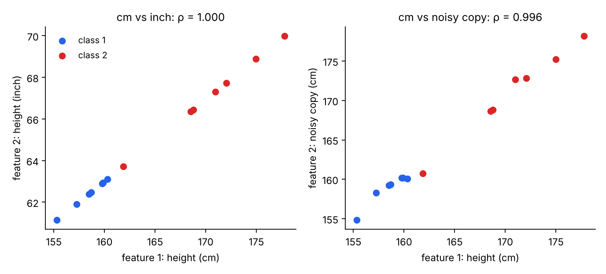
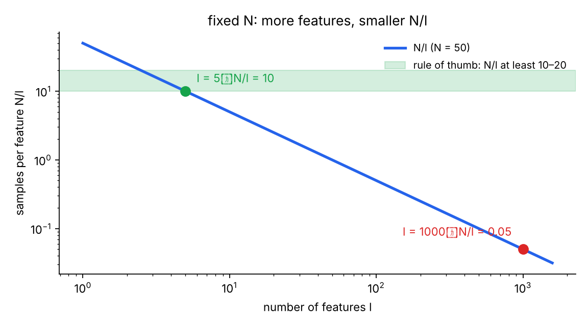
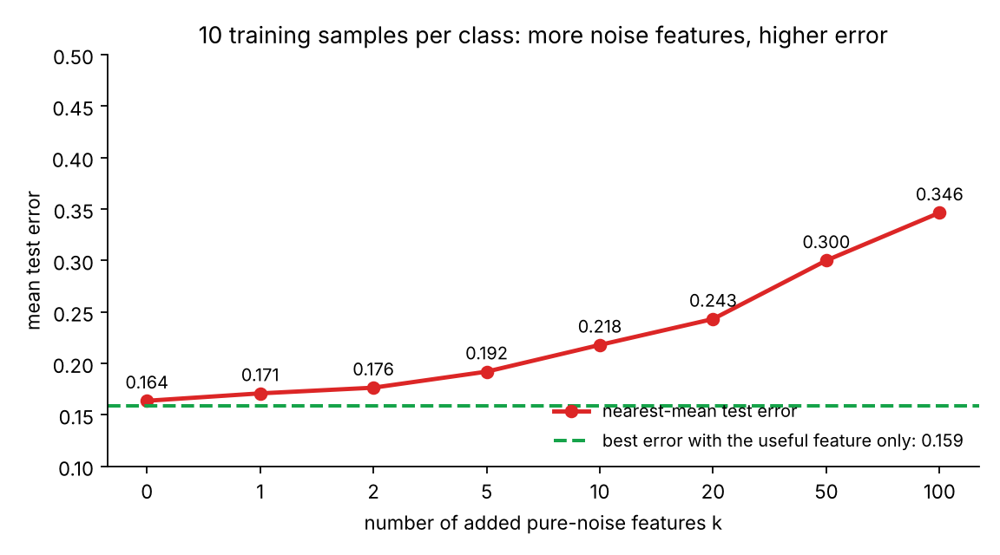

# KP01 Why Select Features: More Is Not Always Better

> Level: undergraduate
>
> Pattern Recognition | Feature selection unit, knowledge point 1 (KP01) | [中文版](../lec07-kp01-why-select.md)

## Learning objectives

- State the three reasons for selecting features: computation, redundant features, and a limited sample.
- Use $O(l^2)$ and $O(l^3)$ to explain why computation explodes as the number of features grows.
- Decide whether two features are redundant, and explain why the covariance matrix is singular when $\rho=\pm1$.
- Use the ratio $N/l$ and a rule of thumb to judge how many features a sample can support.
- Tell feature selection apart from feature generation, and explain that selection is not only about speed.

## KP01 Why Select Features: More Is Not Always Better

**One-sentence summary**: More features are not always better. Computation, redundancy, and a limited sample each make extra features harmful.

### Prerequisites and notation

*Three things you need to know first*:

- *Features and classes*: each sample has many measurements (features), and we predict its class.
- *Covariance matrix and its inverse*: the classifiers of Chapter 2 often need $\Sigma^{-1}$.
- *Training set and test set*: the training set is used to learn, and the test set mimics unseen data.

*Symbol table*:

| Symbol | Meaning | Note |
|---|---|---|
| $l$ | number of features (dimension of the feature vector) | e.g. $l=1000$ |
| $N$ | number of training samples | e.g. $N=50$ |
| $N/l$ | samples available per feature | a rough sign of generalization |
| $\rho$ | correlation coefficient of two features | $-1\le\rho\le1$ |
| $\hat\mu_c$ | sample mean of class $c$ | computed from the training set |
| $k$ | number of added noise features | used in the simulation below |

*Terms*: **Feature selection** means choosing a subset of the features we already have. **Generalization** is how well a classifier works on new data. **Overfitting** means the classifier memorizes the noise in the training data and fails on new data.

### 1. Three reasons not to feed in every feature

Imagine packing for a month of backpacking. You fear cold, heat, and rain, so you stuff a thousand items into one suitcase. The suitcase is too heavy to lift. At the airport you dig through everything to find your passport.

Features are like luggage. If a thousand features sit on the table and all go into the classifier, three problems appear:

- First, computation explodes.
- Second, some features repeat and add no new information.
- Third, with a limited sample the classifier overfits.

Each of the next three sections explains one reason.

### 2. Reason one: computation grows quickly with the number of features

**Plain explanation**: A classifier uses feature vectors to compute distances and covariance matrices. It often needs the matrix inverse too. More features make these matrices larger and slower to handle.

**Formal definition**: With $l$ features, multiplying and inverting $l\times l$ matrices costs roughly between $l^2$ and $l^3$ operations:

$$\text{cost}\ \propto\ l^2\ \text{to}\ l^3.$$

**Example**: Take $l=10$ as the baseline. At $l=100$, the $l^2$ cost is $100$ times larger and the $l^3$ cost is $1000$ times larger. At $l=1000$, the $l^3$ cost is $1{,}000{,}000$ times the baseline.

Figure `lec07-kp01-why-select-f1-cost`: First look at the horizontal axis, the number of features $l$. It is on a log scale. Then look at the two lines. Gold is $l^2$ and red is $l^3$. The vertical axis is also logarithmic, so each step up the red line is ten times the cost. [Function: 1]

**Common misconception**: "Computers are fast, so cost is not a problem." This is wrong. One more order of magnitude in dimension can add three orders of magnitude in cost. The third reason also shows that the extra work can make results worse.

### 3. Reason two: redundant features add no information

**Plain explanation**: Measure a person's height in centimeters and again in inches. These are two features that carry the same information. Knowing one gives the other.

**Formal definition**: The correlation coefficient of two features is

$$\rho=\frac{\operatorname{cov}(x_1,x_2)}{\sigma_1\sigma_2}.$$

When $\rho=\pm1$, one feature is a linear function of the other. Then the determinant of the covariance matrix is

$$\det\Sigma=\sigma_1^2\sigma_2^2\,(1-\rho^2)=0,$$

so the matrix is not invertible. A classifier that needs $\Sigma^{-1}$ cannot be computed.

**Example**: `[Supplement]` Take the heights of 14 people (a teaching setup generated by a program with a fixed seed). Feature 1 is in centimeters, and feature 2 is in inches, $x_2=x_1/2.54$. We get $\rho=1.000$.

If feature 2 is a noisy copy instead, $\rho=0.996$. The matrix is barely invertible, yet it holds almost no new information. Numerical results are unstable.

Figure `lec07-kp01-why-select-f2-redundant`: First look at the left plot. The 14 points lie on one straight line. Inches are a fixed multiple of centimeters. Then look at the right plot. The points spread slightly but still hug one line. In both plots the second feature does not separate the classes any better. [Function: 2]

*Guess first*: Each of two features alone gives 90% accuracy. Combined into a two-dimensional feature vector, must the accuracy rise to 98%?

The answer is no. It may not improve at all. If the correlation of the two features is close to $1$, combining them gives no new information about the classes. We still pay twice the computation.

**Common misconception**: "Two features that are each useful must be better together." This is wrong. When they are highly correlated, combining them adds almost nothing.

### 4. Reason three: with a limited sample, many features break generalization

**Plain explanation**: More features mean more parameters to estimate. With a fixed sample, each parameter gets less data. The classifier starts to memorize the training data, noise included.

**Formal definition**: We use $N/l$ as a rough indicator. By the Fine rule of thumb quoted in the CCC-LNS notes, $N/l$ should be at least $10$ to $20$ for stable generalization:

$$\frac{N}{l}\ \ge\ 10\sim20.$$

**Example**: A hospital diagnoses a rare genetic disease. It has only $N=50$ patient records. A gene chip gives $l=1000$ features at once.

| Choice | Features $l$ | $N/l$ | Meets the rule of thumb? |
|---|---|---|---|
| Use all features | $1000$ | $0.05$ | No, far below $10$ |
| Keep 5 core genes | $5$ | $10$ | Yes, just reaches it |

Using everything leaves only $0.05$ samples per feature. After keeping $5$, each feature gets $10$ samples, and the estimates can be stable.

Figure `lec07-kp01-why-select-f3-ratio`: First look at the blue line, $N/l$ for $N=50$. The horizontal axis is the number of features, and both axes are logarithmic. Then look at the green band, the rule of thumb of $10$ to $20$. The red point ($l=1000$) is far below the band. The green point ($l=5$) sits at its lower edge. [Function: 3]

*A simulation to look at*: `[Supplement]` This is a teaching simulation, not a result from the source. There are two classes with 10 training samples each. Feature 1 is useful: the class means differ by 2 standard deviations. We add $k$ pure-noise features that have nothing to do with the class.

The classifier is the nearest-mean classifier. It assigns a test point to the class whose training mean $\hat\mu_c$ is closer. The test set has 5000 samples per class. The whole experiment is repeated 300 times with a fixed seed, using a fresh training set each time, and the results are averaged.

| $k$ | 0 | 1 | 2 | 5 | 10 | 20 | 50 | 100 |
|---|---|---|---|---|---|---|---|---|
| Mean test error | 0.164 | 0.171 | 0.176 | 0.192 | 0.218 | 0.243 | 0.300 | 0.346 |

Using only the useful feature, the best possible error is $0.159$.

Figure `lec07-kp01-why-select-f4-noise`: First look at the green dashed line. It is the best error with the useful feature only, $0.159$. Then look at the red line, the test error after adding $k$ noise features. It climbs with $k$ and reaches about $0.35$ at $k=100$. [Function: 4]

This simulation uses only the nearest-mean classifier, Gaussian data, and a deliberately small sample. Other classifiers rise at other speeds. The direction stays the same: with a limited sample, extra features hurt.

The CCC-LNS medical example says that using everything gives a "true test error as high as 50%, like guessing". That is the notes' own statement, and this lecture did not reproduce it.

**Common misconception**: "More features give the classifier more information, so it cannot get worse." This is wrong. If the extra features are noise and the sample is limited, the error goes up.

### 5. Two easy mix-ups

**Common misconception**: "Selecting features is only to make the program faster." This is wrong. The more important goal is better generalization. Selection keeps irrelevant noise from damaging the decision boundary.

**Common misconception**: "Feature selection and feature generation are the same." This is wrong. Selection subtracts: it picks a subset of the existing features. Generation combines the original features, linearly or nonlinearly, into a new space. PCA is an example.

### 6. Summary: the question left over

The three reasons explain why we select features. Computation explodes. Redundant features are useless. With a limited sample, extra features drag the classifier down.

Later notes return to these points. They include the peaking phenomenon (error rebounds when there are too many features), feature subset selection, and VC dimension with SRM.

Comparing features relies on means and variances. If the data contain outliers, these two numbers mislead.

**Left-over question**: Is the data clean before we evaluate features? The next knowledge point, KP02 preprocessing, answers it.

### Extension: practice and worked solutions

**Practice**:

1. An online store predicts purchase intent from $N=2000$ transactions. To satisfy $N/l\ge20$, how many features can it keep at most?
2. The team collected $l=500$ features at once. What is $N/l$ now? Is feature selection needed?
3. Two features satisfy $x_2=3x_1+2$. What is their correlation coefficient? Is the covariance matrix invertible?

**Question 1 worked solution**: $N/l\ge20$ means $l\le N/20=2000/20=100$. It can keep at most $100$ features.

**Question 2 worked solution**: $N/l=2000/500=4$, below the rule of thumb of $10$ to $20$. Feature selection is needed.

**Question 3 worked solution**: $x_2$ is a linear function of $x_1$ with positive slope, so $\rho=+1$. The determinant $\sigma_1^2\sigma_2^2(1-\rho^2)=0$, so the matrix is not invertible.

## Glossary and sources

| 中文 | English |
|---|---|
| 特徵選擇 | Feature selection |
| 特徵產生 | Feature generation |
| 重複的特徵 | Redundant feature |
| 泛化 | Generalization |
| 過擬合 | Overfitting |
| 相關係數 | Correlation coefficient |
| 共變異矩陣 | Covariance matrix |
| 最近均值分類器 | Nearest-mean classifier |
| 測試誤差 | Test error |
| 主成分分析（PCA） | Principal component analysis (PCA) |
| VC 維度 | Vapnik–Chervonenkis (VC) dimension |
| 結構風險最小化（SRM） | Structural risk minimization (SRM) |

Source: Chapter 5 of the CCC-LNS notes (feature selection), the section "Why select features?" and its "Professor's notes": the three reasons, the $N/l$ rule of thumb, the medical example, and the exercises (`https://ndhuccc.github.io/CCC-LNS/PR_115/Ch05-feature-selection/index.html`, read on 2026-11-08). The explanations, order, and figures were rewritten.

The Fine rule of thumb is quoted from that page. This lecture did not check Fine's original paper or the textbook by Theodoridis and Koutroumbas. Examples and the simulation marked `[Supplement]` are teaching setups. Their numbers come from `scripts/lec07-kp01-why-select/make_figures.py` with fixed seeds, and were rechecked by an independent program.
