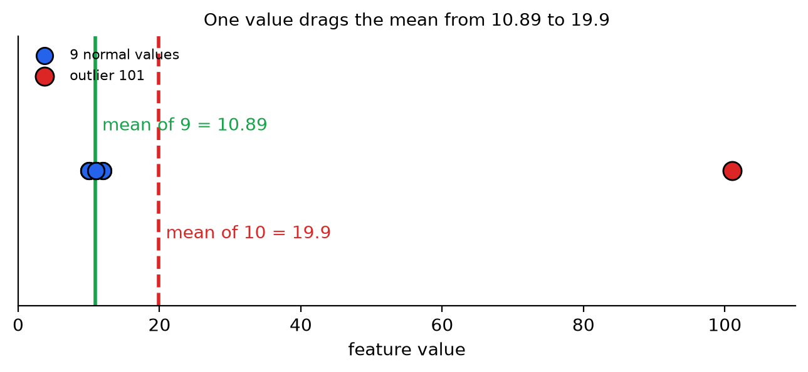
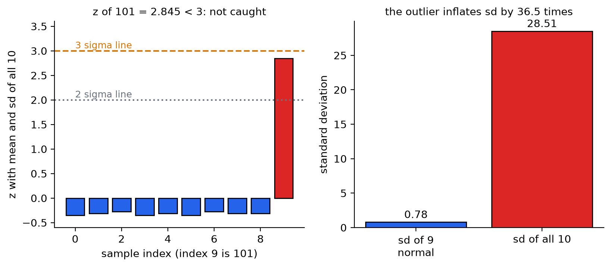
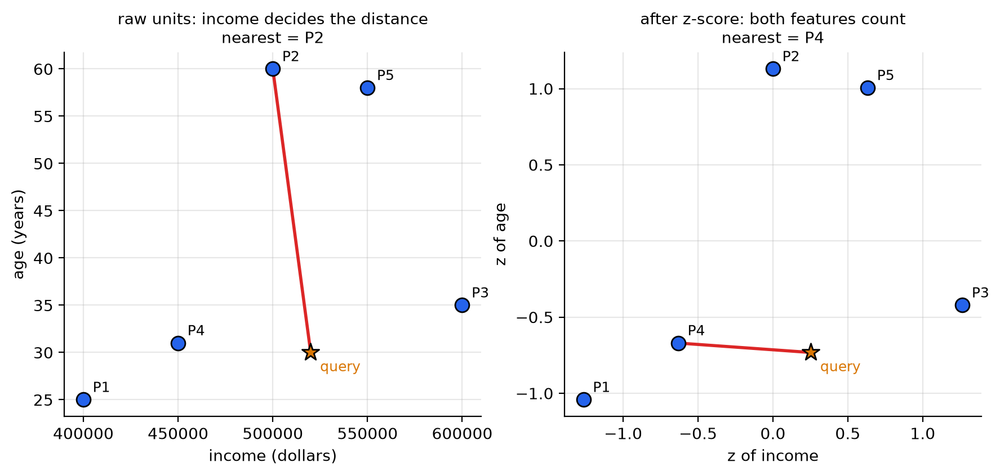
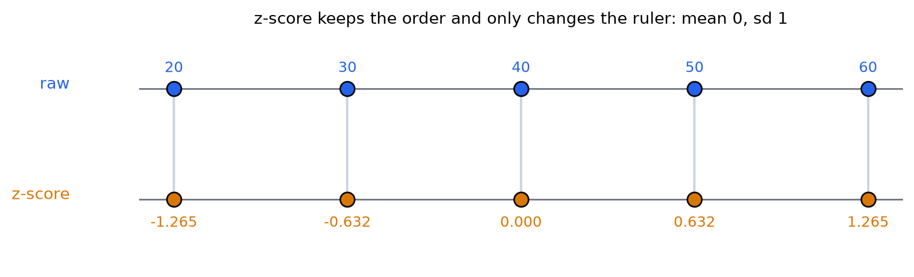
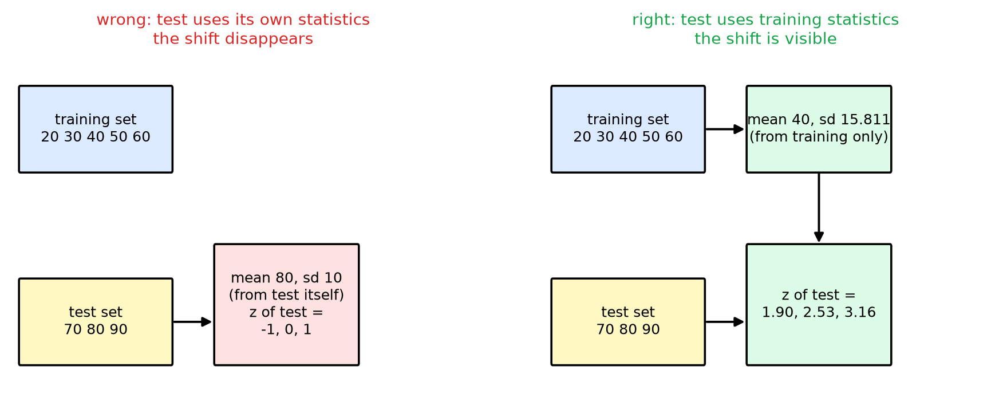
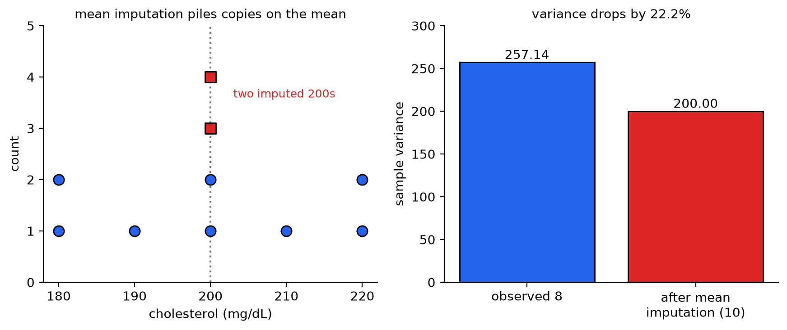
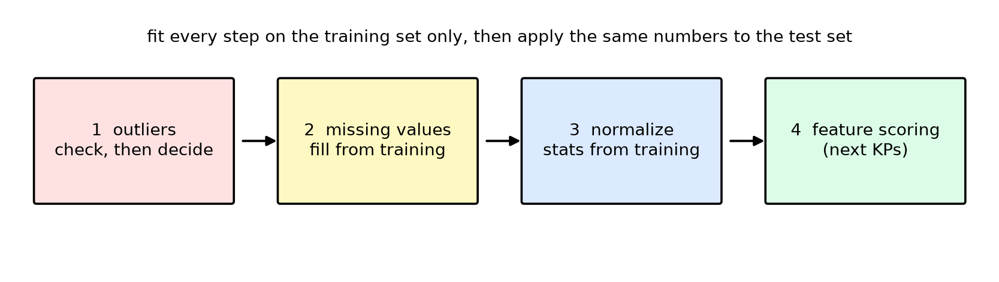

# KP02 Preprocessing: Clean the Data First, So the Statistics of the Features Can Be Trusted

> Level: undergraduate
>
> Pattern Recognition | Feature selection unit

[Slides](../../slides/lec07-kp02-preprocessing-en.jbd.json) | [中文版](../lec07-kp02-preprocessing.md)

## Learning objectives

- Explain how an outlier pulls the mean and the variance off, and judge whether to delete or keep it.
- Point out that the $3\sigma$ rule fails when the outlier is extreme, and say why.
- Put features on the same scale with the z-score and min-max, and compute one example by hand.
- Explain why the normalization parameters may only be computed from the training set, and point out the practice that causes data leakage.
- Compare deleting samples, mean imputation and multiple imputation, and state the side effect of mean imputation.
- Order the three steps outliers, missing values and normalization, and write the corresponding scikit-learn code.

## KP02 Preprocessing: clean the data first, so the statistics of the features can be trusted

**One-sentence summary**: Later, whether a feature is good is judged by its mean and variance. If the data is not cleaned, these two numbers will mislead; in every cleaning step, the parameters may only be computed from the training set.

### Prerequisites and notation

*Three things you need to know first*:

- *Mean and standard deviation*: $\bar x=\frac1N\sum x_i$, $\sigma=\sqrt{\frac{1}{N-1}\sum(x_i-\bar x)^2}$. All standard deviations in this lecture divide by $N-1$.
- *Training set and test set*: the training set is used to estimate parameters, and the test set imitates new data that has never been seen.
- **Feature**: one number describing each sample, for example age or cholesterol. The previous KP explained why features need to be evaluated; this KP makes the numbers used in the evaluation trustworthy.

*Symbol table*:

| Symbol | Meaning | Note |
|---|---|---|
| $x_i$ | A feature value of sample $i$ | One dimension, a real number |
| $N$ | Number of samples | Integer |
| $\bar x$ | Sample mean | Same unit as $x_i$ |
| $\sigma$ | Sample standard deviation | Divides by $N-1$ |
| $\hat x_i$ | Normalized value | No unit |
| $z_i$ | How many standard deviations value $i$ is from the mean | $z_i=(x_i-\bar x)/\sigma$ |

*Terms*: An **outlier** is a point far from most of the data. A **missing value** is a field that was not measured. **Normalization** converts features with different units onto the same scale.

### 1. One bad point can pull the average off

**In plain words**: Imagine 9 normal measurements $\{10,11,12,10,11,10,12,11,11\}$, and then one instrument spike $101$ mixed in. Describing this batch with the mean and standard deviation gives completely distorted results.

**Formal definition**: An **outlier** is a sample point far from the mean, with the distance often measured in multiples of $\sigma$. The squared error $(x_i-\bar x)^2$ magnifies large deviations: a deviation of $2$ squares to $4$, a deviation of $100$ squares to $10000$. So whenever squares are used (mean, variance, least squares), a single outlier can dominate the result.

**Example**: The sum of the 9 normal values is $98$, the mean $10.89$ and the standard deviation $0.78$. After adding $101$ the sum is $199$, the mean $19.9$ and the standard deviation $28.51$.

| Statistic | 9 normal values | With 101 (10 values) | Change |
|---|---|---|---|
| Mean $\bar x$ | $10.89$ | $19.90$ | Moved by $9.01$, about 1.8 times |
| Variance $\sigma^2$ | $0.611$ | $812.54$ | About 1330 times |
| Standard deviation $\sigma$ | $0.78$ | $28.51$ | About 36.5 times |

With one data point, the standard deviation swelled 36 times. If this standard deviation is later used to compute a test statistic or FDR, the denominator is inflated, and a good feature will be judged a bad one.

Figure `lec07-kp02-preprocessing-f1-outlier`: first the blue dots: the 9 normal values are packed between 10 and 12, and the green line is their mean $10.89$; then the red dot $101$ and the red dashed line: the mean of the 10 values including it is pulled to $19.9$, a number that is not close to any data point. (Function: 1, 2)



**Common misconception**: "With a lot of data, one outlier has no effect." As long as the outlier is extreme enough (for example $10^6$), its square is $10^{12}$, which can still overwhelm the sum of errors of tens of thousands of normal values.

### 2. Delete or keep: judge by a rule, and also by the source

**In plain words**: The most common way to judge outliers is the **$k\sigma$ rule**: become suspicious when a value is more than $k$ standard deviations from the mean. Under a normal distribution, about 95% of the data lies within $2\sigma$ and about 99% within $3\sigma$ (the textbook says 99%; the exact value is 99.7%).

*But it can fail*: with the 10 values that include 101, compute $z=(101-19.9)/28.51=2.845$. This is below $3$, so the $3\sigma$ rule **lets it pass**. The reason is that the outlier itself inflates the standard deviation, which in turn makes itself look not so far. Using the mean and standard deviation of the 9 normal values instead, $z=(101-10.89)/0.78\approx115.3$, obvious at a glance.

Figure `lec07-kp02-preprocessing-f2-masking`: first the left chart: the 9 blue bars are all close to 0, and the red bar for 101 has $z=2.845$, which does not cross the orange $3\sigma$ dashed line; then the right chart: that one point swells the standard deviation from $0.78$ to $28.51$, which is how it hides itself. (Function: 1, 2)



*Practice*: `[Added]` Two approaches reduce this "hiding itself": ① first mark suspicious points with a threshold of $2\sigma$ or stricter and check their source by hand; ② use quantities not affected by extreme values: the **median** and the **median absolute deviation** (MAD). The median of this data is $11$ and the MAD is $1$, so $101$ is $90$ MADs from the median and cannot be hidden.

*Delete or keep depends on the source*: if the outlier comes from an instrument fault or an input error, deleting it is reasonable. If it comes from a real **long-tailed distribution** (for example a very few high-income households), deleting it would damage the real distribution; then use a robust cost function that is insensitive to outliers (for example Huber: squared for small errors, linear for large errors). Delete only when outliers are few and certain to be noise.

**Common misconception**: "Delete everything outside $3\sigma$." Two problems: an outlier can hide itself; and extreme values in long-tailed data are real data.

### 3. With different units, distances are unfair

**In plain words**: Feature A is annual income (currency), ranging over hundreds of thousands; feature B is age (years), ranging over a few dozen. Computing the Euclidean distance directly, income gaps run to tens of thousands, while an age gap of 30 years is only 30, completely drowned out.

**Example**: 5 users (P1 to P5) and one query person; use the Euclidean distance to find the nearest person.

| Person | Annual income | Age | Raw distance to the query | z (income) | z (age) | z distance |
|---|---|---|---|---|---|---|
| P1 | 400,000 | 25 | 120,000 | $-1.265$ | $-1.042$ | 1.549 |
| P2 | 500,000 | 60 | 20,000 | $0.000$ | $1.129$ | 1.879 |
| P3 | 600,000 | 35 | 80,000 | $1.265$ | $-0.422$ | 1.058 |
| P4 | 450,000 | 31 | 70,000 | $-0.632$ | $-0.670$ | 0.888 |
| P5 | 550,000 | 58 | 30,000 | $0.632$ | $1.005$ | 1.778 |

The query person is $(520000,\ 30)$, which after z becomes $(0.253,\ -0.732)$. In raw units the nearest is **P2** (distance $20000$, although the age differs by 30 years); after the z-score the nearest is **P4** (z distance $0.888$, the age differs by only 1 year and the income is not far either). For the same query person, changing the scale changes the nearest neighbour. In the raw distance, the income gap accounts for 99.9999998% of the squared distance and age hardly matters.

Figure `lec07-kp02-preprocessing-f3-scale-distance`: first the left chart: in raw units the red line goes to P2, whose age of 60 differs a lot from the query but which is chosen because its income is nearest; then the right chart: after the z-score both axes have the same scale and the red line goes to P4 instead. (Function: 1, 3)



**Common misconception**: "Normalization changes the order of the points." It does not. $\hat x=(x-\bar x)/\sigma$ is a strictly increasing linear transformation, the order inside each feature does not change, and only the scale does.

### 4. How normalization is done and where its parameters come from

**Formal definition**: Three commonly used methods. ① The **z-score** (zero mean, unit variance):

$$
\hat x_{i}=\frac{x_i-\bar x}{\sigma},\qquad \bar x=\frac1N\sum_i x_i,\quad \sigma^2=\frac1{N-1}\sum_i(x_i-\bar x)^2 .
$$

② *Min-max*: $\hat x_i=(x_i-x_{\min})/(x_{\max}-x_{\min})$, with values in $[0,1]$. ③ *Softmax scaling*: first compute $y=(x_i-\bar x)/(r\sigma)$, then $\hat x_i=1/(1+e^{-y})$, which smoothly squeezes long-tailed data into $(0,1)$; $r$ controls the width of the central linear region.

**Example**: $x=\{20,30,40,50,60\}$, $\bar x=40$, $\sigma=\sqrt{1000/4}=15.811$.

| $x$ | $x-\bar x$ | z-score | min-max | softmax ($r=1$) |
|---|---|---|---|---|
| 20 | $-20$ | $-1.265$ | $0.00$ | $0.220$ |
| 30 | $-10$ | $-0.632$ | $0.25$ | $0.347$ |
| 40 | $0$ | $0.000$ | $0.50$ | $0.500$ |
| 50 | $+10$ | $0.632$ | $0.75$ | $0.653$ |
| 60 | $+20$ | $1.265$ | $1.00$ | $0.780$ |

After the z-score the mean is exactly $0$ and the standard deviation exactly $1$.

Figure `lec07-kp02-preprocessing-f4-zscore`: first the blue dots in the top row: the raw values $20$ to $60$; then the orange dots in the bottom row: after the z-score they become $-1.265$ to $1.265$, and the connecting lines are parallel and do not cross, showing that the order did not change. (Function: 1)



*The parameters may only be computed from the training set (data leakage)*: after the classifier goes live, it will meet data it has never seen. So $\bar x$ and $\sigma$ must be computed from the training set only, and then the same numbers are used to transform the test set. If you compute the test set's own mean and standard deviation separately, the shift of the test data is erased.

**Example**: Training set $\{20,30,40,50,60\}$ ($\bar x=40$, $\sigma=15.811$), test set $\{70,80,90\}$, a whole batch that is too high. ① The right way: with the training parameters, the test z are $1.90,\ 2.53,\ 3.16$, clearly showing "much higher than the training data". ② The wrong way: with the test set's own mean $80$ and standard deviation $10$, z becomes $-1,\ 0,\ 1$ and the shift disappears completely. The second way is **data leakage**: information from the test set got into the transformation parameters.

Figure `lec07-kp02-preprocessing-f5-leakage`: first the left chart (wrong): the test set uses its own mean 80 and standard deviation 10 and becomes $-1,0,1$ after transformation; then the right chart (right): the test set reuses the training mean 40 and standard deviation 15.811 and becomes $1.90,2.53,3.16$. (Function: 1, 2)



*Trade-offs*: min-max sends new values beyond the training range outside $[0,1]$; the z-score has no fixed bounds and can hold new values. For long-tailed data use softmax scaling or take the logarithm first. `[Added]` The `StandardScaler` of scikit-learn uses the standard deviation that **divides by $N$**, slightly different from the $N-1$ of this lecture: for the same $\{20,\dots,60\}$ it gets $\sigma=14.142$ and the test z are $2.121,\ 2.828,\ 3.536$. The larger $N$ is, the smaller the difference; as long as training and test use the same one, the conclusion does not change.

**Common misconception**: "It is most convenient to normalize all the data together." That is data leakage; when validating, every fold must recompute the parameters on that fold's training part.

### 5. Missing values: delete, fill with the mean, or fill better

**In plain words**: Someone left the monthly income blank on a questionnaire. Throwing away the whole questionnaire leaves fewer samples; filling in the overall mean looks reasonable but quietly changes the data.

*Four approaches* (the textbook also lists two traditional ways of filling, zero and the "conditional mean"; the conditional mean is a special case of approach ③ below that fills in only the mean without drawing a sample): ① *Delete the sample*: simple, but when samples are few or missing values are scattered in many places it throws away most of the data. ② **Mean imputation**: fill in the mean of the observed values. ③ *Single conditional imputation*: assume the data is **missing at random** (MAR, whether a value is missing depends only on the observed features), estimate the conditional distribution of the missing value from the known features, and draw one value from it to fill in, which keeps the correlations between features. ④ **Multiple imputation** (MI): draw $m>1$ sets of imputed values repeatedly, analyze each and combine, so that the result reflects "the uncertainty of the imputation itself".

**Example (the side effect of mean imputation)**: 10 patients, 8 have cholesterol data $\{180,190,200,210,220,180,200,220\}$ and 2 are missing. The observed mean is $200$, the sum of squares $1800$ and the variance $1800/7=257.14$. Fill both missing values with $200$:

| Statistic | 8 observed values | 10 values after mean imputation |
|---|---|---|
| Mean | $200.00$ | $200.00$ |
| Sum of squares $\sum(x_i-\bar x)^2$ | $1800$ | $1800$ (the two new values have deviation 0) |
| Variance | $257.14$ | $200.00$ (divide by $9$) |
| Standard deviation | $16.04$ | $14.14$ |

The mean did not change, but the variance was lowered by $22.2\%$: the two filled values both sit exactly at the mean, so the data looks more concentrated than it really is. A smaller variance makes the denominators of the test statistic and FDR smaller, so a feature without discriminating power will look as if it had.

Figure `lec07-kp02-preprocessing-f6-imputation`: first the left chart: the blue dots are the 8 observed values, and the red squares are the two values filled at $200$, stacked on the mean line; then the right chart: the variance drops from $257.14$ to $200.00$. (Function: 1, 2)



*A numerical example of multiple imputation*: `[Added]` Draw imputed values from $N(200,\ 257.14)$ (the observed mean and variance), repeating $m=3$ times (seed 0). The three sets of imputed values are $(202.0,\ 197.9)$, $(210.3,\ 201.7)$, $(191.4,\ 205.8)$, and the means of the three completed data sets are $199.99,\ 201.20,\ 199.72$. Combine by Rubin's rules: combined mean $=200.30$; within-imputation variance $\bar U=20.77$ (the average of the variance of the mean of each set); between-imputation variance $B=0.616$; total variance $T=\bar U+(1+1/m)B=21.60$, standard error $\sqrt T=4.65$. For comparison: mean imputation gives only $4.47$ (the variance is lowered and the standard error is too small). The standard error of MI is larger than that of mean imputation because it honestly reflects "these two values were imputed"; using only the 8 observed values gives $5.67$.

**Common misconception**: ① "Mean imputation is the safest, because the mean does not change." The variance is lowered. ② "With few missing values just fill them in any way." The way of filling affects the later feature evaluation, so it still needs comparing.

### 6. The order of the three steps, and a complete pipeline

*Order*: first check outliers, then handle missing values, and finally normalize. Reason: outliers pull the mean and the standard deviation off, so they must be handled first; imputation should use a clean mean; normalization comes after imputation so that complete data is available to compute the parameters. All "parameters" are computed from the training set and then applied to the test set.

Figure `lec07-kp02-preprocessing-f7-pipeline`: first the four boxes from left to right: outliers, missing values, normalization, and the later feature scoring; then the sentence above: every step learns its parameters on the training set only, and the same numbers are then used to transform the test set. (Function: 1)



*Implementation*: `[Added]` scikit-learn chains imputation and normalization into one pipeline: `fit` sees only the training set, and `transform` then applies to the test set. The program below was actually run, and its output is given in the comments:

```python
import numpy as np
from sklearn.impute import SimpleImputer
from sklearn.preprocessing import StandardScaler
from sklearn.pipeline import make_pipeline

X_train = np.array([[180], [190], [200], [210], [220], [180], [200], [220],
                    [np.nan], [np.nan]])          # 8 observed, 2 missing
X_test = np.array([[np.nan], [240.0]])            # the test set can also have missing values

pipe = make_pipeline(SimpleImputer(strategy="mean"), StandardScaler())
pipe.fit(X_train)                                  # learn parameters from the training set only

print(pipe[0].statistics_)    # [200.]      the mean used for imputation
print(pipe[1].mean_)          # [200.]      the mean for normalization
print(pipe[1].scale_)         # [13.4164]   the standard deviation after imputation (divides by N)
print(pipe.transform(X_test).ravel())   # [0.     2.9814]
```

The missing value of the test set is first imputed as $200$ and then becomes $z=0$; $240$ becomes $(240-200)/13.416=2.981$. The standard deviation after imputation, $13.416$, is smaller than that of the observed data, which is exactly the "mean imputation lowers the variance" of the previous section.

**Going deeper** (optional): outliers, missing values and normalization all affect the later feature scoring, for example the $t$ test of KP03 and the FDR of KP05. This is why this KP comes before feature evaluation: the scoring uses means and variances, and if these numbers cannot be trusted, the scores cannot be trusted.

### Extension: exercises and worked solutions

**Exercises**:

1. A sensor collects $\{20,21,22,21,116\}$. ① What is the mean including $116$? ② And after removing $116$? ③ Compute the $z$ of $116$ with the mean and standard deviation that include $116$; can the $3\sigma$ rule catch it?
2. A feature has $\bar x=100$, $\sigma=20$: what are the z-scores of $x=140$ and $x=70$?
3. A value in the test set, transformed with the training $\bar x=40$ and $\sigma=15.811$, has raw value $70$. What is z? What happens if the test set's own statistics are used by mistake?

**Worked solution of exercise 1**: ① $(20+21+22+21+116)/5=40.0$. ② $(20+21+22+21)/4=21.0$. ③ The standard deviation including $116$ is $42.49$, $z=(116-40)/42.49=1.79$, below $2$, so even $2\sigma$ does not catch it; after removal $z=(116-21)/0.816=116.4$. This is the masking of Section 2: the outlier inflates the standard deviation and itself does not look like an outlier.

**Worked solution of exercise 2**: $x=140$: $(140-100)/20=2.0$. $x=70$: $(70-100)/20=-1.5$.

**Worked solution of exercise 3**: ① $z=(70-40)/15.811=1.897$, about $1.9$ standard deviations above the training mean. ② If the test set's own statistics are used, this value may be computed as $-1$, $0$ or $1$, and it cannot be seen that it actually deviates far from the training data, which is data leakage.

## Terms and sources

| English | 中文 |
|---|---|
| Outlier | 離群點 |
| Standard deviation | 標準差 |
| $k$-sigma rule | $k\sigma$ 規則 |
| Masking | 遮住現象 |
| Median absolute deviation (MAD) | 中位數絕對偏差 |
| Robust cost function | 穩健代價函數 |
| Normalization | 正規化 |
| z-score | z-score |
| Data leakage | 資料洩漏 |
| Missing value | 遺失值 |
| Missing at random (MAR) | 隨機遺失 |
| Mean imputation | 均值補值 |
| Multiple imputation (MI) | 多重插補 |
| Listwise deletion | 刪除樣本 |
| Single imputation from the conditional distribution | 單一條件補值 |
| Min-max scaling | min-max 縮放 |
| Softmax scaling | softmax 縮放 |
| Fisher discriminant ratio (FDR) (later KP) | 費雪判別比（後續 KP） |
| `StandardScaler` | scikit-learn's standardization tool |

Sources: the three preprocessing sections of Chapter 5 (feature selection) on the CCC-LNS web page, checked item by item against §5.2 of Chapter 5 of Theodoridis & Koutroumbas (the three subsections on outliers, data normalization and missing data); the explanations, figures and order are rewritten. The sums and means of the web page's outlier example are wrong (the sum of the 9 normal values is 98, not 97; the mean with the outlier is 19.9, not 19.80; the variance is 812.54, not 810.04), and this lecture follows the values recomputed by program. The distance example, the data-leakage example, Rubin's combination, MAD and the scikit-learn code are `[Added]`; all numbers are computed by `scripts/lec07-kp02-preprocessing/compute_data.py` (`reports/lec07-kp02-preprocessing/數值驗算.json`).
