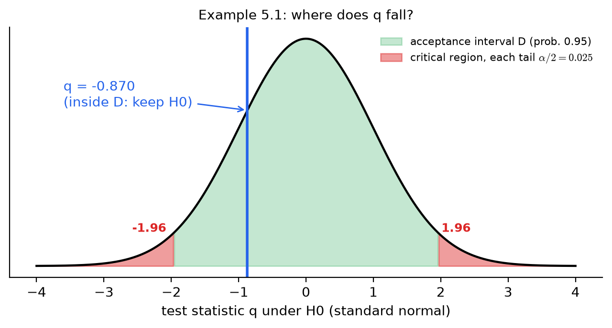
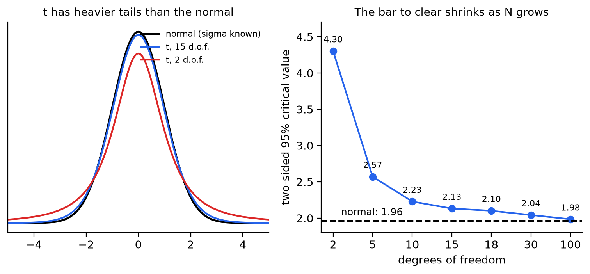
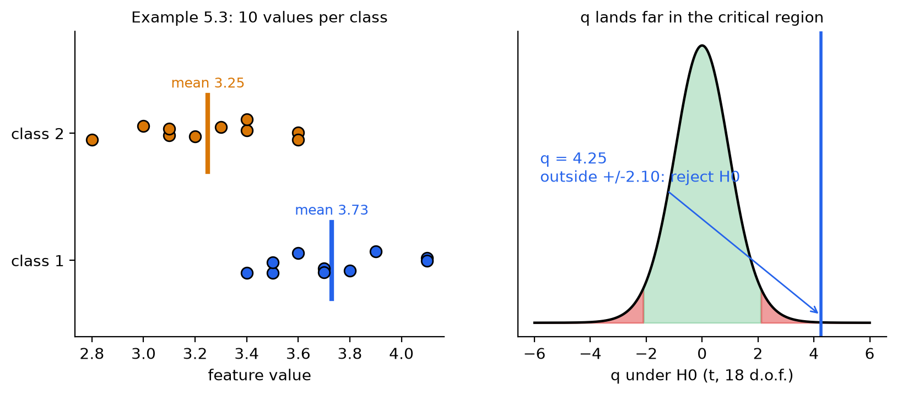
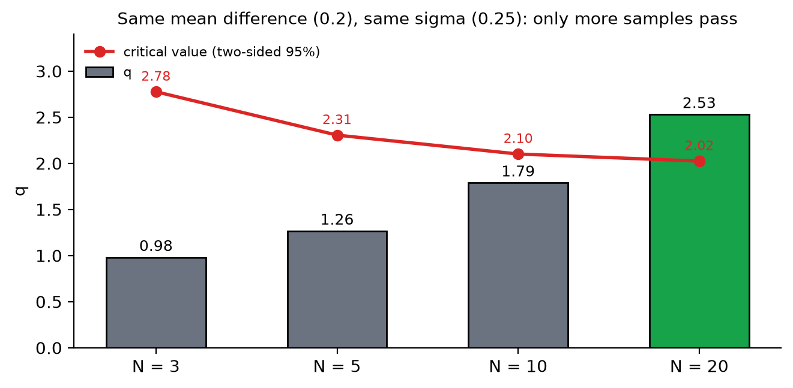
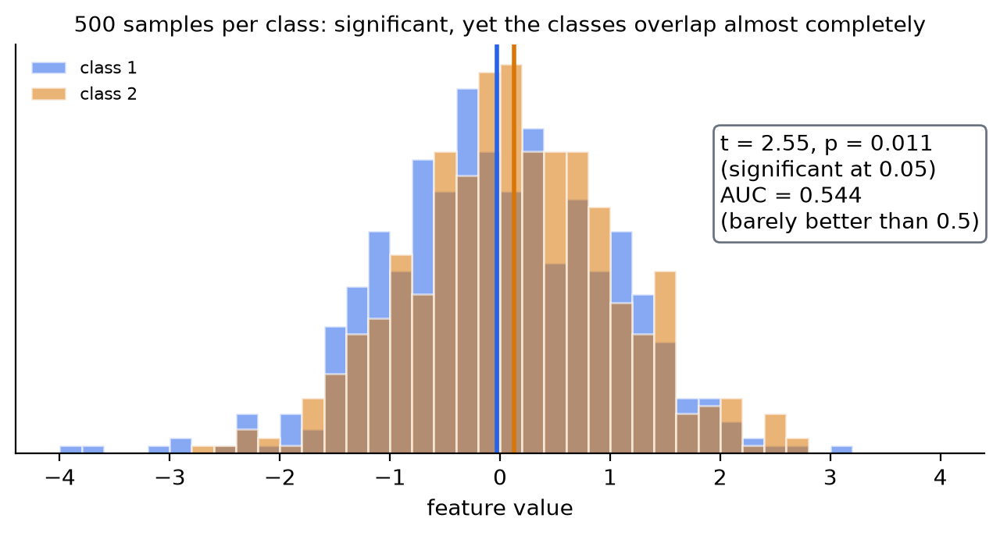
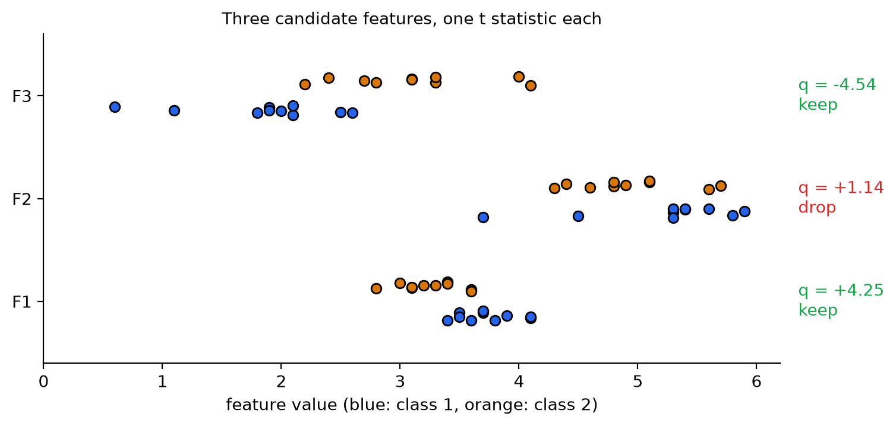

# KP03 Hypothesis Tests: Examine Each Feature in Turn and Drop Those Without Evidence

> Level: undergraduate
>
> Pattern Recognition | Feature selection unit

[Slides](../../slides/lec07-kp03-hypothesis-tests-en.jbd.json) | [中文版](../lec07-kp03-hypothesis-tests.md)

## Learning objectives

- Say what the null hypothesis, the alternative hypothesis, the test statistic and the significance level each stand for.
- Use the $z$ test (when $\sigma$ is known) and the $t$ test (when $\sigma$ is unknown) to judge whether a mean equals a given value.
- Compute by hand the $t$ statistic of one feature between two classes, decide to keep or drop it with the critical value, and explain why the degrees of freedom are $2N-2$.
- Explain why the same mean difference can lead to different test conclusions at different sample sizes.
- Point out that "the test is significant" does not mean "the two classes are separable", and say what to look at next.

## KP03 Hypothesis tests: examine each feature in turn and drop those without evidence

**One-sentence summary**: Take each feature on its own and ask "is the difference in class means real, or just sampling luck?" The gap counts as evidence only after it is divided by the sampling fluctuation; passing this gate only means the means differ, not yet that the classes are separable.

### Prerequisites and notation

*Three things you need to know first*:

- *Mean and standard deviation*: $\bar x=\frac1N\sum x_i$, $\hat\sigma=\sqrt{\frac{1}{N-1}\sum(x_i-\bar x)^2}$. The reason for dividing by $N-1$ is in KP02.
- *Critical value of the normal distribution*: the middle 95% interval of the standard normal is $[-1.96,\,1.96]$.
- *The conclusion of KP02*: if outliers and missing values are handled badly, the mean and the variance cannot be trusted; this KP computes nothing but these two quantities.

*Symbol table*:

| Symbol | Meaning | Note |
|---|---|---|
| $H_0$, $H_1$ | Null hypothesis, alternative hypothesis | $H_0$: no difference; $H_1$: there is a difference |
| $\bar x,\ \bar y$ | Sample means of the two classes | Same unit as the feature |
| $\sigma,\ \hat\sigma$ | Population standard deviation, standard deviation estimated from the sample | $\hat\sigma$ divides by $N-1$ |
| $q$ | Test statistic | No unit; the gap divided by the fluctuation |
| $\alpha$ | Significance level | The probability you allow yourself of wrongly rejecting $H_0$, commonly $0.05$ |
| $D$ | Acceptance region | Keep $H_0$ when $q$ falls inside |
| $s_z^2$ | Pooled variance estimate of the two classes | The average of the two sample variances |
| $N$ | Number of samples per class | The two classes have equal sizes in this lecture |

*Terms*: A **feature** is one number that describes a sample. The **class** is the label you want to predict; here there are two classes $\omega_1,\omega_2$. **Sampling fluctuation** is how much the computed mean jumps around when you draw a different batch of samples.

### 1. Why examine features one at a time first

**In plain words**: After KP02 the data is clean, and you may have dozens to hundreds of features. The later subset selection is expensive (KP06, KP07). So do the cheapest step first: look at the features one by one and drop those that clearly cannot discriminate.

**Formal definition**: Let $x$ be a feature. We ask whether its values differ significantly between the two classes $\omega_1,\omega_2$. Write the question as a statistical hypothesis test:

- $H_1$: the (mean) value of the feature differs significantly between the two classes.
- $H_0$: there is no significant difference.

The textbook states the limit of this step directly: looking at features one by one is "far from the best solution". It cannot see how features work together. Its value is that it is cheap, used to throw away obviously bad choices.

**Common misconception**: "If every feature passes the test, combining them is surely good." Not necessarily. Two features that pass the test may be two ways of writing the same thing, redundant (the unit-conversion example of KP01). Combinations are handled only in KP06.

### 2. The gap must be divided by the fluctuation to count as evidence

**In plain words**: Think of a courtroom. $H_0$ is "the defendant is innocent", and you look for evidence to overturn it. Evidence is not "the mean differs by 0.05" but "it differs by 0.05, and that gap is much larger than sampling luck". The same 0.05: with stable measurements and many samples it is strong evidence; with jumpy measurements and few samples it may be a coincidence. So divide the gap by its uncertainty; this "standardized strength of evidence" is called the **test statistic**.

**Formal definition**: First the general test. Let $\theta$ be an unknown parameter (for example a mean) and $\theta_0$ the specified value being tested:

$$
H_1:\ \theta\ne\theta_0,\qquad H_0:\ \theta=\theta_0 .
$$

Take $N$ samples $x_1,\dots,x_N$ and obtain a test statistic $q$ through a function, designed so that its distribution is known when $H_0$ holds. Cut the axis of $q$ into two parts:

- **Acceptance region** $D$: when $H_0$ holds, $q$ falls here with high probability ($1-\alpha$).
- **Critical region** $\bar D$: when $H_0$ holds, $q$ falls here with low probability ($\alpha$).

$\alpha$ is called the **significance level**. Keep $H_0$ if $q$ is in $D$, reject $H_0$ if $q$ is in $\bar D$. Note what $\alpha$ means: even if $H_0$ is true, you still have probability $\alpha$ of rejecting it through bad luck. You choose this error probability in advance.

**When $\sigma$ is known**: let the mean of $x$ be $\mu$ and the standard deviation $\sigma$. The sample mean $\bar x$ itself also fluctuates, with standard deviation $\sigma/\sqrt N$: the more samples, the smaller the fluctuation. To test $H_0:\mu=\hat\mu$, use

$$
q=\frac{\bar x-\hat\mu}{\sigma/\sqrt N}.
$$

By the central limit theorem, $q$ is approximately standard normal $N(0,1)$ when $H_0$ holds. The middle 95% interval of the standard normal is $[-1.96,\,1.96]$, so with $\alpha=0.05$ we get $D=[-1.96,\,1.96]$.

**Example (textbook Example 5.1)**: A feature has $\sigma=0.23$, $N=16$, and we measure $\bar x=1.35$. Test $\hat\mu=1.4$ with $\alpha=0.05$.

| Step | Formula | Result |
|---|---|---|
| ① Standard deviation of the mean | $\sigma/\sqrt N=0.23/\sqrt{16}$ | $0.0575$ |
| ② Gap | $\bar x-\hat\mu=1.35-1.4$ | $-0.05$ |
| ③ Test statistic | $q=-0.05/0.0575$ | $-0.870$ |
| ④ Acceptance region | Middle 95% of the standard normal | $[-1.96,\,1.96]$ |
| ⑤ Decision | $-0.870$ is inside $D$ | Keep $H_0$ |

Conclusion: there is no evidence that the mean is not $1.4$. This is not "proof that the mean is $1.4$", only that this batch of samples is not enough to overturn it. Conversely we can compute an interval: the **confidence interval** of the mean is $\bar x\pm1.96\cdot0.0575=[1.237,\,1.463]$, and $1.4$ is inside. Table 5.1 of the textbook gives $1.967$ in the 95% column, while the exact value is $1.960$; the two interval endpoints differ only in the fourth decimal place and the conclusion is the same.

Figure `lec07-kp03-hypothesis-tests-f1-acceptance`: first look at the green middle region: it holds 95% of the probability and is the acceptance region $D$; then the small red tails at both ends, 2.5% each, are the critical region; finally the blue line: $q=-0.870$ falls inside the green region, so we keep $H_0$. (Function: 1, 2)



**Common misconception**: "If $q$ falls in the acceptance region, $H_0$ is proved true." No. The acceptance region only means the evidence is not enough to overturn it. With too few samples, a real difference can also be missed (see Section 6).

### 3. When $\sigma$ is unknown: use $t$, and loosen the threshold

**In plain words**: In practice you almost never know $\sigma$ and must estimate it from the samples. The estimate $\hat\sigma$ itself fluctuates. When the denominator jumps, $q$ produces extreme values more easily than a standard normal. So the threshold must be loosened a little, by an amount that depends on how many samples you have.

**Formal definition**: Estimate $\sigma$ from the samples:

$$
\hat\sigma^2=\frac{1}{N-1}\sum_{i=1}^N(x_i-\bar x)^2,\qquad
q=\frac{\bar x-\hat\mu}{\hat\sigma/\sqrt N}.
$$

If $x$ is normal, this $q$ follows a **$t$ distribution** with $N-1$ **degrees of freedom**. Degrees of freedom can first be understood as "how many independent pieces of information are used to estimate $\sigma$": $N$ values have already spent one piece on computing $\bar x$, leaving $N-1$. The tails of the $t$ distribution are thicker than the normal (see the left chart below), so the acceptance region must be wider; the larger the degrees of freedom, the closer to the normal.

| Degrees of freedom | 2 | 5 | 10 | 15 | 18 | 30 | 100 | Normal |
|---|---|---|---|---|---|---|---|---|
| Two-sided 95% critical value | 4.30 | 2.57 | 2.23 | 2.13 | 2.10 | 2.04 | 1.98 | 1.96 |

**Example (textbook Example 5.2)**: Use the numbers of Example 5.1 but treat $0.23$ as $\hat\sigma$ estimated from the samples. $N=16$, degrees of freedom $15$. The textbook takes significance level $\alpha=0.025$ (two-sided) and reads the critical value $2.49$ from Table 5.2:

- Confidence interval of the mean: $1.35\pm2.49\cdot0.0575=[1.207,\,1.493]$.
- With 95% instead: critical value $2.131$, interval $[1.227,\,1.473]$. Both are wider than the $z$ interval $[1.237,\,1.463]$.

*Read the table carefully*: the column $1-\alpha$ of Table 5.2 is the **two-sided** probability. For example, the $2.49$ in the $0.975$ column at 15 degrees of freedom is the critical value for "the middle 97.5%"; if an ordinary $t$ table lists one-sided quantiles, the same value corresponds to $0.9875$. Convert the table correctly.

Figure `lec07-kp03-hypothesis-tests-f2-t-vs-z`: first the left chart: the red $t$ (2 degrees of freedom) has the thickest tails, the blue one (15 degrees of freedom) is already close to the black normal; then the right chart: the two-sided 95% critical value falls from 4.30 at 2 degrees of freedom to 1.98 at 100, approaching the normal's 1.96. (Function: 1, 2)



**Common misconception**: "With $N$ above 30 you can always use $z$." Only approximately. The critical value at 30 degrees of freedom is $2.04$, still different from $1.96$; the difference is small, so with large samples the two usually agree.

### 4. The mean difference of two classes is also a $t$

**In plain words**: What feature selection really asks is whether the feature has different means in $\omega_1$ and $\omega_2$. Subtracting the corresponding values of the two classes turns "comparing two classes" into the previous section's "is the mean of one set of numbers equal to 0?".

**Formal definition**: Let the $N$ values of the feature in $\omega_1$ be $x_i$ (mean $\bar x$) and the $N$ values in $\omega_2$ be $y_i$ (mean $\bar y$). Assume the two classes have the same variance $\sigma^2$. Test

$$
H_1:\ \Delta\mu=\mu_1-\mu_2\ne0,\qquad H_0:\ \Delta\mu=0 .
$$

Let $z=x-y$. When the two are independent, the mean of $z$ is $\mu_1-\mu_2$ and its variance is $2\sigma^2$, so the standard deviation of $\bar z=\bar x-\bar y$ is $\sigma\sqrt{2/N}$. $\sigma$ must be estimated from both classes together:

$$
s_z^2=\frac{1}{2N-2}\Big[\sum_{i=1}^N(x_i-\bar x)^2+\sum_{i=1}^N(y_i-\bar y)^2\Big],\qquad
q=\frac{(\bar x-\bar y)-0}{s_z\sqrt{2/N}} .
$$

When the two classes have equal sample sizes, $s_z^2$ is just the average of the two sample variances $\hat\sigma_1^2,\hat\sigma_2^2$. The denominator uses $N-1+N-1=2N-2$ independent pieces of information, so $q$ follows a $t$ distribution with **$2N-2$** degrees of freedom.

**Example (textbook Example 5.3)**: A feature is measured 10 times in each class:

| Class | The 10 values | Mean | Sample variance |
|---|---|---|---|
| $\omega_1$ | 3.5, 3.7, 3.9, 4.1, 3.4, 3.5, 4.1, 3.8, 3.6, 3.7 | $3.73$ | $0.0601$ |
| $\omega_2$ | 3.2, 3.6, 3.1, 3.4, 3.0, 3.4, 2.8, 3.1, 3.3, 3.6 | $3.25$ | $0.0672$ |

| Step | Formula | Result |
|---|---|---|
| ① Pooled variance | $s_z^2=(0.0601+0.0672)/2$ | $0.0637$, $s_z=0.2523$ |
| ② Standard deviation of the mean difference | $s_z\sqrt{2/10}=0.2523\times0.4472$ | $0.1128$ |
| ③ Test statistic | $q=(3.73-3.25)/0.1128$ | $4.254$ |
| ④ Degrees of freedom and critical value | $2\times10-2=18$, $\alpha=0.05$ | $D=[-2.10,\,2.10]$ |
| ⑤ Decision | $4.254$ is outside $D$ | Reject $H_0$, keep this feature |

The textbook writes $q=4.25$ and $D=[-2.10,\,2.10]$, which agrees with the recomputation. `[Added]` The $p$-value is then $0.0005$ (the probability that $|q|$ is this large when $H_0$ holds); the 95% confidence interval of the mean difference $0.48$ is $[0.243,\,0.717]$, which does not contain $0$.

Figure `lec07-kp03-hypothesis-tests-f3-two-class-t`: first the left chart: the orange points (class 2) lie to the left overall, with mean $3.25$; the blue ones (class 1) lie to the right, with mean $3.73$; then the right chart: the $t$ distribution with 18 degrees of freedom, where the green region is the acceptance region and the blue line $q=4.25$ lies far outside the red critical region. (Function: 1, 2)



**Common misconception**: "The test checks the difference of individual samples." No. The test checks the difference of the class **means**, divided by the jitter of the means. The same mean difference is stable with many samples and shaky with few (Section 6).

### 5. When the assumptions fail: change the tool

**In plain words**: The $t$ of the previous section used three assumptions: equal variances in the two classes, equal sample sizes, and a roughly normal feature. In practice they often fail, and each has a matching remedy.

- *Different sample sizes*: $s_z^2$ must be changed to weight by each class's own degrees of freedom; the textbook leaves this modification as an exercise.
- *Different variances*: first check whether the ratio $F=\hat\sigma_1^2/\hat\sigma_2^2$ is close to $1$; the distribution of the ratio is called the $F$ distribution. In Example 5.3, $F=0.0601/0.0672=0.894$, and the 95% acceptance region for degrees of freedom $(9,9)$ is $[0.248,\,4.03]$, which contains it, so the equal-variance assumption can be accepted. If it cannot be accepted, switch to **Welch's $t$ test** (which does not require equal variances) `[Added]`.
- *Not normal*: switch to a method that does not assume a distribution, for example the Kruskal–Wallis test mentioned in the textbook, which for two classes is equivalent to the Mann–Whitney test `[Added]`.

`[Added]` Checking Example 5.3 with scipy:

```python
from scipy import stats
a = [3.5, 3.7, 3.9, 4.1, 3.4, 3.5, 4.1, 3.8, 3.6, 3.7]
b = [3.2, 3.6, 3.1, 3.4, 3.0, 3.4, 2.8, 3.1, 3.3, 3.6]
stats.ttest_ind(a, b)                      # t=4.254, p=0.00048 (equal variances)
stats.ttest_ind(a, b, equal_var=False)     # Welch: t is unchanged for equal sizes, p=0.00048
stats.mannwhitneyu(a, b)                   # no normality assumed: p=0.0016
```

All three results point to the same conclusion, which in practice is a good sign: the conclusion does not depend on one assumption.

**Common misconception**: "If an assumption fails, the test is completely void." A small departure usually matters little; but when the result lands right next to the critical value, cross-check with a method that does not depend on the assumption.

### 6. What the test does not tell you

**In plain words**: Passing the test only lets you say "the means differ". Three more things must be considered before deciding to keep the feature.

**(a) The sample size decides whether you can see the difference.** Suppose the true mean difference of the two classes is $0.2$ and $\sigma=0.25$. Changing only $N$, the values of $q=\dfrac{0.2}{0.25\sqrt{2/N}}$ and of the critical value are:

| Samples per class $N$ | 3 | 5 | 10 | 20 |
|---|---|---|---|---|
| $q$ | $0.98$ | $1.26$ | $1.79$ | $2.53$ |
| Two-sided 95% critical value | $2.78$ | $2.31$ | $2.10$ | $2.02$ |
| Reject $H_0$? | No | No | No | Yes |

With the same true gap, only $N=20$ can see it. Failing the test may mean the feature is useless, or that there are too few samples.

Figure `lec07-kp03-hypothesis-tests-f4-n-effect`: first the grey and green bars: $q$ grows as the sample size ($\sqrt N$) increases; then the red line: the critical value falls at the same time; only the rightmost bar ($N=20$) is taller than the red line. (Function: 1, 2)



**(b) Significant does not mean separable.** Conversely, with enough samples even a tiny mean difference becomes "significant". `[Added]` Teaching setup: 500 samples per class, with a true mean difference of only $0.2\sigma$ (seed 0). We get $t=2.55$, $p=0.011$, significant at the $0.05$ level. But the distributions of the two classes almost completely overlap: if you draw one $\omega_2$ sample and one $\omega_1$ sample at random, the probability that the former is larger is only $0.544$ (AUC, the star of the next KP), not far from the coin toss's $0.5$. The test answers "do the means differ?", not "by how much, and how much do they overlap?".

Figure `lec07-kp03-hypothesis-tests-f5-significant-overlap`: first the two histograms: blue and orange almost completely overlap; then the two vertical lines: the means differ only slightly; the box at the upper right says: the $p$-value is significant, yet the AUC is only 0.544. (Function: 1, 2)



This is exactly the motivation of the textbook's next section (the ROC curve): the means can differ a lot, yet the spread can be so large that the classes blur together; we need a tool that measures the "overlap" directly.

**(c) Preprocessing quietly changes $q$ (continuing KP02).** Back to Example 5.3. Suppose the 2nd, 4th and 10th values of $\omega_2$ (values $3.6$, $3.4$, $3.6$) were not measured, leaving 7 values with mean $3.129$ and sample variance $0.0390$.

- If we run Welch's test directly on the 7 values: $q=5.59$ (about $14.6$ degrees of freedom).
- If we fill the 3 missing values with $3.129$ to make 10 values and recompute: the imputed values are at distance 0 from the mean and add nothing to the sum of squares, yet the denominator $N-1$ changes from $6$ to $9$, so the sample variance is multiplied by $6/9=2/3$ and drops to $0.0260$; $q$ is inflated to $6.48$.

On the same data, mean imputation raises $q$ from $5.59$ to $6.48$. The denominator is artificially shrunk and the feature looks more discriminative. This is the concrete consequence of KP02's remark that mean imputation has side effects.

**(d) Many features to examine at once.** Take three candidate features F1, F2, F3 (F1 is Example 5.3; F2 and F3 are `[Added]` teaching-setup data, seed 1, 10 per class):

| Feature | $\omega_1$ mean | $\omega_2$ mean | $q$ | $p$-value | Decision |
|---|---|---|---|---|---|
| F1 | $3.73$ | $3.25$ | $+4.25$ | $0.0005$ | Keep |
| F2 | $5.22$ | $4.93$ | $+1.14$ | $0.267$ | Drop |
| F3 | $1.86$ | $3.10$ | $-4.54$ | $0.0003$ | Keep |

The sign of $q$ only tells which class has the larger mean; rank by $|q|$. F3 has the largest $|q|$. Note: when testing many features at once, a few will pass $\alpha=0.05$ by luck alone (among 100 useless features, 5 will pass on average), so passing the test only screens out the clearly bad ones and is not the final answer. `[Added]` This is different from the "Fisher discriminant ratio FDR" of the next batch of KPs: the multiple-testing problem here is about the "false discovery rate", another concept with the same abbreviation; do not confuse them.

Figure `lec07-kp03-hypothesis-tests-f6-three-features`: first the blue and orange points in each row: the two classes of F1 and F3 are clearly apart, while F2's two classes are mixed; then the $q$ on the right: F2 is only $1.14$ and is dropped. (Function: 1, 2)



**Common misconception**: "The $p$-value is the probability that this feature is useful." No. The $p$-value is the probability of seeing a $q$ this extreme when $H_0$ holds; it does not tell you how useful the feature is, and it is not the probability that $H_0$ is true.

### Extension: exercises and worked solutions

**Exercises**:

1. The 8 values of a feature in one class are $5.1,\ 4.9,\ 5.3,\ 5.0,\ 4.7,\ 5.2,\ 4.8,\ 5.0$. Use a $t$ test ($\alpha=0.05$, two-sided) to test whether the mean is $4.8$.
2. Keep $s_z=0.2523$ and the mean difference $0.48$ of Example 5.3, but with only $N=3$ per class. What is $q$? Can we reject $H_0$?
3. A student says: "This feature has $p=0.003$, so it must separate the two classes." How do you answer?

**Worked solution of exercise 1**: The mean is $5.0$ and the sample standard deviation is $0.2$. $q=(5.0-4.8)/(0.2/\sqrt8)=2.828$, with $7$ degrees of freedom. The two-sided 95% critical value is $2.365$. Since $2.828>2.365$, reject $H_0$: the mean differs significantly from $4.8$ ($p=0.025$).

**Worked solution of exercise 2**: $q=0.48/(0.2523\sqrt{2/3})=2.33$. The degrees of freedom are $2\cdot3-2=4$ and the critical value is $2.776$. Since $2.33<2.776$ we cannot reject. With the same mean difference, $N=10$ gives $q=4.25$ and can reject, while $N=3$ cannot: the sample is too small, the fluctuation is large, and the difference cannot be seen.

**Worked solution of exercise 3**: $p=0.003$ only says the class means are probably different; it does not say the classes are separable. With many samples and a large spread, the classes can still overlap heavily (Section 6 (b): $p=0.011$ but AUC only 0.544). To judge separability, look at the amount of overlap, for example the ROC curve and AUC of the next KP.

## Terms and sources

| English | 中文 |
|---|---|
| Hypothesis testing | 假設檢定 |
| Null hypothesis ($H_0$) | 虛無假設 |
| Alternative hypothesis ($H_1$) | 對立假設 |
| Test statistic | 檢定統計量 |
| Significance level ($\alpha$) | 顯著水準 |
| Acceptance region, critical region | 接受域、臨界域 |
| Confidence interval | 信賴區間 |
| Degrees of freedom | 自由度 |
| Student's $t$-distribution | $t$ 分布 |
| Pooled variance | 合併變異數 |
| $F$-test | $F$ 檢定 |
| Welch's $t$-test | Welch $t$ 檢定 |
| Nonparametric test | 無母數檢定 |
| $p$-value | $p$ 值 |
| Receiver operating characteristic (ROC) curve (next KP) | ROC 曲線（下一個 KP） |
| Area under the ROC curve (AUC) (next KP) | AUC（下一個 KP） |
| Fisher discriminant ratio (FDR) (later KP) | 費雪判別比 FDR（後續 KP） |
| False discovery rate | 錯誤發現率 |

Sources: Theodoridis & Koutroumbas, *Pattern Recognition*, Chapter 5 §5.4 (local Ch5.pdf), and §5.4 of Chapter 5 on the CCC-LNS web page; the explanations, figures and order are rewritten, and the numbers of the three textbook examples (Examples 5.1–5.3) agree with recomputation by program. The $1.967$ in Table 5.1 is the table's approximation (exact $1.960$). The sample-size effect, the significant-but-overlapping simulation, the mean imputation inflating $q$, the three-feature ranking, the scipy code, and Welch and Mann–Whitney are `[Added]`; all numbers are computed by `scripts/lec07-kp03-hypothesis-tests/compute_data.py` (`reports/lec07-kp03-hypothesis-tests/數值驗算.json`).
