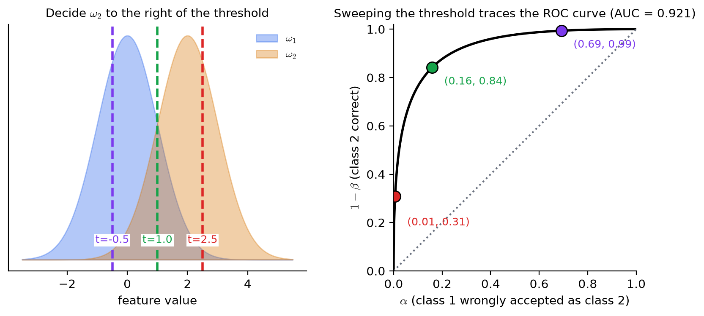
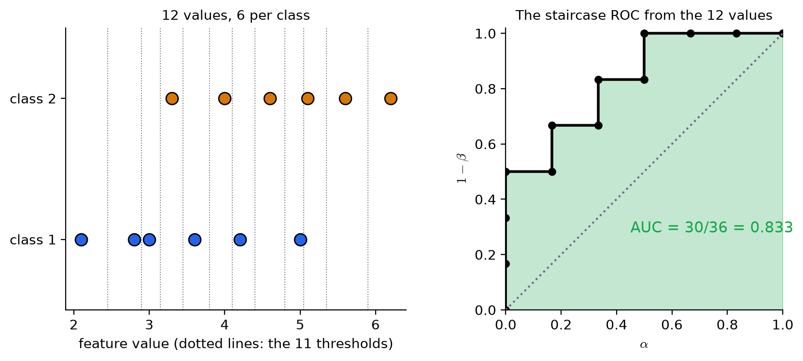
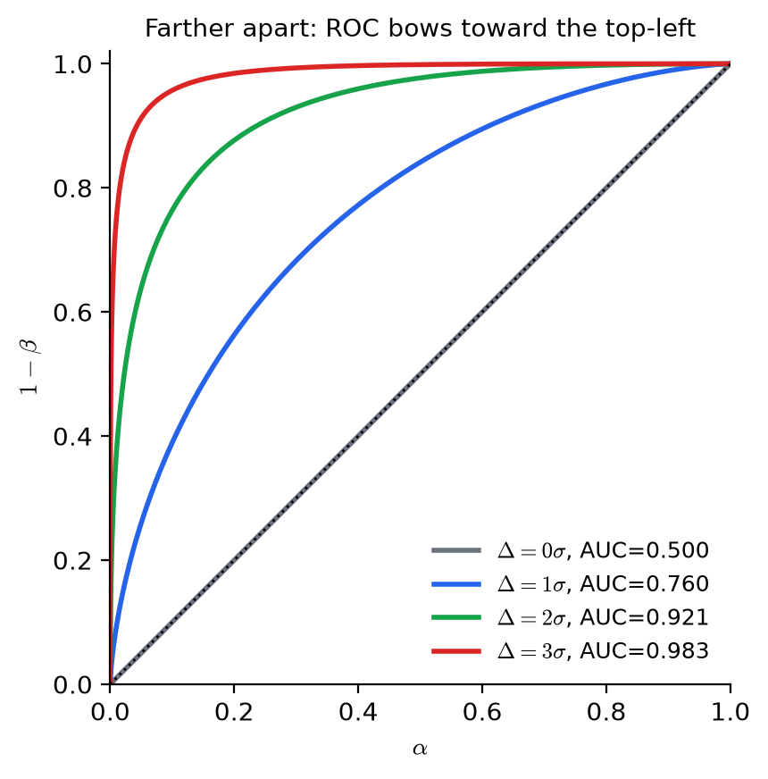
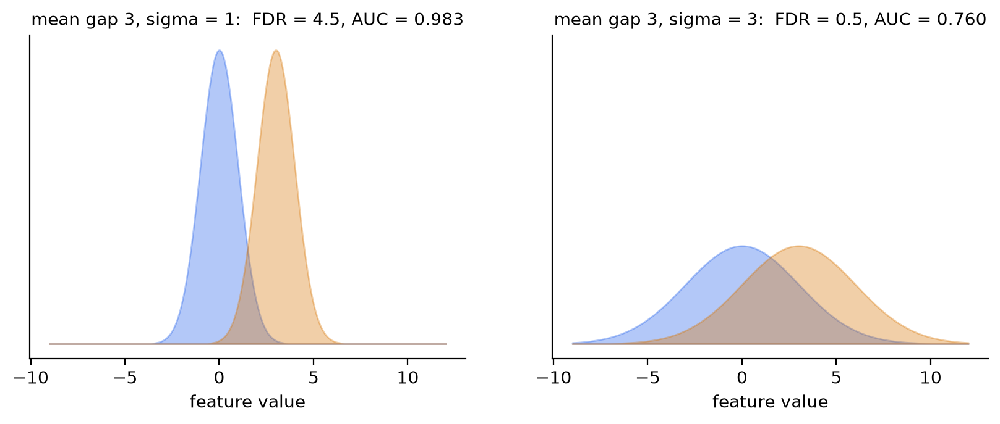
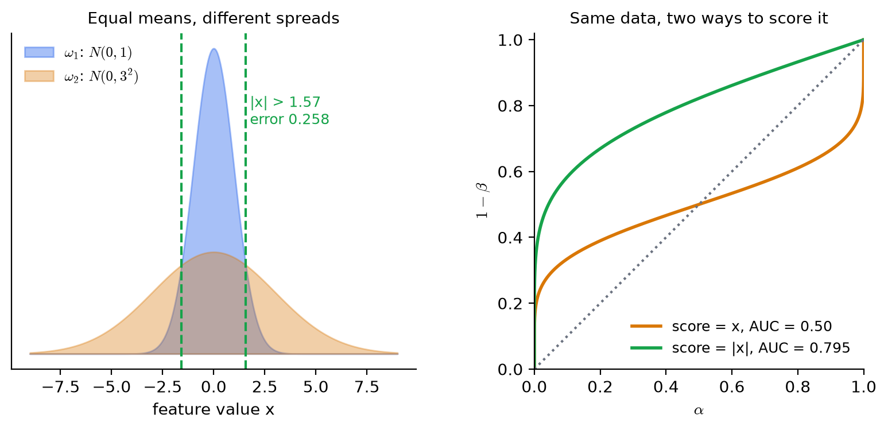

# KP04 ROC Curve and AUC: See How Much the Classes Overlap, Not Just How Far the Means Differ

> Level: undergraduate
>
> Pattern Recognition | Feature selection unit

[Slides](../../slides/lec07-kp04-roc-auc-en.jbd.json) | [中文版](../lec07-kp04-roc-auc.md)

## Learning objectives

- From two classes of samples and one threshold, compute the two error rates $\alpha$ and $\beta$, and say that they trade off against each other.
- Sweep all thresholds to draw the ROC curve, and say what the diagonal and the upper-left corner stand for.
- Compute the AUC by hand from a small data set, and state its probabilistic meaning: the probability that, for a random pair, the value of $\omega_2$ is larger.
- Explain why AUC can be used to rank features, and point out the cases it cannot see.

## KP04 ROC curve and AUC: see how much the classes overlap, not just how far the means differ

**One-sentence summary**: Sweep the threshold from left to right; each threshold gives a pair (fraction wrongly flagged, fraction correctly caught), and joining them gives the ROC curve. The closer the curve is to the upper-left corner, and the larger the area under it (AUC), the better the two classes separate.

### Prerequisites and notation

*Two things you need to know first*:

- *KP03*: a significant mean difference does not mean the two classes are separable (with 500 samples per class and a mean gap of only $0.2\sigma$, $p=0.011$ yet the two classes almost overlap). This KP answers "how much do they overlap?".
- *Probability and cumulative distributions*: the cumulative distribution function $\Phi(t)$ of the standard normal is the probability of falling "to the left of $t$".

*Symbol table*:

| Symbol | Meaning | Note |
|---|---|---|
| $\omega_1,\ \omega_2$ | The two classes | In this lecture $\omega_2$ has the larger feature values on average |
| $t$ | Decision threshold | Values above $t$ are labelled $\omega_2$, otherwise $\omega_1$ |
| $\alpha$ | Probability of misclassifying $\omega_1$ as $\omega_2$ | That is $P(x>t\mid\omega_1)$ |
| $\beta$ | Probability of misclassifying $\omega_2$ as $\omega_1$ | That is $P(x\le t\mid\omega_2)$ |
| $1-\beta$ | Probability that $\omega_2$ is classified correctly | The vertical axis of the ROC |
| AUC | Area under the ROC curve | Between $0$ and $1$ |
| $\Delta$ | Difference of the two class means | Same unit as the feature |

*Term*: The **ROC curve** (receiver operating characteristic curve) joins the points $(\alpha,\,1-\beta)$ of all thresholds.

### 1. The means differ, yet the two classes can still blur together

**In plain words**: The test of KP03 only looks at "how much the means differ". Imagine two piles of apples whose average weights differ by $10$ grams, but each pile spreads from $50$ to $250$ grams. Pick one up and you cannot guess which pile it came from. However significant the mean difference, once the spread is large the classes still blur together. What we need to measure is the **degree of overlap** of the two classes.

**Formal definition**: Let the probability densities of feature $x$ in the two classes be $p(x\mid\omega_1)$ and $p(x\mid\omega_2)$. The larger the overlapping area of the two density curves, the higher the probability that any decision made with $x$ is wrong. Overlap is not one number but a whole set of trade-offs, and it can only be seen completely by sweeping all possible thresholds; that is the job of the ROC curve.

**Common misconception**: "A large mean difference makes classification easy." Not necessarily. Separability depends on the ratio of mean difference to spread, which KP05 will write as FDR.

### 2. One threshold, two errors, trading off

**In plain words**: Cut with threshold $t$: $x>t$ is labelled $\omega_2$ and $x\le t$ is labelled $\omega_1$. The cut makes two kinds of mistakes: a sample of $\omega_1$ wrongly labelled $\omega_2$ (false alarm), and a sample of $\omega_2$ missed (miss). Move the threshold right: fewer false alarms, more misses; move it left and it is the opposite. No position makes both errors smallest at once.

**Formal definition**:

$$
\alpha=P(x>t\mid\omega_1),\qquad \beta=P(x\le t\mid\omega_2),\qquad 1-\beta=P(x>t\mid\omega_2).
$$

$\alpha$ is the probability that $\omega_1$ is misclassified and $\beta$ the probability that $\omega_2$ is misclassified. $1-\beta$ is the probability that $\omega_2$ is correctly caught. One threshold corresponds to one point $(\alpha,\ 1-\beta)$ in the plane.

**Example**: 100 samples, 50 belonging to $\omega_1$ and 50 to $\omega_2$. After setting a threshold:

| Outcome | Count |
|---|---|
| $\omega_1$ correct ($1-\alpha$) | 40 |
| $\omega_1$ misclassified as $\omega_2$ ($\alpha$) | 10 |
| $\omega_2$ correct ($1-\beta$) | 45 |
| $\omega_2$ missed as $\omega_1$ ($\beta$) | 5 |

$\alpha=10/50=0.20$ and $1-\beta=45/50=0.90$. This threshold is the point $(0.20,\ 0.90)$ on the chart.

**Common misconception**: "The two errors must be read separately; one alone is useless." A high $1-\beta$ alone may only mean the threshold is set too low and everything is labelled $\omega_2$, giving $1-\beta=1$ but $\alpha=1$. Always read them as a pair.

### 3. Sweep all thresholds to get the ROC curve

**In plain words**: Sweep the threshold from the far left to the far right; each position gives one point, and joining them gives the ROC curve. Each point on the curve is a trade-off: moving to the upper right catches more but also raises more false alarms; moving to the lower left gives fewer false alarms but catches less.

**Formal definition**: The ROC curve is the point set $\{(\alpha(t),\,1-\beta(t))\}$ with $t$ running over all possible thresholds. Two extremes:

- *The two classes overlap completely*: every threshold has $\alpha=1-\beta$ (the fraction caught equals the fraction falsely alarmed, which is guessing), and the curve is the **diagonal** from $(0,0)$ to $(1,1)$.
- *The two classes are completely separate*: there is always a threshold with $\alpha=0$ and $1-\beta=1$, and the curve hugs the **upper-left corner**.

The better the classes separate, the farther the curve is from the diagonal and the more it bulges toward the upper left.

Figure `lec07-kp04-roc-auc-f1-sweep`: first the left chart: blue is $\omega_1$, orange is $\omega_2$, and the three dashed lines are three thresholds $t=-0.5,\ 1.0,\ 2.5$; then the right chart: the three points of the same colours are the $(\alpha,1-\beta)$ of these thresholds: $(0.69,\,0.99)$, $(0.16,\,0.84)$, $(0.01,\,0.31)$; the black curve is the result of sweeping all thresholds. The two class means of this distribution are $2\sigma$ apart and the AUC is $0.921$. (Function: 1, 2)

**Example: a hand-computed ROC from 12 values.** Six values in each class:

- $\omega_1$: $2.1,\ 2.8,\ 3.0,\ 3.6,\ 4.2,\ 5.0$
- $\omega_2$: $3.3,\ 4.0,\ 4.6,\ 5.1,\ 5.6,\ 6.2$

Sort the 12 values from small to large and put a threshold at the midpoint of each pair of neighbours; add the two extremes "label everything $\omega_2$" and "label everything $\omega_1$", giving 13 thresholds in all. Count how many $\omega_1$ and how many $\omega_2$ lie to the right of each threshold, and divide each by 6:

| Threshold $t$ | $\omega_1$ on the right | $\omega_2$ on the right | $\alpha$ | $1-\beta$ |
|---|---|---|---|---|
| $-\infty$ | 6 | 6 | 1.000 | 1.000 |
| 2.45 | 5 | 6 | 0.833 | 1.000 |
| 2.90 | 4 | 6 | 0.667 | 1.000 |
| 3.15 | 3 | 6 | 0.500 | 1.000 |
| 3.45 | 3 | 5 | 0.500 | 0.833 |
| 3.80 | 2 | 5 | 0.333 | 0.833 |
| 4.10 | 2 | 4 | 0.333 | 0.667 |
| 4.40 | 1 | 4 | 0.167 | 0.667 |
| 4.80 | 1 | 3 | 0.167 | 0.500 |
| 5.05 | 0 | 3 | 0.000 | 0.500 |
| 5.35 | 0 | 2 | 0.000 | 0.333 |
| 5.90 | 0 | 1 | 0.000 | 0.167 |
| $+\infty$ | 0 | 0 | 0.000 | 0.000 |

Joining these 13 points in order gives a staircase ROC curve: at each $\omega_2$ value the curve goes up one step ($1/6$); at each $\omega_1$ value it goes right one step.

Figure `lec07-kp04-roc-auc-f2-hand-roc`: first the left chart: the 12 values on the axis, with grey dotted lines for the 11 thresholds; then the right chart: the staircase black line is the ROC joined from the 13 points of the table above, and green is the area under the curve. (Function: 1, 2)

**Common misconception**: "The ROC curve is always smooth." It is only approximately smooth with many samples and a continuous distribution; with few samples it is a staircase, which is normal.

### 4. AUC: condense the whole curve into one score

**In plain words**: Each point on the curve is a trade-off, hard to compare. Compute the area under the curve to get a score from $0$ to $1$: the **AUC**. The diagonal (guessing) has AUC $0.5$; perfect separation gives $1$.

**Two ways to compute the area**: The textbook uses "the area between the curve and the diagonal": complete overlap gives $0$ and complete separation gives $\tfrac12$ (the upper triangle). Nowadays the area under the whole curve, the AUC, is more common; the two differ by the $\tfrac12$ under the diagonal:

$$
\text{AUC}=\tfrac12+(\text{area between the curve and the diagonal}).
$$

For the 12-value example: the area under the staircase is $0.833$, so the area between the curve and the diagonal is $0.333$.

**Probabilistic meaning of AUC**: AUC equals "the probability that, when one sample of $\omega_1$ and one of $\omega_2$ are drawn at random, the value of $\omega_2$ is larger". Verify with the 12 values: there are $6\times6=36$ pairs. For each $\omega_2$ value, count how many $\omega_1$ values are smaller:

| $\omega_2$ value | 3.3 | 4.0 | 4.6 | 5.1 | 5.6 | 6.2 |
|---|---|---|---|---|---|---|
| Number of smaller $\omega_1$ values | 3 | 4 | 5 | 6 | 6 | 6 |

The total is $3+4+5+6+6+6=30$, so $\text{AUC}=30/36=0.833$, the same as the staircase area. `[Added]` The `roc_auc_score` of scikit-learn also gives $0.8333$.

**When both classes are normal with equal variance**: with mean difference $\Delta$ and standard deviation $\sigma$,

$$
\text{AUC}=\Phi\!\Big(\frac{\Delta}{\sigma\sqrt2}\Big).
$$

| $\Delta/\sigma$ | 0 | 0.5 | 1 | 2 | 3 |
|---|---|---|---|---|---|
| AUC | $0.500$ | $0.638$ | $0.760$ | $0.921$ | $0.983$ |

Figure `lec07-kp04-roc-auc-f3-separation`: first the grey curve: at $\Delta=0$ it hugs the diagonal and the AUC is $0.5$; then look up at the blue, green and red ones: each additional $\sigma$ of separation makes the curve bulge further toward the upper-left corner and the AUC larger. (Function: 1, 2)

**Connection to KP03**: the example of KP03 (500 samples per class, $\Delta=0.2\sigma$) has an AUC of only $0.544$, while the theoretical value from the formula is $\Phi(0.2/\sqrt2)=0.556$. The $p$-value is significant, yet the AUC is only a little better than guessing. The two numbers each answer one question: the $p$-value answers "do the means differ?", and the AUC answers "how well do the two classes separate?".

**Used to rank features**: compute one AUC for each candidate feature, sort from large to small, and drop those with AUC near $0.5$. This is in the same spirit as ranking by $|q|$ in KP03, but AUC measures overlap and needs no normality assumption.

**Common misconception**: "An AUC below $0.5$ means the feature is useless." Not necessarily. An AUC of $0.2$ means the direction is reversed: change "above the threshold is $\omega_2$" to "below the threshold is $\omega_2$" and the AUC becomes $0.8$.

### 5. Cases that ROC and AUC cannot see

**(a) The same mean difference, different spread.** Two features both have a mean difference of $3$. Feature A has $\sigma=1$ and feature B has $\sigma=3$.

| Feature | Mean difference | $\sigma$ | AUC | FDR $=\Delta^2/(\sigma_1^2+\sigma_2^2)$ |
|---|---|---|---|---|
| A | 3 | 1 | $0.983$ | $4.5$ |
| B | 3 | 3 | $0.760$ | $0.5$ |

With the same mean difference the AUC differs a lot: B has a large spread and more overlap. The FDR in the right column is the star of KP05; here it is only previewed: it also divides the "mean difference" by the "spread", and its conclusion agrees with AUC.

Figure `lec07-kp04-roc-auc-f4-same-gap`: first the left chart: with $\sigma=1$ the two hills are apart; then the right chart: with the same mean difference but $\sigma=3$ the two hills almost lie on top of each other; the FDR and AUC in the titles both fall. (Function: 1, 2)

**(b) The same mean, different spread.** `[Added]` Let $\omega_1\sim N(0,1)$ and $\omega_2\sim N(0,3^2)$. Both class means are $0$, but $\omega_2$ is more "spread out": $\omega_1$ is squeezed in the middle while $\omega_2$ appears on both sides. Using $x$ itself as the score, the ROC curve crosses the diagonal and the AUC is exactly $0.50$: a one-sided threshold sees no discriminating power at all. Yet the two classes can in fact be separated: look at $|x|$, label $\omega_2$ when $|x|>1.57$, and the error rate is about $0.258$. Changing the score to $|x|$ raises the AUC to $\frac2\pi\arctan 3=0.795$.

The lesson of this example: the decision form assumed by ROC and AUC is a "one-sided threshold". When a feature's discriminating power hides in another form (for example "how far from the centre"), first change the feature into a suitable representation, and then compute.

Figure `lec07-kp04-roc-auc-f5-same-mean`: first the left chart: the narrow blue hill sits on top of the wide orange hill, and the green dashed lines are the decision boundary $|x|>1.57$; then the right chart: the orange curve uses $x$ as the score with AUC $=0.50$; the green curve uses $|x|$ as the score, far above the diagonal, with AUC $=0.795$. (Function: 1, 2)

**(c) Two features with the same AUC can have different curve shapes.** AUC is one number and flattens the whole curve. One curve may do very well in the low-false-alarm region ($\alpha$ very small) and badly in the high-false-alarm region, while another does the opposite. If your application can only tolerate $\alpha\le0.05$, what to look at is the height of the curve in that stretch, not the area of the whole curve. In practice look at the curve first, then at the AUC.

**Common misconception**: "A high AUC means the feature will surely work well in a classifier." AUC only measures the one-sided discriminating power of a single feature. It cannot see how features combine, which is the topic of KP06.

### Extension: exercises and worked solutions

**Exercises**:

1. Two classes with 20 samples each. Under some threshold: $\omega_2$ has 18 correct and 2 missed; $\omega_1$ has 14 correct and 6 misclassified. Compute $\alpha$, $\beta$, $1-\beta$, and write down the point of this threshold on the ROC.
2. The values of $\omega_1$ are $1,\ 3,\ 5$ and the values of $\omega_2$ are $2,\ 4,\ 6$. Compute the AUC by pairwise counting.
3. A student says: "My feature has AUC $=0.5$, so it is completely useless." Give a counterexample.

**Worked solution of exercise 1**: $\alpha=6/20=0.30$, $\beta=2/20=0.10$, $1-\beta=18/20=0.90$. The point on the ROC is $(0.30,\ 0.90)$.

**Worked solution of exercise 2**: There are $3\times3=9$ pairs. The $2$ of $\omega_2$ is larger than the $1$ of $\omega_1$ (1 pair); $4$ is larger than $1,3$ (2 pairs); $6$ is larger than $1,3,5$ (3 pairs). The total is $1+2+3=6$, so $\text{AUC}=6/9=0.667$.

**Worked solution of exercise 3**: Section 5 (b): the AUC of $\omega_1\sim N(0,1)$ and $\omega_2\sim N(0,3^2)$ is $0.50$, but looking at $|x|$ separates the two classes and the AUC rises to $0.795$. AUC $=0.5$ only says a "one-sided threshold" has no discriminating power; it does not mean the feature has no information.

## Terms and sources

| English | 中文 |
|---|---|
| Receiver operating characteristic (ROC) curve | ROC 曲線 |
| Area under the curve (AUC) | 曲線下面積 |
| Decision threshold | 決策門檻 |
| Misclassification probability | 誤判率 |
| Overlap | 重疊 |
| Fisher discriminant ratio (FDR) (KP05) | 費雪判別比（KP05） |
| Cumulative distribution function (CDF) | 累積分布函數 |
| Pairwise counting | 配對計數 |

Sources: Theodoridis & Koutroumbas, *Pattern Recognition*, Chapter 5 §5.5 (local Ch5.pdf), and §5.5 of Chapter 5 on the CCC-LNS web page; the explanations, figures and order are rewritten. The confusion counts of the 100 samples are the web page's example. The textbook measures discriminating power by "the area between the curve and the diagonal" (0 to $\tfrac12$); this lecture also gives the now-common AUC (0.5 to 1) and explains the conversion. The hand-computed ROC and pairwise-counting AUC of the 12 values, the AUC formula for Gaussians with equal variance, the equal-mean different-variance example, and the scikit-learn check are `[Added]`; all numbers are computed by `scripts/lec07-kp04-roc-auc/compute_data.py` (`reports/lec07-kp04-roc-auc/數值驗算.json`).
