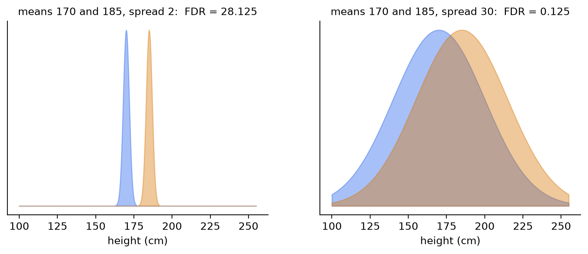
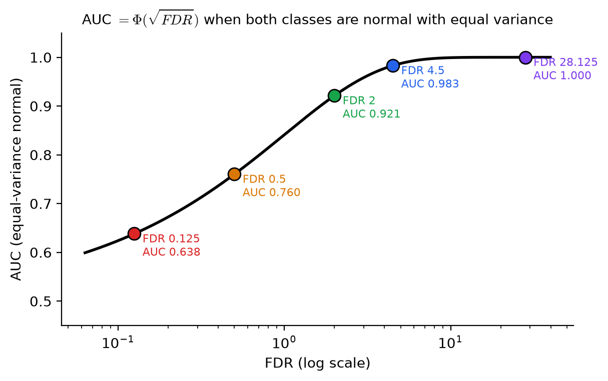
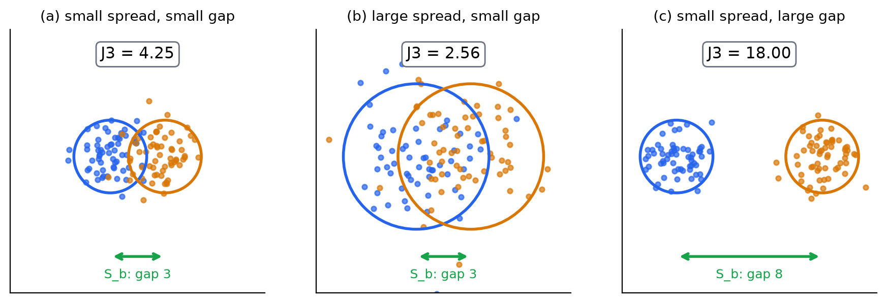
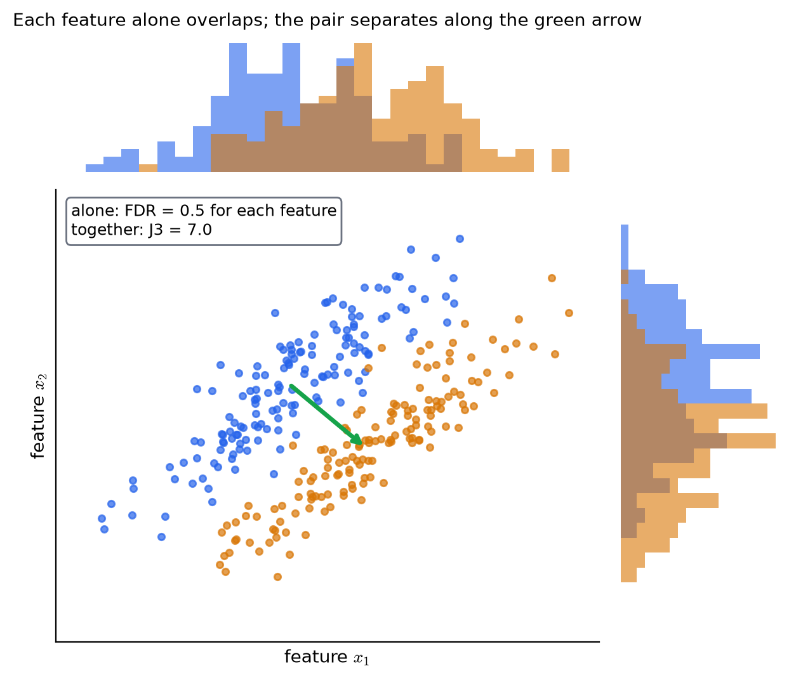

# KP05 Separability Scores: One Formula from Means and Spread

> Level: undergraduate
>
> Pattern Recognition | Feature selection unit

[Slides](../../slides/lec07-kp05-separability-fdr-en.jbd.json) | [中文版](../lec07-kp05-separability-fdr.md)

## Learning objectives

- Compute the Fisher discriminant ratio FDR for two classes in one dimension, and say what the numerator and the denominator stand for.
- Explain how FDR relates to the $t$ statistic of KP03 and the AUC of KP04.
- From the means and covariances of two classes, compute $S_w$, $S_b$, $S_m$, and use them to compute $J_1$, $J_2$, $J_3$.
- Explain why $J_2$ and $J_3$ are not affected by the unit of a feature while $J_1$ is.
- Give an example in which two features cannot separate the classes alone but can when put together.

## KP05 Separability scores: one formula from means and spread

**One-sentence summary**: Divide "how far apart the class centres are" by "how spread out each class is on its own" and you get a score that can be computed directly. In one dimension it is called FDR; in many dimensions use the scatter matrices to compute $J_1,J_2,J_3$.

### Prerequisites and notation

*Three things you need to know first*:

- *KP03 and KP04*: the $t$ test asks "do the means differ?", and AUC asks "how much do the two classes overlap?".
- *The covariance matrix*: $\Sigma=E[(\mathbf x-\boldsymbol\mu)(\mathbf x-\boldsymbol\mu)^{\mathsf T}]$. The diagonal holds the variance of each feature, and the off-diagonal entries show how much two features vary together.
- *Trace and determinant of a matrix*: the trace is the sum of the diagonal and also the sum of the eigenvalues; the determinant equals the product of the eigenvalues.

*Symbol table*:

| Symbol | Meaning | Note |
|---|---|---|
| $\mu_i,\ \sigma_i^2$ | Mean and variance of class $i$ on one feature | One dimension |
| $\boldsymbol\mu_i,\ \Sigma_i$ | Mean vector and covariance matrix of class $i$ | $l$ dimensions |
| $P_i$ | Prior probability of class $i$ | Can be estimated by $n_i/N$ |
| $\boldsymbol\mu_0$ | Mean vector of everything | $\boldsymbol\mu_0=\sum_iP_i\boldsymbol\mu_i$ |
| $S_w$ | Within-class scatter matrix | $\sum_iP_i\Sigma_i$ |
| $S_b$ | Between-class scatter matrix | $\sum_iP_i(\boldsymbol\mu_i-\boldsymbol\mu_0)(\boldsymbol\mu_i-\boldsymbol\mu_0)^{\mathsf T}$ |
| $S_m$ | Mixture scatter matrix | Covariance of the data about the overall mean |
| $l,\ M$ | Number of features, number of classes | Integers |

### 1. Why we need an even simpler score

**In plain words**: KP03 needs a distribution assumption to compute a $p$-value, and KP04 needs a sweep over all thresholds to draw a curve. With hundreds of features, you want a fast score "computed directly from means and variances" to rank the features first. The textbook says: the earlier criteria are all hard to compute unless normality is assumed; looking instead at "how the sample points scatter in space" is much simpler.

**Common misconception**: "A simple score is always worse than a complicated one." It is a heuristic criterion: it does not guarantee the minimum error rate, but it is cheap and intuitive, and good enough for ranking and screening.

### 2. One dimension, two classes: mean difference divided by spread is FDR

**In plain words**: Two basketball teams; you measure everyone's height. To judge "can height separate the two teams?", the intuition is: the average heights of the two teams should differ a lot, and the spread of heights inside each team should be small. Writing this intuition as a ratio gives the **FDR** (Fisher's discriminant ratio).

**Formal definition**:

$$
\text{FDR}=\frac{(\mu_1-\mu_2)^2}{\sigma_1^2+\sigma_2^2}.
$$

The numerator is the squared distance between the class centres, the larger the better; the denominator is the sum of the spreads inside the two classes, the smaller the better. The larger the FDR, the better the feature separates the two classes.

**Example**: The average heights of the two teams are $170$ and $185$ cm.

| Case | $\sigma_1,\ \sigma_2$ | FDR formula | FDR |
|---|---|---|---|
| Tidy inside teams | $2,\ 2$ | $\dfrac{(170-185)^2}{2^2+2^2}=\dfrac{225}{8}$ | $28.125$ |
| Messy inside teams | $30,\ 30$ | $\dfrac{225}{30^2+30^2}=\dfrac{225}{1800}$ | $0.125$ |

The mean difference is the same $15$ cm, yet the FDR differs by a factor of $225$: the large spread inside the teams makes the denominator eat up the discriminating power.

Figure `lec07-kp05-separability-fdr-f2-heights`: first the left chart: with standard deviation $2$ the two hills are narrow and apart, FDR $=28.125$; then the right chart: with the same means but standard deviation $30$ the two hills almost lie on top of each other, and the FDR is only $0.125$. (Function: 1, 2)

**Relation to the $t$ of KP03**: when both classes have $N$ samples and $s_z^2$ is the average of the two sample variances, the $q=\dfrac{\bar x-\bar y}{s_z\sqrt{2/N}}$ of KP03 squares to

$$
q^2=\frac{(\bar x-\bar y)^2}{s_z^2\cdot 2/N}=N\cdot\frac{(\bar x-\bar y)^2}{\hat\sigma_1^2+\hat\sigma_2^2}=N\cdot\text{FDR}.
$$

That is, the square of the $t$ statistic equals "the sample size times FDR". With Example 5.3 of KP03: means $3.73$ and $3.25$, sample variances $0.0601$ and $0.0672$, FDR $=\dfrac{0.2304}{0.1273}=1.809$; $N=10$, $N\cdot\text{FDR}=18.09$, the same as $q^2=4.254^2=18.09$. The difference is: $t$ multiplies by the sample size and is used to judge "is it luck?"; FDR does not multiply and is used to compare "how well separated", so it does not grow just because more samples are collected. The textbook also points out that FDR is used in a more "raw" way and does not depend on the underlying distribution.

**Relation to the AUC of KP04**: `[Added]` When both classes are normal with equal variance, $\text{FDR}=\Delta^2/(2\sigma^2)$, and substituting into the formula of KP04 gives $\text{AUC}=\Phi(\Delta/(\sigma\sqrt2))=\Phi(\sqrt{\text{FDR}})$.

| FDR | 0.125 | 0.5 | 1 | 2 | 4.5 | 8 |
|---|---|---|---|---|---|---|
| AUC | $0.638$ | $0.760$ | $0.841$ | $0.921$ | $0.983$ | $0.998$ |

The two features of KP04 (the same mean difference $3$, with $\sigma=1$ and $3$): FDR is $4.5$ and $0.5$, AUC is $0.983$ and $0.760$, exactly two rows of the table. When the conditions are not normal with equal variance, this correspondence is only approximate.

Figure `lec07-kp05-separability-fdr-f3-fdr-auc`: first the black curve: the larger the FDR, the closer the AUC is to $1$; then the coloured dots: the $0.125$ and $28.125$ of the height example and the $0.5$ and $4.5$ of KP04 are all on the curve. (Function: 1, 2)

**Common misconception**: "The larger the FDR, the lower the error rate, always." FDR is a heuristic indicator and is monotonically related to the error rate only in simple cases like the one above.

### 3. Many classes: add the pairs, or look at the worst pair

**In plain words**: With $M\ge3$ classes, add up the FDR of every pair of classes:

$$
\text{FDR}_1=\sum_{i=1}^M\sum_{j\ne i}\frac{(\mu_i-\mu_j)^2}{\sigma_i^2+\sigma_j^2}.
$$

Note that this double sum runs over **ordered pairs**, so each pair of classes is counted twice.

**Example**: Three classes with means $0,\ 2,\ 6$ and standard deviations all $1$:

| Class pair | FDR |
|---|---|
| $(1,2)$ | $(0-2)^2/2=2$ |
| $(1,3)$ | $(0-6)^2/2=18$ |
| $(2,3)$ | $(2-6)^2/2=8$ |

The sum with each pair counted once is $28$; counting ordered pairs twice, $\text{FDR}_1=56$.

Adding has one drawback: the pair that is far apart ($18$) pulls the total score up and hides the pair that is closest ($2$). The textbook therefore mentions another approach: take the **minimum** over all class pairs as each feature's score, and choose the feature whose "worst case" is best (maxmin). In this example the minimum is $2$, and the real bottleneck is between the first and second classes.

**Common misconception**: "A high summed score means every class is separable." Not necessarily; look at the worst pair.

### 4. Many dimensions: keep the books with scatter matrices

**In plain words**: With $l$ features, each class is a cloud of points in $l$-dimensional space. We need to measure two things: how spread out each cloud is on its own, and how far each cloud's centre is from the overall centre. Three matrices keep these books:

- **Within-class scatter matrix** $S_w$: the covariance of each class, added up weighted by prior probability.
- **Between-class scatter matrix** $S_b$: the displacement of each class centre from the overall centre, outer-multiplied and added with weights.
- **Mixture scatter matrix** $S_m$: the covariance of the data about the overall mean.

**Formal definition**:

$$
S_w=\sum_{i=1}^MP_i\Sigma_i,\qquad
S_b=\sum_{i=1}^MP_i(\boldsymbol\mu_i-\boldsymbol\mu_0)(\boldsymbol\mu_i-\boldsymbol\mu_0)^{\mathsf T},\qquad
\boldsymbol\mu_0=\sum_{i=1}^MP_i\boldsymbol\mu_i .
$$

$S_m=E[(\mathbf x-\boldsymbol\mu_0)(\mathbf x-\boldsymbol\mu_0)^{\mathsf T}]$ relates to the other two by

$$
S_m=S_w+S_b,
$$

in plain words: **total scatter = within-class scatter + between-class scatter**. $\text{trace}\{S_w\}$ is the (weighted) average of the within-class feature variances, and $\text{trace}\{S_b\}$ is the (weighted) average squared distance of the class centres from the overall centre.

**Example**: Two classes, two features, equal priors ($P_1=P_2=0.5$). The covariance of both classes is $\Sigma_i=\sigma^2I$, and the means are $(-d/2,\ 0)$ and $(d/2,\ 0)$. Take $\sigma^2=1$, $d=3$:

- $\boldsymbol\mu_0=(0,\ 0)$.
- $S_w=0.5\,I+0.5\,I=\begin{pmatrix}1&0\\0&1\end{pmatrix}$.
- $S_b=0.5\begin{pmatrix}2.25&0\\0&0\end{pmatrix}\cdot2=\begin{pmatrix}2.25&0\\0&0\end{pmatrix}$ (each class is $1.5$ from the overall centre, and the square is $2.25$).
- $S_m=S_w+S_b=\begin{pmatrix}3.25&0\\0&1\end{pmatrix}$.

Note that $S_b$ is non-zero only in the direction joining the two class centres (the first feature); on the second feature the two class centres do not differ.

**Common misconception**: "The rank of $S_b$ can be very high." It cannot. $S_b$ is the sum of $M$ rank-$1$ matrices (and they satisfy one linear relation: the weighted sum of the class centres equals the overall centre), so its rank is at most $M-1$. With few classes and many features, $S_b$ is a singular matrix and its determinant is $0$.

### 5. Three criteria: $J_1,\ J_2,\ J_3$

**In plain words**: Between-class scatter should be large and within-class scatter small, so take their ratio. Matrices cannot be compared in size directly; first turn each into one number, by taking the trace or the determinant.

**Formal definition**:

$$
J_1=\frac{\text{trace}\{S_m\}}{\text{trace}\{S_w\}},\qquad
J_2=\frac{|S_m|}{|S_w|}=|S_w^{-1}S_m|,\qquad
J_3=\text{trace}\{S_w^{-1}S_m\}.
$$

All three values are the larger the better: the tighter each class and the farther apart the class centres, the larger the value.

**Example (three cases)**: Two classes, two features, equal priors, covariance $\sigma^2I$ and mean difference $d$ (a teaching setup, the same kind of case as the three sketches of textbook Example 5.5):

| Case | Within-class $\sigma^2$ | Mean difference $d$ | $\text{tr}\{S_w\}$ | $\text{tr}\{S_m\}$ | $J_1$ | $J_2$ | $J_3$ |
|---|---|---|---|---|---|---|---|
| (a) Small spread, small gap | $1$ | $3$ | $2$ | $4.25$ | $2.125$ | $3.25$ | $4.25$ |
| (b) Large spread, small gap | $4$ | $3$ | $8$ | $10.25$ | $1.281$ | $1.563$ | $2.563$ |
| (c) Small spread, large gap | $1$ | $8$ | $2$ | $18$ | $9$ | $17$ | $18$ |

Take (a) as the example: $S_w=I$, $S_m=\text{diag}(3.25,\ 1)$, $J_1=4.25/2=2.125$, $J_2=3.25\cdot1/1=3.25$, $J_3=\text{trace}\{S_m\}=4.25$. The three criteria agree on the ranking: (c) is best, then (a), and (b) is worst. Textbook Example 5.5 gives the same ranking ($J_3$ of $620.9$, $164.7$, $12.5$, in the order c, a, b); that example does not publish the coordinates of the points in the figures and so cannot be recomputed, and the numbers here are data made up for this lecture.

`[Added]` Real data must be estimated from samples. Estimates with 200 samples per class (seed 0): (a) $J_3=4.32$, (b) $2.77$, (c) $16.11$, with the same ranking as the population values and numbers differing slightly because of sampling.

Figure `lec07-kp05-separability-fdr-f1-three-cases`: first the blue and orange circles in the three panels: their size is the spread of each class; then the green double arrow: the distance between the two class centres, corresponding to $S_b$; the $J_3$ above each panel is the population value: (a) $4.25$, (b) $2.56$, (c) $18.00$. (Function: 1, 3)

**Why there are three at once.** $J_2$ and $J_3$ both contain $S_w^{-1}$: first "standardize" each axis with the within-class scatter, then compare the between-class scatter. This makes them **invariant** under linear transformations of the features (the textbook: "they will be used later to derive optimal features"). $J_1$ does not have this property. `[Added]` Verification: take 200 samples per class and multiply the unit of the second feature by $10$ (for example metres to centimetres):

| | $J_1$ | $J_2$ | $J_3$ |
|---|---|---|---|
| Before multiplying by $10$ | $2.197$ | $3.464$ | $4.464$ |
| After multiplying by $10$ | $1.023$ | $3.464$ | $4.464$ |

Change the unit and $J_1$ drops from $2.20$ to $1.02$, while $J_2$ and $J_3$ do not change at all. This is another angle on why normalization matters in KP02: $J_1$ is affected by units and is reliable only after normalization.

*The determinant trap*: if we used $|S_b|$ directly, then when there are fewer classes than features ($M<l$), $|S_b|=0$ and the criterion fails. So the determinant version uses $S_m$ in the numerator, not $S_b$.

**Common misconception**: "The larger $J_3$ is, the better the classifier, always." It is a geometric ratio of class scatter, a heuristic indicator of goodness.

### 6. Looking at features one at a time misses how they work together

**In plain words**: The previous sections give "one score per feature". But two features together can create discriminating power that cannot be seen alone.

**Example**: `[Added]` Two classes, two features, with the same covariance for both classes, $\Sigma=\begin{pmatrix}1&0.9\\0.9&1\end{pmatrix}$ (the two features are highly positively correlated). The class means are $(0,\ 0)$ and $(1,\ -1)$.

- Looking at $x_1$ alone: mean difference $1$, variance $1$, $\text{FDR}=1/(1+1)=0.5$; $x_2$ is also $0.5$. Each is the "heavy overlap" type of KP04.
- Looking at them together: the data spreads along a slanted band ($\rho=0.9$), and the line joining the class centres $(1,-1)$ is exactly perpendicular to this band, the direction of smallest variation. The squared Mahalanobis distance between the two class centres is $\Delta^{\mathsf T}\Sigma^{-1}\Delta=20$, and $J_3=2+20/4=7.0$; the one-dimensional $J_3$ of each feature alone is only $1+\text{FDR}/2=1.25$.

Alone, both FDRs are $0.5$; together, $J_3$ reaches $7.0$. Scoring one by one judges both features "weak" and cannot see the power they have in combination.

Figure `lec07-kp05-separability-fdr-f4-correlated`: first the histograms at the top and on the right: for each feature alone, blue and orange overlap heavily; then the scatter plot in the middle: the two clouds line up along a slanted band and are clearly separated along the direction of the green arrow. (Function: 1, 3)

**The lesson of this example**: scoring one by one is cheap but misses combinations, and also keeps redundant features (two highly correlated features that are each strong are really the same thing). So we also need a way to evaluate a whole set of features, which is the subset selection of the next KP.

**Common misconception**: "Keeping the $k$ features with the highest individual scores gives the best $k$." Not necessarily: they may repeat one another, and may miss complementary features.

### Extension: exercises and worked solutions

**Exercises**:

1. The means of two classes are $10$ and $14$, both standard deviations $2$. Compute the FDR; what is it if the standard deviations become $6$?
2. Two classes, two features, equal priors, both covariances $I$, means $(0,0)$ and $(4,0)$. Compute $S_w$, $S_b$, $S_m$ and $J_3$.
3. A student throws away two features whose FDRs are both very low. In what situation could this be wrong?

**Worked solution of exercise 1**: Standard deviation $2$: $\text{FDR}=(10-14)^2/(4+4)=16/8=2$. Standard deviation $6$: $16/(36+36)=0.222$. With the same mean difference, tripling the spread cuts the FDR to about $1/9$.

**Worked solution of exercise 2**: $\boldsymbol\mu_0=(2,0)$. $S_w=I$. Each class is $2$ from the centre, $S_b=0.5\cdot4\cdot\begin{pmatrix}1&0\\0&0\end{pmatrix}\cdot2=\begin{pmatrix}4&0\\0&0\end{pmatrix}$. $S_m=S_w+S_b=\text{diag}(5,\ 1)$. $J_3=\text{trace}\{S_w^{-1}S_m\}=5+1=6$.

**Worked solution of exercise 3**: The example of Section 6: each feature has FDR $0.5$ alone, and together $J_3=7.0$. If there is correlation between features, a pair of individually weak features may be a strong feature together, and throwing them away loses it.

## Terms and sources

| English | 中文 |
|---|---|
| Fisher's discriminant ratio (FDR) | 費雪判別比 |
| Within-class scatter matrix | 類內散布矩陣 |
| Between-class scatter matrix | 類間散布矩陣 |
| Mixture scatter matrix | 混合散布矩陣 |
| Prior probability | 先驗機率 |
| Trace | 跡 |
| Determinant | 行列式 |
| Invariance under linear transformations | 線性變換不變性 |
| Mahalanobis distance | 馬氏距離 |
| Heuristic criterion | 啟發式準則 |
| Singular matrix | 奇異矩陣 |

Sources: Theodoridis & Koutroumbas, *Pattern Recognition*, Chapter 5 §5.6.3 and §5.7.1 (local Ch5.pdf), and §5.6 of Chapter 5 on the CCC-LNS web page; the explanations, figures and order are rewritten. The height example ($28.125$ and $0.125$) is the web page's example, with numbers that agree on recomputation. Textbook Example 5.5 gives only three results ($J_3=164.7,\ 12.5,\ 620.9$) without the data points and cannot be recomputed, so this lecture builds three cases of the same kind. The derivation and check of $q^2=N\cdot\text{FDR}$, $\text{AUC}=\Phi(\sqrt{\text{FDR}})$, the three-class FDR example, the check by multiplying the unit by $10$, and the correlated-feature example are `[Added]`; all numbers are computed by `scripts/lec07-kp05-separability-fdr/compute_data.py` (`reports/lec07-kp05-separability-fdr/數值驗算.json`).
