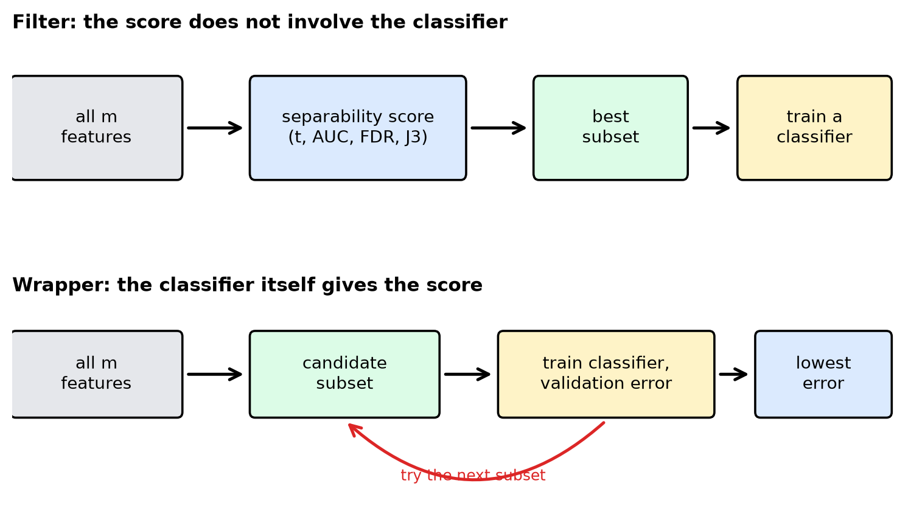
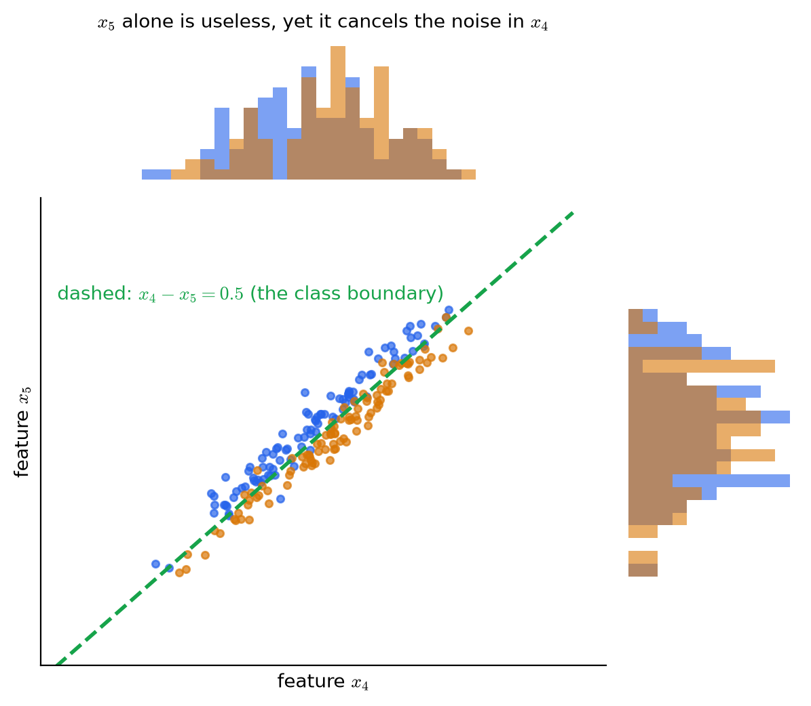
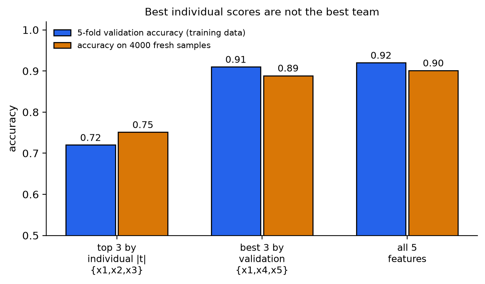
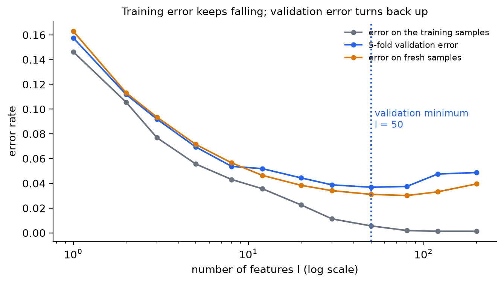
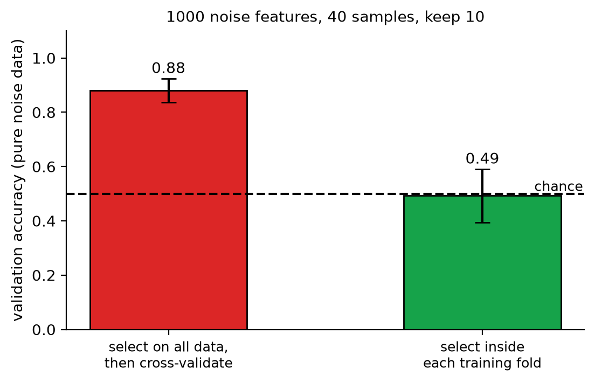

# KP06 Feature Subset Selection: Pick a Set, Not the Highest Scores One by One

> Level: undergraduate
>
> Pattern Recognition | Feature selection unit

[Slides](../../slides/lec07-kp06-subset-selection-en.jbd.json) | [中文版](../lec07-kp06-subset-selection.md)

## Learning objectives

- Explain why "the $l$ features with the highest individual scores" are not necessarily the best $l$ features.
- Pick features step by step with "individual score minus correlation with the features already chosen", and do one step by hand.
- Distinguish filter from wrapper: what each uses for scoring and what each costs.
- Compute the number of feature subsets and explain why we cannot try them all.
- Use the validation curve to decide how many features to keep, and point out why "select features on all the data first, then cross-validate" misleads.

## KP06 Feature subset selection: pick a set, not the highest scores one by one

**One-sentence summary**: Whether a feature is good depends on how it works together within the set, not on its score alone. A set of features can be scored with a separability criterion (filter) or by asking the classifier directly (wrapper); how many to keep is decided by validation; and the selection itself must be put inside the validation.

### Prerequisites and notation

*Three things you need to know first*:

- *Single-feature scores*: the $|q|$ of KP03, the AUC of KP04, and the FDR and $J_3$ of KP05 are all "the larger, the more separable". This KP uses $C(k)$ for any one of them.
- *Correlation coefficient*: the correlation coefficient of two features $\rho_{ij}\in[-1,1]$; the larger $|\rho_{ij}|$, the more alike the two are.
- *Training, validation and test sets*: already used in KP02; the validation set is used to compare methods, and the test set only for the final report.

*Symbol table*:

| Symbol | Meaning | Note |
|---|---|---|
| $m$ | Total number of candidate features | Integer |
| $l$ | Number of features to keep | $l\le m$ |
| $C(k)$ | Single-feature score of feature $k$ | The larger, the better |
| $\rho_{ij}$ | Correlation coefficient of features $i$ and $j$ | This lecture uses the absolute value $|\rho_{ij}|$ |
| $\alpha_1,\ \alpha_2$ | Two weights | The trade-off between individual score and avoiding repetition |
| $\binom{m}{l}$ | Number of ways to choose $l$ from $m$ | $\frac{m!}{l!\,(m-l)!}$ |
| $\mathcal S$ | A chosen set of features | A subset |

### 1. The individual top $l$ are not necessarily the best $l$

**In plain words**: The most direct way: compute one $C(k)$ per feature, sort from large to small, and take the top $l$. This is called **scalar feature selection**. It is fast, like HR scanning résumés for keywords first. Its blind spot is that it ignores how the candidates relate to one another.

**Formal definition**: Compute $C(k)$ for each feature $k=1,\dots,m$, sort by $C(k)$ from large to small, and take the top $l$ to form the feature vector. $C$ can be any criterion of KP03–KP05. With many classes, use the average (like $\text{FDR}_1$ in KP05) or the minimum over all class pairs (choosing features that still separate even the "worst pair").

This approach has two blind spots:

- *Redundancy*: two highly correlated features that are each strong are really the same thing said twice; selecting both wastes a slot.
- *Complementarity*: a feature that is weak alone may cancel the noise of another feature when paired with it, which single scoring cannot see.

**Common misconception**: "If every feature is good enough, the set is good enough." Redundant features add no information; and a feature screened out by its individual score may be the key partner of another.

### 2. Subtract the "similarity to the features already chosen"

**In plain words**: The textbook gives a remedy: when choosing the next feature, look not only at its own score but also subtract how much it resembles the features already chosen.

**Formal definition**: Let $i_1$ be the feature with the highest score. When choosing the second feature $i_2$, the combined score of each candidate $j$ is

$$
\alpha_1C(j)-\alpha_2\,|\rho_{i_1j}|,
$$

and we take the $j$ with the largest combined score. At step $k$ ($k\ge3$) the average correlation with **all chosen features** is included:

$$
i_k=\arg\max_{j\notin\{i_1,\dots,i_{k-1}\}}\Big\{\alpha_1C(j)-\frac{\alpha_2}{k-1}\sum_{r=1}^{k-1}|\rho_{i_rj}|\Big\}.
$$

$\alpha_1,\alpha_2$ decide which matters more: "individual ability" or "avoiding repetition".

**Example** (teaching setup, a toy scenario from the web page): the individual scores of five candidate features are $C=0.90,\ 0.84,\ 0.80,\ 0.73,\ 0.70$. It is known that the correlation coefficient of $x_1$ and $x_2$ is $0.95$ (the two are almost duplicates). Take $\alpha_1=1$, $\alpha_2=0.4$, with $x_1$ already chosen. Second step:

| Candidate | $C(j)$ | $|\rho_{1j}|$ | $C(j)-0.4|\rho_{1j}|$ |
|---|---|---|---|
| $x_2$ | $0.84$ | $0.95$ | $0.84-0.38=0.46$ |
| $x_3$ | $0.80$ | $0.10$ | $0.80-0.04=0.76$ |
| $x_4$ | $0.73$ | $0.05$ | $0.73-0.02=0.71$ |
| $x_5$ | $0.70$ | $0.20$ | $0.70-0.08=0.62$ |

The second pick is no longer $x_2$, which has the second-highest individual score, but $x_3$ ($0.76$). The third step uses the average correlation with the two chosen features $x_1,x_3$. `[Added]` Suppose $|\rho_{23}|=0.20$, $|\rho_{34}|=0.30$, $|\rho_{35}|=0.25$ (the web page gives only $\rho_{1j}$):

| Candidate | Average correlation | Combined score |
|---|---|---|
| $x_2$ | $(0.95+0.20)/2=0.575$ | $0.84-0.4\cdot0.575=0.61$ |
| $x_4$ | $(0.05+0.30)/2=0.175$ | $0.73-0.4\cdot0.175=0.66$ |
| $x_5$ | $(0.20+0.25)/2=0.225$ | $0.70-0.4\cdot0.225=0.61$ |

The third pick is $x_4$. The chosen set is $\{x_1,x_3,x_4\}$, different from $\{x_1,x_2,x_3\}$ obtained by looking only at individual scores.

*This is still not the optimal solution.* The method only picks step by step and does not compare whole sets; it also penalizes only "redundancy" and cannot see "complementarity" (next section).

**Common misconception**: "Subtracting correlation solves all problems." The weight $\alpha_2$ is set by hand; and a complementary feature screened out by its individual score still cannot get in after the correction.

### 3. Score the whole set at once: filter and wrapper

**In plain words**: To see how features work together, a whole set of features must be scored as one unit. There are two sources of the score:

- **Filter**: score the set directly with a separability criterion (the $J_2$ and $J_3$ of KP05, or the Bhattacharyya distance), **regardless of which classifier is used later**. It is fast and clean, and can be done even before the classifier is chosen. Drawback: a good criterion does not mean the final classifier performs well.
- **Wrapper**: hand the set to **the classifier you will use**, estimate its classification error, and pick the set with the lowest error. It is close to the real task, but every set tried needs a classifier to be trained, so the cost is higher.

Figure `lec07-kp06-subset-selection-f1-filter-wrapper`: first the top row: the filter's scoring sits outside the classifier, and the classifier is trained only after the subset is chosen; then the bottom row: the wrapper puts the classifier inside the scoring loop, and the red arrow means "finish one set, then try the next". (Function: 1, 2)



**Number of combinations**: choosing $l$ from $m$ gives

$$
\binom{m}{l}=\frac{m!}{l!\,(m-l)!}
$$

sets. The textbook's numbers: $m=20$, $l=5$ gives $15{,}504$; $m=100$, $l=10$ gives $17{,}310{,}309{,}456{,}440$, about $1.73\times10^{13}$. Moreover $l$ itself is often unknown in advance, and each $l$ must be tried again.

**Example (the web page's toy scenario)**: Continuing with the five features above, use the same classifier to score three candidate sets on 100 validation samples:

| Candidate subset | Validation errors (of 100) | Error rate |
|---|---|---|
| $\{x_1,x_2,x_3\}$ | $18$ | $0.18$ |
| $\{x_1,x_3,x_4\}$ | $10$ | $0.10$ |
| $\{x_1,x_4,x_5\}$ | $13$ | $0.13$ |

A filter that looks only at individual scores chooses $\{x_1,x_2,x_3\}$ (the highest error rate); a wrapper sees the validation errors and chooses $\{x_1,x_3,x_4\}$. These error counts are teaching numbers designed by the web page, not experimental results. Below, a reproducible simulation reproduces the same phenomenon for real.

**Simulation: complementary features.** `[Added]` 100 samples per class, 5 features (teaching setup, seed 0):

- $x_1$: carries class signal; $x_2\approx x_1$ (correlation $0.99$, redundant); $x_3$: carries class signal.
- $x_4$: class signal plus a large noise $2n$; $x_5$: **only the same noise** $2n$ (correlation $0.95$ with $x_4$).

The individual $|t|$: $x_1=7.55,\ x_2=7.31,\ x_3=4.98,\ x_4=2.39,\ x_5=0.86$. The individual top three are $\{x_1,x_2,x_3\}$, and $x_5$ looks completely useless. With a linear discriminant classifier, 5-fold cross-validation, and 4000 new samples for evaluation:

| Subset | Validation accuracy | Accuracy on new data |
|---|---|---|
| Individual top three $\{x_1,x_2,x_3\}$ | $0.72$ | $0.75$ |
| Three with highest validation $\{x_1,x_4,x_5\}$ | $0.91$ | $0.89$ |
| All 5 | $0.92$ | $0.90$ |
| Only $\{x_4,x_5\}$ | $0.89$ | $0.87$ |
| $x_4$ alone / $x_5$ alone | — | $0.60$ / $0.49$ |

The accuracy of $x_5$ alone is $0.49$, the same as guessing, yet $x_4$ plus $x_5$ rises from $0.60$ to $0.87$: subtract the noise in $x_4$ using $x_5$, and what remains is the class signal ($x_4-x_5\approx$ class). Individual scoring threw away this key partner and kept both redundant features ($x_1,x_2$).

Figure `lec07-kp06-subset-selection-f3-complementary`: first the histograms at the top and on the right: looking at $x_4$ and $x_5$ separately, the two classes almost completely overlap; then the scatter plot in the middle: looking at the two features together, the points line up along a slanted band, and the blue and orange classes are separated by the green dashed line $x_4-x_5=0.5$. (Function: 1, 3)



Figure `lec07-kp06-subset-selection-f2-filter-vs-wrapper`: first the two bars on the left: the individual top three have accuracies of only $0.72$ and $0.75$; then the middle: the $\{x_1,x_4,x_5\}$ chosen by validation reaches $0.91$ and $0.89$, almost as good as the $0.92$ and $0.90$ with all 5 features on the right. (Function: 1, 2)



**Common misconception**: "Filter is always worse than wrapper." No. The advantage of filter is that it is fast and independent of the classifier; with many features, a filter is often used first to cut thousands of features to hundreds, and then a wrapper is run on the rest.

### 4. How many features to keep: read the validation curve

**In plain words**: After choosing up to the $l$-th feature, we still need to decide the value of $l$. Do not look at the training error: the more features, the smaller the training error only gets (the model can memorize the training data better). Look at the **validation error**.

**Formal definition**: With the sample size $N$ fixed, as the number of features $l$ grows, the validation error usually first falls and then rises: it falls because more features bring more information, and rises because each extra feature adds some parameters to estimate while the sample size is fixed, so the estimates get less and less accurate. This is called the **peaking phenomenon**; KP01 mentioned the ratio $N/l$.

**Example**: `[Added]` Two classes; the class mean of the $i$-th feature is $\pm1/\sqrt i$ (later features are weaker, the setup of the textbook's Trunk example); each class has only $20$ training samples and the classifier is the nearest-mean method; repeat 40 times and average:

| Number of features $l$ | 1 | 5 | 20 | 50 | 80 | 200 |
|---|---|---|---|---|---|---|
| Training error | $0.146$ | $0.056$ | $0.023$ | $0.006$ | $0.002$ | $0.001$ |
| 5-fold validation error | $0.158$ | $0.069$ | $0.044$ | $0.037$ | $0.038$ | $0.049$ |
| Error on new data | $0.163$ | $0.071$ | $0.038$ | $0.031$ | $0.030$ | $0.040$ |

The training error falls all the way to $0.001$; the validation error is lowest at $l=50$ ($0.037$) and then rises back to $0.049$; the error on new data is lowest at $l=80$ ($0.030$) and then also rises. The lowest point of the validation error is close to the lowest point on new data; the training error gives no hint of where to stop.

Figure `lec07-kp06-subset-selection-f4-validation-curve`: first the grey line: the training error falls all the way to nearly $0$; then the blue line (validation error) and the orange line (error on new data): both first fall and then rise, with the valley between $l=50$ and $80$, and the blue dashed line marks the lowest validation error. (Function: 1, 2)



*Practical rule*: choose the $l$ with the lowest validation error; if several $l$ are almost equally good, choose the smallest, which gives a simpler model.

**Common misconception**: "More features are always safer." With a fixed sample size, redundant features make the estimates worse.

### 5. Selecting features is itself a kind of learning: put it inside the validation

**In plain words**: Using data to decide which features to keep is "learning" from the data. If you first pick features with **all** the data and then cross-validate on the same data, the validation has "seen" the answers already and the score comes out too high. This is the same kind of error as the data leakage of KP02.

**Example**: `[Added]` The data is pure noise: 1000 features and 40 samples (20 per class), the class labels have nothing to do with the features, and the true accuracy can only be $0.5$.

- *Wrong way*: first pick the 10 features with the largest $|t|$ using all 40 samples, then run 5-fold cross-validation on these 10 features. Repeated 20 times, the mean accuracy is $0.88$ (standard deviation $0.04$).
- *Right way*: in each fold of the cross-validation, pick features using only that fold's training data, then evaluate on that fold's validation data. Repeated 20 times, the mean accuracy is $0.49$ (standard deviation $0.10$), back to the level of guessing.

Figure `lec07-kp06-subset-selection-f5-selection-bias`: first the red bar on the left: select features first and then validate, and on pure noise the accuracy is a surprising $0.88$; then the green bar on the right: after putting the selection inside each fold, $0.49$, consistent with the dashed random-guess level. (Function: 1, 2)



`[Added]` In scikit-learn, chain feature selection and the classifier with `Pipeline`, and every fold of the cross-validation re-selects:

```python
from sklearn.pipeline import make_pipeline
from sklearn.feature_selection import SelectKBest, f_classif
from sklearn.discriminant_analysis import LinearDiscriminantAnalysis
from sklearn.model_selection import cross_val_score

pipe = make_pipeline(SelectKBest(f_classif, k=10), LinearDiscriminantAnalysis())
cross_val_score(pipe, X, y, cv=5).mean()     # selection happens inside the training data of each fold
```

**Common misconception**: "There is little data, so selecting features first and then splitting off a validation set is cheaper." It is exactly this order that causes the bias. Whether you use a filter or a wrapper, the selection must be done inside each fold.

### Extension: exercises and worked solutions

**Exercises**:

1. Choosing $l=4$ from $m=30$ features, how many combinations are there in all?
2. Three features have individual scores $C=0.95,\ 0.90,\ 0.60$. $x_1$ is already chosen, $|\rho_{12}|=0.97$, $|\rho_{13}|=0.10$. With $\alpha_1=1$ and $\alpha_2=0.5$, whom do you pick second?
3. A student first picks the best 5 features using all the data, then splits the data into training and validation, and gets a validation accuracy of $95\%$. Can this number be trusted?

**Worked solution of exercise 1**: $\binom{30}{4}=\dfrac{30\cdot29\cdot28\cdot27}{4\cdot3\cdot2\cdot1}=27{,}405$.

**Worked solution of exercise 2**: $x_2$: $0.90-0.5\cdot0.97=0.415$. $x_3$: $0.60-0.5\cdot0.10=0.55$. Pick $x_3$, although its individual score is only $0.60$.

**Worked solution of exercise 3**: Not trustworthy. The feature selection used samples that later served as validation data, so information leaked into the validation. Split the data first, pick features using only the training part, and evaluate on the validation data; or use `Pipeline` so that selection happens inside each fold.

## Terms and sources

| English | 中文 |
|---|---|
| Feature subset selection | 特徵子集選擇 |
| Scalar feature selection | 純量特徵選擇 |
| Cross-correlation coefficient | 交叉相關係數 |
| Filter approach | 過濾法 |
| Wrapper approach | 包裝法 |
| Number of combinations | 組合數 |
| Validation curve | 驗證曲線 |
| Peaking phenomenon | 峰值現象 |
| Selection bias | 選擇偏差 |
| Cross-validation | 交叉驗證 |
| Pipeline | 管線 |
| Linear discriminant classifier | 線性判別分類器 |
| Area under the curve (AUC) (KP04) | 曲線下面積（KP04） |
| Fisher's discriminant ratio (FDR) (KP05) | 費雪判別比（KP05） |

Sources: Theodoridis & Koutroumbas, *Pattern Recognition*, Chapter 5 §5.3 and §5.7 (local Ch5.pdf), and KP-12 of Chapter 5 on the CCC-LNS web page; the explanations, figures and order are rewritten. The count $15{,}504$ and the correlation-corrected stepwise method come from the textbook; the individual scores of the five candidates, $\rho_{12}=0.95$ and the validation error counts $18/10/13$ are the web page's teaching setup. The $\rho_{23},\rho_{34},\rho_{35}$ needed for the third step, the complementary-feature simulation, the Trunk-type validation-curve simulation, the pure-noise selection-bias simulation and the scikit-learn code are `[Added]`; all numbers are computed by `scripts/lec07-kp06-subset-selection/compute_data.py` (`reports/lec07-kp06-subset-selection/數值驗算.json`).
