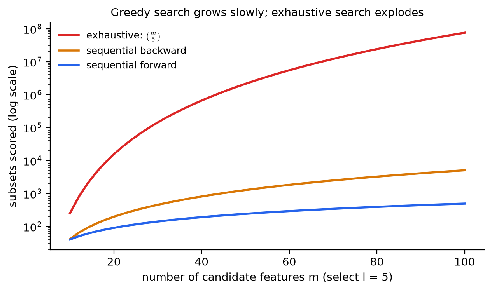
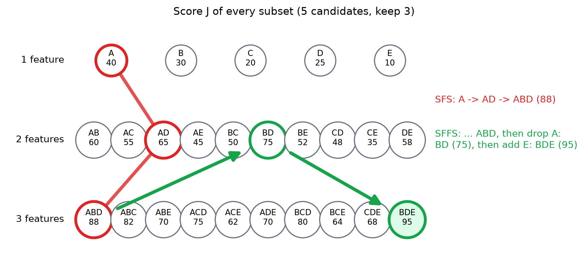
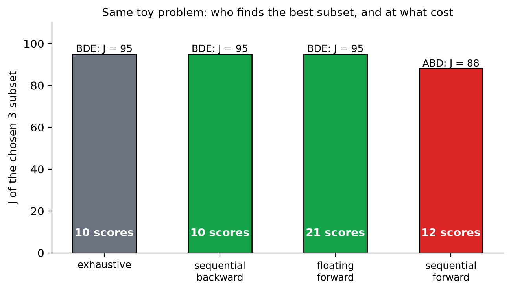

# KP07 Feature Search: We Cannot Enumerate, So How Do We Walk Cleverly?

> Level: undergraduate
>
> Pattern Recognition | Feature selection unit

[Slides](../../slides/lec07-kp07-search-en.jbd.json) | [中文版](../lec07-kp07-search.md)

## Learning objectives

- Run forward selection and backward selection step by step, and say how many sets each evaluates.
- Explain the nesting effect: why these two methods cannot take a decision back.
- Use floating search to correct the nesting effect, and say that it still does not guarantee the optimum.
- Explain what condition optimal search (branch and bound) needs, and why the validation error of a wrapper does not satisfy it.
- Choose a suitable search method according to the total number of features, the number to keep and the scoring cost.

## KP07 Feature search: we cannot enumerate, so how do we walk cleverly?

**One-sentence summary**: There are too many subsets to try all, so each step compares only a small batch: forward is "add the best one", backward is "drop the most useless one", and floating search allows going back to correct. These are all greedy shortcuts and do not guarantee the optimum.

### Prerequisites and notation

*Two things you need to know first*:

- *Subset scoring*: the $J(\mathcal S)$ of KP06 can be a filter's separability criterion or a wrapper's validation performance; this KP does not care how it is computed and treats it only as "give a subset a score, the larger the better".
- *Number of combinations*: $\binom{m}{l}$ is the number of ways to choose $l$ from $m$.

*Symbol table*:

| Symbol | Meaning | Note |
|---|---|---|
| $m$ | Total number of candidate features | Integer |
| $l$ | Number of features to keep | $l\le m$ |
| $\mathcal S$ | A set of features (subset) | Example: $\{A,B,D\}$ |
| $J(\mathcal S)$ | Score of subset $\mathcal S$ | The larger the better |
| SFS / SBS / SFFS | Sequential forward / backward / floating forward selection | See each section |

### 1. Why we can only walk step by step

**In plain words**: KP06 computed: choosing $l=5$ from $m=20$ gives $15{,}504$ sets; choosing $l=10$ from $m=100$ gives $1.73\times10^{13}$ sets. Under a wrapper, each set needs a classifier trained once. Enumeration is impossible, so we need a clever way of walking: each step evaluates only a small batch of subsets.

**Example**: When choosing $l$ from $m$ candidate features, the number of subsets that must be scored by three methods. Exhaustive search is $\binom{m}{l}$; the counts of forward selection (SFS) and backward selection (SBS) are the textbook formulas:

$$
\text{SFS}:\ lm-\frac{l(l-1)}{2},\qquad
\text{SBS}:\ 1+\frac{(m+1)m-l(l+1)}{2}.
$$

| $m$ | $l$ | Exhaustive | SFS | SBS |
|---|---|---|---|---|
| 5 | 3 | $10$ | $12$ | $10$ |
| 20 | 5 | $15{,}504$ | $90$ | $196$ |
| 100 | 10 | $17{,}310{,}309{,}456{,}440$ | $955$ | $4{,}996$ |
| 1000 | 20 | about $3.4\times10^{41}$ | $19{,}810$ | $500{,}291$ |

With very few features ($m=5$), the greedy methods save nothing over enumeration; with many features, the gap is astronomical.

Figure `lec07-kp07-search-f2-cost`: first the red line: the count for exhaustive search explodes with $m$, and even on the log-scale vertical axis it still climbs fast; then the orange and blue lines: the counts for backward and forward selection grow slowly. (Function: 1, 2)



### 2. Forward selection (SFS): add the best one each time

**In plain words**: Start from the empty set. In the first step choose the best among all single features. At each later step, choose one from the remaining features so that the "chosen ones plus it" has the highest score, until $l$ are chosen.

**Formal definition**: Let $\mathcal S_0=\emptyset$. Step $k$:

$$
x^{+}=\arg\max_{x\notin\mathcal S_{k-1}}J(\mathcal S_{k-1}\cup\{x\}),\qquad
\mathcal S_k=\mathcal S_{k-1}\cup\{x^{+}\}.
$$

**Example**: Teaching scenario: five candidate features $A,B,C,D,E$, and we want 3. The score of each subset is as follows (bold is the maximum; the scores of single features and of some pairs and triples come from the web page, the rest are `[Added]`, filled in so that "adding a feature never lowers the score"):

| Subset size | $J$ of each subset |
|---|---|
| 1 | $A{:}40,\ B{:}30,\ C{:}20,\ D{:}25,\ E{:}10$ |
| 2 | $AB{:}60,\ AC{:}55,\ AD{:}65,\ AE{:}45,\ BC{:}50,\ BD{:}75,\ BE{:}52,\ CD{:}48,\ CE{:}35,\ DE{:}58$ |
| 3 | $ABC{:}82,\ ABD{:}88,\ ABE{:}70,\ ACD{:}75,\ ACE{:}62,\ ADE{:}70,\ BCD{:}80,\ BCE{:}64,\ CDE{:}68,\ \mathbf{BDE{:}95}$ |
| 4 | $ABCD{:}92,\ ABCE{:}85,\ ABDE{:}97,\ ACDE{:}80,\ BCDE{:}96$ |
| 5 | $ABCDE{:}98$ |

Each step of SFS:

| Step | Candidates compared | Best | Chosen |
|---|---|---|---|
| 1 | Single features $A{:}40,B{:}30,C{:}20,D{:}25,E{:}10$ | $A$ | $\{A\}$ |
| 2 | $AB{:}60,\ AC{:}55,\ AD{:}65,\ AE{:}45$ | $AD$ | $\{A,D\}$ |
| 3 | $ABD{:}88,\ ACD{:}75,\ ADE{:}70$ | $ABD$ | $\{A,B,D\}$, $J=88$ |

Number of evaluations: $5+4+3=12$, matching the formula $3\cdot5-3=12$. Exhaustive search would find that the best is $\{B,D,E\}$ ($J=95$). SFS missed it.

**Nesting effect**: The decisions of SFS are one-way: $A$ is chosen in the first step and is never removed afterwards. But $A$ is strong alone and combines badly with the others; the truly strongest $\{B,D,E\}$ has no $A$ at all. This phenomenon of "an early decision locking in the later ones" is called the **nesting effect**.

**Common misconception**: "SFS picks the best at every step, so the final result must be the best." The best at each step does not mean the best overall.

### 3. Backward selection (SBS): drop the most useless one each time

**In plain words**: The other way round: start with all features. At each step try dropping each feature in turn, and drop the one whose removal leaves the highest score, until $l$ remain.

**Example** (the same score table):

| Step | Candidates after dropping one | Highest score | Drop |
|---|---|---|---|
| Start | $ABCDE{:}98$ | — | — |
| 1 | $BCDE{:}96,\ ACDE{:}80,\ ABDE{:}97,\ ABCE{:}85,\ ABCD{:}92$ | $ABDE{:}97$ | $C$ |
| 2 | $BDE{:}95,\ ADE{:}70,\ ABE{:}70,\ ABD{:}88$ | $BDE{:}95$ | $A$ |

SBS found $\{B,D,E\}$ ($J=95$). Number of evaluations: $1+5+4=10$, matching the formula $1+\frac{(5+1)\cdot5-3\cdot4}{2}=10$.

In this example backward succeeds and forward fails; that is the result of this set of numbers, not a general rule. Backward also cannot take decisions back: a dropped feature never returns. For example, if $E$ were dropped too early and $E$ is valuable only together with $B,D$, backward would miss it in the same way.

*Forward or backward*: the textbook points out that when the number to keep $l$ is close to $m$, backward needs fewer evaluations, and when $l$ is very small, forward needs fewer. A wrapper must also consider the cost of each evaluation: backward evaluates large subsets from the start, so training the classifier is more expensive.

**Common misconception**: "Backward is always better than forward." Not necessarily; it is cheaper only when $l$ is close to $m$, and it has the same nesting effect.

### 4. Floating search (SFFS): after adding, look back

**In plain words**: Floating search is like SFS, but after adding each feature it **looks back and checks**: if one of the chosen features is removed, would the score beat "the historical best of the same size"? If so, remove it (a "backward" step), and continue adding forward. It can take decisions back, so it can correct the nesting effect.

**Formal definition** (floating forward search, proposed by Pudil; steps I to III of the textbook). Let $X_k$ be the best $k$ features found so far, and remember the best subsets of all smaller sizes:

1. **Add**: from the remaining features choose an $x$ that maximizes $J(X_k\cup\{x\})$, giving $X_{k+1}$.
2. **Test**: find the feature $x_r$ in $X_{k+1}$ whose removal leaves the highest score. If $x_r$ is the one just added, go back to step 1. If the score after removing $x_r$ does **not** exceed that of the remembered best $k$ features $X_k$, also go back to step 1.
3. **Remove**: otherwise remove $x_r$, update the best $k$ features, and repeat the test until no further improvement is possible.

Start by running SFS up to 2 features. The algorithm ends when $l$ features are chosen.

**Example** (the same score table, $l=3$):

| Action | Resulting subset | Score | Note |
|---|---|---|---|
| Forward | $\{A\}$ | $40$ | Same as SFS |
| Forward | $\{A,D\}$ | $65$ | Same as SFS |
| Forward | $\{A,B,D\}$ | $88$ | Same as SFS |
| Test / remove | $\{B,D\}$ (remove $A$) | $75$ | The $75$ after removing $A$ exceeds the historical best 2-feature set $\{A,D\}$ at $65$, so $A$ is removed |
| Forward | $\{B,D,E\}$ | $95$ | Add the best $E$ on top of $\{B,D\}$ |

SFFS finds the global optimum $\{B,D,E\}$. By program count it evaluated 21 times (including repeated evaluations, more than the 12 of SFS).

Figure `lec07-kp07-search-f1-subset-lattice`: first the three rows of circles: each circle is a subset and the number is its score $J$; then the red line: the path of SFS, $A\to AD\to ABD$, stopping at 88; finally the two green arrows: SFFS first reaches $ABD$, removes $A$ to return to $BD$ (75), then adds $E$ to reach $BDE$ (95, the circle with the green fill). (Function: 1, 3)



*This example is deliberately designed.* The textbook states clearly: floating search "does not guarantee finding all the best subsets"; it is only better than plain forward or backward, at the cost of more evaluations.

**Common misconception**: "Floating search is optimal search." No. It is still a greedy method that merely gives a chance to take decisions back.

### 5. To guarantee the optimum: monotonicity and branch and bound

**In plain words**: To guarantee finding the global optimum without trying everything, one condition is needed: **monotonicity**. It means that adding a new feature to a subset never lowers the score:

$$
J(x_1,\dots,x_i)\le J(x_1,\dots,x_i,x_{i+1}).
$$

With monotonicity, the score of a subset is an upper bound on all of its subsets. During the search, if a branch is found such that "even adding all remaining features, the upper bound is below the best solution found so far", the whole branch can be pruned without trying each member. This method is called **branch and bound**; the textbook also mentions dynamic programming as another approach. It can find the optimum without enumerating everything, but the textbook also says its complexity is still higher than that of the suboptimal methods above.

*The score table above satisfies monotonicity* (every score with an added feature does not fall), so it applies; we specifically checked this when filling in the numbers.

**But a wrapper usually does not satisfy monotonicity.** Take the validation curve of KP06: with more features the validation error first falls and then rises, so "adding features does not lower the score (accuracy)" does not hold. The separability criteria of a filter (for example the $J_3$ of KP05) often have monotonicity, so branch and bound is mostly used with filters.

**Common misconception**: "With branch and bound we need no other method." It requires monotonicity; and with very many features it is still too slow.

### 6. Comparison and practice

The same 5-choose-3 problem:

| Method | Chosen subset | $J$ | Evaluations |
|---|---|---|---|
| Exhaustive | $\{B,D,E\}$ | $95$ | $10$ |
| Backward (SBS) | $\{B,D,E\}$ | $95$ | $10$ |
| Floating forward (SFFS) | $\{B,D,E\}$ | $95$ | $21$ |
| Forward (SFS) | $\{A,B,D\}$ | $88$ | $12$ |

Figure `lec07-kp07-search-f3-compare`: first the heights of the four bars: exhaustive, backward and floating forward all reach 95; then the red forward selection on the far right: only 88; the white numbers inside the bars are the number of evaluations of each. (Function: 1, 2)



*How to choose* (rules of thumb): with thousands of features, first cut to a few dozen with a filter or forward selection; when the number to keep is very small, use forward; when the number to keep is close to the total, use backward; when the scoring cost is not high and you want a better result, use floating search; consider branch and bound only with a monotone criterion and not many features.

`[Added]` scikit-learn provides `SequentialFeatureSelector`, which supports forward and backward (no floating) with cross-validation as the score. With the simulated data of KP06 (5 features, choose 3, linear discriminant classifier, 5 folds):

```python
from sklearn.feature_selection import SequentialFeatureSelector
from sklearn.discriminant_analysis import LinearDiscriminantAnalysis

sfs = SequentialFeatureSelector(LinearDiscriminantAnalysis(), n_features_to_select=3,
                                direction='forward', cv=5)
sfs.fit(X, y)
sfs.get_support()          # the selected features
```

Both the forward and backward directions choose $\{x_2,x_4,x_5\}$, with an accuracy of $0.89$ on 4000 new samples, the same level as the $\{x_1,x_4,x_5\}$ chosen by validation in KP06 ($x_1$ and $x_2$ are almost duplicates, so swapping them does not matter). The individual-score filter's top three reach only $0.75$. The wrapper-style forward search evaluates "the whole set with it added" at each step, so it can find $x_5$, which is useless alone.

**Common misconception**: "The search method matters more than the scoring method." Both are needed: if the scoring criterion is wrong, however good the search is, it only finds the wrong answer more efficiently; Section 5 and KP06 also say that even the act of selecting features must be put inside the validation.

### Extension: exercises and worked solutions

**Exercises**:

1. $m=50$ features, choose $l=3$. How many evaluations do exhaustive search, SFS and SBS each need?
2. Three features $A,B,C$, choose 2. Single features: $A{:}30,\ B{:}25,\ C{:}20$. Pairs: $AB{:}40,\ AC{:}38,\ BC{:}55$. What does SFS choose? What is the optimum?
3. Explain why the validation accuracy of a wrapper usually does not satisfy monotonicity.

**Worked solution of exercise 1**: Exhaustive $\binom{50}{3}=19{,}600$. SFS: $lm-l(l-1)/2=3\cdot50-3=147$. SBS: $1+\frac{(50+1)\cdot50-3\cdot4}{2}=1+\frac{2538}{2}=1270$. With $l$ very small, forward is cheapest.

**Worked solution of exercise 2**: SFS chooses $A$ in the first step (30, the highest); in the second step it compares $AB{:}40$ and $AC{:}38$ and chooses $AB$, $J=40$. The optimum is $BC{:}55$. This is the nesting effect: $A$ is strongest alone, yet misses the combination of $B$ and $C$.

**Worked solution of exercise 3**: Validation accuracy is affected by two things: more features bring more information, and also more parameters to estimate. The validation curve of KP06 shows that beyond a certain number of features the validation error rises again; that is, "add one feature and the score actually falls" does happen, and monotonicity fails.

## Terms and sources

| English | 中文 |
|---|---|
| Sequential forward selection (SFS) | 順序前向選擇 |
| Sequential backward selection (SBS) | 順序後向選擇 |
| Floating search (SFFS) | 浮動搜尋 |
| Nesting effect | 巢狀效應 |
| Greedy search | 貪婪搜尋 |
| Monotonicity | 單調性 |
| Branch and bound | 分枝定界 |
| Number of combinations | 組合數 |
| Suboptimal search | 次佳搜尋 |
| Optimal search | 最佳搜尋 |

Sources: Theodoridis & Koutroumbas, *Pattern Recognition*, Chapter 5 §5.7.2 (local Ch5.pdf), and KP-13 of Chapter 5 on the CCC-LNS web page; the explanations, figures and order are rewritten. The evaluation-count formulas and the steps of floating search come from the textbook and were verified by a program implementation (5 choose 3: SFS 12 times, SBS 10 times, matching the formulas). The single-feature, some pair and triple scores of the five candidate features are taken from the web page's teaching scenario, and the missing values among the other 31 subsets are `[Added]` (checked for no violation of monotonicity). The scikit-learn demonstration and check are `[Added]`; all numbers are computed by `scripts/lec07-kp07-search/compute_data.py` (`reports/lec07-kp07-search/數值驗算.json`).
