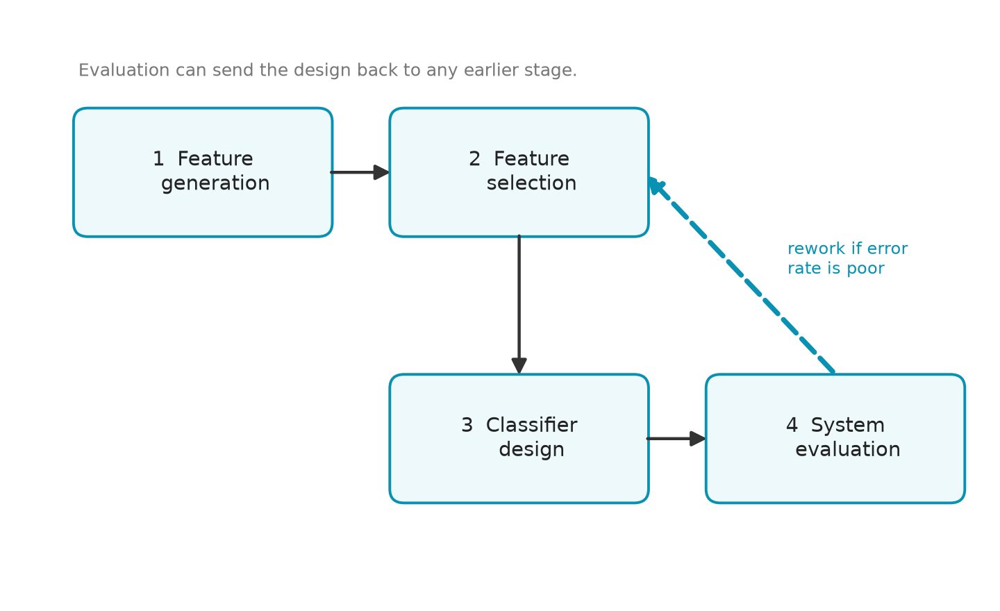
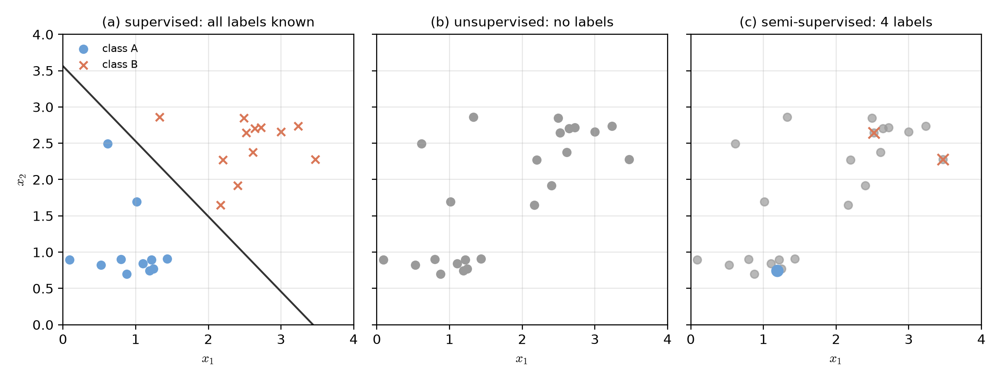

# Lecture 01：導論——什麼是樣式識別？（Introduction: What Is Pattern Recognition?）

> 週次:第 1 週（2026-09-07）｜進度:課程介紹與圖形識別概論
>
> Week 1 (2026-09-07) | Topic: Course Overview and Introduction to Pattern Recognition

本講義的內容改寫自 Theodoridis 教科書第 1 章的重點，並參考課程網頁的自學講義。文字是重新寫的，標有 `[補充]` 的內容是為了幫助理解而新增的。

This lecture rewrites the key ideas of Chapter 1 of the Theodoridis textbook and draws on the course's self-study notes. The text is newly written. Content marked `[補充]` / `[Added]` is extra material added to help understanding.

## 學習目標（Learning objectives）

- 說出樣式識別要解決的問題，並舉出五類典型應用（State what pattern recognition solves, and name five typical applications）。
- 解釋「特徵」、「特徵向量」與「分類器」三者的關係（Explain how a feature, a feature vector, and a classifier are related）。
- 說出分類系統設計的四個階段，並說明為什麼它是一個迴圈（Name the four stages of designing a classification system, and explain why it is a loop）。
- 區分監督式、非監督式與半監督式學習（Distinguish supervised, unsupervised, and semi-supervised learning）。
- 了解全書的結構（Describe how the book is organized）。

## 1. 為什麼要學樣式識別？（Why study pattern recognition?）

人類每天都在做樣式識別。你看到一隻狗，即使牠的姿勢、毛色、距離都不同，你仍然知道那是狗。樣式識別要做的，就是讓電腦也能把東西歸到正確的類別。

Humans do pattern recognition all the time. You see a dog, and even if its pose, color, or distance changes, you still know it is a dog. Pattern recognition aims to let a computer put things into the right class too.

`[補充]` 這個比喻有侷限：人是靠經驗「感覺」出來的，電腦必須先把資料轉成數字，才能做判斷。

`[Added]` This analogy has a limit: people judge by experience, but a computer must first turn the data into numbers.

以下是幾個典型的應用（Here are some typical applications）：

- 機器視覺：相機拍下零件的照片，判斷有沒有瑕疵（Machine vision: a camera photographs a part, and the system checks whether it has a defect）。
- 文字辨識（OCR）：把掃描的文件辨認成一個一個的字母與數字，存成文字檔（Optical character recognition (OCR): a scanned page is read character by character and saved as text）。
- 電腦輔助診斷：幫醫師檢視醫學影像，提供第二意見（Computer-aided diagnosis: the system reviews a medical image and gives the doctor a second opinion）。
- 語音辨識：系統接收麥克風送進來的語音，寫出對應的文字（Speech recognition: the system takes in speech from a microphone and writes out the matching text）。
- 內容式檢索：依相似度找出相近的影像、音樂或 DNA 序列，而不是只靠關鍵字（Content-based retrieval: find similar images, music, or DNA sequences by similarity, not only by keywords）。

仔細看這些例子，它們的輸入很不一樣：圖片、聲音、文件、序列。但它們都遵循同一條路線：先把資料變成數字，再做分類。

Look closely: the inputs are very different (images, sound, documents, sequences). Yet they all follow the same route: turn the data into numbers first, then classify.

> 分類器看不到圖片，它只看數字。
>
> A classifier never sees a picture; it only sees numbers.

`[補充]` 記憶要訣：**先量、再分、最後測**。

`[Added]` Memory aid: **measure, then classify, then test.**

## 2. 特徵、特徵向量與分類器（Features, feature vectors, and classifiers）

**特徵**：從資料中量出來的一個數字，用來描述資料的某個特點。例如一張影像的平均亮度。

**Feature**: a number measured from the data that describes one property of it, for example the average brightness of an image.

**特徵向量**：把 $l$ 個特徵排成一欄，就是特徵向量：

**Feature vector**: when you arrange $l$ features in one column, you get a feature vector:

$$
\mathbf{x} = [x_1, x_2, \dots, x_l]^T
$$

上標 $T$ 表示**轉置**，也就是把一列橫著寫的數字改成一欄直著寫。

The superscript $T$ means **transpose**: a row of numbers is written as a column.

**分類器**：一個規則，負責把特徵空間切成不同的區域，每個區域對應一個類別。

**Classifier**: a rule that cuts the feature space into regions, with each region assigned to one class.

### 一個醫學影像的簡化例子（A simplified medical-image example）

`[補充]` 我們手上有兩張影像，每張都標出了一塊感興趣區域（region of interest）。其中一塊取自良性的病變（記為類別 A），另一塊取自惡性的病變（記為類別 B）。我們不直接比較整張影像，而是先量兩個特徵：平均灰階值與灰階標準差。下面的程式片段正是計算這兩個特徵。

`[Added]` Suppose two images each contain a region of interest: one from a benign lesion (class A) and one from a malignant lesion (class B). We do not compare the images directly. Instead we measure two features: the mean gray level and the gray-level standard deviation. The code below computes them.

```python
import numpy as np

def features(region):
    # region: 一維陣列,裝著這塊區域每個像素的灰階值
    return np.array([region.mean(), region.std()])   # x = [平均值, 標準差]^T

region = np.array([100, 110, 120, 130, 140.0])
print(features(region))    # 輸出 [120.  14.142...]
```

每一塊區域都變成一個二維點。把很多點畫在同一張平面上，就得到**特徵平面**（feature plane）：

Each region becomes a point in two dimensions. Plotting many points on one plane gives a **feature plane**:


圖中的資料是我們用電腦模擬的，不是來自教科書的真實病例。決策線是用兩類的平均值算出來的，它是一條直線。依這條線，星號位於 B 類那一側。但它離線很近，所以結論不是絕對的。

The data in the figure are simulated by computer, not real patient records from the textbook. The decision line is computed from the two class means, and it is a straight line. By this line, the star falls on the side of class B. It is close to the line, though, so the conclusion is not certain.

**名詞解釋**：

- **訓練樣本（training sample）**：類別已知、用來設計分類器的樣本。
- **誤判（misclassification）**：分類器把樣本判到錯誤的類別。

**Terms**:

- **Training sample**: a sample whose class is known and is used to design the classifier.
- **Misclassification**: the classifier assigns a sample to the wrong class.

`[補充]` 做一個簡單的檢查：用線性規則 $g(\mathbf{x}) = \mathbf{w}^T\mathbf{x} + w_0$，取 $\mathbf{w} = [1, 1.5]^T$、$w_0 = -150$。若 $g < 0$ 判為 A，若 $g > 0$ 判為 B。三個點的計算結果如下：

`[Added]` A quick check: take the linear rule $g(\mathbf{x}) = \mathbf{w}^T\mathbf{x} + w_0$ with $\mathbf{w} = [1, 1.5]^T$ and $w_0 = -150$. Decide A if $g < 0$ and B if $g > 0$. Results for three points:

| 點 $\mathbf{x}$ | 計算 $g(\mathbf{x})$ | 判斷（Decision） |
|---|---|---|
| $[110, 20]^T$ | $110 + 1.5 \times 20 - 150 = -10$ | A |
| $[135, 40]^T$ | $135 + 1.5 \times 40 - 150 = 45$ | B |
| $[120, 30]^T$ | $120 + 1.5 \times 30 - 150 = 15$ | B |

`[補充]` 記憶要訣：**分類器的決策 = 看 $g$ 的正負號**。

`[Added]` Memory aid: **the decision is just the sign of $g$.**

### 接下來要回答的四個問題（Four questions to answer next）

上面的例子其實很取巧。我們只是剛好找到了兩個好用的特徵，又憑感覺畫了一條線。真實的問題要更嚴謹地回答下列四個問題：

The example above is a shortcut. We happened to find two useful features and drew a line by eye. A real project must answer four questions more carefully:

1. 特徵要怎麼生成？（How should the features be generated?）
2. 該用幾個特徵最好？（How many features should we use?）
3. 分界線（決策邊界）要怎麼畫？（How should the decision boundary be drawn?）
4. 畫好之後，準不準？（Once drawn, how accurate is it?）

## 3. 分類系統設計的四個階段（Four stages of designing a classification system）

設計一個分類系統，通常依序經過四個階段：**特徵生成 → 特徵選擇 → 分類器設計 → 系統評估**。

Designing a classification system usually passes through four stages: **feature generation → feature selection → classifier design → system evaluation**.

- **特徵生成（Feature generation）**：這個問題該量什麼數字？例如上一節的平均值與標準差。
- **特徵選擇（Feature selection）**：候選特徵通常很多，要挑出最有用的子集合。
- **分類器設計（Classifier design）**：依選定的特徵，找出最好的分界規則。多數真實問題的分界不是直線，而是彎曲的曲面。
- **系統評估（System evaluation）**：用有系統的方法量出錯誤率，而不是憑感覺。



**重要觀念：這不是一條單向流水線，而是一個迴圈。** 如果評估的結果不好，就要回頭修正前面的階段。有些方法會把「特徵選擇」與「分類器設計」當成同一個問題，一起求解。

**Key idea: this is a loop, not a one-way pipeline.** If the evaluation result is poor, you go back and revise an earlier stage. Some methods even merge feature selection and classifier design into one optimization problem.

`[補充]` 記憶要訣：**生、選、設、評，評完再回頭。**

`[Added]` Memory aid: **generate, select, design, evaluate; then loop back if needed.**

## 4. 三種學習方式（Three learning settings）

依照訓練時「有沒有類別標籤」，學習方式分成三種。

Learning methods fall into three groups, depending on whether the training data come with class labels.

### 4.1 監督式學習（Supervised learning）

每個訓練樣本的類別都已知。我們用這些「已知答案」的樣本來設計分類器，就像老師批改過的考卷。

Every training sample has a known class. We use these labelled samples to design the classifier, like a set of exams already graded by a teacher.

第 2 節的醫學影像例子就是監督式學習。

The medical-image example in Section 2 is supervised learning.

### 4.2 非監督式學習（Unsupervised learning, clustering）

這一類方法手上只有特徵向量，沒有類別標籤。它的任務是找出資料裡彼此相像的點，並把它們歸成一堆一堆。

In this setting we have feature vectors but no class labels. The task is to find points that resemble each other and group them into clusters.

- **例子一：衛星影像的地表分類**（Example 1: land-cover classification from satellite images）。感測器在不同波段量到每個像元的反射強度，這些強度就組成該像元的特徵向量。接著用分群方法把彼此相似的向量歸成同一堆，再拿少量實地資料為每一堆取名（水域、農地、森林……）。
- **例子二：國家的統計資料**（Example 2: country statistics）。每個國家可以用「國民所得、文盲率、兒童死亡率」三個數字來描述。分群後，可能會發現一批「收入低、文盲多、嬰幼兒死亡多」的國家彼此靠得很近。這種群體不是事先設定的，而是從數字中浮現出來的。

`[補充]` 分群有兩個關鍵抉擇：怎麼定義「相似」，以及用哪個演算法分群。不同的選擇常會得到不同的結果，需要專家判讀。

`[Added]` Clustering has two key choices: how to define "similar", and which algorithm to use. Different choices often give different results, so expert judgment is needed.

**常見迷思（Common misconception）**：距離近不一定代表屬於同一類。兩個點很近，仍可能分屬不同的概念。

**Common misconception**: being close does not always mean being in the same class. Two nearby points can still belong to different concepts.

### 4.3 半監督式學習（Semi-supervised learning）

半監督式學習處在監督式與非監督式的中間地帶：只有一小部分樣本有標籤，其餘的沒有。未標籤的樣本仍然帶有資料的結構，可以用來輔助學習。

It lies between the two: only a small part of the samples have labels. The unlabelled samples still carry the structure of the data and can help learning.

在分群時，半監督式學習常把已知的標籤轉成兩種限制：

In clustering, semi-supervised methods often turn known labels into two kinds of constraints:

- **必連（must-link）**：強制這兩個點分在同一群。
- **不可連（cannot-link）**：禁止這兩個點分在同一群。

`[補充]` 比喻：必連像「同一組的朋友」，不可連像「不能同桌的人」。這個比喻只說明關係，不代表真實的距離。

`[Added]` Analogy: must-link is like "friends who must sit together"; cannot-link is like "people who must not sit together". The analogy describes the relation only, not real distances.



**記憶要訣**：監督式是「有答案，學規則」；非監督式是「沒答案，找結構」；半監督式是「少量答案，帶動整體」。

**Memory aid**: supervised means "answers given, learn the rule"; unsupervised means "no answers, find the structure"; semi-supervised means "a few answers guide the whole".

## 5. 全書地圖（How the book is organized）

全書大致分成兩大部分：前半部是監督式樣式識別，後半部是非監督式（分群）。第 10 章連接兩者，談系統評估與半監督式學習。

The book has two main parts: the first half covers supervised pattern recognition, and the second half covers unsupervised learning (clustering). Chapter 10 links the two, covering system evaluation and semi-supervised learning.

| 章次 | 中文主題 | English topic |
|---|---|---|
| 2 | 貝氏分類與機率密度估計 | Bayesian classification and density estimation |
| 3 | 線性分類器 | Linear classifiers |
| 4 | 非線性分類器 | Nonlinear classifiers |
| 5 | 特徵選擇 | Feature selection |
| 6 | 特徵生成（一）：資料轉換與降維 | Feature generation I: data transformation and dimensionality reduction |
| 7 | 特徵生成（二）：影像與音訊 | Feature generation II: images and audio |
| 8 | 樣板匹配 | Template matching |
| 9 | 上下文相關分類 | Context-dependent classification |
| 10 | 系統評估與半監督式學習 | System evaluation and semi-supervised learning |
| 11–16 | 非監督式學習（分群）各主題 | Unsupervised learning (clustering) topics |

書中大部分章節附有 MATLAB 程式。它們的主要目的是教學：用模擬的高斯資料讓學生看清楚演算法在理想假設下的行為，而不是拿來當成現成的商用套件。

Most chapters include MATLAB programs. Their main purpose is teaching: they use simulated Gaussian data so you can see how an algorithm behaves under clean assumptions, not to serve as ready-made commercial tools.

本書不討論語法式樣式識別（syntactic pattern recognition），也就是用文法規則描述樣式結構的路線。因為它的思路與本書的統計與幾何取向差異很大，本書沒有專章處理。

The book does not cover syntactic pattern recognition, which describes pattern structure with grammar rules. Its approach differs greatly from the statistical and geometric view of this book, so there is no dedicated chapter.

## 6. 小結（Summary）

- 樣式識別讓電腦依特徵把輸入歸到某個類別（Pattern recognition assigns an input to a class based on its features）。
- 特徵是量出來的數字，特徵向量把它們排成一欄，分類器是切割特徵空間的規則（A feature is a measured number; a feature vector stacks features in a column; a classifier is a rule that cuts the feature space）。
- 系統設計是「生成、選擇、設計、評估」的迴圈（System design is a loop of generation, selection, design, and evaluation）。
- 學習方式可以看訓練資料有沒有標籤來分類：全部有、全部沒有，或只有一部分有（Learning methods can be sorted by how many labels the training data have: all, none, or some）。

## 7. 練習（Practice）

以下練習只給問題與提示，答案請在課堂或討論區討論。

The exercises below give problems and hints only. Discuss the answers in class or on the discussion board.

1. 想一個你日常生活中遇到的樣式識別例子，寫出它的輸入、你會用的特徵，以及要判斷的類別。（提示：先想「輸入是什麼」，再想「能量出哪些數字」。）（Think of one pattern recognition example from daily life. Write down its input, the features you would use, and the classes to decide. Hint: first ask "what is the input?", then "which numbers can I measure?"）
2. 若要區分「晴天」與「雨天」的照片，你會選哪兩個特徵？為什麼？（提示：想想亮度與顏色的分布。）（To separate photos of sunny days from rainy days, which two features would you choose, and why? Hint: think about brightness and color distribution.）
3. 為什麼在標籤很貴的情況下，半監督式學習特別有用？（提示：標籤少時，未標籤資料還能提供什麼資訊？）（Why is semi-supervised learning especially useful when labels are expensive? Hint: when labels are few, what can unlabelled data still tell us?）

## 延伸閱讀（Further reading）

- 教科書：Sergios Theodoridis & Konstantinos Koutroumbas, *Pattern Recognition*, 4th ed.，第 1 章（本週章節）。
- 課程網頁的互動式自學講義：Chapter 1（Introduction），讀取日期 2026-10-09。
- 參考資料：見 [參考資料](../references/README.md)。

- Textbook: Theodoridis & Koutroumbas, *Pattern Recognition*, 4th ed., Chapter 1 (this week's chapter).
- Course self-study notes: Chapter 1 (Introduction), read on 2026-10-09.
- References: see the [references folder](../references/README.md).

## 術語表（Glossary）

| 中文 | English |
|---|---|
| 樣式識別 | pattern recognition |
| 特徵 | feature |
| 特徵向量 | feature vector |
| 特徵空間／特徵平面 | feature space / feature plane |
| 分類器 | classifier |
| 決策邊界 | decision boundary |
| 訓練樣本 | training sample |
| 誤判 | misclassification |
| 特徵生成 | feature generation |
| 特徵選擇 | feature selection |
| 系統評估 | system evaluation |
| 監督式學習 | supervised learning |
| 非監督式學習／分群 | unsupervised learning / clustering |
| 半監督式學習 | semi-supervised learning |
| 必連 | must-link |
| 不可連 | cannot-link |
| 轉置 | transpose |
