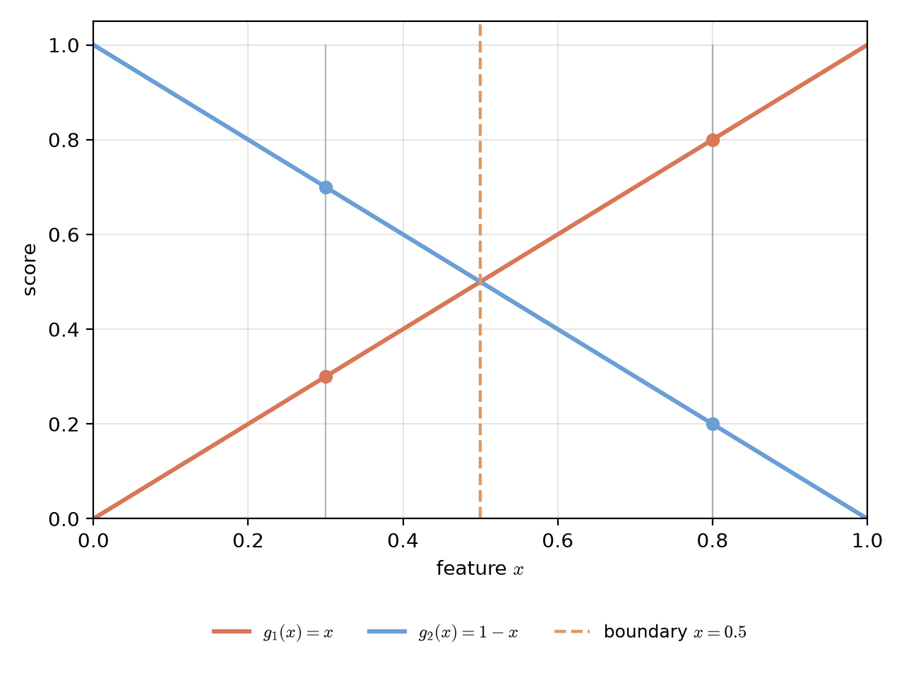

# Lecture 01:課程介紹與圖形識別概論 / Course Overview and Introduction to Pattern Recognition

> 週次:第 1 週（2026-09-07）｜進度:Introduction / Course Overview & Introduction to Pattern Recognition
> Week 1 (2026-09-07) | Topic: Introduction / Course Overview & Introduction to Pattern Recognition

## 學習目標 / Learning objectives

- 說明圖形識別要解決的問題,並舉出文字、影像、聲音的例子。
  Explain what pattern recognition solves, and give examples with text, images, and sound.
- 了解本課程的主題架構與評分方式(見 [`syllabus.md`](../syllabus.md)、[`schedule.md`](../schedule.md))。
  Describe the course structure and grading (see [syllabus](../syllabus.md) and [schedule](../schedule.md)).
- 理解「特徵 → 分類器 → 類別」的基本流程。
  Understand the basic flow: features → classifier → class.

## 1. 什麼是圖形識別? / What is pattern recognition?

圖形識別是讓電腦依據資料的特徵,把輸入歸入某一個類別。輸入可以是文字、影像或聲音。
Pattern recognition lets a computer put an input into a class, based on the input's features. The input can be text, an image, or sound.

**特徵(feature)**:從資料中取出的數字,用來描述資料的某個特點。例如一張圖的平均亮度。
**Feature**: a number taken from the data that describes one property of it. For example, the average brightness of an image.

處理流程 / Processing flow:

- 原始資料(文字、影像、聲音)/ Raw data (text, images, sound)
- 特徵萃取:把資料轉成可以比較的數字 / Feature generation: turn the data into numbers we can compare
- 特徵選取:保留最有鑑別力的特徵 / Feature selection: keep the features that best separate classes
- 分類器:依特徵決定類別 / Classifier: decide the class from the features
- 類別輸出 / Output: a class label

## 2. 課程主題 / Course topics

本課程的核心問題是:**如何設計特徵與分類器,使電腦能正確區分不同類別。**
The main question of this course is: **how do we design features and classifiers so that a computer can tell the classes apart correctly?**

- 貝氏分類器:用機率與風險做決策 / Bayes classifiers: decide using probability and risk
- 線性與非線性分類器:感知機、支持向量機、神經網路、核方法與決策樹 / Linear and nonlinear classifiers: perceptrons, support vector machines, neural networks, kernel methods, and decision trees
- 特徵選取與萃取:特徵選擇方法、PCA 與 LDA / Feature selection and generation: selection methods, PCA, and LDA
- 樣板匹配:距離量測與動態時間規整(DTW)/ Template matching: distance measures and dynamic time warping (DTW)
- 上下文相關分類:Markov 模型與隱藏式 Markov 模型(HMM)/ Context-dependent classification: Markov models and hidden Markov models (HMMs)
- 分群:K-means、階層式分群與評估 / Clustering: K-means, hierarchical clustering, and evaluation

各週細節見 [`schedule.md`](../schedule.md)。Details for each week are in the [schedule](../schedule.md).

## 3. 符號約定 / Notation

| 符號 Symbol | 中文意義 | English meaning |
|---|---|---|
| $\mathbf{x} \in \mathbb{R}^d$ | 特徵向量(d 維) | feature vector (d dimensions) |
| $\omega_i$ | 第 $i$ 個類別 | the $i$-th class |
| $P(\omega_i)$ | 先驗機率:在還沒看資料前,屬於類別 $\omega_i$ 的把握 | prior probability: how likely class $\omega_i$ is before seeing data |
| $p(\mathbf{x} \mid \omega_i)$ | 條件機率密度:若真的是 $\omega_i$,看到 $\mathbf{x}$ 的可能程度 | class-conditional density: how likely $\mathbf{x}$ is if the true class is $\omega_i$ |
| $g_i(\mathbf{x})$ | 判別函數:第 $i$ 類的分數,分數越高越像這一類 | discriminant function: a score for class $i$; higher means more like class $i$ |

## 4. 最簡單的決策規則 / A simple decision rule

假設你有兩個分數函數 $g_1(x)$ 與 $g_2(x)$。規則很簡單:哪一個分數高,就選哪一類。

Suppose you have two score functions, $g_1(x)$ and $g_2(x)$. The rule is simple: choose the class with the higher score.

$$
\text{decide } \omega_1 \text{ if } g_1(x) > g_2(x), \quad \text{otherwise decide } \omega_2
$$

**例子 / Example.** 設 $x$ 介於 0 與 1 之間,兩個分數函數為 $g_1(x) = x$、$g_2(x) = 1 - x$。
Let $x$ lie between 0 and 1, with $g_1(x) = x$ and $g_2(x) = 1 - x$.

| $x$ | $g_1(x)$ | $g_2(x)$ | 比較 / Comparison | 決策 / Decision |
|---|---|---|---|---|
| 0.3 | 0.3 | 0.7 | $0.3 > 0.7$ 不成立 / not true | $\omega_2$ |
| 0.8 | 0.8 | 0.2 | $0.8 > 0.2$ 成立 / true | $\omega_1$ |
| 0.5 | 0.5 | 0.5 | 相等 / equal | 邊界 / on the boundary |

兩條線相等的地方是**決策邊界**(decision boundary):$g_1(x) = g_2(x)$,解得 $x = 0.5$。
The place where the two lines meet is the **decision boundary**: $g_1(x) = g_2(x)$ gives $x = 0.5$.

**常見迷思 / Common misconception.** 分數不一定是機率。分數高只代表「比較像」這一類,不代表機率是 0.8。
A score is not always a probability. A higher score only means "more like" that class; it does not mean the probability is 0.8.

## 5. 小結 / Summary

- 圖形識別 = 由特徵決定輸入所屬的類別。Pattern recognition = deciding the class of an input from its features.
- 特徵的品質與分類器的選擇共同決定辨識效果。Feature quality and classifier choice together decide accuracy.
- 下一週:貝氏決策理論。Next week: Bayesian decision theory.

## 延伸閱讀 / Further reading

- 教科書:Sergios Theodoridis & Konstantinos Koutroumbas, *Pattern Recognition*, 4th ed.(本週對應章節待老師指定)。
  Textbook: Theodoridis & Koutroumbas, *Pattern Recognition*, 4th ed. (the chapter for this week is to be confirmed by the instructor).
- 參考資料:見 [`references/`](../references/README.md)。References: see the [references folder](../references/README.md).

## 術語表 / Glossary

| 中文 | English |
|---|---|
| 圖形識別 | pattern recognition |
| 特徵 | feature |
| 特徵萃取 | feature generation |
| 特徵選取 | feature selection |
| 分類器 | classifier |
| 類別 | class |
| 先驗機率 | prior probability |
| 條件機率密度 | class-conditional density |
| 判別函數 | discriminant function |
| 決策邊界 | decision boundary |
