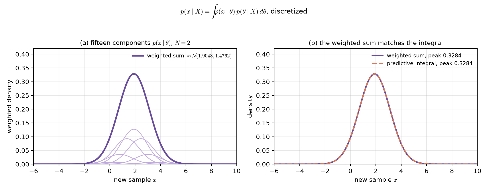
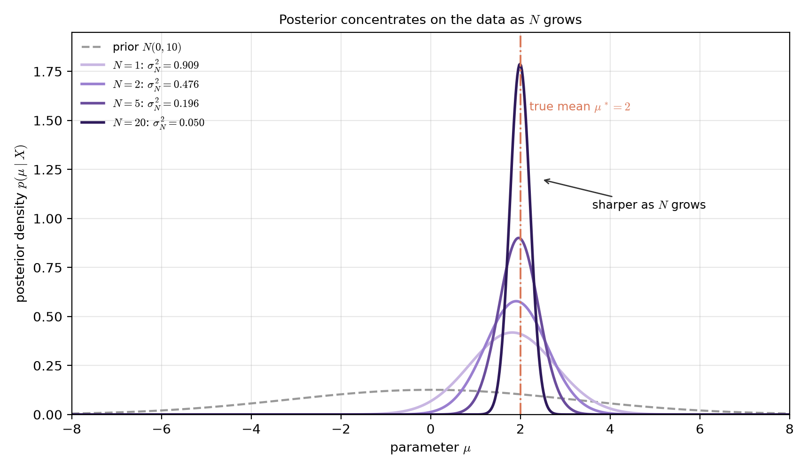
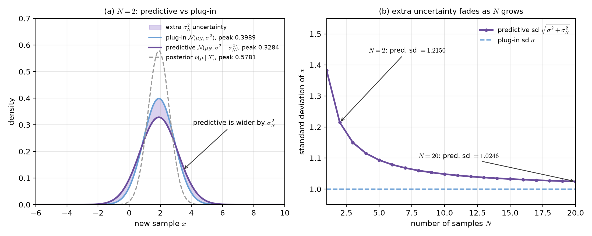
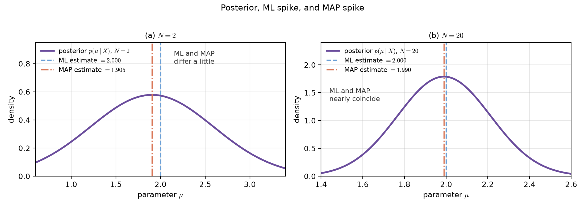
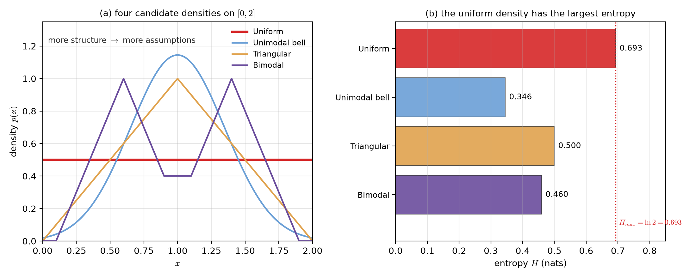
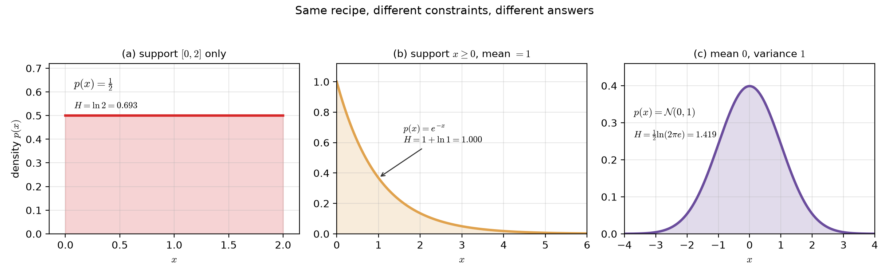

# Lecture 02 補充:貝氏推論與最大熵估計（Bayesian Inference and Maximum-Entropy Estimation）

> 週次:第 2 週（自主學習教材）｜進度:貝氏推論與最大熵估計
>
> Week 2 (self-study material) | Topic: Bayesian Inference and Maximum-Entropy Estimation

本講義涵蓋課程網頁第 2 章 2.5 節的兩個知識點:貝氏推論,以及最大熵估計。本週主講義談的是已知分布參數時如何做決策。本講義改問另一個問題:參數本身不知道時,該怎麼辦。

This lecture covers two topics from Section 2.5 of the course notes: Bayesian inference and maximum-entropy estimation. This week's main lecture assumed the distribution parameters were known; here we ask what to do when the parameters themselves are unknown.

文字是重新撰寫的，不是原文摘錄。標有 `[補充]` / `[Added]` 的內容是為了幫助理解而新增的。圖中的數字都是自己算的示範數字，不是教科書原圖。

The text is newly written, not copied. Content marked `[補充]` / `[Added]` is added to help understanding. All figure numbers are our own worked examples.

## 學習目標（Learning objectives）

- 說明貝氏推論為什麼要算完整的後驗分布，而不是只算一個點估計（Explain why Bayesian inference computes a full posterior instead of a single point estimate）。
- 寫出一維高斯的後驗均值與後驗變異數公式，並說明 $N$ 增加時它如何變化（Write the posterior mean and variance for a one-dimensional Gaussian, and say how they change as $N$ grows）。
- 解釋預測分布為什麼比原本的 $\sigma^2$ 多出 $\sigma_N^2$（Explain why the predictive distribution is wider than $\sigma^2$ by the extra term $\sigma_N^2$）。
- 說明資料量很大時，貝氏推論、MAP 與 ML 為什麼會趨於一致（Explain why Bayesian inference, MAP, and ML agree when the data set is large）。
- 寫出熵的定義，並說明最大熵原理在選什麼（Write the definition of entropy, and state what the maximum-entropy principle chooses）。
- 用 Lagrange 乘子法求出定義域限制下的最大熵分布是均勻分布（Derive, with Lagrange multipliers, that the maximum-entropy distribution under a support constraint is uniform）。
- 比較三種限制條件下最大熵分布的不同答案（Compare the maximum-entropy answers under three different sets of constraints）。

## 1. 從「一個值」到「整個分布」（From one value to a whole distribution）

前面的最大概似（ML）與最大事後機率（MAP）都只給一個數字。你拿那個數字當成真實參數，然後往下算。問題是:這個數字錯了怎麼辦?

Maximum likelihood (ML) and maximum a posteriori (MAP) both return a single number. You plug that number in as if it were the true parameter. The trouble is: what if that number is wrong?

`[補充]` 比喻:有人問你明天的氣溫。ML 是「我猜 25 度」，貝氏推論是「我猜 24 到 26 度，中間最可能」。後者資訊更完整，因為它把「有多不確定」也講清楚了。這個比喻的侷限是，氣溫的不確定性不完全等於參數的不確定性。

`[Added]` Analogy: someone asks for tomorrow's temperature. ML says "I guess 25 degrees," and Bayesian inference says "I guess 24 to 26 degrees, with the middle most likely." The second answer carries more information because it also states how unsure we are. The limit is that weather uncertainty is not exactly parameter uncertainty.

**貝氏推論（Bayesian inference）**的做法是:不要去挑一個 $\mathbf{\theta}$。它把所有可能的 $\mathbf{\theta}$ 都留下來，各自帶一個權重。這個權重就是後驗機率 $p(\mathbf{\theta}\mid X)$。

**Bayesian inference** does not pick one $\mathbf{\theta}$. It keeps every possible $\mathbf{\theta}$, each with a weight. That weight is the posterior $p(\mathbf{\theta}\mid X)$.

有了後驗,就可以直接回答我們真正想問的問題:給定訓練資料 $X$,一個新樣本 $\mathbf{x}$ 的分布是什麼?答案就是**預測分布**(predictive distribution):

With the posterior in hand, we can answer our real question: given the data $X$, how is a new sample $\mathbf{x}$ distributed? The answer is the **predictive distribution**:

$$
p(\mathbf{x}\mid X)=\int p(\mathbf{x}\mid\mathbf{\theta})\,p(\mathbf{\theta}\mid X)\,d\mathbf{\theta}
$$

其中有兩層:預測分布由參數積分得到，而後驗本身由貝氏定理給出。

Two layers stack here: the predictive distribution comes from integrating over the parameter, and the posterior itself comes from Bayes' rule.

$$
p(\mathbf{\theta}\mid X)=\frac{p(X\mid\mathbf{\theta})\,p(\mathbf{\theta})}{\int p(X\mid\mathbf{\theta})\,p(\mathbf{\theta})\,d\mathbf{\theta}}
$$

| 符號（Symbol） | 中文意義 | English meaning |
|---|---|---|
| $X$ | 訓練資料集 | the training data set |
| $\mathbf{\theta}$ | 未知的參數（可以是一整組） | the unknown parameter (possibly a vector) |
| $p(\mathbf{\theta})$ | 先驗:看資料前對參數的把握 | prior: our belief about the parameter before seeing data |
| $p(\mathbf{\theta}\mid X)$ | 後驗:看完資料後對參數的把握 | posterior: our belief after seeing the data |
| $p(\mathbf{x}\mid X)$ | 預測分布:新樣本的完整機率分布 | predictive distribution: the full distribution of a new sample |

**白話直覺**:預測分布就是把每個可能的 $\mathbf{\theta}$ 都代進去算一次 $p(\mathbf{x}\mid\mathbf{\theta})$，再依 $\mathbf{\theta}$ 有多可能去加權平均。

**Plain intuition**: the predictive distribution plugs every possible $\mathbf{\theta}$ into $p(\mathbf{x}\mid\mathbf{\theta})$. It then averages those values, weighted by how likely each $\mathbf{\theta}$ is.

**數字例（Numerical example）**:把積分換成有限個加權項，就可以看出預測分布是怎麼組合出來的。取 $\sigma^2=1$、先驗 $\mathcal{N}(0,10)$、$\bar{x}_N=2$、樣本數 $N=2$（這組設定在第 2、3 節會再出現）。用 15 個由求積公式定出的節點近似這個積分，得到預測分布 $\mathcal{N}(1.9048,1.4762)$。

**Numerical example**: replacing the integral by finitely many weighted terms shows how the predictive density is assembled. Take $\sigma^2=1$, prior $\mathcal{N}(0,10)$, $\bar{x}_N=2$, and $N=2$ (the same setting returns in Sections 2 and 3). Approximating the integral with 15 quadrature nodes gives the predictive density $\mathcal{N}(1.9048,1.4762)$.

**圖說 `lec02-predictive-mixture`**：左圖每一條淡紫細線是一個 $p(x\mid\theta)$，高度依後驗 $p(\theta\mid X)$ 加權，節點由求積公式決定。深紫粗線是它們的和（峰值 $0.3283$），也就是預測分布。右圖把這個加權和與解析的積分結果疊在一起，兩條線幾乎重合（峰值都是 $0.3283$）。讀圖時先看左圖細線的高度分布，再看右圖兩條曲線是否貼合。〔功能：1、2、3〕

**Caption `lec02-predictive-mixture`**: in the left panel each pale purple curve is one $p(x\mid\theta)$, weighted by the posterior $p(\theta\mid X)$. The nodes come from the quadrature rule. The dark purple curve is their sum (peak $0.3283$), which is the predictive density. The right panel overlays this weighted sum on the analytic integral. The two curves nearly coincide, both with peak $0.3283$.

**常見迷思**:「貝氏推論只是換一種方法算點估計。」不是。它輸出的是整個分布，這比一個數字多出「不確定性有多大」的資訊。

**Common misconception**: "Bayesian inference is just another way to compute a point estimate." It is not. It returns a whole distribution, which carries information about how large the uncertainty is.

`[補充]` 這個積分多數時候沒有公式解。實務上得靠數值方法，例如 MCMC、Gibbs 抽樣或 Metropolis-Hastings。

`[Added]` This integral usually has no closed form. In practice we use numerical methods such as MCMC, Gibbs sampling, or Metropolis-Hastings.

## 2. 一維高斯:後驗長什麼樣子（One-dimensional Gaussian: what the posterior looks like）

先用最簡單的例子把公式看懂。假設資料來自一維高斯，變異數 $\sigma^2$ 已知，均值 $\mu$ 未知。給 $\mu$ 一個高斯先驗 $\mathcal{N}(\mu_0,\sigma_0^2)$。

Start with the simplest case. The data follow a one-dimensional Gaussian with known variance $\sigma^2$ and unknown mean $\mu$. Give $\mu$ a Gaussian prior $\mathcal{N}(\mu_0,\sigma_0^2)$.

在這種設定下，後驗仍然是高斯，而且參數有公式解。

Under this setting the posterior is again Gaussian, and its parameters have closed forms.

$$
\mu_N=\frac{N\sigma_0^2\bar{x}_N+\sigma^2\mu_0}{N\sigma_0^2+\sigma^2},\qquad
\sigma_N^2=\frac{\sigma^2\sigma_0^2}{N\sigma_0^2+\sigma^2}
$$

| 符號（Symbol） | 中文意義 | English meaning |
|---|---|---|
| $N$ | 樣本數 | the number of samples |
| $\bar{x}_N$ | 樣本平均 | the sample mean |
| $\mu_0,\sigma_0^2$ | 先驗的均值與變異數 | the mean and variance of the prior |
| $\mu_N$ | 後驗均值 | the posterior mean |
| $\sigma_N^2$ | 後驗變異數 | the posterior variance |

**白話直覺**:後驗均值是「先驗」與「資料」的加權平均。資料越多，權重越偏資料。後驗變異數則隨 $N$ 變大而變小，也就是分布越來越尖。

**Plain intuition**: the posterior mean is a weighted average of the prior and the data. More data means more weight on the data. The posterior variance shrinks as $N$ grows, so the posterior gets sharper.

**數字例（Numerical example）**:取 $\sigma^2=1$、先驗 $\mathcal{N}(0,10)$、$\bar{x}_N=2$。代入公式得:

**Numerical example**: take $\sigma^2=1$, prior $\mathcal{N}(0,10)$, and $\bar{x}_N=2$. Substituting into the formulas gives:

| $N$ | 後驗均值 $\mu_N$（Posterior mean） | 後驗變異數 $\sigma_N^2$（Posterior variance） | 後驗標準差（Posterior sd） |
|---|---|---|---|
| $1$ | $1.8182$ | $0.9091$ | $0.9535$ |
| $2$ | $1.9048$ | $0.4762$ | $0.6901$ |
| $5$ | $1.9608$ | $0.1961$ | $0.4428$ |
| $20$ | $1.9900$ | $0.0498$ | $0.2230$ |
| $100$ | $1.9980$ | $0.0100$ | $0.1000$ |

以上數字由 Python 依公式計算，不是心算。`[補充]` 可以注意兩件事:後驗均值從 $0$ 往 $2$ 移動，後驗變異數大致以 $1/N$ 的速度縮小。

The values above were computed with Python from the formulas. `[Added]` Two things to notice: the posterior mean moves from $0$ toward $2$, and the posterior variance shrinks roughly like $1/N$.

**圖說 `lec02-posterior-sharpening`**：灰色虛線是先驗 $\mathcal{N}(0,10)$，四條實線是 $N=1,2,5,20$ 的後驗。$N$ 越大，曲線越高越窄，中心也越靠近真實均值 $2$（橘色點劃線）。圖例直接標出每個 $N$ 對應的 $\sigma_N^2$。讀圖時先看曲線的高度與寬度變化，再看每條線的中心是否往橘線靠攏。〔功能：1、2〕

**Caption `lec02-posterior-sharpening`**: the grey dashed curve is the prior $\mathcal{N}(0,10)$, and the four solid curves are the posteriors for $N=1,2,5,20$. A larger $N$ gives a higher, narrower curve whose center moves toward the true mean $2$ (orange dash-dot line). The legend lists the matching $\sigma_N^2$ for each $N$. Read the figure by comparing the heights and widths first, then by checking where each center sits.

> 資料越多，後驗越尖。不確定性不是消失，而是被資料壓縮。
>
> More data makes the posterior sharper. Uncertainty is not gone; it is squeezed by the data.

## 3. 預測分布:多出來的 $\sigma_N^2$ 是什麼？（The predictive distribution: what is the extra $\sigma_N^2$?）

現在把後驗代進預測分布。計算結果仍然是一個高斯。

Substituting the posterior into the predictive distribution still gives a Gaussian.

$$
p(x\mid X)\sim\mathcal{N}\!\left(\mu_N,\ \sigma^2+\sigma_N^2\right)
$$

**注意變異數是 $\sigma^2+\sigma_N^2$，不是 $\sigma^2$。** 多出來的那一項，就是「我們對 $\mu$ 還不完全確定」所帶來的不確定性。

**Notice that the variance is $\sigma^2+\sigma_N^2$, not $\sigma^2$.** The extra term is the uncertainty that comes from not knowing $\mu$ exactly.

**白話直覺**:預測一個新樣本時，有兩個不確定性疊在一起。第一個是樣本本身的亂度 $\sigma^2$;第二個是「中心在哪裡」還不確定，也就是 $\sigma_N^2$。兩者相加，預測就必須更寬。

**Plain intuition**: predicting a new sample stacks two uncertainties. The first is the noise of the sample itself, $\sigma^2$. The second is that we are unsure where the center is, which is $\sigma_N^2$. The two add up, so the prediction must be wider.

**數字例（Numerical example）**:沿用上一節，取 $N=2$，此時 $\mu_N=1.9048$、$\sigma_N^2=0.4762$。預測變異數是 $1+0.4762=1.4762$，預測標準差是 $\sqrt{1.4762}=1.2150$。

**Numerical example**: continue from the last section with $N=2$, where $\mu_N=1.9048$ and $\sigma_N^2=0.4762$. The predictive variance is $1+0.4762=1.4762$, and the predictive standard deviation is $\sqrt{1.4762}=1.2150$.

| 量（Quantity） | 值（Value） | 怎麼算（How） |
|---|---|---|
| 樣本雜訊標準差（sample noise sd） | $1.0000$ | $\sqrt{\sigma^2}$ |
| 後驗標準差（posterior sd） | $0.6901$ | $\sqrt{\sigma_N^2}$ |
| 預測標準差（predictive sd） | $1.2150$ | $\sqrt{\sigma^2+\sigma_N^2}$ |
| 只代入點估計的密度峰值（plug-in density peak） | $0.3989$ | $1/\sqrt{2\pi\sigma^2}$ |
| 預測分布密度峰值（predictive density peak） | $0.3284$ | $1/\sqrt{2\pi(\sigma^2+\sigma_N^2)}$ |
| 後驗密度峰值（posterior density peak） | $0.5781$ | $1/\sqrt{2\pi\sigma_N^2}$ |

峰值比較的意義是:預測分布比只代入點估計的分布矮（$0.3284<0.3989$），也就是更寬、更誠實。

The comparison of peaks says this: the predictive density is lower than the plug-in density ($0.3284<0.3989$), which means it is wider and more honest.

**圖說 `lec02-predictive-widening`**：左圖是 $N=2$。深紫實線是預測分布，藍線是只代入 $\mu_N$ 的分布，紫色陰影就是兩者的差，對應多出來的 $\sigma_N^2$。灰虛線是後驗，它比兩者都窄。右圖是預測標準差對 $N$ 的曲線，從 $1.3817$（$N=1$）降到 $1.0246$（$N=20$），逐漸貼近藍色虛線 $\sigma=1$。讀圖時先比較左圖兩條曲線的高度，再看右圖曲線是否往 $\sigma=1$ 收斂。〔功能：1、2、3〕

**Caption `lec02-predictive-widening`**: the left panel uses $N=2$. The purple solid curve is the predictive density. The blue curve is the density that just plugs in $\mu_N$. The purple shading is their gap, which is the extra $\sigma_N^2$. The grey dashed posterior is the narrowest of the three. The right panel plots the predictive standard deviation against $N$. It falls from $1.3817$ at $N=1$ to $1.0246$ at $N=20$, approaching the blue dashed line $\sigma=1$.

**常見迷思**:「多出來的 $\sigma_N^2$ 是程式算錯，應該忽略。」不是。它來自「參數沒有被完全確定」這件事。想成計算誤差，就會把最重要的不確定性丟掉。

**Common misconception**: "the extra $\sigma_N^2$ is a numerical bug and should be dropped." It is not. It comes from the fact that the parameter is not fully known. Treating it as an error throws away the most important part of the uncertainty.

`[補充]` 反例:小樣本時若硬把 $\sigma_N^2$ 設成 0，預測分布會變得又高又窄。實際量測落在這個區間外的機率，就會比宣稱的高很多。

`[Added]` Counter-example: forcing $\sigma_N^2$ to zero with a small sample makes the predictive density tall and narrow. Then real measurements fall outside the claimed range far more often than advertised.

## 4. 點估計、貝氏與資料量（Point estimates, Bayesian inference, and data size）

把三種做法放在同一張圖上比一比。ML 只給一個數字 $\bar{x}_N$;MAP 給後驗的最高點 $\mu_N$;貝氏推論給整條後驗曲線。

Put the three approaches on one picture. ML returns one number $\bar{x}_N$; MAP returns the peak of the posterior, $\mu_N$; Bayesian inference returns the whole posterior curve.

**數字例（Numerical example）**:沿用 $\sigma^2=1$、先驗 $\mathcal{N}(0,10)$、$\bar{x}_N=2$。

**Numerical example**: keep $\sigma^2=1$, prior $\mathcal{N}(0,10)$, and $\bar{x}_N=2$.

| $N$ | ML 估計 $\bar{x}_N$ | MAP 估計 $\mu_N$ | 兩者差距（gap） |
|---|---|---|---|
| $2$ | $2.0000$ | $1.9048$ | $0.0952$ |
| $20$ | $2.0000$ | $1.9900$ | $0.0100$ |

`[補充]` 這裡 MAP 與後驗均值剛好相同，因為後驗是對稱的高斯，均值就是眾數。其他分布不一定如此。

`[Added]` Here the MAP estimate equals the posterior mean because the posterior is a symmetric Gaussian, where the mean is also the mode. Other distributions need not behave this way.

**圖說 `lec02-point-estimates`**：紫線是後驗，藍色虛線是 ML 估計（固定在 $2$），橘色點劃線是 MAP 估計。左圖 $N=2$，兩條虛線分開 $0.0952$;右圖 $N=20$，差距縮到 $0.0100$，兩條線幾乎疊在一起。讀圖時先看兩條虛線的間距，再看後驗是不是同時變窄。〔功能：1、2〕

**Caption `lec02-point-estimates`**: the purple curve is the posterior. The blue dashed line is the ML estimate, fixed at $2$, and the orange dash-dot line is the MAP estimate. At $N=2$ the two lines are $0.0952$ apart. At $N=20$ the gap shrinks to $0.0100$ and the lines nearly overlap. Read the figure by comparing the gaps first, then by checking whether the posterior also becomes narrower.

**收斂關係（Convergence）**:當 $N$ 很大，後驗變得非常尖，像一根脈衝。此時貝氏推論、MAP、ML 三者給出的答案幾乎相同。

**Convergence**: for large $N$ the posterior becomes very sharp, almost a pulse. Then Bayesian inference, MAP, and ML give nearly the same answer.

`[補充]` 為什麼?因為 $\sigma_N^2$ 隨 $N$ 變小而趨近 $0$，先驗的影響也被大量資料稀釋。資料少時三者可能明顯不同，此時貝氏推論保留的不確定性資訊最完整，代價是計算最貴。

`[Added]` Why? Because $\sigma_N^2\to 0$ as $N$ grows, and a large data set also dilutes the prior. With little data the three can differ clearly; then Bayesian inference keeps the most complete uncertainty information, at the highest computational cost.

> 資料少時，三條路差很多;資料多時，三條路會走到同一個地方。
>
> With little data the three routes differ a lot; with plenty of data they arrive at the same place.

## 5. 最大熵:最不武斷的選擇（Maximum entropy: the least committal choice）

換一個問題。假設有個機率密度函數,而我們手上只有零碎的線索。例如它能取值的範圍,或是它的平均值與分散程度。這些線索又少又粗略,對吧?符合它們的分布有無窮多個。該挑哪一個?

Change the question. Suppose we know almost nothing about a density, except a few constraints such as its support, its mean, and its variance. Infinitely many densities satisfy those constraints. Which one should we pick?

**最大熵原理（maximum-entropy principle）**的答案:選**熵**最大、也就是最隨機、最不多加任何假設的那一個。

The **maximum-entropy principle** answers: pick the one with the largest **entropy**, that is, the most random density, which adds no extra assumption.

`[補充]` 比喻:如果只被告知「這個人住在台灣」，你不該假設他住台北。假設住台北就是偷偷加了沒人告訴你的資訊。最大熵原理要避免的正是這件事。

`[Added]` Analogy: if you are only told that a person lives in Taiwan, you should not assume they live in Taipei. That assumption quietly adds information nobody gave you. The maximum-entropy principle avoids exactly this.

熵的定義如下。

Entropy is defined as follows.

$$
H=-\int_{\mathbf{x}}p(\mathbf{x})\ln p(\mathbf{x})\,d\mathbf{x}
$$

| 符號（Symbol） | 中文意義 | English meaning |
|---|---|---|
| $H$ | 熵:分布的平均不確定度 | entropy: the average uncertainty of the distribution |
| $p(\mathbf{x})$ | 待選的機率密度 | the density being considered |
| $\ln$ | 自然對數，單位是 nats | natural logarithm, so the unit is nats |

熵越大,代表這個分布越平均、越不肯把機率集中在少數幾處。熵越小,代表分布越集中在某幾點,我們對結果越有把握。最大熵估計的做法是:先寫下所有已知條件,再在符合條件的分布裡挑 $H$ 最大的一個當作 $p(\mathbf{x})$。

A larger entropy means the density has no preference and is close to uniform randomness. A smaller entropy means it is concentrated and confident. Maximum-entropy estimation finds the $p(\mathbf{x})$ that maximizes $H$ while satisfying the known constraints.

**數字例（Numerical example）**:在 $[0,2]$ 上比較四種候選密度，都用數值方法在同一組網格上計算 $H$。

**Numerical example**: compare four candidate densities on $[0,2]$. All values of $H$ are computed numerically on one fine grid.

| 候選分布（Candidate） | 峰值（Peak） | 熵 $H$（nats） |
|---|---|---|
| 均勻分布（uniform） | $0.5000$ | $0.6932$ |
| 三角形（triangular） | $1.0000$ | $0.5000$ |
| 雙峰（bimodal） | $1.0000$ | $0.4600$ |
| 單峰鐘形（unimodal bell） | $1.1447$ | $0.3455$ |

理論上，$[0,2]$ 上的最大熵分布是均勻分布，熵為 $\ln 2=0.6931$，與表中的 $0.6932$ 相符（差距來自數值積分）。

In theory the maximum-entropy density on $[0,2]$ is the uniform one, with entropy $\ln 2=0.6931$. The table value $0.6932$ matches it; the tiny gap comes from numerical integration.

**圖說 `lec02-maxent-bracket`**：左圖四條曲線都在 $[0,2]$ 上，且面積都是 $1$。紅色粗線是均勻分布，其餘三條都有峰或結構。右圖是對應的熵，均勻分布最高（$0.693$），越集中或結構越多的越低（$0.500$、$0.460$、$0.346$）。紅色點線標出 $H_{max}=\ln 2$。讀圖時先看左圖哪些曲線偏離平坦，再對照右圖的長條是否變短。〔功能：1、2〕

**Caption `lec02-maxent-bracket`**: all four curves in the left panel live on $[0,2]$ and each has area $1$. The red thick line is the uniform density; the other three have peaks or structure. The right panel shows the matching entropies. The uniform one is the largest at $0.693$. The more concentrated or shaped ones are smaller ($0.500$, $0.460$, $0.346$). The red dotted line marks $H_{max}=\ln 2$.

**常見迷思**:「有峰值、看起來比較有結構的分布，資訊量比較豐富，應該比較好。」恰好相反。峰值是你自己加上去的假設，不是資料告訴你的。假設越多，熵越低，離「誠實」越遠。

**Common misconception**: "a peaked, structured density looks richer in information, so it should be better." The opposite is true. The peak is an assumption you added, not something the data told you. More assumptions mean lower entropy and less honesty.

## 6. 用 Lagrange 乘子法求最大熵分布（Solving for the maximum-entropy density with Lagrange multipliers）

先做最簡單的版本。已知 $x$ 只在 $[x_1,x_2]$ 內非零，沒有其他資訊。唯一的限制是總機率為 $1$。

Start with the simplest version. The only information is that $x$ is nonzero only on $[x_1,x_2]$. The one constraint is that the total probability equals $1$.

$$
\int_{x_1}^{x_2}p(x)\,dx=1
$$

`[補充]` Lagrange 乘子法的想法是:把限制條件乘上一個未知係數 $\lambda$，再加進目標函數。這樣就變成沒有額外限制的最佳化問題。解完後，再回頭用限制條件把 $\lambda$ 定出來。

`[Added]` The idea of Lagrange multipliers: multiply each constraint by an unknown coefficient $\lambda$. Add it to the objective, and the problem becomes unconstrained. After solving, use the constraint again to fix $\lambda$.

把限制乘上 $\lambda$ 後加進熵，得到一個新的目標函數。

Adding the constraint times $\lambda$ to the entropy gives a new objective.

$$
H_L=-\int_{x_1}^{x_2}p(x)\bigl(\ln p(x)-\lambda\bigr)\,dx
$$

**關鍵推導步驟**:對 $p(x)$ 微分並令其為 $0$，得到 $\ln p(x)=\lambda-1$，所以 $\hat{p}(x)=\exp(\lambda-1)$，是一個常數。代回限制式可定出 $\exp(\lambda-1)=\dfrac{1}{x_2-x_1}$。

**Key derivation steps**: differentiate with respect to $p(x)$ and set it to zero. This gives $\ln p(x)=\lambda-1$, so $\hat{p}(x)=\exp(\lambda-1)$, a constant. Substituting back into the constraint fixes $\exp(\lambda-1)=\dfrac{1}{x_2-x_1}$.

最終答案是這個分段函數。

The final answer is this piecewise function.

$$
\hat{p}(x)=\begin{cases}\dfrac{1}{x_2-x_1}, & x_1\le x\le x_2\\[4pt]0,&\text{otherwise}\end{cases}
$$

也就是**均勻分布**。已知的資訊只有「範圍落在 $[x_1,x_2]$」這一件事。既然如此,最誠實的回答就是讓區間內每個位置都有相同機率,不對任何位置特別偏心。

That is the **uniform distribution**. Apart from the range $[x_1,x_2]$, we know nothing. So the honest choice gives every point in the range the same probability and favors no position.

**數字例（Numerical example）**:取 $[x_1,x_2]=[0,2]$。此時 $\hat{p}(x)=1/(2-0)=0.5$，而 $\lambda$ 由 $\exp(\lambda-1)=0.5$ 解得 $\lambda=1-\ln 2=0.3069$。熵是 $H=-\int_0^2 0.5\ln 0.5\,dx=\ln 2=0.6931$。

**Numerical example**: take $[x_1,x_2]=[0,2]$. Then $\hat{p}(x)=1/(2-0)=0.5$, and $\lambda$ follows from $\exp(\lambda-1)=0.5$, giving $\lambda=1-\ln 2=0.3069$. The entropy is $H=-\int_0^2 0.5\ln 0.5\,dx=\ln 2=0.6931$.

`[補充]` 這一節是純代數推導，不另畫圖。推導結果的形狀，在上一節的均勻密度與下一節的 (a) 小圖都已經畫出來。

`[Added]` This section is pure algebra, so it carries no figure of its own. The shape of its result is already drawn in the uniform density of the previous section and in panel (a) of the next section.

> 一無所知時，最誠實的答案就是均勻分布。
>
> When you know nothing, the most honest answer is the uniform density.

## 7. 不同限制，不同答案（Different constraints, different answers）

同一套做法，換上不同的限制條件，答案就不同。以下三個結果都可以用同樣的 Lagrange 乘子法導出。

The same recipe with different constraints gives different answers. All three results below follow from the same Lagrange-multiplier method.

**限制一:只知道定義域 $[x_1,x_2]$**。答案:均勻分布，熵 $H=\ln(x_2-x_1)$。這是上一節的結果。

**Constraint 1: only the support $[x_1,x_2]$ is known.** Answer: the uniform density, with entropy $H=\ln(x_2-x_1)$. This is the result from the previous section.

**限制二:定義域 $x\ge 0$，且已知均值 $\mu$**。答案:指數分布 $\hat{p}(x)=\dfrac{1}{\mu}e^{-x/\mu}$，熵 $H=1+\ln\mu$。[補充] 取 $\mu=1$ 就是 $\hat{p}(x)=e^{-x}$，熵 $H=1+\ln 1=1.0000$。

**Constraint 2: support $x\ge 0$ and a known mean $\mu$.** Answer: the exponential density $\hat{p}(x)=\dfrac{1}{\mu}e^{-x/\mu}$, with entropy $H=1+\ln\mu$. `[Added]` With $\mu=1$ this is $\hat{p}(x)=e^{-x}$, whose entropy is $H=1+\ln 1=1.0000$.

**限制三:已知均值 $\mu$ 與變異數 $\sigma^2$（定義域是整條實數軸）**。答案:高斯分布 $\mathcal{N}(\mu,\sigma^2)$，熵 $H=\tfrac{1}{2}\ln(2\pi e\sigma^2)$。[補充] 取 $\sigma^2=1$ 得 $H=1.4189$。

**Constraint 3: a known mean $\mu$ and variance $\sigma^2$ over the whole real line.** Answer: the Gaussian $\mathcal{N}(\mu,\sigma^2)$, with entropy $H=\tfrac{1}{2}\ln(2\pi e\sigma^2)$. `[Added]` With $\sigma^2=1$ this gives $H=1.4189$.

這一組結果替高斯分布多添了一項理論依據。當我們手上只有平均值與變異數這兩條線索時,高斯是其中最不武斷的答案。中央極限定理則是支持高斯的另一條路。兩者的出發點不同,結論卻一致。

This gives the Gaussian one more theoretical reason to be common. When only the mean and variance are known, the Gaussian is the least committal guess. This reason is independent of the central limit theorem, yet consistent with it.

**對照表**

**Comparison table**:

| 已知限制（Known constraints） | 最大熵分布（Maximum-entropy density） | 熵 $H$（Entropy） | 數值例（Numerical value） |
|---|---|---|---|
| $x\in[x_1,x_2]$ | 均勻分布 $1/(x_2-x_1)$（uniform） | $\ln(x_2-x_1)$ | $[0,2]$: $0.6931$ |
| $x\ge 0$，均值 $\mu$ | 指數分布 $\frac{1}{\mu}e^{-x/\mu}$（exponential） | $1+\ln\mu$ | $\mu=1$: $1.0000$ |
| 均值 $\mu$、變異數 $\sigma^2$ | 高斯分布 $\mathcal{N}(\mu,\sigma^2)$（Gaussian） | $\tfrac{1}{2}\ln(2\pi e\sigma^2)$ | $\sigma^2=1$: $1.4189$ |

`[補充]` 這張表的熵不能直接互相比大小，因為三者的定義域不同。要比熵，必須在相同的定義域上比。

`[Added]` The entropies in this table cannot be compared directly, because the three supports differ. A fair comparison of entropy needs one common support.

**圖說 `lec02-maxent-constraints`**：三張小圖各對應一種限制條件,橫軸範圍也照各自的定義域畫。(a) 只知道 $[0,2]$,得到平坦的均勻分布。(b) 知道 $x\ge 0$ 且均值為 $1$,得到遞減的指數分布。(c) 知道均值 $0$ 與變異數 $1$,得到鐘形的高斯分布。每張圖都標出各自的熵。讀圖時先看三條曲線的形狀差別,再看是哪一組限制造成這個形狀。〔功能:3〕

**Caption `lec02-maxent-constraints`**: each panel matches one constraint set, and each x-axis follows its own support. (a) Only $[0,2]$ is known, which gives the flat uniform density. (b) $x\ge 0$ and mean $1$ give the decaying exponential density. (c) Mean $0$ and variance $1$ give the bell-shaped Gaussian. Each panel prints its own entropy.

> 限制條件決定答案，不是憑喜好挑一個分布。
>
> The constraints determine the answer; you do not pick a density by taste.

## 8. 小結（Summary）

- 貝氏推論不挑單一參數，而是算出完整的後驗 $p(\mathbf{\theta}\mid X)$，再對參數積分得到預測分布 $p(\mathbf{x}\mid X)$（Bayesian inference keeps the whole posterior $p(\mathbf{\theta}\mid X)$ and integrates over parameters to get the predictive distribution）。
- 一維高斯下，後驗均值是先驗與資料的加權平均，後驗變異數 $\sigma_N^2$ 隨 $N$ 變大而縮小（With a one-dimensional Gaussian the posterior mean is a weighted average, and $\sigma_N^2$ shrinks as $N$ grows）。
- 預測分布的變異數是 $\sigma^2+\sigma_N^2$，多出的 $\sigma_N^2$ 代表對均值本身的不確定性（The predictive variance is $\sigma^2+\sigma_N^2$; the extra term is the uncertainty about the mean itself）。
- 資料量很大時，貝氏推論、MAP 與 ML 幾乎給出相同答案（With plenty of data, Bayesian inference, MAP, and ML nearly agree）。
- 最大熵原理在已知限制下選熵最大的分布，也就是最不多加假設的那一個（The maximum-entropy principle picks the largest-entropy density that fits the known constraints）。
- 只知道定義域得到均勻分布;多給均值得到指數分布;再給變異數得到高斯分布（Support alone gives the uniform; adding a mean gives the exponential; adding a variance gives the Gaussian）。

## 9. 練習（Practice）

以下練習只給問題與提示，答案請在課堂或討論區討論。

The exercises below give problems and hints only. Discuss the answers in class or on the discussion board.

1. 取 $\sigma^2=2$、先驗 $\mathcal{N}(0,10)$、$\bar{x}_N=3$，求 $N=4$ 時的 $\mu_N$ 與 $\sigma_N^2$。（提示:直接代公式。）（With $\sigma^2=2$, prior $\mathcal{N}(0,10)$, and $\bar{x}_N=3$, find $\mu_N$ and $\sigma_N^2$ at $N=4$. Hint: substitute into the formulas.）
2. 承上，求 $p(x\mid X)$ 的變異數，並與 $\sigma^2$ 比較，多出多少?（Continuing, find the variance of $p(x\mid X)$ and compare it with $\sigma^2$. How much larger is it?）
3. 在 $[0,3]$ 上求最大熵分布與其熵值。（提示:限制只有總機率為 $1$。）（Find the maximum-entropy density on $[0,3]$ and its entropy. Hint: the only constraint is that the total probability is one.）
4. 為什麼「只知道定義域」的最大熵答案是均勻分布?用一段話說明你對「不武斷」的理解。（Why is the uniform density the maximum-entropy answer when only the support is known? In a few sentences, state your own reading of "least committal."）
5. 在第 1 節的加權和圖中，若把求積節點從 15 個改成 4 個，預測分布的峰值會偏高還是偏低?為什麼?（In the weighted-sum figure of Section 1, if the number of quadrature nodes drops from 15 to 4, does the predictive peak go up or down? Why?）

## 延伸閱讀（Further reading）

- 教科書第 2 章 2.5 節（參數估計、貝氏推論與最大熵）（Textbook, Chapter 2, Section 2.5: parameter estimation, Bayesian inference, and maximum entropy）：Sergios Theodoridis & Konstantinos Koutroumbas, *Pattern Recognition*, 4th ed.
- 課程網頁第 2 章自學講義的 2.5.4 與 2.5.5 兩節，讀取日期 2026-10-09（Course self-study notes for Chapter 2, Sections 2.5.4 and 2.5.5, read on 2026-10-09）。
- 本週主講義:[貝氏決策理論與判別函數](lec02.md)（This week's main lecture: [Bayesian decision theory and discriminant functions](lec02.md)）。
- 參考資料:見 [參考資料](../references/README.md)（References: see the [references folder](../references/README.md)）。

## 術語表（Glossary）

| 中文 | English |
|---|---|
| 貝氏推論 | Bayesian inference |
| 後驗分布 | posterior distribution |
| 預測分布 | predictive distribution |
| 點估計 | point estimate |
| 最大概似（ML） | maximum likelihood (ML) |
| 最大事後機率（MAP） | maximum a posteriori (MAP) |
| 後驗均值 | posterior mean |
| 後驗變異數 | posterior variance |
| 參數不確定性 | parameter uncertainty |
| 收斂 | convergence |
| 最大熵原理 | maximum-entropy principle |
| 熵 | entropy |
| 均勻分布 | uniform distribution |
| 指數分布 | exponential distribution |
| 高斯分布（常態分布） | Gaussian (normal) distribution |
| 定義域 | support |
| 限制條件 | constraint |
| Lagrange 乘子法 | Lagrange multiplier method |
| 自然對數單位（nat） | nat |
| 先驗分布 | prior distribution |
| 加權和 | weighted sum |
| 求積公式 | quadrature rule |
