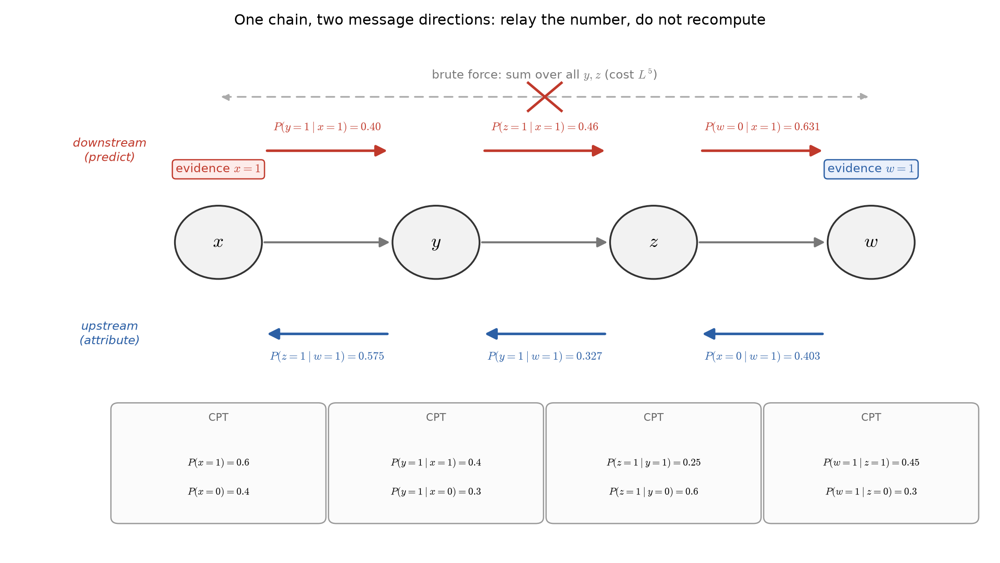
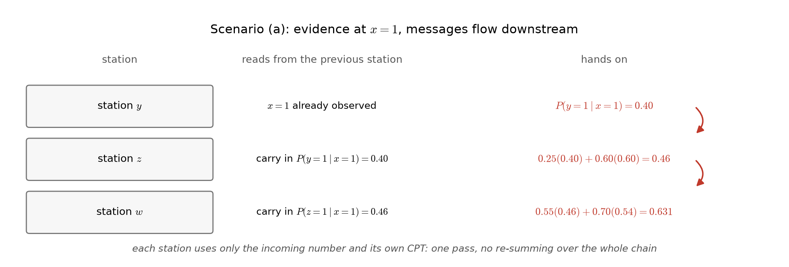
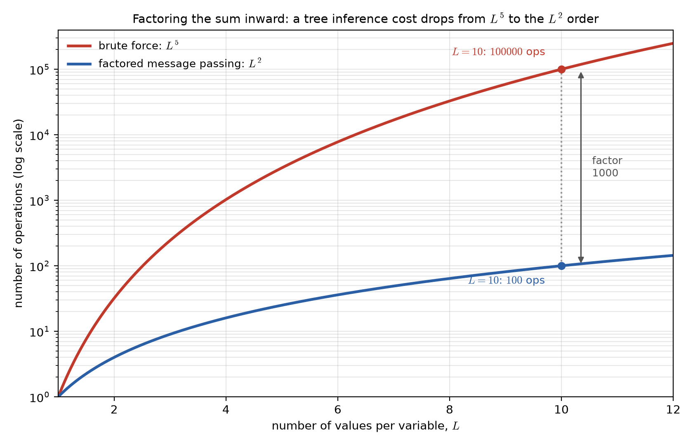
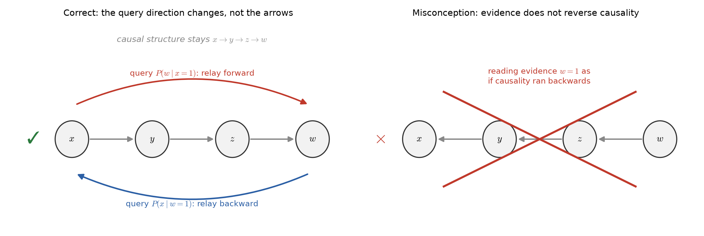

# Lecture 02B：貝氏網路的機率推論（Inference in Bayesian Networks）

> 週次:第 2 週（自主學習教材）｜進度:貝氏分類器（二）——貝氏網路與機率推論
>
> Week 2 (self-study material) | Topic: Bayes Classifiers (2) — Bayesian networks and probabilistic inference

前面的講義已經把貝氏網路蓋好。節點是隨機變數，箭頭代表因果或依賴關係。每個節點附一張條件機率表（CPT）。這份講義要回答一個很實務的問題——網路上線之後，最常被問的是什麼？

The earlier notes already built a Bayesian network. Nodes are random variables and arrows express causal or dependence relations. Each node carries a conditional probability table (CPT). These notes answer a practical question: once the network is built, what do people actually ask it?

答案是**機率推論（probabilistic inference）**：看到某幾個節點的值之後，其他節點的機率各是多少。本講義說明為什麼直接算很貴，以及圖的結構如何讓它變便宜。

The answer is **probabilistic inference**: after observing the values of some nodes, what are the probabilities of the others? These notes explain why the direct approach is expensive, and how the graph structure makes it cheap.

講義文字是重新撰寫的，不是來源網頁的摘錄。標有 `[補充]` / `[Added]` 的內容是為了幫助理解而新增的。

The text here is newly written, not copied from the source page. Content marked `[補充]` / `[Added]` is added to help understanding.

## 學習目標（Learning objectives）

- 說明機率推論在問什麼，並指出它為什麼比表面上困難（State what probabilistic inference asks, and explain why it is harder than it looks）。
- 用「沿著邊傳遞訊息」的方式，逐步算出鏈狀網路的條件機率（Compute conditional probabilities in a chain network by passing messages along the edges）。
- 說明把求和往內分配為什麼能把 $L^5$ 的暴力計算壓到 $L^2$ 量級（Explain why distributing the sums inward cuts a brute-force $L^5$ computation down to the $L^2$ order）。
- 分辨因果方向與推論方向，指出把兩者混為一談的錯誤（Distinguish causal direction from inference direction, and name the mistake of confusing them）。

## 1. 機率推論：圖蓋好之後最常做的事（Probabilistic inference: the most common task after the network is built）

**一句話重點**：機率推論就是「已知幾個節點，問其他節點」。把觀察值（證據）放進網路，然後讀出其他變數的條件機率。

**One-sentence summary**: probabilistic inference is "given a few nodes, ask about the rest". Plug the observed values (the evidence) into the network, then read off the conditional probabilities of the other variables.

**白話說明**：[補充] 想像一條從上游客戶行為流向本站購買行為的因果鏈。上線之後，工程師往往不是問「哪個模型對」。他們更常問：「這個造訪者已經把商品放進購物車，他最後會結帳的機率是多少？」這就是推論：把已知節點固定住，去問未知節點。反過來也一樣，看到結果可以回推原因。

**Plain explanation**: `[Added]` Imagine a causal chain running from an upstream customer action down to a purchase on your site. After launch, engineers rarely ask "which model is right". They ask about one visitor: "he already put an item in the cart. What is the chance he checks out?" That is inference: pin down the known nodes, then query the unknown ones. The reverse works too: seeing the result lets you infer the cause.

**正式定義**：給定網路上的聯合分布 $P(x_1,\dots,x_n)=\prod_{i=1}^{n}P(x_i\mid \mathrm{pa}(x_i))$，其中 $\mathrm{pa}(x_i)$ 是 $x_i$ 的父節點集合。設證據為 $E=\{x_i=e_i\}$，查詢變數為 $Q$。推論要算的是

**Formal definition**: the network's joint distribution factors as $P(x_1,\dots,x_n)=\prod_{i=1}^{n}P(x_i\mid \mathrm{pa}(x_i))$. Here $\mathrm{pa}(x_i)$ is the set of parents of $x_i$. Let the evidence be $E=\{x_i=e_i\}$ and the query variable be $Q$. Inference computes

$$
P(Q\mid E)=\frac{P(Q,E)}{P(E)}=\frac{\sum_{X\setminus(Q\cup E)}P(x_1,\dots,x_n)}{P(E)}
$$

| 符號（Symbol） | 中文意義 | English meaning |
|---|---|---|
| $P(x_i\mid \mathrm{pa}(x_i))$ | 節點的條件機率表（CPT） | the node's conditional probability table (CPT) |
| $E$ | 證據：已觀察到的節點與其值 | the evidence: observed nodes and their values |
| $Q$ | 查詢變數，想知道它的機率 | the query variable whose probability we want |
| $X\setminus(Q\cup E)$ | 其餘未觀察的變數，要對它們加總 | the remaining unobserved variables, which get summed out |

**為什麼困難**：上面的分子是一個對「其餘所有變數」的加總。若網路有 $n$ 個節點、每個節點有 $L$ 種取值，直接加總要做 $L^{n-2}$ 量級的工作，成長得非常快。[補充] 這就是推論的第一個難點：聯合分布寫得出來，卻算不完。

**Why it is hard**: the numerator is a sum over all remaining variables. With $n$ nodes and $L$ values per node, summing directly costs on the order of $L^{n-2}$ operations, which grows very fast. `[Added]` This is the first difficulty: the joint distribution can be written down, but not summed out by brute force.

**例子**：一條四節點的鏈 $x\to y\to z\to w$，全部是二元變數（$L=2$）。想知道 $P(w\mid x)$ 就得對 $y$、$z$ 加總，共 $2^2=4$ 種組合；若鏈變長，組合數就以指數成長。

**Example**: a four-node chain $x\to y\to z\to w$, all binary ($L=2$). To get $P(w\mid x)$ you sum over $y$ and $z$, four combinations in total. Lengthen the chain and the count grows exponentially.

**常見迷思**：「只要網路蓋得對，推論就會快。」圖的結構只決定依賴關係，不會自動幫你省計算——省計算的是下一節的演算法。

**Common misconception**: "once the network is built correctly, inference is fast." The graph structure only fixes the dependence relations. It does not by itself save computation. What saves computation is the algorithm in the next section.

**圖說 `lec02-bn-inference-messages`**：四節點鏈 $x\to y\to z\to w$。灰色箭頭是網路本身的因果結構；紅色箭頭在下傳，代表證據在 $x$ 時往下游預測（$0.40\to0.46\to0.63$）；藍色箭頭在上傳，代表證據在 $w$ 時往上游歸因（$0.575\to0.327\to0.403$）。上方被打叉的長虛線是暴力法，它要對 $y$、$z$ 的所有組合加總。讀圖時先看兩個證據徽章分別在鏈的兩端，再看紅色與藍色箭頭的方向相反。〔功能：1〕

**Caption `lec02-bn-inference-messages`**: a four-node chain $x\to y\to z\to w$. The gray arrows are the causal structure of the network itself. The red arrows above flow downstream: with evidence at $x$, we predict downstream ($0.40\to0.46\to0.63$). The blue arrows below flow upstream: with evidence at $w$, we attribute upstream ($0.575\to0.327\to0.403$). The crossed-out long dashed line on top is brute force, which would sum over every combination of $y$ and $z$. Read the figure by locating the two evidence badges at the two ends. Then note that the red and blue arrows point in opposite directions.

> 網路告訴你誰和誰有關；演算法才告訴你怎麼算得快。
>
> The network tells you who is related to whom; the algorithm tells you how to compute it fast.

**想深入**（選讀）：當證據與查詢都在同一條鏈上時，只要左右各掃描一次。這樣就能得到所有節點的條件機率。

**Going deeper** (optional): when the evidence and the query both sit on one chain, two sweeps produce the conditional probabilities of every node. One sweep goes each way.

**小練習**：設一條三節點鏈 $a\to b\to c$，全部二元。要算 $P(c\mid a)$ 需要對幾個變數加總？各有多少個值？

**Practice**: for a three-node chain $a\to b\to c$, all binary, how many variables must be summed out to compute $P(c\mid a)$? How many values does each have?

## 2. 順著圖傳遞訊息：鏈狀網路的數值範例（Passing messages along the graph: a numerical chain example）

**一句話重點**：推論不必重算整條鏈；每一站只要「上一站交過來的數」加上「自己那張表」，就能把結果往下一站交棒。

**One-sentence summary**: inference does not recompute the whole chain. Each station only needs the number handed over by the previous station plus its own table. It then hands the result on.

**白話說明**：把這條鏈想成接力賽。第一棒只做自己那一小段，把結果交給第二棒；第二棒不回頭看第一棒怎麼跑的，只拿結果繼續跑。每一站做的都是同一個小動作：把進來的數乘以自己的條件機率，再對自己的變數加總。因為結果會被留下來重複使用，下一站省下大量重算。

**Plain explanation**: think of the chain as a relay race. The first runner covers only his own short leg and passes the baton. The second runner does not replay the first leg. He just takes the baton and keeps going. Every station performs the same small step: multiply the incoming number by its own conditional probabilities, then sum over its own variable. Because the result is kept for reuse, the next station avoids a lot of recomputation.

**正式定義**：鏈狀網路的聯合分布可以拆成

**Formal definition**: the joint distribution of a chain factors as

$$
P(x,y,z,w)=P(x)\,P(y\mid x)\,P(z\mid y)\,P(w\mid z)
$$

要算 $P(z\mid x)$ 時，把與 $z$ 無關的部分收進去：

To compute $P(z\mid x)$, gather the parts that do not involve $z$:

$$
P(z\mid x)=\sum_{y}P(z\mid y)\,P(y\mid x)
$$

| 符號（Symbol） | 中文意義 | English meaning |
|---|---|---|
| $P(x)$ | $x$ 的先驗機率（根節點沒有父節點） | the prior of $x$ (a root node has no parents) |
| $P(y\mid x)$ | $y$ 的條件機率表，只有一個父節點 | the CPT of $y$, which has one parent |
| $\sum_y$ | 對中介變數 $y$ 加總，把它消去 | sum over the intermediate variable $y$, removing it |

**例子（情境 a：證據在上游，往下游預測）**：觀察到 $x=1$，求 $P(z=1\mid x=1)$ 與 $P(w=0\mid x=1)$。設定是 $P(x=1)=0.6$、$P(y=1\mid x=1)=0.4$、$P(y=1\mid x=0)=0.3$、$P(z=1\mid y=1)=0.25$、$P(z=1\mid y=0)=0.6$、$P(w=1\mid z=1)=0.45$、$P(w=1\mid z=0)=0.3$。

**Example (scenario a: evidence upstream, predict downstream)**: observe $x=1$ and ask for $P(z=1\mid x=1)$ and $P(w=0\mid x=1)$. The settings are $P(x=1)=0.6$, $P(y=1\mid x=1)=0.4$, $P(y=1\mid x=0)=0.3$. Also $P(z=1\mid y=1)=0.25$, $P(z=1\mid y=0)=0.6$, $P(w=1\mid z=1)=0.45$, and $P(w=1\mid z=0)=0.3$.

第一站 $y$ 直接讀表，得到 $P(y=1\mid x=1)=0.4$，因此 $P(y=0\mid x=1)=0.6$。

The first station $y$ reads its table directly: $P(y=1\mid x=1)=0.4$, so $P(y=0\mid x=1)=0.6$.

第二站 $z$ 拿這個數，配上自己的表：

Station $z$ takes that number and adds its own table:

$$
P(z=1\mid x=1)=(0.25)(0.4)+(0.6)(0.6)=0.46,\qquad P(z=0\mid x=1)=1-0.46=0.54
$$

第三站 $w$ 拿 $0.46$ 與 $0.54$，再配自己的表：

Station $w$ takes $0.46$ and $0.54$, then adds its own table:

$$
P(w=0\mid x=1)=(0.55)(0.46)+(0.7)(0.54)=0.631
$$

| 站（Station） | 進來的數（Incoming） | 這一站做的事（What it does） | 交出去的數（Outgoing） |
|---|---|---|---|
| $y$ | 證據 $x=1$ | 讀表 $P(y\mid x)$ | $P(y=1\mid x=1)=0.40$ |
| $z$ | $0.40$、$0.60$ | $0.25(0.40)+0.60(0.60)$ | $P(z=1\mid x=1)=0.46$ |
| $w$ | $0.46$、$0.54$ | $0.55(0.46)+0.70(0.54)$ | $P(w=0\mid x=1)=0.631$ |

**例子（情境 b：證據在下游，往上游歸因）**：這一次觀察到 $w=1$，想回推 $P(z=1\mid w=1)$ 與 $P(x=0\mid w=1)$。訊息要反過來傳，於是要用貝氏定理。先算 $z$ 的邊際機率：$P(z=1)=P(z=1\mid y=1)P(y=1)+P(z=1\mid y=0)P(y=0)$，其中 $P(y=1)=(0.4)(0.6)+(0.3)(0.4)=0.36$，得到 $P(z=1)=(0.25)(0.36)+(0.6)(0.64)=0.474$。

**Example (scenario b: evidence downstream, attribute upstream)**: this time $w=1$ is observed, and we ask for $P(z=1\mid w=1)$ and $P(x=0\mid w=1)$. The message now runs the other way, so Bayes' rule enters. First compute the marginal of $z$, namely $P(z=1)=P(z=1\mid y=1)P(y=1)+P(z=1\mid y=0)P(y=0)$. Here $P(y=1)=(0.4)(0.6)+(0.3)(0.4)=0.36$, giving $P(z=1)=(0.25)(0.36)+(0.6)(0.64)=0.474$.

接著用貝氏定理從下游反推：

Then Bayes' rule infers upstream from the downstream observation:

$$
P(z=1\mid w=1)=\frac{P(w=1\mid z=1)\,P(z=1)}{P(w=1)}=\frac{(0.45)(0.474)}{P(w=1)}
$$

分母是證據的機率 $P(w=1)=(0.45)(0.474)+(0.3)(0.526)=0.371$。代入後得到

The denominator is the probability of the evidence, $P(w=1)=(0.45)(0.474)+(0.3)(0.526)=0.371$. Substituting gives

$$
P(z=1\mid w=1)=\frac{(0.45)(0.474)}{0.371}=0.5748\approx 0.575
$$

同樣的手法繼續往上游傳，$y$ 再傳到 $x$，最後得到 $P(x=0\mid w=1)=0.403$。

The same move continues upstream: $y$ passes its message to $x$, and finally $P(x=0\mid w=1)=0.403$.

| 查詢（Query） | 方向（Direction） | 結果（Result） |
|---|---|---|
| $P(y=1\mid x=1)$ | 下傳（downstream） | $0.40$ |
| $P(z=1\mid x=1)$ | 下傳（downstream） | $0.46$ |
| $P(w=0\mid x=1)$ | 下傳（downstream） | $0.631$ |
| $P(z=1\mid w=1)$ | 上傳（upstream） | $0.575$ |
| $P(x=0\mid w=1)$ | 上傳（upstream） | $0.403$ |

以上每個數都用 Python 的完整列舉法核對過，與逐站傳遞的結果完全一致。

Every number above was checked against a full enumeration in Python and agrees exactly with the station-by-station message passing.

**圖說 `lec02-bn-inference-downstream`**：情境 (a) 的三站接力過程。左欄是節點，中欄是這一站從上一站拿到的數，右欄是它交出去的結果：$0.40$、$0.46$、$0.63$。紅色弧線表示交棒方向。讀圖時由上往下看三列，注意中欄的數都來自上一列的右欄。〔功能：1、2〕

**Caption `lec02-bn-inference-downstream`**: the three-station relay of scenario (a). The left column is the node. The middle column is the number this station receives from the previous one. The right column is what it hands on: $0.40$, $0.46$, $0.63$. The red arcs mark the direction of the hand-off. Read the rows from top to bottom and note that each middle-column value comes from the right column of the row above.

**常見迷思**：「上傳時必須從頭重算整條鏈的聯合機率。」其實不用：上傳時每一站仍然只做一個乘法加一個加總，只是方向反過來。

**Common misconception**: "the upward pass has to recompute the joint probability of the whole chain from scratch." It does not. Every station still performs one multiplication and one sum, only in the reverse direction.

> 證據在鏈的哪一端，不影響每一站的計算量；只影響訊息往哪邊走。
>
> Which end holds the evidence does not change the cost at any station; it only changes the direction in which messages travel.

**想深入**（選讀）：$P(w=1)=0.371$ 也可以用訊息傳遞本身算出，而不必另外枚舉；這正是「快取」的另一個例子。

**Going deeper** (optional): $P(w=1)=0.371$ can also be produced by message passing itself rather than a separate enumeration — another instance of caching.

**小練習**：改用 $P(x=1)=0.5$ 重算情境 (a) 的 $P(z=1\mid x=1)$ 與 $P(w=0\mid x=1)$。

**Practice**: recompute $P(z=1\mid x=1)$ and $P(w=0\mid x=1)$ in scenario (a) with $P(x=1)=0.5$.

## 3. 一般網路：把求和往內分配（General networks: distributing the sums inward）

**一句話重點**：將一個很大的總和，改寫成許多小總和相乘，運算量可以從 $L^5$ 降到 $L^2$ 量級。

**One-sentence summary**: splitting one huge sum into a product of small sums can cut the cost from the $L^5$ order down to the $L^2$ order.

**白話說明**：直接算 $P(s\mid z=z_0)$，等於把其他五個變數的所有取值都跑一遍再相加。但網路有結構，有些變數只出現在幾個因式裡。我們可以先對「只牽涉最少變數」的那些變數加總，把小結果存起來，再往上一層一層合併。就像整理一疊收據：先把同一攤位的收據加起來，再把各攤位的小計加起來，不必逐張重複加總。

**Plain explanation**: computing $P(s\mid z=z_0)$ directly means running through every value of the other five variables and adding. But the network has structure: some variables appear in only a few factors. We can first sum over the variables that appear in the fewest factors, store the small results, then merge them level by level. It is like totalling a pile of receipts. Add the receipts of one vendor first. Then add the vendor subtotals, instead of adding every receipt over and over.

**正式定義**：對樹狀網路（節點 $s,u,v,x,y,w,z$），算 $P(s\mid z=z_0)$ 時，暴力法要對其餘五個變數做邊際化，成本是 $L^5$；若把求和按圖的結構往內分配，成本降到 $L^2$ 量級。對任兩節點間最多只有一條路徑的**單一連通**網路，這類演算法的成本對節點數是線性的。

**Formal definition**: take a tree network with nodes $s,u,v,x,y,w,z$, and query $P(s\mid z=z_0)$. Brute force marginalizes the other five variables. That costs $L^5$. Distributing the sums inward along the graph structure lowers the cost to the $L^2$ order. A **singly connected** network has at most one path between any two nodes. On such a network the cost of these algorithms grows linearly with the number of nodes.

| 方法（Method） | 成本（Cost） | 說明（Remark） |
|---|---|---|
| 暴力加總（Brute-force summation） | $L^5$ | 對其餘五個變數逐一列舉（enumerates all five remaining variables） |
| 分解求和（Factored summation） | $L^2$ 量級（order $L^2$） | 先對局部小總和求解，再往上合併（solve local sums first, then merge upward） |
| 一般多重連通網路（General multiply connected networks） | NP-hard | 只能靠近似法（only approximation methods are practical） |

**例子**：取 $L=10$，五個變數。暴力法要做 $10^5=100000$ 次運算，分解後只要 $10^2=100$ 次，相差 $1000$ 倍。這個倍數隨 $L$ 成長還會繼續擴大。

**Example**: take $L=10$ with five variables. Brute force needs $10^5=100000$ operations, while the factored form needs only $10^2=100$, a factor of $1000$. That factor keeps growing as $L$ grows.

**圖說 `lec02-bn-inference-complexity`**：橫軸是每個變數的取值數 $L$，縱軸取對數。紅線是暴力法的 $L^5$，藍線是分解求和的 $L^2$。兩條線都是公式畫出來的，沒有手填點。虛線標出 $L=10$：紅點 $100000$ 次、藍點 $100$ 次，相差 $1000$ 倍。讀圖時先看兩條線在 $L$ 小時差距不大，再看 $L$ 變大後紅線迅速拉開。〔功能：1、2〕

**Caption `lec02-bn-inference-complexity`**: the horizontal axis is the number of values per variable, $L$; the vertical axis is logarithmic. The red curve is brute force, $L^5$; the blue curve is factored summation, $L^2$. Both curves are drawn from formulas, with no hand-placed points. The dotted line marks $L=10$: $100000$ operations for the red point and $100$ for the blue one, a factor of $1000$. Read the figure by noting how close the curves are for small $L$, then how the red curve pulls away as $L$ grows.

**常見迷思**：「分解求和只是一種最佳化技巧，改變不了數量級。」事實上它改變的正是數量級：指數次方被壓成常數次方，這不是常數倍的加速。

**Common misconception**: "factored summation is just an optimization trick; it cannot change the order of growth." In fact the order of growth is exactly what changes here. An exponent is pushed down to a constant power, far more than a constant-factor speedup.

> 求和不會消失，只是被拆小、被重複利用。
>
> The sums do not disappear; they are simply broken into small pieces and reused.

`[補充]` 為什麼「往內分配」是合法的？因為乘法對加法有分配律：$\sum_a\sum_b f(a)g(b)=\bigl(\sum_a f(a)\bigr)\bigl(\sum_b g(b)\bigr)$。只要因式中不出現某個變數，就可以先把它加掉，得到的數再拿去乘別的東西。這個看似平凡的交換，正是整套演算法的核心。

`[Added]` Why is "distributing inward" valid? Because multiplication distributes over addition: $\sum_a\sum_b f(a)g(b)=\bigl(\sum_a f(a)\bigr)\bigl(\sum_b g(b)\bigr)$. As long as one variable does not appear in a factor, we can sum it out first and multiply the resulting number into the rest. This seemingly plain swap is the core of the whole algorithm.

**想深入**（選讀）：若把變數消去的順序換掉，中間因式的大小可能差很多。挑選好的消去順序，本身是一個需要經驗與啟發式的問題。

**Going deeper** (optional): changing the order in which variables are eliminated can change the size of the intermediate factors a lot. Choosing a good elimination order is itself a problem that needs experience and heuristics.

**小練習**：在 $L=10$、六個未觀察變數的情況下，暴力法的運算量大約是 $10^5$ 的幾倍？分解後又大約是多少？

**Practice**: with $L=10$ and six unobserved variables, roughly how many times larger than $10^5$ is the brute-force cost, and roughly what is the factored cost?

## 4. 常見混淆：因果方向不是推論方向（Common confusion: causal direction is not inference direction）

**一句話重點**：箭頭畫的是「誰造成誰」，訊息的方向畫的是「你在問誰」；兩者是兩件事。

**One-sentence summary**: the arrows show who causes whom; the message directions show whom you are asking about. These are two different things.

**白話說明**：網路上的箭頭是因果機制，不會因為你觀察到結果就倒過來。你觀察到 $w=1$，這只是把 $w$ 固定住，$x\to y\to z\to w$ 這個機制本身沒有改變。改變的只是**我們計算的順序**：當證據在下游、查詢在上游，訊息就往回傳。

**Plain explanation**: the arrows in the network describe the causal mechanism, and they do not flip just because you observed an effect. Observing $w=1$ only pins $w$ down; the mechanism $x\to y\to z\to w$ itself is unchanged. What changes is the **order of our computation**: when the evidence is downstream and the query is upstream, messages travel back.

**正式定義**：網路的結構邊永遠是 $x\to y\to z\to w$。推論時把證據節點當成「已知」，因此查詢 $P(x\mid w=1)$ 是在計算 $P(x=0\mid w=1)=0.403$，這是對聯合分布做條件化，不是把結構邊反轉。

**Formal definition**: the structural edges are always $x\to y\to z\to w$. At inference time the evidence node is treated as "known", so the query $P(x\mid w=1)$ computes $P(x=0\mid w=1)=0.403$. This is conditioning the joint distribution, not reversing the structural edges.

**例子**：情境 (a) 與情境 (b) 用的是同一個網路、同一組條件機率表。差別只在把哪一個節點設為證據，以及訊息往哪個方向走。

**Example**: scenarios (a) and (b) use the same network and the same CPTs. The only difference is which node is set as evidence and hence which way the messages travel.

**常見迷思**：「既然要從 $w$ 推回 $x$，那網路的箭頭應該改成 $w\to z\to y\to x$。」這是把因果方向與推論方向混為一談。箭頭真的反轉之後，就變成另一個模型，它描述另一套生成機制。算出來的機率也不再是原本那個網路的值。

**Common misconception**: "since we infer $x$ from $w$, the arrows should be rewritten as $w\to z\to y\to x$." This mistake confuses causal direction with inference direction. If you really reversed the arrows, you would get a different model describing a different generating process. The probabilities would no longer be those of the original network.

**圖說 `lec02-bn-inference-direction`**：兩張對照圖。左圖的灰色結構邊固定向右，紅色與藍色弧線分別代表查詢 $P(w\mid x=1)$ 與 $P(x\mid w=1)$ 的訊息方向，打勾表示正確。右圖把結構邊整排反轉，並打叉表示錯誤。讀圖時先比較兩張圖的灰色箭頭：左圖一致向右，右圖整排向左。〔功能：1〕

**Caption `lec02-bn-inference-direction`**: two contrasting panels. In the left panel the gray structural edges all point right. The red and blue arcs show the message directions for the queries $P(w\mid x=1)$ and $P(x\mid w=1)$. The check mark says this is correct. In the right panel the structural edges are reversed, marked with a cross as the mistake. Read the figure by comparing the gray arrows first: they all point right on the left and all point left on the right.

> 觀察結果不會讓因果倒流；它只會改變你該從哪裡開始算。
>
> Observing an effect does not reverse causation; it only changes where your computation should start.

**想深入**（選讀）：要把「觀察到結果」與「動手改變結果」區分開來，需要的是另一套語言，例如 do-算子。單純翻轉箭頭並不夠。

**Going deeper** (optional): distinguishing "seeing an effect" from "intervening to change it" needs a different language, such as the do-operator. A simple flip of the arrows is not enough.

**小練習**：某人說「證據在 $w$，所以網路方向應該改成 $w\to z$」。請用一句話指出他的錯誤。

**Practice**: someone says "the evidence is at $w$, so the network direction should become $w\to z$". Point out the error in one sentence.

## 5. 訓練與限制（Training and limits）

**一句話重點**：網路要先決定拓樸，再用資料估條件機率表；單一連通網路可以快速推論，多重連通網路則一般很難。

**One-sentence summary**: a network first fixes its topology, then estimates the CPTs from data. Singly connected networks allow fast inference, while multiply connected ones are generally hard.

**白話說明**：拓樸可以由專家依領域知識畫出來，也可以由演算法從資料中搜尋。拓樸定下來之後，每個節點的條件機率就用訓練資料中的出現頻率來估。`[補充]` 頻率估計在樣本少時會很不穩定，實務上常加上平滑或改用貝氏估計。

**Plain explanation**: the topology can be drawn by an expert from domain knowledge, or searched from data by an algorithm. Once the topology is fixed, each node's conditional probabilities are estimated from how often the relevant combinations appear in the training data. `[Added]` Frequency estimates can be very unstable when samples are few, so in practice smoothing or Bayesian estimation is often used.

**正式定義**：訓練分兩階段——先決定拓樸，再估計條件機率表。推論方面，**單一連通**的網路指任何兩個節點之間最多只有一條路徑；這種網路的推論成本對節點數是線性的。一般多重連通網路上的精確推論已被證明是 NP-hard，只能靠近似解法。

**Formal definition**: training has two stages — fix the topology, then estimate the CPTs. For inference, such algorithms are linear in the number of nodes on a singly connected network. Exact inference on a general multiply connected network is known to be NP-hard, so only approximation methods remain.

**例子**：[補充] 一個有數十個節點、彼此互相連接的網路，精確推論可能慢到不可用；此時可用近似法（例如取樣或變分法）換取速度。

**Example**: `[Added]` for a network with dozens of densely interconnected nodes, exact inference may be far too slow to use. Approximation methods such as sampling or variational techniques trade accuracy for speed.

**常見迷思**：「既然多重連通網路是 NP-hard，那貝氏網路就沒有用了。」事實是：實務上多數模型刻意設計成單一連通或樹狀（例如 Naive Bayes），精確推論就能保持很快。

**Common misconception**: "since multiply connected networks are NP-hard, Bayesian networks are useless." In practice most models are deliberately built as trees or singly connected graphs (Naive Bayes, for example). Exact inference stays fast that way.

**圖**：本節不需要圖。它是訓練流程與複雜度限制的敘述，沒有幾何、分布或數值比較需要視覺化；流程的抽象結構已由前一節的 $L^5$／$L^2$ 對照圖涵蓋。

**Figure**: no figure is needed here. This section states a training procedure and complexity limits. Nothing geometric, distributional, or numerical needs to be visualized. The abstract flow is already covered by the $L^5$ versus $L^2$ figure in the previous section.

**想深入**（選讀）：常見的近似推論有兩大類：蒙地卡羅取樣，以及把難問題放寬成可解問題的變分法。

**Going deeper** (optional): approximation methods fall into two broad families: Monte Carlo sampling, and variational methods that relax the hard problem into a solvable one.

**小練習**：為什麼「把拓樸定好之後才估條件機率」可以讓整個訓練流程變得單純？提示：想想兩階段各自的最佳化目標。

**Practice**: why does "fix the topology first, then estimate the CPTs" keep the whole training procedure simple? Hint: think about the optimization target of each stage.

## 小結（Summary）

- 機率推論是在有證據時查詢其他節點的條件機率；直接對其餘變數加總會指數成長（Probabilistic inference queries the conditional probability of other nodes given evidence; summing directly over the remaining variables grows exponentially）。
- 鏈狀網路可以一站一站接力：每站只讀上一站交來的數與自己的條件機率表（A chain network runs as a relay: each station reads only the incoming number and its own CPT）。
- 證據在上游時訊息下傳，證據在下游時訊息上傳；兩者的每站計算量相同（Messages run downstream when evidence is upstream and upstream when evidence is downstream; the per-station cost is the same）。
- 把求和按圖的結構往內分配，可把 $L^5$ 的暴力計算壓到 $L^2$ 量級（Distributing the sums inward along the graph structure cuts a brute-force $L^5$ down to the $L^2$ order）。
- 因果方向與推論方向是兩件事；觀察結果不會反轉結構邊（Causal direction and inference direction are different things; observing an effect does not reverse the structural edges）。

## 延伸閱讀（Further reading）

- 教科書第 2 章後半，貝氏網路與機率推論（Textbook, Chapter 2, second half: Bayesian networks and inference）：Sergios Theodoridis & Konstantinos Koutroumbas, *Pattern Recognition*, 4th ed.
- 課程網頁的互動式自學講義：Chapter 2，貝氏網路推論 demo，讀取日期 2026-10-09（Course self-study notes: Chapter 2, Bayesian network inference demo, read on 2026-10-09）。
- 參考資料：見 [參考資料](../references/README.md)（References: see the [references folder](../references/README.md)）。

## 術語表（Glossary）

| 中文 | English |
|---|---|
| 機率推論 | probabilistic inference |
| 證據 | evidence |
| 查詢變數 | query variable |
| 條件機率表（CPT） | conditional probability table (CPT) |
| 父節點 | parent node |
| 邊際化 | marginalization |
| 變數消去 | variable elimination |
| 訊息傳遞 | message passing |
| 分解求和 | factored summation |
| 樹狀網路 | tree network |
| 單一連通 | singly connected |
| 多重連通 | multiply connected |
| 鏈狀網路 | chain network |
| 下傳／上傳 | downstream message / upstream message |
| 因果方向 | causal direction |
| 近似推論 | approximate inference |
