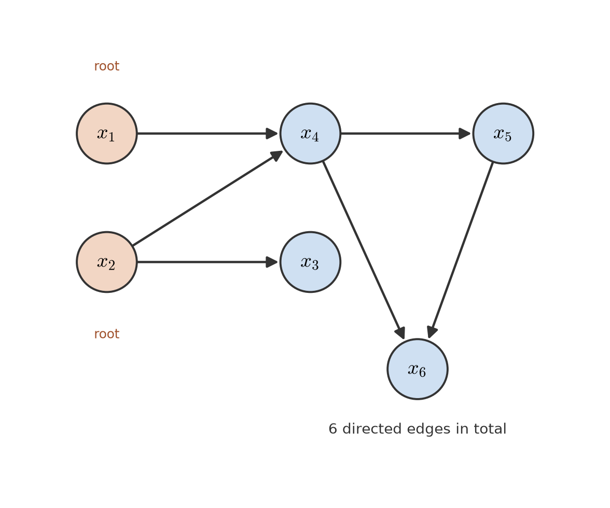
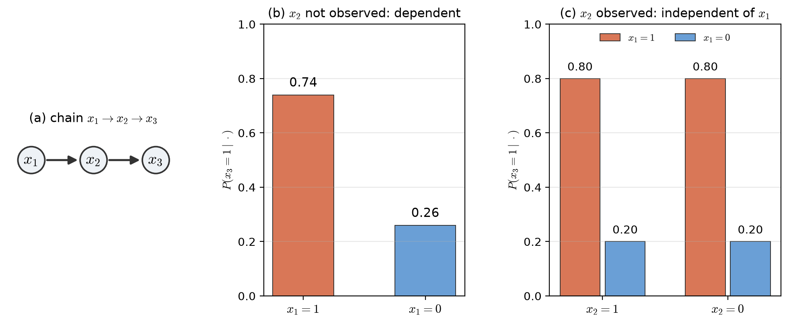
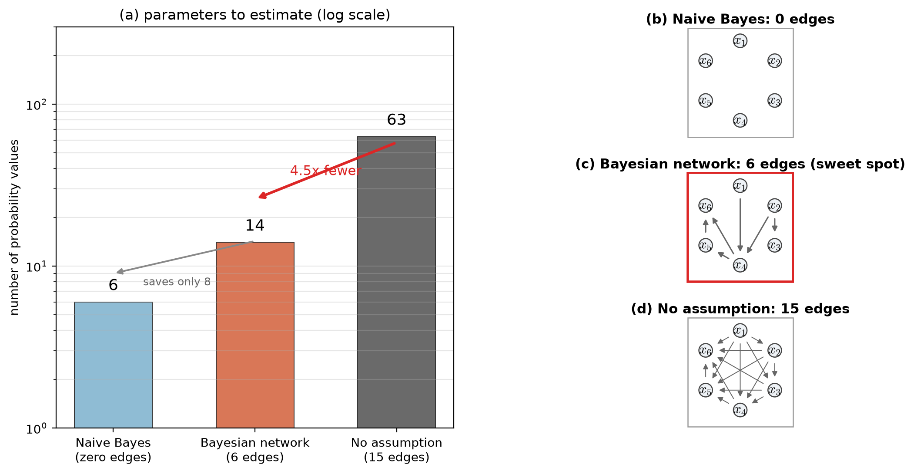
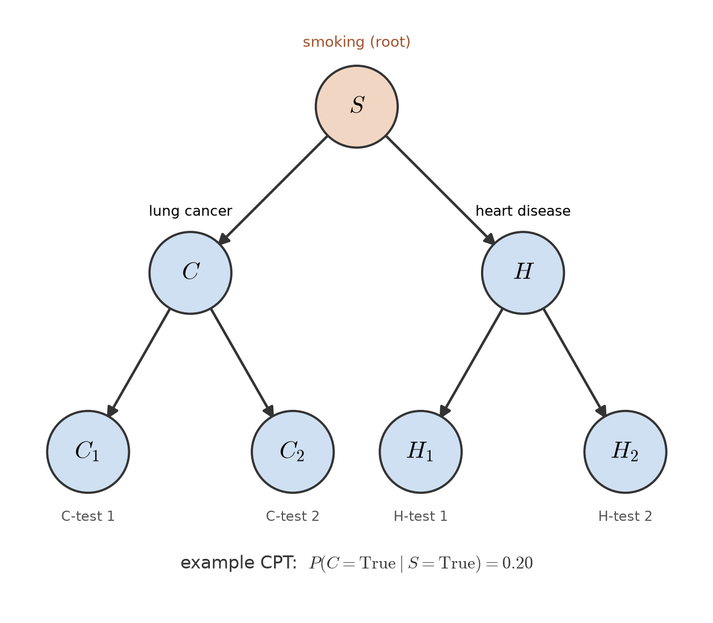

# Lecture 02：貝氏網路（一）：結構、獨立假設的光譜與參數數量（Bayesian Networks I: Structure, the Spectrum of Independence Assumptions, and Parameter Counts）

> 週次：第 2 週（自主學習教材）｜進度：貝氏網路（一）——結構、獨立假設的光譜、參數數量比較
>
> Week (self-study material) | Topic: Bayesian Networks I — structure, the spectrum of independence assumptions, and parameter counts

投影片：[JianBauDau JSON](../slides/lec02-bayesian-networks.jbd.json)（使用 JianBauDau 編輯器或播放器開啟）。

Slides: [JianBauDau JSON](../slides/lec02-bayesian-networks.jbd.json) (open with the JianBauDau editor or player).

本講義處理課程網頁 2.7 節的第一個知識點。前一講（`lec02.md`）談的是貝氏決策理論與高斯分類器。這裡接著問：當特徵不只一兩個，而要一起描述整個聯合分布時，該怎麼做才不會爆炸。

This lecture covers the first knowledge point of Section 2.7 of the course website. The previous lecture (`lec02.md`) covered Bayesian decision theory and Gaussian classifiers. Here we ask the next question. When there is more than one or two features, how do we describe their whole joint distribution without having it blow up?

講義文字為重新撰寫，圖為自製。標有 `[補充]` / `[Added]` 的內容是為了幫助理解而新增的。圖中的數字都是示範用的，不是原圖。

The text is newly written and the figures are our own. Content marked `[補充]` / `[Added]` is added to help understanding. All numbers in the figures are illustrative, not from the original material.

## 學習目標（Learning objectives）

- 說明為什麼完全獨立與完全不做假設都不夠好（Explain why neither full independence nor the no-assumption extreme is good enough）。
- 用機率鏈鎖規則寫出聯合分布，並用父節點集合 $A_i$ 簡化它（Write the joint distribution with the chain rule and simplify it with parent sets $A_i$）。
- 拆解一張有向無環圖(DAG)的節點、邊與父節點，並數出每個節點要估幾個機率值（Break a DAG into nodes, edges, and parents, and count the probability values each node needs）。
- 分辨「兩兩獨立」與「條件獨立」的差別（Tell marginal independence apart from conditional independence）。
- 比較三種假設在 6 個二元特徵下的參數數量（Compare the parameter counts of three assumptions for six binary features）。

## 1. 為什麼需要貝氏網路（Why we need Bayesian networks）

設你有 $l$ 個特徵，每個都是二元（只取 0 或 1）。你想完整描述它們的聯合分布 $p(x_1,\dots,x_l)$。若不做任何假設，你要為 $2^l$ 種組合各記一個機率值，扣掉總和為 1 的限制，共 $2^l-1$ 個自由參數。

Suppose you have $l$ features, each binary (taking 0 or 1). You want to describe their joint distribution $p(x_1,\dots,x_l)$ completely. With no assumption, you assign one probability value to each of the $2^l$ combinations. Subtracting the constraint that the values sum to 1 leaves $2^l-1$ free parameters.

$l=6$ 時是 $63$；$l=20$ 時是 $1048575$，已經無法估計。這就是**維度詛咒**：維度一高，資料量與參數量的差距就失控。另一條路是宣告所有特徵**完全獨立**，參數只剩 $l$ 個，但這個假設幾乎一定錯。

For $l=6$ this is $63$; for $l=20$ it is $1048575$, which is hopeless to estimate. This is the **curse of dimensionality**: as the dimension grows, the gap between the data you have and the parameters you need runs away. The other extreme is to declare all features **fully independent**, which leaves only $l$ parameters but is almost certainly wrong.

`[補充]` 用一句話記住這個張力：**假設越多，參數越少，但越容易失真。** 貝氏網路不選任何一個極端，而是在中間挑位子。

`[Added]` Remember the tension in one sentence. **The more you assume, the fewer parameters you need.** But the more you assume, the more likely you are to distort the truth. A Bayesian network does not pick either extreme; it takes a position in between.

**白話說明**：想像你要描述六位同學彼此熟不熟。你可以說「誰都不認識誰」（完全獨立），也可以一張表列出每兩人認不認識的所有組合（完全不做假設）。前者太簡略，後者太龐大。貝氏網路是第三條路：先看誰真的認識誰，只把真有交情的關係畫下來。

**Plain explanation**: imagine describing which of six classmates know each other. You could say "nobody knows anybody" (full independence), or list every pair combination in one giant table (no assumption). The first is too crude, the second too huge. A Bayesian network is a third way: see who really knows whom and draw only the real links.

`[補充]` 這個比喻的侷限是，同學之間的「認識」沒有方向。貝氏網路的箭頭卻有方向，代表一個變數影響另一個變數。比喻只對應到「關係稀疏」這一點。

`[Added]` The limit of this analogy is that knowing a classmate has no direction. The arrows in a Bayesian network, however, are directed and stand for one variable influencing another. The analogy only captures the "sparse links" idea.

> 參數太少會失真，參數太多估不動；貝氏網路在兩者之間找甜區。
>
> Too few parameters distort; too many cannot be estimated; a Bayesian network looks for the sweet spot between them.

## 2. 機率鏈鎖規則與部分獨立（The chain rule and partial independence）

**機率鏈鎖規則（chain rule of probability）**：任何聯合分布都可以無條件拆成一連串條件機率的乘積。

**Chain rule of probability**: any joint distribution can be factored, with no assumption at all, into a product of conditional probabilities.

$$
p(x_1,\dots,x_l)=p(x_l\mid x_{l-1},\dots,x_1)\,p(x_{l-1}\mid x_{l-2},\dots,x_1)\cdots p(x_2\mid x_1)\,p(x_1)
$$

| 符號（Symbol） | 中文意義 | English meaning |
|---|---|---|
| $l$ | 特徵（變數）的數量 | the number of features (variables) |
| $x_i$ | 第 $i$ 個變數的值 | the value of the $i$-th variable |
| $p(x_i\mid \cdot)$ | 在給定條件下 $x_i$ 的條件機率 | the conditional probability of $x_i$ given the condition |

**白話直覺**：把「一次決定全部」拆成「一步一步決定」。先定 $x_1$，再在已知 $x_1$ 下決定 $x_2$，依此類推。因為每一步都用到前面所有變數，這個拆法永遠正確，但參數數量一點都沒少。

**Plain intuition**: split "deciding everything at once" into "deciding one step at a time". Fix $x_1$ first, then decide $x_2$ given $x_1$， and so on. Because every step uses all earlier variables, this factorization is always correct, but it saves no parameters at all.

**貝氏網路的關鍵一步（the key step）**：假設每個 $x_i$ 只依賴前面變數裡的**一個子集合** $A_i$，而不是全部。

**The key step of a Bayesian network**: assume that each $x_i$ depends only on **a subset** $A_i$ of the earlier variables. It does not depend on all of them.

$$
p(\mathbf{x})=p(x_1)\prod_{i=2}^{l}p(x_i\mid A_i),\qquad A_i\subseteq\{x_{i-1},\dots,x_1\}
$$

| 符號（Symbol） | 中文意義 | English meaning |
|---|---|---|
| $\mathbf{x}$ | 全部特徵組成的向量 | the vector of all features |
| $A_i$ | $x_i$ 的父節點集合，只含編號比 $i$ 小的變數 | the parent set of $x_i$, containing only variables indexed below $i$ |

**常見錯誤（Common misconception）**：學生常以為「鏈鎖規則本身就在簡化」。其實鏈鎖規則單獨用時，右邊每個因子仍然是一張大表。

**Common misconception**: students often think the chain rule itself already simplifies things. In fact, used alone, each factor on the right is still a full table.

`[補充]` 真正省下參數的是「只依賴 $A_i$」這個假設。少了它，右邊每個因子的大小都和左邊的聯合分布一樣大。

`[Added]` What actually saves parameters is the assumption "depends only on $A_i$". Without it, every factor on the right is as large as the joint distribution on the left.

## 3. DAG 的符號拆解（Anatomy of a DAG）

**有向無環圖（DAG, Directed Acyclic Graph）**是把依賴關係畫出來的工具。節點是變數；若某個變數 $x_j\in A_i$，就畫一條箭頭 $x_j\to x_i$。「有向」指箭頭有方向；「無環」指沿箭頭走不會繞回原點。

A **directed acyclic graph (DAG)** is the tool for drawing the dependencies. Nodes are variables. If $x_j\in A_i$, draw an arrow $x_j\to x_i$. "Directed" means the arrows have a direction; "acyclic" means you cannot follow arrows and return to where you started.

| 圖上的元素（Element） | 中文意義 | English meaning |
|---|---|---|
| 節點（node） | 一個隨機變數 | one random variable |
| 邊／箭頭（edge） | 由父節點指向子節點 | an arrow from a parent to a child |
| 父節點（parent） | $A_i$ 裡的變數 | a variable in $A_i$ |
| 根節點（root） | 沒有父節點的節點 | a node with no parent |
| 條件機率表（CPT） | 每個節點在父節點各組合下的機率 | the probabilities of a node for each parent combination |

**正式定義(formal definition)**:貝氏網路是一張有向無環圖(DAG),每個節點對應一個隨機變數,節點上附一組條件機率 $p(x_i\mid A_i)$。要完整指定這個模型,需要兩類數字。第一類是根節點的邊際機率,第二類是其餘每個節點在「父節點所有組合」底下的條件機率。有了這兩類數字,沿著拓樸排序就能組合出整張圖的聯合機率。

**Formal definition**: a Bayesian network is a DAG whose nodes are random variables, together with a set of conditional probabilities $p(x_i\mid A_i)$. Two things are needed: (a) the marginal probability of each root node, and (b) the conditional probability of every non-root node for each parent combination. With these, the joint probability of the whole graph can be computed along a topological order.

`[補充]` **拓樸排序**是指把節點排成一列，讓每條箭頭都從前面指向後面。因為圖無環，這種排法一定存在。有了它，就能從根節點一路往下乘，不必回頭。

`[Added]` A **topological order** is a line-up of the nodes in which every arrow points forward. Because the graph is acyclic, such an order always exists. With it, we can multiply from the roots downward without ever going back.

**圖說 `lec02-bn-structure`**：這張圖畫出本節要用的六節點貝氏網路。兩個根節點($x_1$、$x_2$)沒有入箭頭，其餘節點各有一到兩條入箭頭，全圖共 6 條邊。箭頭一律由父節點指向子節點，例如 $x_1\to x_4$ 表示 $x_4$ 的父節點之一是 $x_1$。讀圖時先找出沒有入箭頭的那兩個節點，它們就是根節點。再沿箭頭數一數每條邊的方向，確認圖中沒有任何繞回起點的路徑。〔功能：1〕

**Caption `lec02-bn-structure`**: this figure shows the six-node Bayesian network used in this section. Two root nodes ($x_1$ and $x_2$) have no incoming arrow; the other nodes have one or two, and the graph has six edges in total. Every arrow runs from a parent to a child, so $x_1\to x_4$ means that $x_1$ is one parent of $x_4$. Read the figure by locating the two nodes with no incoming arrow; these are the roots. Then follow the arrows to confirm that no path returns to its own start.

**數字例（Numerical example）**：沿用上圖。設根節點機率 $p(x_1{=}1)=0.3$、$p(x_2{=}1)=0.6$，其餘條件機率為 $p(x_3{=}1\mid x_2{=}1)=0.8$、$p(x_5{=}1\mid x_4{=}1)=0.7$、$p(x_4{=}1\mid x_1{=}1,x_2{=}1)=0.9$、$p(x_6{=}1\mid x_4{=}1,x_5{=}1)=0.85$。

**Numerical example**: use the graph above. Let the root probabilities be $p(x_1{=}1)=0.3$ and $p(x_2{=}1)=0.6$. The other conditional probabilities are $p(x_3{=}1\mid x_2{=}1)=0.8$, $p(x_5{=}1\mid x_4{=}1)=0.7$, $p(x_4{=}1\mid x_1{=}1,x_2{=}1)=0.9$, and $p(x_6{=}1\mid x_4{=}1,x_5{=}1)=0.85$.

全部取 1 的聯合機率，就是把這幾項乘起來：

The joint probability of all ones is simply the product of these terms:

$$
p(\mathbf{x}{=}\mathbf{1})=0.3\times 0.6\times 0.8\times 0.9\times 0.7\times 0.85=0.0771
$$

這個數字由 Python 算出，並用整張表的 64 種組合加總驗證過總和為 1。

This value was computed with Python, and the sum over all 64 combinations of the full table was checked to be exactly 1.

## 4. 條件獨立的微妙之處（The subtlety of conditional independence）

**條件獨立（conditional independence）**：寫成 $p(x_3\mid x_2,x_1)=p(x_3\mid x_2)$。它的意思是「**在知道 $x_2$ 之後**，$x_3$ 就不再從 $x_1$ 得到額外資訊」。

**Conditional independence** is written $p(x_3\mid x_2,x_1)=p(x_3\mid x_2)$. It means that "**once $x_2$ is known**," $x_3$ gains no further information from $x_1$.

**關鍵陷阱**：這個式子**不代表** $x_3$ 與 $x_1$ 兩兩獨立。它們在不知道 $x_2$ 時可能仍然相關，只有當 $x_2$ 的值被揭露後才變得獨立。

**The key trap**: this equation does **not** mean that $x_3$ and $x_1$ are marginally independent. They may still be related when $x_2$ is unknown, and become independent only after the value of $x_2$ is revealed.

**圖說 `lec02-bn-conditional-independence`**：左圖是鏈 $x_1\to x_2\to x_3$，箭頭只沿一個方向。中圖是還沒觀察 $x_2$ 時 $P(x_3{=}1\mid x_1)$ 的兩個值：$0.74$ 對 $0.26$，差很多，所以兩者相關。右圖是觀察到 $x_2$ 後，把 $x_1{=}1$ 與 $x_1{=}0$ 並排：同一組 $x_2$ 下兩根長條同高($0.80$ 與 $0.80$、$0.20$ 與 $0.20$)，報你 $x_1$ 的值也改變不了答案。讀圖時先比較中圖兩根長條的落差，再看右圖每組內兩根長條是否同高。〔功能：1、2〕

**Caption `lec02-bn-conditional-independence`**: the left panel shows the chain $x_1\to x_2\to x_3$ with arrows in one direction. The middle panel shows the two values of $P(x_3{=}1\mid x_1)$ before $x_2$ is observed: $0.74$ against $0.26$, a large gap, so the two are dependent. The right panel shows the same quantity after $x_2$ is observed, with $x_1{=}1$ and $x_1{=}0$ side by side. Within each value of $x_2$ the two bars are equal ($0.80$ and $0.80$, $0.20$ and $0.20$), so learning $x_1$ cannot change the answer. Read the figure by comparing the gap between the two bars in the middle panel first. Then check whether the two bars agree within each group on the right.

**數字例（Numerical example）**：設 $p(x_1{=}1)=0.5$，$p(x_2{=}1\mid x_1{=}1)=0.9$，$p(x_2{=}1\mid x_1{=}0)=0.1$，$p(x_3{=}1\mid x_2{=}1)=0.8$，$p(x_3{=}1\mid x_2{=}0)=0.2$。

**Numerical example**: let $p(x_1{=}1)=0.5$, $p(x_2{=}1\mid x_1{=}1)=0.9$, $p(x_2{=}1\mid x_1{=}0)=0.1$, $p(x_3{=}1\mid x_2{=}1)=0.8$, and $p(x_3{=}1\mid x_2{=}0)=0.2$.

| 已知（Given） | $p(x_3{=}1\mid\cdot)$（機率） |
|---|---|
| $x_1{=}1$（無 $x_2$） | $0.74$ |
| $x_1{=}0$（無 $x_2$） | $0.26$ |
| $x_2{=}1$ | $0.80$ |
| $x_2{=}0$ | $0.20$ |

**讀表**：不知道 $x_2$ 時，知道 $x_1$ 會大幅改變 $x_3$ 的機率（0.74 對 0.26），所以 $x_3$ 與 $x_1$ **不**獨立。一旦 $x_2$ 已知，再報你 $x_1$ 的值也無法改變 $x_3$ 的機率，所以此時它們條件獨立。

**Reading the table**: with $x_2$ unknown, learning $x_1$ changes the probability of $x_3$ a great deal ($0.74$ against $0.26$). So $x_3$ and $x_1$ are **not** independent. Once $x_2$ is known, telling you $x_1$ cannot change the probability of $x_3$. They are conditionally independent at that point.

`[補充]` 直覺是「資訊被中介吃掉了」。$x_2$ 承接了 $x_1$ 對 $x_3$ 的全部影響，一旦看到 $x_2$，$x_1$ 就沒有殘餘的解釋力。

`[Added]` The intuition is that the information is absorbed by the middle node. $x_2$ carries the entire influence of $x_1$ on $x_3$; once $x_2$ is seen, $x_1$ has no leftover explanatory power.

所有數字由 Python 計算。`[補充]` 例：已知 $x_1{=}1$ 時，$x_2{=}1$ 的機率是 0.9，於是有 $0.9\times0.8+0.1\times0.2=0.74$。

All numbers were computed with Python. `[Added]` For example, given $x_1{=}1$, $x_2{=}1$ has probability 0.9, so $0.9\times0.8+0.1\times0.2=0.74$.

> 「已知 $x_2$ 後 $x_3$ 與 $x_1$ 獨立」不等於「$x_3$ 與 $x_1$ 獨立」。
>
> "Independent given $x_2$" is not the same as "independent".

## 5. 參數數量比較（Comparing parameter counts）

現在把三種假設放在同一把尺上量。同樣是 6 個二元特徵，要估的機率值數量差很多。

Now measure the three assumptions on the same scale. For the same six binary features, the number of probability values to estimate differs a lot.

| 假設（Assumption） | 依賴邊數（Edges） | 參數數量（Parameters） | 中文說明 | English note |
|---|---|---|---|---|
| 完全獨立 Naive Bayes | 0 | 6 | 每個特徵各自估一個機率 | each feature needs one probability |
| 部分獨立 貝氏網路 | 6 | 14 | 每個節點依父節點數估 $2^{\lvert A_i\rvert}$ 個 | each node needs $2^{\lvert A_i\rvert}$ values |
| 完全不做假設 | 15 | 63 | 整個聯合分布 $2^l-1$ 個自由參數 | the full joint has $2^l-1$ free parameters |

**參數怎麼數（how to count）**：先看每個節點的父節點個數 $\lvert A_i\rvert$。根節點 $\lvert A_i\rvert=0$，只要 1 個機率值；有 1 個父節點要 $2^1=2$ 個，因為父節點有兩種取值；有 2 個父節點要 $2^2=4$ 個，依此類推。

**How to count**: first look at the parent count $\lvert A_i\rvert$ of each node. A root with $\lvert A_i\rvert=0$ needs 1 probability value. One parent needs $2^1=2$ values, because the parent has two settings. Two parents need $2^2=4$ values, and so on.

| 節點（Node） | 父節點（Parents） | 父節點個數（Count） | 機率值（Values） |
|---|---|---|---|
| $x_1$ | 無（none） | 0 | $2^0=1$ |
| $x_2$ | 無（none） | 0 | $2^0=1$ |
| $x_3$ | $x_2$ | 1 | $2^1=2$ |
| $x_4$ | $x_1,x_2$ | 2 | $2^2=4$ |
| $x_5$ | $x_4$ | 1 | $2^1=2$ |
| $x_6$ | $x_4,x_5$ | 2 | $2^2=4$ |
| 合計（Total） | 6 條邊（edges） | — | $14$ |

**驗算（recomputation）**：$1+1+2+4+2+4=14$。與完全不做假設的 $2^6-1=63$ 相比，$63/14=4.5$，省下約 5 倍。

**Recomputation**: $1+1+2+4+2+4=14$. Compared with the no-assumption count $2^6-1=63$, we have $63/14=4.5$, a saving of about five times.

`[補充]` 待老師確認：來源寫貝氏網路是「13 個」機率值，並註明 $A_1$ 不需要、$x_1$ 是根節點。若把根節點 $x_1$ 的邊際機率也算進去，依上表逐項相加是 14。本講義以 14 為準，並保留與來源的差異供老師核對。

`[Added]` For the teacher's confirmation: the source states that the Bayesian network needs "13" probability values. It also notes that $A_1$ is not needed and that $x_1$ is a root. If the marginal probability of the root $x_1$ is included as well, the per-node sum in the table above is 14. This lecture uses 14 and keeps the discrepancy with the source for the teacher to check.

**圖說 `lec02-bn-parameter-count`**：左圖是三種假設的參數數量，縱軸取對數，長條高度分別是 6、14、63。從 63 降到 14 是 4.5 倍，用紅色粗箭頭標出；從 14 再降到 6 只省 8 個，用灰色細箭頭標出。右圖是三張同節點、不同邊數的依賴圖。上圖 0 條邊（完全獨立）；中圖 6 條邊（貝氏網路，紅框標為甜區）；下圖 15 條邊（完全圖，全部互相依賴）。讀圖時先看左邊三根長條的高度差，再看右邊三張圖的線條由疏到密，兩者方向一致。〔功能：1、2〕

**Caption `lec02-bn-parameter-count`**: the left panel shows the parameter counts of the three assumptions on a log-scale axis, with bar heights 6, 14, and 63. The drop from 63 to 14 is 4.5 times and is marked by a thick red arrow. The further drop from 14 to 6 saves only 8 values and is marked by a thin gray arrow. The right panel shows three dependency graphs with the same nodes but different edge counts. Top: 0 edges (full independence). Middle: 6 edges (the Bayesian network, boxed in red as the sweet spot). Bottom: 15 edges (the complete graph, everything depends on everything). Read the figure by comparing the three bar heights on the left first. Then compare the three graphs from sparse to dense on the right; the two directions agree.

**為什麼中間是甜區(why the middle is the sweet spot)**:真實世界的依賴通常很稀疏。貝氏網路沿著真正相關的邊建模,所以參數從 63 降到 14 時,結構幾乎沒有損失。若再往下砍到 6,等於把所有邊都抹掉;特徵實際上彼此相關時,誤差就會急速放大。

**Why the middle is the sweet spot**: real-world dependencies are usually sparse. A Bayesian network keeps only the edges that truly exist, so cutting from 63 to 14 loses almost no structure. Cutting further to 6, however, is the same as discarding every edge, and the distortion explodes whenever the features are in fact correlated.

> 從 63 砍到 14 幾乎不痛，從 14 砍到 6 才開始痛。
>
> Cutting from 63 to 14 is nearly painless; cutting from 14 to 6 is where it starts to hurt.

## 6. 醫療診斷範例（Medical diagnosis example）

醫療診斷是常見的例子。最上層是「吸菸與否」在母體中的比例,再往下兩層依序是疾病、以及對應的醫學檢測。

A common Bayesian network is medical diagnosis. The root node is the population share of smokers; the two layers below hold the diseases and the medical tests.

| 符號（Symbol） | 中文意義 | English meaning |
|---|---|---|
| $S$ | 是否吸菸 | whether the patient smokes |
| $C$ | 是否罹患肺癌 | whether lung cancer is present |
| $H$ | 是否罹患心臟病 | whether heart disease is present |
| $C_1,C_2$ | 肺癌的兩項檢測 | two tests for lung cancer |
| $H_1,H_2$ | 心臟病的兩項檢測 | two tests for heart disease |

**圖說 `lec02-bn-medical`**：根節點 $S$ 沒有入箭頭，它同時指向疾病節點 $C$ 與 $H$。$C$ 再指向檢測 $C_1$、$C_2$，$H$ 再指向 $H_1$、$H_2$。圖下方標出一條示範的條件機率：$P(C{=}\text{True}\mid S{=}\text{True})=0.20$，意思是吸菸者得肺癌的機率為 0.20。讀圖時先確認只有 $S$ 是根節點，再看每條邊都從上層指向下層。最後對照圖下方的機率，理解「疾病給定吸菸與否」的意思。〔功能：1〕

**Caption `lec02-bn-medical`**: the root $S$ has no incoming arrow and points to the two disease nodes $C$ and $H$. $C$ in turn points to the tests $C_1$ and $C_2$, and $H$ points to $H_1$ and $H_2$. One illustrative conditional probability is printed below the graph: $P(C{=}\text{True}\mid S{=}\text{True})=0.20$, meaning the cancer risk of a smoker is 0.20. Read the figure by checking that $S$ is the only root, then that every edge runs from the upper layer to the lower one. Finally check that the printed probability is conditioned on smoking status.

**結構給我們的省思（what the structure buys us）**：圖上的箭頭數是 6，而不是七個節點兩兩相連的 21 條。這 6 條邊直接對應到一張稀疏的條件機率表集合。

**What the structure buys us**: the graph has 6 arrows, not the 21 arrows of a fully connected seven-node graph. These 6 edges correspond directly to a sparse set of conditional probability tables.

**Naive Bayes 是特例（Naive Bayes as a special case）**：若把所有非根節點的父節點集合都設成空集合($A_i=\emptyset$)，貝氏網路就退化成完全獨立，也就是 Naive Bayes。

**Naive Bayes as a special case**: suppose every non-root parent set is empty ($A_i=\emptyset$). The Bayesian network then collapses to full independence, which is Naive Bayes.

`[補充]` 檢測節點的存在，讓「同一個病因可以由多項檢查共同支持」變成圖上兩條平行的邊。這種形狀在真實診斷系統裡很常見。

`[Added]` The presence of test nodes turns "one cause supported by several checks" into two parallel edges in the graph. This shape is very common in real diagnostic systems.

| 模型（Model） | 條件獨立假設（Conditional independence） | 中文說明 |
|---|---|---|
| Naive Bayes | $A_i=\emptyset$ | 所有特徵彼此獨立 |
| 貝氏網路 | $A_i\subseteq\{\text{前面的變數}\}$ | 只保留圖上畫出的依賴 |
| 完全聯合分布 | 無假設 | 不假設任何獨立 |

## 7. 小結（Summary）

- 參數數量從 $2^l-1$ 起跳，是貝氏網路要解決的痛點(The parameter count starts at $2^l-1$, which is the pain a Bayesian network addresses)。
- 鏈鎖規則本身不省參數，配上「只依賴 $A_i$」才省(The chain rule alone saves nothing; adding "depends only on $A_i$" does)。
- DAG 用節點、邊與父節點集合把稀疏依賴畫出來(A DAG draws the sparse dependencies with nodes, edges, and parent sets)。
- 條件獨立不等於兩兩獨立(Conditional independence is not marginal independence)。
- 6 個二元特徵下，三種假設的參數數量是 6、14、63，貝氏網路位於中間的甜區(For six binary features the three assumptions need 6, 14, and 63 values, with the Bayesian network in the sweet spot)。

## 延伸閱讀（Further reading）

- 課程網頁 2.7 節，貝氏網路（一）：結構與獨立假設，讀取日期 2026-10-09(Course website, Section 2.7, Bayesian networks I: structure and independence assumptions, read on 2026-10-09)。
- 前一講：`lec02.md`，貝氏決策理論與判別函數(Previous lecture: `lec02.md`, Bayesian decision theory and discriminant functions)。
- 參考資料：見 [參考資料](../references/README.md)(References: see the [references folder](../references/README.md))。

## 術語表（Glossary）

| 中文 | English |
|---|---|
| 貝氏網路 | Bayesian network |
| 有向無環圖（DAG） | directed acyclic graph (DAG) |
| 節點 | node |
| 邊／箭頭 | edge / arrow |
| 父節點 | parent |
| 子節點 | child |
| 根節點 | root |
| 條件機率表（CPT） | conditional probability table (CPT) |
| 機率鏈鎖規則 | chain rule of probability |
| 聯合分布 | joint distribution |
| 條件獨立 | conditional independence |
| 兩兩獨立 | marginal independence |
| 維度詛咒 | curse of dimensionality |
| 拓樸排序 | topological order |
| 完全獨立 | full independence |
| 稀疏依賴 | sparse dependency |
| 參數數量 | parameter count |
| 甜區 | sweet spot |
