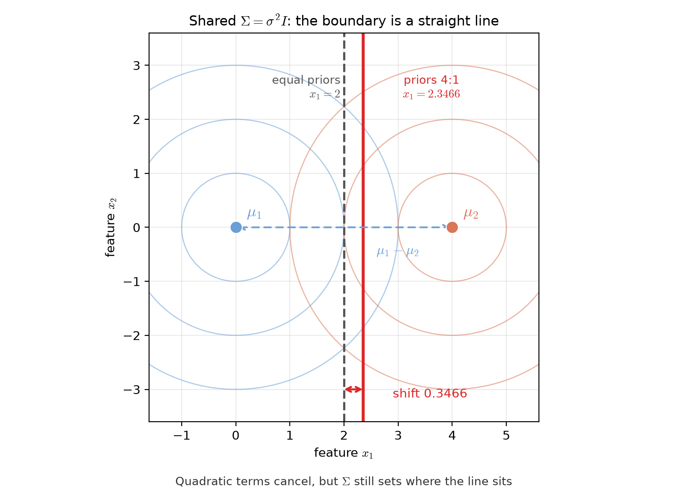
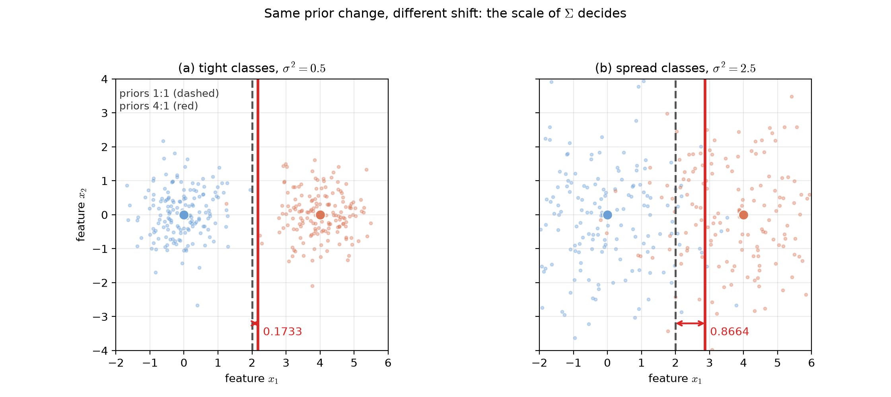
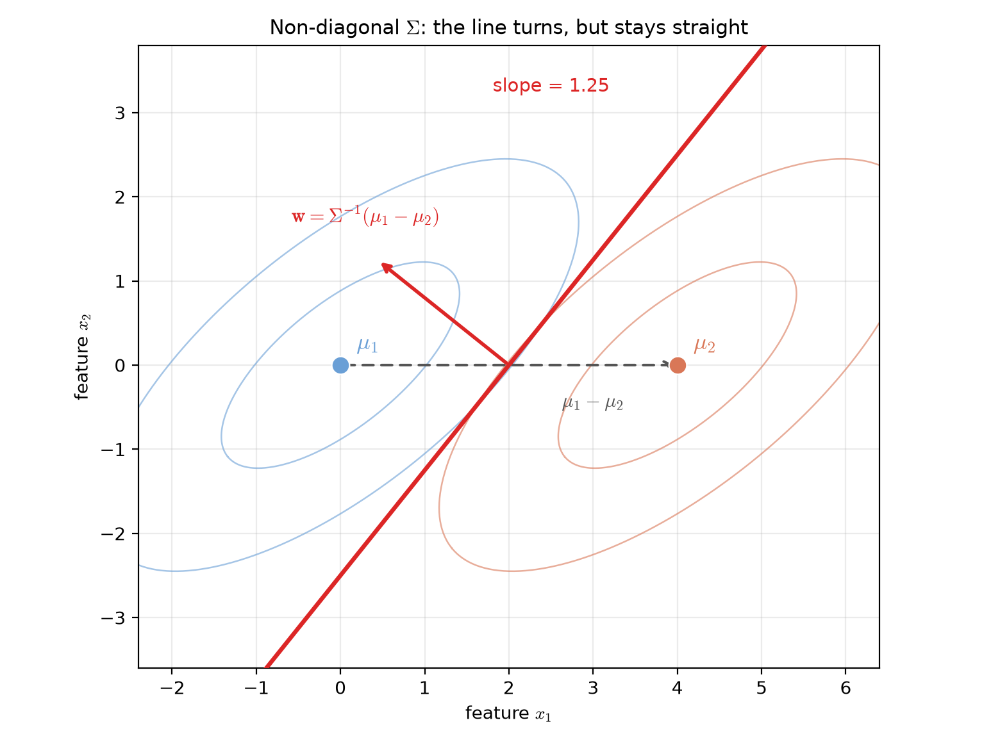
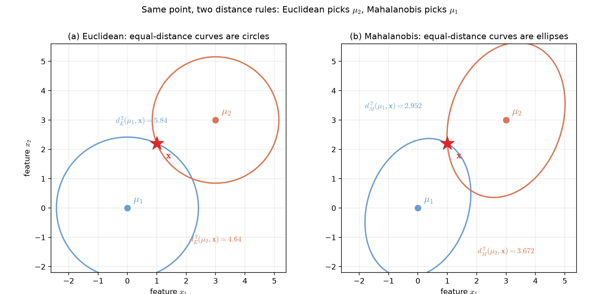

# Lecture 02（自主學習）：共同共變異數下的決策超平面與最小距離分類器（Shared-Covariance Decision Hyperplanes and Minimum-Distance Classifiers）

> 週次：第 2 週（自主學習教材）｜進度：貝氏分類器的延伸，線性分類器的前導
>
> Week 2 (self-study material) | Topic: an extension of Bayes classifiers and a bridge to linear classifiers

本份講義接續 `lec02.md` 的第 5 節。那裡提到：當每個類別都使用同一顆共變異數矩陣時，判別函數裡的二次項會互相抵銷。本篇把這個結論講清楚，並介紹它的另一種說法：最小距離分類器。

This note continues Section 5 of `lec02.md`. There we saw that when all classes share one covariance matrix, the quadratic terms in the discriminant functions cancel. This note explains that result in detail and presents a second way to read it: the minimum-distance classifier.

講義文字是重新撰寫的。標有 `[補充]` / `[Added]` 的內容是為幫助理解而新增的。所有數字都用 Python 實算，圖中的數字與正文一致。

The text is newly written. Items marked `[補充]` / `[Added]` are added to aid understanding. All numbers were computed with Python, and the figures use the same numbers as the text.

## 學習目標（Learning objectives）

- 說明共同共變異數為何讓二次項抵銷，以及邊界為何從曲面變成超平面（Explain why a shared covariance cancels the quadratic terms and why the boundary becomes a hyperplane）。
- 寫出 $\Sigma=\sigma^2 I$ 時的決策超平面，並指出它與兩均值連線的關係（Write the decision hyperplane for $\Sigma=\sigma^2 I$ and state its relation to the line joining the two means）。
- 計算先驗不等時超平面位移的量，並說明位移方向（Compute how far the hyperplane shifts when the priors differ, and state the direction）。
- 區分歐氏距離與馬氏距離，並用同一個點示範兩者可能給出相反的答案（Distinguish Euclidean from Mahalanobis distance and show that the same point can flip the answer）。
- 由 $\Sigma$ 的特徵分解寫出等馬氏距離曲線的橢圓主軸（Derive the ellipse axes of an equal-Mahalanobis-distance contour from the eigendecomposition of $\Sigma$）。

## 1. 兩個知識點與共用符號（Two concepts and the shared notation）

這一節先把符號統一，後面兩個知識點都用到同一套記號。我們只看兩類 $\omega_1$ 與 $\omega_2$。

This section fixes the notation once; both concepts below use the same symbols. We look at two classes, $\omega_1$ and $\omega_2$.

| 符號（Symbol） | 中文意義 | English meaning |
|---|---|---|
| $\mathbf{x}$ | 待分類的特徵向量 | the feature vector to be classified |
| $\omega_i$ | 第 $i$ 個類別 | the $i$-th class |
| $\mu_i$ | 第 $i$ 類的均值向量 | the mean vector of class $i$ |
| $\Sigma_i$ | 第 $i$ 類的共變異數矩陣 | the covariance matrix of class $i$ |
| $\Sigma$ | 兩類共用的共變異數矩陣 | the covariance matrix shared by both classes |
| $P(\omega_i)$ | 第 $i$ 類的先驗機率 | the prior probability of class $i$ |
| $g_i(\mathbf{x})$ | 第 $i$ 類的判別函數 | the discriminant function of class $i$ |
| $l$ | 特徵維度 | the number of features |

`[補充]` 把 $\Sigma$ 想成資料「散開的形狀」。$\Sigma=\sigma^2 I$ 代表每個特徵各自獨立、散開程度相同，像一團正圓形的雲。非對角的 $\Sigma$ 代表特徵之間有相關，雲被拉成斜的橢圓。這個比喻的侷限是，它只描述二維，看不出更高維的形狀。

`[Added]` Think of $\Sigma$ as the "shape of the spread". $\Sigma=\sigma^2 I$ means the features are independent and equally spread, like a round cloud. A non-diagonal $\Sigma$ means the features are correlated, so the cloud is stretched into a tilted ellipse. The limit of this picture is that it only shows two dimensions, not the shape in higher dimensions.

本份講義涵蓋兩個知識點：**知識點 7**（共同共變異數下的決策超平面）與**知識點 8**（最小距離分類器）。兩者其實是同一條式子的兩種讀法，第 3 節末尾會把這個連結講清楚。

This note covers **Concept 7** (decision hyperplanes under a shared covariance) and **Concept 8** (minimum-distance classifiers). They are two readings of the same formula; Section 3 closes the loop.

## 2. 知識點 7：共同共變異數下的決策超平面（Concept 7: decision hyperplanes under a shared covariance）

### 2.1 二次項為什麼消失（Why the quadratic terms vanish）

**一句話重點**：只要兩類的 $\Sigma_i$ 相同，判別函數相減時，$\mathbf{x}$ 的二次項一模一樣，因此完全抵銷，邊界被「拉直」。

**One-sentence summary**: when two classes share the same $\Sigma_i$, the quadratic terms in $\mathbf{x}$ are identical. They cancel on subtraction, so the boundary becomes straight.

**白話說明**：把兩類的分數相減，我們只在乎誰大誰小。兩邊都有的東西可以一起丟掉。$\mathbf{x}^T\Sigma^{-1}\mathbf{x}$ 這一項和類別無關，兩類都有，所以直接丟掉。剩下的是 $\mathbf{x}$ 的一次項，一次項的邊界就是直線。這也是**線性判別分析（Linear Discriminant Analysis, LDA）**名稱的由來。

**Plain explanation**: when we subtract the two class scores we only care about which is larger. Anything that appears in both can be dropped. The term $\mathbf{x}^T\Sigma^{-1}\mathbf{x}$ does not depend on the class, so it appears in both and is dropped. What remains is linear in $\mathbf{x}$, and a linear equation defines a straight boundary. This is where the name **linear discriminant analysis (LDA)** comes from.

**正式定義**：取對數後的判別函數為

**Formal definition**: the log discriminant function is

$$
g_i(\mathbf{x})=\ln\!\bigl(p(\mathbf{x}\mid\omega_i)P(\omega_i)\bigr)
=-\frac{1}{2}(\mathbf{x}-\mu_i)^T\Sigma^{-1}(\mathbf{x}-\mu_i)-\frac{1}{2}\ln|\Sigma|+\ln P(\omega_i)
$$

把平方項展開：

Expanding the quadratic term gives:

$$
(\mathbf{x}-\mu_i)^T\Sigma^{-1}(\mathbf{x}-\mu_i)
=\mathbf{x}^T\Sigma^{-1}\mathbf{x}-2\,\mathbf{x}^T\Sigma^{-1}\mu_i+\mu_i^T\Sigma^{-1}\mu_i
$$

第一項 $\mathbf{x}^T\Sigma^{-1}\mathbf{x}$ 與 $i$ 無關，第二項 $-\tfrac{1}{2}\ln|\Sigma|$ 也與 $i$ 無關。兩者在相減時抵銷，剩下的判別函數是線性的：

The first term $\mathbf{x}^T\Sigma^{-1}\mathbf{x}$ does not depend on $i$, and neither does $-\tfrac{1}{2}\ln|\Sigma|$. Both cancel on subtraction, leaving a linear discriminant:

$$
g_i(\mathbf{x})=\mathbf{w}_i^T\mathbf{x}+w_{i0},\qquad
\mathbf{w}_i=\Sigma^{-1}\mu_i,\qquad
w_{i0}=\ln P(\omega_i)-\frac{1}{2}\mu_i^T\Sigma^{-1}\mu_i
$$

**邊界（boundary）**：令 $g_i(\mathbf{x})=g_j(\mathbf{x})$ 解出的集合，就是兩類之間的決策邊界。因為 $g_i-g_j$ 是 $\mathbf{x}$ 的一次函數，這個集合是一個**超平面（hyperplane）**：二維時是直線，三維時是平面。

**Boundary**: the set of $\mathbf{x}$ with $g_i(\mathbf{x})=g_j(\mathbf{x})$ is the decision boundary between the two classes. Since $g_i-g_j$ is linear in $\mathbf{x}$, this set is a **hyperplane**: a line in two dimensions, a plane in three.

**常見迷思**：「二維時邊界一定是垂直平分線。」不對。垂直於 $\mu_1-\mu_2$ 只在 $\Sigma=\sigma^2 I$ 時成立。$\Sigma$ 一旦有非對角項，邊界方向就會偏斜。

**Common misconception**: "in two dimensions the boundary is always the perpendicular bisector." That is not true. Being perpendicular to $\mu_1-\mu_2$ holds only when $\Sigma=\sigma^2 I$. As soon as $\Sigma$ has off-diagonal entries, the boundary tilts.

**圖**：本知識點的整體形狀見後面兩張圖；超平面與偏移量在 §2.2、§2.3，非對角方向在 §2.4。

**Figure**: the shape of this concept appears in the next figures; the hyperplane and its shift are in §2.2 and §2.3, and the non-diagonal direction is in §2.4.

**想深入**：$-2\mathbf{x}^T\Sigma^{-1}\mu_i$ 告訴我們一件事：資料先被 $\Sigma^{-1}$ 做了一次線性變換。白化（whitening）之後，橢圓雲變成圓雲，問題就回到最單純的情形。這個想法在 §2.4 會再出現。

**Going deeper**: the term $-2\mathbf{x}^T\Sigma^{-1}\mu_i$ says that the data is first transformed linearly by $\Sigma^{-1}$. After whitening, the elliptical cloud becomes a round cloud, and the problem returns to the simplest case. This idea reappears in §2.4.

**小練習**：若兩類的 $\Sigma_i$ 不同，請說明為什麼二次項無法抵銷，並指出邊界可能變成哪三種圓錐曲線。

**Practice**: suppose the two classes have different $\Sigma_i$. Explain why the quadratic terms no longer cancel, and name the three kinds of conic the boundary may become.

### 2.2 特例 $\Sigma=\sigma^2 I$：垂直平分線與先驗偏移（The case $\Sigma=\sigma^2 I$: perpendicular bisector and prior shift）

**一句話重點**：$\Sigma=\sigma^2 I$ 時，超平面垂直於 $\mu_1-\mu_2$，通過均值連線上一點；兩類先驗相等時，那一點就是中點。

**One-sentence summary**: when $\Sigma=\sigma^2 I$, the hyperplane is perpendicular to $\mu_1-\mu_2$. It passes through a point on the line joining the means; with equal priors that point is the midpoint.

**正式定義**：此時 $\Sigma^{-1}=\tfrac{1}{\sigma^2}I$。決策超平面可寫成

**Formal definition**: here $\Sigma^{-1}=\tfrac{1}{\sigma^2}I$, and the decision hyperplane can be written as

$$
\mathbf{w}^T(\mathbf{x}-\mathbf{x}_0)=0,\qquad
\mathbf{w}=\mu_1-\mu_2,\qquad
\mathbf{x}_0=\frac{1}{2}(\mu_1+\mu_2)-\sigma^2\ln\!\left(\frac{P(\omega_1)}{P(\omega_2)}\right)\frac{\mu_1-\mu_2}{\|\mu_1-\mu_2\|^2}
$$

| 符號（Symbol） | 中文意義 | English meaning |
|---|---|---|
| $\mathbf{w}$ | 超平面的法向量 | the normal vector of the hyperplane |
| $\mathbf{x}_0$ | 超平面通過的一個點 | one point on the hyperplane |
| $\|\mu_1-\mu_2\|^2$ | 兩均值距離的平方 | the squared distance between the two means |

**白話說明**：第一項 $\tfrac{1}{2}(\mu_1+\mu_2)$ 是中點。第二項是修正量，大小與 $\sigma^2\ln(P_1/P_2)$ 成正比。若 $P_1>P_2$，對數為正，修正量方向是 $-\tfrac{\mu_1-\mu_2}{\|\mu_1-\mu_2\|^2}$，也就是往 $\omega_2$ 那一側；換句話說，邊界往「先驗較小」的類別偏，讓先驗大的類別多分到一些空間。

**Plain explanation**: the first term $\tfrac{1}{2}(\mu_1+\mu_2)$ is the midpoint. The second term is a correction proportional to $\sigma^2\ln(P_1/P_2)$. If $P_1>P_2$ the logarithm is positive, and the correction points along $-\tfrac{\mu_1-\mu_2}{\|\mu_1-\mu_2\|^2}$, that is toward $\omega_2$. The boundary thus moves toward the class with the smaller prior, giving the larger-prior class more room.

**數字例**：取 $\mu_1=[0,0]^T$、$\mu_2=[4,0]^T$、$\sigma^2=1$。

**Numerical example**: take $\mu_1=[0,0]^T$, $\mu_2=[4,0]^T$ and $\sigma^2=1$.

| 情況（Case） | $\mathbf{x}_0$ | 邊界（Boundary） |
|---|---|---|
| 先驗 $1{:}1$（equal priors） | $[2,\,0]^T$ | $x_1=2$ |
| 先驗 $4{:}1$（priors $4{:}1$） | $[2.3466,\,0]^T$ | $x_1=2.3466$ |

第二列由 $\ln 4=1.3863$ 算得，修正量是 $1\times1.3863\times4/16=0.3466$，方向沿 $+\hat{x}_1$（朝 $\omega_2$）。位移量 $0.3466$ 就是兩條線的距離。

The second row follows from $\ln 4=1.3863$; the correction is $1\times1.3863\times4/16=0.3466$ along $+\hat{x}_1$ (toward $\omega_2$). The shift $0.3466$ is the distance between the two lines.

**圖說 `lec02-linear-shared-sigma-boundary`**：兩類共用 $\Sigma=\sigma^2 I$，$\mu_1=[0,0]^T$、$\mu_2=[4,0]^T$。淡色的同心圓是等密度線，每類三圈。灰色虛線是先驗 $1{:}1$ 的邊界 $x_1=2$；紅色實線是先驗 $4{:}1$ 的邊界 $x_1=2.3466$，下方紅色雙箭頭標出位移 $0.3466$。兩條線都垂直於 $\mu_1-\mu_2$。讀圖時先看兩個均值點與它們之間的虛線，再比較兩條垂直線的位置，注意紅線往 $\mu_2$ 那一側移。〔功能：2、3〕

**Caption `lec02-linear-shared-sigma-boundary`**: the two classes share $\Sigma=\sigma^2 I$ with $\mu_1=[0,0]^T$ and $\mu_2=[4,0]^T$. The pale concentric circles are equal-density contours, three per class. The grey dashed line is the $1{:}1$ boundary at $x_1=2$. The red line is the $4{:}1$ boundary at $x_1=2.3466$, and the red double arrow marks the shift $0.3466$. Both lines are perpendicular to $\mu_1-\mu_2$. Read the two mean points first, then compare the two vertical lines and note that the red one moves toward $\mu_2$.

> 二次項抵銷，不代表 $\Sigma$ 的影響消失；$\Sigma$ 的尺度仍然決定邊界的位置。
>
> Cancelling the quadratic terms does not remove the effect of $\Sigma$; its scale still sets where the line sits.

**為什麼方向是往先驗小的那一類**：$\omega_1$ 出現得多，就該分到比較多的空間。邊界往 $\omega_2$ 移，$\omega_1$ 就多吃了一些區域。這是「先驗大者多分」的直接結果。

**Why the shift is toward the smaller prior**: $\omega_1$ occurs more often, so it deserves more room. Moving the boundary toward $\omega_2$ lets $\omega_1$ take more area. This is the direct consequence of "the larger prior gets more room".

### 2.3 位移對先驗的敏感度（How sensitive the shift is to the priors）

**一句話重點**：先驗改變造成的位移與 $\sigma^2$ 成正比；類別越分散（$\sigma^2$ 大），同樣的先驗改變造成越大的位移。

**One-sentence summary**: the shift caused by a prior change scales with $\sigma^2$. The more spread out the classes are, the larger the shift for the same prior change.

**白話說明**：位移量是 $\sigma^2\ln(P_1/P_2)/\|\mu_1-\mu_2\|$。$\sigma^2$ 越大，位移越大。直覺上，若樣本緊緊聚在均值附近，邊界小幅移動幾乎不會跨過任何樣本，所以結果不敏感；若樣本散得很開，邊界一移就會改變許多樣本的歸類，因此敏感。

**Plain explanation**: the shift is $\sigma^2\ln(P_1/P_2)/\|\mu_1-\mu_2\|$. The larger $\sigma^2$ is, the larger the shift. Intuitively, if the samples are packed tightly around their means, a small move barely crosses any sample, so the result is insensitive. If the samples are spread out, a move reclassifies many samples and matters a lot.

**數字例**：同樣把先驗從 $1{:}1$ 改成 $4{:}1$（$\ln 4=1.3863$），$\|\mu_1-\mu_2\|=4$。

**Numerical example**: change the priors from $1{:}1$ to $4{:}1$ (so $\ln 4=1.3863$) with $\|\mu_1-\mu_2\|=4$.

| 情境（Scenario） | $\sigma^2$ | 位移（Shift） |
|---|---|---|
| 類別緊實（tight classes） | $0.5$ | $0.1733$ |
| 類別分散（spread classes） | $2.5$ | $0.8664$ |

兩者相差 $5$ 倍，正比於 $\sigma^2$ 的比值 $2.5/0.5=5$。

The two differ by a factor of $5$, exactly the ratio $2.5/0.5=5$ of the $\sigma^2$ values.

**圖說 `lec02-linear-prior-sensitivity`**：兩面板的均值都是 $\mu_1=[0,0]^T$、$\mu_2=[4,0]^T$，先驗都從 $1{:}1$ 改成 $4{:}1$。左圖 $\sigma^2=0.5$，點雲緊實，虛線到紅線只隔 $0.1733$；右圖 $\sigma^2=2.5$，點雲散開，同樣的先驗改變卻隔了 $0.8664$。讀圖時先比較兩張圖點雲的鬆緊，再比較紅線與虛線的間距。這樣就會看到「同樣的先驗改變、不同的位移」。〔功能：1、2〕

**Caption `lec02-linear-prior-sensitivity`**: both panels use the means $\mu_1=[0,0]^T$ and $\mu_2=[4,0]^T$ and change the priors from $1{:}1$ to $4{:}1$. On the left $\sigma^2=0.5$: the clouds are tight and the red line is only $0.1733$ from the dashed one. On the right $\sigma^2=2.5$: the clouds are spread and the same prior change separates the lines by $0.8664$. Read the tightness of the clouds first, then compare the two line gaps.

`[補充]` Demo 對應：課程網頁的互動 Demo 讓你把 $\sigma^2$ 與 $\ln(P_1/P_2)$ 當成旋鈕。把先驗設成 $4{:}1$，先在小 $\sigma^2$ 下看位移，再切到大 $\sigma^2$，就會看到上面這張對照圖的效果。

`[Added]` Demo link: the course page's interactive demo exposes $\sigma^2$ and $\ln(P_1/P_2)$ as sliders. Set the priors to $4{:}1$ and watch the shift at a small $\sigma^2$. Then switch to a large $\sigma^2$ to reproduce the contrast in the figure above.

**常見迷思**：「二次項抵銷後，$\Sigma$ 就不重要了。」錯。二次項抵銷只保證邊界是一條直線，$\Sigma$ 的尺度仍透過 $\sigma^2$ 決定這條線的位置，也決定它對先驗的敏感度。

**Common misconception**: "once the quadratic terms cancel, $\Sigma$ no longer matters." Wrong. The cancellation only guarantees a straight boundary; the scale in $\Sigma$ still fixes where the line sits and how sensitive it is to the priors.

**小練習**：固定 $\sigma^2=1$，把先驗比從 $1{:}1$ 改成 $e{:}1$。位移量是多少？方向往哪一類？

**Practice**: fix $\sigma^2=1$ and change the prior ratio from $1{:}1$ to $e{:}1$. What is the shift, and toward which class does it point?

### 2.4 非對角 $\Sigma$：直線還在，但方向偏了（Non-diagonal $\Sigma$: still a straight line, but tilted）

**一句話重點**：$\Sigma$ 有非對角項時，$\mathbf{w}=\Sigma^{-1}(\mu_1-\mu_2)$，超平面仍然垂直於 $\mathbf{w}$，但不再垂直於 $\mu_1-\mu_2$ 本身。

**One-sentence summary**: when $\Sigma$ has off-diagonal entries, $\mathbf{w}=\Sigma^{-1}(\mu_1-\mu_2)$. The hyperplane stays perpendicular to $\mathbf{w}$ but no longer to $\mu_1-\mu_2$ itself.

**正式定義**：兩類共用非對角的 $\Sigma$，等先驗時判別函數差為

**Formal definition**: for a shared non-diagonal $\Sigma$ with equal priors, the difference of the discriminants is

$$
g_1(\mathbf{x})-g_2(\mathbf{x})=(\mu_1-\mu_2)^T\Sigma^{-1}\mathbf{x}-\frac{1}{2}\bigl(\mu_1^T\Sigma^{-1}\mu_1-\mu_2^T\Sigma^{-1}\mu_2\bigr)
$$

邊界是 $\mathbf{w}^T(\mathbf{x}-\mathbf{x}_0)=0$，其中 $\mathbf{w}=\Sigma^{-1}(\mu_1-\mu_2)$、$\mathbf{x}_0=\tfrac{1}{2}(\mu_1+\mu_2)$。形狀仍是直線，只有方向改變。

The boundary is $\mathbf{w}^T(\mathbf{x}-\mathbf{x}_0)=0$ with $\mathbf{w}=\Sigma^{-1}(\mu_1-\mu_2)$ and $\mathbf{x}_0=\tfrac{1}{2}(\mu_1+\mu_2)$. The shape stays a straight line; only its direction changes.

**白話說明**：$\Sigma^{-1}$ 把方向做了「拉長與壓縮」。原本水平的方向可能被轉成斜的。這和 §2.1「想深入」提到的白化是同一件事。先還原成圓雲，在中間畫垂直平分線，再變換回原座標，線就斜了。

**Plain explanation**: $\Sigma^{-1}$ stretches and squeezes directions. A direction that was horizontal can be turned into a slope. This is the same whitening idea as in §2.1. Transform back to a round cloud, draw the perpendicular bisector there, then map back; the line comes out tilted.

**數字例**：$\mu_1=[0,0]^T$、$\mu_2=[4,0]^T$，共用 $\Sigma=\begin{bmatrix}2.0&1.2\\1.2&1.5\end{bmatrix}$。

**Numerical example**: $\mu_1=[0,0]^T$, $\mu_2=[4,0]^T$ with shared $\Sigma=\begin{bmatrix}2.0&1.2\\1.2&1.5\end{bmatrix}$.

| 量（Quantity） | 值（Value） |
|---|---|
| $\Sigma^{-1}$ | $\begin{bmatrix}0.9615&-0.7692\\-0.7692&1.2821\end{bmatrix}$ |
| $\mathbf{w}=\Sigma^{-1}(\mu_1-\mu_2)$ | $[-3.8462,\,3.0769]^T$ |
| 邊界斜率（boundary slope） | $1.2500$ |
| 邊界通過點（point on the line） | $[2,\,0]^T$ |

$\mu_1-\mu_2$ 是水平的，所以若垂直於它，邊界應是垂直線。實際斜率卻是 $1.25$，這就是 $\Sigma^{-1}$ 轉動方向的效果。邊界仍然通過中點 $[2,0]^T$，因為先驗相等。

$\mu_1-\mu_2$ is horizontal, so a line perpendicular to it would be vertical. The actual slope is $1.25$, which is the effect of $\Sigma^{-1}$ rotating the direction. The boundary still passes through the midpoint $[2,0]^T$ because the priors are equal.

**圖說 `lec02-linear-nondiagonal-direction`**：兩類共用 $\Sigma=\begin{bmatrix}2.0&1.2\\1.2&1.5\end{bmatrix}$，淡色同心橢圓是等密度線，其傾斜方向由 $\Sigma$ 決定。灰色虛線箭頭是 $\mu_1-\mu_2$，水平。紅色實線是決策邊界，斜率 $1.25$，通過中點 $[2,0]^T$。紅色箭頭是法向量 $\mathbf{w}=\Sigma^{-1}(\mu_1-\mu_2)$，邊界與它垂直。讀圖時先看水平的灰色箭頭，再看紅色法向量。兩者方向不同，這就是邊界不再垂直於 $\mu_1-\mu_2$ 的原因。〔功能：3〕

**Caption `lec02-linear-nondiagonal-direction`**: the classes share $\Sigma=\begin{bmatrix}2.0&1.2\\1.2&1.5\end{bmatrix}$; the pale concentric ellipses are equal-density contours whose tilt follows $\Sigma$. The grey dashed arrow is the horizontal $\mu_1-\mu_2$. The red line is the decision boundary with slope $1.25$, passing through the midpoint $[2,0]^T$. The red arrow is the normal $\mathbf{w}=\Sigma^{-1}(\mu_1-\mu_2)$, to which the boundary is perpendicular. Read the horizontal grey arrow first, then the red normal. Their different directions are why the boundary is no longer perpendicular to $\mu_1-\mu_2$.

> 邊界是直線，不代表它垂直於均值連線。垂直於均值連線只是 $\Sigma=\sigma^2 I$ 的特例。
>
> A straight boundary need not be perpendicular to the line joining the means; that perpendicularity is only the special case $\Sigma=\sigma^2 I$.

**小練習**：把上面的 $\Sigma$ 的非對角項從 $1.2$ 改成 $0$、對角項不變，重求邊界斜率，並說明它為什麼變回垂直線。

**Practice**: change the off-diagonal entry of $\Sigma$ above from $1.2$ to $0$ and keep the diagonal. Re-derive the slope and explain why the line becomes vertical again.

## 3. 知識點 8：最小距離分類器（Concept 8: minimum-distance classifiers）

### 3.1 把「分數最大」改寫成「距離最小」（Rewriting "largest score" as "smallest distance"）

**一句話重點**：等先驗時，$g_i(\mathbf{x})$ 取到最大值，也就等於某種「$\mathbf{x}$ 到 $\mu_i$ 的距離」取到最小值。距離的定義換一套，分類器就換一個。

**One-sentence summary**: with equal priors, maximizing $g_i(\mathbf{x})$ means minimizing a certain distance from $\mathbf{x}$ to $\mu_i$. Change the distance definition and you change the classifier.

**正式定義**：等先驗時，

**Formal definition**: with equal priors,

$$
g_i(\mathbf{x})=-\frac{1}{2}(\mathbf{x}-\mu_i)^T\Sigma^{-1}(\mathbf{x}-\mu_i)+\text{const}
$$

所以 $g_i$ 最大 ⟺ 馬氏距離的平方 $d_m^2=(\mathbf{x}-\mu_i)^T\Sigma^{-1}(\mathbf{x}-\mu_i)$ 最小。這就是**最小距離分類器**：算出 $\mathbf{x}$ 到每個均值的距離，選最近的。

So $g_i$ is largest exactly when the squared Mahalanobis distance $d_m^2=(\mathbf{x}-\mu_i)^T\Sigma^{-1}(\mathbf{x}-\mu_i)$ is smallest. This is the **minimum-distance classifier**: compute the distance from $\mathbf{x}$ to each mean and pick the nearest.

**白話說明**：先驗不等時，距離還要減去 $\ln P(\omega_i)$ 的兩倍；先驗大的類別，距離可以「打折」。為了看清楚距離本身的效果，本節假設先驗相等。距離的定義有兩種：$\Sigma=\sigma^2 I$ 時是歐氏距離，一般 $\Sigma$ 時是馬氏距離。

**Plain explanation**: when the priors differ, twice $\ln P(\omega_i)$ is subtracted from the distance. A class with a larger prior therefore gets a discount. To isolate the effect of distance itself, this section assumes equal priors. There are two definitions of distance: Euclidean when $\Sigma=\sigma^2 I$, and Mahalanobis for a general $\Sigma$.

**情況一：$\Sigma=\sigma^2 I$ → 歐氏距離（Euclidean distance）**

$$
d_e=\|\mathbf{x}-\mu_i\|
$$

等距離曲線 $d_e=c$ 是一個正圓，圓心在 $\mu_i$；到了 $l$ 維，這個圓就成了超球。

**Case one: $\Sigma=\sigma^2 I$ → Euclidean distance.** The equal-distance curve $d_e=c$ is a circle centred at $\mu_i$ (a hypersphere in $l$ dimensions).

**情況二：一般 $\Sigma$ → 馬氏距離（Mahalanobis distance）**

$$
d_m=\Bigl((\mathbf{x}-\mu_i)^T\Sigma^{-1}(\mathbf{x}-\mu_i)\Bigr)^{1/2}
$$

**Case two: general $\Sigma$ → Mahalanobis distance.**

**等距離曲線的形狀**：把 $\Sigma$ 做特徵分解 $\Sigma=\Phi\Lambda\Phi^T$，其中 $\Phi$ 的每一行是單位特徵向量、$\Lambda$ 是特徵值對角矩陣。令 $\mathbf{y}=\Phi^T(\mathbf{x}-\mu_i)$，則 $d_m=c$ 變成

**Shape of the equal-distance curve**: write the eigendecomposition $\Sigma=\Phi\Lambda\Phi^T$, where the columns of $\Phi$ are unit eigenvectors and $\Lambda$ is diagonal. Setting $\mathbf{y}=\Phi^T(\mathbf{x}-\mu_i)$ turns $d_m=c$ into

$$
\frac{y_1^2}{\lambda_1}+\cdots+\frac{y_l^2}{\lambda_l}=c^2
$$

這是橢圓（$l$ 維時是超橢球），中心在 $\mu_i$，主軸沿 $\Sigma$ 的特徵向量方向，半軸長為 $c\sqrt{\lambda_k}$，全軸長為 $2c\sqrt{\lambda_k}$。

This is an ellipse (a hyperellipsoid in $l$ dimensions) centred at $\mu_i$, with principal axes along the eigenvectors of $\Sigma$. Its semi-axis lengths are $c\sqrt{\lambda_k}$, so the full axis lengths are $2c\sqrt{\lambda_k}$.

**常見迷思**：「馬氏距離只是把歐氏距離除以一個常數。」不對。它用到整個矩陣 $\Sigma^{-1}$，所以不同方向被縮放的比例不同，等距線才會從圓變成橢圓。

**Common misconception**: "Mahalanobis distance is just Euclidean distance divided by a constant." Not so. It uses the whole matrix $\Sigma^{-1}$, so different directions are scaled differently; that is why the contours change from circles to ellipses.

### 3.2 數值範例：同一點，兩個答案（Numerical example: one point, two answers）

**設定**：兩類共用 $\Sigma=\begin{bmatrix}1.1&0.3\\0.3&1.9\end{bmatrix}$，$\mu_1=[0,0]^T$、$\mu_2=[3,3]^T$，測試點 $\mathbf{x}=[1.0,2.2]^T$。

**Setup**: the classes share $\Sigma=\begin{bmatrix}1.1&0.3\\0.3&1.9\end{bmatrix}$ with $\mu_1=[0,0]^T$, $\mu_2=[3,3]^T$, and test point $\mathbf{x}=[1.0,2.2]^T$.

| 距離（Distance） | 到 $\mu_1$（to $\mu_1$） | 到 $\mu_2$（to $\mu_2$） | 最近的類別（Nearest class） |
|---|---|---|---|
| 歐氏距離平方（squared Euclidean） | $5.84$ | $4.64$ | $\omega_2$ |
| 馬氏距離平方（squared Mahalanobis） | $2.952$ | $3.672$ | $\omega_1$ |

兩個答案相反！只看普通的直線距離，$\mathbf{x}$ 離 $\mu_2$ 比較近；改用馬氏距離，$\mathbf{x}$ 反而離 $\mu_1$ 比較近。

The two answers disagree. By plain straight-line distance, $\mathbf{x}$ is nearer to $\mu_2$; by Mahalanobis distance, $\mathbf{x}$ is nearer to $\mu_1$.

**為什麼會翻轉**：把差向量投影到 $\Sigma$ 的兩個主軸上。其中一個主軸的特徵值是 $1$（緊實方向），另一個是 $2$（分散方向）。馬氏距離的平方等於兩段投影各自「除以對應特徵值」後相加。到 $\mu_1$ 的差向量幾乎全落在特徵值 $2$ 的主軸上（貢獻 $2.888$，占 $2.952$ 的大部分），這個分散方向被自動打折。到 $\mu_2$ 的差向量則主要落在特徵值 $1$ 的主軸上（貢獻 $2.704$）。這個緊實方向沒有折扣，反而讓距離膨脹。結果 $3.672>2.952$，$\mathbf{x}$ 反而更靠近 $\mu_1$。

**Why the flip**: project the difference vector onto the two principal axes of $\Sigma$. One axis has eigenvalue $1$ (the tight direction) and the other eigenvalue $2$ (the spread direction). The squared Mahalanobis distance sums the two projected lengths, each divided by its own eigenvalue. The difference vector to $\mu_1$ lies almost entirely on the eigenvalue-$2$ axis (contributing $2.888$ of the total $2.952$), so the spread direction is discounted. The difference vector to $\mu_2$ lies mostly on the eigenvalue-$1$ axis (containing $2.704$ of the total $3.672$). The tight direction gives no discount and inflates the distance. As a result $3.672>2.952$, and $\mathbf{x}$ is nearer to $\mu_1$.

**數字逐步**：先算 $\Sigma$ 的行列式與反矩陣。

**Step by step**: first compute the determinant and inverse of $\Sigma$.

| 步驟（Step） | 值（Value） |
|---|---|
| $\det\Sigma$ | $1.1\times1.9-0.3^2=2.0$ |
| $\Sigma^{-1}$ | $\tfrac{1}{2.0}\begin{bmatrix}1.9&-0.3\\-0.3&1.1\end{bmatrix}=\begin{bmatrix}0.95&-0.15\\-0.15&0.55\end{bmatrix}$ |
| $\mathbf{x}-\mu_1$ | $[1.0,\,2.2]^T$ |
| $d_m^2(\mu_1,\mathbf{x})$ | $0.95\times1^2-2\times0.15\times1\times2.2+0.55\times2.2^2=2.952$ |
| $\mathbf{x}-\mu_2$ | $[-2.0,\,-0.8]^T$ |
| $d_m^2(\mu_2,\mathbf{x})$ | $0.95\times4-2\times0.15\times1.6+0.55\times0.64=3.672$ |

$2.952<3.672$，所以判給 $\omega_1$。以上數字全部由 Python 實算。

Since $2.952<3.672$, the point is assigned to $\omega_1$. All numbers above were computed with Python.

**圖說 `lec02-min-distance-euclid-vs-mahalanobis`**：兩面板用同一個 $\Sigma$、同一對均值與同一個紅色星號 $\mathbf{x}=[1.0,2.2]^T$。左圖是等歐氏距離曲線，通過 $\mathbf{x}$ 的兩條線都是正圓；右圖是等馬氏距離曲線，兩條線都是依 $\Sigma$ 傾斜的橢圓。左圖圓弧半徑 $5.84$（藍）大於 $4.64$（橘），所以判給 $\mu_2$；右圖橢圓距離 $2.952$（藍）小於 $3.672$（橘），所以判給 $\mu_1$。讀圖時先確認兩張圖的星號位置相同，再比較藍與橘兩條曲線誰先碰不到星號。〔功能：2、3〕

**Caption `lec02-min-distance-euclid-vs-mahalanobis`**: both panels use the same $\Sigma$, the same pair of means and the same red star $\mathbf{x}=[1.0,2.2]^T$. On the left are the equal-Euclidean-distance curves, which are circles through $\mathbf{x}$. On the right are the equal-Mahalanobis-distance curves, which are ellipses tilted by $\Sigma$. On the left the circle radius $5.84$ (blue) exceeds $4.64$ (orange), so $\mu_2$ wins. On the right the Mahalanobis distance $2.952$ (blue) is below $3.672$ (orange), so $\mu_1$ wins. Read the star's position first, then compare which curve the star moves away from.

**想深入**：等馬氏距離 $\Sigma$ 的橢圓可以用特徵分解畫出。對本題的 $\Sigma$，特徵值是 $\lambda_1=1$、$\lambda_2=2$，單位距離（$c=1$）的橢圓半軸是 $1$ 與 $\sqrt{2}\approx1.414$，這是右圖橢圓看起來「扁一邊」的原因。

**Going deeper**: the ellipse of a Mahalanobis contour can be drawn from the eigendecomposition. For this $\Sigma$ the eigenvalues are $\lambda_1=1$ and $\lambda_2=2$. The unit contour ($c=1$) then has semi-axes $1$ and $\sqrt{2}\approx1.414$, which is why the right-panel ellipses look elongated.

**小練習**：若把 $\mu_2$ 改成 $[3,-3]^T$，$\mathbf{x}=[1.0,2.2]^T$ 的歐氏與馬氏判斷會不會一致？先用公式推測，再用 Python 驗證。

**Practice**: if $\mu_2$ is changed to $[3,-3]^T$, do the Euclidean and Mahalanobis rules agree on $\mathbf{x}=[1.0,2.2]^T$? Guess from the formula first, then check with Python.

### 3.3 兩個知識點是同一件事（The two concepts are the same formula）

在 §2 我們把 $g_i$ 寫成 $\mathbf{w}_i^T\mathbf{x}+w_{i0}$。在 §3 同樣的 $g_i$ 被寫成負距離平方。兩者其實相同，只是一個用「分數」的語言，一個用「距離」的語言。$\Sigma=\sigma^2 I$ 時，兩種語言給出的邊界都是垂直平分線；一般 $\Sigma$ 時，兩種語言給出的邊界都是同一條傾斜直線。

In §2 we wrote $g_i$ as $\mathbf{w}_i^T\mathbf{x}+w_{i0}$. In §3 the same $g_i$ is written as a negative squared distance. The two are identical; one speaks the language of scores, the other the language of distances. For $\Sigma=\sigma^2 I$ both give the perpendicular bisector; for a general $\Sigma$ both give the same tilted line.

> 分數最大 ＝ 距離最小。記住這句話，兩個知識點就合成一個。
>
> Largest score equals smallest distance; keep this in mind and the two concepts merge into one.

## 4. 小結（Summary）

- 兩類共用 $\Sigma$ 時，二次項在相減時抵銷，判別函數變成線性，邊界是超平面（With a shared $\Sigma$, the quadratic terms cancel on subtraction, the discriminant becomes linear, and the boundary is a hyperplane）。
- $\Sigma=\sigma^2 I$ 時超平面垂直於 $\mu_1-\mu_2$，通過均值連線的中點；先驗不等時往先驗較小的類別偏移（For $\Sigma=\sigma^2 I$ the hyperplane is perpendicular to $\mu_1-\mu_2$ through the midpoint; unequal priors shift it toward the smaller prior）。
- 位移量與 $\sigma^2$ 成正比，所以分散的類別對先驗比較敏感（The shift is proportional to $\sigma^2$, so spread-out classes are more sensitive to the priors）。
- 非對角 $\Sigma$ 時 $\mathbf{w}=\Sigma^{-1}(\mu_1-\mu_2)$，線仍是直線，但不再垂直於 $\mu_1-\mu_2$（With a non-diagonal $\Sigma$, $\mathbf{w}=\Sigma^{-1}(\mu_1-\mu_2)$; the line stays straight but is no longer perpendicular to $\mu_1-\mu_2$）。
- 等先驗時，分數最大等於馬氏距離最小；$\Sigma=\sigma^2 I$ 退化成歐氏距離，等距線由圓變成橢圓（With equal priors, the largest score equals the smallest Mahalanobis distance; it reduces to the Euclidean distance for $\Sigma=\sigma^2 I$, and the contours change from circles to ellipses）。

## 5. 練習（Practice）

以下練習只給問題與提示，答案請在課堂或討論區討論。

The exercises below give problems and hints only. Discuss the answers in class or on the discussion board.

1. 承 §2.2，若先驗比改成 $P(\omega_1)/P(\omega_2)=e$，且 $\sigma^2=1$、$\mu_1-\mu_2=[4,0]^T$，求新邊界的位置和位移量。（提示：位移 $=\sigma^2\ln(e)/\|\mu_1-\mu_2\|=1\times1/4$。）（Following §2.2, with prior ratio $e$, $\sigma^2=1$ and $\mu_1-\mu_2=[4,0]^T$, find the new boundary and the shift. Hint: shift $=\sigma^2\ln(e)/\|\mu_1-\mu_2\|=1\times1/4$.）
2. 承 §3.2，把測試點改成 $\mathbf{x}=[0.5,0.5]^T$，重算歐氏與馬氏距離平方，並判斷是否還翻轉。（提示：這次兩者可能一致。）（Following §3.2, change the test point to $\mathbf{x}=[0.5,0.5]^T$, recompute both squared distances, and check whether the flip persists. Hint: the two may agree this time.）
3. 對 $\Sigma=\sigma^2 I$ 的兩類問題，若把「所有均值點與所有資料點」一起平移同一個向量 $\mathbf{c}$，決策會改變嗎？為什麼？（提示：超平面的法向量與相對位置都不變。）（For two classes with $\Sigma=\sigma^2 I$, if every mean and every data point is translated by the same vector $\mathbf{c}$, do the decisions change? Why? Hint: both the normal vector and the relative geometry are unchanged.）

## 延伸閱讀（Further reading）

- 教科書第 2 章 2.4 節後半（Textbook, Chapter 2, Section 2.4, second half）：Sergios Theodoridis & Konstantinos Koutroumbas, *Pattern Recognition*, 4th ed.
- 本份講義的前篇：`lec02.md` 第 5、6 節（The earlier note: Sections 5 and 6 of `lec02.md`）。
- 課程網頁的互動式自學講義：Chapter 2（讀取日期 2026-10-09）（Course self-study notes: Chapter 2, read on 2026-10-09）。
- 參考資料：見 [參考資料](../references/README.md)（References: see the [references folder](../references/README.md)）。

## 術語表（Glossary）

| 中文 | English |
|---|---|
| 決策超平面 | decision hyperplane |
| 共同共變異數 | shared covariance |
| 線性判別分析（LDA） | linear discriminant analysis (LDA) |
| 二次項 | quadratic term |
| 先驗機率 | prior probability |
| 判別函數 | discriminant function |
| 決策邊界 | decision boundary |
| 最小距離分類器 | minimum-distance classifier |
| 歐氏距離 | Euclidean distance |
| 馬氏距離 | Mahalanobis distance |
| 等距曲線 | equal-distance contour |
| 超球 | hypersphere |
| 超橢球 | hyperellipsoid |
| 特徵分解 | eigendecomposition |
| 特徵值／特徵向量 | eigenvalue / eigenvector |
| 白化 | whitening |
| 法向量 | normal vector |
