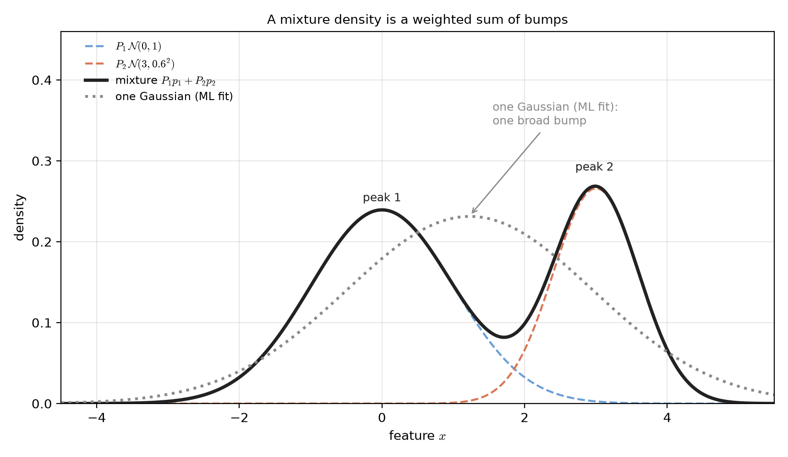
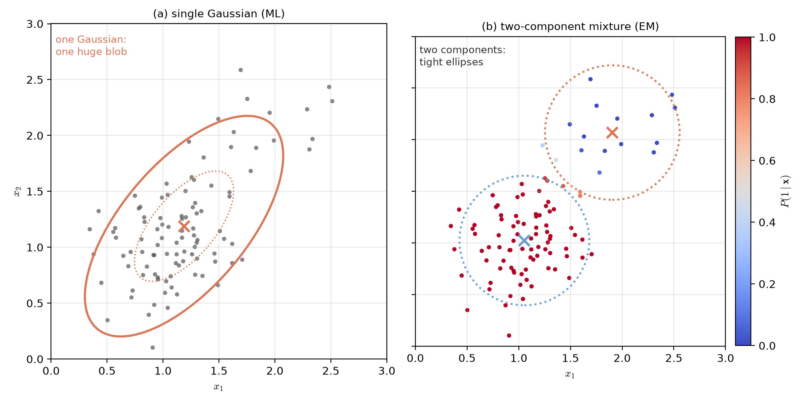
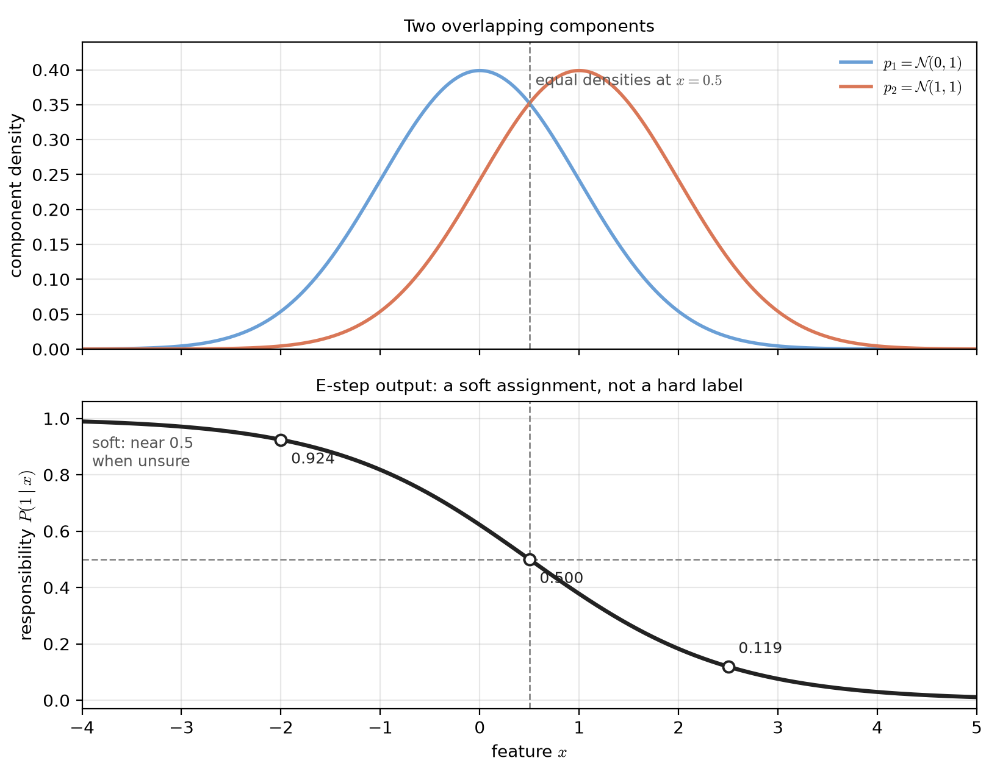
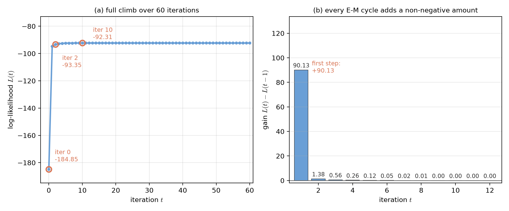
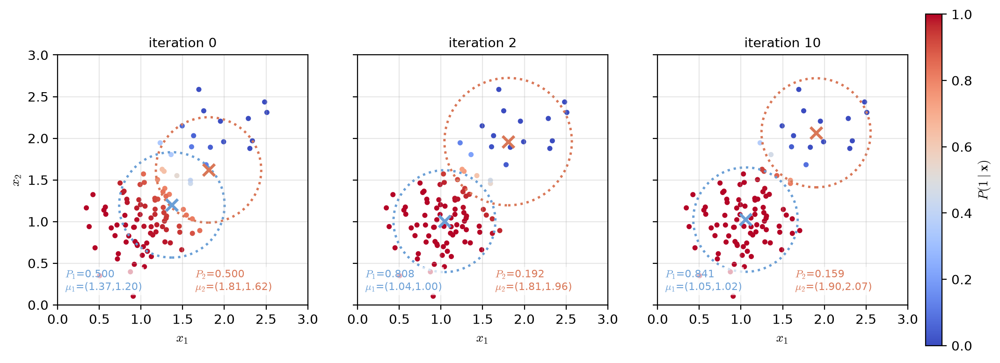
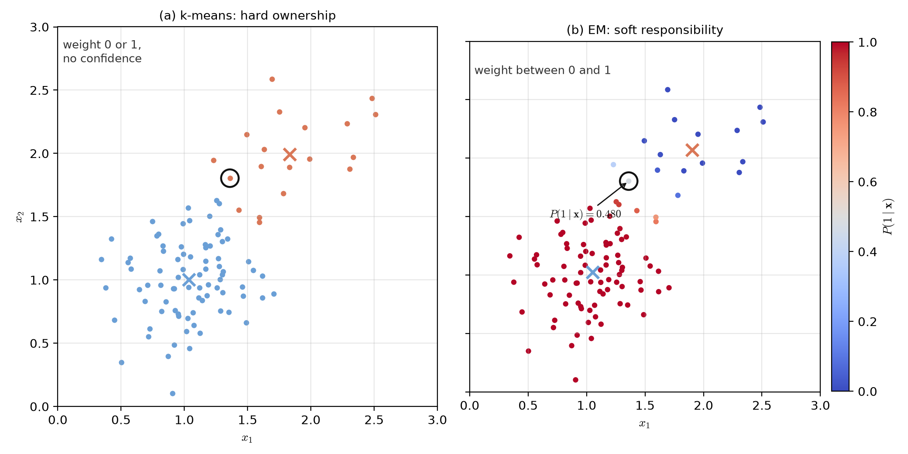

# Lecture 02（補充）：混合模型與 EM 演算法（Mixture Models and the EM Algorithm）

> 週次:第 2 週（自主學習教材）｜進度:混合模型與 EM 演算法（搭配課程網頁 2.5 知識點 13）
>
> Week 2 (self-study material) | Topic: Mixture models and the EM algorithm (course web notes, Section 2.5, point 13)

投影片：[JianBauDau JSON](../slides/lec02-mixture-models-em.jbd.json)（使用 JianBauDau 編輯器或播放器開啟）。

Slides: [JianBauDau JSON](../slides/lec02-mixture-models-em.jbd.json) (open with the JianBauDau editor or player).

本講義對應課程網頁 2.5 的知識點「混合模型與 EM 演算法」，以及課本 Figure 2.17 的主題。這裡談的是：資料由好幾個高斯疊加而成。如何在完全不知道每個點來自哪一群的情況下，把參數估出來？文字全部重新撰寫。標有 `[補充]` / `[Added]` 的內容是為了幫助理解而新增的。

This lecture covers the course web note "mixture models and the EM algorithm" (point 13 of Section 2.5) and the topic of textbook Figure 2.17. The question is this. The data come from several overlapping Gaussians. How do we estimate the parameters when we never know which group each point came from? The text is newly written. Content marked `[補充]` / `[Added]` is added to help understanding.

## 學習目標（Learning objectives）

- 用白話說明混合模型是什麼，以及為什麼單一高斯不夠用（Explain in plain words what a mixture model is and why one Gaussian is not enough）。
- 說明「標籤缺失」為什麼讓最大似然估計卡死（Explain why missing labels block direct maximum-likelihood estimation）。
- 寫出 E 步的責任度公式，並解釋它為什麼是「軟性分配」（Write the responsibility formula of the E step and explain why it is a soft assignment）。
- 寫出高斯混合 M 步的三條更新式，並說明每一條都是加權平均（Write the three M-step updates for a Gaussian mixture and explain why each is a weighted average）。
- 用一個小數字例手算一輪 E 步與 M 步（Hand-compute one E-step and M-step cycle on a small numerical example）。
- 說明對數概似為什麼疊代時只升不降，以及它保證了什麼、不保證什麼（Explain why the log-likelihood never falls during iteration, and what that does and does not guarantee）。
- 比較 K-means 與 EM 的本質差異（Compare K-means and EM at the level of their core idea）。

## 1. 一個高斯不夠用（One Gaussian is not enough）

**一句話重點**：混合模型把機率密度寫成好幾個「元件分布」的加權和。

**One-sentence summary**: a mixture model writes a probability density as a weighted sum of several component densities.

**白話說明**：真實資料常常不是單一座山峰。以身高為例，如果把男生與女生混在一起量，分布會出現兩座峰。硬要用一個鐘形曲線去描寫，就會變成又寬又扁、兩峰都不像。混合模型的做法是承認「這裡其實有兩群」，用兩條曲線加權相加。

**Plain explanation**: real data often do not form a single mountain. Measure the heights of men and women together and you see two peaks. Forcing one bell curve onto them gives a wide, flat shape that matches neither peak. A mixture model accepts that there are two groups and adds two curves with weights.

**正式定義**：設有 $J$ 個元件，第 $j$ 個元件的密度是 $p(\mathbf{x}\mid j)$，它佔的比例是 $P_j$（稱為**混合係數**）：

**Formal definition**: with $J$ components, the density of component $j$ is $p(\mathbf{x}\mid j)$ and its share is $P_j$, the **mixing coefficient**:

$$
p(\mathbf{x})=\sum_{j=1}^{J}p(\mathbf{x}\mid j)\,P_j,\qquad \sum_{j=1}^{J}P_j=1
$$

| 符號（Symbol） | 中文意義 | English meaning |
|---|---|---|
| $J$ | 元件總數，例如高斯峰的個數 | the number of components, e.g. the number of Gaussian peaks |
| $p(\mathbf{x}\mid j)$ | 第 $j$ 個元件的密度 | the density of component $j$ |
| $P_j$ | 第 $j$ 個元件的混合係數，介於 0 與 1，總和為 1 | the mixing coefficient of component $j$, between 0 and 1, summing to 1 |
| $\mathbf{x}$ | 觀察到的特徵向量 | the observed feature vector |

`[補充]` 注意 $P_j$ 的兩個身分：它既是「隨機挑一個樣本時，它來自第 $j$ 群」的機率，也是第 $j$ 條曲線在加總時佔的權重。這兩個說法是同一件事。

`[Added]` Note the two roles of $P_j$. It is the probability that a randomly drawn sample comes from group $j$. It is also the weight of curve $j$ in the sum. These are the same statement.

**例子**：一維、兩個高斯元件,$P_1=0.6$ 配 $\mathcal{N}(0,1)$,$P_2=0.4$ 配 $\mathcal{N}(3,0.6^2)$。下圖用解析公式畫出三條曲線:兩條加權後的元件曲線、它們相加的混合密度。第四條是單一高斯的最大似然配適,用來對照。

**Example**: one dimension, two Gaussian components, $P_1=0.6$ with $\mathcal{N}(0,1)$ and $P_2=0.4$ with $\mathcal{N}(3,0.6^2)$. The figure below draws the two weighted components from their formulas, their sum, and a single Gaussian fitted by maximum likelihood.

**圖說 `lec02-mixture-1d-components`**：兩條虛線是加權後的元件 $P_1p_1$ 與 $P_2p_2$，實線黑線是它們的和，灰點線是用 600 個樣本配出的單一高斯（種子 7）。混合密度有兩座峰：高度 0.239 與 0.269。單一高斯的峰只有 0.231，而且位置落在兩峰之間的鞍部附近，兩座峰都抓不到。讀圖時先比較虛線的高度與實線兩座峰的關係，再看灰點線為什麼只有一座峰。〔功能：1、2〕

**Caption `lec02-mixture-1d-components`**: the dashed curves are the weighted components $P_1p_1$ and $P_2p_2$. The solid black curve is their sum, and the grey dotted curve is a single Gaussian fitted to 600 samples (seed 7). The mixture has two peaks of height 0.239 and 0.269. The single Gaussian peaks at only 0.231 and sits near the saddle between them, so it captures neither peak.

**常見迷思**：「混合模型的參數比單一高斯多，所以一定配得比較好。」多參數確實更靈活，但也更容易過擬合。真正該問的是：元件的數量 $J$ 要怎麼決定？這通常靠模型選擇準則或領域知識，不是越多越好。

**Common misconception**: "a mixture has more parameters than one Gaussian, so it must fit better." More parameters do give more flexibility. They also invite overfitting. The real question is how to choose the number of components $J$. That normally needs a model-selection criterion or domain knowledge, not simply a larger number.

> 一個高斯是一座山，混合模型是好幾座山疊起來的地形。
>
> One Gaussian is a single mountain; a mixture is a landscape of several mountains added together.

## 2. 不知道標籤：不完整資料（Unknown labels: the incomplete-data problem）

**一句話重點**：每個樣本屬於哪個元件是隱藏的，這個隱藏變數讓概似函數失去簡單的解析解。

**One-sentence summary**: which component produced each sample is hidden, and this hidden variable destroys the simple analytic solution.

**白話說明**：假設我們除了資料，還知道每個點來自哪一群。那麼估計就變得容易：把同一群的點集合起來，各自算平均與變異數就好。問題是我們不知道。這個「每筆資料少了一個標籤」的狀況，就是**不完整資料**。

**Plain explanation**: suppose we knew, for every point, which group produced it. Estimation would then be easy: collect the points of each group and compute its mean and variance. The trouble is that we do not know. This situation, where each record is missing one label, is the **incomplete-data** problem.

**正式定義**：令 $j_k$ 表示第 $k$ 個樣本真正的元件編號，這是一個隱藏變數。完整的對數概似是

**Formal definition**: let $j_k$ be the true component index of sample $k$, a hidden variable. The complete-data log-likelihood is

$$
L_c(\mathbf{\Theta})=\sum_{k=1}^{N}\ln\bigl(p(\mathbf{x}_k\mid j_k)\,P_{j_k}\bigr)
$$

但我們手上只有 $X=\{\mathbf{x}_1,\dots,\mathbf{x}_N\}$，觀測對數概似是

but all we have is $X=\{\mathbf{x}_1,\dots,\mathbf{x}_N\}$, so the observed log-likelihood is

$$
L(\mathbf{\Theta})=\sum_{k=1}^{N}\ln\Bigl(\sum_{j=1}^{J}p(\mathbf{x}_k\mid j)\,P_j\Bigr)
$$

**為什麼會卡死**：請看 $L(\mathbf{\Theta})$ 裡的對數。對數裡面是一個**和**，而每個 $P_j$ 都同時出現在所有樣本的括號中。對 $\mathbf{\Theta}$ 微分時，各元件的參數會互相糾纏。方程式無法拆開單獨求解，不像單一高斯那樣能一步解出樣本平均。

**Why it stalls**: look at the logarithm in $L(\mathbf{\Theta})$. Inside it sits a **sum**, and every $P_j$ appears in the brackets of every sample at once. Differentiating with respect to $\mathbf{\Theta}$ entangles the components. The equations cannot then be separated. A single Gaussian, by contrast, yields the sample mean in one step.

`[補充]` 直覺版：如果知道標籤，參數就很容易估；如果知道參數，標籤也很容易猜。兩件事互相依賴，形成雞生蛋、蛋生雞的死結。EM 的破解法是：不要糾結先有雞還是先有蛋，先隨便拿一個，再輪流更新。

`[Added]` Intuition: if the labels were known, the parameters would be easy to estimate. If the parameters were known, the labels would be easy to guess. Each depends on the other, a chicken-and-egg deadlock. EM breaks it by refusing to decide which comes first: start from something rough and update the two in turn.

**圖說 `lec02-mixture-single-vs-mixture`**：同一批 100 個二維點（種子 3261），真實由 80% 的 $\mathcal{N}((1,1),0.10\,I)$ 與 20% 的 $\mathcal{N}((2,2),0.10\,I)$ 混合產生。左圖是單一高斯的最大似然配適。中心 (1.19, 1.19)，兩個 2-標準差的主軸長 1.20 與 0.56，方向約 49.8 度。一個巨大的斜橢圓同時罩住兩團。右圖是雙元件混合，點的顏色是責任度 $P(1\mid\mathbf{x})$。兩個 2-標準差圓半徑 0.63 與 0.65，各自貼住一團。讀圖時先看左圖那一個大橢圓罩住全部。再看右圖顏色由紅到藍的分界，以及兩條緊貼的小虛線圓。〔功能：1、3〕

**Caption `lec02-mixture-single-vs-mixture`**: the same 100 points in two dimensions (seed 3261). They were truly generated as 80% $\mathcal{N}((1,1),0.10\,I)$ and 20% $\mathcal{N}((2,2),0.10\,I)$. The left panel is the single-Gaussian ML fit. Its centre is (1.19, 1.19) and its 2-sigma semi-axes are 1.20 and 0.56, tilted about 49.8 degrees. One huge ellipse covers both clouds. The right panel is the two-component mixture: the colour of each point is the responsibility $P(1\mid\mathbf{x})$. The two 2-sigma circles have radius 0.63 and 0.65, each hugging one cloud.

**常見迷思**：「資料點看起來分兩團，所以標籤其實是知道的。」分兩團只是二維投影的視覺印象。在高維、或是兩群高度重疊時，肉眼根本分不出來。EM 的價值在於它不需要人眼看圖判斷。

**Common misconception**: "the points clearly form two clumps, so the labels are known after all." Seeing two clumps is only a visual impression in two dimensions. In higher dimensions the eye cannot separate them at all. Heavy overlap defeats it too. EM matters precisely because it needs no human looking at a plot.

> 知道標籤就沒有難題，難題正是不知道標籤。
>
> With the labels there is no hard problem; the hard problem is exactly the missing label.

## 3. E 步：先猜一份軟性分配（The E step: guess a soft assignment first）

**一句話重點**：E 步用目前的參數，算出每一筆資料落在各個元件底下的機率。

**One-sentence summary**: the E step uses the current parameters to compute the probability that each sample belongs to each component.

**白話說明**：既然不能硬說某個點屬於第一群，那就給它一個分數。「這個點像不像第一群」用兩個元件的密度比一比就知道。這個分數稱為**責任度**，意思是「第 $j$ 個元件要為這個點負多少責任」。

**Plain explanation**: since we cannot declare a point to belong to group one, we give it a score instead. How much the point looks like group one follows from comparing the two component densities. This score is the **responsibility**, the share of blame that component $j$ takes for this point.

**正式定義**：

**Formal definition**:

$$
\gamma_{k,j}=P(j\mid\mathbf{x}_k;\mathbf{\Theta}(t))
=\frac{P_j(t)\,p\bigl(\mathbf{x}_k\mid j;\mathbf{\Theta}(t)\bigr)}
{\sum_{m=1}^{J}P_m(t)\,p\bigl(\mathbf{x}_k\mid m;\mathbf{\Theta}(t)\bigr)}
$$

| 符號（Symbol） | 中文意義 | English meaning |
|---|---|---|
| $\gamma_{k,j}$ | 第 $k$ 個樣本對第 $j$ 個元件的責任度 | the responsibility of component $j$ for sample $k$ |
| $\mathbf{\Theta}(t)$ | 第 $t$ 次疊代時的參數（均值、變異數、混合係數） | the parameters at iteration $t$ (means, variances, mixing coefficients) |
| $p(\mathbf{x}_k\mid j)$ | 第 $j$ 個元件在 $\mathbf{x}_k$ 的密度值 | the density of component $j$ evaluated at $\mathbf{x}_k$ |

`[補充]` 三個性質要記住。第一，每個樣本的所有責任度加起來是 1。第二，它是一個介於 0 與 1 之間的機率，不是硬標籤。第三，兩群一樣像的時候，責任度會是 0.5，代表「我不確定」。

`[Added]` Three properties matter. First, the responsibilities of one sample over all components sum to 1. Second, each is a number between 0 and 1, not a hard label. Third, when two components look equally plausible, the responsibility is 0.5, meaning "I am unsure".

**例子**：一維、兩元件，$P_1=P_2=0.5$、$p_1=\mathcal{N}(0,1)$、$p_2=\mathcal{N}(1,1)$。兩條密度在 $x=0.5$ 相等，所以該點的責任度正好是 0.5。下圖把責任度畫成 $x$ 的函數。

**Example**: one dimension, two components, $P_1=P_2=0.5$, $p_1=\mathcal{N}(0,1)$ and $p_2=\mathcal{N}(1,1)$. The two densities are equal at $x=0.5$, so the responsibility there is exactly 0.5. The figure below plots the responsibility as a function of $x$.

**圖說 `lec02-mixture-responsibility`**：上圖是兩條元件密度，交點在 $x=0.5$。下圖是責任度曲線，它是平滑的 S 形，在交點剛好是 0.500，往左趨近 1、往右趨近 0。三個空心點標出 $x=-2.0$、$0.5$、$2.5$ 的責任度 0.924、0.500、0.119。讀圖時先看上下兩張圖的對應：上面兩條線交叉的地方，就是下面曲線穿過 0.5 的地方。〔功能：2、3〕

**Caption `lec02-mixture-responsibility`**: the upper panel shows the two component densities, crossing at $x=0.5$. The lower panel shows the responsibility curve, a smooth S-shape. It passes exactly 0.500 at the crossing and tends to 1 on the left and 0 on the right. Three open dots mark $x=-2.0$, $0.5$ and $2.5$ with responsibilities 0.924, 0.500 and 0.119.

**常見迷思**：「責任度就是分群結果。」不是。責任度是連續的機率，分群只是把它取最大後丟掉資訊。EM 之所以比 K-means 好用，很大一部分就來自它保留這份資訊。

**Common misconception**: "the responsibility is the clustering result." It is not. The responsibility is a continuous probability; clustering throws information away by taking the largest one. Much of the advantage of EM over K-means comes from keeping that information.

> 不確定就說不確定；0.5 是一個誠實的答案。
>
> When unsure, say so; 0.5 is an honest answer.

## 4. M 步：用加權平均更新參數（The M step: update parameters by weighted averages）

**一句話重點**：M 步把 E 步的責任度當成權重，重新計算每個元件的參數。

**One-sentence summary**: the M step treats the responsibilities from the E step as weights and recomputes the parameters of each component.

**白話說明**：拿到責任度以後，原本的難題消失了。我們假裝「每個點有 $\gamma_{k,j}$ 的分量屬於第 $j$ 群」，於是估計平均就是加權平均，權重正是責任度。這和知道硬標籤時的做法形狀一樣，只是把整數標籤換成機率。

**Plain explanation**: once the responsibilities are in hand, the original difficulty disappears. Pretend each point belongs to group $j$ with weight $\gamma_{k,j}$; then the estimated mean is a weighted average whose weights are exactly the responsibilities. This has the same shape as the case with hard labels, except the integer labels become probabilities.

**正式定義**：對高斯元件、且每個元件共用球形的共變異數 $\Sigma_j=\sigma_j^2 I$，M 步有解析解：

**Formal definition**: for Gaussian components sharing a spherical covariance $\Sigma_j=\sigma_j^2 I$, the M step has closed-form updates:

$$
\hat{\mathbf{\mu}}_j=\frac{\sum_k \gamma_{k,j}\,\mathbf{x}_k}{\sum_k \gamma_{k,j}},\qquad
\hat{\sigma}_j^2=\frac{\sum_k \gamma_{k,j}\,\lVert\mathbf{x}_k-\hat{\mathbf{\mu}}_j\rVert^2}{l\sum_k \gamma_{k,j}},\qquad
\hat{P}_j=\frac{1}{N}\sum_k \gamma_{k,j}
$$

| 符號（Symbol） | 中文意義 | English meaning |
|---|---|---|
| $\hat{\mathbf{\mu}}_j$ | 第 $j$ 個元件的新均值 | the new mean of component $j$ |
| $\hat{\sigma}_j^2$ | 第 $j$ 個元件的新變異數 | the new variance of component $j$ |
| $\hat{P}_j$ | 第 $j$ 個元件的新混合係數 | the new mixing coefficient of component $j$ |
| $l$ | 特徵維度（除以 $l$ 才是每個座標的變異數） | the feature dimension; dividing by $l$ gives the per-coordinate variance |
| $N$ | 樣本總數 | the number of samples |

**這裡要小心的一點**：除以 $l$ 不是筆誤。$\lVert\mathbf{x}_k-\hat{\mathbf{\mu}}_j\rVert^2$ 是 $l$ 個座標的平方和，攤回每個座標要除以 $l$。若寫成除以 2，那是 $\Sigma_j$ 本身（二維時的 $2\sigma^2$），不是 $\sigma_j^2$。這是初學者最常漏掉的一個因子。

**One thing to watch**: dividing by $l$ is not a typo. The quantity $\lVert\mathbf{x}_k-\hat{\mathbf{\mu}}_j\rVert^2$ sums the squares over $l$ coordinates, so bringing it back to one coordinate requires dividing by $l$. Writing 2 instead would give $\Sigma_j$ itself (which is $2\sigma^2$ in two dimensions), not $\sigma_j^2$. This is the factor beginners miss most often.

**例子**：三個一維點 $x=0.5,1.0,1.5$，$P_1=P_2=0.5$、$\mu_1=0$、$\mu_2=2$、$\sigma_1=\sigma_2=1$。三點的責任度是 (0.731, 0.269)、(0.5, 0.5)、(0.269, 0.731)。

**Example**: three one-dimensional points $x=0.5,1.0,1.5$ with $P_1=P_2=0.5$, $\mu_1=0$, $\mu_2=2$ and $\sigma_1=\sigma_2=1$. The responsibilities are (0.731, 0.269), (0.5, 0.5) and (0.269, 0.731).

| 步驟（Step） | 元件 1（Component 1） | 元件 2（Component 2） |
|---|---|---|
| 責任度總和 $N_k$（Total responsibility） | $0.731+0.500+0.269=1.500$ | $0.269+0.500+0.731=1.500$ |
| 新均值 $\hat{\mu}_k$（New mean） | $(0.731\times0.5+0.5\times1.0+0.269\times1.5)/1.5=0.846$ | $(0.269\times0.5+0.5\times1.0+0.731\times1.5)/1.5=1.154$ |
| 新變異數 $\hat{\sigma}_k^2$（New variance） | $0.143$ | $0.143$ |
| 新混合係數 $\hat{P}_k$（New mixing coefficient） | $1.5/3=0.5$ | $1.5/3=0.5$ |

以上數字全部由 Python 計算。`[補充]` 有趣的是兩個新均值各自朝對方移動了一小步：從 0 與 2 變成 0.846 與 1.154，兩者互相靠近。

All values were computed with Python. `[Added]` Interestingly, the two new means each move one step towards the other: from 0 and 2 to 0.846 and 1.154, narrowing the gap.

**常見迷思**：「混合係數也要用梯度法慢慢調。」不用。混合係數的更新只是把責任度平均起來，一行就算完。真正需要小心的是變異數：若某個元件的責任度總和趨近 0，除以它會爆掉。

**Common misconception**: "the mixing coefficients must be tuned by gradient descent." They do not: the update simply averages the responsibilities. The real danger is the variance: if the total responsibility of a component approaches 0, dividing by it blows up.

> 每個公式都是加權平均，權重就是責任度。
>
> Every update is a weighted average, and the weights are the responsibilities.

## 5. 概似為什麼只升不降（Why the likelihood never falls）

**一句話重點**：EM 每一步都會讓對數概似不減；這是它最強的保證，也是它只能保證到「局部」的原因。

**One-sentence summary**: each EM cycle leaves the log-likelihood no smaller; this is its strongest guarantee, and also why it only reaches a local optimum.

**白話說明**：把 E 步與 M 步想成一件兩段式的工作。E 步先為目前的參數打造一把替代尺。這把尺不會超過真實概似，而且在目前的參數上剛好等於真實概似。M 步再把參數移到這把尺的最高點，於是真實概似至少不會比原本差。重複下去，概似只能往上走。

**Plain explanation**: think of E and M as a two-stage routine. The E step builds a stand-in ruler for the current parameters. That ruler never rises above the true likelihood, and it touches the likelihood exactly at the current parameters. The M step then moves the parameters to the top of that ruler, so the true likelihood cannot end up lower. Repeating this, the likelihood can only climb.

**正式定義**：E 步計算的是完整資料對數概似的期望值，稱為 $Q$ 函數：

**Formal definition**: the E step computes the expectation of the complete-data log-likelihood, called the $Q$ function:

$$
Q(\mathbf{\Theta};\mathbf{\Theta}(t))=E\Bigl[\textstyle\sum_k\ln p(\mathbf{x}_k,j_k;\mathbf{\Theta})\;\Big|\;X;\mathbf{\Theta}(t)\Bigr]
$$

M 步則解 $\mathbf{\Theta}(t+1)=\arg\max_{\mathbf{\Theta}}Q(\mathbf{\Theta};\mathbf{\Theta}(t))$。兩個步驟合起來保證

and the M step solves $\mathbf{\Theta}(t+1)=\arg\max_{\mathbf{\Theta}}Q(\mathbf{\Theta};\mathbf{\Theta}(t))$. Together they guarantee

$$
L\bigl(\mathbf{\Theta}(t+1)\bigr)\ge L\bigl(\mathbf{\Theta}(t)\bigr)
$$

**它保證什麼、不保證什麼**：

**What it does and does not guarantee**:

| 項目（Item） | 是否保證（Guaranteed?） |
|---|---|
| 概似不下降（Likelihood never falls） | 是（Yes） |
| 收斂到某個駐點（Converges to a stationary point） | 是（Yes） |
| 收斂到全域最大值（Converges to the global maximum） | 否，可能卡在局部極值（No, it may stop at a local optimum） |
| 需要計算 Hessian 矩陣（Needs the Hessian） | 否（No） |
| 收斂速度（Speed of convergence） | 通常比 Newton 法慢（Usually slower than Newton's method） |

`[補充]` 為什麼不必算 Hessian 也能穩定上升？因為 EM 用的是「替代函數」的想法，不是沿著梯度亂走。代價是每一步的進展可能很小，疊代次數多。這是典型的「一步便宜、步數多」換「一步昂貴、步數少」。

`[Added]` Why can it rise reliably without a Hessian? Because EM uses a stand-in function rather than walking along a gradient. The price is that each step may gain very little, so many iterations are needed. This trades "cheap steps, many of them" against "expensive steps, few of them".

**圖說 `lec02-mixture-em-loglik`**：資料是種子 3261 的 100 個點。左圖是 $L(t)$ 隨疊代的變化，橘圈標出第 0、2、10 次：$-184.85$、$-93.35$、$-92.31$。第一次躍升最大，因為初始猜測離資料很遠。右圖是每一步的增量，全部為正：第一步 $+90.13$，之後遞減為 $+1.38$、$+0.56$、$+0.26$。讀圖時先看左圖只有起點一個低點，之後單調貼平；再看右圖所有長條都在零線之上，而且越來越矮。〔功能：1、2〕

**Caption `lec02-mixture-em-loglik`**: the data are 100 points from seed 3261. The left panel shows $L(t)$ over the iterations, with circles at iterations 0, 2 and 10 giving $-184.85$, $-93.35$ and $-92.31$. The first jump is the largest because the initial guess is far from the data. The right panel shows the gain of each cycle, all positive: $+90.13$ first, then $+1.38$, $+0.56$ and $+0.26$.

**常見迷思**：「概似單調上升，所以一定找到最好的解。」單調只保證不倒退，不保證到達山頂。從不同初始值出發，EM 可能停在不同高度的地方。

**Common misconception**: "a monotone likelihood means EM finds the best solution." Monotonicity only rules out going backwards; it does not promise the summit. Started from different initial values, EM may stop at places of different heights.

> 不會變差是保證，會變最好不是保證。
>
> Never getting worse is a guarantee; ending at the best is not.

## 6. 二維 100 個點的完整疊代（A full run on 100 points in two dimensions）

**一句話重點**：從很差的初始猜測出發，EM 仍能把兩團分開，並讓參數逼近真實值。

**One-sentence summary**: even from a poor initial guess, EM separates the two clouds and drives the parameters close to the truth.

**白話說明**：這是課本 Figure 2.17 的同型示範。真實資料由兩個高斯混合產生，標籤完全不給。初始中心刻意放在兩團中間、幾乎重疊，混合係數設成 0.5/0.5。接著照第 3 節與第 4 節的公式反覆疊代。

**Plain explanation**: this is a demonstration of the same kind as textbook Figure 2.17. The data truly come from two Gaussians, and no labels are given. The initial centres are placed deliberately in the middle, almost on top of each other, and the mixing coefficients start at 0.5/0.5. The updates of Sections 3 and 4 are then applied repeatedly.

**例子**：$N=100$ 個二維點，真實參數為 $\mathbf{\mu}_1^*=[1,1]^T$、$\mathbf{\mu}_2^*=[2,2]^T$、$\sigma_1^2=\sigma_2^2=0.10$、$P_1^*=0.8$、$P_2^*=0.2$。初始猜測刻意設成 $\mathbf{\mu}_1(0)=[1.37,1.20]^T$、$\mathbf{\mu}_2(0)=[1.81,1.62]^T$、$P_1(0)=P_2(0)=0.5$。

**Example**: $N=100$ points in two dimensions. The truly generating values are $\mathbf{\mu}_1^*=[1,1]^T$, $\mathbf{\mu}_2^*=[2,2]^T$, $\sigma_1^2=\sigma_2^2=0.10$, $P_1^*=0.8$ and $P_2^*=0.2$. The initial guess is deliberately $\mathbf{\mu}_1(0)=[1.37,1.20]^T$, $\mathbf{\mu}_2(0)=[1.81,1.62]^T$ and $P_1(0)=P_2(0)=0.5$.

| 疊代 $t$（Iteration） | $\mathbf{\mu}_1$ | $\mathbf{\mu}_2$ | $\sigma_1^2$ | $\sigma_2^2$ | $P_1$ | 對數概似 $L$（Log-likelihood） |
|---|---|---|---|---|---|---|
| 0 | $(1.370,\ 1.200)$ | $(1.810,\ 1.620)$ | $0.1000$ | $0.1000$ | $0.5000$ | $-184.8514$ |
| 1 | $(1.038,\ 1.008)$ | $(1.765,\ 1.882)$ | $0.0975$ | $0.1783$ | $0.7938$ | $-94.7235$ |
| 2 | $(1.041,\ 1.005)$ | $(1.806,\ 1.960)$ | $0.0934$ | $0.1462$ | $0.8075$ | $-93.3468$ |
| 3 | $(1.045,\ 1.008)$ | $(1.836,\ 2.000)$ | $0.0940$ | $0.1292$ | $0.8184$ | $-92.7903$ |
| 5 | $(1.050,\ 1.016)$ | $(1.873,\ 2.040)$ | $0.0961$ | $0.1153$ | $0.8320$ | $-92.4107$ |
| 10 | $(1.054,\ 1.023)$ | $(1.901,\ 2.066)$ | $0.0981$ | $0.1072$ | $0.8414$ | $-92.3147$ |
| 20 | $(1.054,\ 1.024)$ | $(1.905,\ 2.069)$ | $0.0984$ | $0.1060$ | $0.8428$ | $-92.3131$ |

最後收斂到 $\mathbf{\mu}_1\approx[1.05,1.02]^T$、$\mathbf{\mu}_2\approx[1.91,2.07]^T$、$P_1\approx0.843$。生成時設定的 $P_1^*$ 是 0.8。但這批樣本實際有 83 個點來自第一元件、17 個來自第二元件。所以 $0.843$ 反而比 $0.8$ 更接近這批樣本的真實組成。

It converges to $\mathbf{\mu}_1\approx[1.05,1.02]^T$, $\mathbf{\mu}_2\approx[1.91,2.07]^T$ and $P_1\approx0.843$. The generating value of $P_1$ is 0.8. However, this particular sample draws 83 points from the first component and 17 from the second. So $0.843$ is in fact closer to the composition of these 100 points than 0.8 is.

`[補充]` 為什麼第 1 次疊代的 $L$ 跳這麼大？因為初始中心幾乎重疊，兩條密度在多數點上「分不出彼此」，責任度接近 0.5，概似自然很低。M 步一下子把中心推開，概似立刻大幅改善。

`[Added]` Why is the first jump in $L$ so large? The two initial centres nearly coincide, so the two densities cannot be told apart at most points. The responsibilities then sit near 0.5, and the likelihood is therefore low. One M step pushes the centres apart, and the likelihood improves at once.

**圖說 `lec02-mixture-em-stages`**：三格分別是第 0、2、10 次疊代，同一批點、同一組初始值。點的顏色是責任度 $P(1\mid\mathbf{x})$：紅色偏第一元件、藍色偏第二元件。叉號是各自的中心，虛線圓是 2 標準差輪廓。第 0 次時兩中心距離只有 0.61、兩個圓大幅重疊、$P_1=0.500$、顏色界線模糊；第 2 次中心分開、$P_1=0.808$、只有 10 個點的責任度還落在 0.05 與 0.95 之間；第 10 次 $P_1=0.841$、模糊點降到 8 個，第一元件的圓半徑穩定在 0.63 附近。讀圖時先看三格中心叉號的距離，再看顏色的分界如何變清楚。〔功能：1、3〕

**Caption `lec02-mixture-em-stages`**: three snapshots at iterations 0, 2 and 10, on the same points from the same initial values. The colour of a point is the responsibility $P(1\mid\mathbf{x})$: red leans to component 1, blue to component 2. Crosses are the centres and dotted circles are the 2-sigma contours. At iteration 0 the two centres are only 0.61 apart, the circles overlap heavily, $P_1=0.500$ and the colour boundary is blurred. At iteration 2 the centres have separated, $P_1=0.808$, and only 10 points still fall between responsibilities 0.05 and 0.95. At iteration 10, $P_1=0.841$, that count drops to 8, and the radius of the first component settles near 0.63.

**常見迷思**：「EM 收斂到真實參數，所以 EM 是無偏估計。」不對。EM 收斂到的是概似函數的駐點，那個點受初始值與資料本身影響。上面的例子收斂得不錯，但換一個初始值可能收斂到別的地方。

**Common misconception**: "EM recovers the true parameters, so EM is unbiased." Not so. EM converges to a stationary point of the likelihood, and that point depends on the initial values and on the data. The example above converges well, but another starting point may land elsewhere.

> 初始值決定你爬的是哪一座山。
>
> The starting point decides which mountain you are climbing.

## 7. K-means 與 EM：硬分配與軟分配（K-means versus EM: hard versus soft assignment）

**一句話重點**：K-means 對每個點只說「屬於哪一群」，EM 說「屬於各群的機率各是多少」。

**One-sentence summary**: K-means tells each point which single group it belongs to; EM says how probable each group is.

**白話說明**：K-means 的更新式是「把中心移到該群點的平均」。這和 EM 的均值更新長得幾乎一樣，差別只在權重。K-means 的權重是 0 或 1，EM 的權重是責任度。這個小差別帶來三件大事。

**Plain explanation**: the K-means update moves each centre to the average of its cluster. This looks almost identical to the mean update of EM; only the weights differ. K-means weights are 0 or 1, EM weights are responsibilities. That small difference produces three big consequences.

**正式定義與對照**：

**Formal definition and comparison**:

| 項目（Item） | K-means | EM（GMM） |
|---|---|---|
| 每個點的分派（Assignment per point） | 硬性：0 或 1（Hard: 0 or 1） | 軟性：責任度（Soft: responsibility） |
| 更新的量（What is updated） | 只有中心（Only centres） | 中心、變異數、混合係數（Centres, variances, mixing coefficients） |
| 群的大小（Cluster size） | 固定由分派人數決定（Fixed by the hard counts） | 由責任度總和決定（Set by the total responsibility） |
| 橢圓形狀（Shape of the region） | 等大小、等方向（Equal size and orientation） | 每個元件各自調整（Each component adapts） |
| 目標函數（Objective） | 群內平方和（Within-cluster sum of squares） | 對數概似（Log-likelihood） |
| 保證（Guarantee） | 平方和不增（The sum does not increase） | 概似不減（The likelihood does not fall） |

`[補充]` 換句話說，K-means 是 EM 的一個特例。把每個元件固定成「等大小、球形、混合係數相等」，並且在 E 步把責任度直接取最大，變成 0 或 1。所以 K-means 的隱含模型是「每群都是一個等大小的圓球」。

`[Added]` Put differently, K-means is a special case of EM. Fix every component to "equal size, spherical, equal mixing coefficient". Then in the E step take the largest responsibility and turn it into 0 or 1. The hidden model behind K-means is therefore "each cluster is a ball of the same size".

**例子**：同一批 100 個點、同一組初始中心，左邊跑 K-means，右邊跑 EM。K-means 收斂到中心 $(1.037,1.000)$ 與 $(1.835,1.990)$，硬性群大小 81 與 19。EM 收斂到 $(1.055,1.024)$ 與 $(1.905,2.069)$，責任度總和 84.28 與 15.72。有一點 (1.360, 1.804) 的責任度是 0.480，接近一半一半；K-means 必須硬把它判給其中一群，卻沒有任何信心指標。

**Example**: the same 100 points and the same initial centres, with K-means on the left and EM on the right. K-means converges to centres $(1.037,1.000)$ and $(1.835,1.990)$ with hard cluster sizes 81 and 19. EM converges to $(1.055,1.024)$ and $(1.905,2.069)$ with total responsibilities 84.28 and 15.72. One point at (1.360, 1.804) has responsibility 0.480, close to a tie; K-means must still assign it to one group, with no confidence measure at all.

**圖說 `lec02-mixture-hard-vs-soft`**：同一批點、同一組初始中心。左圖 K-means 只有兩種顏色，每個點非藍即橘，黑圈標出那個中間點。右圖顏色是連續的責任度，從紅色（傾向第一元件）漸變到藍色（傾向第二元件），中間有淡色過渡帶；黑圈是同一點，責任度 0.480。讀圖時先看左圖只有兩種顏色，再看右圖同一位置是接近中性的淡色。〔功能：1、3〕

**Caption `lec02-mixture-hard-vs-soft`**: the same points and the same initial centres. In the left panel K-means uses only two colours, so every point is either blue or orange, with the middle point ringed. In the right panel the colour is the continuous responsibility. It runs from red (leaning to component 1) through a pale transition band to blue (leaning to component 2). The ringed point has responsibility 0.480.

**常見迷思**：「EM 一定比 K-means 準，所以 K-means 沒用。」不對。K-means 每一輪便宜很多，資料量極大或維度極高時仍然是首選。而且它常被拿來當 EM 的初始值：先跑幾輪 K-means 把中心放好，再交給 EM。

**Common misconception**: "EM is always more accurate, so K-means is useless." Not so. Each K-means cycle is much cheaper, so it remains the first choice for very large or very high-dimensional data. It is also often used to initialise EM: run a few K-means cycles to place the centres, then hand them to EM.

> K-means 只說答案，EM 還說自己有多確定。
>
> K-means gives only the answer; EM also says how sure it is.

## 8. 什麼時候會出問題（When it goes wrong）

**一句話重點**：混合模型與 EM 有幾個常見的失敗模式，認識它們比記公式重要。

**One-sentence summary**: mixture models and EM have a few common failure modes, and knowing them matters more than memorising the formulas.

**白話說明**：EM 保證概似不下降，但不保證結果有意義。下面四個坑最常遇到。

**Plain explanation**: EM guarantees that the likelihood does not fall, but it does not guarantee a meaningful answer. The four traps below are the ones you meet most often.

**四個常見的坑**：

**Four common traps**:

| 問題（Problem） | 症狀與原因（Symptom and cause） | 對策（Remedy） |
|---|---|---|
| 局部極值（Local optimum） | 不同初始值收斂到不同高度（Different starts converge to different heights） | 多跑幾個初始值，取概似最高的（Try several starts and keep the best） |
| 變異數崩塌（Variance collapse） | 某元件收縮到單一資料點，概似衝向無限大（A component shrinks onto one point and the likelihood runs to infinity） | 設定變異數下限，或改用有正則化的版本（Set a floor on the variance or regularise） |
| 元件數選錯（Wrong number of components） | $J$ 太大時多出沒有資料的元件；$J$ 太小則硬把兩峰疊成一峰（Too large gives empty components; too small merges two peaks） | 用模型選擇準則或領域知識決定 $J$（Choose $J$ by model selection or domain knowledge） |
| 尺度未標準化（Unstandardised scales） | 某個特徵數值特別大，獨佔了距離與變異數（One feature with a huge range dominates distances and variances） | 先把每個特徵標準化（Standardise each feature first） |

`[補充]` 變異數崩塌值得多講一句。若某個元件的中心恰好落在某一點上，而它的變異數趨近 0，那麼該點的密度會趨近無限大。概似函數也就跟著無限大。這不是「找到好答案」，而是模型在鑽漏洞。實作上通常對 $\sigma_j^2$ 設定一個小的下限，例如 $10^{-3}$。

`[Added]` Variance collapse deserves one more sentence. Suppose a component centre lands exactly on a data point and its variance goes to 0. Then the density at that point goes to infinity, and so does the likelihood. This is not a good answer but the model exploiting a loophole. In practice one sets a small floor on $\sigma_j^2$, say $10^{-3}$.

**實作上的小提醒**：計算 $\gamma_{k,j}$ 時，先減掉括號內的最大值再取指數（log-sum-exp 技巧），否則密度值可能小到溢位成 0。

**A practical note**: when computing $\gamma_{k,j}$, subtract the largest term inside the bracket before exponentiating (the log-sum-exp trick), otherwise density values can underflow to 0.

**常見迷思**：「概似越大越好，所以 $\sigma_j^2$ 越小越好。」這正是上面那個漏洞。沒有下界時，概似可以被推到任意大，但模型完全失去推廣能力。

**Common misconception**: "a larger likelihood is always better, so a smaller $\sigma_j^2$ is better." That is exactly the loophole above. Without a floor the likelihood can be pushed arbitrarily high while the model loses all ability to generalise.

> 概似大不代表模型好，只代表它對這批資料很會找藉口。
>
> A large likelihood does not mean a good model; it means the model is good at making excuses for this particular data set.

## 9. 小結（Summary）

- 混合模型把密度寫成數個元件分布的加權和，混合係數的總和為 1（A mixture writes the density as a weighted sum of component densities, with mixing coefficients summing to 1）。
- 標籤未知使觀測對數概似裡的對數包住一個和，參數互相糾纏，無法一步解出（Missing labels put a sum inside the logarithm of the observed log-likelihood, entangling the parameters so that no one-step solution exists）。
- E 步算責任度，是一份軟性分配；兩群一樣像時責任度為 0.5（The E step computes responsibilities, a soft assignment that equals 0.5 when two components look equally likely）。
- M 步的更新全是加權平均，權重就是責任度；球形高斯要記得除以維度 $l$（The M-step updates are all weighted averages whose weights are responsibilities; for spherical Gaussians remember to divide by the dimension $l$）。
- 對數概似單調不減，但只保證收斂到駐點，不保證全域最大（The log-likelihood never falls, but this only guarantees a stationary point, not the global maximum）。
- K-means 是硬性分派的特例，只更新中心、隱含等大小球形模型（K-means is the hard-assignment special case: it updates only centres and assumes equal spherical components）。
- 初始值、變異數下界與元件數是實作時的三個關鍵選擇（Initial values, a variance floor and the number of components are the three key practical choices）。

## 10. 練習（Practice）

以下練習只給問題與提示，答案請在課堂或討論區討論。

The exercises below give problems and hints only. Discuss the answers in class or on the discussion board.

1. 承第 4 節的三個點，再跑一輪 E 步與 M 步，看新的均值變成多少。（提示：把上次的 $\hat{\mu}_1=0.846$、$\hat{\mu}_2=1.154$、$\hat{\sigma}_1^2=\hat{\sigma}_2^2=0.143$ 當成新的參數。）（Continuing the three points of Section 4, run one more E–M cycle and see what the new means become. Hint: use $\hat{\mu}_1=0.846$, $\hat{\mu}_2=1.154$ and $\hat{\sigma}_1^2=\hat{\sigma}_2^2=0.143$ as the new parameters.）
2. 若把第 6 節的初始中心互換（$\mathbf{\mu}_1(0)$ 與 $\mathbf{\mu}_2(0)$ 對調），收斂結果會如何改變？先預測再實作。（提示：想想哪一個元件最後會搶到大的那一團。）（If the two initial centres in Section 6 are swapped, how does the converged result change? Predict first, then run it. Hint: think about which component ends up owning the larger cloud.）
3. 在第 7 節的圖裡，那個責任度 0.480 的點如果改由 K-means 處理，它會被分到哪一群？這個決定有多可靠？（提示：比較它到兩個中心的平方距離。）（In the figure of Section 7, if the point with responsibility 0.480 were handled by K-means, which cluster would it join, and how reliable is that decision? Hint: compare its squared distances to both centres.）
4. 為什麼第 6 節的 $P_1$ 收斂到 0.843 而不是真實生成機率 0.8？（提示：數一數這批 100 個點實際上有幾個來自第一個元件。）（Why does $P_1$ in Section 6 converge to 0.843 rather than the generating value 0.8? Hint: count how many of these 100 points actually came from the first component.）

## 延伸閱讀（Further reading）

- 教科書第 2 章 2.5.5 節：混合模型與 EM 演算法（Textbook, Chapter 2, Section 2.5.5: mixture models and the EM algorithm）。Sergios Theodoridis & Konstantinos Koutroumbas, *Pattern Recognition*, 4th ed.
- 課程網頁的互動式自學講義：Chapter 2, 2.5 知識點 13「混合模型與 EM 演算法」，讀取日期 2026-10-09（Course self-study notes: Chapter 2, Section 2.5, point 13, read on 2026-10-09）。
- 參考資料：見 [參考資料](../references/README.md)（References: see the [references folder](../references/README.md)）。

## 術語表（Glossary）

| 中文 | English |
|---|---|
| 混合模型 | mixture model |
| 混合係數 | mixing coefficient |
| 元件分布 | component density |
| 不完整資料 | incomplete data |
| 隱藏變數 | hidden variable |
| 責任度／軟性分配 | responsibility / soft assignment |
| E 步 | E step (expectation step) |
| M 步 | M step (maximization step) |
| 對數概似函數 | log-likelihood |
| 完整資料對數概似 | complete-data log-likelihood |
| 概似函數的下界 | lower bound on the likelihood |
| 局部極值 | local optimum |
| 變異數崩塌 | variance collapse |
| 混合係數總和 | total responsibility |
| K-means 分群 | K-means clustering |
| 硬性分派 | hard assignment |
| 球形共變異數 | spherical covariance |
| 高斯混合模型（GMM） | Gaussian mixture model (GMM) |
