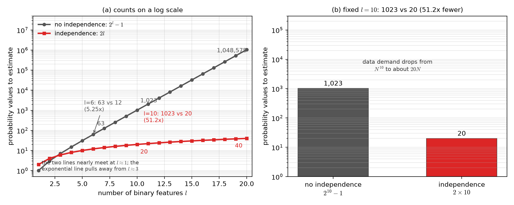
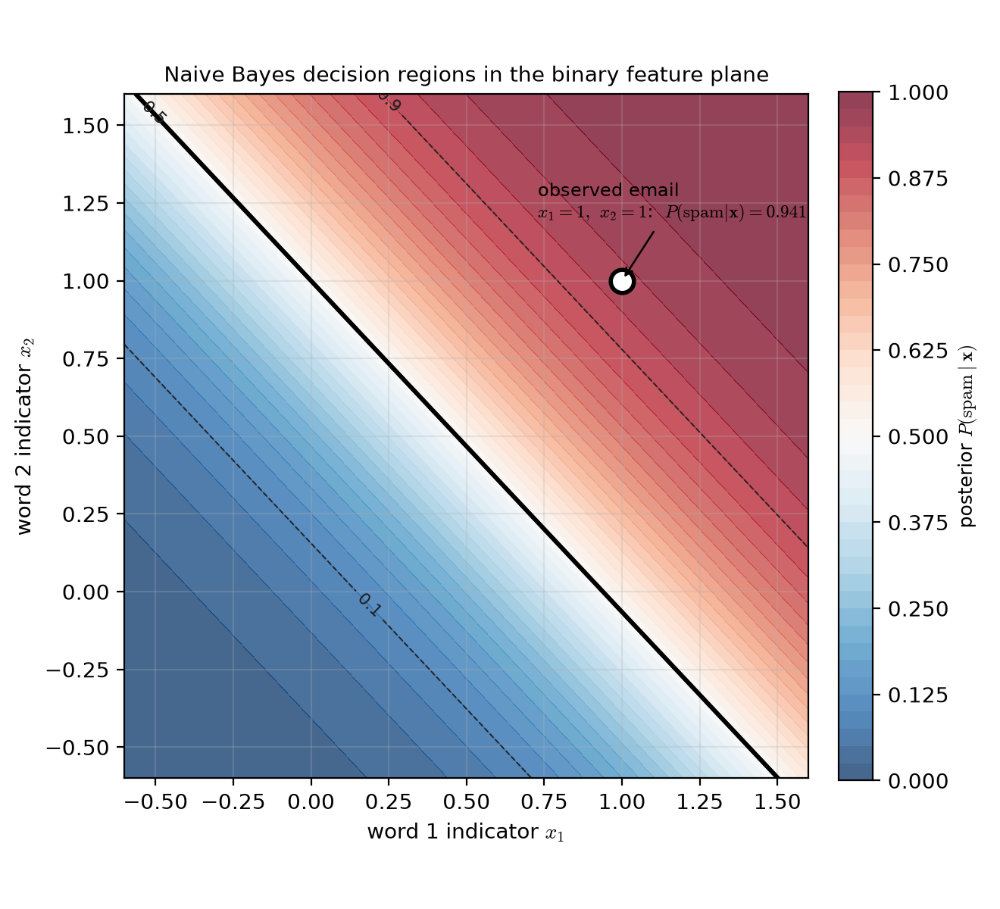
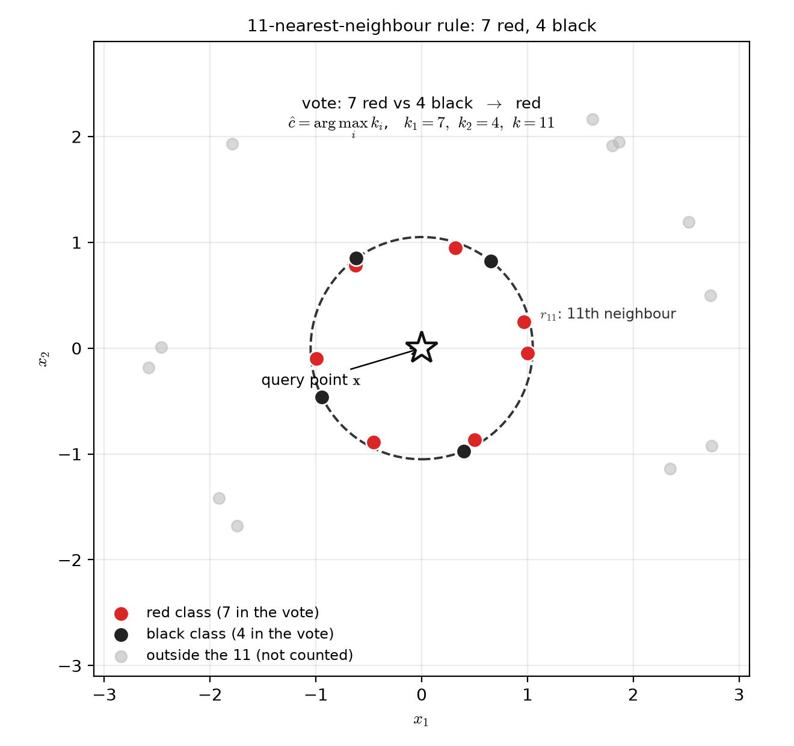
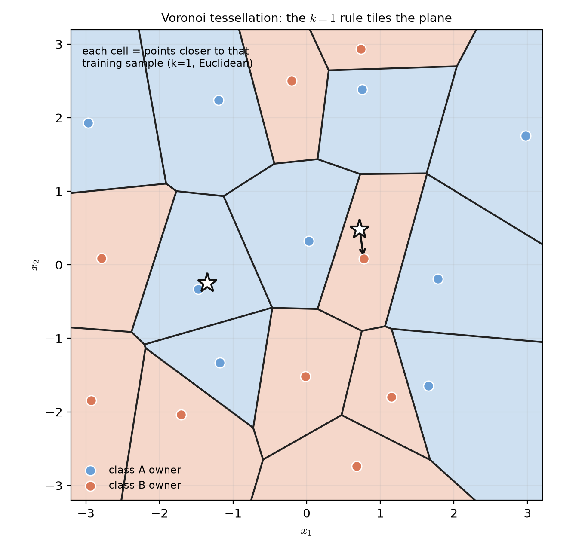
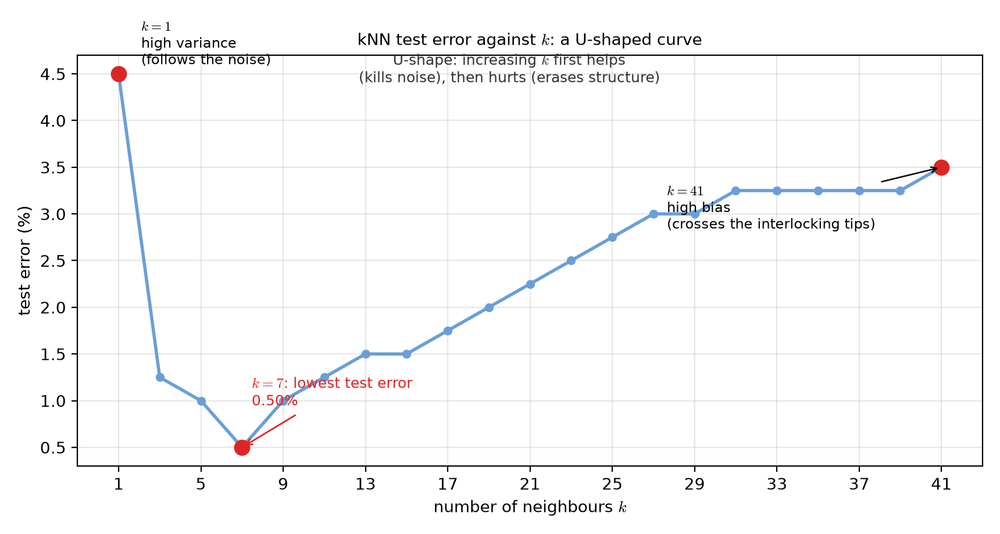

# Lecture 02：單純貝氏分類器與最近鄰居法則（Naive Bayes Classifiers and the Nearest-Neighbour Rule）

> 週次:第 2 週（自主學習教材）｜進度:貝氏分類器（二）延伸——單純貝氏分類器與最近鄰居法則
>
> Week 2 (self-study material) | Topic: Bayes classifiers, extended — the naive Bayes classifier and the nearest-neighbour rule

本講義涵蓋課程網頁第 2.5–2.6 節的兩個知識點。第一個是**單純貝氏分類器（naive Bayes classifier）**：它用一個大膽的獨立假設，把指數成長的估計量壓回線性。第二個是**最近鄰居法則（nearest-neighbour rule）**：它完全不估計機率密度，直接讓鄰居投票。

This note covers two knowledge points from Sections 2.5–2.6 of the course web page. The first is the **naive Bayes classifier**, which uses one bold independence assumption to collapse an exponentially growing estimation problem back to a linear one. The second is the **nearest-neighbour rule**, which estimates no probability density at all and simply lets the neighbours vote.

講義文字是重新撰寫的。標有 `[補充]` / `[Added]` 的內容是為了幫助理解而新增的。圖中的數字都是電腦模擬或示範值，不是教科書原圖。

The text is newly written. Content marked `[補充]` / `[Added]` is added to help understanding. All figures are our own; the numbers are simulated or illustrative, not copied from the textbook.

## 學習目標（Learning objectives）

- 說明為什麼估計高維聯合密度會隨維度指數爆炸（Explain why estimating a high-dimensional joint density explodes exponentially with dimension）。
- 寫出獨立假設下的聯合密度與分類規則（Write the joint density and the classification rule under the independence assumption）。
- 在二元特徵下推導單純貝氏的線性判別函數（Derive the linear discriminant function of naive Bayes for binary features）。
- 用電子郵件資料逐步算出未正規化事後機率與最終決策（Compute unnormalised posteriors and the final decision step by step on an e-mail example）。
- 說明 k 近鄰法則的三個步驟，並解釋 Voronoi 鑲嵌的幾何意義（State the three steps of the k-NN rule and explain the geometry of the Voronoi tessellation）。
- 說明 k 太大與太小各會出什麼問題（Explain what goes wrong when k is too large or too small）。

## 1. 為什麼需要獨立假設：估計量的爆炸（Why we need the independence assumption: the explosion of counts）

想像你要為 $l$ 個**二元特徵**（binary feature，只取 0 或 1）估一個聯合機率。每個特徵有兩種取值，全部組合就有 $2^l$ 種。若每一種組合都當成獨立的一格來估，你需要 $2^l-1$ 個機率值。這個數字隨 $l$ 指數成長。

Imagine estimating a joint probability for $l$ **binary features** (each taking only 0 or 1). Each feature has two values, so there are $2^l$ possible combinations. If you estimate one probability for every combination, you need $2^l-1$ numbers. This count grows exponentially with $l$.

另一條路是假設所有特徵**統計獨立**（statistically independent），只需要 $2l$ 個機率值。這個數字隨 $l$ 線性成長。兩條路線的差距不是幾倍，而是數量級。

The other route assumes all features are **statistically independent**, which needs only $2l$ numbers, growing linearly with $l$. The gap between the two routes is not a few times but orders of magnitude.

| $l$（特徵數） | 不做獨立假設：$2^l-1$ | 獨立假設：$2l$ | 差距倍數（Ratio） |
|---|---|---|---|
| 6 | 63 | 12 | 5.25 |
| 10 | 1,023 | 20 | 51.15 |
| 20 | 1,048,575 | 40 | 26,214.4 |

以上數字由 Python 計算，不是心算。$l=10$ 時差距約 51 倍，$l=20$ 時差距超過兩萬六千倍。

The values above were computed with Python. At $l=10$ the gap is about 51 times; at $l=20$ it exceeds 26,000 times.

**圖說 `lec02-nb-count-explosion`**：左圖有兩條線，灰色是 $2^l-1$，紅色是 $2l$，縱軸取對數。兩條線在 $l=1$ 附近幾乎貼在一起，指數線從 $l\approx3$ 開始明顯甩開。右圖把 $l=10$ 固定，用長條直接對比 1023 與 20，兩者相差 51.15 倍。讀圖時先看左圖兩條線的分岔點。再看右圖長條的高度差，就知道「指數變線性」不是形容詞，而是數量級的差別。〔功能：1、2〕

**Caption `lec02-nb-count-explosion`**: the left panel has two lines, grey for $2^l-1$ and red for $2l$, with a log-scaled y-axis. They nearly coincide near $l=1$, and the exponential line pulls away clearly from $l\approx3$. The right panel fixes $l=10$ and compares 1023 with 20, a 51.15-fold gap. Read the crossing point in the left panel first. Then read the bar heights on the right: "exponential to linear" means orders of magnitude, not a figure of speech.

`[補充]` 資料需求也一起爆炸。要可靠地估 $l$ 維聯合密度，大約需要 $N^l$ 等級的樣本；獨立假設下只要約 $20N$ 等級（$l=10$ 時）。這就是實務上非做這個假設不可的理由。

`[Added]` The data demand explodes too. Estimating an $l$-dimensional joint density reliably needs samples on the order of $N^l$. Under the independence assumption you need only about $20N$ at $l=10$. This is why the assumption is hard to avoid in practice.

> 維度一高，不做假設的代價就不只是麻煩，而是算不出來。
>
> In high dimensions, skipping the assumption is not merely inconvenient; it becomes impossible.

## 2. 獨立假設與分類規則（The independence assumption and the classification rule）

**一句話重點**：把聯合密度拆成各特徵密度的乘積，估計量就從指數變成線性。

**One-sentence summary**: factorising the joint density into a product of per-feature densities turns the count from exponential into linear.

**白話說明**：單純貝氏的想法是「偷懶地假設」。它假設一旦知道類別，第 1 個特徵的值不會透露第 2 個特徵的任何訊息。於是 $l$ 維的聯合密度就拆成 $l$ 個一維密度的乘積。這個假設通常不完全正確，但常常夠用。

**Plain explanation**: naive Bayes takes a deliberately lazy shortcut. It assumes that once you know the class, the value of feature 1 tells you nothing extra about feature 2. The $l$-dimensional joint density then factors into a product of $l$ one-dimensional densities. The assumption is rarely exactly true, but it is often good enough.

**正式定義**：在獨立假設下，類別條件密度可寫成

**Formal definition**: under the independence assumption, the class-conditional density becomes

$$
p(\mathbf{x}\mid\omega_i)=\prod_{j=1}^{l}p(x_j\mid\omega_i)
$$

分類規則則是各類的事後機率取最大，也就是

The classification rule picks the class with the largest posterior, that is

$$
\omega_m=\arg\max_{\omega_i}\prod_{j=1}^{l}p(x_j\mid\omega_i)
$$

| 符號（Symbol） | 中文意義 | English meaning |
|---|---|---|
| $\mathbf{x}$ | 觀察到的特徵向量 | the observed feature vector |
| $x_j$ | 第 $j$ 個特徵 | the $j$-th feature |
| $l$ | 特徵的維度 | the dimension of the feature vector |
| $\omega_i$ | 第 $i$ 個類別 | the $i$-th class |
| $p(x_j\mid\omega_i)$ | 第 $j$ 個特徵的一維類別條件密度 | the one-dimensional class-conditional density of feature $j$ |

`[補充]` 實際比較時通常加上對數，把連乘變成連加，避免太多小數相乘而**下溢（underflow）**。對數是單調函數，不會改變決策結果。

`[Added]` In practice we usually take logarithms, turning the product into a sum. This avoids **underflow** when many small probabilities are multiplied. The logarithm is monotone, so the decision is unchanged.

**常見迷思**：「獨立假設只是為了簡化數學，對準確度沒有影響。」實際上，若特徵真的高度相關，這個假設會讓機率估計明顯偏離，決策可能跟著出錯。它換來的是計算量，代價是精確度。

**Common misconception**: "the independence assumption only simplifies the algebra and does not affect accuracy." In fact, when features are strongly correlated, the assumption distorts the probability estimates and can change the decision. It buys computation at the price of accuracy.

> 用一個可能錯的假設，換取少好幾個數量級的資料量。
>
> Trade one possibly wrong assumption for several orders of magnitude less data.

## 3. 離散特徵與線性判別函數（Discrete features and the linear discriminant function）

**一句話重點**：在二元特徵下，單純貝氏的概似比取對數後，正好是一個線性判別函數。

**One-sentence summary**: with binary features, the log likelihood ratio of naive Bayes turns out to be exactly a linear discriminant function.

**白話說明**：令第 $i$ 個特徵在類別 1 出現 1 的機率是 $p_i$，在類別 2 是 $q_i$。把兩類的乘積相除再取對數，一維的部分會兩兩配對，最後整理成「每個特徵乘一個權重再加總」。它的幾何形狀就是一條直線。

**Plain explanation**: let feature $i$ appear as 1 with probability $p_i$ in class 1 and $q_i$ in class 2. Dividing the two products and taking logarithms pairs up the one-dimensional terms, and everything collapses into "multiply each feature by a weight and add". Its geometry is a straight line.

**正式定義**：

**Formal definition**:

$$
g(\mathbf{x})=\mathbf{w}^T\mathbf{x}+w_0,\qquad w_i=\ln\frac{p_i(1-q_i)}{q_i(1-p_i)}
$$

| 符號（Symbol） | 中文意義 | English meaning |
|---|---|---|
| $p_i$ | 類別 1 中第 $i$ 個特徵為 1 的機率 | probability that feature $i$ is 1 in class 1 |
| $q_i$ | 類別 2 中第 $i$ 個特徵為 1 的機率 | probability that feature $i$ is 1 in class 2 |
| $w_i$ | 第 $i$ 個特徵的權重 | the weight of feature $i$ |
| $w_0$ | 偏權重（含先驗的影響） | the bias term (it also carries the priors) |

`[補充]` 這裡的線性來自「特徵獨立」假設。前一份講義「等共變異數高斯」也得到線性，但那裡的線性來自「共同共變異數」假設。兩者在數學形式上是同一家人。

`[Added]` The linearity here comes from the **independence** assumption. The earlier note on equal-covariance Gaussians also ended up linear, but there it came from the **shared-covariance** assumption. Mathematically the two results belong to the same family.

### 3.1 垃圾郵件分類的數值示範（A numerical example: spam classification）

`[補充]` 下面這個電子郵件的例子是為了把公式算給你看，並非原文的例子。

`[Added]` The e-mail example below is added to walk you through the formula; it is not part of the source example.

**設定**：某封郵件只看四個字詞是否出現。令 $x_j=1$ 表示第 $j$ 個字詞出現。兩類是「垃圾郵件」（spam，類別 1）與「非垃圾郵件」（ham，類別 2）。

**Setup**: consider four word indicators of one e-mail, with $x_j=1$ meaning word $j$ appears. The two classes are spam (class 1) and ham (class 2).

| 字詞（Word） | $p_i=P(x_i{=}1\mid\mathrm{spam})$ | $q_i=P(x_i{=}1\mid\mathrm{ham})$ | 郵件 $x_i$ |
|---|---|---|---|
| 1 | 0.8 | 0.2 | 1 |
| 2 | 0.6 | 0.1 | 1 |
| 3 | 0.5 | 0.4 | 0 |
| 4 | 0.3 | 0.05 | 1 |

先驗機率取 $P(\mathrm{spam})=0.4$、$P(\mathrm{ham})=0.6$。第一步算兩類的概似函數。出現 1 的用 $p_i$，出現 0 的用 $1-p_i$：

The priors are $P(\mathrm{spam})=0.4$ and $P(\mathrm{ham})=0.6$. Step one computes the likelihoods: use $p_i$ for $x_i=1$ and $1-p_i$ for $x_i=0$:

$$
\prod_j p(x_j\mid\mathrm{spam})=0.8\times0.6\times0.5\times0.3=0.072
$$

$$
\prod_j p(x_j\mid\mathrm{ham})=0.2\times0.1\times0.6\times0.05=0.0006
$$

第二步乘以先驗，得到**未正規化的事後機率**（unnormalised posterior）：

Step two multiplies by the priors to get the **unnormalised posteriors**:

$$
P(\mathrm{spam})\prod_j p(x_j\mid\mathrm{spam})=0.4\times0.072=0.0288
$$

$$
P(\mathrm{ham})\prod_j p(x_j\mid\mathrm{ham})=0.6\times0.0006=0.00036
$$

第三步除以證據 $0.0288+0.00036=0.02916$：

Step three divides by the evidence, $0.0288+0.00036=0.02916$:

| 類別（Class） | 未正規化（Unnormalised） | 事後機率（Posterior） |
|---|---|---|
| spam | 0.0288 | $0.0288/0.02916=0.987654$ |
| ham | 0.00036 | $0.00036/0.02916=0.012346$ |

因為 $0.987654>0.012346$，這封郵件判為垃圾郵件。`[補充]` 注意分母只是把兩個數字放大成總和為 1，不影響誰比較大。

Since $0.987654>0.012346$, the e-mail is classified as spam. `[Added]` The denominator only rescales the two numbers so that they sum to 1; it does not change which one is larger.

用判別函數算會得到同一個答案。權重用 $w_i=\ln\frac{p_i(1-q_i)}{q_i(1-p_i)}$：

The discriminant function gives the same answer. Using $w_i=\ln\frac{p_i(1-q_i)}{q_i(1-p_i)}$:

| 字詞（Word） | $w_i$ |
|---|---|
| 1 | $2.772589$ |
| 2 | $2.602690$ |
| 3 | $0.405465$ |
| 4 | $2.097141$ |

偏權重 $w_0=-3.090393$。代入郵件 $\mathbf{x}=(1,1,0,1)$：

The bias is $w_0=-3.090393$. Substituting the e-mail $\mathbf{x}=(1,1,0,1)$:

$$
g(\mathbf{x})=2.772589+2.602690+0+2.097141-3.090393=4.382027
$$

把 $g$ 經過 sigmoid 就回到後驗機率：$1/(1+e^{-4.382027})=0.987654$，和上面的算法一致。這也印證了判別函數與事後機率是同一件事的兩種寫法。

Passing $g$ through a sigmoid returns the posterior: $1/(1+e^{-4.382027})=0.987654$, matching the earlier route. This confirms that the discriminant function and the posterior are two ways of writing the same thing.

### 3.2 決策邊界是一條直線（The decision boundary is a straight line）

`[補充]` 為了把邊界畫成二維的圖，這裡只取前兩個字詞。

`[Added]` To draw the boundary in two dimensions, we keep only the first two words here.

此時 $w_1=2.772589$、$w_2=2.602690$，$w_0=\ln\frac{0.4}{0.6}+\ln\frac{0.2}{0.8}+\ln\frac{0.4}{0.9}=-2.602690$。邊界方程式 $\mathbf{w}^T\mathbf{x}+w_0=0$ 是三種情形的分界：

Here $w_1=2.772589$, $w_2=2.602690$ and $w_0=\ln\frac{0.4}{0.6}+\ln\frac{0.2}{0.8}+\ln\frac{0.4}{0.9}=-2.602690$. The boundary $\mathbf{w}^T\mathbf{x}+w_0=0$ separates three cases:

| 郵件（E-mail） | $g(\mathbf{x})$ | 事後機率 $P(\mathrm{spam}\mid\mathbf{x})$ | 判斷（Decision） |
|---|---|---|---|
| $(0,0)$ | $-2.602690$ | $0.068966$ | ham |
| $(1,0)$ | $0.169899$ | $0.542373$ | spam |
| $(0,1)$ | $0.000000$ | $0.500000$ | 剛好平手（exactly tied） |
| $(1,1)$ | $2.772589$ | $0.941176$ | spam |

邊界在水平軸上交於 $x_1=0$ 時 $x_2=1.000000$，交於 $x_1=1$ 時 $x_2=-0.065278$，交於 $x_1=2$ 時 $x_2=-1.130557$。

The boundary crosses $x_2=1.000000$ at $x_1=0$, $x_2=-0.065278$ at $x_1=1$, and $x_2=-1.130557$ at $x_1=2$.

**圖說 `lec02-nb-spam-boundary`**：底色是事後機率 $P(\mathrm{spam}\mid\mathbf{x})$，紅代表偏 spam、藍代表偏 ham。粗黑線是 $g=0$，也就是決策邊界，它是一條直線。空心圓是觀察到的郵件 $(1,1)$，事後機率 0.941。讀圖時先找粗黑線，再看線的右上方顏色偏紅，就知道那一側判為 spam。〔功能：2、3〕

**Caption `lec02-nb-spam-boundary`**: the colour is the posterior $P(\mathrm{spam}\mid\mathbf{x})$, red for spam-leaning and blue for ham-leaning. The thick black line is $g=0$, the decision boundary, and it is straight. The open circle is the observed e-mail $(1,1)$, with posterior 0.941. Read the figure by locating the thick black line first, then noting that the upper-right side is red, which is where the decision is spam.

> 兩個字詞就能把邊界畫出來；特徵再多，邊界仍然是一張超平面。
>
> Two word indicators are enough to draw the boundary; with more features it stays a single hyperplane.

## 4. 最近鄰居法則：不估計密度，直接投票（The nearest-neighbour rule: vote instead of estimating）

**一句話重點**：不估任何密度，直接讓最近的 $k$ 個訓練樣本投票。

**One-sentence summary**: estimate no density at all; let the $k$ closest training samples vote.

**白話說明**：前面所有方法都先估一個密度或一條邊界。kNN 反其道而行：要判斷一個新樣本的類別，就看它附近最近的幾個已知樣本屬於哪一類，多數決。它沒有「訓練」階段，全部工作都在分類時才做。

**Plain explanation**: every earlier method first estimates a density or a boundary. k-NN does the opposite: to classify a new sample, look at the nearest known samples and take a majority vote. There is no training stage; all the work happens at classification time.

**演算法三步驟**：

**Algorithm, three steps**:

1. 把 $N$ 個訓練向量全部拿出來比距離，不看類別標籤，挑出離 $\mathbf{x}$ 最近的 $k$ 個（Compare distances against all $N$ training vectors, ignoring class labels, and keep the $k$ nearest to $\mathbf{x}$）.
2. 數出這 $k$ 個鄰居中各類別各有幾個 $k_i$，且 $\sum_i k_i=k$（Count how many of the $k$ neighbours fall in each class, with $\sum_i k_i=k$）。
3. 把 $\mathbf{x}$ 分給 $k_i$ 最多的那一類（Assign $\mathbf{x}$ to the class with the largest $k_i$）。

**正式定義**:決策規則是 $\hat{c}=\arg\max_i k_i$。$k$ 的選擇有兩個常見原則:取奇數,並且避開類別數 $M$ 的倍數,以免出現票數相同的情形。

**Formal definition**: the decision rule is $\hat{c}=\arg\max_i k_i$. The value $k$ is usually odd and not a multiple of the number of classes $M$, so that ties cannot happen.

| 符號（Symbol） | 中文意義 | English meaning |
|---|---|---|
| $N$ | 訓練樣本總數 | the total number of training samples |
| $k$ | 參與投票的鄰居數 | the number of neighbours that vote |
| $k_i$ | $k$ 個鄰居中第 $i$ 類的個數 | the number of the $k$ neighbours in class $i$ |
| $M$ | 類別總數 | the number of classes |

**圖說 `lec02-knn-vote-panel`**：空心星星是待分類的查詢點。虛線圓的半徑 $r_{11}$ 畫到第 11 個鄰居為止，圓內恰好有 7 個紅點與 4 個黑點。灰色點在圓外，不參與投票。讀圖時先數圓內的紅點與黑點，再看兩者的數量比較（$7/11=0.6364$ 對 $4/11=0.3636$），就知道判為紅色。〔功能：1、2〕

**Caption `lec02-knn-vote-panel`**: the open star is the query point to classify. The dashed circle has radius $r_{11}$, reaching the 11th neighbour, and it contains exactly 7 red and 4 black points. The grey points lie outside the circle and do not vote. Count the red and black points inside the circle first, then compare their shares ($7/11=0.6364$ against $4/11=0.3636$) to see that the decision is red.

**特例 $k=1$（最近鄰居法則 NN）**：規則是只看距離最近的那一個訓練樣本，把新樣本判成它所屬的類別。這個規則簡單到不可思議，卻有理論保證。

**The special case $k=1$ (the nearest-neighbour rule)**: assign $\mathbf{x}$ to the class of the single closest training sample. The rule looks absurdly simple, yet theory backs it.

**常見迷思**：「kNN 沒有任何理論依據，只是憑感覺的規則。」事實上，當 $N\to\infty$ 時，NN 規則的誤判機率 $P_{NN}$ 會被貝氏最優誤判機率 $P_B$ 夾住：

**Common misconception**: "k-NN has no theoretical support; it is just a rule of thumb." In fact, as $N\to\infty$ the error probability $P_{NN}$ of the NN rule is squeezed by the Bayes-optimal error $P_B$:

$$
P_B\le P_{NN}\le P_B\!\left(2-\frac{M}{M-1}P_B\right)\le 2P_B
$$

最簡單、完全不估密度的 NN 規則,它的漸進誤判率不會超過貝氏最優解的兩倍。一般的 $k$NN 則滿足 $P_B\le P_{kNN}\le P_B+\frac{1}{\sqrt{ke}}$,$k$ 越大就越接近貝氏最優。

The simplest rule, which estimates nothing, has an asymptotic error at most twice that of the optimal rule. For general $k$-NN, $P_B\le P_{kNN}\le P_B+\frac{1}{\sqrt{ke}}$, and larger $k$ approaches the Bayes optimum.

`[補充]` 原文提到「貝氏誤差 1% 時，3NN 的誤差約只有 1.03%」。用上式的 $P_B+\frac{1}{\sqrt{ke}}$ 代入 $P_B=0.01$、$k=3$，得到的是 $0.360181$（36%），與 1.03% 不符。這個來源數字疑似有誤，這裡先標註，建議向老師確認後再定案；正文不採用未經核實的數字。

`[Added]` The source states that "with a Bayes error of 1%, the 3-NN error is only about 1.03%". Substituting $P_B=0.01$ and $k=3$ into the bound $P_B+\frac{1}{\sqrt{ke}}$ gives $0.360181$ (36%), which does not agree with 1.03%. This source number looks inconsistent; it is flagged here for the teacher to confirm, and the unverified value is not used in the main text.

> 最笨的規則，誤差最多只比最聰明的規則差一倍。
>
> The dumbest rule is at most twice as wrong as the smartest one.

## 5. Voronoi 鑲嵌：$k=1$ 把空間切成多邊形（Voronoi tessellation: how $k=1$ tiles the plane）

**一句話重點**：$k=1$ 時，每個訓練樣本各自佔據一塊多邊形，整片空間被切滿。

**One-sentence summary**: when $k=1$, every training sample owns one polygon, and these tiles fill the whole plane.

**白話說明**：固定一個訓練樣本 $\mathbf{x}_i$，把所有「離 $\mathbf{x}_i$ 比離任何其他樣本都近」的點收集起來，就是它的一塊地盤。所有地盤拼起來剛好鋪滿整個空間，這叫 **Voronoi 鑲嵌**。

**Plain explanation**: fix a training sample $\mathbf{x}_i$ and collect every point that is closer to $\mathbf{x}_i$ than to any other sample. That collection is its territory. All territories together tile the whole space exactly, and this tiling is the **Voronoi tessellation**.

**正式定義**：第 $i$ 塊區域是

**Formal definition**: the $i$-th region is

$$
R_i=\{\mathbf{x}: d(\mathbf{x},\mathbf{x}_i)<d(\mathbf{x},\mathbf{x}_j),\ i\ne j\}
$$

$k=1$ 的分類規則因此可以這樣理解：看新樣本站在哪一塊地盤上，就判成那塊地盤主人的類別。

The $k=1$ rule can therefore be read as: see which tile the new sample stands on, and assign it the class of that tile's owner.

**圖說 `lec02-knn-voronoi-tessellation`**：粗黑線是多邊形的邊，每個多邊形內恰有一個訓練樣本。底色依地主類別分成淺藍與淺橘。兩顆空心星星是新的查詢點，箭頭指向離它最近的地主，也就是 $k=1$ 時的判別依據。讀圖時先看邊界是否處處等距，再看箭頭落在哪一塊地盤，就知道判成哪一類。〔功能：1、3〕

**Caption `lec02-knn-voronoi-tessellation`**: the thick black lines are the polygon edges, and each polygon contains exactly one training sample. The fill colour follows the owner's class, light blue or light orange. The two open stars are new query points, and each arrow points at its nearest owner, which is the $k=1$ decision. Read the figure by checking that the edges are everywhere equidistant, then by seeing which tile each arrow lands in.

`[補充]` 類別數大於 2 時，相鄰而同性質的地盤會合併成同一塊決策區域。鑲嵌本身仍以「每個樣本一格」為單位。

`[Added]` When there are more than two classes, neighbouring tiles of the same class merge into one decision region. The tessellation itself is still one cell per sample.

## 6. k 太小與太大：變異與偏誤的拉扯（k too small and too large: variance against bias）

**一句話重點**：k 決定每個訓練樣本的影響範圍；太小會追著雜訊跑，太大會把真實結構抹平。

**One-sentence summary**: $k$ sets how far each training point's influence reaches; too small chases the noise, too large erases the structure.

**白話說明**：$k$ 很小時，邊界緊貼每一個訓練點，連標錯的點也被當真，邊界長出尖刺。這是**變異大**。$k$ 很大時，鄰居範圍跨過兩類交錯的地方，邊界被推平，一類吞掉另一類。這是**偏誤大**。中間有一個誤差最低的甜蜜點。

**Plain explanation**: with a small $k$, the boundary hugs every training point, even mislabelled ones, and grows spurs; this is **high variance**. With a large $k$, the neighbourhood reaches across where the two classes interlock. The boundary then straightens and one class swallows the other; this is **high bias**. Somewhere in between there is a sweet spot with the lowest error.

**數字例**：用兩類交錯的半月形資料加上 12 個標錯的訓練點做實驗。測試誤差在 $k=1$ 是 $4.50\%$，在 $k=7$ 降到最低的 $0.50\%$，到 $k=41$ 又升回 $3.50\%$。曲線呈 U 形。

**Numerical example**: an experiment on two interlocking half-moons with 12 mislabelled training points. The test error is $4.50\%$ at $k=1$, drops to its minimum $0.50\%$ at $k=7$, and rises again to $3.50\%$ at $k=41$. The curve is U-shaped.

| $k$ | 1 | 3 | 5 | 7 | 15 | 25 | 41 |
|---|---|---|---|---|---|---|---|
| 測試誤差（Test error, %） | 4.50 | 1.25 | 1.00 | 0.50 | 1.50 | 2.75 | 3.50 |

以上數字由 Python 依實際投票重算，測試集有 400 個樣本，隨機種子固定。

The values above were recomputed in Python from the actual votes, with a test set of 400 samples and a fixed random seed.

**圖說 `lec02-knn-error-vs-k`**：橫軸是 $k$（取奇數 1 到 41），縱軸是測試誤差百分比。紅點標出三個關鍵值：$k=1$ 的 4.50%（變異主導）、$k=7$ 的 0.50%（最低點）、$k=41$ 的 3.50%（偏誤主導）。讀圖時先看左端快速下降，再看右端緩慢上升，最後確認最低點落在 $k=7$。〔功能：1、2〕

**Caption `lec02-knn-error-vs-k`**: the horizontal axis is $k$ (odd values from 1 to 41) and the vertical axis is the test error in percent. Three red dots mark the key values: $4.50\%$ at $k=1$ (variance-dominated), $0.50\%$ at $k=7$ (the minimum), and $3.50\%$ at $k=41$ (bias-dominated). Read the steep fall on the left first, then the slow rise on the right, and finally check that the minimum sits at $k=7$.

**常見迷思**：「$k$ 越大越穩，因為用了更多鄰居的資訊。」其實 $k$ 太大時，投票會把遠處不相關的樣本也算進來，反而抹掉局部的真實結構。U 形的最低點才是最佳折衷。

**Common misconception**: "a larger $k$ is always more stable because it uses more neighbours." In fact, an over-large $k$ pulls in far-away and irrelevant samples, erasing the real local structure. The bottom of the U is the best trade-off.

> 誤差先降後升；最低點不是平凡的折衷，而是最佳解。
>
> The error falls and then rises; the bottom is not a mediocre compromise but the optimum.

## 7. 這兩種方法與前面方法的關係（How these two methods relate to the earlier ones）

**一句話重點**：單純貝氏是「換假設換來線性」，kNN 是「不建模直接表決」，兩者剛好站在光譜的兩端。

**One-sentence summary**: naive Bayes trades an assumption for linearity, while $k$-NN skips modelling and votes directly; they sit at opposite ends of one spectrum.

**白話說明**：高斯貝氏分類器假設密度是高斯形狀；單純貝氏放寬這個限制，只要求特徵獨立；kNN 則完全不做形狀假設。越往右，模型越有彈性，但需要的資料也越多。

**Plain explanation**: the Gaussian Bayes classifier assumes the densities are Gaussian. Naive Bayes relaxes this and only requires feature independence. $k$-NN makes no shape assumption at all. Moving in that direction buys flexibility at the cost of needing more data.

| 方法（Method） | 假設（Assumption） | 邊界形狀（Boundary） | 主要代價（Main cost） |
|---|---|---|---|
| 高斯貝氏（Gaussian Bayes） | 密度為高斯 | 直線或二次曲線 | 形狀假設可能不符 |
| 單純貝氏（Naive Bayes） | 特徵統計獨立 | 線性 | 忽略特徵相關性 |
| $k$ 近鄰（$k$-NN） | 幾乎沒有 | 高度非線性 | 每次分類都算 $O(kN)$ |

**代價**：kNN 沒有訓練階段，但每分類一個新樣本，都要跟全部 $N$ 個訓練樣本算距離，複雜度 $O(kN)$。$N$ 大或維度高時負擔很重。實務上會先縮小訓練集，常用高效搜尋結構與「原型精簡（prototype editing/condensing）」。

**The cost**: $k$-NN has no training stage. But classifying one new sample requires distances to all $N$ training samples, at a complexity of $O(kN)$. This becomes heavy when $N$ is large or the dimension is high. In practice the training set is shrunk first, often with efficient search structures and prototype editing/condensing.

`[補充]` 上面說的漸進最優性,前提是樣本數 $N$ 要夠大。樣本少的時候,$k$NN 的表現可能明顯不如貝氏分類器。

`[Added]` The asymptotic optimality of $k$-NN holds only when $N$ is large enough. With a small $N$, its performance can fall clearly behind a Bayes classifier.

## 8. 小結（Summary）

- 不做獨立假設時，估計 $l$ 個二元特徵的聯合機率需要 $2^l-1$ 個值；獨立假設下只要 $2l$ 個（Without the independence assumption, $l$ binary features need $2^l-1$ probability values; with it, only $2l$）。
- $l=10$ 時是 1023 對 20，差 51.15 倍；$l=20$ 時差距超過兩萬六千倍（At $l=10$ that is 1023 against 20, a 51.15-fold gap; at $l=20$ it exceeds 26,000 times）。
- 獨立假設讓聯合密度拆成連乘積，分類規則取乘積的最大值（The independence assumption factors the joint density into a product, and the rule takes the largest product）。
- 二元特徵下，單純貝氏的概似比取對數後是線性判別函數（For binary features the log likelihood ratio is a linear discriminant function）。
- $k$NN 直接讓最近的 $k$ 個訓練樣本投票，$k$ 通常取奇數（$k$-NN lets the $k$ nearest training samples vote, with $k$ usually odd）。
- $k=1$ 的 NN 規則漸進誤判率最多是最優解的兩倍（The $k=1$ NN rule has an asymptotic error at most twice the optimum）。
- $k=1$ 把空間切成 Voronoi 鑲嵌；$k$ 太大或太小都會讓誤差上升（At $k=1$ the space becomes a Voronoi tessellation; either too large or too small a $k$ raises the error）。

## 9. 練習（Practice）

以下練習只給問題與提示，答案請在課堂或討論區討論。

The exercises below give problems and hints only. Discuss the answers in class or on the discussion board.

1. 用本講義的郵件例子，若第 3 個字詞改成出現（$x_3=1$），重算 spam 與 ham 的未正規化事後機率，並做決策。（提示：出現 0 與出現 1 的因子不同。）（Using the e-mail example, change the third word to present ($x_3=1$), recompute the unnormalised posteriors, and decide. Hint: the factor differs for $x_i=0$ and $x_i=1$.）
2. 在 11 近鄰的例子中，假設第 12 近的鄰居是黑點，且 $k$ 改成 9。投票結果會改變嗎？（提示：先數圓內的紅點與黑點。）(In the 11-neighbour example, suppose the 12th nearest neighbour is black and $k$ becomes 9. Does the vote change? Hint: count the red and black points inside the smaller circle first.)
3. 為什麼 $k$ 通常取奇數，且不要是類別數的倍數？（提示：想想平手會發生什麼事。）(Why is $k$ usually odd and not a multiple of the number of classes? Hint: what happens on a tie?)
4. 說明為什麼單純貝氏「犧牲精確度換取資料量」，並舉一個特徵高度相關時會出錯的情境。（Explain why naive Bayes trades accuracy for data, and give a situation with strongly correlated features where it goes wrong.）

## 延伸閱讀（Further reading）

- 教科書第 2 章 2.5–2.6 節（本講義範圍）（Textbook, Chapter 2, Sections 2.5–2.6: this note's scope）：Sergios Theodoridis & Konstantinos Koutroumbas, *Pattern Recognition*, 4th ed.
- 課程網頁的互動式自學講義：Chapter 2（貝氏分類器），第 2.5.7–2.6 節，讀取日期 2026-10-09（Course self-study notes: Chapter 2, Sections 2.5.7–2.6, read on 2026-10-09）。
- 本週另見 [lec02](lec02.md)（貝氏決策理論與判別函數）與無母數密度估計的相關講義（See also [lec02](lec02.md) on Bayesian decision theory and discriminant functions, and the note on nonparametric density estimation）。
- 參考資料：見 [參考資料](../references/README.md)（References: see the [references folder](../references/README.md)）。

## 術語表（Glossary）

| 中文 | English |
|---|---|
| 單純貝氏分類器 | naive Bayes classifier |
| 統計獨立 | statistically independent |
| 聯合機率密度 | joint probability density |
| 類別條件密度 | class-conditional density |
| 先驗機率 | prior probability |
| 事後機率 | posterior probability |
| 未正規化事後機率 | unnormalised posterior |
| 證據 | evidence |
| 概似函數 | likelihood |
| 線性判別函數 | linear discriminant function |
| 下溢 | underflow |
| 最近鄰居法則 | nearest-neighbour rule |
| $k$ 近鄰分類器 | $k$-nearest-neighbour ($k$-NN) classifier |
| 多數決投票 | majority vote |
| Voronoi 鑲嵌 | Voronoi tessellation |
| 決策區域 | decision region |
| 變異 | variance |
| 偏誤 | bias |
| 原型精簡 | prototype editing / condensing |
| 貝氏最優誤判機率 | Bayes-optimal error probability |
