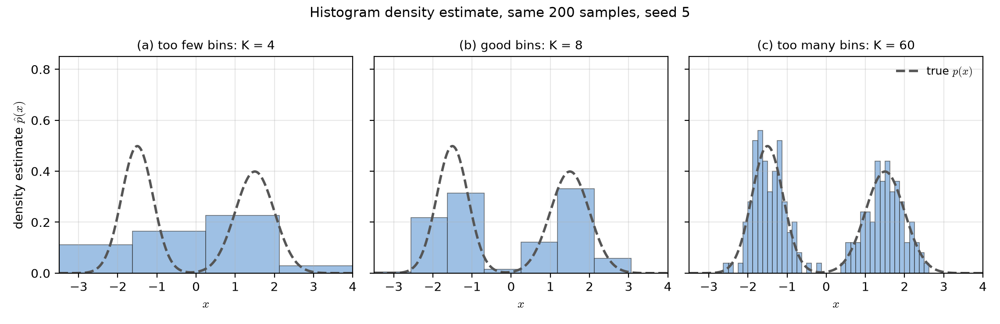
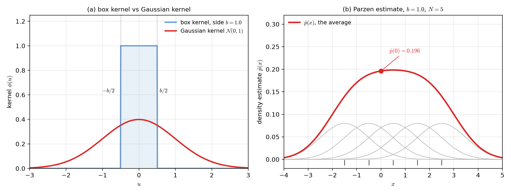
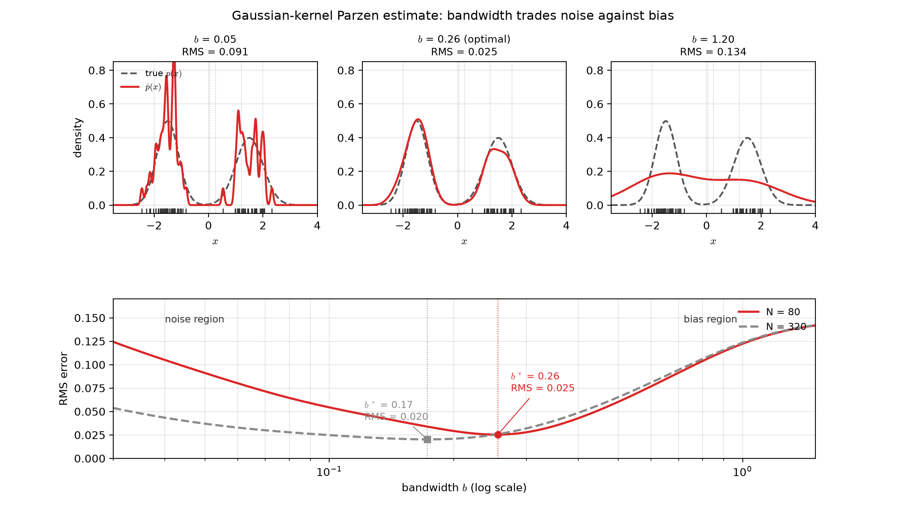
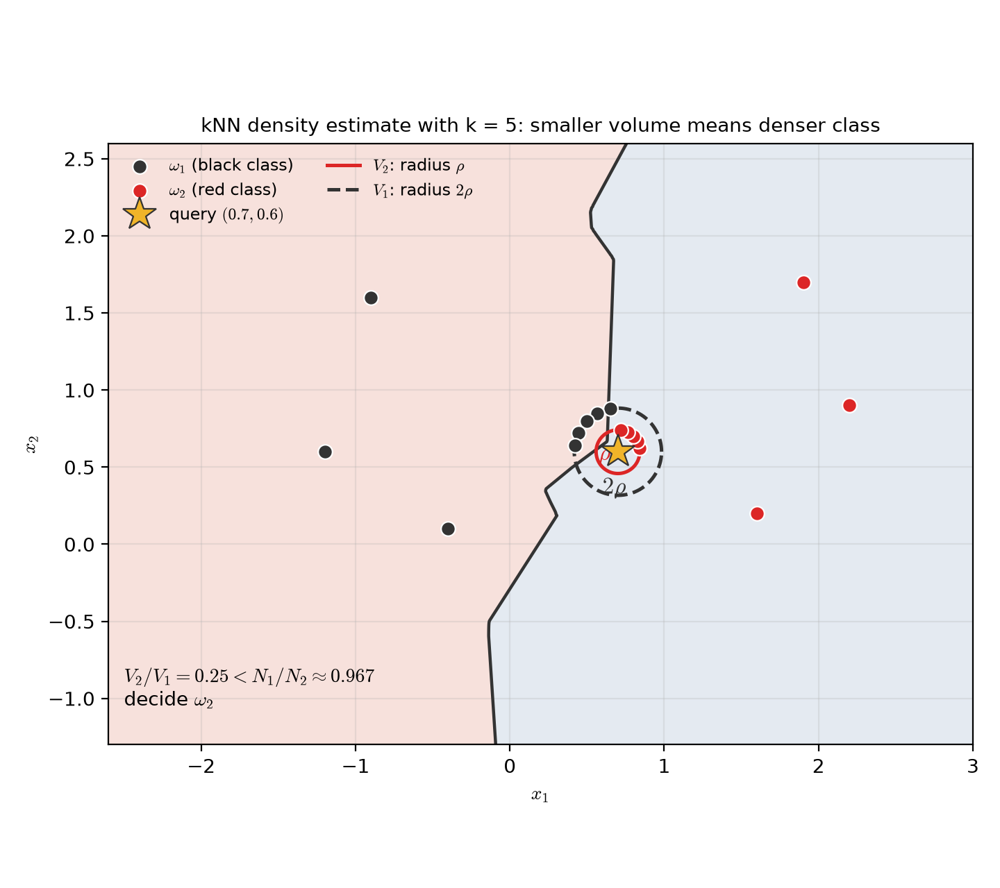
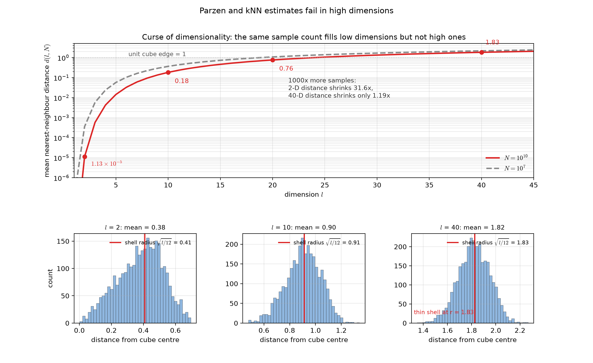

# Lecture 02：無母數密度估計——直方圖、Parzen 窗與 kNN（Nonparametric Density Estimation: Histograms, Parzen Windows, and kNN）

> 週次:第 2 週(自主學習教材)｜進度:貝氏分類器(二)補充——參數估計之後的無母數方法
>
> Week 2 (self-study material) | Topic: supplement to Bayes Classifiers (2) — nonparametric methods after parameter estimation

投影片：[JianBauDau JSON](../slides/lec02-nonparametric-density.jbd.json)（使用 JianBauDau 編輯器或播放器開啟）。

Slides: [JianBauDau JSON](../slides/lec02-nonparametric-density.jbd.json) (open with the JianBauDau editor or player).

前面幾種方法都先假設機率密度有已知的形式,例如高斯,再從資料估參數。這一節換一條路:完全不做形式假設,只靠資料的密集程度,直接把密度的形狀畫回來。這是課程網頁第 2.5 節的兩個知識點。

Earlier methods assume the density has a known form, such as a Gaussian, and estimate its parameters from data. This section takes a different route: assume nothing about the form and let the local crowding of the data paint the density itself. These are the two concepts from Section 2.5 of the course notes.

講義文字是重新撰寫的。標有 `[補充]` / `[Added]` 的內容是為了幫助理解而新增的。圖中的數字都是本講義自行計算的示範值。

The text is newly written. Content marked `[補充]` / `[Added]` is added to help understanding. All numbers in the figures are computed here for demonstration.

## 學習目標（Learning objectives）

- 說明參數法與無母數估計的差別,以及後者為什麼需要更多資料（Explain the difference between parametric and nonparametric estimation, and why the latter needs more data）。
- 寫出直方圖密度估計的公式,並說出它收斂到真值的三個條件（Write the histogram density estimate and state the three conditions for it to converge）。
- 選出合理的格子大小,並說明格子太大與太小的後果（Choose a sensible bin size and explain what happens when it is too large or too small）。
- 寫出 Parzen 窗公式,並解釋核函數與窗寬 $b$ 各自扮演的角色（Write the Parzen window formula and explain the roles of the kernel and the bandwidth $b$）。
- 用高斯核與 $b=1.0$ 手算一小段密度估計（Compute a short density estimate by hand with a Gaussian kernel and $b=1.0$）。
- 寫出 kNN 密度估計公式,並用體積比做兩類分類（Write the kNN density estimate and classify two classes by comparing volumes）。
- 解釋維度詛咒,並用最近鄰距離的公式說明高維為何使無母數方法失效（Explain the curse of dimensionality and use the nearest-neighbour distance formula to show why nonparametric methods fail in high dimensions）。

## 知識點地圖（Concept map）

| # | 知識點（Concept） | 為什麼重要（Why it matters） | 類型（Type） | 視覺需求（Visual need） |
|---|---|---|---|---|
| 1 | 無母數估計的想法（Idea of nonparametric estimation） | 打破「密度必須先假設形式」的慣例 | 直覺 | 必圖·示意 `histogram-bins`〔功能:1〕 |
| 2 | 直方圖密度估計與三個收斂條件（Histogram estimate and its convergence conditions） | 最原始的無母數方法,也是所有核方法的起點 | 公式 | 必圖·函數 `histogram-bins`〔功能:2〕 |
| 3 | 格子大小的取捨（Bin-size trade-off） | 影響估計的偏誤與變異,是第一個要調的自由度 | 比較 | 必圖·統計 `histogram-bins`〔功能:1、2〕 |
| 4 | Parzen 窗公式與核函數（Parzen window and kernels） | 把不連續的方框換成平滑的核 | 公式 | 必圖·函數 `kernel-shapes`〔功能:2〕 |
| 5 | 窗寬 $b$ 的權衡（Bandwidth trade-off） | $b$ 是 Parzen 估計唯一的自由度,決定雜訊與失真的平衡 | 比較 | 必圖·統計 `parzen-bandwidth`〔功能:1、2〕 |
| 6 | 一維數值示範 $b=1.0$（One-dimensional worked example） | 把公式變成看得懂的逐步計算 | 程序 | 必圖·函數 `kernel-shapes`〔功能:1、2〕 |
| 7 | kNN 密度估計（kNN density estimation） | 把「固定體積」換成「固定點數」,是另一種無母數思路 | 公式 | 必圖·幾何 `knn-classification`〔功能:3〕 |
| 8 | kNN 的體積比分類（Classification by volume ratio） | 把密度估計直接變成分類器 | 程序 | 必圖·幾何 `knn-classification`〔功能:1、3〕 |
| 9 | 維度詛咒（Curse of dimensionality） | 解釋為什麼上述方法在高維全部失效 | 迷思 | 必圖·統計 `dimensionality-curse`〔功能:1、2〕 |

表內代碼皆省略前綴 `lec02-nonparametric-`。九個知識點共用五張圖,每個必圖知識點都有對應的圖,沒有無圖的知識點。

The codes above omit the shared prefix `lec02-nonparametric-`. The nine concepts share five figures, and every concept that needs a figure has one.

## 1. 無母數估計的想法（The idea of nonparametric estimation）

**一句話重點**:不看資料像什麼分布,只看資料在哪裡擠成一團。

**One-sentence summary**: Ignore what shape the distribution should have; just look at where the data crowd together.

**白話說明**:前面的方法先挑一個家族,例如高斯,再問「這個家族裡哪一個成員最像我的資料」。這叫**參數法（parametric method）**。無母數估計（nonparametric estimation）反過來做:它不挑家族,直接從樣本在空間中的分布密度反推形狀。你越不放假設,就越需要資料自己講話,所以樣本數通常要更大。

**Plain explanation**: Parametric methods first pick a family, such as the Gaussian, and then ask which member of that family fits the data best. Nonparametric estimation works the other way: it picks no family and reads the shape straight off the local crowding of the samples. The fewer assumptions you make, the more the data must speak for itself, so you usually need more samples.

`[補充]` 比喻:參數法像挑一件現成尺寸的衣服,再改到合身;無母數估計像拿一團布直接捏出形狀。第二種更自由,但也更吃布(資料)。這個比喻的侷限是:捏出來的形狀會受手的抖動影響,正如估計曲線會受雜訊影響。

`[Added]` Analogy: a parametric method picks a ready-made size and tailors it; a nonparametric method moulds the shape directly from cloth. The second is freer but consumes far more cloth (data). The analogy fails in one way: a shaky hand leaves bumps, just as noise leaves wiggles in the estimate.

**常見迷思**:「無母數就是不需要任何假設。」其實還是要假設資料是獨立同分布,而且要選一個平滑參數,例如格子寬度或窗寬。無母數指的是不假設密度的函數形式,不是完全沒有選擇。

**Common misconception**: "Nonparametric means no assumptions at all." You still assume the samples are independent and identically distributed. You also choose a smoothing parameter, such as a bin width or a bandwidth. Nonparametric means no assumed functional form for the density, not zero choices.

**圖**:這是一個直覺型知識點,對應的圖是 `lec02-nonparametric-histogram-bins`,放在下一節。它讓你看見「只靠資料密集程度」是什麼樣子。

**Figure**: this is an intuition concept, and its figure is `lec02-nonparametric-histogram-bins`, shown in the next section. It lets you see what "reading the shape off the data alone" looks like.

> 無母數不是沒有假設,只是把假設從「形狀」搬到「平滑程度」。
>
> Nonparametric estimation does not remove assumptions; it moves them from the shape to the smoothness.

## 2. 直方圖密度估計（Histogram density estimation）

**一句話重點**:把空間切成格子,數每一格有幾個樣本,再除以總數與格寬。

**One-sentence summary**: Cut the space into bins, count the samples in each bin, and divide by the total count and the bin width.

**白話說明**:把實數軸切成寬度為 $b$ 的小格。若某格內有 $k_N$ 個樣本,這格的機率大約是 $k_N/N$。因為機率等於密度乘以寬度,把機率再除以 $b$ 就得到密度。所以直方圖估計在每一格內是**常數**,格與格之間是**階梯**。

**Plain explanation**: Cut the real line into bins of width $b$. If a bin holds $k_N$ samples, its probability is about $k_N/N$. Probability equals density times width, so dividing by $b$ gives the density. The histogram estimate is therefore constant inside each bin and jumps like a staircase at the bin edges.

$$
\hat p(x)\approx\frac{1}{b}\cdot\frac{k_N}{N}
$$

| 符號（Symbol） | 中文意義 | English meaning |
|---|---|---|
| $b$ | 格寬,每格的寬度 | the bin width |
| $N$ | 樣本總數 | the total number of samples |
| $k_N$ | 落在 $x$ 所屬那一格的樣本數 | the number of samples falling in the bin containing $x$ |
| $\hat p(x)$ | 密度的估計值 | the estimated density |

**收斂條件（convergence conditions）**:要讓 $\hat p(x)$ 收斂到真密度,下面三件事必須同時成立。

**Convergence conditions**: for $\hat p(x)$ to converge to the true density, all three conditions below must hold at the same time.

1. $b_N\to 0$:格子要越切越細,否則估計永遠是階梯。
1. $b_N \to 0$: the bins must become finer, or the estimate stays a staircase forever.
2. $k_N\to\infty$:每一格內仍要有足夠多的樣本,否則機率估計太吵。
2. $k_N \to \infty$: each bin must still contain enough samples, or the probability estimate is too noisy.
3. $k_N/N\to 0$:但每格占全體的比例要趨近零,否則格子數不會成長。
3. $k_N/N \to 0$: but each bin must hold a vanishing share of the data, or the number of bins never grows.

把第 2 與第 3 點放在一起看:每格樣本數要變多,同時每格占的比例要變小。這只在 $N$ 成長得比格子數快時才可能。換句話說,樣本數必須成長得比解析度還快。

Taken together, conditions 2 and 3 say that the count per bin must grow while the share per bin must shrink. This is only possible when $N$ grows faster than the number of bins. In short, the sample size must grow faster than the resolution.

**例子**:假設你切 $m$ 格,每格平均 $N/m$ 個樣本。要讓每格樣本數變多,就得讓 $m$ 成長得比 $N$ 慢,例如 $m=\sqrt{N}$。若 $N=10^4$,則 $m=100$,每格平均 100 個樣本;若 $N=10^6$,則 $m=1000$,每格平均仍是 1000 個樣本。這只是舉例,不是唯一選法。

**Example**: with $m$ bins, the average count per bin is $N/m$. To raise the count per bin, $m$ must grow more slowly than $N$, for instance $m=\sqrt{N}$. At $N=10^4$ this gives $m=100$ and 100 samples per bin on average; at $N=10^6$ it gives $m=1000$ and 1000 samples per bin. This is one choice among many, not a rule.

**常見迷思**:「切得越細一定越準。」切太細時每格樣本數掉到 0 或 1,估計曲線變成一根一根尖刺,看起來很精緻但雜訊極大。

**Common misconception**: "Finer bins are always more accurate." With very fine bins the count per bin drops to 0 or 1. The curve becomes a row of spikes that looks detailed but is dominated by noise.

**圖**:見下方 `lec02-nonparametric-histogram-bins`。它把同一個公式在三種格數下的結果並排,讓「階梯」看得見。

**Figure**: see `lec02-nonparametric-histogram-bins` below. It places the same formula at three bin counts side by side, so the staircase becomes visible.

**圖說 `lec02-nonparametric-histogram-bins`**:三張圖共用同一批 200 個樣本,灰虛線是真密度。真密度是兩個高斯的混合:0.5 個 $\mathcal{N}(-1.5,0.4^2)$ 加 0.5 個 $\mathcal{N}(1.5,0.5^2)$。左圖只切 4 格,階梯太粗,連兩個峰的位置都看不出來。中圖切 8 格,兩個峰已經浮現。右圖切 60 格,每格樣本太少,長出一堆尖刺。讀圖時先看中圖的兩個峰,再比較左圖的平坦與右圖的雜亂。〔功能:1、2〕

**Caption `lec02-nonparametric-histogram-bins`**: the three panels share the same 200 samples, with the true density drawn as a grey dashed curve. It is a mixture of two Gaussians: 0.5 of $\mathcal{N}(-1.5,0.4^2)$ plus 0.5 of $\mathcal{N}(1.5,0.5^2)$. The left panel uses only 4 bins, so the steps are too coarse to show the two modes. The middle panel uses 8 bins and the two modes appear. The right panel uses 60 bins, where each bin holds very few samples and the curve grows spikes. Read the middle panel first, then compare it with the flat left panel and the noisy right panel. 〔Function: 1, 2〕

## 3. 格子大小怎麼選（Choosing the bin size）

**一句話重點**:格子太大會抹平細節,太小會放大雜訊,中間有一個甜蜜點。

**One-sentence summary**: Large bins erase detail and small bins amplify noise; the good choice sits between them.

**白話說明**:格子大小同時控制兩件事。**偏誤（bias）**來自「把一格內的變化壓成一個常數」;格子越大,偏誤越大。**變異（variance）**來自「每格樣本數有限」;格子越小,每格樣本越少,變異越大。兩者相加的總誤差在中間某個格寬最小。

**Plain explanation**: The bin size controls two things at once. **Bias** comes from flattening the variation inside one bin into a single number; wider bins mean more bias. **Variance** comes from the finite count in each bin; narrower bins mean fewer samples per bin and more variance. Their sum, the total error, is smallest at some intermediate width.

`[補充]` 一個實用起點是 Freedman–Diaconis 規則:取格寬 $h\approx 2\,\mathrm{IQR}\,N^{-1/3}$,其中 $\mathrm{IQR}$ 是四分位距,也就是第 75 與第 25 百分位的差。它同時考慮樣本數與資料的分散程度。本講義的圖就是用它算出「好」的格數。

`[Added]` A practical starting point is the Freedman–Diaconis rule. Take the bin width $h \approx 2\,\mathrm{IQR}\,N^{-1/3}$, where $\mathrm{IQR}$ is the interquartile range. It is the difference between the 75th and 25th percentiles. The rule accounts for both the sample size and the spread of the data. The figure above uses it to compute the "good" bin count.

**例子**:用上一張圖的樣本,第 25 與第 75 百分位是 $-1.52$ 與 $1.48$,所以 $\mathrm{IQR}=3.00$。代入規則得 $h\approx2\times3.00\times200^{-1/3}\approx1.03$,再用 $8/1.03=7.79$ 向上取整得到 8 格,正是中圖的格數。

**Example**: for the sample in the figure above, the 25th and 75th percentiles are $-1.52$ and $1.48$, so $\mathrm{IQR}=3.00$. The rule gives $h \approx 2 \times 3.00 \times 200^{-1/3} \approx 1.03$, and $8/1.03 = 7.79$ rounds up to 8 bins, exactly the count used in the middle panel.

**常見迷思**:「統計軟體畫的直方圖就是對的。」軟體預設的格數只是一個習慣值,不是為你的資料算出來的最佳值,換一個設定曲線就會變。

**Common misconception**: "The histogram the software draws is the right one." The default bin count is a convention. It is not an optimum for your data. Change the setting and the curve changes.

**圖**:見上方 `lec02-nonparametric-histogram-bins` 的三格對照,偏誤與變異的拉扯在左格與右格一目了然。

**Figure**: see the three panels of `lec02-nonparametric-histogram-bins` above; the tug between bias and variance is plain in the left and right panels.

> 偏誤要小而格子要大,變異要小而格子要小,兩者拉扯出一個最佳值。
>
> Small bias wants wide bins, small variance wants narrow ones; the tug of war leaves one best width.

## 4. Parzen 窗:把方框換成平滑的核（Parzen windows: replacing the box with a smooth kernel）

**一句話重點**:把每個樣本當成一顆小饅頭的中心,整排饅頭疊起來就是密度。

**One-sentence summary**: Treat every sample as the centre of a small bump, and the sum of all bumps is the density.

**白話說明**:直方圖的問題出在方框函數本身:它不連續,所以估計曲線是階梯。Parzen 窗的想法很直接——既然元凶是那個方框,就換一個平滑的函數。這個平滑函數叫**核函數（kernel）**,寫成 $\phi(\cdot)$,條件只有兩個:到處不為負,而且整條曲線下的面積是 1。

**Plain explanation**: The trouble with the histogram is the box function itself, which is discontinuous. That is why the estimate is a staircase. The Parzen window takes the direct route: if the box is the culprit, replace it with a smooth function. That smooth function is the **kernel**, written $\phi(\cdot)$. It must satisfy only two conditions: it is never negative, and the area under it is 1.

$$
\hat p(\mathbf{x})=\frac{1}{b^l}\left(\frac{1}{N}\sum_{i=1}^{N}\phi\!\left(\frac{\mathbf{x}_i-\mathbf{x}}{b}\right)\right)
$$

| 符號（Symbol） | 中文意義 | English meaning |
|---|---|---|
| $\mathbf{x}$ | 要估計密度的位置 | the point at which the density is estimated |
| $\mathbf{x}_i$ | 第 $i$ 個訓練樣本 | the $i$-th training sample |
| $l$ | 特徵的維度 | the dimension of the feature vector |
| $b$ | 窗寬,控制每顆核的胖瘦 | the bandwidth, controlling how wide each kernel is |
| $\phi(\cdot)$ | 核函數,非負且積分為 1 | the kernel: non-negative with unit integral |

**白話直覺**:這個式子只做兩件事。先把每個樣本到 $\mathbf{x}$ 的距離除以 $b$,換成「以核為單位的距離」。再把這些核的值平均起來。最後除以 $b^l$,讓總面積保持 1。結果就是 $N$ 顆核疊出來的平滑曲線。

**Plain intuition**: the formula does two things. It divides each distance from a sample to $\mathbf{x}$ by $b$, converting it into kernel units. Then it averages the kernel values. Finally it divides by $b^l$ so the total area stays 1. The result is a smooth curve built by stacking $N$ kernels.

**常見迷思**:「核函數的形狀很重要。」實務上核的形狀影響很小,窗寬 $b$ 的影響才大。高斯核之所以最常用,主要原因是它到處平滑、數學上好處理。

**Common misconception**: "The shape of the kernel matters a lot." In practice the kernel shape matters little; the bandwidth $b$ matters a great deal. The Gaussian kernel is the most common choice mainly because it is smooth everywhere and easy to handle mathematically.

**圖**:見下方 `lec02-nonparametric-kernel-shapes`,左圖比較方框核與高斯核,右圖把 $b=1.0$ 的 $N=5$ 個核逐一畫出。

**Figure**: see `lec02-nonparametric-kernel-shapes` below. Its left panel compares the box kernel with the Gaussian kernel. Its right panel draws the five kernels of the $b=1.0$ example one by one.

**圖說 `lec02-nonparametric-kernel-shapes`**:左圖藍線是邊長 $b=1.0$ 的方框核,高度 $1/b=1.0$。兩條點線標出 $\pm b/2$ 的邊界。紅線是標準高斯核,峰高只有 0.40,尾巴卻延伸很遠。右圖把五顆高斯核疊起來,細灰線是各別核。粗紅線是它們的平均,也就是 $\hat p(x)$。紅點是 $x=0$ 處的估計值 0.196。讀圖時先看左圖的直角與圓肩,再看右圖的疊加。〔功能:1、2〕

**Caption `lec02-nonparametric-kernel-shapes`**: on the left, the blue curve is the box kernel of side $b=1.0$ and height $1/b=1.0$. The dotted lines mark its $\pm b/2$ edges. The red curve is the standard Gaussian kernel, peaking at only 0.40 with long tails. On the right the five Gaussian kernels are stacked, drawn thin grey. The thick red curve is their average, which is $\hat p(x)$. The red dot marks the estimate 0.196 at $x=0$. Read the left panel first for the square corner against the round shoulder, then the right panel for the stacking. 〔Function: 1, 2〕

## 5. 窗寬 $b$ 的兩難（The bandwidth dilemma）

**一句話重點**:$b$ 太小看到的是雜訊,太大看到的是被抹平的真相。

**One-sentence summary**: A tiny $b$ shows noise, and a huge $b$ shows a blurred truth.

**白話說明**:$b$ 是 Parzen 估計唯一的自由度,它決定每顆核有多胖。$b$ 很小時,每顆核像一根針,只反映它頭上那一個樣本,曲線坑坑巴巴;**變異很大、偏誤很小**。$b$ 很大時,每顆核攤得很開,把附近樣本全糊在一起,雙峰可能被抹成單峰;**偏誤很大、變異很小**。中間有一個使總誤差最小的窗寬。

**Plain explanation**: $b$ is the only free parameter of the Parzen estimate, and it decides how fat each kernel is. A small $b$ makes each kernel a needle that reflects only its own sample, so the curve is lumpy: high variance, low bias. A large $b$ spreads each kernel so widely that nearby samples blur together, and two peaks can merge into one: high bias, low variance. Some intermediate bandwidth minimizes the total error.

**量化指標**:用**均方根誤差（RMS error）**衡量整條曲線的貼合程度。

**Quantitative measure**: the **RMS error** measures how well the whole curve fits.

$$
\text{RMS}=\sqrt{\frac{1}{x_B-x_A}\int_{x_A}^{x_B}\bigl(\hat p(x)-p(x)\bigr)^2\,dx}
$$

`[補充]` 反直覺的一點:樣本數從 80 增加到 320 之後,不只整體誤差下降,最佳窗寬還會往**左**移。原因是資料變多以後,原本太小的窗寬也能變光滑。鄰居會互相補位,所以不需要那麼大的窗寬來壓雜訊。

`[Added]` One counter-intuitive point: raising the sample count from 80 to 320 not only lowers the overall error, it also moves the best bandwidth to the **left**. With more data, an otherwise too-small bandwidth becomes smooth. Neighbours fill each other in, so a large bandwidth is no longer needed to suppress noise.

**圖說 `lec02-nonparametric-parzen-bandwidth`**:上排三格共用同一批 $N=80$ 樣本,黑色短豎線標出樣本位置。灰虛線是真密度,紅實線是估計。左格 $b=0.05$,曲線長滿尖刺,RMS 0.091。中格 $b=0.26$,雙峰清清楚楚,RMS 僅 0.025。右格 $b=1.20$,兩個峰糊成一個大包,RMS 0.134。下排是 RMS 對窗寬的曲線,紅實線是 $N=80$,灰虛線是 $N=320$。兩個最佳窗寬用點線標在下排曲線上,方便交叉對照。讀圖時先看下排的 U 形:左臂是雜訊區,右臂是失真區。再看灰記號($b=0.17$)落在紅記號($b=0.26$)的左邊。〔功能:1、2〕

**Caption `lec02-nonparametric-parzen-bandwidth`**: the three top panels share one $N=80$ sample, with ticks marking the sample positions. The grey dashed curve is the true density and the red solid one the estimate. The left panel uses $b=0.05$ and the curve is spiky, with RMS 0.091. The middle panel uses $b=0.26$, where the two peaks are clean and the RMS is 0.025. The right panel uses $b=1.20$, where the peaks blur into one mound and the RMS is 0.134. The bottom panel plots RMS against bandwidth for $N=80$ (red) and $N=320$ (grey). Dotted lines mark the two optimal bandwidths on that curve. Read the bottom U shape first: the left arm is the noise region and the right arm the bias region. Then note that the grey marker ($b=0.17$) sits left of the red one ($b=0.26$). 〔Function: 1, 2〕

**常見迷思**:「存在一個放諸四海皆準的最佳 $b$。」最佳 $b$ 取決於樣本數與真密度的形狀。本講義的 0.26 與 0.17 只適用於這批示範資料,不能當成通用常數。

**Common misconception**: "There is one universally best $b$." The best $b$ depends on the sample size and the shape of the true density. The values 0.26 and 0.17 here apply only to this demonstration sample and are not universal constants.

**圖**:見下方 `lec02-nonparametric-parzen-bandwidth`。上排是三種窗寬的對照,下排是 RMS 對窗寬的權衡曲線。

**Figure**: see `lec02-nonparametric-parzen-bandwidth` below. Its top row compares three bandwidths, and its bottom row plots RMS against the bandwidth.

> 雜訊與失真是一場拉鋸,窗寬就是那條繩子。
>
> Noise and distortion pull against each other, and the bandwidth is the rope.

## 6. 一維數值示範:$b=1.0$ 的高斯核（Worked example: a Gaussian kernel with $b=1.0$）

**一句話重點**:把五顆高斯核的值算出來,平均後就是該點的密度。

**One-sentence summary**: Compute the five Gaussian kernel values, average them, and that is the density at that point.

**設定**:一維,五個樣本 $x_i\in\{-1.5,\,-0.5,\,0.5,\,1.5,\,2.5\}$,窗寬 $b=1.0$,核為標準高斯 $\phi(u)=e^{-u^2/2}/\sqrt{2\pi}$。這裡 $l=1$,所以公式中的 $1/b^l$ 就是 $1/b$。

**Setup**: one dimension, five samples $x_i \in \{-1.5, -0.5, 0.5, 1.5, 2.5\}$, bandwidth $b=1.0$, and the standard Gaussian kernel $\phi(u) = e^{-u^2/2}/\sqrt{2\pi}$. Here $l=1$, so $1/b^l$ is just $1/b$.

**逐步計算 $x=0$**:先算每個樣本到 $x=0$ 的標準化距離 $u_i=(x_i-x)/b=x_i$,再查核值。

**Step-by-step at $x=0$**: first form the standardized distance $u_i=(x_i-x)/b=x_i$ for each sample, then look up the kernel value.

| $x_i$ | $u_i=(x_i-0)/1.0$ | $\phi(u_i)$ |
|---|---|---|
| $-1.5$ | $-1.5$ | $0.1295$ |
| $-0.5$ | $-0.5$ | $0.3521$ |
| $0.5$ | $0.5$ | $0.3521$ |
| $1.5$ | $1.5$ | $0.1295$ |
| $2.5$ | $2.5$ | $0.0175$ |

五個核值相加是 $0.9807$,除以 $N=5$ 得 $0.1961$,再除以 $b=1.0$ 仍是 $0.1961$。所以 $\hat p(0)=0.196$。

The five kernel values sum to $0.9807$. Dividing by $N=5$ gives $0.1961$, and dividing by $b=1.0$ leaves $0.1961$. So $\hat p(0)=0.196$.

**對照**:若改用邊長 $b=1.0$ 的方框核,只有 $x_i=-0.5$ 與 $x_i=0.5$ 落在 $x=0$ 的格內,所以 $\hat p(0)=\frac{1}{5}\times\frac{2}{1.0}=0.4$。同樣五個樣本,只換核函數,估計值就從 0.196 變成 0.400。

**Comparison**: with a box kernel of side $b=1.0$, only $x_i=-0.5$ and $x_i=0.5$ fall in the bin containing $x=0$, so $\hat p(0)=\frac{1}{5}\times\frac{2}{1.0}=0.4$. With the same five samples, changing only the kernel moves the estimate from 0.196 to 0.400.

以上數字都由 Python 計算,不是心算。

All numbers above were computed with Python, not by hand.

**常見迷思**:「高斯核的峰高是 1,所以密度估計不會超過 1。」錯。核的峰高是 $1/\sqrt{2\pi}\approx0.40$,不是 1。又因為 $\hat p(x)$ 是 $N$ 顆核的平均再除以 $b$,所以 $\hat p(x)\le 0.40/b$:$b=1.0$ 時估計值**不會超過 0.40**(本節的 0.196 也遠低於它);只有 $b<1$ 時,估計值才可能超過 0.40,甚至超過 1,因為除以較小的 $b$ 會把密度放大。

**Common misconception**: "The Gaussian kernel peaks at 1, so the estimate never exceeds 1." The peak of the kernel is $1/\sqrt{2\pi}\approx0.40$, not 1. Because $\hat p(x)$ is the average of $N$ kernels divided by $b$, we have $\hat p(x)\le 0.40/b$. With $b=1.0$ the estimate **cannot exceed 0.40** (the 0.196 of this section is well below it); only when $b<1$ can the estimate exceed 0.40, or even 1, because dividing by a smaller $b$ scales the density up.

**圖**:見上方 `lec02-nonparametric-kernel-shapes` 的右圖,五顆核與它們的平均都畫在同一張圖上。

**Figure**: see the right panel of `lec02-nonparametric-kernel-shapes` above, where the five kernels and their average share one plot.

**小練習**:把 $x$ 換成 $1.0$,重算上表。提示:此時 $u_i\in\{-2.5,-1.5,-0.5,0.5,1.5\}$,核值為 $0.0175,0.1295,0.3521,0.3521,0.1295$。

**Practice**: repeat the table at $x=1.0$. Hint: the standardized distances become $u_i \in \{-2.5,-1.5,-0.5,0.5,1.5\}$, whose kernel values are $0.0175, 0.1295, 0.3521, 0.3521, 0.1295$.

## 7. kNN 密度估計:固定點數,讓體積伸縮（kNN density estimation: fix the count, let the volume breathe）

**一句話重點**:Parzen 固定體積、讓點數變動;kNN 固定點數、讓體積變動。

**One-sentence summary**: Parzen fixes the volume and lets the count vary; kNN fixes the count and lets the volume vary.

**白話說明**:Parzen 窗的窗寬固定,所以每顆核蓋住的樣本數是隨機的。k 近鄰密度估計（kNN density estimation）把兩者對調:先指定要包住幾個點 $k$,再把體積放大到剛好包住 $k$ 個訓練樣本。資料密的地方,小體積就夠了;資料疏的地方,體積得自動放大。

**Plain explanation**: In a Parzen window the bandwidth is fixed, so the number of samples covered by each kernel is random. The k-nearest-neighbour density estimate swaps the two. You name the count $k$ to be enclosed. Then the volume grows until it just covers $k$ training samples. Where the data are dense a small volume suffices, and where they are sparse the volume grows on its own.

$$
\hat p(\mathbf{x})=\frac{k}{N\,V(\mathbf{x})}
$$

| 符號（Symbol） | 中文意義 | English meaning |
|---|---|---|
| $k$ | 要包住的訓練樣本數,使用者指定 | the number of training samples to enclose, chosen by the user |
| $V(\mathbf{x})$ | 剛好包住 $k$ 個樣本的最小體積 | the smallest volume that encloses exactly $k$ samples |
| $N$ | 樣本總數 | the total number of samples |

**白話直覺**:密度就是「單位體積裡有多少點」。分子是點數 $k$,分母是體積乘上總數。體積越小,密度越大,所以 $\hat p$ 越大。

**Plain intuition**: density is how many points sit in one unit of volume. The numerator is the count $k$, and the denominator is the volume times the total count. A smaller volume means a larger density, so $\hat p$ is larger.

**常見迷思**:「$V(\mathbf{x})$ 一定要是超球。」不一定,超球只是最常用的選擇。用超立方體或橢球也能定義體積,只要前後一致即可。

**Common misconception**: "$V(\mathbf{x})$ must be a hypersphere." It need not be; a hypersphere is merely the usual choice. A hypercube or an ellipsoid also defines a volume, as long as you are consistent.

**圖**:見下方 `lec02-nonparametric-knn-classification`。兩類各自的最後一顆近鄰圍成圓,圓的大小就是 $V_1$ 與 $V_2$。

**Figure**: see `lec02-nonparametric-knn-classification` below. The last neighbour of each class defines a circle, and the circle sizes are $V_1$ and $V_2$.

> 密度高的地方,小網子就撈得到足夠的魚。
>
> Where the fish are dense, a small net catches enough of them.

## 8. 用體積比做分類（Classifying with a volume ratio）

**一句話重點**:同一顆小圓在某一類裡裝得下 $k$ 個鄰居,就說那一類比較密。

**One-sentence summary**: If a small circle holds $k$ neighbours of one class, that class is the denser one.

**白話說明**:把 kNN 密度估計代進概似比檢定,兩類各自估自己的 $p(\mathbf{x}\mid\omega_i)$,再比較兩邊的密度。密度大的一方勝出。因為 $k$ 與 $N$ 在兩邊差不多,比較密度就變成比較體積。若還要把錯誤代價算進去,就在不等號右邊乘上代價比。

**Plain explanation**: Feed the kNN estimate into a likelihood ratio test. Each class estimates its own $p(\mathbf{x}\mid\omega_i)$, and the larger density wins. Because $k$ and $N$ are similar on both sides, comparing densities reduces to comparing volumes. To include unequal error costs, multiply the right-hand side by the cost ratio.

$$
\frac{V_2}{V_1}\ \gtrless\ \frac{N_1}{N_2}\cdot\frac{P(\omega_2)}{P(\omega_1)}\cdot\frac{\lambda_{21}-\lambda_{22}}{\lambda_{12}-\lambda_{11}}
$$

| 符號（Symbol） | 中文意義 | English meaning |
|---|---|---|
| $V_i$ | 類別 $\omega_i$ 包住 $k$ 個鄰居所需的體積 | the volume needed by class $\omega_i$ to enclose $k$ neighbours |
| $N_i$ | 類別 $\omega_i$ 的樣本數 | the number of samples in class $\omega_i$ |
| $P(\omega_i)$ | 類別 $\omega_i$ 的事前機率 | the prior probability of class $\omega_i$ |
| $\lambda_{ij}$ | 把真實類別 $\omega_j$ 判成 $\omega_i$ 的代價 | the cost of deciding $\omega_i$ when the truth is $\omega_j$ |

**數值範例**:待分類點 $(0.7,0.6)$,取 $k=5$,兩類樣本數 $N_1=59$、$N_2=61$。

**Numerical example**: the query point is $(0.7,0.6)$ with $k=5$, and the two classes hold $N_1=59$ and $N_2=61$ samples.

| 步驟（Step） | 類別 $\omega_1$(黑) | 類別 $\omega_2$(紅) |
|---|---|---|
| 第 5 近鄰的半徑（radius to the 5th neighbour） | $2\rho\approx0.283$ | $\rho\approx0.141$ |
| 體積 $V=\pi\rho^2$（volume） | $4\pi\rho^2\approx0.251$ | $\pi\rho^2\approx0.063$ |
| 體積比（volume ratio） | — | $V_2/V_1=0.25$ |
| 樣本數比（count ratio） | — | $N_1/N_2\approx0.967$ |

$0.25<0.967$,所以判給 $\omega_2$。

Since $0.25<0.967$, the query point is assigned to $\omega_2$.

**直覺解讀**:紅類只用半徑 $\rho$ 的小圓,就包住 5 個鄰居。這代表紅點在這裡很擠。黑類得把圓放大到 $2\rho$,面積變成 4 倍才湊到 5 個。這代表黑點在這裡很疏。密度高的那一類勝出。

**Plain reading**: the red class needs only the small circle of radius $\rho$ to enclose 5 neighbours, so red points are crowded here. The black class must grow the circle to radius $2\rho$, four times the area, to reach 5 neighbours, so black points are thin here. The denser class wins.

**常見迷思**:「kNN 分類一定要算密度。」其實不必,因為 $k$、$N$、$\pi$ 在相減時常互相抵消,體積比就夠了。真正要小心的是 $N_1$ 與 $N_2$ 相差很大時,不能只看體積,還要乘上樣本數比。

**Common misconception**: "kNN classification must compute densities." It need not. The terms $k$, $N$ and $\pi$ often cancel when the two sides are compared, so the volume ratio is enough. The real trap is unbalanced classes: when $N_1$ and $N_2$ differ a lot, the ratio of counts must be included.

**圖**:見下方 `lec02-nonparametric-knn-classification`,紅圓與黑圓就是 $V_2$ 與 $V_1$ 的實際大小。

**Figure**: see `lec02-nonparametric-knn-classification` below, where the red and black circles are the actual sizes of $V_2$ and $V_1$.

**圖說 `lec02-nonparametric-knn-classification`**:黃色星號是待分類點 $(0.7,0.6)$。紅實線圓是紅類的第 5 近鄰半徑 $\rho\approx0.141$,虛線圓是黑類的第 5 近鄰半徑 $2\rho\approx0.283$。紅點都落在紅圓的半徑上,黑點都落在虛線圓上,所以兩類的體積比正好是 $0.25$。底色的淡橘與淡藍是 kNN 密度分數的決策區域,黑色邊界就是體積比等於 $N_1/N_2$ 的地方。讀圖時先比較兩個圓的大小(紅圓的面積是黑圓的 1/4),再確認星號落在哪一色區域。〔功能:1、3〕

**Caption `lec02-nonparametric-knn-classification`**: the yellow star is the query point $(0.7,0.6)$. The solid red circle is the radius $\rho \approx 0.141$ to the 5th red neighbour. The dashed circle is the radius $2\rho \approx 0.283$ to the 5th black neighbour. The red points sit on the red circle and the black points on the dashed circle, so the volume ratio is exactly 0.25. The pale orange and pale blue fills are the decision regions of the kNN density score. The black boundary is where the volume ratio equals $N_1/N_2$. Read the two circles first (the red area is one quarter of the black one), then check which colour the star falls in. 〔Function: 1, 3〕

**小練習**:若把 $k$ 從 5 改成 3,兩個圓的半徑會怎麼變?提示:兩類的密度比大致不變,但圓會縮小。邊界也跟著移動。

**Practice**: if $k$ changes from 5 to 3, how do the two radii change? Hint: the density ratio is roughly unchanged, but both circles shrink and the boundary moves.

## 9. 維度詛咒（The curse of dimensionality）

**一句話重點**:點數不變而維度上升,空間會急速變得空曠。

**One-sentence summary**: With the same number of points, adding dimensions quickly empties the space.

**白話說明**:把 $N$ 個點隨機灑進邊長為 1 的 $l$ 維立方體中,點與它最近鄰居的平均距離有一個理論公式。把 $N$ 固定,只把 $l$ 往上加,距離會快速逼近甚至超過立方體的邊長 1。空間沒有變小,是點相對於空間變得太少。所有無母數方法都要靠「附近有足夠的點」,所以它們在高維一起失效。

**Plain explanation**: Scatter $N$ points uniformly in the $l$-dimensional unit hypercube. There is a theoretical formula for the average Euclidean distance from a point to its nearest neighbour. Hold $N$ fixed and raise $l$, and that distance quickly approaches or exceeds the cube edge of 1. The space did not shrink; the points became too few for the space. Every nonparametric method relies on having enough points nearby, so all of them fail together in high dimensions.

$$
d(l,N)=2\left(\frac{l\,\Gamma(l/2)}{2\pi^{l/2}N}\right)^{1/l}
$$

| 符號（Symbol） | 中文意義 | English meaning |
|---|---|---|
| $l$ | 維度 | the dimension |
| $N$ | 點的數量 | the number of points |
| $\Gamma(\cdot)$ | 伽瑪函數,這裡用來表示高維球體積中的常數 | the gamma function, here carrying the constant in a high-dimensional ball volume |
| $d(l,N)$ | 平均最近鄰距離 | the mean nearest-neighbour distance |

**數字表**:固定 $N=10^{10}$,用上式算出:

**Number table**: with $N=10^{10}$ fixed, the formula gives:

| 維度 $l$（dimension） | $d(l,10^{10})$ | 解讀（reading） |
|---|---|---|
| 2 | $1.13\times10^{-5}$ | 擠到幾乎重疊 |
| 10 | $0.18$ | 距離已達邊長的 18% |
| 20 | $0.76$ | 邊長的四分之三 |
| 40 | $1.83$ | 超過單位立方體的邊長 |

一百億個點放進 2 維,最近鄰距離只有十萬分之一。同一個數目放到 40 維,距離膨脹到 1.83,比立方體的邊長還大。這就是「同樣多的點,在高維等於空曠」的量化版本。

Ten billion points in 2-D leave a nearest-neighbour distance of about one hundred-thousandth. The same count in 40-D blows up to 1.83, larger than the edge of the cube. That is the quantitative sense in which the same number of points is sparse in high dimensions.

`[補充]` 把樣本數增加 1000 倍(從 $10^7$ 到 $10^{10}$)的效果並不平均:2 維的距離縮短約 31.6 倍,40 維卻只縮短約 1.19 倍。也就是說,加樣本救得了低維問題,卻幾乎救不了高維問題。

`[Added]` Multiplying the sample count by 1000 (from $10^7$ to $10^{10}$) does not help evenly. The 2-D distance shrinks by about 31.6 times. The 40-D distance shrinks by only about 1.19 times. More samples rescue low-dimensional problems but barely touch high-dimensional ones.

**常見迷思**:「維度詛咒是電腦算不準造成的。」不是。上式是解析結果,和浮點誤差無關。它是幾何事實:高維球體的體積幾乎全擠在外殼上,內部反而空虛。

**Common misconception**: "The curse of dimensionality is a numerical error." It is not. The formula above is analytic and has nothing to do with floating-point error. It is a geometric fact: the volume of a high-dimensional ball sits almost entirely in a thin outer shell, leaving the inside hollow.

**圖**:見下方 `lec02-nonparametric-dimensionality-curse`。上圖是曲線,下圖是三個維度下的距離分布。

**Figure**: see `lec02-nonparametric-dimensionality-curse` below. Its top panel is the curve and its bottom panels are the distance histograms at three dimensions.

**與實作的連結**:實務上處理高維資料時,常見做法是先降維或做特徵挑選。例如用主成分分析把 $l$ 壓下來,再交給 Parzen 窗或 kNN。不做這件事就硬上,估計曲線會變成一堆孤立尖峰,分類器也只能記住訓練樣本。

**Link to practice**: in practice, high-dimensional data are usually reduced first. Typical steps are principal component analysis or feature selection, so that $l$ comes down before Parzen or kNN is applied. Without this step the density estimate becomes a field of isolated spikes, and the classifier merely memorises the training set.

> 多一千倍樣本,低維縮短三十倍,高維只縮短一倍。
>
> A thousandfold more samples shrinks a low-dimensional distance thirtyfold but a high-dimensional one barely at all.

**圖說 `lec02-nonparametric-dimensionality-curse`**:上圖縱軸取對數,紅實線是 $N=10^{10}$,灰虛線是 $N=10^{7}$。四個紅點標出 $l=2,10,20,40$ 的理論值:$1.13\times10^{-5}$、0.18、0.76、1.83。水平虛線是單位立方體的邊長 1,可見 40 維的最近鄰距離已經越過它。下圖三格是 3000 個均勻點到立方體中心的距離分布。$l=2$ 時分布很寬,$l=40$ 時全部擠在 $\sqrt{40/12}\approx1.83$ 附近的一層薄殼上。這個 1.83 正好等於上圖 40 維的值,兩張圖互相呼應。讀圖時先看上面兩條曲線在低維分開、在高維黏在一起,再看下圖的直方圖如何收窄成一根細殼。〔功能:1、2〕

**Caption `lec02-nonparametric-dimensionality-curse`**: the top panel uses a log scale. The red solid curve is $N=10^{10}$ and the grey dashed curve is $N=10^{7}$. Four red dots mark the theoretical values at $l = 2, 10, 20, 40$: $1.13\times10^{-5}$, 0.18, 0.76 and 1.83. The horizontal dotted line is the unit cube edge at 1, which the 40-D value has already passed. The three bottom panels show the distance from the cube centre for 3000 uniform points. At $l=2$ the spread is wide, while at $l=40$ everything crowds into a thin shell near $\sqrt{40/12}\approx1.83$. That value equals the 40-D point in the top panel. Read the top curves first as they separate in low dimensions and merge in high ones, then watch the histograms narrow into a thin shell. 〔Function: 1, 2〕

## 小結（Summary）

- 無母數估計不假設密度的形式,只靠資料的分布密度反推形狀,代價是需要更多樣本（Nonparametric estimation assumes no functional form for the density and reads the shape off the data, at the price of needing more samples）。
- 直方圖估計要把格寬趨近零、每格樣本數趨近無限、每格占比趨近零,三者同時成立才收斂（The histogram converges only when the bin width vanishes, the count per bin grows without bound, and the share per bin vanishes）。
- 格子或窗寬太小造成高變異,太大造成高偏誤,中間存在一個使總誤差最小的值（Too small a bin or bandwidth gives high variance, too large gives high bias, and a middle value minimizes the total error）。
- Parzen 窗用平滑核取代方框核,是 $N$ 顆核的平均;kNN 則改為指定包住的點數,讓體積隨密度自動伸縮（Parzen windows average $N$ smooth kernels instead of stacking boxes; kNN instead names the enclosed count and lets the volume grow with sparsity）。
- 兩類分類可以只比較體積比 $V_2/V_1$ 與樣本數比 $N_1/N_2$,不必真的算出密度（Two-class classification can compare the volume ratio $V_2/V_1$ with the count ratio $N_1/N_2$ without computing densities）。
- 維度上升時,空間中的點急速稀疏。最近鄰距離甚至可超過單位立方體的邊長。這是所有無母數方法在高維失效的根本原因（Raising the dimension empties the space; the nearest-neighbour distance can even exceed the cube edge, which is why nonparametric methods fail in high dimensions）。

## 延伸閱讀（Further reading）

- 教科書第 2 章 2.5 節「無母數技術」(Nonparametric Techniques):Sergios Theodoridis & Konstantinos Koutroumbas, *Pattern Recognition*, 4th ed.
- 課程網頁的互動式自學講義:Chapter 2 第 2.5 節(直方圖、Parzen 窗、kNN 與維度詛咒),讀取日期 2026-10-09(Course self-study notes, Chapter 2, Section 2.5, read on 2026-10-09)。
- 參考資料:見 [參考資料](../references/README.md)(References: see the [references folder](../references/README.md))。

## 術語表（Glossary）

| 中文 | English |
|---|---|
| 參數法 | parametric method |
| 無母數估計 | nonparametric estimation |
| 直方圖 | histogram |
| 格子／區間 | bin |
| 格寬 | bin width |
| 直方圖密度估計 | histogram density estimate |
| 偏誤 | bias |
| 變異 | variance |
| 均方根誤差 | RMS error |
| 核函數 | kernel function |
| 方框核 | box kernel |
| 高斯核 | Gaussian kernel |
| Parzen 窗 | Parzen window |
| 窗寬 | bandwidth |
| k 近鄰密度估計 | k-nearest-neighbour (kNN) density estimation |
| 體積比分類 | classification by volume ratio |
| 概似比檢定 | likelihood ratio test |
| 維度詛咒 | curse of dimensionality |
| 最近鄰距離 | nearest-neighbour distance |
| 四分位距 | interquartile range (IQR) |
