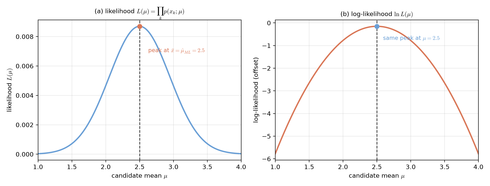
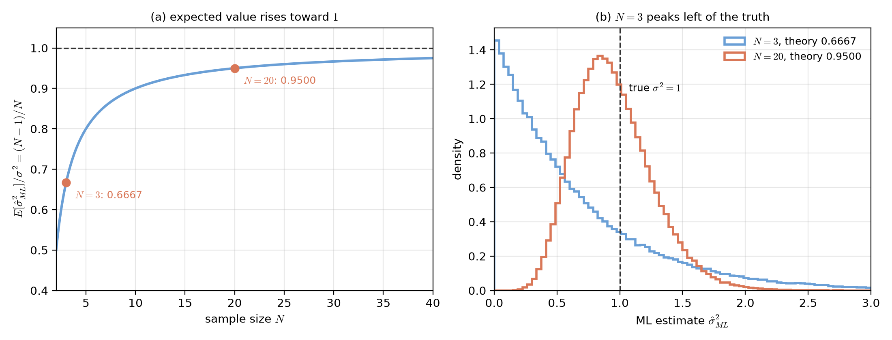
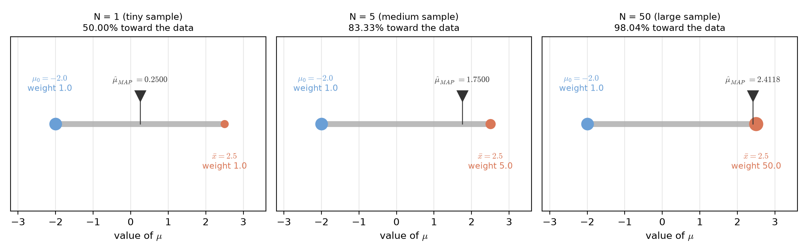
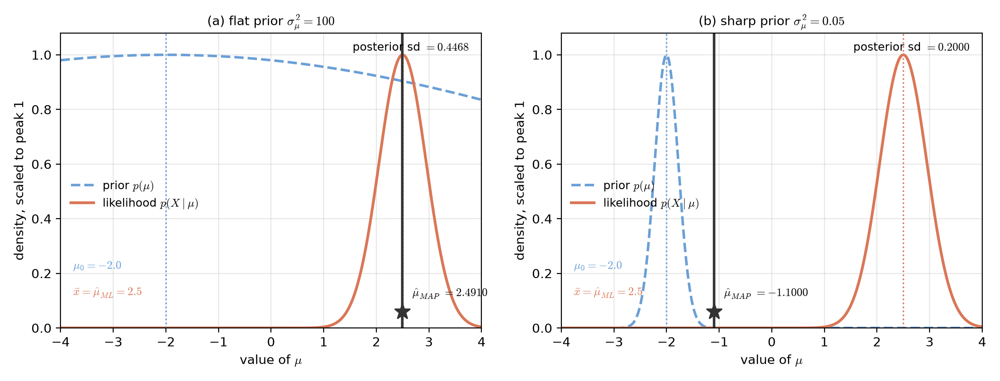

# Lecture 02：參數估計——最大似然與最大後驗（Parameter Estimation: Maximum Likelihood and MAP）

> 週次：第 2 週（自主學習教材）｜進度：參數估計（一）—最大似然估計與最大後驗機率估計
>
> Week 2 (self-study material) | Topic: Parameter estimation (1) — maximum likelihood and maximum a posteriori estimation

前面幾個知識點都假設類別條件密度 $p(\mathbf{x}\mid\omega_i)$ 的參數已知：均值、共變異數都由老師直接給。真實世界沒有這麼好康，這些參數通常要從訓練資料估出來。本講義處理兩個最基本的方法：最大似然估計（ML）與最大後驗機率估計（MAP）。

The earlier topics assumed the parameters of the class-conditional density $p(\mathbf{x}\mid\omega_i)$ were given: the mean and the covariance were handed to us. In the real world this is rarely true; the parameters must be estimated from training data. These notes cover the two most basic methods: maximum likelihood (ML) and maximum a posteriori (MAP) estimation.

講義的文字是重新撰寫的，不是原網頁的抄錄。標有 `[補充]` / `[Added]` 的段落是為了幫助理解而新增。圖中的資料都是示範用的模擬數字，不是教科書原圖。

The text is newly written, not copied from the source page. Passages marked `[補充]` / `[Added]` are added to aid understanding. All numbers in the figures are illustrative simulations, not taken from the textbook.

來源：課程網頁「Ch02 貝氏分類器」2.5.1–2.5.3 節（Maximum Likelihood Estimation；Maximum A Posteriori Estimation），讀取日期 2026-10-09。

Source: course page "Ch02 Bayes Classifiers", Sections 2.5.1–2.5.3 (Maximum Likelihood Estimation; Maximum A Posteriori Estimation), read on 2026-10-09.

## 學習目標（Learning objectives）

- 說明概似函數的意義，並解釋為什麼要取對數再求解（Explain what a likelihood function means and why we take its logarithm before solving）。
- 在已知均值的情況下，推導一維高斯的 ML 變異數估計（Derive the ML variance estimate of a one-dimensional Gaussian when the mean is known）。
- 說明 ML 變異數估計在小樣本時為何系統性偏低，並算出偏低的比例（Explain why the ML variance estimate is systematically low for small samples, and compute the size of that bias）。
- 從後驗機率推導 MAP 估計，並寫出先驗與樣本平均的加權式（Derive the MAP estimate from the posterior and write the weighted form of the prior guess and the sample mean）。
- 比較 ML 與 MAP：說明先驗平緩、先驗尖銳與樣本量很大時各會發生什麼（Compare ML and MAP: explain what happens when the prior is flat, when it is sharp, and when the sample is large）。

## 1. 最大似然估計（Maximum likelihood estimation）

### 1.1 概似函數與對數概似（The likelihood and the log-likelihood）

**一句話重點**：ML 是找一組參數，讓「看到手上這份訓練資料」這件事看起來最合理。

**One-sentence summary**: ML finds the parameter values under which the training data we actually hold looks most plausible.

**白話說明**：想像你手上有一袋抽出來的球，每顆球的重量都記下來了。你懷疑這袋球來自某個製程，而這個製程有一個調整旋鈕 $\theta$（例如平均重量）。ML 的做法是：把旋鈕轉到每一格，問一個問題。若旋鈕停在這裡，抽到現在這串重量的機會有多大？然後把旋鈕停在機會最大的那一格。注意，我們不是在問「參數的機率是多少」，而是在問「哪個參數最能解釋眼前的資料」。

**Plain explanation**: picture a bag of balls whose weights you have written down. You suspect the bag came from a machine with a single tuning knob $\theta$ (say, the average weight). ML turns the knob through every setting and asks: if the knob sat here, how likely would this exact sequence of weights be? Then you park the knob where that chance is largest. Note that we are not asking how probable the parameter is; we are asking which parameter best explains the data at hand.

**正式定義**：設有 $N$ 個訓練樣本 $\mathbf{x}_1,\dots,\mathbf{x}_N$，彼此統計獨立，且都抽自同一個機率密度 $p(\mathbf{x};\mathbf{\theta})$，其中 $\mathbf{\theta}$ 未知。把它們的聯合機率寫成

**Formal definition**: let the $N$ training samples $\mathbf{x}_1,\dots,\mathbf{x}_N$ be statistically independent draws from one distribution $p(\mathbf{x};\mathbf{\theta})$ with unknown parameter $\mathbf{\theta}$. Their joint probability is

$$
p(X;\mathbf{\theta})=\prod_{k=1}^{N}p(\mathbf{x}_k;\mathbf{\theta})
$$

這個式子就是**概似函數（likelihood function）**：它是 $\mathbf{\theta}$ 的函數，資料 $X$ 固定不動。ML 估計是

This expression is the **likelihood function**: a function of $\mathbf{\theta}$ with the data $X$ held fixed. The ML estimate is

$$
\hat{\mathbf{\theta}}_{ML}=\arg\max_{\mathbf{\theta}}\prod_{k=1}^{N}p(\mathbf{x}_k;\mathbf{\theta})
$$

| 符號（Symbol） | 中文意義 | English meaning |
|---|---|---|
| $N$ | 訓練樣本數 | the number of training samples |
| $\mathbf{x}_k$ | 第 $k$ 個訓練樣本 | the $k$-th training sample |
| $\mathbf{\theta}$ | 未知參數（可以是向量） | the unknown parameter (possibly a vector) |
| $p(\mathbf{x};\mathbf{\theta})$ | 帶參數 $\mathbf{\theta}$ 的機率密度 | the density indexed by the parameter $\mathbf{\theta}$ |
| $L(\mathbf{\theta})$ | 對數概似函數 | the log-likelihood function |

**為什麼要取對數**：上面的乘積有 $N$ 個因項。當 $N=1000$ 時，每個因項都小於 1，乘起來會小到電腦的浮點數存不住（下溢）。取對數把乘法變成加法，數值穩定得多。而且 $\ln$ 是嚴格遞增函數，最大值的位置不會改變。

**Why take logarithms**: the product above has $N$ factors. When $N=1000$, each factor is below 1 and the product underflows the floating-point range of a computer. A logarithm turns the product into a sum, which is far more stable. Since $\ln$ is strictly increasing, the location of the maximum does not move.

$$
L(\mathbf{\theta})=\ln\prod_{k=1}^{N}p(\mathbf{x}_k;\mathbf{\theta})=\sum_{k=1}^{N}\ln p(\mathbf{x}_k;\mathbf{\theta}),\qquad \frac{\partial L(\mathbf{\theta})}{\partial\mathbf{\theta}}=0
$$

`[補充]` 取對數只是把「乘」換成「加」，答案不變。可以想成：班上排名前幾名的同學，把每個人的分數開根號之後排名還是一樣；因為開根號是遞增的。

`[Added]` Taking the logarithm only swaps multiplication for addition; the answer is unchanged. Think of exam scores: if you take the square root of every score, the class ranking stays the same. The square root is increasing.

**圖說 `lec02-parameter-estimation-ml-peak`**：五個樣本 $2.1,2.7,2.4,2.8,2.5$，變異數假設為 1。左圖是概似函數 $L(\mu)$，右圖是取對數後的 $\ln L(\mu)$。兩張圖的曲線形狀不同（左邊尖、右邊是拋物線），但最高點都在 $\mu=2.5$，也就是樣本平均。讀圖時先看左圖的單一高峰與它底下的虛線，再對照右圖同一條虛線仍然穿過最高點。〔功能：1、2〕

**Caption `lec02-parameter-estimation-ml-peak`**: five samples $2.1, 2.7, 2.4, 2.8, 2.5$ with the variance fixed at 1. The left panel shows the likelihood $L(\mu)$ and the right panel the log-likelihood $\ln L(\mu)$. The two curves have different shapes, yet both peak at $\mu=2.5$, the sample mean. First read the left panel's single peak and the dashed line under it. Then check that the same line still crosses the top of the right panel.

**例子**：用上面五個樣本，且假設已知 $\sigma^2=1$、未知 $\mu$。因為是高斯，對數概似（省略與 $\mu$ 無關的常數）是

**Example**: use the five samples above with $\sigma^2=1$ known and $\mu$ unknown. For a Gaussian, the log-likelihood (dropping constants that do not involve $\mu$) is

$$
\ln L(\mu)=-\frac{1}{2}\sum_{k=1}^{5}(x_k-\mu)^2
$$

| 候選 $\mu$（Candidate $\mu$） | $\sum (x_k-\mu)^2$ | $\ln L(\mu)$（含常數） | $L(\mu)$ |
|---|---|---|---|
| $2.0$ | $1.55$ | $-5.3697$ | $0.004656$ |
| $2.5$（樣本平均，sample mean） | $0.30$ | $-4.7447$ | $0.008698$ |
| $3.0$ | $1.55$ | $-5.3697$ | $0.004656$ |

以上數字由 Python 計算。離樣本平均越遠，平方誤差和越大，對數概似越小，所以樣本平均是最大值的位置。

The numbers above were computed with Python. The farther a candidate is from the sample mean, the larger the sum of squared errors. A larger sum means a smaller log-likelihood, so the sample mean is where the maximum sits.

**常見迷思**：「取對數會改變答案，所以不能亂取。」不會。$\ln$ 是嚴格遞增函數，任何兩個數的大小關係在取對數後保持不變，最大值的位置因此不動。

**Common misconception**: "taking logarithms changes the answer, so it is not allowed." It does not. The logarithm is strictly increasing, so the order of any two values is preserved; the location of the maximum does not move.

**小練習**：若把上面的樣本換成 $2.2,2.6,2.4,2.8,2.5$，樣本平均變成多少？（提示：先加總再除以 5。）

**Practice**: with the samples replaced by $2.2, 2.6, 2.4, 2.8, 2.5$, what is the new sample mean? Hint: sum first, then divide by 5.

### 1.2 兩個推導範例（Two derivations）

**一句話重點**：一維高斯下，估均值得到樣本平均，估變異數得到平方誤差的平均。但後者對有限樣本有偏。

**One-sentence summary**: for a one-dimensional Gaussian, estimating the mean gives the sample mean. Estimating the variance gives the average squared error, which is biased for finite samples.

**白話說明**：「已知一部分、只估另一部分」是最容易上手的情形。這兩題的答案都很直覺，重要的是看清楚為什麼，以及直覺在哪裡會出錯。

**Plain explanation**: the easiest setting is when part of the parameters is known and only the rest is estimated. Both answers here are intuitive; what matters is seeing why they hold and where intuition breaks down.

**推導一（已知 $\mu$，估 $\sigma^2$）**：一維高斯 $p(x;\mu,\sigma^2)=\frac{1}{\sqrt{2\pi}\sigma}\exp\!\bigl(-\frac{(x-\mu)^2}{2\sigma^2}\bigr)$。令 $L(\sigma^2)=-\frac{N}{2}\ln\sigma^2-\frac{1}{2\sigma^2}\sum_{k}(x_k-\mu)^2$（已省略常數）。對 $\sigma^2$ 微分並令為零：

**Derivation one ($\mu$ known, estimating $\sigma^2$)**: for the one-dimensional Gaussian $p(x;\mu,\sigma^2)=\frac{1}{\sqrt{2\pi}\sigma}\exp\!\bigl(-\frac{(x-\mu)^2}{2\sigma^2}\bigr)$, take $L(\sigma^2)=-\frac{N}{2}\ln\sigma^2-\frac{1}{2\sigma^2}\sum_{k}(x_k-\mu)^2$ up to constants. Differentiate with respect to $\sigma^2$ and set the result to zero:

$$
\frac{\partial L}{\partial\sigma^2}=-\frac{N}{2\sigma^2}+\frac{1}{2(\sigma^2)^2}\sum_{k=1}^{N}(x_k-\mu)^2=0
$$

移項後得到

Rearranging gives

$$
\hat{\sigma}^2_{ML}=\frac{1}{N}\sum_{k=1}^{N}(x_k-\mu)^2
$$

**推導二（已知 $\Sigma$，估 $\mathbf{\mu}$）**：多維高斯下，對 $\mathbf{\mu}$ 微分並令為零，解得

**Derivation two ($\Sigma$ known, estimating $\mathbf{\mu}$)**: for the multivariate Gaussian, differentiate with respect to $\mathbf{\mu}$ and set the result to zero:

$$
\hat{\mathbf{\mu}}_{ML}=\frac{1}{N}\sum_{k=1}^{N}\mathbf{x}_k
$$

也就是**樣本平均**。`[補充]` 這裡有個容易忽略的細節：樣本平均之所以剛好是 ML 解，是因為我們假設了高斯。換成均勻分布或指數分布，ML 解就不一定是樣本平均。直覺上「平均最公平」只在這個假設下成立。

That is the **sample mean**. `[Added]` One detail is easy to miss: the sample mean is the ML solution only because we assumed a Gaussian. For a uniform or exponential distribution the ML solution is generally not the sample mean. The intuition that "the average is the fairest choice" holds only under this assumption.

**常見迷思**：「樣本平均永遠是最合理的估計。」它只是高斯假設下的 ML 解。若真實分布重尾或有離群值，樣本平均會被少數極端值拉走，中位數反而更穩健。

**Common misconception**: "the sample mean is always the most reasonable estimate." It is only the ML solution under a Gaussian assumption. If the true distribution is heavy-tailed or has outliers, a few extreme values drag the sample mean; the median is then more robust.

**小練習**：若已知 $\mu=0$，樣本是 $-1,0,1$，用上式算出 $\hat{\sigma}^2_{ML}$。（提示：三個平方和除以 3。）

**Practice**: with $\mu=0$ known and samples $-1, 0, 1$, compute $\hat{\sigma}^2_{ML}$. Hint: the sum of three squares divided by 3.

### 1.3 小樣本的低估陷阱（The small-sample bias trap）

**一句話重點**：ML 變異數估計的期望值是 $\frac{N-1}{N}\sigma^2$，樣本越小，低估越嚴重。

**One-sentence summary**: the ML variance estimate has expectation $\frac{N-1}{N}\sigma^2$, so the smaller the sample, the worse the underestimate.

**白話說明**：許多人以為「最大似然」就等於「最客觀、最正確」。其實不然。樣本小的時候，ML 算出來的變異數會系統性偏低。原因很單純。計算變異數時，我們用樣本平均取代了真實均值。而樣本平均是所有可能中心裡「離這批資料最近」的那一點。用最近的中心去量散布，散布自然顯得比真相小。

**Plain explanation**: many people assume that "maximum likelihood" means "most objective and most correct." That is not so. With few samples the ML variance comes out systematically low. The reason is simple. When computing the variance we replace the true mean by the sample mean. That sample mean is the center closest to exactly this batch of data. Measuring spread from the nearest center makes the spread look smaller than the truth.

**正式定義**：可以證明（細節見「想深入」）

**Formal definition**: one can show (details in "Going deeper") that

$$
E[\hat{\sigma}^2_{ML}]=\frac{N-1}{N}\sigma^2,\qquad \text{Bias}=E[\hat{\sigma}^2_{ML}]-\sigma^2=-\frac{1}{N}\sigma^2
$$

| 樣本數 $N$（Sample size） | $(N-1)/N$ | 低估比例（Underestimate） |
|---|---|---|
| $3$ | $0.6667$ | $33.33\%$ |
| $20$ | $0.9500$ | $5.00\%$ |
| $99$ | $0.9899$ | $1.01\%$ |

以上數字由 Python 計算。`[補充]` 低估的比例剛好是 $1/N$：$N=3$ 時偏低三分之一，$N=20$ 時只偏低二十分之一。這也是為什麼實務上常把分母改成 $N-1$，得到不偏的樣本變異數。

The numbers above were computed with Python. `[Added]` The shortfall is exactly $1/N$: one third at $N=3$ and only one twentieth at $N=20$. This is why in practice the denominator is often changed to $N-1$, which gives an unbiased sample variance.

**圖說 `lec02-parameter-estimation-ml-bias`**：左圖是期望值比例 $(N-1)/N$，標出 $N=3$（0.6667）與 $N=20$（0.9500）兩點，虛線是無偏的水準 1。右圖是 200000 次模擬下 $\hat{\sigma}^2_{ML}$ 的分布，真實變異數為 1。$N=3$ 的曲線整體落在虛線左側，與理論平均 0.6667 相符；$N=20$ 的曲線貼近虛線，與理論平均 0.9500 相符。讀圖時先看左圖兩點離虛線多遠，再看右圖兩條曲線相對虛線的位置。〔功能：1、2〕

**Caption `lec02-parameter-estimation-ml-bias`**: the left panel plots the expected-value ratio $(N-1)/N$ and marks $N=3$ (0.6667) and $N=20$ (0.9500). The dashed line is the unbiased level 1. The right panel shows the distribution of $\hat{\sigma}^2_{ML}$ over 200000 simulations with true variance 1. The $N=3$ curve sits clearly to the left of the dashed line, consistent with its theoretical mean 0.6667. The $N=20$ curve hugs the dashed line, consistent with its theoretical mean 0.9500. First read the two marked points on the left, then compare where each curve sits relative to the dashed line.

**例子**：用第 1.1 節那組五個樣本，並讓 $\mu$ 未知、改用樣本平均 $\bar{x}=2.5$。則 $\sum(x_k-\bar{x})^2=0.30$，所以

**Example**: take the five samples from Section 1.1, let $\mu$ be unknown and use the sample mean $\bar{x}=2.5$. Then $\sum(x_k-\bar{x})^2=0.30$, so

$$
\hat{\sigma}^2_{ML}=\frac{0.30}{5}=0.0600,\qquad \hat{\sigma}^2_{\text{unbiased}}=\frac{0.30}{4}=0.0750
$$

兩者相差 $0.0150$，正是 $5$ 分之 $1$ 的差距（$0.0600/0.0750=0.8000$）。以上數字由 Python 計算。

The two differ by $0.0150$, exactly a fifth of the unbiased value ($0.0600/0.0750=0.8000$). These numbers were computed with Python.

**常見迷思**：「ML 估計一定是不偏的。」不偏只在大樣本下的極限成立。$N=3$ 時的低估高達三成，不能當作小誤差忽略。實務上要嘛改用 $N-1$ 的分母，要嘛明確報告樣本數。

**Common misconception**: "an ML estimate is always unbiased." Unbiasedness holds only in the large-sample limit. At $N=3$ the underestimate reaches one third and cannot be dismissed as a small error. In practice either use the $N-1$ denominator or report the sample size explicitly.

**想深入**：偏差的來源是自由度。用 $\bar{x}$ 取代 $\mu$ 時，我們「借走」了一個自由度。五個離差 $x_k-\bar{x}$ 的總和必為零，所以只要知道其中四個，第五個就被決定了。可自由變動的其實只有 $N-1$ 個，分母用 $N$ 自然低估。

**Going deeper**: the bias comes from the degrees of freedom. Replacing $\mu$ by $\bar{x}$ costs one degree of freedom: the five deviations $x_k-\bar{x}$ always sum to zero, so four of them determine the fifth. Only $N-1$ of them can vary freely, and a denominator of $N$ therefore underestimates.

**小練習**：若 $N=4$ 且真實 $\sigma^2=2$，ML 估計的期望值是多少？低估幾個百分點？（提示：用 $(N-1)/N$。）

**Practice**: If $N=4$ and the true $\sigma^2=2$, what is the expectation of the ML estimate, and by what percentage is it low? Hint: use $(N-1)/N$.

## 2. 最大後驗機率估計（Maximum a posteriori estimation）

### 2.1 把參數也當成隨機變數（Treating the parameter as a random variable）

**一句話重點**：ML 把 $\mathbf{\theta}$ 看成固定但未知；MAP 讓 $\mathbf{\theta}$ 自己也有機率分布，並把事前信念納入。

**One-sentence summary**: ML treats $\mathbf{\theta}$ as fixed but unknown, while MAP treats it as a random variable with a distribution and adds prior belief.

**白話說明**：ML 的立場是「上帝已經把參數調好了，只是沒告訴我們」。MAP 換一個立場：「參數本身也有它的可能性分布，而且我在看資料之前就對它有印象。」這個印象寫成 $p(\mathbf{\theta})$，叫做**先驗分布**。例如你在量一個已知規格的零件長度，製程標示是 $2.0$ 公分，這就是一份先驗。

**Plain explanation**: ML takes the stance that the parameter has already been fixed by nature and simply hidden from us. MAP switches stances: the parameter itself has a distribution of possibilities, and we already hold an impression about it before seeing the data. That impression is written $p(\mathbf{\theta})$ and called the **prior distribution**. If you measure the length of a part with a known specification, and the process sheet says $2.0$ cm, that is a prior.

**正式定義**：目標是找讓後驗機率 $p(\mathbf{\theta}\mid X)$ 最大的 $\mathbf{\theta}$。由貝氏定理

**Formal definition**: the goal is the $\mathbf{\theta}$ that maximizes the posterior $p(\mathbf{\theta}\mid X)$. By Bayes' rule

$$
p(\mathbf{\theta}\mid X)=\frac{p(\mathbf{\theta})\,p(X\mid\mathbf{\theta})}{p(X)}
$$

分母 $p(X)$ 與 $\mathbf{\theta}$ 無關，不影響最大值的位置。所以 MAP 估計等價於

The denominator $p(X)$ does not depend on $\mathbf{\theta}$ and cannot move the maximum, so the MAP estimate is equivalently

$$
\hat{\mathbf{\theta}}_{MAP}:\ \frac{\partial}{\partial\mathbf{\theta}}\Bigl(p(\mathbf{\theta})\,p(X\mid\mathbf{\theta})\Bigr)=0
$$

| 符號（Symbol） | 中文意義 | English meaning |
|---|---|---|
| $p(\mathbf{\theta})$ | 先驗分布：看資料前對參數的信念 | prior: belief about the parameter before seeing data |
| $p(X\mid\mathbf{\theta})$ | 概似函數 | the likelihood |
| $p(\mathbf{\theta}\mid X)$ | 後驗分布：看資料後更新過的信念 | posterior: the updated belief after seeing data |
| $p(X)$ | 證據，與參數無關 | the evidence, independent of the parameter |

**與 ML 的差別**：MAP 的方程式只比 ML 多了一個 $p(\mathbf{\theta})$ 因項。如果先驗是均勻分布（所有 $\mathbf{\theta}$ 一視同仁），這個因項是常數，MAP 就退化回 ML。

**The difference from ML**: the MAP equation has exactly one extra factor, $p(\mathbf{\theta})$. If the prior is uniform (all values of $\mathbf{\theta}$ treated alike), the factor is a constant and MAP collapses back to ML.

`[補充]` 比喻：把 ML 想成一位不看任何背景資料、只憑現場證據判案的法官；MAP 則是一位腦中已有一份前科的法官。兩人都看證據，但後者會把背景一起納入。這個比喻的侷限是，法官不必然以貝氏方式更新信念。

`[Added]` An analogy: ML is a judge who looks only at the evidence in court. MAP is a judge who also holds a record of previous cases. Both see the evidence, but the second folds in the background. The analogy has a limit: a judge does not necessarily update beliefs in a Bayesian way.

**常見迷思**：「MAP 一定比 ML 準。」不一定。先驗若是錯的，MAP 會被錯的先驗帶偏；只有當先驗與真相接近，或資料量夠大足以壓過先驗時，MAP 才佔便宜。

**Common misconception**: "MAP is always more accurate than ML." Not so. A wrong prior drags the MAP estimate away. MAP wins only when the prior is close to the truth, or when enough data drowns the prior out.

**小練習**：若先驗 $p(\mathbf{\theta})$ 是常數，MAP 的解會是什麼？（提示：常數因項不影響微分結果。）

**Practice**: If the prior $p(\mathbf{\theta})$ is a constant, what is the MAP solution? Hint: a constant factor does not affect the derivative.

### 2.2 高斯先驗下的均值估計（Estimating the mean under a Gaussian prior）

**一句話重點**：MAP 的解是先驗猜測與樣本平均的加權平均，權重由 $\sigma_\mu^2/\sigma^2$ 與 $N$ 共同決定。

**One-sentence summary**: the MAP solution is a weighted average of the prior guess and the sample mean, with weights set by $\sigma_\mu^2/\sigma^2$ and $N$.

**白話說明**：延續前面估均值的問題，現在多給一份先驗。你相信均值大概在 $\mu_0$ 附近，但不確定；不確定的程度是 $\sigma_\mu^2$。MAP 的答案會落在 $\mu_0$ 與樣本平均之間，像天平一樣：一邊是先驗，一邊是資料。

**Plain explanation**: continue the mean-estimation problem, but now add a prior. You believe the mean lies somewhere near $\mu_0$, with uncertainty $\sigma_\mu^2$. The MAP answer falls between $\mu_0$ and the sample mean, like a balance scale. The prior sits on one side and the data on the other.

**正式定義**：假設 $\mathbf{\mu}$ 服從高斯先驗 $\mathcal{N}(\mathbf{\mu}_0,\sigma_\mu^2 I)$，且 $\Sigma=\sigma^2 I$。解 $\frac{\partial}{\partial\mathbf{\mu}}\bigl(p(\mathbf{\mu})p(X\mid\mathbf{\mu})\bigr)=0$ 得

**Formal definition**: assume $\mathbf{\mu}$ follows the Gaussian prior $\mathcal{N}(\mathbf{\mu}_0,\sigma_\mu^2 I)$ and $\Sigma=\sigma^2 I$. Solving $\frac{\partial}{\partial\mathbf{\mu}}\bigl(p(\mathbf{\mu})p(X\mid\mathbf{\mu})\bigr)=0$ gives

$$
\hat{\mathbf{\mu}}_{MAP}=\frac{\mathbf{\mu}_0+\dfrac{\sigma_\mu^2}{\sigma^2}\sum_{k=1}^{N}\mathbf{x}_k}{1+\dfrac{\sigma_\mu^2}{\sigma^2}N}=\frac{\mathbf{\mu}_0+\dfrac{\sigma_\mu^2}{\sigma^2}N\bar{\mathbf{x}}}{1+\dfrac{\sigma_\mu^2}{\sigma^2}N}
$$

| 符號（Symbol） | 中文意義 | English meaning |
|---|---|---|
| $\mu_0$ | 先驗均值：看資料前的猜測 | prior mean: the guess before seeing data |
| $\sigma_\mu^2$ | 先驗變異數：對猜測的信心（越小越有信心） | prior variance: confidence in the guess (smaller means more confident) |
| $\sigma^2$ | 資料的雜訊變異數 | the noise variance of the data |
| $N$ | 樣本數，決定資料的拉力 | sample size, which sets the pull of the data |

**例子**：設 $\mu_0=-2.0$、$\sigma_\mu^2=1$、$\sigma^2=1$、樣本平均 $\bar{x}=2.5$。代入上式：

**Example**: take $\mu_0=-2.0$, $\sigma_\mu^2=1$, $\sigma^2=1$ and sample mean $\bar{x}=2.5$. Substituting,

| $N$ | 資料權重 $\frac{\sigma_\mu^2}{\sigma^2}N$ | $\hat{\mu}_{MAP}$ | 數據方向位移比例（Share toward data） |
|---|---|---|---|
| $1$ | $1.0$ | $0.2500$ | $50.00\%$ |
| $5$ | $5.0$ | $1.7500$ | $83.33\%$ |
| $50$ | $50.0$ | $2.4118$ | $98.04\%$ |

以上數字由 Python 計算。位移比例是 $\frac{w}{1+w}$，其中 $w$ 是資料權重。`[補充]` 注意 $N=3$ 與 $N=99$ 也可以直接代入：$w=3$ 得 $\hat{\mu}_{MAP}=1.375$（位移 $75\%$），$w=99$ 得 $\hat{\mu}_{MAP}=2.4550$（位移 $99\%$）。

These numbers were computed with Python. The share toward the data is $\frac{w}{1+w}$, where $w$ is the weight of the data. `[Added]` The cases $N=3$ and $N=99$ follow the same formula: $w=3$ gives $\hat{\mu}_{MAP}=1.375$ (75% of the way) and $w=99$ gives $\hat{\mu}_{MAP}=2.4550$ (99% of the way).

**圖說 `lec02-parameter-estimation-map-tug`**：三張圖共用同一個數軸。藍點是先驗 $\mu_0=-2.0$（權重固定為 1），橘點是樣本平均 $\bar{x}=2.5$（圓點大小隨 $N$ 變大）。黑色倒三角是指標 $\hat{\mu}_{MAP}$。$N=1$ 時指標停在 $0.2500$，只走了一半；$N=5$ 走到 $1.7500$，$83.33\%$；$N=50$ 幾乎貼上橘點，$2.4118$。讀圖時先看橘點隨 $N$ 變大，再看黑色指標往右推進的距離。〔功能：1、2〕

**Caption `lec02-parameter-estimation-map-tug`**: the three panels share one axis. The blue dot is the prior $\mu_0=-2.0$ (a fixed weight of 1). The orange dot is the sample mean $\bar{x}=2.5$, and its size grows with $N$. The black triangle is the estimate $\hat{\mu}_{MAP}$. At $N=1$ the triangle stops at $0.2500$, only halfway. At $N=5$ it reaches $1.7500$ (83.33% of the way). At $N=50$ it nearly touches the orange dot at $2.4118$. Read the orange dot growing first, then watch how far the black triangle advances.

**常見迷思**：「$N$ 小的時候 MAP 是錯的，因為它不肯相信資料。」不是。$N$ 小時資料本身不可靠，MAP 只是把不確定性算進去。若你其實確信資料、對先驗毫無信心（$\sigma_\mu^2/\sigma^2\gg 1$），把 $\sigma_\mu^2$ 調大，MAP 立刻回到樣本平均。

**Common misconception**: "when $N$ is small, MAP is wrong because it refuses to believe the data." It is not wrong. With small $N$ the data itself is unreliable, and MAP simply accounts for that uncertainty. If you truly trust the data and hold no prior belief ($\sigma_\mu^2/\sigma^2\gg 1$), raising $\sigma_\mu^2$ sends MAP straight back to the sample mean.

**小練習**：在同樣設定下，$N=10$ 時 $w$、$\hat{\mu}_{MAP}$ 與位移比例各是多少？（提示：先算 $w$，再算 $w/(1+w)$。）

**Practice**: Under the same setting, for $N=10$ what are $w$, $\hat{\mu}_{MAP}$ and the share toward the data? Hint: get $w$ first, then $w/(1+w)$.

### 2.3 兩種極端：先驗有多強？資料有多少？（Two extremes: how strong is the prior, how much data?）

**一句話重點**：先驗很寬等於沒意見，MAP 靠向 ML；先驗很尖就是很有意見，MAP 被拉向先驗；資料一大，證據終究會贏。

**One-sentence summary**: a wide prior means no opinion, so MAP drifts to ML. A sharp prior means a strong opinion, so MAP is pulled toward it. With enough data the evidence wins in the end.

**白話說明**：同一套公式，只要改動 $\sigma_\mu^2$ 或 $N$，行為就完全不同。$\sigma_\mu^2$ 很大時，先驗像一片平坦的高原，每個 $\mu$ 看起來都差不多，MAP 只好聽資料的。$\sigma_\mu^2$ 很小時，先驗像一根尖塔，MAP 被牢牢釘在塔尖附近。兩股力量的強弱，可以從後驗分布的寬度看出來。

**Plain explanation**: the same formula behaves very differently as $\sigma_\mu^2$ or $N$ changes. When $\sigma_\mu^2$ is large, the prior is a flat plateau where every $\mu$ looks alike, so MAP has to listen to the data. When $\sigma_\mu^2$ is small, the prior is a sharp tower and MAP stays pinned near its tip. The strength of the two sides shows up in the width of the posterior.

**正式定義**：後驗仍然是高斯，其變異數是兩份資訊的調和平均

**Formal definition**: the posterior is again Gaussian, with a variance that is the harmonic combination of the two sources:

$$
\sigma^2_{post}=\left(\frac{1}{\sigma_\mu^2}+\frac{N}{\sigma^2}\right)^{-1}
$$

| 情境（Setting） | $\sigma_\mu^2$ | $N$ | $\hat{\mu}_{MAP}$ | 後驗標準差（Posterior sd） |
|---|---|---|---|---|
| 先驗平緩（Flat prior） | $100$ | $5$ | $2.4910$ | $0.4468$ |
| 先驗尖銳（Sharp prior） | $0.05$ | $5$ | $-1.1000$ | $0.2000$ |

以上數字由 Python 計算。`[補充]` 第一列幾乎等於樣本平均 $2.5$（差距只有 $0.009$），第二列則被先驗拉到先驗均值 $-2.0$ 的附近，完全離開了資料。

These numbers were computed with Python. `[Added]` The first row is almost the sample mean $2.5$ (off by only $0.009$). The second row is dragged near the prior mean $-2.0$ and leaves the data entirely.

**圖說 `lec02-parameter-estimation-map-prior`**：兩張圖都畫出先驗（藍虛線）與概似（橘實線），都縮放到峰值為 1，黑色粗線是指標 $\hat{\mu}_{MAP}$。左圖先驗平緩（$\sigma_\mu^2=100$），粗線幾乎落在概似峰值 $\bar{x}=2.5$ 上；右圖先驗尖銳（$\sigma_\mu^2=0.05$），粗線被拉到 $-1.1000$，離開概似峰值。讀圖時先比較藍虛線的寬度，再看黑線落在哪一條曲線的峰值附近。〔功能：1、2〕

**Caption `lec02-parameter-estimation-map-prior`**: both panels plot the prior (blue dashed) and the likelihood (orange solid), each scaled to peak 1. The estimate $\hat{\mu}_{MAP}$ is a thick black line. On the left the prior is flat ($\sigma_\mu^2=100$) and the black line almost sits on the likelihood peak $\bar{x}=2.5$. On the right the prior is sharp ($\sigma_\mu^2=0.05$) and the black line is pulled away to $-1.1000$. Read the width of the blue dashed curve first, then see which peak the black line lands near.

**例子**：把上面兩列與 ML 的答案並排，可以看出三種行為。

**Example**: line up the two rows above against the ML answer to see the three behaviors.

| 條件（Condition） | $\hat{\mu}_{MAP}$ | 行為（Behaviour） |
|---|---|---|
| $\sigma_\mu^2/\sigma^2\gg 1$（先驗很寬，wide prior） | 接近 $\hat{\mu}_{ML}$ | 幾乎只看資料（data only） |
| $\sigma_\mu^2/\sigma^2\ll 1$（先驗很尖，sharp prior） | 接近 $\mu_0$ | 幾乎只看先驗（prior only） |
| $N\to\infty$（資料很多，many samples） | 趨近 $\hat{\mu}_{ML}$ | 先驗被淹沒（prior drowned） |

> MAP 可視為「ML 再押上一份事前經驗」：樣本少時，天平倒向先驗；樣本一多，概似函數這一方自然勝出。
>
> MAP is ML with an extra wager of prior experience. With few samples the scale tips toward the prior. With many samples the likelihood side wins.

**常見迷思**：「$N$ 很大時 MAP 會停在先驗附近。」相反。$N\to\infty$ 時先驗的份量被稀釋到趨近於零，MAP 與 ML 的解就會一致。真正把 MAP 釘在先驗上的，是 $\sigma_\mu^2\to 0$，也就是對先驗百分之百確定。

**Common misconception**: "with large $N$, MAP stays near the prior." The opposite holds. As $N\to\infty$ the prior is diluted without limit and MAP coincides with ML. What pins MAP to the prior is $\sigma_\mu^2\to 0$, that is, total certainty about the prior.

**想深入**：把 MAP 寫成加權平均後，會發現它其實是「帶正則化的 ML」。最小化 $\sum_k (x_k-\mu)^2$ 對應 ML，再加上 $\frac{\sigma^2}{\sigma_\mu^2}(\mu-\mu_0)^2$ 這一項，就得到 MAP。這個觀點在機器學習裡很常見：先驗就是正則化項，懲罰偏離先驗太遠的解。

**Going deeper**: written as a weighted average, MAP turns out to be a regularized ML. Minimizing $\sum_k (x_k-\mu)^2$ alone gives ML; adding the term $\frac{\sigma^2}{\sigma_\mu^2}(\mu-\mu_0)^2$ gives MAP. This view is common in machine learning: the prior is a regularizer that penalizes solutions far from the prior belief.

**小練習**：若 $\sigma_\mu^2=4$、$\sigma^2=1$、$N=5$，$w$ 與後驗標準差各是多少？（提示：$w=\sigma_\mu^2 N/\sigma^2$，後驗變異數是 $(1/\sigma_\mu^2+N/\sigma^2)^{-1}$。）

**Practice**: If $\sigma_\mu^2=4$, $\sigma^2=1$ and $N=5$, what are $w$ and the posterior standard deviation? Hint: $w=\sigma_\mu^2 N/\sigma^2$, and the posterior variance is $(1/\sigma_\mu^2+N/\sigma^2)^{-1}$.

## 3. ML 與 MAP 的對照（ML versus MAP）

**一句話重點**：ML 是 MAP 在先驗均勻時的特例；MAP 多了先驗，代價是要先選一個先驗。

**One-sentence summary**: ML is the special case of MAP with a uniform prior. MAP adds the prior and pays for it by requiring that prior to be chosen.

**白話說明**：兩個方法用的是同一份概似函數，差別只在要不要乘上先驗。資料少時先驗有用，可以防止估計值被雜訊帶走；資料多時先驗的作用可忽略，兩個方法結果相同。真正的風險在於先驗選錯：錯的先驗會把答案系統性帶偏，而且資料越多才能抵銷。

**Plain explanation**: both methods use the same likelihood; the only difference is whether a prior is multiplied in. With little data the prior helps by keeping noise from dragging the estimate away. With plenty of data the prior fades and the two methods agree. The real risk is a badly chosen prior: it biases the answer systematically, and only more data can offset it.

| 面向（Aspect） | ML | MAP |
|---|---|---|
| 參數的地位（Status of the parameter） | 固定但未知的常數（fixed but unknown constant） | 有分布的隨機變數（random variable with a distribution） |
| 目標（Objective） | 最大化概似 $p(X\mid\mathbf{\theta})$ | 最大化後驗 $p(\mathbf{\theta}\mid X)$ |
| 需要先驗（Needs a prior） | 不需要（no） | 需要（yes） |
| 先驗均勻時（Uniform prior） | — | 退化為 ML（collapses to ML） |
| 小樣本（Small sample） | 可能有偏（can be biased） | 先驗可抑制雜訊（prior suppresses noise） |
| 大樣本（Large sample） | 一致、漸近有效（consistent, asymptotically efficient） | 收斂到 ML（converges to ML） |

`[補充]` ML 的四個好性質都在 $N\to\infty$ 時成立：漸近不偏、漸近一致、漸近效率（達到 Cramér-Rao 下界），且估計值的分布趨近高斯。這些都是漸進性質；$N$ 小時如第 1.3 節，偏誤可能很明顯。

`[Added]` The four nice properties of ML all hold as $N\to\infty$. They are asymptotic unbiasedness, consistency, asymptotic efficiency (reaching the Cramér-Rao lower bound), and a Gaussian limiting distribution. These are asymptotic statements. For small $N$ the bias can be large, as in Section 1.3.

**常見迷思**：「MAP 只是 ML 換個名字。」兩者在資料少時可以差很多。上面的例子裡 $N=5$、先驗尖銳時，MAP 是 $-1.1000$，ML 是 $2.5000$，方向完全相反。

**Common misconception**: "MAP is just ML under another name." The two can differ a lot when data is scarce. In the example above with $N=5$ and a sharp prior, MAP gives $-1.1000$ while ML gives $2.5000$—opposite directions.

**小練習**：若先驗是均勻分布，你會選 ML 還是 MAP？兩者的解相同，為什麼還要用 MAP？（提示：想想計算成本。）

**Practice**: If the prior is uniform, would you pick ML or MAP? Their solutions coincide; why bother with MAP at all? Hint: think about computational cost.

## 4. 小結（Summary）

- 概似函數是參數的函數、資料固定；取對數把連乘變連加，不改變最大值的位置（The likelihood is a function of the parameter with the data fixed; the logarithm turns products into sums and does not move the maximum）。
- 一維高斯下，已知均值時 $\hat{\sigma}^2_{ML}=\frac{1}{N}\sum(x_k-\mu)^2$，已知共變異數時 $\hat{\mathbf{\mu}}_{ML}$ 就是樣本平均（For a one-dimensional Gaussian, $\hat{\sigma}^2_{ML}=\frac{1}{N}\sum(x_k-\mu)^2$ when the mean is known, and the sample mean when the covariance is known）。
- $E[\hat{\sigma}^2_{ML}]=\frac{N-1}{N}\sigma^2$，低估比例是 $1/N$：$N=3$ 時偏低三成三，$N=20$ 時只剩半成（$E[\hat{\sigma}^2_{ML}]=\frac{N-1}{N}\sigma^2$, a shortfall of $1/N$: one third at $N=3$ and only one twentieth at $N=20$）。
- MAP 最大化 $p(\mathbf{\theta})p(X\mid\mathbf{\theta})$，先驗均勻時退化為 ML（MAP maximizes $p(\mathbf{\theta})p(X\mid\mathbf{\theta})$ and collapses to ML when the prior is uniform）。
- 高斯先驗下 $\hat{\mu}_{MAP}$ 是先驗均值與樣本平均的加權平均，權重 $w=\frac{\sigma_\mu^2}{\sigma^2}N$；$w$ 越大越靠資料，$N$ 大時先驗被淹沒（Under a Gaussian prior, $\hat{\mu}_{MAP}$ is a weighted average of the prior mean and the sample mean with weight $w=\frac{\sigma_\mu^2}{\sigma^2}N$; larger $w$ favors the data, and a large $N$ drowns the prior）。

## 延伸閱讀（Further reading）

- 教科書第 2 章 2.5 節（本講義範圍）（Textbook, Chapter 2, Section 2.5: the scope of these notes）：Sergios Theodoridis & Konstantinos Koutroumbas, *Pattern Recognition*, 4th ed.
- 課程網頁的互動式自學講義：Chapter 2（2.5.1–2.5.3，最大似然估計與最大後驗機率估計），讀取日期 2026-10-09（Course self-study notes: Chapter 2, Sections 2.5.1–2.5.3, read on 2026-10-09）。
- 參考資料：見 [參考資料](../references/README.md)（References: see the [references folder](../references/README.md)）。

## 術語表（Glossary）

| 中文 | English |
|---|---|
| 參數估計 | parameter estimation |
| 最大似然估計（ML） | maximum likelihood estimation (ML) |
| 概似函數 | likelihood function |
| 對數概似函數 | log-likelihood function |
| 聯合機率 | joint probability |
| 統計獨立 | statistically independent |
| 有偏估計 | biased estimate |
| 不偏估計 | unbiased estimate |
| 樣本平均 | sample mean |
| 樣本變異數 | sample variance |
| 自由度 | degrees of freedom |
| 漸近不偏 | asymptotically unbiased |
| 一致估計 | consistent estimate |
| 漸近效率 | asymptotic efficiency |
| 最大後驗機率估計（MAP） | maximum a posteriori estimation (MAP) |
| 先驗分布／先驗機率 | prior distribution / prior probability |
| 後驗分布 | posterior distribution |
| 證據 | evidence |
| 貝氏定理 | Bayes' rule |
| 高斯先驗 | Gaussian prior |
| 先驗變異數 | prior variance |
| 加權平均 | weighted average |
| 後驗標準差 | posterior standard deviation |
