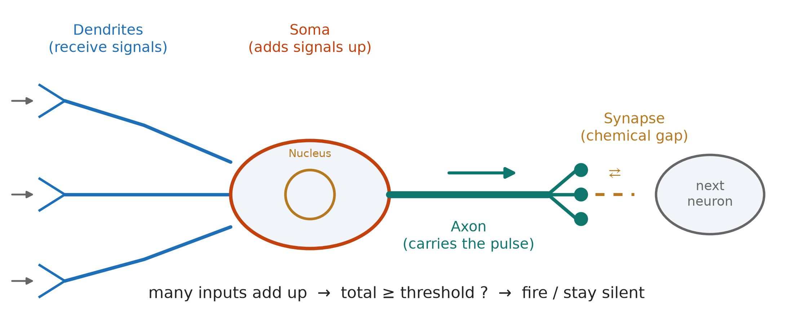
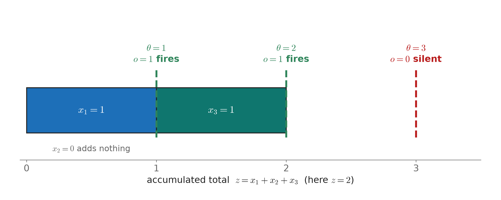
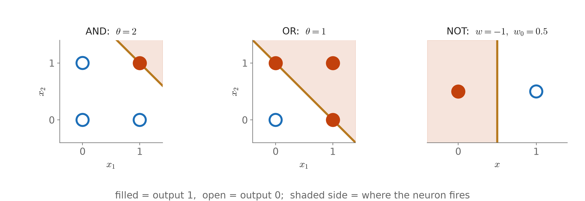

# Lecture 02：從生物神經元到前饋網路——第一個會算的人工神經元（From the Perceptron to Feedforward Networks: The First Artificial Neuron）

> 程度：大學生（undergrad）／Level: Undergraduate (undergrad)

> 週次:第 2 週(自主學習教材)｜進度:非線性分類器補充——神經網路的起點
>
> Week 2 (self-study material) | Topic: supplement to nonlinear classifiers — where neural networks start

投影片：[JianBauDau JSON](../slides/lec02-perceptron-mlp.jbd.json)（使用 JianBauDau 編輯器或播放器開啟）。

Slides: [JianBauDau JSON](../slides/lec02-perceptron-mlp.jbd.json) (open with the JianBauDau editor or player).

神經網路看起來複雜,但它的積木只有一種:人工神經元。這份講義從這顆積木怎麼來的講起,再一步步疊到多層網路。本章對應課程網頁第 2 章,共 10 個知識點;**目前完成第 1 個**,其餘按批次續寫。

A neural network looks complicated, but it is built from one kind of brick: the artificial neuron. This note starts with where that brick comes from and then stacks it step by step into multi-layer networks. It follows Chapter 2 of the course notes, with 10 concepts in total; **only the first is finished so far**, and the rest are added batch by batch.

講義文字是重新撰寫的。標有 `[補充]` / `[Added]` 的內容是為了幫助理解而新增的。圖中的數字都是本講義自行計算的示範值。

The text is newly written. Content marked `[補充]` / `[Added]` is added to help understanding. All numbers in the figures are computed here for demonstration.

## 學習目標（Learning objectives）

- 說出生物神經元的四個部件,以及「累積、過門檻、才放電」的機制（Name the four parts of a biological neuron and describe the sum, threshold and fire mechanism）。
- 把生物機制對應到加權和、偏置與激活函數三個數學元件（Map the biological mechanism onto the three math parts: weighted sum, bias and activation function）。
- 用 $o=f(\sum_j w_jx_j+w_0)$ 手算一顆 McCulloch-Pitts 神經元的輸出（Compute the output of a McCulloch-Pitts neuron by hand with $o=f(\sum_j w_jx_j+w_0)$）。
- 只改閾值或權重,讓同一顆神經元變成 AND、OR、NOT 閘（Turn the same neuron into AND, OR and NOT gates by changing only the threshold or the weights）。
- 說明這顆神經元為什麼不能學習,以及下一步需要什麼（Explain why this neuron cannot learn and what the next step must add）。

## 知識點地圖（Concept map）

| # | 知識點（Concept） | 為什麼重要（Why it matters） | 類型（Type） | 視覺需求（Visual need） | 狀態（Status） |
|---|---|---|---|---|---|
| 1 | 生物神經元與 McCulloch-Pitts 神經元（Biological neuron and the McCulloch-Pitts neuron） | 人工神經元的原型,後面所有模型都由它長出來 | 直覺、公式 | 必圖·示意 `neuron-anatomy`〔功能:1〕；必圖·統計 `mp-threshold`〔功能:1、2〕；必圖·幾何 `mp-gates`〔功能:1、3〕 | 已完成（Done） |
| 2–10 | Perceptron、Signum 版本、XOR 限制、MLP 與非線性、激活函數、損失函數、ADALINE 與 Logistic Regression、RBF 與 SOM、萬有逼近定理 | 由「會算」走到「會學」再到「能逼近任何函數」 | — | — | 待續（Pending） |

## KP1：生物神經元與 McCulloch-Pitts 神經元（Biological neuron and the McCulloch-Pitts neuron）

**一句話重點**：人工神經元模仿的不是生物神經元的外形,而是它「把訊號加起來,超過門檻才放電」的機制。

**One-sentence summary**: An artificial neuron copies not the shape of a biological neuron but its mechanism: add up the signals and fire only past a threshold.

### 為什麼需要它（Why we need it）

要讓機器做判斷,最簡單的辦法是:收集幾項證據,把它們合起來,再決定要不要行動。生物神經元就是這樣做的。它每秒接到許多訊號,卻只用「放電」或「沉默」兩種狀態回應。把這個機制寫成數學,我們就得到一塊可以組裝、可以研究的積木。沒有這塊積木,後面的 Perceptron 與多層網路都無從談起。

To make a machine decide, the simplest idea is to collect a few pieces of evidence, combine them, and then choose whether to act. A biological neuron does exactly this. It receives many signals but answers in only two states, fire or stay silent. Once we write this mechanism as mathematics, we get a brick we can assemble and study. Without it, neither the Perceptron nor multi-layer networks could exist.

### 白話說明（Plain explanation）

**白話說明**：一顆神經元有四個要認識的部件。**樹突**（Dendrites）像天線,接收其他神經元傳來的訊號。**細胞體**（Soma）把收到的訊號加在一起,細胞核在它裡面。**軸突**（Axon）把放電的脈衝送出去。**突觸**（Synapse）是軸突末端與下一顆神經元之間的微小縫隙,訊號在這裡以化學方式接力。

**Plain explanation**: A neuron has four parts to know. **Dendrites** act like antennas and receive signals from other neurons. The **soma** adds the received signals together, and the nucleus sits inside it. The **axon** carries the firing pulse outward. The **synapse** is the tiny gap between the end of an axon and the next neuron, where the signal is relayed chemically.

關鍵在機制。細胞體把各路訊號累積起來,只有總量跨過某個門檻,神經元才放電;沒跨過,就完全沉默。所以它是開關,不是音量鈕:訊號再大,只要總量不夠,就不會有任何反應。

The key is the mechanism. The soma accumulates the signals, and the neuron fires only when the total crosses a threshold; otherwise it stays completely silent. It is a switch, not a volume knob: however loud one signal is, nothing happens if the total is too small.

**圖說 `lec02-perceptron-mlp-neuron-anatomy`**：先看左邊三條樹突,它們各自帶來一路訊號;再看中間的細胞體,訊號在這裡相加;最後看右邊,放電後脈衝沿軸突走到突觸,再傳給下一顆神經元。底部一行就是整個機制的縮寫。〔功能：1〕

**Caption `lec02-perceptron-mlp-neuron-anatomy`**: Look first at the three dendrites on the left, each bringing one signal. Then look at the soma in the middle, where the signals are added. Finally look right: after firing, the pulse runs along the axon to the synapse and on to the next neuron. The bottom line is the whole mechanism in short form. 〔Function: 1〕

### 正式定義（Formal definition）

**正式定義**：把「多路訊號」寫成輸入 $x_1,\dots,x_d$,把「每一路的重要性」寫成權重 $w_1,\dots,w_d$,把「門檻」放進偏置 $w_0$,把「放電或沉默」寫成激活函數 $f$。McCulloch 與 Pitts 在 1943 年提出的神經元是:

**Formal definition**: Write the "many signals" as inputs $x_1,\dots,x_d$, the "importance of each signal" as weights $w_1,\dots,w_d$, put the "threshold" into the bias $w_0$, and write "fire or stay silent" as the activation function $f$. The neuron that McCulloch and Pitts proposed in 1943 is:

$$
o=f\!\left(\sum_{j=1}^{d} w_j x_j + w_0\right),\qquad
f(s)=\begin{cases}1 & s\ge 0\\ 0 & s<0\end{cases}
$$

| 符號 | 中文意義 | English meaning |
|---|---|---|
| $x_j$ | 第 $j$ 路輸入,在本模型只取 0 或 1 | The $j$-th input; here only 0 or 1 |
| $w_j$ | 第 $j$ 路的權重,代表這一路有多重要 | Weight of the $j$-th input, its importance |
| $w_0$ | 偏置,等於負的閾值 $-\theta$ | Bias, equal to the negative threshold $-\theta$ |
| $f$ | 激活函數,這裡是二元階梯函數 | Activation function; here the binary step |
| $o$ | 輸出,1 代表放電,0 代表沉默 | Output; 1 means fire, 0 means silent |
| $\theta$ | 閾值,加權和要達到的門檻 | Threshold the weighted sum must reach |

McCulloch-Pitts 的版本還有三個限制:輸入與輸出都是 0 或 1;所有權重相等且固定,例如全部取 1;不做任何學習。此時 $\sum_j x_j+w_0\ge 0$ 與 $\sum_j x_j\ge\theta$ 是同一個條件,只要取 $w_0=-\theta$。

The McCulloch-Pitts version has three further limits: inputs and outputs are 0 or 1; all weights are equal and fixed, for example all 1; and nothing is ever learned. Then $\sum_j x_j+w_0\ge 0$ and $\sum_j x_j\ge\theta$ are the same condition once we set $w_0=-\theta$.

**公式的白話直覺**：先把所有證據加起來,再問「夠不夠」。夠就輸出 1,不夠就輸出 0。

**Plain reading of the formula**: First add up all the evidence, then ask "is it enough?" If yes, output 1; if not, output 0.

[補充] 來源把閾值寫成「總和 $\ge\theta$」。式子裡的 $w_0$ 只是把 $-\theta$ 搬到同一邊,方便後面的 Perceptron 一起處理。

[Added] The source states the threshold as "sum $\ge\theta$". The $w_0$ in the formula just moves $-\theta$ to the same side, which lets the later Perceptron treat everything in one form.

### 例子（Example）

**例子**：三路輸入 $\mathbf{x}=(1,0,1)$,權重全為 1。先算總和 $z=1+0+1=2$。再用三個不同的閾值各判斷一次,即 $s=z+w_0=z-\theta$:

**Example**: Take three inputs $\mathbf{x}=(1,0,1)$ with all weights 1. First compute the total $z=1+0+1=2$. Then test three different thresholds, using $s=z+w_0=z-\theta$:

| $\theta$ | $w_0=-\theta$ | $s=z+w_0$ | $o=f(s)$ |
|---|---|---|---|
| 1 | $-1$ | $2-1=1$ | 1 |
| 2 | $-2$ | $2-2=0$ | 1 |
| 3 | $-3$ | $2-3=-1$ | 0 |

總和不變,只有門檻在變。$\theta=2$ 時 $s=0$ 剛好達標,所以仍然放電。

The total never changes; only the threshold does. At $\theta=2$ we get $s=0$, which just reaches the bar, so the neuron still fires.

**圖說 `lec02-perceptron-mlp-mp-threshold`**：先看橫條的長度,它就是總和 $z=2$,由 $x_1$ 與 $x_3$ 各貢獻 1,$x_2=0$ 不貢獻;再看三條虛線,哪一條在橫條的右端或內側,就代表放電。〔功能：1、2〕

**Caption `lec02-perceptron-mlp-mp-threshold`**: Look first at the length of the bar: it is the total $z=2$, with $x_1$ and $x_3$ contributing 1 each and $x_2=0$ contributing nothing. Then look at the three dashed lines; a line at or inside the bar's right end means the neuron fires. 〔Function: 1, 2〕

同一顆神經元,只改閾值,就能做邏輯閘。兩個輸入時:$\theta=2$ 要兩路都為 1 才放電,這是 **AND**;$\theta=1$ 只要有一路為 1 就放電,這是 **OR**。

The same neuron becomes a logic gate when only the threshold changes. With two inputs, $\theta=2$ needs both inputs to be 1, which is **AND**; $\theta=1$ needs at least one input to be 1, which is **OR**.

| $(x_1,x_2)$ | AND（$\theta=2$,$w_0=-2$） | OR（$\theta=1$,$w_0=-1$） |
|---|---|---|
| (0,0) | $s=-2$,$o=0$ | $s=-1$,$o=0$ |
| (0,1) | $s=-1$,$o=0$ | $s=0$,$o=1$ |
| (1,0) | $s=-1$,$o=0$ | $s=0$,$o=1$ |
| (1,1) | $s=0$,$o=1$ | $s=1$,$o=1$ |

**NOT** 需要換一個做法。取 $w=-1$、$w_0=0.5$:$x=0$ 時 $s=0.5$,$o=1$;$x=1$ 時 $s=-0.5$,$o=0$。輸入越大,$s$ 越小,所以權重必須是負的。

**NOT** needs a different move. Take $w=-1$ and $w_0=0.5$: at $x=0$ we get $s=0.5$ and $o=1$; at $x=1$ we get $s=-0.5$ and $o=0$. A larger input must lower $s$, so the weight has to be negative.

[補充] 來源把 NOT 也寫成等權的閾值 $\theta=0.5$。但全部權重為正時,輸入變大不可能讓輸出由 1 變 0,所以這裡改用抑制權重 $w=-1$。這是對來源的更正,請老師確認。

[Added] The source also writes NOT as an equal-weight threshold $\theta=0.5$. With all weights positive, a larger input can never turn the output from 1 to 0, so we use the inhibitory weight $w=-1$ here. This corrects the source; please confirm.

**圖說 `lec02-perceptron-mlp-mp-gates`**：先看左邊兩張圖的四個角,實心點是輸出 1,空心點是輸出 0;再看那條斜線,它是 $x_1+x_2=\theta$,線上與右上方是放電區。AND 與 OR 只差線的位置;最右邊 NOT 只有一個輸入,所以是一條垂直線。〔功能：1、3〕

**Caption `lec02-perceptron-mlp-mp-gates`**: Look first at the four corners in the two left panels: a filled dot is output 1 and an open dot is output 0. Then look at the diagonal line $x_1+x_2=\theta$; the line and the region above it form the firing zone. AND and OR differ only in where the line sits. NOT, on the right, has one input, so its boundary is a vertical line. 〔Function: 1, 3〕

### 假設條件與何時失效（Assumptions and when it fails）

這個模型成立,需要四個條件:輸入是 0 或 1;權重已經由人決定;輸出只有 0 與 1 兩種;一次只算一層。一旦要處理連續的數值、要讓機器自己找權重,或要判斷圖形這類複雜的規律,它就不夠用了。

This model holds under four conditions: inputs are 0 or 1; a person has already chosen the weights; the output has only the two values 0 and 1; and only one layer is computed. It stops being enough once we need continuous values, want the machine to find its own weights, or must recognise complex patterns such as shapes.

**與實作的連結**：這顆神經元寫成程式只要兩行:先算 `s = sum(w*x) + w0`,再回傳 `1 if s >= 0 else 0`。要注意比較用 `>=`,因為總和剛好等於閾值時也要放電。

**Link to code**: The neuron takes two lines of code: compute `s = sum(w*x) + w0`, then return `1 if s >= 0 else 0`. Use `>=` for the comparison, because the neuron also fires when the sum exactly equals the threshold.

### 常見迷思（Common misconception）

**常見迷思**：「輸入越強,神經元輸出越大。」這是錯的。以 $\theta=2$ 為例,總和 $z=2$ 與 $z=3$ 的輸出都是 1,沒有「更亮」;而 $z=1$ 的輸出是 0,一點反應也沒有。輸出只回答「有沒有跨過門檻」,不回答「超過多少」。

**Common misconception**: "The stronger the input, the larger the output." This is wrong. At $\theta=2$, the totals $z=2$ and $z=3$ both give output 1, with nothing "brighter", while $z=1$ gives 0, no reaction at all. The output only says whether the threshold was crossed, not by how much.

### 想深入（Going deeper）

**想深入**（選讀）：McCulloch 與 Pitts 證明,把這種神經元連成網路,可以算出任何邏輯函數。這說明它已經夠有「計算力」。缺的是學習:每一個權重都得由人事先算好。下一個知識點的 Perceptron 補上這一環。

**Going deeper** (optional): McCulloch and Pitts showed that networks of such neurons can compute any logic function, so the neuron already has real computing power. What it lacks is learning: a person must work out every weight beforehand. The Perceptron in the next concept fills this gap.

### 小練習（Practice）

**小練習**：只給提示,不附答案。

**Practice**: Hints only, no answers.

1. 三路輸入 $\mathbf{x}=(1,1,0)$,權重全為 1,$\theta=2$。輸出是多少?提示:先算 $z$,再算 $s=z-\theta$。（Three inputs $\mathbf{x}=(1,1,0)$, all weights 1, $\theta=2$. What is the output? Hint: compute $z$ first, then $s=z-\theta$.）
2. 三路輸入、權重全為 1,要做出「三路中至少兩路為 1 才放電」,$\theta$ 該取多少?提示:試 $\mathbf{x}=(1,1,0)$ 與 $\mathbf{x}=(1,0,0)$,看哪個 $\theta$ 能把它們分開。（With three inputs and all weights 1, which $\theta$ makes the neuron fire only when at least two inputs are 1? Hint: try $\mathbf{x}=(1,1,0)$ and $\mathbf{x}=(1,0,0)$ and find the $\theta$ that separates them.）
3. 為什麼全部權重為正的神經元做不出 NOT?提示:輸入由 0 變 1 時,$s$ 是變大還是變小?（Why can a neuron with all-positive weights not make NOT? Hint: when an input goes from 0 to 1, does $s$ grow or shrink?）

**留給下一個知識點的問題**：這顆神經元的權重與閾值都要人事先算好。能不能只給它資料與正確答案,讓它自己把權重改對?

**Question for the next concept**: The weights and threshold of this neuron must be worked out by a person beforehand. Can we give it only data and the right answers, and let it correct its own weights?

## 小結（Summary）

- 生物神經元把訊號加起來,跨過門檻才放電,像開關而不是音量鈕（A biological neuron adds signals and fires only past a threshold, like a switch rather than a volume knob）。
- 這個機制寫成 $o=f(\sum_j w_jx_j+w_0)$,三個元件是加權和、偏置與激活函數（The mechanism becomes $o=f(\sum_j w_jx_j+w_0)$ with three parts: weighted sum, bias and activation function）。
- 只改閾值,同一顆神經元就能做 AND 與 OR;NOT 需要負權重（Changing only the threshold gives AND and OR; NOT needs a negative weight）。
- McCulloch-Pitts 神經元的權重固定、不能學習,這是下一步要補的缺口（The McCulloch-Pitts neuron has fixed weights and cannot learn, which is the gap the next step fills）。

## 延伸閱讀（Further reading）

- 課程網頁第 2 章「From Perceptron to Feedforward Neural Networks」,導論、2.1 與 2.2 節（Chapter 2 of the course notes, the introduction and Sections 2.1 and 2.2）。來源網址:https://ndhuccc.github.io/CCC-LNS/IDL_115/Ch02-perceptron-mlp/index.html,讀取日期 2026-10-14（Source URL above, read on 2026-10-14）。

## 術語表（Glossary）

| 中文 | English |
|---|---|
| 樹突 | Dendrites |
| 細胞體 | Soma |
| 細胞核 | Nucleus |
| 軸突 | Axon |
| 突觸 | Synapse |
| 閾值 | Threshold |
| 加權和 | Weighted sum |
| 偏置 | Bias |
| 權重 | Weight |
| 激活函數 | Activation function |
| 二元階梯函數 | Binary step function |
| 邏輯閘 | Logic gate |
| 抑制權重 | Inhibitory weight |
