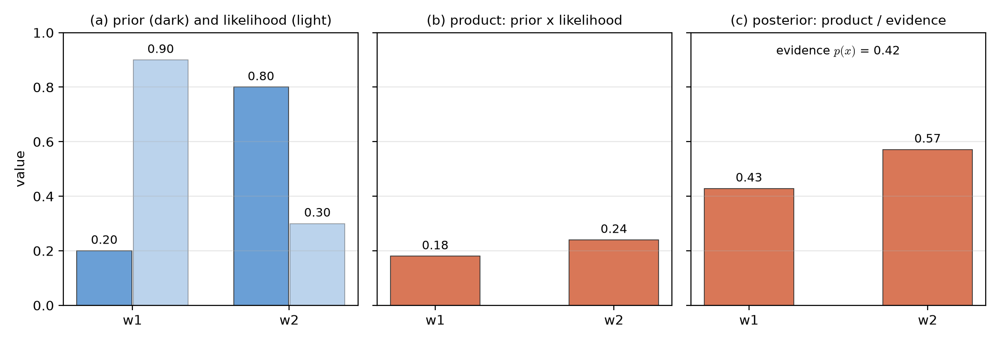
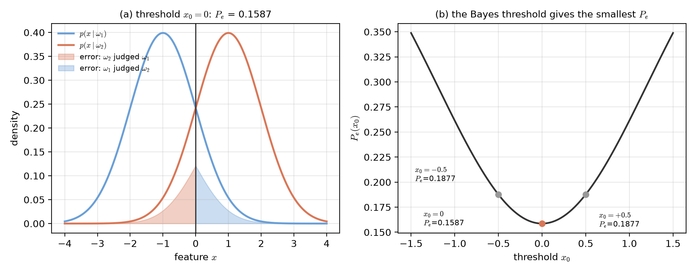
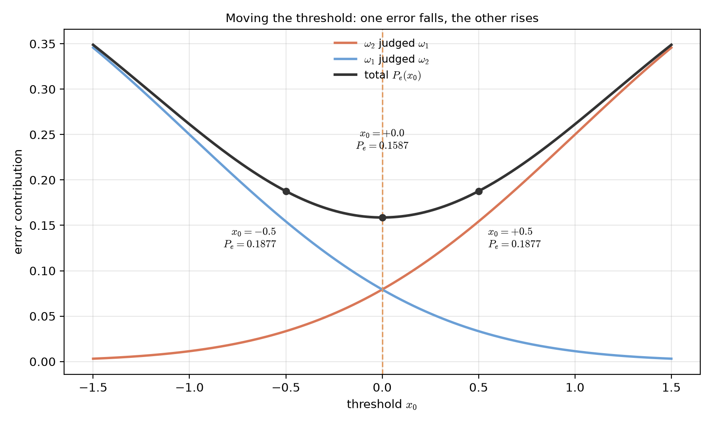
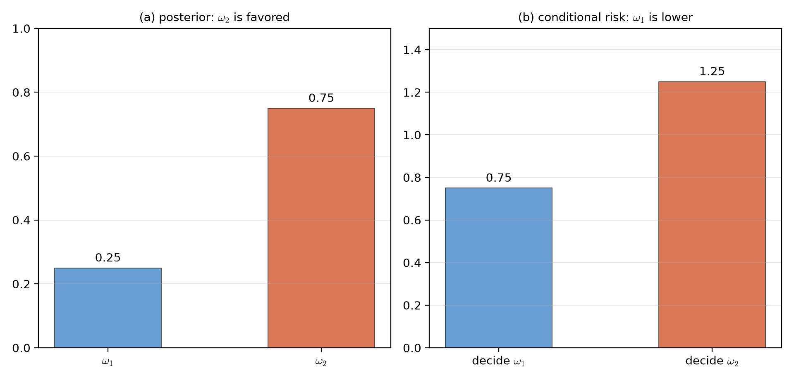
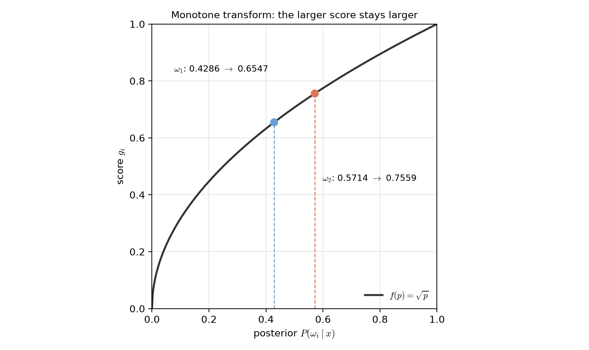
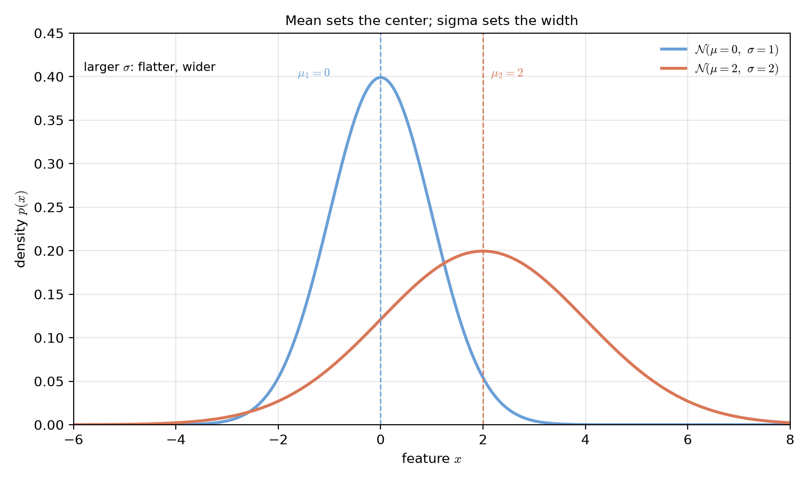
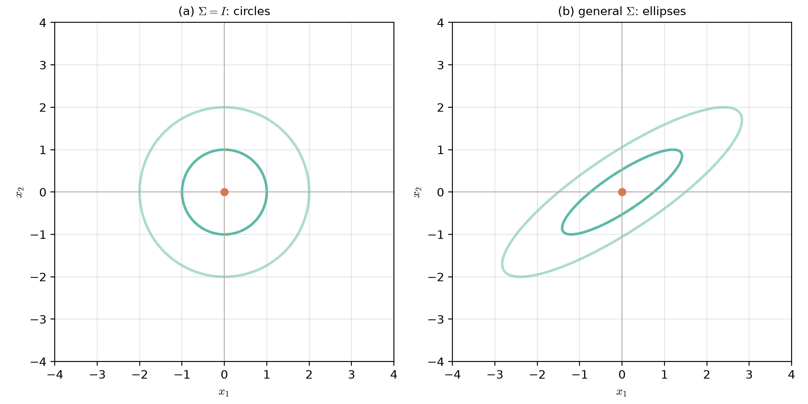
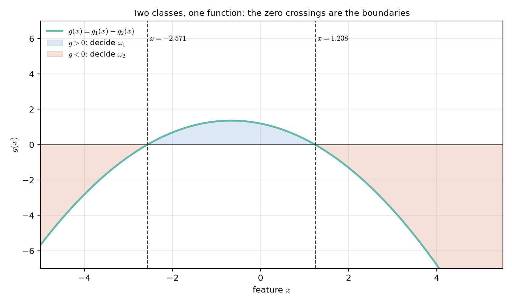
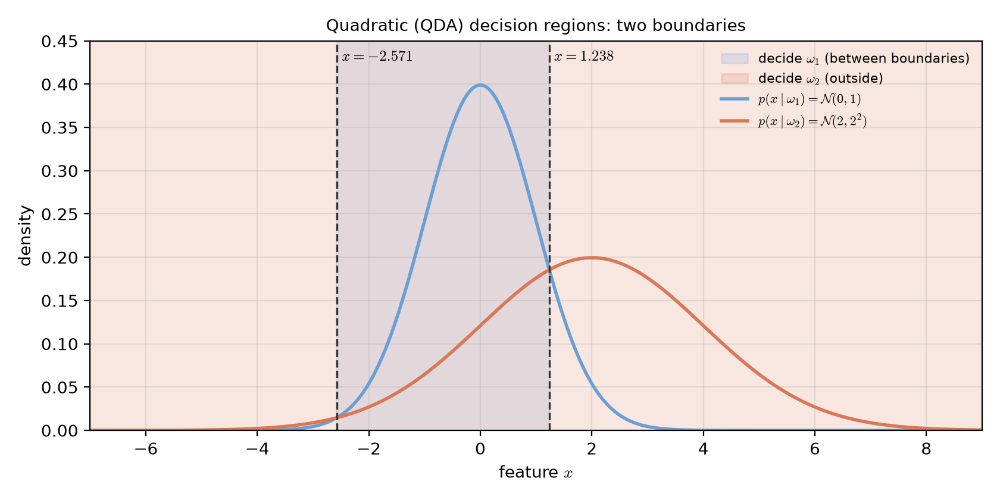
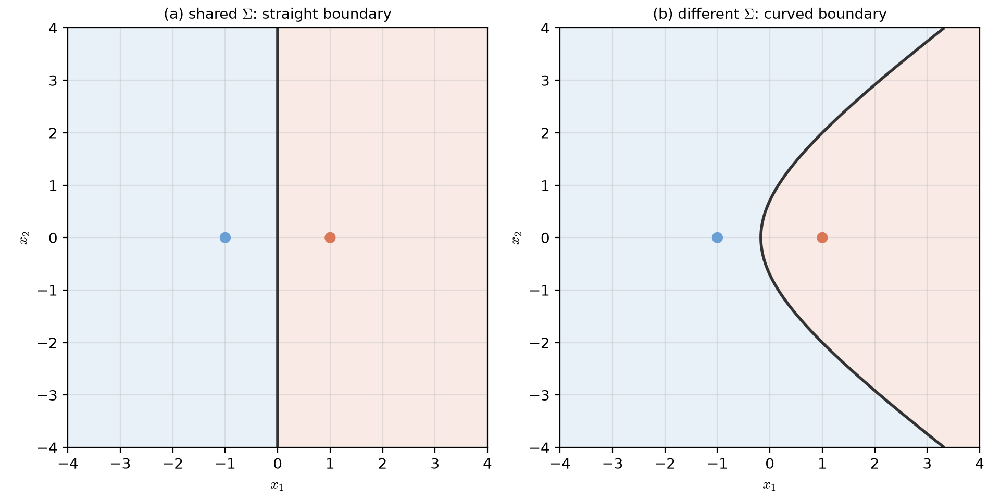

# Lecture 02：貝氏決策理論與判別函數（Bayesian Decision Theory and Discriminant Functions）

> 週次:第 2 週（2026-09-14）｜進度:貝氏分類器（一）與（二）
>
> Week 2 (2026-09-14) | Topic: Bayes Classifiers (1) and (2)

本週範圍是教科書第 2 章的前半：貝氏決策理論、誤判機率與風險、判別函數，以及高斯分布的貝氏分類器。參數估計、無母數方法、Naive Bayes 與貝氏網路留待後續週次。

This week covers the first half of Chapter 2: Bayesian decision theory, error probability and risk, discriminant functions, and Bayes classifiers with Gaussian densities. Parameter estimation, nonparametric methods, Naive Bayes, and Bayesian networks are left for later weeks.

講義的文字是重新撰寫的。標有 `[補充]` / `[Added]` 的內容是為了幫助理解而新增的。圖中的資料都是電腦模擬或示範用的數字，不是教科書原圖。

The text is newly written. Content marked `[補充]` / `[Added]` is added to help understanding. All figures are our own; the numbers are illustrative or simulated, not copied from the textbook.

## 學習目標（Learning objectives）

- 用白話說明事後機率、事前機率與概似函數的關係（Explain in plain words how posterior probability, prior probability, and likelihood are related）。
- 用貝氏定理算出後驗機率並做決策（Compute posterior probabilities with Bayes' rule and make a decision）。
- 說明貝氏規則為什麼能讓誤判機率最小，以及為什麼誤判機率不可能降到零（Explain why the Bayes rule minimizes the error probability, and why it cannot reduce it to zero）。
- 在錯誤代價不同時，用損失矩陣做決策（Use a loss matrix when mistakes have different costs）。
- 寫出判別函數，並說明單調變換為什麼不改變決策（Write discriminant functions, and explain why a monotone transform does not change the decision）。
- 寫出高斯分布的貝氏分類器，並認出它的二次決策曲面（Write the Bayes classifier for Gaussian densities, and recognize its quadratic decision surface）。

## 1. 把「最可能」變成數學（Turning "most likely" into mathematics）

分類的核心問題很簡單：看到特徵 $\mathbf{x}$ 之後，哪一類最可能？要回答這個問題，我們需要三個概念。

The core question is simple: after seeing the feature $\mathbf{x}$, which class is most likely? Three ideas help answer it.

**事後機率（posterior probability）** $P(\omega_i\mid\mathbf{x})$：看到 $\mathbf{x}$ 之後，樣本屬於類別 $\omega_i$ 的機率。

**Posterior probability** $P(\omega_i\mid\mathbf{x})$: the probability that the sample belongs to class $\omega_i$ after we have seen $\mathbf{x}$.

**事前機率（prior probability）** $P(\omega_i)$：還沒看資料之前，這一類在母體中出現的比例。

**Prior probability** $P(\omega_i)$: how often class $\omega_i$ occurs before we look at the data.

**概似函數（likelihood, class-conditional density）** $p(\mathbf{x}\mid\omega_i)$：假設樣本真的屬於 $\omega_i$，看到 $\mathbf{x}$ 的可能程度。

**Likelihood** $p(\mathbf{x}\mid\omega_i)$: if the sample really belongs to $\omega_i$, how likely we are to see $\mathbf{x}$.

`[補充]` 比喻：醫師看一張影像時，會同時考慮兩件事：「這種病本來常不常見」（事前機率），以及「這張影像像不像這種病」（概似函數）。只看其中一件，很容易判錯。這個比喻的侷限是，醫師的判斷不一定能寫成精確的機率。

`[Added]` Analogy: when a doctor reads an image, two things matter: how common the disease is in general (prior), and how much the image looks like that disease (likelihood). Looking at only one of them often leads to a wrong judgment. The limit of this analogy is that a doctor's judgment is not always an exact probability.

貝氏定理把這三者連在一起：

Bayes' rule connects the three:

$$
P(\omega_i\mid\mathbf{x})=\frac{p(\mathbf{x}\mid\omega_i)\,P(\omega_i)}{p(\mathbf{x})},\qquad p(\mathbf{x})=\sum_{j=1}^{M}p(\mathbf{x}\mid\omega_j)\,P(\omega_j)
$$

| 符號（Symbol） | 中文意義 | English meaning |
|---|---|---|
| $\mathbf{x}$ | 觀察到的特徵向量 | the observed feature vector |
| $\omega_i$ | 第 $i$ 個類別 | the $i$-th class |
| $M$ | 類別總數 | the number of classes |
| $p(\mathbf{x})$ | 證據：$\mathbf{x}$ 出現的總機率（對所有類別加總） | evidence: the total probability of seeing $\mathbf{x}$ over all classes |

**數字例（Numerical example）**：兩類，$P(\omega_1)=0.2$、$P(\omega_2)=0.8$。觀察到 $\mathbf{x}$ 時，$p(\mathbf{x}\mid\omega_1)=0.9$、$p(\mathbf{x}\mid\omega_2)=0.3$。

**Numerical example**: two classes with $P(\omega_1)=0.2$ and $P(\omega_2)=0.8$. Having observed $\mathbf{x}$, $p(\mathbf{x}\mid\omega_1)=0.9$ and $p(\mathbf{x}\mid\omega_2)=0.3$.

| 步驟（Step） | $\omega_1$ | $\omega_2$ |
|---|---|---|
| 先驗 × 概似（Prior × likelihood） | $0.2 \times 0.9 = 0.18$ | $0.8 \times 0.3 = 0.24$ |
| 證據（Evidence） | $p(\mathbf{x}) = 0.18 + 0.24 = 0.42$ | 同左（same） |
| 事後機率（Posterior） | $0.18 / 0.42 = 0.4286$ | $0.24 / 0.42 = 0.5714$ |

**圖說 `lec02-bayes-numbers`**：左圖是先驗（深色）與概似（淺色）。單看概似，$\omega_1$ 較大（0.9 比 0.3）；單看先驗，$\omega_2$ 較大（0.8 比 0.2）。兩者相乘後，$\omega_2$ 勝出。中圖是乘積，右圖是除以證據後的事後機率。讀圖時先看左圖的兩組長條：單看淺色的概似，$\omega_1$ 的長條較高；再轉到右圖，看除以證據之後的兩條長條，$\omega_2$ 反而較高。〔功能：1、2〕

**Caption `lec02-bayes-numbers`**: left, the prior (dark) and the likelihood (light). Looking at the likelihood alone, $\omega_1$ wins (0.9 vs 0.3). Looking at the prior alone, $\omega_2$ wins (0.8 vs 0.2). After multiplying the two, $\omega_2$ wins. The middle panel shows the products; the right panel shows the posteriors after dividing by the evidence.

**關鍵觀察**：只看概似，會選 $\omega_1$；只看先驗，會選 $\omega_2$；把兩者乘起來，答案是 $\omega_2$。決策必須同時考慮兩件事。

**Key observation**: the likelihood alone picks $\omega_1$, the prior alone picks $\omega_2$, and their product picks $\omega_2$. The decision must use both pieces of information.

> 先驗與證據要一起看，只看一邊會判錯。
>
> Look at the prior and the evidence together; looking at only one side leads to mistakes.

**貝氏決策規則（Bayes decision rule）**：若 $P(\omega_i\mid\mathbf{x})>P(\omega_j\mid\mathbf{x})$ 對所有 $j\neq i$ 都成立，就把 $\mathbf{x}$ 判為 $\omega_i$。

**Bayes decision rule**: assign $\mathbf{x}$ to $\omega_i$ if $P(\omega_i\mid\mathbf{x})>P(\omega_j\mid\mathbf{x})$ for every $j\neq i$.

`[補充]` 分母 $p(\mathbf{x})$ 對所有類別都一樣，不會改變誰比較大。所以實際比較時，只要比較分子 $p(\mathbf{x}\mid\omega_i)P(\omega_i)$ 即可。

`[Added]` The denominator $p(\mathbf{x})$ is the same for every class, so it does not change which posterior is larger. In practice we only compare the numerators $p(\mathbf{x}\mid\omega_i)P(\omega_i)$.

> 記憶要訣：先乘，再除以總和，最後選最大。
>
> Memory aid: multiply first, divide by the total, then pick the largest.

## 2. 決策區域與誤判機率（Decision regions and error probability）

貝氏規則會把特徵空間切成幾塊區域 $R_1,R_2,\dots$。落在 $R_i$ 裡的 $\mathbf{x}$ 就判為 $\omega_i$。只要兩類的概似有重疊，就一定有誤判。誤判機率 $P_e$ 是所有誤判情況的總機率。

The Bayes rule cuts the feature space into regions $R_1, R_2, \dots$. A point that falls in $R_i$ is assigned to $\omega_i$. Whenever the two likelihoods overlap, some mistakes are unavoidable. The error probability $P_e$ is the total probability of all mistakes.

**先看最簡單的情形：兩類機率相等**。此時比較後驗機率，就等於比較概似。兩條概似曲線的交點 $x_0$ 就是門檻，左邊判為 $\omega_1$，右邊判為 $\omega_2$。誤判機率是：

**The simple case of two equal-prior classes**: if $P(\omega_1)=P(\omega_2)$, comparing posteriors is the same as comparing likelihoods. The crossing point $x_0$ of the two curves is the threshold: points on the left are assigned to $\omega_1$, and points on the right to $\omega_2$. The error probability is then

$$
P_e=\frac{1}{2}\int_{-\infty}^{x_0}p(x\mid\omega_2)\,dx+\frac{1}{2}\int_{x_0}^{\infty}p(x\mid\omega_1)\,dx
$$

積分的意思是曲線下的面積。第一項是 $\omega_2$ 的樣本掉到左邊（被誤判成 $\omega_1$）的面積，第二項是 $\omega_1$ 的樣本掉到右邊（被誤判成 $\omega_2$）的面積。

The integrals are areas under the curves. The first term is the area of $\omega_2$ samples that fall on the left (wrongly judged $\omega_1$). The second term is the area of $\omega_1$ samples that fall on the right (wrongly judged $\omega_2$).

**數字例（Numerical example）**：設 $p(x\mid\omega_1)=\mathcal{N}(-1,1)$、$p(x\mid\omega_2)=\mathcal{N}(+1,1)$，兩類機率相等。令 $\Phi$ 為標準常態的累積分布函數，則誤判機率為 $P_e=\tfrac{1}{2}\Phi(x_0-1)+\tfrac{1}{2}\bigl(1-\Phi(x_0+1)\bigr)$。

**Numerical example**: let $p(x\mid\omega_1)=\mathcal{N}(-1,1)$ and $p(x\mid\omega_2)=\mathcal{N}(+1,1)$ with equal priors. Let $\Phi$ be the standard normal cumulative distribution function. Then $P_e=\tfrac{1}{2}\Phi(x_0-1)+\tfrac{1}{2}\bigl(1-\Phi(x_0+1)\bigr)$.

| 門檻 $x_0$（Threshold） | 誤判機率 $P_e$（Error probability） |
|---|---|
| $-0.5$ | $0.1877$ |
| $0$（交點，Bayes 門檻） | $0.1587$ |
| $+0.5$ | $0.1877$ |

以上數字由 Python 計算，不是心算。`[補充]` 這裡 $\Phi(-1)\approx 0.1587$，代表標準常態分布中 $-1$ 左邊的面積。

The values above were computed with Python. `[Added]` Here $\Phi(-1)\approx 0.1587$ is the area of the standard normal distribution to the left of $-1$.

**圖說 `lec02-error-regions`**：左圖畫的是加權密度 $P(\omega_i)p(x\mid\omega_i)$。陰影的上緣就是圖上的曲線，每一塊陰影的面積都是 0.0793，兩塊合計 0.1587，也就是 $P_e$。右圖是總誤判機率隨門檻變化的曲線，最低點在兩條曲線的交點 $x_0=0$。讀圖時先看左圖的兩塊陰影：每塊陰影的上緣就是它旁邊那條曲線，面積 0.0793 是單一誤判的機率；再看右圖的最低點正好落在 $x_0=0$，也就是交點。〔功能：2、3〕

**Caption `lec02-error-regions`**: the left panel plots the weighted densities $P(\omega_i)p(x\mid\omega_i)$. The top edge of each shaded region is the plotted curve. Each region has area 0.0793, and the two together give $P_e=0.1587$. The right panel shows the total error probability as the threshold changes; the lowest point is the crossing point $x_0=0$.

**常見迷思（Common misconception）**：「移動門檻就能同時減少兩種錯誤。」事實上，往某一邊移動，會減少一種錯誤，同時增加另一種。交點是兩者之和最小的位置。

**Common misconception**: "moving the threshold can reduce both kinds of error at once." In fact, moving it to one side reduces one kind of error and increases the other. The crossing point is where their sum is smallest.

**圖說 `lec02-threshold-tradeoff`**：沿用左圖（`lec02-error-regions`）的兩條加權密度，把兩種誤判拆開畫：橘色是 $\omega_2$ 被誤判成 $\omega_1$，藍色是 $\omega_1$ 被誤判成 $\omega_2$，黑線是兩者之和 $P_e$。門檻往左移（$x_0=-0.5$）時橘色變大、藍色變小；往右移（$x_0=+0.5$）時正好相反，兩種情況的總誤判都是 0.1877。讀圖時先看橘色與藍色兩條線的走向相反，再看黑線的最低點落在 $x_0=0$，這就是交點。〔功能：1、2〕

**Caption `lec02-threshold-tradeoff`**: the two error terms of the previous figure, drawn separately against the threshold. Orange is $\omega_2$ judged as $\omega_1$, blue is $\omega_1$ judged as $\omega_2$, and black is their sum $P_e$. Moving the threshold left ($-0.5$) raises the orange term and lowers the blue one; moving it right ($+0.5$) does the opposite. The total error is 0.1877 at both, and 0.1587 at $x_0=0$. Read the orange and blue curves first, then the black curve, whose minimum sits at the crossing point.

> 只要兩條曲線有重疊，誤判就不可能降到零。貝氏規則做到的，是讓誤判機率最小。
>
> As long as the two curves overlap, the error cannot be reduced to zero. The Bayes rule achieves the smallest possible error probability.

`[補充]` 為什麼貝氏規則是最優的？一般情況下（任意先驗），可以把誤判機率寫成：

`[Added]` Why is the Bayes rule optimal? In general (for any priors), the error probability can be written as:

$$
P_e=P(\omega_1)-\int_{R_1}\bigl(P(\omega_1\mid\mathbf{x})-P(\omega_2\mid\mathbf{x})\bigr)\,p(\mathbf{x})\,d\mathbf{x}
$$

要讓 $P_e$ 變小，就要讓上式中被減去的那一項盡量大。最好的做法，是把 $P(\omega_1\mid\mathbf{x})>P(\omega_2\mid\mathbf{x})$ 的點全部放進 $R_1$，這正是貝氏規則本身。

To make $P_e$ as small as possible, the subtracted integral must be as large as possible. The best choice is to put into $R_1$ exactly the points where $P(\omega_1\mid\mathbf{x})>P(\omega_2\mid\mathbf{x})$. That is the Bayes rule itself. Multi-class problems work the same way: each point goes to the class with the largest posterior.

## 3. 錯誤的代價不一樣（When mistakes have different costs）

把惡性腫瘤判成良性，和把良性腫瘤判成惡性，後果差很多。前面的 $P_e$ 把所有錯誤一視同仁。當錯誤的代價不同時，我們要最小化的是**風險**，而不是誤判機率。

Calling a malignant tumor benign is far worse than calling a benign tumor malignant. The error probability $P_e$ treats all mistakes equally. When mistakes have different costs, we minimize the **risk** instead.

**損失矩陣（loss matrix）**：$\lambda_{ik}$ 是「真實類別是 $\omega_k$，卻判成 $\omega_i$」的代價。正確判斷的代價是 0。

**Loss matrix**: $\lambda_{ik}$ is the cost of deciding $\omega_i$ when the true class is $\omega_k$. A correct decision costs 0.

**條件風險（conditional risk）**：對某個 $\mathbf{x}$，判成 $\omega_i$ 的期望代價是

**Conditional risk**: for a given $\mathbf{x}$, the expected cost of deciding $\omega_i$ is

$$
\ell_i(\mathbf{x})=\sum_{k=1}^{M}\lambda_{ik}\,P(\omega_k\mid\mathbf{x})
$$

決策規則是：選擇使 $\ell_i(\mathbf{x})$ 最小的 $i$。

The decision rule: choose the $i$ that makes $\ell_i(\mathbf{x})$ smallest.

`[補充]` 特例：若 $\lambda_{ik}=1-\delta_{ik}$（判對得 0、判錯得 1），則 $\ell_i(\mathbf{x})=1-P(\omega_i\mid\mathbf{x})$，最小風險就等於最大後驗機率，也就是前面的貝氏規則。因此，前面的最小誤判機率，就是對錯代價相同時的風險最小化。

`[Added]` Special case: if $\lambda_{ik}=1-\delta_{ik}$ (0 for a correct decision, 1 for a wrong one), then $\ell_i(\mathbf{x})=1-P(\omega_i\mid\mathbf{x})$. Minimizing risk then means maximizing the posterior, which is the Bayes rule from Section 1. Minimizing error probability is therefore a special case of minimizing risk.

**數字例（Numerical example）**：令 $\lambda_{12}=1$（真實是 $\omega_2$ 卻判成 $\omega_1$，代價 1）、$\lambda_{21}=5$（真實是 $\omega_1$ 卻判成 $\omega_2$，代價 5），對角線為 0。某個點的事後機率是 $P(\omega_1\mid\mathbf{x})=0.25$、$P(\omega_2\mid\mathbf{x})=0.75$。

**Numerical example**: let $\lambda_{12}=1$ (true $\omega_2$, decided $\omega_1$, cost 1) and $\lambda_{21}=5$ (true $\omega_1$, decided $\omega_2$, cost 5), with zeros on the diagonal. Suppose a point has $P(\omega_1\mid\mathbf{x})=0.25$ and $P(\omega_2\mid\mathbf{x})=0.75$.

| 決策（Decision） | 條件風險（Conditional risk） |
|---|---|
| 判成 $\omega_1$（Decide $\omega_1$） | $\ell_1 = 0 \times 0.25 + 1 \times 0.75 = 0.75$ |
| 判成 $\omega_2$（Decide $\omega_2$） | $\ell_2 = 5 \times 0.25 + 0 \times 0.75 = 1.25$ |

$\ell_1<\ell_2$，所以判為 $\omega_1$。即使後驗機率明顯偏向 $\omega_2$，風險最小的決策仍然是 $\omega_1$。這代表系統會更保守地把可疑樣本歸到代價高的那一類。

Since $\ell_1<\ell_2$, the decision is $\omega_1$. Even though the posterior favors $\omega_2$, the lowest-risk decision is $\omega_1$. The system becomes more cautious, assigning doubtful samples to the class whose mistakes are more costly.

**圖說 `lec02-risk-flip`**：左圖是後驗機率，$\omega_2$ 的長條較高（0.75 對 0.25）。右圖是同一個點的條件風險，$\omega_1$ 的長條較低（0.75 對 1.25）。兩張圖的結論相反，這正是因為損失矩陣不對稱。讀圖時先確認左圖「誰的機率大」，再看右圖「誰的代價小」。右圖較低的長條對應哪一類，就是決策。〔功能：1、2〕

**Caption `lec02-risk-flip`**: the left panel shows the posteriors, where $\omega_2$ is larger (0.75 against 0.25). The right panel shows the conditional risks of the same point, where $\omega_1$ is smaller (0.75 against 1.25). The two panels disagree because the loss matrix is asymmetric. Read the left panel first to see which class is more probable. Then read the right panel to see which mistake is cheaper. The shorter bar on the right is the decision.

> 錯誤有輕重，決策要看後果。
>
> Mistakes have different weights; decisions should depend on the consequences.

## 4. 判別函數（Discriminant functions）

我們不一定要直接算出機率，只要一組分數就夠了。對每一類定義一個分數 $g_i(\mathbf{x})$，哪一類的分數最大，就判為哪一類。

We do not always need the probabilities themselves; a set of scores is enough. For each class we define a score $g_i(\mathbf{x})$, and the class with the largest score wins.

**單調變換（monotone transform）**：若 $f$ 是嚴格遞增函數，令 $g_i(\mathbf{x})=f\bigl(P(\omega_i\mid\mathbf{x})\bigr)$，則決策完全不變。遞增函數保持數值的大小排列，所以各類分數的排列不會改變。

**Monotone transform**: if $f$ is strictly increasing and $g_i(\mathbf{x})=f\bigl(P(\omega_i\mid\mathbf{x})\bigr)$, the decisions do not change, because an increasing function preserves the order of the values.

**數字例（Numerical example）**：沿用第 1 節的事後機率 $0.4286$ 與 $0.5714$，取 $f(p)=\sqrt{p}$：

**Numerical example**: using the posteriors $0.4286$ and $0.5714$ from Section 1 with $f(p)=\sqrt{p}$:

| | $\omega_1$ | $\omega_2$ |
|---|---|---|
| $P(\omega_i\mid\mathbf{x})$ | $0.4286$ | $0.5714$ |
| $g_i = \sqrt{P(\omega_i\mid\mathbf{x})}$ | $0.6547$ | $0.7559$ |

分數的數值變了，但 $\omega_2$ 仍然勝出。`[補充]` 這正是單調變換的意義：數字的尺度可以改變，決策不會改變。

The numbers changed, but $\omega_2$ still wins. `[Added]` This is the point of a monotone transform: the scale of the numbers can change, but the decision does not.

**圖說 `lec02-monotone-transform`**：黑線是 $f(p)=\sqrt{p}$。兩個圓點是上表的事後機率：藍點 $0.4286$ 變成分數 $0.6547$，橘點 $0.5714$ 變成分數 $0.7559$。分數的數字都變了，但橘點始終在藍點的右上，也就是排序沒有改變。讀圖時先看兩個圓點都在黑線上，再看它們的左右順序與高低順序一致，就知道 $\omega_2$ 仍然勝出。〔功能：1、2〕

**Caption `lec02-monotone-transform`**: the black curve is $f(p)=\sqrt{p}$. The two dots are the posteriors from the table above: the blue point $0.4286$ becomes the score $0.6547$, and the orange point $0.5714$ becomes $0.7559$. Both numbers changed, but the orange point stays to the upper right of the blue one, so the order is unchanged. Read the figure by first checking that both dots lie on the curve, then that their left-to-right order matches their low-to-high order.

**決策曲面（decision surface）**：兩類的判別函數相減 $g_{ij}(\mathbf{x})=g_i(\mathbf{x})-g_j(\mathbf{x})$，等於 0 的地方就是 $\omega_i$ 與 $\omega_j$ 的邊界。若只有兩類，常用單一函數 $g(\mathbf{x})=g_1(\mathbf{x})-g_2(\mathbf{x})$：$g(\mathbf{x})>0$ 判為 $\omega_1$，否則判為 $\omega_2$。

**Decision surface**: the difference $g_{ij}(\mathbf{x})=g_i(\mathbf{x})-g_j(\mathbf{x})$ is zero on the boundary between $\omega_i$ and $\omega_j$. With two classes, one function $g(\mathbf{x})=g_1(\mathbf{x})-g_2(\mathbf{x})$ is enough: $g(\mathbf{x})>0$ means $\omega_1$, otherwise $\omega_2$.

> 挑一個讓計算容易的單調函數，決策不會因此改變。
>
> Choose a monotone function that makes the algebra easy; the decision will not change.

## 5. 高斯分布與貝氏分類器（Bayes classifiers with Gaussian densities）

高斯（常態）分布在樣式識別中非常常見。原因之一是中央極限定理：許多獨立的小影響加在一起，結果常接近高斯分布。另一個原因是它的數學形式好處理。

The Gaussian (normal) distribution is common in pattern recognition. One reason is the central limit theorem: many small independent effects added together often look Gaussian. Another reason is that its mathematics is convenient.

### 5.1 一維高斯（One-dimensional Gaussian）

$$
p(x)=\frac{1}{\sqrt{2\pi}\,\sigma}\exp\!\left(-\frac{(x-\mu)^2}{2\sigma^2}\right)
$$

| 符號（Symbol） | 中文意義 | English meaning |
|---|---|---|
| $\mu$ | 平均值，曲線的中心 | mean, the center of the curve |
| $\sigma^2$ | 變異數，決定曲線寬窄 | variance, which sets the width |

白話：$\mu$ 決定曲線在哪裡，$\sigma$ 決定曲線有多寬。$\sigma$ 越大，曲線越平、越寬。

Plain explanation: $\mu$ decides where the curve is centered, and $\sigma$ decides how wide it is. A larger $\sigma$ gives a flatter, wider curve.

**圖說 `lec02-gaussian-1d`**：藍線是 $\mathcal{N}(0,1)$，橘線是 $\mathcal{N}(2,2^2)$（第 5.3 節數字例會用到）。兩條虛線標出各自的 $\mu$：藍線的最高點在 $0$，橘線的最高點在 $2$，這就是 $\mu$ 管位置。橘線的 $\sigma$ 較大，所以最高點較低（0.20 對 0.40）、曲線較平、伸展較寬，這就是 $\sigma$ 管寬窄。讀圖時先比較兩條曲線的最高點高度，再比較它們的高度落在哪個 x 值。〔功能：2、3〕

**Caption `lec02-gaussian-1d`**: the blue curve is $\mathcal{N}(0,1)$ and the orange curve is $\mathcal{N}(2,2^2)$, the pair used in the numerical example of Section 5.3. The dashed lines mark the means: the blue peak sits at $0$ and the orange peak at $2$, which is what $\mu$ controls. The orange curve has the larger $\sigma$, so its peak is lower (0.20 against 0.40). It is flatter and wider, which is what $\sigma$ controls. Read the figure by comparing the two peak heights first, then by comparing where each peak occurs.

### 5.2 多維高斯（Multivariate Gaussian）

$$
p(\mathbf{x})=\frac{1}{(2\pi)^{l/2}\,|\Sigma|^{1/2}}\exp\!\left(-\frac{1}{2}(\mathbf{x}-\mu)^T\Sigma^{-1}(\mathbf{x}-\mu)\right)
$$

| 符號（Symbol） | 中文意義 | English meaning |
|---|---|---|
| $l$ | 特徵的維度 | the dimension of the feature vector |
| $\mu$ | 均值向量 | the mean vector |
| $\Sigma$ | 共變異數矩陣，描述各特徵的散布與相關 | covariance matrix: the spread of each feature and their correlations |
| $|\Sigma|$ | $\Sigma$ 的行列式，描述散布的大小 | the determinant of $\Sigma$, measuring the overall spread |

白話：$\Sigma$ 的對角元素描述每個特徵各自的散布；對角以外的元素描述兩兩特徵之間的關聯，為 0 代表沒有線性相關。等機率線的形狀由 $\Sigma$ 決定：$\Sigma$ 是單位矩陣的倍數時，等機率線是圓；否則是橢圓。

Plain explanation: the diagonal of $\Sigma$ holds each feature's own variance. The off-diagonal entries hold covariances between features; zero means no linear correlation. The shape of the equal-probability contours comes from $\Sigma$: they are circles when $\Sigma$ is a multiple of the identity, and ellipses otherwise.

**圖說 `lec02-gaussian-contours`**：兩張圖都用馬氏距離 $1$ 與 $2$ 畫出等機率線，中心（橘點）是 $\mu$。左圖 $\Sigma=I$，兩條線都是正圓；右圖是一般對稱的 $\Sigma$（示意，數值為舉例），線變成長短軸不等的橢圓，長軸方向由 $\Sigma$ 的特徵向量決定。讀圖時先比較兩張圖的線的形狀：圓形變成傾斜的橢圓，就是 $\Sigma$ 改變形狀的結果。〔功能：3〕

**Caption `lec02-gaussian-contours`**: both panels draw the contours at Mahalanobis distance $1$ and $2$, centered on $\mu$ (orange dot). On the left, $\Sigma=I$ gives two circles. On the right, a general symmetric $\Sigma$ (illustrative values) gives ellipses whose long axis follows the eigenvector of $\Sigma$. Read the figure by comparing the shape of the contours first: the circle becomes a tilted ellipse because $\Sigma$ changes the shape.

`[補充]` 記憶要訣：**Σ 管形狀，μ 管位置。**

`[Added]` Memory aid: **Σ controls the shape, μ controls the location.**

### 5.3 高斯貝氏分類器的判別函數（Discriminant function of the Gaussian Bayes classifier）

把高斯密度代入 $g_i(\mathbf{x})=\ln\bigl(p(\mathbf{x}\mid\omega_i)P(\omega_i)\bigr)$，取對數後指數項變成二次式，去掉對所有類別都相同的常數，得到：

Substituting the Gaussian density into $g_i(\mathbf{x})=\ln\bigl(p(\mathbf{x}\mid\omega_i)P(\omega_i)\bigr)$ and taking the logarithm turns the exponential into a quadratic. Dropping the constant that is the same for all classes gives:

$$
g_i(\mathbf{x})=-\frac{1}{2}(\mathbf{x}-\mu_i)^T\Sigma_i^{-1}(\mathbf{x}-\mu_i)-\frac{1}{2}\ln|\Sigma_i|+\ln P(\omega_i)
$$

**二次決策曲面（quadratic decision surface）**：若各類的 $\Sigma_i$ 不同，兩類判別函數相減後會留下 $\mathbf{x}$ 的二次項。決策邊界因此一般是二次曲線：橢圓、拋物線或雙曲線。這種分類器稱為**二次判別分析（QDA, Quadratic Discriminant Analysis）**。

**Quadratic decision surface**: if the $\Sigma_i$ differ between classes, the quadratic terms in $\mathbf{x}$ do not cancel when we subtract the two discriminant functions. The boundary is then generally a conic section: an ellipse, a parabola, or a hyperbola. This classifier is called **QDA (Quadratic Discriminant Analysis)**.

**數字例（Numerical example）**：一維，$\omega_1=\mathcal{N}(0,1)$、$\omega_2=\mathcal{N}(2,2^2)$，兩類機率相等。用 Python 計算四個點的判別函數（只列出 $g_1$ 與 $g_2$ 中較大的類別）：

**Numerical example**: one dimension, $\omega_1=\mathcal{N}(0,1)$ and $\omega_2=\mathcal{N}(2,2^2)$, equal priors. Python evaluated the discriminant functions at four points:

| $x$ | $g_1(x)$ | $g_2(x)$ | 判斷（Decision） |
|---|---|---|---|
| $-3$ | $-5.419$ | $-4.737$ | $\omega_2$ |
| $0$ | $-0.919$ | $-2.112$ | $\omega_1$ |
| $2$ | $-2.919$ | $-1.612$ | $\omega_2$ |
| $4$ | $-8.919$ | $-2.112$ | $\omega_2$ |

決策邊界的位置是 $x\approx-2.571$ 與 $x\approx 1.238$。因此 $\omega_1$ 佔據中間的區間 $[-2.571,\,1.238]$，$\omega_2$ 佔據兩側。雖然 $\omega_2$ 的變異數較大，它卻被推到兩側，因為它的寬曲線在遠處的機率反而較大。

The decision boundaries are at $x\approx-2.571$ and $x\approx 1.238$. So $\omega_1$ occupies the middle interval $[-2.571,\,1.238]$ and $\omega_2$ occupies both outer parts. Even though $\omega_2$ has the larger variance, it wins on the outside, because its wider curve has more probability far from the center.

**圖說 `lec02-discriminant-difference`**：青線是單一函數 $g(\mathbf{x})=g_1(\mathbf{x})-g_2(\mathbf{x})$（等先驗時取對數的差）。橫軸的粗線是 $g=0$，也就是決策規則的分界。青線穿過粗線兩次：$x=-2.571$ 與 $x=1.238$，兩點之間 $g>0$（藍色）判為 $\omega_1$，兩側 $g<0$（橘色）判為 $\omega_2$。y 軸刻意只畫到 $\pm 7$，讓交點附近的形狀看得清楚。讀圖時先找兩條虛線（$g=0$ 的位置），再看兩條虛線之間是藍色，就知道那個區間判給 $\omega_1$。〔功能：3〕

**Caption `lec02-discriminant-difference`**: the teal curve is the single function $g(\mathbf{x})=g_1(\mathbf{x})-g_2(\mathbf{x})$ (the difference of the log densities for equal priors). The thick horizontal line is $g=0$, which is the decision rule. The curve crosses that line twice, at $x=-2.571$ and $x=1.238$; between the two crossings $g>0$ (blue) means $\omega_1$, and outside $g<0$ (orange) means $\omega_2$. The y-axis is clipped to $\pm 7$ on purpose, so that the shape near the crossings is visible. Read the figure by locating the two dashed lines first, then checking that the region between them is blue.

**圖說 `lec02-qda-regions`**：兩個高斯密度與數字例的決策區域。邊界是兩條曲線的交點，位於 $x\approx-2.571$ 與 $x\approx1.238$。中間區間判為 $\omega_1$，兩側判為 $\omega_2$。讀圖時先找到兩條虛線，它們就是邊界；再確認兩條虛線之間是 $\omega_1$ 的藍色區間，兩側是 $\omega_2$ 的橘色區域。〔功能：2、3〕

**Caption `lec02-qda-regions`**: the two Gaussian densities and the decision regions of the numerical example. The boundaries are the crossing points of the two curves, at $x\approx-2.571$ and $x\approx1.238$. The middle interval is assigned to $\omega_1$, and the outer parts to $\omega_2$.

`[補充]` 邊界是兩條寬度不同的曲線的交點。這就是二次判別函數會產生兩個邊界點的原因。

`[Added]` The boundaries are the crossing points of two curves with different widths. This is why the quadratic discriminant produces two boundary points.

> 兩類的寬窄不同，邊界就不再是一個點，而是曲線的交點。
>
> When the two classes have different widths, the boundary is no longer a single crossing point but a pair of crossing points.

## 6. 預告：共同共變異數（Preview: shared covariance）

若所有類別的共變異數都相同（$\Sigma_i=\Sigma$），判別函數中的二次項在相減時會互相抵消，決策邊界變成直線或超平面。這正是第 3 週線性分類器（如線性判別分析 LDA）的起點。

If all classes share the same covariance ($\Sigma_i=\Sigma$), the quadratic terms cancel when we subtract discriminant functions, and the boundary becomes a line or a hyperplane. This is the starting point of next week's linear classifiers, such as linear discriminant analysis (LDA).

**圖說 `lec02-shared-covariance`**：示意圖，數值為舉例。兩類中心都在同一条水平線上（左邊的 $\omega_1$、右邊的 $\omega_2$，以藍、橘點標出）。左圖兩類的 $\Sigma$ 都是單位矩陣，決策邊界（粗黑線）是筆直的 $x_1=0$；右圖第二類的 $\Sigma$ 拉長，邊界就彎成曲線。兩張圖只有共變異數不同，邊界就從直線變成曲線，這就是「二次項沒有互相抵消」的意思。讀圖時先看兩張圖的中心點位置相同，再比較粗黑線的形狀。〔功能：3〕

**Caption `lec02-shared-covariance`**: an illustrative figure with chosen numbers. The two class means lie on the same horizontal line ($\omega_1$ on the left, $\omega_2$ on the right, marked in blue and orange). In the left panel both classes use the identity covariance, and the decision boundary (the thick black curve) is the straight line $x_1=0$. In the right panel the second class uses an elongated covariance, and the boundary bends into a curve. Only the covariances differ, yet the boundary changes from a line to a curve. That is what it means for the quadratic terms not to cancel. Read the figure by first checking that the two means are in the same places, then by comparing the shape of the black boundary.

## 7. 小結（Summary）

- 貝氏規則結合先驗與概似，計算事後機率，選擇事後機率最大的類別（The Bayes rule combines priors and likelihoods into posteriors and picks the largest one）。
- 只要概似有重疊，誤判機率就不可能是零；貝氏規則能讓它最小（Whenever likelihoods overlap, the error probability cannot be zero; the Bayes rule makes it as small as possible）。
- 當錯誤代價不同時，改用條件風險最小化，決策會偏向代價高的類別（When mistakes have different costs, minimize conditional risk; decisions then favor the costlier class）。
- 判別函數可以任意選用單調變換，決策不變（Discriminant functions can use any monotone transform without changing the decision）。
- 高斯假設下，判別函數是二次式；共變異數相同時，它會變成線性（With Gaussian densities the discriminant is quadratic; with a shared covariance it becomes linear）。

## 8. 練習（Practice）

以下練習只給問題與提示，答案請在課堂或討論區討論。

The exercises below give problems and hints only. Discuss the answers in class or on the discussion board.

1. 設 $P(\omega_1)=0.5$、$P(\omega_2)=0.5$，觀察到 $\mathbf{x}$ 時 $p(\mathbf{x}\mid\omega_1)=0.2$、$p(\mathbf{x}\mid\omega_2)=0.6$。求後驗機率並做決策。（提示：先乘，再除以總和。）（With equal priors, $p(\mathbf{x}\mid\omega_1)=0.2$ and $p(\mathbf{x}\mid\omega_2)=0.6$. Find the posteriors and decide. Hint: multiply first, then divide by the total.）
2. 在第 3 節的損失矩陣中，若 $\lambda_{21}$ 從 5 改成 2，對同一個點 $P(\omega_1\mid\mathbf{x})=0.25$ 的決策會改變嗎？為什麼？（提示：重算 $\ell_1$ 與 $\ell_2$。）（In the loss matrix of Section 3, if $\lambda_{21}$ changes from 5 to 2, does the decision for the same point with $P(\omega_1\mid\mathbf{x})=0.25$ change? Why? Hint: recompute $\ell_1$ and $\ell_2$.）
3. 當兩類的概似曲線有重疊時，為什麼無論怎麼選門檻，誤判機率都無法降到零？（提示：想想兩條曲線在重疊區域的面積。）（When the likelihood curves overlap, why can no threshold reduce the error probability to zero? Hint: think about the area in the overlapping region.）

## 延伸閱讀（Further reading）

- 教科書第 2 章 2.1–2.4 節（本週範圍）（Textbook, Chapter 2, Sections 2.1–2.4: this week's scope）：Sergios Theodoridis & Konstantinos Koutroumbas, *Pattern Recognition*, 4th ed.
- 課程網頁的互動式自學講義：Chapter 2（以貝氏決策理論為基礎的分類器），讀取日期 2026-10-09（Course self-study notes: Chapter 2, read on 2026-10-09）。
- 參考資料：見 [參考資料](../references/README.md)（References: see the [references folder](../references/README.md)）。

## 術語表（Glossary）

| 中文 | English |
|---|---|
| 事後機率 | posterior probability |
| 事前機率 | prior probability |
| 概似函數／類別條件機率密度 | likelihood / class-conditional density |
| 證據 | evidence |
| 貝氏規則 | Bayes rule |
| 決策區域 | decision region |
| 誤判機率 | error probability |
| 損失矩陣 | loss matrix |
| 條件風險 | conditional risk |
| 判別函數 | discriminant function |
| 單調變換 | monotone transform |
| 決策曲面 | decision surface |
| 高斯分布（常態分布） | Gaussian (normal) distribution |
| 共變異數矩陣 | covariance matrix |
| 二次判別分析（QDA） | quadratic discriminant analysis (QDA) |
| 概似比檢定 | likelihood ratio test |
